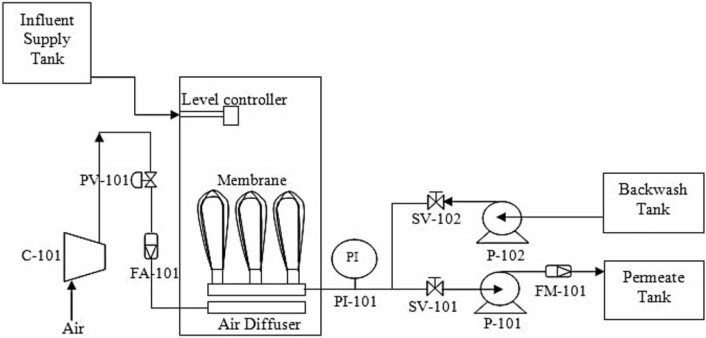
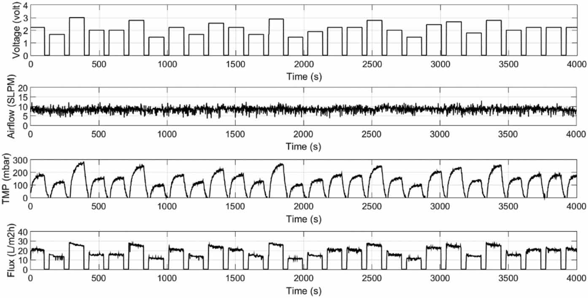
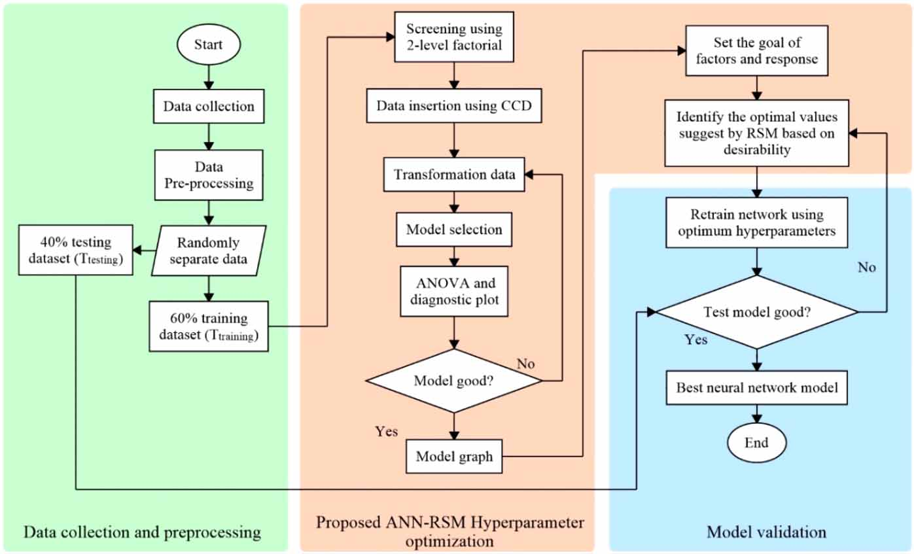
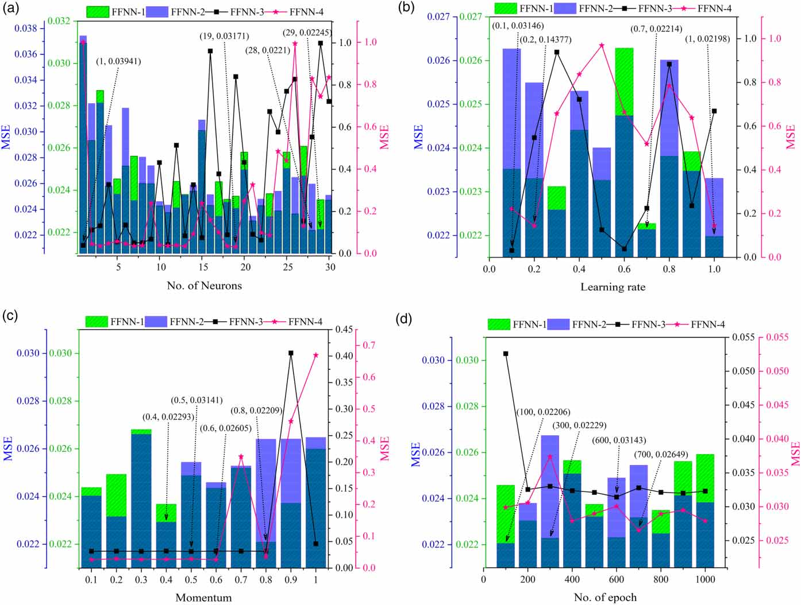
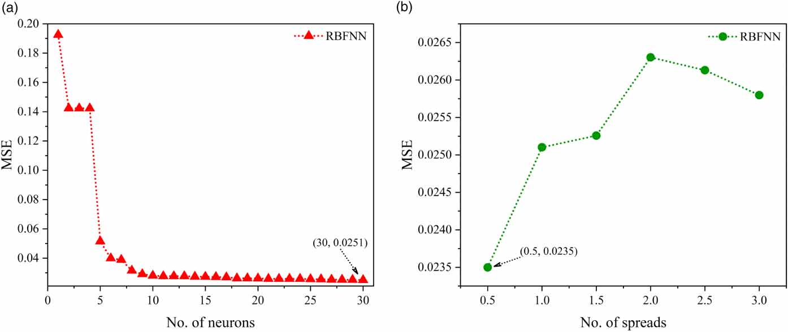
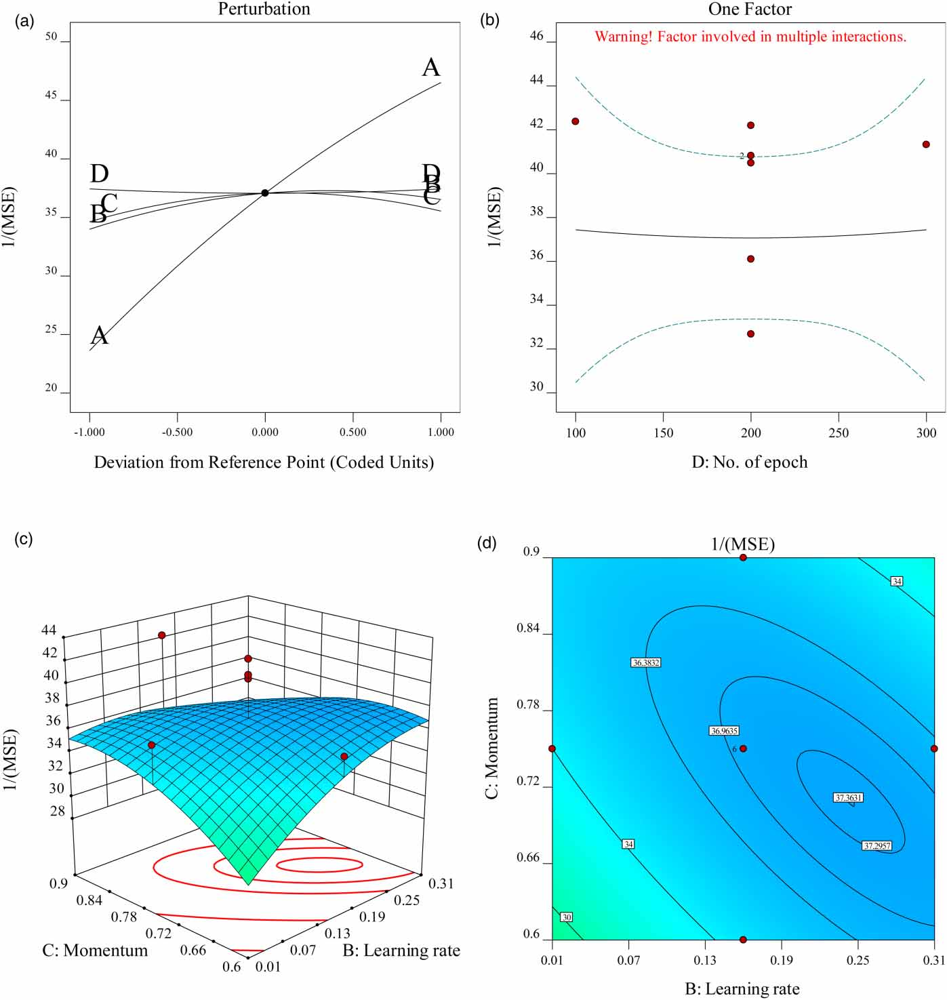
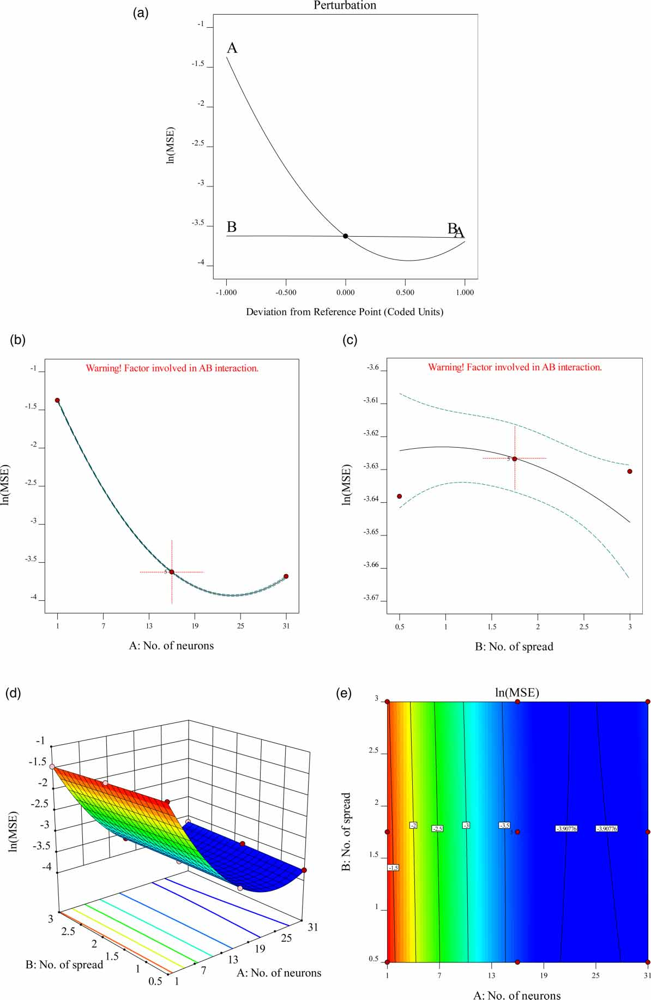
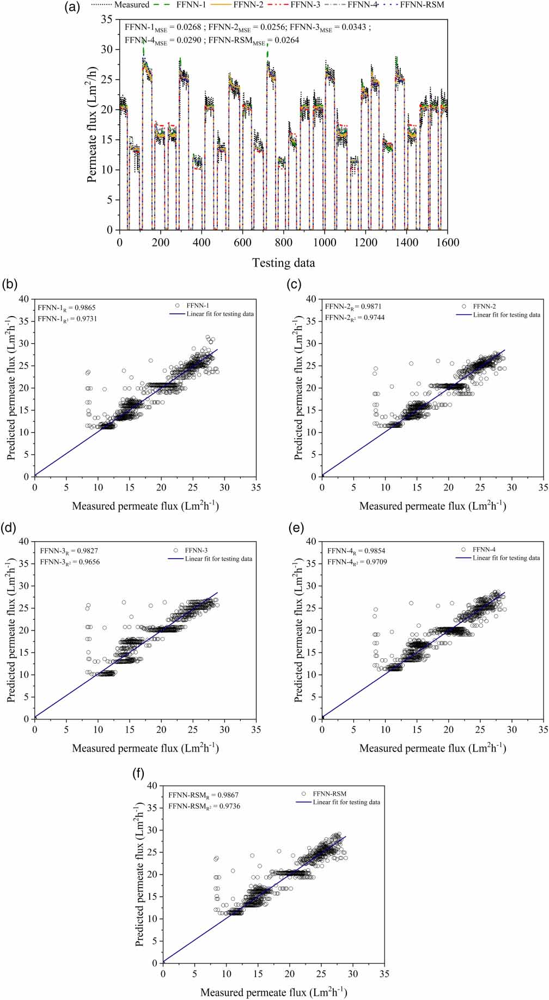
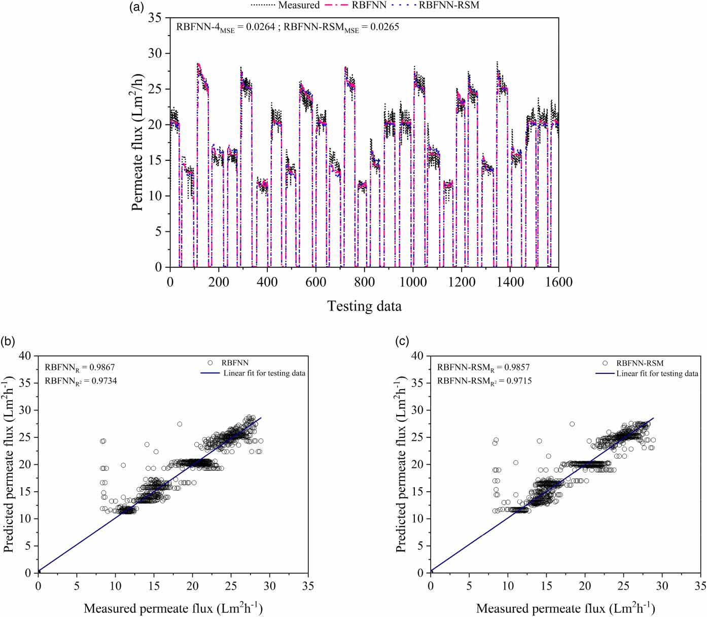

# Optimizing neural network algorithms for submerged membrane bioreactor: A comparative study of OVAT and RSM hyperparameter optimization techniques

## Abstract

- Hyperparameter tuning (tinh chỉnh siêu tham số) là quy trình quan trọng để tối đa hóa performance (hiệu năng) của bất kỳ mô hình neural network (mạng nơ-ron) nào.
- Nghiên cứu đề xuất factorial design of experiment (thiết kế thí nghiệm thừa số) để screening (sàng lọc) và response surface methodology (phương pháp bề mặt đáp ứng) để tối ưu hóa hyperparameter của $2$ thuật toán artificial neural network (mạng nơ-ron nhân tạo):
  - Feed-forward neural network (FFNN, mạng nơ-ron truyền thẳng) và radial basis function neural network (RBFNN, mạng nơ-ron hàm cơ sở xuyên tâm) được áp dụng để dự đoán permeate flux (thông lượng thấm) của palm oil mill effluent (nước thải nhà máy dầu cọ).
  - Permeate pump (bơm thấm) và transmembrane pressure (áp suất xuyên màng) của hệ thống submerged membrane bioreactor (SMBR, bể phản ứng sinh học màng ngập) là các input variables (biến đầu vào).
- $6$ hyperparameter của mô hình FFNN được đưa vào tối ưu hóa hyperparameter:
  - Bao gồm $4$ numerical factors (yếu tố số trị): neuron numbers (số lượng nơ-ron), learning rate (tốc độ học), momentum (động lượng), và epoch numbers (số chu kỳ huấn luyện).
  - Bao gồm $2$ categorical factors (yếu tố phân loại): training function (hàm huấn luyện) và activation function (hàm kích hoạt).
- RBFNN bao gồm $2$ numerical factors (yếu tố số trị): number of neurons (số lượng nơ-ron) và spreads (độ trải rộng).
- Phương pháp thông thường (conventional method: one-variable-at-a-time / một biến tại một thời điểm) được đem ra so sánh về optimization processing time (thời gian xử lý tối ưu hóa) và accuracy (độ chính xác) của mô hình.
- Các hyperparameter tối ưu thu được từ phương pháp đề xuất mang lại accuracy (độ chính xác) tốt với generalization error (sai số khái quát hóa) nhỏ hơn:
  - Simulation results (kết quả mô phỏng) cho thấy training performance (hiệu năng huấn luyện) cải thiện hơn $65\%$, giảm repetition (số lần lặp) và processing time (thời gian xử lý).
  - Phương pháp luận đề xuất có thể được ứng dụng cho bất kỳ loại neural network nào để tìm mức tối ưu của các thông số khác nhau.
- Key words (Từ khóa): computational time (thời gian tính toán), DoE implementation (triển khai DoE), neural network (mạng nơ-ron), optimization techniques (các kỹ thuật tối ưu hóa), submerged membrane bioreactor data (dữ liệu bể phản ứng sinh học màng ngập).

### Highlights

- Membrane fouling (nghẹt màng) trong filtration (quá trình lọc) là một quá trình phức tạp, và việc hiểu rõ dynamic behavior (hành vi động học) là rất quan trọng.
- Nghiên cứu tập trung vào mô hình động học dựa trên artificial neural network (ANN) và tối ưu hóa cho quá trình lọc submerged membrane bioreactor (SMBR).
- Cấu trúc ANN có khả năng mô hình hóa dynamic behavior (hành vi động học) của quá trình lọc trong các điều kiện bình thường.
- Phương pháp tối ưu hóa giúp cải thiện cấu trúc ANN cho việc phát triển mô hình lọc SMBR.

## 1. Introduction

- Vị thế then chốt của ngành palm oil (PO - dầu cọ) và thách thức phát sinh nước thải công nghiệp:
  - Malaysia là quốc gia sản xuất và xuất khẩu palm oil (PO - dầu cọ) lớn thứ $2$ trên thế giới sau Indonesia (Kushairi et al. 2018).
  - PO và palm kernel oil (dầu nhân cọ) chiếm $34\%$ tổng sản lượng dầu và mỡ (oil and fat) trên toàn cầu, giữ vai trò thiết yếu đối với việc duy trì an ninh dinh dưỡng cho dân số thế giới.
  - Ngành công nghiệp PO giữ vai trò động lực đối với tăng trưởng nông nghiệp và kinh tế của Malaysia, đóng góp đáng kể vào gross domestic product (GDP - tổng sản phẩm quốc nội), gross national income (GNI - tổng thu nhập quốc dân), dự trữ ngoại hối và việc làm (Kushairi et al. 2018).
  - Sản lượng PO cao kéo theo phát sinh khối lượng nước thải công nghiệp rất lớn: quá trình chiết xuất $1\text{ tấn}$ crude PO (dầu cọ thô) đòi hỏi từ $5$ đến $7\text{ tấn}$ ($5000\text{–}7000\text{ kg}$) nước, với hơn $50\%$ lượng nước này trở thành palm oil mill effluent (POME - nước thải nhà máy chế biến dầu cọ) (Ahmad et al. 2015).
- Thành phần, tác động môi trường của POME và yêu cầu pháp lý về xử lý nước thải:
  - Nước thải POME bao gồm các dòng thải bắt nguồn từ $3$ công đoạn chế biến chính trong nhà máy (Liew et al. 2015):
    - Sterilizer condensate (nước ngưng tụ từ nồi tiệt trùng).
    - Clarification wastewater (nước thải từ công đoạn làm trong/lắng).
    - Hydrocyclone wastewater (nước thải từ thiết bị tách xoáy thủy lực).
  - POME có bản chất tự nhiên là không độc (non-toxic), nhưng việc xả thải trực tiếp POME chưa qua xử lý ra sông suối kích hoạt quá trình phân hủy tự nhiên, làm cạn kiệt nhanh chóng nồng độ dissolved oxygen (DO - oxy hòa tan) trong nước sông.
  - Hiện tượng cạn kiệt oxy hòa tan dẫn đến suy thoái nghiêm trọng sinh vật thủy sinh và hệ sinh thái tự nhiên.
  - Việc áp dụng các công nghệ xử lý nước thải tiên tiến cho POME là yêu cầu bắt buộc nhằm đáp ứng các quy chuẩn do chính phủ Malaysia ban hành thông qua Environmental Quality Acts (EQA - Đạo luật Chất lượng Môi trường) năm $1978$.
- Ưu thế của membrane technology (công nghệ màng) và trở ngại fouling (tắc nghẽn màng) trong hệ thống MBR:
  - Membrane technology (công nghệ màng) ngày càng khẳng định tầm quan trọng trong xử lý nước thải đô thị, sinh hoạt và công nghiệp bao gồm POME nhờ các ưu thế vận hành:
    - Simplicity of operation (vận hành đơn giản).
    - Lower weight (khối lượng thiết bị nhẹ hơn).
    - Reduced space requirements (giảm yêu cầu diện tích mặt bằng).
    - High efficiency (hiệu suất xử lý cao).
  - Membrane bioreactor (MBR - bể phản ứng sinh học màng) đã chứng minh độ tin cậy như một hệ thống lọc xử lý nước thải POME (Teow et al. 2023).
  - Fouling (hiện tượng tắc nghẽn màng) là trở ngại chính của hệ thống MBR, làm gia tăng mức tiêu thụ năng lượng và chi phí bảo trì (Ghani et al. 2018).
  - Hiện tượng fouling xảy ra khi các vật liệu rắn bít nghẽn membrane pores (các lỗ rỗng của màng), dẫn đến suy giảm permeate flux (thông lượng thấm) và làm tăng transmembrane pressure (TMP - áp suất qua màng).
- Các yếu tố ảnh hưởng và phương pháp kiểm soát hiện tượng fouling:
  - Hiện tượng fouling có thể giảm thiểu bằng cách kiểm soát các biến số tắc nghẽn khác nhau (Li et al. 2022).
  - Fouling chịu ảnh hưởng của một số thông số hệ thống (Stuckey 2012):
    - Membrane form (dạng/cấu hình màng).
    - Hydrodynamic conditions (điều kiện thủy động lực học).
    - Composition of the biological system (thành phần của hệ sinh học).
    - Operating conditions of the reactor and the chemical system (điều kiện vận hành của lò phản ứng và hệ hóa chất).
  - Về phương diện vận hành, fouling có thể được quản lý và giảm thiểu thông qua các kỹ thuật (Yusuf et al. 2019):
    - Air bubble / aeration control (kiểm soát sục khí / bọt khí).
    - Backwashing (rửa ngược).
    - Relaxation (gián đoạn hút / khoảng nghỉ).
    - Chemical cleaning (tẩy rửa hóa chất).
  - Do hệ thống MBR chứa nhiều biến số và thể hiện tính phi tuyến cao bởi bản chất phức tạp của các biến gây tắc nghẽn, việc xây dựng các mô hình toán học nhằm mục đích dự đoán là công cụ có giá trị cao để hỗ trợ ra quyết định tác động đến hiệu năng hệ thống (Xiong et al. 2019).
- Vai trò của machine learning (ML - học máy) trong tối ưu hóa và dự đoán hệ thống:
  - Thuật toán machine learning (ML - học máy) hướng đến phát triển các mô hình có khả năng dự đoán các giá trị mới dựa trên dữ liệu lịch sử.
  - Thuật toán ML gồm $2$ nhóm tổng quát (Garza-Ulloa 2022):
    - Linear regression (mô hình hồi quy tuyến tính).
    - Nonlinear regression (mô hình hồi quy phi tuyến).
  - Đối với mô hình phi tuyến, các phương pháp thường được sử dụng gồm (Basha & Rajput 2019):
    - $k$-nearest neighbour ($k$-NN - $k$-láng giềng gần nhất).
    - Decision trees (cây quyết định).
    - Support vector machines (SVM - máy vector hỗ trợ).
    - Artificial neural networks (ANN - mạng nơ-ron nhân tạo).
  - Mô hình dự đoán giữ vai trò không thể thiếu trong tối ưu hóa thông số thông qua (Bunmahotama et al. 2017):
    - Xử lý dữ liệu độc lập.
    - Dự báo đầu ra dựa trên các tập dữ liệu đầu vào.
    - Điều chỉnh vận hành của một chuỗi thiết bị.
    - Cung cấp các quyết định sản xuất kịp thời và tự động hóa.
  - Mô hình hóa giúp tinh giản vận hành, tiết kiệm nhân lực và giảm tiêu thụ năng lượng trong hệ thống; do đó mô hình dự đoán chính xác có vai trò then chốt trong hỗ trợ ra quyết định tác động trực tiếp đến hiệu năng hệ thống.
- Đặc tính của artificial neural networks (ANN - mạng nơ-ron nhân tạo) và thách thức hyperparameter optimization (HPO - tối ưu hóa siêu tham số):
  - ANN là thuật toán ML uy tín, nổi bật nhờ hiệu quả trong mô hình hóa các quá trình phức tạp và phi tuyến.
  - Khái niệm ANN được lấy cảm hứng từ cơ chế hoạt động của bộ não con người sinh học trong các quá trình giải quyết vấn đề.
  - Các ưu điểm kỹ thuật nổi bật của ANN bao gồm (Hemeida et al. 2020):
    - Strong learning capacity (năng lực học tập mạnh mẽ).
    - Parallelism (tính song song).
    - Robustness in handling noise (độ bền vững khi xử lý dữ liệu chứa nhiễu).
  - $2$ cấu trúc ANN phổ biến nhất trong lĩnh vực xử lý nước thải:
    - Multilayer perceptron (mạng perceptron đa tầng) hoặc feed-forward neural network (FFNN - mạng nơ-ron truyền thẳng).
    - Radial basis function neural network (RBFNN - mạng nơ-ron hàm cơ sở xuyên tâm).
  - Thách thức hàng đầu khi xây dựng mô hình dự đoán hiệu quả bằng ANN nằm ở quy trình tinh chỉnh các hyperparameters (siêu tham số) (Feurer & Hutter 2019; Probst 2019b; Pannakkong et al. 2022).
  - Phần lớn kỹ thuật ML, bao gồm ANN, đều chứa các hyperparameters đòi hỏi cấu hình cụ thể; việc tinh chỉnh các hyperparameters để xác định cấu hình tối ưu nhằm tối thiểu hóa loss value (giá trị hàm mất mát) được định nghĩa là hyperparameter optimization (HPO - tối ưu hóa siêu tham số) (Feurer & Hutter 2019).
- Tầm quan trọng của HPO và tính đa dạng thuật toán:
  - HPO giữ vai trò trọng yếu trong việc nâng cao hiệu năng và reproducibility (khả năng tái lập) của các mô hình ML (Vincent & Jidesh 2023).
  - HPO thu hút sự quan tâm thương mại đáng kể gắn liền với sự gia tăng ứng dụng ML trong công nghiệp, thường được triển khai trong các công cụ nội bộ và dịch vụ đám mây ML (ML cloud services).
  - HPO đóng vai trò nguồn lực cốt lõi cho các nhà phân tích dữ liệu và nghiên cứu để thấu hiểu các hyperparameters của ML (Ali et al. 2023).
  - Đạt được cấu hình lý tưởng chỉ trong một vài lần thử nghiệm là bài toán đầy thách thức nhưng mang tính quyết định, đòi hỏi tiếp cận phù hợp.
  - Các nghiên cứu chuyên sâu đã đề xuất phương pháp tinh chỉnh hyperparameters cho nhiều thuật toán ML:
    - Decision tree (cây quyết định) (Alawad et al. 2018).
    - Support vector machine (máy vector hỗ trợ) (Duarte & Wainer 2017).
    - Deep neural network (mạng nơ-ron sâu) (Zhou et al. 2019).
    - Random forest (RF - rừng ngẫu nhiên) (Probst 2019b).
    - FFNN (mạng nơ-ron truyền thẳng) (Ibrahim & Wahab 2022).
  - Việc tinh chỉnh chuẩn xác hyperparameters làm gia tăng hiệu năng của quá trình huấn luyện ML (Nematzadeh et al. 2022).
  - Không tồn tại một quy tắc chung duy nhất cho mọi bài toán (no one-size-fits-all rule); quá trình tối ưu hóa phụ thuộc vào độ phức tạp của hệ thống được mô hình hóa.
- Các hạn chế cố hữu của phương pháp HPO truyền thống (mặc định, trial-and-error, OVAT):
  - Tiếp cận đơn giản nhất với nỗ lực tối thiểu là sử dụng các giá trị khuyến nghị từ nghiên cứu trước hoặc giá trị mặc định do các thư viện ML cung cấp, nhưng các giá trị này không hoạt động tối ưu trên tất cả các mô hình và đòi hỏi hiệu chỉnh theo dữ liệu đầu vào mới hoặc cập nhật (Lujan-Moreno et al. 2018; Probst 2019a).
  - HPO truyền thống thường được tiến hành qua phương pháp trial-and-error (thử và sai), trong đó các nghiên cứu thường chỉ tập trung lựa chọn số lượng nơ-ron mà bỏ qua các hyperparameters khác (Badrnezhad & Mirza 2014; Onukwuli et al. 2021).
  - Tiếp cận trial-and-error không thực tế đối với người lập mô hình thiếu kinh nghiệm khi đối mặt với không gian cấu hình rộng lớn, đồng thời không đảm bảo tìm được giá trị hyperparameters tối ưu.
  - Phương pháp one-variable-at-a-time (OVAT - thay đổi từng biến tại một thời điểm) được áp dụng để xác định số nơ-ron tối ưu nhờ tính thân thiện và yêu cầu chuyên môn tối thiểu (Pakravan et al. 2015; Said et al. 2018).
  - Ví dụ thực tế: Jawad et al. (2021) đã huấn luyện riêng lẻ hàm kích hoạt log-sigmoid và tan-sigmoid với số nơ-ron dao động từ $1$ đến $20$.
  - Tuy nhiên, quy trình OVAT tiêu tốn nhiều thời gian và công sức, đặc biệt khi khảo sát đồng thời nhiều tham số (Elfghi 2016).
  - Đối với $3$ mức giá trị khác nhau cho mỗi biến của ANN, ước tính cần tới khoảng $245$ ($= 3^5$) cấu hình hyperparameters khác nhau (Ibrahim et al. 2020).
- Tiềm năng của kỹ thuật design of experiment (DoE - thiết kế thí nghiệm) trong HPO:
  - Kỹ thuật design of experiment (DoE - thiết kế thí nghiệm / quy hoạch thực nghiệm) đã được áp dụng thành công như một công cụ mô hình hóa và tối ưu hóa cho các bài toán phức tạp và phi tuyến trong công nghiệp (Pashaei et al. 2023).
  - DoE được ưa chuộng nhờ các đặc tính:
    - Reliability (độ tin cậy cao).
    - Simplicity (tính đơn giản).
    - Systematic strategies (chiến lược có hệ thống).
    - Low trial requirements (yêu cầu số lần thử nghiệm thấp).
    - Reduced processing time (giảm thời gian xử lý tính toán).
  - DoE khắc phục hiệu quả hạn chế tiêu tốn thời gian khi xem xét toàn bộ các tổ hợp hyperparameters, đặc biệt khi liên quan đến mixed parameters (các tham số hỗn hợp gồm dạng số và dạng phân loại).
  - DoE cung cấp thông tin phong phú hơn nhờ khám phá không gian thiết kế lớn hơn một cách trực quan (dạng $2\text{D}$ và $3\text{D}$), tạo phương tiện thuận tiện để nhận diện các tương tác giữa các hyperparameters.
- Ứng dụng DoE và response surface methodology (RSM - phương pháp bề mặt đáp ứng) trong tối ưu hóa hyperparameters:
  - Full factorial design (thiết kế nhân tố toàn phần) đã được Kechagias et al. (2018) sử dụng cho HPO để tối ưu hóa số nơ-ron trong lớp ẩn, learning rate (tốc độ học) và momentum constant (hằng số xung lượng).
  - Full factorial design xác định chính xác các ảnh hưởng chính và ảnh hưởng tương tác của hyperparameters, nhưng bị giới hạn ở các mô hình tuyến tính và số lượng thí nghiệm gia tăng theo cấp số nhân khi số yếu tố tăng lên.
  - Thiết kế nhân tố thường áp dụng cho $3$ mục tiêu chính (Chen et al. 2013):
    - Screening factors (sàng lọc các yếu tố).
    - Optimization (tối ưu hóa).
    - Stability testing (kiểm tra độ ổn định).
  - Response surface methodology (RSM - phương pháp bề mặt đáp ứng) là công cụ không thể thiếu khi xuất hiện độ cong (curvature) do các mối quan hệ bậc cao hơn.
  - Lujan-Moreno et al. (2018) và Probst (2019b) đã áp dụng phương pháp luận DoE để tinh chỉnh các hyperparameters của RF như `ntree`, `mtry`, `replace`, `nodesize`, `classwt`, `cutoff` và giá trị `maxnodes`, kết hợp thiết kế tuyến tính (factorial design) cho sàng lọc và thiết kế phi tuyến (RSM) cho tinh chỉnh.
- So sánh các dạng quy hoạch RSM và các khoảng trống nghiên cứu cần giải quyết:
  - Trong các thiết kế RSM, phổ biến nhất là central composite design (CCD - thiết kế tâm xoay phức hợp) và Box–Behnken designs (BBD - thiết kế Box–Behnken).
  - Nghiên cứu của Pashaei et al. (2023) so sánh CCD và BBD, chỉ ra CCD nổi bật nhờ khả năng ứng dụng cao và hiệu năng vượt trội chỉ với một số ít điểm thử nghiệm.
  - Nourbakhsh et al. (2014) chỉ tạo ra $52$ thiết lập khác nhau bằng CCD cho $5$ loại hyperparameters (số nơ-ron, training epochs (số chu kỳ huấn luyện), step size (kích thước bước), tỷ lệ phần trăm huấn luyện và momentum coefficient (hệ số xung lượng)), xây dựng mô hình bậc hai với mean-square error (MSE - sai số bình phương trung bình) là đáp ứng.
  - Kết quả từ Nourbakhsh et al. (2014) chỉ ra step size, momentum coefficient và training epochs ảnh hưởng đáng kể đến quá trình phát triển mô hình.
  - Tuy nhiên, nghiên cứu của Nourbakhsh et al. (2014) tồn tại $2$ hạn chế lớn:
    - Chưa xét đến bất kỳ yếu tố phân loại (categorical factors) nào.
    - Chưa so sánh phương pháp truyền thống với kỹ thuật RSM đề xuất về thời gian xử lý tối ưu hóa và độ chính xác mô hình, do đó tính công bằng và hiệu quả của phương pháp RSM chưa thể xác lập dứt khoát.
  - Thực tế này nhấn mạnh nhu cầu mở rộng hiểu biết về các hyperparameters hỗn hợp liên quan đến hiệu năng mô hình dự đoán trên nhiều dạng ML khác nhau bằng cách tiếp cận RSM.
- Mục tiêu và đóng góp của nghiên cứu đề xuất:
  - Nghiên cứu đề xuất phương pháp tiếp cận tối ưu hóa kết hợp DoE và RSM với các mô hình ANN để dự đoán permeate flux (thông lượng thấm) của submerged membrane bioreactors (SMBRs - bể phản ứng sinh học màng ngập nước).
  - Khảo sát và ứng dụng đồng thời $2$ cấu trúc mạng phổ biến: thuật toán FFNN và thuật toán RBFNN.
  - Kết hợp đồng thời các hyperparameters dạng số (numerical) và dạng phân loại (categorical) nhằm đạt độ chính xác mô hình cao.
  - So sánh đối chứng toàn diện kết quả của ANN khi sử dụng tối ưu hóa RSM đề xuất và tối ưu hóa OVAT nhằm đạt hiểu biết đầy đủ về năng lực dự đoán chính xác và cải thiện hiệu năng huấn luyện ANN.
- Dữ liệu thực nghiệm và hệ thống chỉ số kiểm định hiệu năng mô hình:
  - Đánh giá hiệu năng mô hình dựa trên tập dữ liệu vào - ra thực tế thu thập từ trạm xử lý SMBR đối với nước thải POME.
  - Độ chính xác mô hình được phân tích thông qua các sai số thống kê hiệu năng tiêu chuẩn:
    - Correlation coefficient ($R$ - hệ số tương quan).
    - Coefficient of determination ($R^2$ - hệ số xác định).
    - Mean-square error ($MSE$ - sai số bình phương trung bình).
    - Root-mean-square error ($RMSE$ - căn bậc hai của sai số bình phương trung bình).
  - Tổng số lần lặp lại (total number of repetitions) và computational time (thời gian tính toán) được đo lường và so sánh đối chứng.
  - Trình bày kết quả áp dụng $2$ loại kỹ thuật HPO (RSM và OVAT) cho các thuật toán học mạng nơ-ron (FFNN và RBFNN) để chứng minh các ý nghĩa thực tiễn của phương pháp HPO đề xuất.
  - Các phát hiện từ mô phỏng và thực nghiệm từ việc áp dụng HPO trên tập dữ liệu POME được thảo luận thấu đáo.

## 2. Materials and methods

### 2.1. Experimental setup

* Quá trình xử lý lọc MBR (Membrane Bioreactor) được tiến hành ở quy mô pilot với thể tích làm việc $30\text{ L}$.
* Mẫu nước thải được thu thập từ hồ cuối (final pond) của trạm xử lý, có nhu cầu oxy sinh hóa (biochemical oxygen demand - BOD) dưới $10.000\text{ mg}\cdot\text{L}^{-1}$, nhằm kích thích hiện tượng tắc nghẽn màng (fouling) trong quá trình lọc SMBR (Submerged MBR).
* Hệ thống được trang bị một bể phản ứng sinh học đơn (single bioreactor tank) chứa các màng sợi rỗng ngập nước (submerged hollow fibre membranes).
  * Màng sợi rỗng được chế tạo từ polyethersulfone (PES), có kích thước lỗ màng khoảng $80$–$100\text{ kDa}$ và diện tích bề mặt hiệu dụng khoảng $0{,}35\text{ m}^2$.
* Sơ đồ bố trí hệ thống pilot cho thí nghiệm được thể hiện trong Hình 1, và Bảng S1 (xem Supplementary Material) xác định các thiết bị đo được sử dụng trong hệ thống pilot:
  * **Hình 1.** Sơ đồ hệ thống SMBR quy mô pilot (Schematic diagram of the SMBR system).
    
    - Cấu hình hệ thống gồm bể bioreactor chứa màng sợi rỗng ngập nước (submerged hollow fibre membrane), phao kiểm soát mức chất lỏng (Level controller) và bể cấp nguyên liệu vào (Influent Supply Tank).
    - Hệ thống sục khí: máy nén khí C-$101$ dẫn qua van điều khiển PV-$101$ và lưu lượng kế FA-$101$ tới bộ khuếch tán khí (Air Diffuser) đặt bên dưới module màng.
    - Tuyến hút permeate: chỉ báo áp suất PI-$101$, van SV-$101$, bơm hút permeate P-$101$ và lưu lượng kế FM-$101$ dẫn tới bể chứa permeate (Permeate Tank).
    - Tuyến rửa ngược (backwash): bể chứa rửa ngược (Backwash Tank), bơm P-$102$ và van SV-$102$ kết nối vào đường ống màng.
* Quá trình thu thập dữ liệu (data acquisition) được kiểm soát và giám sát thông qua phần mềm National Instruments Labview 2009, kết nối giao tiếp với phần cứng NI USB 6009.

#### 2.1.1. Data collection

* Tổng cộng $4.000$ điểm dữ liệu được thu thập cho mỗi thông số trong suốt thí nghiệm, bao gồm lưu lượng khí sục (airflow tính bằng standard litres per minute - $\text{SLPM}$), điện áp bơm hút permeate (permeate pump voltage), áp suất qua màng (transmembrane pressure - TMP tính bằng $\text{mbar}$), và thông lượng permeate (permeate flux tính bằng $\text{L}\cdot\text{m}^{-2}\cdot\text{h}^{-1}$).
* Các bước nhảy biên độ ngẫu nhiên (random magnitude steps) biến thiên từ $1{,}4$ đến $3\text{ V}$ đối với bơm hút và từ $0$ đến $270\text{ mbar}$ đối với áp suất qua màng ($\text{TMP}$), nhằm tạo ra phản ứng động học (dynamic behaviour) của quá trình lọc.
* Cả bơm hút permeate và TMP đều ở trạng thái TẮT (OFF) trong chu kỳ nghỉ (relaxation period).
* Chu kỳ vận hành hút permeate - nghỉ (permeate-to-relaxation period) được duy trì ở mức $120\text{ s}$ cho hút permeate và $30\text{ s}$ cho nghỉ (relaxation), kết hợp sục khí liên tục (continuous aeration airflow).
* Lưu lượng sục khí được điều chỉnh trong khoảng $6$ đến $8\text{ SLPM}$ trong suốt quá trình lọc để duy trì cường độ bọt khí cao phục vụ làm sạch bề mặt màng (membrane surface cleansing).
* Tập dữ liệu lọc SMBR được minh họa trong Hình 2, bao gồm điện áp bơm permeate và TMP đóng vai trò các đầu vào (inputs) cùng thông lượng permeate là đầu ra (output):
  * **Hình 2.** Tập dữ liệu từ thí nghiệm lọc SMBR (Dataset from the SMBR filtration experiment).
    
    - Bốn đồ thị biến thiên theo thời gian ($0$ đến $4.000\text{ s}$):
      - Điện áp bơm hút (Permeate pump voltage): các xung bậc ngẫu nhiên từ $1{,}4$ đến $3\text{ V}$, về $0\text{ V}$ trong chu kỳ relaxation.
      - Lưu lượng khí sục (Airflow): duy trì liên tục quanh $6$–$8\text{ SLPM}$ để làm sạch bề mặt màng.
      - Áp suất qua màng (TMP): biến thiên từ $0$ đến $270\text{ mbar}$ trong giai đoạn lọc và giảm về $0\text{ mbar}$ khi nghỉ.
      - Thông lượng thấm qua (Permeate flux): biến thiên đồng pha với điện áp và TMP, về $0\text{ L}\cdot\text{m}^{-2}\cdot\text{h}^{-1}$ trong thời gian nghỉ ($120\text{ s}$ lọc / $30\text{ s}$ nghỉ).
* Phân tích dữ liệu được thực hiện bằng phần mềm MATLAB R2015a và Design-Expert phiên bản $12.0$.

#### 2.1.2. Experimental analyses

* Hiệu suất quá trình lọc được đánh giá dựa trên thông lượng permeate ($J$), được tính toán theo công thức:
  $$J = \frac{v}{A \cdot t} \tag{1}$$
  * Trong đó:
    * $J$ là thông lượng permeate ($\text{L}\cdot\text{m}^{-2}\cdot\text{h}^{-1}$).
    * $v$ là lưu lượng thể tích tính bằng lít ($\text{L}$).
    * $A$ là diện tích bề mặt màng ($\text{m}^2$).
    * $t$ là thời gian ($\text{h}$).

### 2.2. Preprocessing data

- **Quy trình tiền xử lý dữ liệu (data preprocessing)**: Chuẩn hóa dữ liệu (data normalization) và phân chia dữ liệu (data division) được thực hiện trước khi phát triển mô hình mạng nơ-ron (neural network model).
- **Chuẩn hóa dữ liệu (data normalization)**:
  - Do dữ liệu đầu vào của hệ thống SMBR (Submerged Membrane Bioreactor) bao gồm các biến có độ lớn (magnitudes) và thang đo (scales) khác nhau, toàn bộ tập dữ liệu được co giãn (scaled) về phạm vi $0\text{--}1$.
  - Mục đích chuẩn hóa:
    - Ngăn ngừa tình trạng các dữ liệu đầu vào gốc có giá trị lớn chi phối/áp đảo nghiệm giải thuật (dominance of large original input data in the solution).
    - Giảm thiểu các thách thức về mặt số học (numerical challenges) trong quá trình tính toán (Kumar $2011$).
  - Công thức chuẩn hóa (Equation $(2)$):
    $$X_0 = \frac{y_i - y_{\min}}{y_{\max} - y_{\min}} \quad (2)$$
    - $X_0$: Giá trị sau chuẩn hóa (scaled value).
    - $y_i$: Giá trị thực tế thứ $i$ của dữ liệu ($i^{\text{th}}$ actual value of the data).
    - $y_{\max}$: Giá trị lớn nhất của dữ liệu (maximum value of the data).
    - $y_{\min}$: Giá trị nhỏ nhất của dữ liệu (minimum value of the data).
- **Phân chia dữ liệu (data division)**:
  - Nhằm đánh giá tính khả thi của mô hình dự đoán (predictive model), toàn bộ dữ liệu được phân chia ngẫu nhiên (randomly divided) thành hai phần: tập dữ liệu huấn luyện ($T_{\text{training}}$ / training dataset) chiếm $60\%$ và tập dữ liệu kiểm thử ($T_{\text{testing}}$ / testing dataset) chiếm $40\%$.
  - Tập dữ liệu huấn luyện ($T_{\text{training}}$):
    - Được sử dụng để huấn luyện mạng (network training) và đánh giá mô hình.
    - Dùng để tinh chỉnh siêu tham số (hyperparameter tuning) và đánh giá hiệu năng mạng (network performance).
    - Quy trình tinh chỉnh siêu tham số được lặp lại $3$ lần, tính sai số toàn phương trung bình (MSE - Mean Squared Error) trung bình, từ đó lựa chọn bộ siêu tham số mang lại MSE tối thiểu (minimum MSE).
  - Tập dữ liệu kiểm thử ($T_{\text{testing}}$):
    - Được sử dụng để kiểm định/xác thực hiệu năng mạng (validate network performance).
    - Cung cấp một ước lượng khách quan, không thiên vị (unbiased estimate) về hiệu năng của mô hình trên dữ liệu chưa từng thấy (unseen data).

### 2.3. Simulation modelling

#### 2.3.1. Feed-forward neural network

- FFNN (Feed-forward neural network - Mạng nơ-ron truyền thẳng) bao gồm hai hoặc nhiều lớp phần tử xử lý (processing elements) được liên kết với nhau bằng các kết nối trọng số (weight connections).
  - Cấu trúc FFNN gồm ba lớp: một lớp đầu vào (input layer), một lớp ẩn (hidden layer), và một lớp đầu ra (output layer) (Figure S1 trong Supplementary Material) (Ghasemi et al. 2023).
  - Nghiên cứu trước đây (Said et al. 2018) đã báo cáo rằng mạng có một lớp ẩn thường được sử dụng phổ biến trong thực tế.
- Cơ chế huấn luyện (training):
  - Sai số được truyền tiến (fed forward) qua mạng trong quá trình huấn luyện nhằm điều chỉnh các trọng số và cực tiểu hóa sai số (minimize the error).
  - Quá trình này được lặp lại cho đến khi đạt được sai số tối thiểu (minimum error) hoặc đạt tới một số lượng epoch (chu kỳ huấn luyện) cụ thể.
- Mô hình FFNN được sử dụng trong nghiên cứu này dựa trên Phương trình (3):
  $$\hat{y}_1(t) = \left[ \sum_{j=1}^{n_h} W_{ij} f_j \left( \sum_{l=1}^{n_w} w_{ij} + w_{j0} \right) + W_{i0} \right] \tag{3}$$
  - $\hat{y}_1(t)$ đại diện cho đầu ra dự đoán (prediction output).
  - $f_j$ là hàm của mạng (function of the network).
  - $w$ là vectơ đầu vào (input vector).
  - $W_{ij}$ và $w_{ij}$ lần lượt đại diện cho trọng số kết nối lớp (layer weights) và độ lệch (biases) của mạng.
  - $n_h$ là số lượng nơ-ron trong lớp ẩn.
  - $n_w$ là kích thước của vectơ đầu vào.
  - $w_{j0}$ và $W_{i0}$ đại diện cho các giá trị bias tương ứng.

#### 2.3.2. Radial basis function neural network

- Cấu trúc mạng RBFNN (Radial basis function neural network - Mạng nơ-ron hàm xuyên tâm):
  - RBFNN có cấu trúc tương tự như FFNN, bao gồm ba lớp (three layers).
  - Trong RBFNN, các nơ-ron ở lớp ẩn (hidden layer) và lớp đầu ra (output layer) được liên kết với nhau bằng các trọng số (weights).
  - Thông thường, các nơ-ron trong RBFNN dựa trên hàm Gauss (Gaussian function) (Kasiviswanathan & Agarwal 2012).
  - Cấu trúc của mạng được thể hiện trong Figure S2.
- Phương trình toán học biểu diễn đầu ra của mạng RBFNN được xác định theo Equation (4):
  $$y(t) = \sum_{i=1}^{k} w_i u_i(t); \quad i = 1, 2, 3, \dots, k \tag{4}$$
  - $y$ biểu thị đầu ra của mạng (output of the network).
  - $w$ đại diện cho giá trị trọng số của lớp đầu ra (weight number of the output layer).
  - $u_i(t)$ là đầu ra của nút ẩn thứ $i$ tại thời điểm $t$.
  - $k$ là số lượng nút ẩn (number of hidden nodes).
- Đầu ra của lớp ẩn được biểu diễn theo Equation (5):
  $$u_i = e^{-\frac{\|x(t) - c_i(t)\|^2}{\psi_i^2}} \tag{5}$$
  - $x$ là vectơ đầu vào (input vector).
  - $c$ là tâm của nút ẩn (centre of the hidden node).
  - $\psi$ là độ rộng của nút ẩn (width of the hidden node).
  - $k$ là số lượng nút ẩn (number of hidden nodes).
- Điều hòa siêu tham số (hyperparameters regulation) nhằm đạt hiệu suất mạng tối ưu:
  - Để đạt hiệu suất mạng tối ưu trong RBFNN, việc điều hòa các siêu tham số nhất định là cần thiết, cụ thể là số lượng spread (number of spreads) và số lượng nơ-ron trong lớp ẩn (number of neurons in the hidden layer).
  - Lựa chọn sai hằng số spread (spread constant) có thể dẫn đến hiện tượng dưới khớp (underfitting) hoặc quá khớp (overfitting).
  - Giá trị spread cao khiến các điểm dữ liệu bị phân tán trên khoảng cách đáng kể so với tâm, dẫn đến làm giảm phản hồi hàm tối đa (maximum function response) (Kasiviswanathan 2012).
  - Giá trị spread mặc định trong Matlab toolbox được thiết lập bằng $1$.

#### 2.3.3. Hyperparameter configurations

- Tối ưu hóa siêu tham số (hyperparameter optimization) đóng vai trò quyết định để đạt được hiệu suất cao trong mô hình mạng nơ-ron nhân tạo (ANN - artificial neural network):
  - Việc lựa chọn cẩn thận các dải giá trị phù hợp (appropriate ranges) cho các siêu tham số là điều thiết yếu.
  - Đối với cấu trúc mô hình mạng nơ-ron truyền thẳng (FFNN - feedforward neural network), quá trình huấn luyện liên quan đến nhiều siêu tham số dạng số (numerical hyperparameters):
    - Số lượng nơ-ron ($number\ of\ neurons$)
    - Tốc độ học ($learning\ rate$)
    - Số lượng epoch ($number\ of\ epochs$)
    - Hệ số động lượng ($momentum\ coefficient$)
  - Các yếu tố phân loại (categorical factors) như hàm huấn luyện ($training\ function$) và hàm kích hoạt ($activation\ function$) được xem xét để nâng cao hiệu suất dự đoán của mô hình ($model\ prediction\ performance$).

- Hàm kích hoạt ($activation\ function$, đôi khi được gọi là hàm truyền - $transfer\ function$) xác định cách thức tổng có trọng số của các đầu vào ($weighted\ sum\ of\ inputs$) được chuyển đổi thành đầu ra từ các nút trong một lớp của mạng:
  - Sự lựa chọn hàm kích hoạt ở lớp ẩn ($hidden\ layer$) và lớp đầu ra ($output\ layer$) ảnh hưởng đáng kể đến khả năng học của mạng từ tập dữ liệu huấn luyện ($training\ dataset$).
  - Lớp ẩn thường sử dụng các hàm phi tuyến tính ($nonlinear\ functions$), trong khi lớp đầu ra sử dụng hàm truyền tuyến tính `purelin` ($linear\ transfer\ function$).
  - Các hàm kích hoạt thường dùng trong lớp ẩn bao gồm sigmoid (hoặc logistic) và hyperbolic tangent ($\mathrm{Tanh}$) (Rasamoelina et al. $2020$).
  - Đơn vị tuyến tính chỉnh lưu ($\mathrm{ReLU}$ - rectified linear unit) gần đây trở nên phổ biến đối với các học viên và nhà nghiên cứu học sâu (deep learning researchers) nhờ tính đơn giản và hiệu suất huấn luyện vượt trội so với các hàm kích hoạt thông thường (Rasamoelina et al. $2020$).

- Các hàm huấn luyện ($training\ functions$) được sử dụng trong trường hợp này bao gồm Levenberg–Marquardt (`lm`) và gradient descent with momentum (`gdm`):
  - Hàm huấn luyện `lm` cung cấp các tính năng nổi bật:
    - Huấn luyện nhanh (fast training).
    - Hồi quy phi tuyến với sai số bình phương trung bình thấp ($MSE$ - mean squared error).
    - Các tính năng giảm thiểu dung lượng bộ nhớ (memory reduction features) (Keong et al. $2016$; Johnson Santhosh et al. $2021$).
  - Hàm huấn luyện `gdm` sở hữu các ưu điểm:
    - Tránh các điểm cực tiểu cục bộ (avoiding local minima).
    - Tăng tốc quá trình học (accelerating learning).
    - Ổn định sự hội tụ (stabilizing convergence) (Winiczenko et al. $2016$).
  - Hàm huấn luyện `gdm` phụ thuộc chủ yếu vào hai tham số: tốc độ học ($learning\ rate$) và tham số động lượng ($momentum\ parameters$).
  - Tác động của các loại hàm kích hoạt và hàm truyền khác nhau lên hiệu suất mạng của mô hình lọc SMBR cho POME (submerged membrane bioreactor filtration for palm oil mill effluent) cần phải được xác định rõ.

- Số lượng epoch ($number\ of\ epochs$) hoặc chu kỳ huấn luyện ($training\ cycles$) mang tính quyết định trong việc định hình mô hình mạng:
  - Quá ít epoch sẽ giới hạn khả năng của mạng (limit the network's ability).
  - Quá nhiều epoch có thể dẫn đến hiện tượng quá khớp ($overfitting$) và tăng sai số ($increased\ error$) (Winiczenko et al. $2016$).
  - Khi huấn luyện mô hình FFNN với các hàm huấn luyện khác nhau (`br` - Bayesian regularization, `lm`, và `gd` - gradient descent), cài đặt tối đa cho số lượng epochs là $1,000$ (Keong et al. $2016$).

- Tham số tốc độ học ($learning\ rate$) có mục tiêu tìm kiếm không gian trọng số tối thiểu ($minimum\ weight\ space$):
  - Tốc độ học quá cao có thể dẫn đến sự dao động gia tăng trong $MSE$ ($increased\ oscillations\ in\ MSE$).
  - Tốc độ học quá thấp tạo ra các bước nhảy nhỏ hơn trong không gian trọng số ($smaller\ steps\ in\ the\ weight\ space$).
  - Tốc độ học thấp có thể làm giảm khả năng thoát khỏi các điểm cực tiểu cục bộ trên bề mặt sai số ($error\ surface$) của mạng.

- Tham số động lượng ($momentum$) quy định mức độ nhạy cảm và tính ổn định của quá trình thích nghi trọng số:
  - Động lượng thấp khiến mạng giảm độ nhạy với các gradient cục bộ ($less\ sensitivity\ of\ the\ network\ to\ local\ gradients$).
  - Động lượng cao có thể gây phân kỳ thích nghi ($divergence\ of\ adaptation$), dẫn đến các trọng số không thể sử dụng được ($unusable\ weights$).
  - Các giá trị tối ưu của tốc độ học và động lượng mang lại hành vi trơn tru (smooth behaviour) và tăng tốc độ hội tụ (speed up convergence) (Winiczenko et al. $2016$; Yousif & Kazem $2021$).
  - Các giá trị quá thấp của tốc độ học và động lượng làm chậm quá trình hội tụ, trong khi các giá trị quá cao có thể dẫn đến mất ổn định mạng ($network\ instability$) và phân kỳ huấn luyện ($training\ divergence$) (Winiczenko et al. $2016$; Yousif & Kazem $2021$).

- Số lượng nơ-ron trong lớp ẩn ($number\ of\ neurons\ in\ the\ hidden\ layer$) giữ vai trò then chốt đối với hiệu suất mạng:
  - Quá ít nơ-ron ẩn dẫn đến khả năng thích nghi hạn chế trong mô hình hóa mô phỏng (limited adaptation in simulation modelling).
  - Quá nhiều nơ-ron ẩn có thể dẫn đến lỗi bộ nhớ hệ thống (system memory errors), hiện tượng huấn luyện quá mức / quá khớp ($over\ training$) (Winiczenko et al. $2016$) và làm tăng thời gian tính toán ($calculation\ time$) (Nazghelichi et al. $2011$).
  - Không có phương pháp có hệ thống (systematic method) để xác định cấu trúc số lượng nơ-ron ẩn của mạng.
  - Cận trên ($upper\ bound$) cho số lượng nơ-ron ẩn nhằm đạt được xấp xỉ mạng nơ-ron chính xác theo đề xuất của Hecht-Nielsen ($1992$) được mô tả bởi Phương trình ($6$):
    $$N_a \le 2 N_b + 1 \tag{6}$$
    trong đó:
    - $N_a$ là số lượng nơ-ron ẩn ($number\ of\ hidden\ neurons$).
    - $N_b$ là số lượng đầu vào ($number\ of\ inputs$).
  - Mối quan hệ giữa số lượng mẫu dữ liệu huấn luyện và số lượng nơ-ron ẩn do Rogers & Dowla ($1994$) đề xuất nhằm ngăn ngừa vấn đề quá khớp ($overfitting\ issue$) trong dữ liệu huấn luyện được xác định bởi Phương trình ($7$):
    $$N_a \le \frac{N_u}{N_b + 1} \tag{7}$$
    trong đó:
    - $N_u$ là số lượng mẫu trong dữ liệu huấn luyện ($number\ of\ samples\ in\ the\ training\ data$).
    - $N_a$ là số lượng nơ-ron ẩn.
    - $N_b$ là số lượng đầu vào.

- Quy trình tối ưu hóa siêu tham số truyền thống (conventional HPO) dựa trên phương pháp một biến tại một thời điểm (OVAT - one-variable-at-a-time):
  - Đối với mô hình ANN truyền thống để tìm kiếm điều kiện tối ưu, các mạng được huấn luyện dưới dải rộng các thiết lập siêu tham số theo phương pháp OVAT.
  - Quá trình HPO truyền thống được thực hiện trên tập dữ liệu huấn luyện ($T_{\mathrm{training}}$).
  - Việc lựa chọn các siêu tham số FFNN và RBFNN (radial basis function neural network) tương ứng dựa trên tiêu chuẩn $MSE$ thấp nhất cho từng tham số, sau đó áp dụng cho tập dữ liệu kiểm tra ($T_{\mathrm{testing}}$) để xác minh độ tin cậy của các mô hình mạng.
  - Các tham số được xem xét để xây dựng cấu trúc mạng tối ưu trong nghiên cứu này gồm: số lượng nơ-ron trong lớp ẩn, tốc độ học, động lượng, số lượng epoch, số lượng spreads (độ trải rộng), hàm huấn luyện và hàm kích hoạt.
  - Dải giá trị của các siêu tham số cho các mô hình FFNN và RBFNN truyền thống được trình bày trong Bảng 1 (Table 1).

- Bảng 1 (Table 1 | The range of ANN hyperparameters for conventional models) thiết lập dải siêu tham số cho các mô hình ANN truyền thống:
  - **Phương pháp FFNN truyền thống (Conventional-based FFNN method):**
    - Nghiên cứu thiết lập $4$ biến thể mô hình: `FFNN-1`, `FFNN-2`, `FFNN-3`, `FFNN-4`.
    - **Ký hiệu A - Số lượng nơ-ron ($Number\ of\ neurons$):**
      - `FFNN-1`: Dải thiết lập $1\text{--}30$
      - `FFNN-2`: Dải thiết lập $1\text{--}30$
      - `FFNN-3`: Dải thiết lập $1\text{--}30$
      - `FFNN-4`: Dải thiết lập $1\text{--}30$
    - **Ký hiệu B - Tốc độ học ($Learning\ rate$):**
      - `FFNN-1`: Dải thiết lập $0.1\text{--}1$
      - `FFNN-2`: Dải thiết lập $0.1\text{--}1$
      - `FFNN-3`: Dải thiết lập $0.1\text{--}1$
      - `FFNN-4`: Dải thiết lập $0.1\text{--}1$
    - **Ký hiệu C - Động lượng ($Momentum$):**
      - `FFNN-1`: Dải thiết lập $0.1\text{--}1$
      - `FFNN-2`: Dải thiết lập $0.1\text{--}1$
      - `FFNN-3`: Dải thiết lập $0.1\text{--}1$
      - `FFNN-4`: Dải thiết lập $0.1\text{--}1$
    - **Ký hiệu D - Số lượng epoch ($Number\ of\ epochs$):**
      - `FFNN-1`: Dải thiết lập $100\text{--}1,000$
      - `FFNN-2`: Dải thiết lập $100\text{--}1,000$
      - `FFNN-3`: Dải thiết lập $100\text{--}1,000$
      - `FFNN-4`: Dải thiết lập $100\text{--}1,000$
    - **Ký hiệu E - Hàm huấn luyện ($Training\ function$):**
      - `FFNN-1`: `trainlm`
      - `FFNN-2`: `trainlm`
      - `FFNN-3`: `traingdm`
      - `FFNN-4`: `traingdm`
    - **Ký hiệu F - Hàm kích hoạt ($Activation\ function$):**
      - `FFNN-1`: `tansig`
      - `FFNN-2`: `ReLu`
      - `FFNN-3`: `tansig`
      - `FFNN-4`: `ReLu`
    - **Số lần lặp lại ($Number\ of\ repetitions$):**
      - `FFNN-1`: $60$
      - `FFNN-2`: $60$
      - `FFNN-3`: $60$
      - `FFNN-4`: $60$
    - *Bảng tổng hợp cấu hình Conventional-based FFNN method:*

| Ký hiệu (Symbol) | Siêu tham số (Hyperparameters) | Mô hình FFNN-1 | Mô hình FFNN-2 | Mô hình FFNN-3 | Mô hình FFNN-4 |
| :--- | :--- | :---: | :---: | :---: | :---: |
| **A** | Số lượng nơ-ron (Number of neurons) | $1\text{--}30$ | $1\text{--}30$ | $1\text{--}30$ | $1\text{--}30$ |
| **B** | Tốc độ học (Learning rate) | $0.1\text{--}1$ | $0.1\text{--}1$ | $0.1\text{--}1$ | $0.1\text{--}1$ |
| **C** | Động lượng (Momentum) | $0.1\text{--}1$ | $0.1\text{--}1$ | $0.1\text{--}1$ | $0.1\text{--}1$ |
| **D** | Số lượng epoch (Number of epochs) | $100\text{--}1,000$ | $100\text{--}1,000$ | $100\text{--}1,000$ | $100\text{--}1,000$ |
| **E** | Hàm huấn luyện (Training function) | `trainlm` | `trainlm` | `traingdm` | `traingdm` |
| **F** | Hàm kích hoạt (Activation function) | `tansig` | `ReLu` | `tansig` | `ReLu` |
| | Số lần lặp lại (Number of repetitions) | $60$ | $60$ | $60$ | $60$ |

  - **Phương pháp RBFNN truyền thống (Conventional-based RBFNN method):**
    - Nghiên cứu thiết lập mô hình: `RBFNN`.
    - **Ký hiệu A - Số lượng nơ-ron ($Number\ of\ neurons$):**
      - Dải thiết lập $1\text{--}30$
    - **Ký hiệu B - Số lượng độ trải rộng ($Number\ of\ spreads$):**
      - Dải thiết lập $0.5\text{--}3$
    - **Số lần lặp lại ($Number\ of\ repetitions$):**
      - $36$
    - *Bảng tổng hợp cấu hình Conventional-based RBFNN method:*

| Ký hiệu (Symbol) | Siêu tham số (Hyperparameters) | Thiết lập dải giá trị mô hình RBFNN (Range setting) |
| :--- | :--- | :---: |
| **A** | Số lượng nơ-ron (Number of neurons) | $1\text{--}30$ |
| **B** | Số lượng độ trải rộng (Number of spreads) | $0.5\text{--}3$ |
| | Số lần lặp lại (Number of repetitions) | $36$ |

#### 2.3.4. Proposed ANN-RSM hyperparameter optimization method

- Phương pháp tối ưu hóa siêu tham số cho mạng nơ-ron nhân tạo dựa trên phương pháp bề mặt đáp ứng đề xuất (ANN-RSM HPO - proposed RSM-based ANN hyperparameter optimization method) bao gồm hai giai đoạn chính: phương pháp sàng lọc (screening method) và phương pháp tối ưu hóa bề mặt đáp ứng (RSM optimization method).

- **2.3.4.1. Phương pháp sàng lọc (Screening method):**
  - Quy trình sàng lọc ban đầu sử dụng mô hình thiết kế nhân tố toàn phần $2$ mức (two-level full factorial design model) với một số tập cấu hình siêu tham số:
    - Sơ đồ các bước sàng lọc sử dụng phương pháp nhân tố toàn phần $2$ mức được minh họa tại Hình S3 (Figure S3 trong tài liệu bổ sung Supplementary Material).
    - Tiếp cận này hỗ trợ xác định các phạm vi hoặc thang đo phù hợp (appropriate ranges or scales) cho quá trình tối ưu hóa RSM tiếp theo.
  - Mô hình bậc một (first-order model) sử dụng hàm đa thức (polynomial function) thường là đủ để xấp xỉ quá trình và được giả định có hành vi tương tự như mạng nơ-ron trong một vùng hoặc phạm vi nhỏ của bề mặt đáp ứng (response surface).
  - Phương trình mô hình bậc một được biểu diễn theo Phương trình ($8$):
    $$Y = b_0 + b_1 x_1 + b_2 x_2 + \dots + b_i x_i + \varepsilon \tag{8}$$
    trong đó:
    - $Y$ đại diện cho đáp ứng dự đoán (predicted response) hoặc biến phụ thuộc (dependent variable).
    - $x_i$ là các biến độc lập (independent variables).
    - $b_i$ là các hằng số (constants).
    - $\varepsilon$ (được ký hiệu là $1$ trong bản in) là số hạng sai số (error term).
  - Xác định miền bề mặt đáp ứng bằng nhiều thang đo siêu tham số:
    - Đánh giá $3$ thang đo siêu tham số khác nhau đối với mô hình FFNN và $2$ thang đo khác nhau đối với mô hình RBFNN (chi tiết tại Bảng S2 trong tài liệu bổ sung).
    - Thang đo siêu tham số thể hiện hiệu năng tốt nhất được lựa chọn cho quy trình tối ưu hóa RSM tiếp theo.
    - Kết quả sàng lọc các siêu tham số của FFNN và RBFNN ($2\text{LF-FFNN}$ và $2\text{LF-RBFNN}$) được trình bày trong Bảng S2.
  - Phân tích phương sai (ANOVA - Analysis of Variance) ở mức ý nghĩa $5\%$ ($\alpha = 0.05$) được sử dụng để xác định thiết kế thực nghiệm, diễn giải và phân tích dữ liệu huấn luyện:
    - Các chỉ số đánh giá của ANOVA bao gồm hệ số xác định ($R^2$), $R^2$ hiệu chỉnh ($R^2_{\mathrm{adj}}$), và $R^2$ dự đoán ($R^2_{\mathrm{pred}}$) nhằm đánh giá mức độ ý nghĩa của mô hình.
    - Biến đổi đáp ứng dự đoán nhằm đưa phân phối của biến đáp ứng về gần phân phối chuẩn (normal distribution).
    - Đồ thị Box-Cox (Box-Cox plot) được áp dụng để cải thiện độ khớp của mô hình với nhiều phép biến đổi khác nhau (Nazghelichi et al. $2011$):
      - $\lambda = -1$: hàm nghịch đảo (inverse).
      - $\lambda = -0.5$: hàm nghịch đảo căn bậc hai (inverse square root).
      - $\lambda = 0$: hàm logarit tự nhiên (natural log).
      - $\lambda = 0.5$: hàm căn bậc hai (square root).
      - $\lambda = 1$: hàm không biến đổi (no transformation).
  - Biểu đồ Pareto (Pareto chart) được áp dụng để minh họa thứ tự ý nghĩa thống kê của các yếu tố ảnh hưởng chính (main effects) và yếu tố tương tác (interaction effects), đồng thời so sánh giá trị tương đối của chúng:
    - Các yếu tố vượt qua đường tham chiếu (reference line) được xem là có ý nghĩa thống kê ở mức độ tin cậy $95\%$ ($t$-value).
    - Hình S4(a) chỉ ra rằng yếu tố chính là siêu tham số hàm huấn luyện ($E$) đóng góp ảnh hưởng lớn nhất đến giá trị sai số bình phương trung bình ($MSE$) của thuật toán $2\text{LF-FFNN-1}$, tiếp theo là động lượng ($C$), số lượng nơ-ron ($A$), và tốc độ học ($B$).
    - Các yếu tố tương tác ảnh hưởng đáng kể đến hiệu năng $MSE$ bao gồm: $AD$, $AE$, $AF$, $BC$, $BE$, $CD$, $CE$, $CF$, $DE$, $DF$, $EF$, $ACE$, $ADE$, $ADF$, $BCE$, và $ACDE$.
    - Hình S4(b) cho thấy số lượng nơ-ron có tác động đáng kể nhất đến hiệu năng $MSE$ của thuật toán $2\text{LF-RBFNN-2}$.
  - Kết quả ANOVA đối với việc lựa chọn thang đo siêu tham số:
    - Thiết lập dải giá trị của $2\text{LF-FFNN-1}$ đạt hiệu năng tốt nhất với $R^2 = 0.9534$, $R^2_{\mathrm{adj}} = 0.9247$, và $R^2_{\mathrm{pred}} = 0.8744$ khi sử dụng phép biến đổi nghịch đảo căn bậc hai để phát triển mô hình nhân tố bậc cao nhất.
    - Đối với các siêu tham số sàng lọc của $2\text{LF-RBFNN}$, phép biến đổi logarit tự nhiên được sử dụng để phát triển mô hình nhân tố $2$ mức cao nhất.
    - Kết quả ANOVA chứng minh $2\text{LF-RBFNN-2}$ tạo ra hiệu năng mô hình xuất sắc với $R^2 = 0.9898$, $R^2_{\mathrm{adj}} = 0.9847$, và $R^2_{\mathrm{pred}} = 0.9593$.
    - Thang đo và cấu hình siêu tham số của $2\text{LF-FFNN-1}$ và $2\text{LF-RBFNN-2}$ lần lượt được lựa chọn cho FFNN và RBFNN để thực hiện phương pháp tối ưu hóa bậc cao hơn bằng kỹ thuật RSM.

- **2.3.4.2. Phương pháp tối ưu hóa siêu tham số bằng RSM (RSM hyperparameters optimization method):**
  - Phương pháp bề mặt đáp ứng (RSM - Response Surface Methodology) là một quy trình tuần tự được sử dụng để khớp mô hình bậc hai (second-order model), hoạt động hiệu quả trong việc mô hình hóa độ cong xung quanh các vùng tiềm năng.
  - **i. Nhập dữ liệu (Data Insertion):**
    - Các bước tổng thể của việc nhập dữ liệu tương tự như Hình S2 (trong tài liệu bổ sung).
    - Đối với mô hình FFNN, $6$ siêu tham số được xem xét:
      - $4$ biến số dạng số (numerical variables): số lượng nơ-ron (number of neurons), tốc độ học (learning rate), động lượng (momentum), và số lượng epoch (number of epochs).
      - $2$ yếu tố phân loại (categorical components): hàm huấn luyện (training function) và hàm kích hoạt (activation function).
    - Đối với mô hình RBFNN, $2$ biến số dạng số được xem xét: số lượng nơ-ron (number of neurons) và độ trải rộng (spreads).
    - Mức thấp nhất và cao nhất của các biến được mã hóa tương ứng là $-1$ và $+1$, bao gồm các điểm trục hình sao (axial star points) tại $-\alpha$ và $+\alpha$:
      - $\alpha$ là khoảng cách của các điểm trục tính từ tâm giúp thiết kế có tính chất quay tròn (rotatable).
      - Giá trị $\alpha$ được thiết lập bằng $1$ (thiết kế tâm mặt - face centred).
    - Tổng số tổ hợp thực nghiệm được tính toán dựa trên khái niệm thiết kế tâm xoay hỗn hợp (CCD - Central Composite Design) theo Phương trình ($9$):
      $$N_{\mathrm{runs}} = 2^k + 2k + n_0 \tag{9}$$
      trong đó:
      - $k$ là số lượng yếu tố (chỉ tính yếu tố dạng số - numerical factors).
      - $n_0$ là số lượng thí nghiệm (tinh chỉnh) lặp lại tại điểm tâm (centre point).
      - $2^k$ là số điểm nhân tố (factorial points).
      - $2k$ là số điểm trục (axial points).
    - Thiết lập số lượng thí nghiệm cụ thể cho hai mạng:
      - Đối với FFNN: với $4$ yếu tố dạng số ($k = 4$) và $n_0 = 6$. Do nghiên cứu bao gồm $2$ yếu tố phân loại với $2$ mức—hàm huấn luyện (`trainlm` và `traingdm`) và hàm kích hoạt (`tansig` và `ReLu`)—số lượng thí nghiệm lặp lại tại điểm nhân tố, điểm trục và điểm tâm được nhân đôi cho từng yếu tố phân loại ($2^4_{\mathrm{trainlm}} = 16$, $2^4_{\mathrm{traingdm}} = 16$; $2^4_{\mathrm{tansig}} = 16$, $2^4_{\mathrm{ReLu}} = 16$; $2k_{\mathrm{trainlm}} = 8$, $2k_{\mathrm{traingdm}} = 8$; $2k_{\mathrm{tansig}} = 8$, $2k_{\mathrm{ReLu}} = 8$; $n_{0,\mathrm{trainlm}} = 6$, $n_{0,\mathrm{traingdm}} = 6$; $n_{0,\mathrm{tansig}} = 6$, $n_{0,\mathrm{ReLu}} = 6$).
      - Đối với RBFNN: với $2$ yếu tố dạng số (số lượng nơ-ron và độ rộng spread), $k = 2$ và $n_0 = 5$. Số lượng thí nghiệm lặp lại tại điểm nhân tố, điểm trục và điểm tâm lần lượt là $4$, $4$, và $5$.
      - Tổng số lượt chạy (runs) cần thiết cho FFNN và RBFNN lần lượt là $120$ và $13$.
    - Ma trận gồm $120$ thí nghiệm cho FFNN và $13$ thí nghiệm cho RBFNN được tạo ra bằng gói phần mềm Design-Expert phiên bản 12.0.
    - Bảng S3 và Bảng S4 trình bày ma trận thiết kế hoàn chỉnh của các thí nghiệm được thực hiện và kết quả $MSE$ thu được tương ứng cho FFNN và RBFNN.
    - Các điểm tâm được sử dụng để xác định sai số thực nghiệm (experimental error) và độ lặp lại (reproducibility) của dữ liệu.
  - **ii. Biến đổi dữ liệu (Data Transformation):**
    - Đáp ứng dự đoán được biến đổi nhằm đưa phân phối của biến đáp ứng về gần phân phối chuẩn.
    - Đồ thị Box-Cox được áp dụng để cải thiện độ khớp của mô hình với các phép biến đổi ($\lambda = -1$, $\lambda = -0.5$, $\lambda = 0$, $\lambda = 0.5$, và $\lambda = 1$), đại diện tương ứng cho các hàm nghịch đảo, nghịch đảo căn bậc hai, logarit tự nhiên, căn bậc hai, và không biến đổi (Nazghelichi et al. $2011$).
  - **iii. Lựa chọn mô hình (Model Selection):**
    - Mô hình bậc hai (quadratic models) được thiết lập bằng phương pháp bình phương tối thiểu (least squares method) nhằm mô tả hành vi động của quá trình mạng nơ-ron.
    - Đối với $k$ yếu tố, mô hình bậc hai được sử dụng theo Phương trình ($10$) (Ogunjiofor & Ayodele $2023$):
      $$Y = b_0 + \sum_{i=1}^{k} b_i x_i + \sum_{i=1}^{k} b_{ii} x_i^2 + \sum_{i=1}^{k-1} \sum_{j=i+1}^{k} b_{ij} x_i x_j + \varepsilon \tag{10}$$
      trong đó:
      - $Y$ là đáp ứng dự đoán (predicted response).
      - $x_i$ và $x_j$ là các biến yếu tố (factors).
      - $b_i$ và $b_j$ là các hằng số.
      - $\varepsilon$ (được ký hiệu là $1$ trong bản in) là số hạng sai số (error term).
      - $b_0$ là số hạng chặn (intercept term).
      - $b_i$ là số hạng tuyến tính (linear term).
      - $b_{ii}$ và $b_{jj}$ là các số hạng bình phương (squared terms).
      - $b_{ij}$ là số hạng tương tác (interaction term) giữa các biến.
  - **iv. Phân tích ANOVA, đồ thị chẩn đoán và đồ thị mô hình (ANOVA, Diagnostic Plot, and Model Graph):**
    - Độ chính xác của mô hình RSM được xác định bằng phân tích ANOVA và đồ thị chẩn đoán (diagnostic plot).
    - Các tiêu chí đánh giá của ANOVA bao gồm hệ số xác định ($R^2$), $R^2$ hiệu chỉnh ($R^2_{\mathrm{adj}}$), $R^2$ dự đoán ($R^2_{\mathrm{pred}}$), độ chính xác thỏa đáng (adequate precision), giá trị $F$ ($F$-value), và giá trị $p$ ($p$-value) dùng để đánh giá mức độ ý nghĩa của mô hình.
    - Hệ số kiểm định thống kê $F$-value được sử dụng để đánh giá mức độ ý nghĩa của mô hình ở mức độ tin cậy $95\%$ (Nourbakhsh et al. $2014$).
    - Giá trị $p$-value đóng vai trò là công cụ bảo đảm tầm quan trọng của từng hệ số ở mức ý nghĩa xác định:
      - Giá trị $p < 0.050$ thể hiện mức ý nghĩa cao nhất và đóng góp lớn vào biến đáp ứng.
      - Giá trị $p$-value càng nhỏ thì hệ số tương ứng càng có ý nghĩa thống kê cao.
      - Các giá trị $p > 0.050$ có ý nghĩa thống kê thấp hơn.
    - Phân tích phần dư (residuals analysis) được thực hiện để chẩn đoán tính thỏa đáng và độ tin cậy của mô hình.
    - Đồ thị bề mặt đáp ứng và các yếu tố tương tác thu được từ đồ thị mô hình (model graph) của phần mềm Design-Expert phiên bản 12.0.
  - **v. Thiết lập mục tiêu và giá trị tối ưu (Set the Goal and Optimum Value):**
    - Trong giai đoạn tối ưu hóa bằng số (numerical optimization phase), có $5$ khả năng thiết lập mục tiêu để xây dựng chỉ số mức độ mong muốn (desirability indices) bao gồm: 'tối đa hóa' ('maximize'), 'tối thiểu hóa' ('minimize'), 'mục tiêu' ('target'), 'trong khoảng' ('in range'), và 'bằng' ('equal to').
    - Thang đo mức độ mong muốn dao động từ $0$ đến $1$ cho bất kỳ đáp ứng nào:
      - Giá trị bằng $1$ đại diện cho trường hợp lý tưởng.
      - Giá trị bằng $0$ biểu thị một hoặc nhiều đáp ứng nằm ngoài giới hạn mong muốn.
    - Phương pháp RSM đề xuất một vài tập hợp giải pháp cấu hình siêu tham số, xếp theo thứ tự từ kết quả mong muốn nhất đến kết quả kém mong muốn nhất.
  - Phương pháp luận chi tiết về việc phát triển quy trình ANN-RSM đề xuất được minh họa trong Hình 3:
    * **Hình 3.** Quy trình tổng thể của phương pháp tinh chỉnh siêu tham số ANN-RSM đề xuất
      * 
      * **Hình này chứng minh điều gì**
        * Quy trình đề xuất chuẩn hóa việc tối ưu siêu tham số ANN qua 3 giai đoạn khép kín: chuẩn bị dữ liệu, tối ưu hóa bằng RSM với DOE (sàng lọc 2 mức và CCD), và thẩm định độc lập có cơ chế phản hồi lặp theo độ thỏa dụng (desirability).
      * **Từ đâu mà thấy được**
        * Khối màu xanh lá (Data collection and preprocessing): Dữ liệu sau tiền xử lý được chia ngẫu nhiên thành 60% huấn luyện (Ttraining) cấp cho RSM và 40% kiểm định (Ttesting) đưa tới bước đánh giá.
        * Khối màu cam (Proposed ANN-RSM Hyperparameter optimization): Tiến hành sàng lọc 2 mức (2-level factorial), bổ sung điểm thực nghiệm CCD, kiểm định ANOVA/chẩn đoán (có vòng lặp cải thiện) và đề xuất nghiệm tối ưu theo hàm desirability.
        * Khối màu xanh dương (Model validation): Mạng được huấn luyện lại và kiểm tra; nhánh "No" tại "Test model good?" tạo vòng lặp quay lại nhận giải pháp tiếp theo từ RSM cho đến khi chọn được mô hình tối ưu nhất.

#### 2.3.5. Performance evaluation

- Đánh giá hiệu năng phát triển mô hình mạng nơ-ron nhân tạo (ANN model development) được đo lường bằng sai số toàn phương trung bình (MSE - Mean Squared Error), căn bậc hai sai số toàn phương trung bình (RMSE - Root Mean Squared Error), hệ số tương quan (correlation coefficient, $R$), và hệ số xác định (determination coefficient, $R^2$), theo các Phương trình $(11)$–$(14)$ (Nourbakhsh et al. 2014; Jawad et al. 2021):
  - Sai số toàn phương trung bình ($\text{MSE}$):
    $$\text{MSE} = \frac{1}{N} \sum_{i=1}^{n} (\hat{y}_i - y_i)^2 \quad (11)$$
  - Căn bậc hai sai số toàn phương trung bình ($\text{RMSE}$):
    $$\text{RMSE} = \sqrt{\frac{1}{N} \sum_{i=1}^{n} (y_i - \hat{y}_i)^2} \quad (12)$$
  - Hệ số tương quan ($R$):
    $$R = \frac{\sum_{i=1}^{n} (y_i - \bar{y})(\hat{y}_i - \bar{\hat{y}})}{\sqrt{\sum_{i=1}^{n} (y_i - \bar{y})^2 \sum_{i=1}^{n} (\hat{y}_i - \bar{\hat{y}})^2}} \quad (13)$$
  - Hệ số xác định ($R^2$):
    $$R^2 = 1 - \frac{\sum_{i=1}^{n} (y_i - \hat{y}_i)^2}{\sum_{i=1}^{n} (y_i - \bar{y})^2} \quad (14)$$
- Ý nghĩa các biến số trong các công thức đánh giá:
  - $y_i$ và $\hat{y}_i$ lần lượt biểu thị biến độc lập thứ $i$ ($i\text{th}$ independent variable) và biến phụ thuộc thứ $i$ ($i\text{th}$ dependent variable).
  - $\bar{y}$ và $\bar{\hat{y}}$ lần lượt biểu thị giá trị trung bình của các biến độc lập (mean of independent variables) và giá trị trung bình của các biến phụ thuộc (mean of dependent variables).
  - Biến độc lập và biến phụ thuộc lần lượt được đo bằng thông lượng dòng thấm (permeate flux) thực nghiệm và thông lượng dòng thấm dự đoán (predicted permeate flux) của POME.
- Mục đích sử dụng và tiêu chí đánh giá mô hình dự đoán:
  - Hệ số tương quan ($R$) được sử dụng để đánh giá độ mạnh của mối quan hệ giữa các biến đầu vào (bơm rút permeate / permeate pump và áp suất xuyên màng TMP) và đầu ra thông lượng dòng thấm (permeate flux output).
  - Giá trị $\text{MSE}$ (hoặc $\text{RMSE}$) tiến gần $0$, và giá trị $R$ (hoặc $R^2$) tiến gần $1$ chỉ ra độ chính xác cao của mô hình dự đoán (high accuracy of the prediction model) (Ibrahim & Wahab 2022; Idris et al. 2022).

## 3. Results and discussion

- Phần kết quả và thảo luận (Results and discussion) được chia thành $3$ phần:
  - Phần thứ nhất mô tả kết quả huấn luyện ANN theo phương pháp thông thường (conventional-based ANN training) nhằm lựa chọn các siêu tham số (hyperparameters).
  - Phần thứ hai giới thiệu phương pháp huấn luyện ANN đề xuất dựa trên phương pháp bề mặt đáp ứng (RSM-based ANN training / ANN-RSM) cùng với các kết quả sàng lọc ban đầu (initial screening results).
  - Phần cuối cùng trình bày và thảo luận về các kiểm chứng mô hình (model validations) đối với thông lượng dòng thấm (permeate flux) sử dụng các thông số tối ưu từ cả hai kỹ thuật (conventional và ANN-RSM).
- Độ chính xác của các mô hình ANN được đo lường và so sánh bằng cách sử dụng hồi quy tập huấn luyện (training regressions) và hồi quy tập kiểm tra (testing regressions).

### 3.1. Conventional-based HPO method

- Phương pháp tối ưu hóa siêu tham số (HPO - hyperparameter optimization) thông thường được thực hiện bằng phương pháp một biến tại một thời điểm (OVAT - one-variable-at-a-time) dựa trên giá trị sai số bình phương trung bình ($MSE$ - mean squared error) thấp nhất:
  - Đối với mô hình mạng nơ-ron truyền thẳng (FFNN - feed-forward neural network), hiệu năng tối ưu đạt được thông qua việc tối ưu hóa $4$ siêu tham số số trị ($numerical\ hyperparameters$) và $2$ siêu tham số phân loại ($categorical\ hyperparameters$):
    - Các siêu tham số số trị gồm: số lượng nơ-ron ($number\ of\ neurons$), tốc độ học ($learning\ rate$), động lượng ($momentum$), và số lượng epoch ($number\ of\ epochs$).
    - Các siêu tham số phân loại gồm: hàm huấn luyện ($training\ function$) và hàm kích hoạt ($activation\ function$) (chi tiết tại Mục 3.1.1).
  - Đối với mô hình mạng nơ-ron hàm cơ sở xuyên tâm (RBFNN - radial basis function neural network), cấu hình tối ưu liên quan đến việc tối ưu hóa $2$ siêu tham số số trị:
    - Bao gồm số lượng nơ-ron ($number\ of\ neurons$) và độ trải rộng ($number\ of\ spreads$) (chi tiết tại Mục 3.1.2).

#### 3.1.1. Conventional-based FFNN training

- Quá trình tối ưu hóa số lượng nơ-ron trong lớp ẩn ($hidden\ layer$) được khảo sát với số nơ-ron biến thiên từ $1$ đến $30$, đòi hỏi $30$ lần chạy ($runs$):
  - Các cột (legend bars) biểu diễn giá trị $MSE$ cho mô hình FFNN-1 và FFNN-2 sử dụng hàm huấn luyện `trainlm`.
  - Các đường liền (solid lines) biểu diễn giá trị $MSE$ cho mô hình FFNN-3 và FFNN-4 sử dụng hàm huấn luyện `traingdm`.
  - Xu hướng tổng quát: biểu đồ cột thể hiện xu hướng giảm theo số lượng nơ-ron, trong khi đường liền thể hiện xu hướng tăng theo số lượng nơ-ron.
  - Giá trị $MSE$ thấp nhất của các mô hình:
    - FFNN-1 đạt $MSE$ thấp nhất là $0.0221$ tại $28$ nơ-ron.
    - FFNN-2 đạt $MSE$ thấp nhất là $0.0225$ tại $29$ nơ-ron.
    - FFNN-3 đạt $MSE$ thấp nhất là $0.0394$ tại $1$ nơ-ron.
    - FFNN-4 cho kết quả dự đoán tốt tại $3$, $7$, $8$, $11$, $13$, và $19$ nơ-ron với các giá trị $MSE$ tương ứng là $0.0352$, $0.0357$, $0.0382$, $0.0366$, $0.0343$, và $0.0317$.
    - Mức $11$ nơ-ron được chọn cho FFNN-4 vì đạt giá trị $MSE$ thấp nhất là $0.0317$.
  - Sự tương tác giữa số lượng nơ-ron và hàm kích hoạt ảnh hưởng đáng kể đến $MSE$ trong quá trình phát triển mô hình FFNN.
- Quá trình tối ưu hóa tốc độ học ($learning\ rate$) và hệ số động lượng ($momentum\ coefficient$) được thực hiện với các giá trị từ $0.1$ đến $1$, yêu cầu $10$ lần chạy cho mỗi siêu tham số:
  - Đối với tốc độ học:
    - Giá trị $MSE$ tạo bởi hàm `traingdm` có xu hướng dao động mạnh giữa $0$ và $1$ khi tốc độ học thay đổi.
    - Giá trị $MSE$ tạo bởi hàm `trainlm` dao động ổn định trong phạm vi hẹp từ $0.022$ đến $0.027$.
    - Các giá trị tốc độ học mang lại kết quả dự đoán thuận lợi lần lượt là $0.8$ (cho FFNN-1), $0.4$ (cho FFNN-2), $0.1$ (cho FFNN-3), và $0.2$ (cho FFNN-4).
  - Đối với hệ số động lượng:
    - FFNN-1 đạt giá trị động lượng tối ưu tại $0.8$ với giá trị $MSE$ là $0.0221$.
    - FFNN-2 thể hiện xu hướng tăng giá trị $MSE$ trên biểu đồ cột theo số lượng động lượng, và $MSE$ thấp nhất đạt được tại $0.4$ ($0.0229$).
    - FFNN-3 và FFNN-4 thể hiện xu hướng tương tự nhau: duy trì tương đối nhất quán ở giai đoạn đầu, nhưng tăng dần về phía cuối dải động lượng.
    - Ở mô hình FFNN-3, các giá trị $MSE$ ban đầu thể hiện sự nhất quán nhẹ, sau đó tăng đột ngột tại các mức động lượng $0.7$, $0.9$, và $1$.
    - Các giá trị động lượng được lựa chọn là $0.5$ cho FFNN-3 và $0.6$ cho FFNN-4, đem lại các giá trị $MSE$ tương ứng là $0.0314$ và $0.0261$.
- Quá trình xác định số lượng epoch tối ưu ($optimal\ number\ of\ epochs$) cho các mô hình FFNN:
  - Giá trị $MSE$ cho FFNN-1 và FFNN-2 dao động ngẫu nhiên trong phạm vi $0.022$–$0.0227$.
  - Đối với FFNN-1, các giá trị epoch $300$ và $600$ đều có tiềm năng đem lại kết quả tốt với $MSE$ thấp hơn; giá trị epoch $300$ được chọn vì mang lại $MSE$ thấp nhất là $0.0223$.
  - FFNN-2 đạt giá trị $MSE$ thấp nhất là $0.0221$ tại $100$ epochs.
  - Đối với FFNN-3, tham số chu kỳ huấn luyện (nguồn ghi momentum) đạt giá trị tối ưu tại $700$ với giá trị $MSE$ là $0.0265$.
  - Đối với FFNN-4, giá trị $MSE$ từ $100$ đến $200$ epochs đầu tiên giảm đột ngột từ $0.0525$ xuống $0.0325$, sau đó ổn định quanh mức $0.0325$ cho đến cuối; FFNN-4 đạt kết quả tối ưu tại $600$ epochs với giá trị $MSE$ nhỏ nhất là $0.0314$.
- Đánh giá tổng quan về các siêu tham số FFNN được hiển thị chi tiết trong Hình 4:
  * **Hình 4.** 
    * **(a) Số lượng nơ-ron (number of neurons):** Biến thiên từ $1$ đến $30$ ($30$ lần chạy). Cột biểu diễn $MSE$ của FFNN-1 và FFNN-2 (dùng hàm trainlm), đường liền biểu diễn $MSE$ của FFNN-3 và FFNN-4 (dùng hàm traingdm). Cột có xu hướng giảm, đường liền có xu hướng tăng. $MSE$ thấp nhất của FFNN-1, FFNN-2, FFNN-3 lần lượt tại $28$ ($0.0221$), $29$ ($0.0225$), và $1$ ($0.0394$). Với FFNN-4, chọn $11$ nơ-ron do đạt $MSE$ thấp nhất ($0.0317$).
    * **(b) Tốc độ học (learning rate):** Biến thiên từ $0.1$ đến $1$ ($10$ lần chạy). $MSE$ của traingdm dao động giữa $0$ và $1$, trong khi trainlm dao động trong khoảng $0.022$–$0.027$. Giá trị tối ưu cho FFNN-1, FFNN-2, FFNN-3, FFNN-4 lần lượt là $0.8$, $0.4$, $0.1$, $0.2$.
    * **(c) Động lượng (momentum):** Biến thiên từ $0.1$ đến $1$ ($10$ lần chạy). Giá trị tối ưu: FFNN-1 là $0.8$ ($MSE$ $0.0221$), FFNN-2 là $0.4$ ($MSE$ $0.0229$), FFNN-3 là $0.5$ ($MSE$ $0.0314$), FFNN-4 là $0.6$ ($MSE$ $0.0261$).
    * **(d) Số chu kỳ huấn luyện (epochs):** FFNN-1 và FFNN-2 dao động ngẫu nhiên trong khoảng $0.022$–$0.0227$. FFNN-1 chọn $300$ epochs ($MSE$ $0.0223$). FFNN-2 chọn $100$ epochs ($MSE$ $0.0221$). FFNN-3 tối ưu tại $700$ epochs ($MSE$ $0.0265$). FFNN-4 giảm đột ngột từ $100$–$200$ epochs (từ $0.0525$ xuống $0.0325$), ổn định và đạt tối ưu tại $600$ epochs ($MSE$ $0.0314$).
- Tóm lại, các giá trị $MSE$ thấp nhất đạt được bởi mô hình FFNN khi sử dụng hàm huấn luyện `trainlm` so với `traingdm`:
  - Điều này bắt nguồn từ các ưu điểm của thuật toán Levenberg–Marquardt, bao gồm quá trình huấn luyện nhanh chóng và hiệu quả cao trong khớp hàm (hồi quy phi tuyến - nonlinear regression), dẫn đến giá trị $MSE$ thấp hơn (Ibrahim & Wahab $2022$).

#### 3.1.2. Conventional-based RBFNN training

- Quá trình tối ưu hóa số lượng nơ-ron và độ trải rộng ($number\ of\ spreads$) trong huấn luyện mô hình RBFNN:
  - Tương tự như FFNN, số lượng nơ-ron biến thiên từ $1$ đến $30$, đòi hỏi $30$ lần chạy ($runs$).
  - Số lượng độ trải rộng biến thiên từ $0.5$ đến $3$ với gia số $0.5$, đòi hỏi $6$ lần chạy.
  - Đối với số lượng nơ-ron: các giá trị $MSE$ giảm đột ngột và sau đó hơi ổn định ở các giá trị cực tiểu bắt đầu từ $8$ cho đến $30$ nơ-ron, với $MSE$ dao động tương ứng trong khoảng từ $0.0315$ đến $0.0251$.
  - Đối với độ trải rộng: $MSE$ thể hiện xu hướng tăng theo số lượng spread, sau đó giảm nhẹ sau khi số lượng spread được đặt bằng $2$.
  - Giá trị $MSE$ thấp nhất thu được:
    - Đối với số lượng nơ-ron: đạt thấp nhất tại $30$ nơ-ron với $MSE = 0.0251$.
    - Đối với độ trải rộng: đạt thấp nhất tại giá trị spread là $0.5$ với $MSE = 0.0235$.
- Kết quả huấn luyện và ảnh hưởng của các siêu tham số RBFNN được thể hiện trong Hình 5:
  * **Hình 5.** 
    * **(a) Số lượng nơ-ron trong RBFNN (number of neurons):** Biến thiên từ $1$ đến $30$ ($30$ lần chạy). Giá trị $MSE$ giảm đột ngột rồi hơi ổn định ở các giá trị tối thiểu từ $8$ đến $30$ nơ-ron ($MSE$ từ $0.0315$ đến $0.0251$). Giá trị $MSE$ thấp nhất đạt tại $30$ nơ-ron ($0.0251$).
    * **(b) Độ trải rộng (number of spreads):** Biến thiên từ $0.5$ đến $3$ với bước tăng $0.5$ ($6$ lần chạy). $MSE$ có xu hướng tăng theo số lượng spread, sau đó giảm nhẹ sau khi spread được đặt bằng $2$. Giá trị $MSE$ thấp nhất thu được tại spread $= 0.5$ ($0.0235$).

### 3.2. RSM-based HPO method

#### 3.2.1. RSM-based FFNN training

* **Mô hình bậc hai và phép biến đổi Box-Cox cho biến đáp ứng $1/\text{MSE}$**:
  * Nghiên cứu lựa chọn mô hình bậc hai (quadratic model) để thiết lập hàm quan hệ giữa các siêu tham số đầu vào của mạng nơ-ron truyền thẳng (Feed-Forward Neural Network - FFNN) và biến đáp ứng sai số toàn phương trung bình (Mean Squared Error - MSE) ở đầu ra.
  * Phép biến đổi Box-Cox (Box-Cox transformation) được áp dụng với tham số $\alpha = 1$, chuyển đổi biến đáp ứng $\text{MSE}$ thành nghịch đảo sai số ($1/\text{MSE}$):
    * Phép biến đổi này đưa phân phối dữ liệu của biến đáp ứng tiệm cận gần hơn với phân phối chuẩn (normality) và tăng cường độ tương thích của mô hình hồi quy với dữ liệu thực nghiệm (Nazghelichi et al. 2011).
    * Việc nghịch đảo giá trị $\text{MSE}$ đặc biệt có lợi cho tập dữ liệu có giá trị số rất nhỏ, vì phép nghịch đảo chuyển đổi chỉ số thành giá trị có độ lớn cao hơn, cho phép thể hiện trực quan và hiệu quả hơn sự cải thiện hiệu năng huấn luyện mạng.
  * Bộ dữ liệu so sánh giữa đáp ứng $1/\text{MSE}$ thực nghiệm (actual) và dự đoán (predicted) dựa trên $120$ lượt chạy thử nghiệm (runs) với nhiều cấu hình siêu tham số khác nhau theo thiết kế tâm xoay hỗn hợp (Central Composite Design - CCD) được trình bày chi tiết tại Bảng S3 trong Tài liệu bổ sung (Supplementary Material).
  * Phương trình hồi quy theo các yếu tố mã hóa (coded factors) cho phép dự đoán giá trị đáp ứng tại các mức cụ thể của từng nhân tố:
    * Mức cao của các yếu tố được chuẩn hóa mã hóa thành $+1$, mức thấp được mã hóa thành $-1$.
    * Phương trình mã hóa cho phép đánh giá định lượng tầm ảnh hưởng tương đối giữa các yếu tố thông qua việc so sánh trực tiếp độ lớn và dấu của các hệ số hồi quy.
  * Mô hình hồi quy bậc hai theo các biến mã hóa cho $1/\text{MSE}$ của mô hình FFNN-RSM được biểu diễn tại Phương trình (15):
    $$\frac{1}{\text{MSE}} = 27.8796 + 4.7072 A + 1.9849 B - 2.5610 C + 1.0684 D - 11.5799 E - 2.3678 F - 1.0215 AB - 0.0688 AC - 0.3811 AD - 3.5479 AE + 3.1920 AF - 2.7498 BC - 0.5089 BD + 0.5671 BE - 0.1462 BF + 0.4303 CD - 2.7918 CE + 0.2225 CF + 1.0511 DE - 0.0169 DF + 0.0231 EF - 1.9888 A^2 - 1.8045 B^2 - 1.9809 C^2 + 0.3722 D^2 \quad (15)$$
    * Trong đó: các thông số $A, B, C, D, E$ và $F$ lần lượt đại diện cho các giá trị mã hóa của:
      * $A$: Số lượng nơ-ron trong tầng ẩn (number of neurons)
      * $B$: Tốc độ học (learning rate)
      * $C$: Hệ số xung lượng (momentum)
      * $D$: Số lượng epoch (number of epochs)
      * $E$: Hàm huấn luyện (training function)
      * $F$: Hàm kích hoạt (activation function)
    * Quy ước dấu: Hệ số dương ($+$) biểu thị tác động làm gia tăng giá trị đáp ứng $1/\text{MSE}$ (giảm $\text{MSE}$, cải thiện độ chính xác), hệ số âm ($-$) biểu thị tác động làm suy giảm đáp ứng.
    * Do giá trị $\text{MSE}$ của mạng nơ-ron vốn dĩ rất nhỏ, độ lớn tuyệt đối của các hệ số hồi quy trong phương trình là tương đối thấp (Podstawczyk et al. 2015).

* **Phân tích phương sai ANOVA cho mô hình bậc hai FFNN-RSM (Bảng 2)**:
  * Độ chính xác và độ tin cậy của mô hình hồi quy RSM được kiểm định thông qua phân tích phương sai (Analysis of Variance - ANOVA) trình bày tại Bảng 2.
  * Tiêu chuẩn ý nghĩa thống kê: Giá trị $p\text{-value} < 0.050$ xác nhận nhân tố hoặc tương tác có ảnh hưởng đáng kể đến quá trình dự đoán đáp ứng.
  * Các số hạng đạt mức ý nghĩa thống kê ($p < 0.050$) gồm: $A, B, C, E, F, AE, AF, BC$ và $CE$.
  * Thứ tự mức độ ảnh hưởng của các yếu tố chính:
    * Số hạng tuyến tính của hàm huấn luyện ($E$) có mức ý nghĩa vượt trội nhất với giá trị $F = 227.38$ và $p < 0.0001$.
    * Số lượng nơ-ron ($A$) là yếu tố quan trọng thứ hai với $F = 22.54$ và $p < 0.0001$.
    * Kế tiếp theo thứ tự giảm dần của mức ý nghĩa là hàm kích hoạt ($F$, $F = 9.51$, $p = 0.0027$), hệ số xung lượng ($C$, $F = 6.67$, $p = 0.0113$), và tốc độ học ($B$, $F = 4.01$, $p = 0.0482$).
    * Trái lại, số lượng epoch ($D$) thể hiện tác động không đáng kể đến biến đáp ứng với giá trị $F$ rất nhỏ ($1.16$) và $p = 0.2839$.
    * Các số hạng tương tác và bậc hai gồm $AB, AC, AD, BD, BE, BF, CD, CF, DE, DF, EF, A^2, B^2, C^2$ và $D^2$ đều có $p > 0.050$, khẳng định vai trò thứ yếu của chúng trong quá trình huấn luyện mạng FFNN.
  * Bảng 2 (Table 2 - ANOVA): Phân tích phương sai cho mô hình bậc hai siêu tham số FFNN:
    | Nguồn biến thiên (Source) | Tổng bình phương (Sum of squares) | Bậc tự do (df) | Trung bình bình phương (Mean square) | Giá trị F (F-value) | Giá trị p (p-Value) | Ghi chú (Remark) |
    | :--- | :---: | :---: | :---: | :---: | :---: | :---: |
    | **Mô hình (Model)** | $22791.82$ | $25$ | $911.67$ | $12.88$ | $< 0.0001$ | Có ý nghĩa (Significant) |
    | $A$: Số nơ-ron (No. of neurons) | $1595.33$ | $1$ | $1595.33$ | $22.54$ | $< 0.0001$ | Có ý nghĩa (Significant) |
    | $B$: Tốc độ học (Learning rate) | $283.68$ | $1$ | $283.68$ | $4.01$ | $0.0482$ | Có ý nghĩa (Significant) |
    | $C$: Xung lượng (Momentum) | $472.24$ | $1$ | $472.24$ | $6.67$ | $0.0113$ | Có ý nghĩa (Significant) |
    | $D$: Số epoch (No. of epoch) | $82.19$ | $1$ | $82.19$ | $1.16$ | $0.2839$ | Không có ý nghĩa |
    | $E$: Hàm huấn luyện (Train. Func.) | $16091.19$ | $1$ | $16091.19$ | $227.38$ | $< 0.0001$ | Có ý nghĩa (Significant) |
    | $F$: Hàm kích hoạt (Activ. Func.) | $672.78$ | $1$ | $672.78$ | $9.51$ | $0.0027$ | Có ý nghĩa (Significant) |
    | $AB$ | $66.78$ | $1$ | $66.78$ | $0.9437$ | $0.3338$ | Không có ý nghĩa |
    | $AC$ | $0.3032$ | $1$ | $0.3032$ | $0.0043$ | $0.9480$ | Không có ý nghĩa |
    | $AD$ | $9.29$ | $1$ | $9.29$ | $0.1313$ | $0.7179$ | Không có ý nghĩa |
    | $AE$ | $906.33$ | $1$ | $906.33$ | $12.81$ | $0.0005$ | Có ý nghĩa (Significant) |
    | $AF$ | $733.12$ | $1$ | $733.12$ | $10.36$ | $0.0018$ | Có ý nghĩa (Significant) |
    | $BC$ | $483.92$ | $1$ | $483.92$ | $6.84$ | $0.0104$ | Có ý nghĩa (Significant) |
    | $BD$ | $16.57$ | $1$ | $16.57$ | $0.2342$ | $0.6295$ | Không có ý nghĩa |
    | $BE$ | $23.15$ | $1$ | $23.15$ | $0.3272$ | $0.5687$ | Không có ý nghĩa |
    | $BF$ | $1.54$ | $1$ | $1.54$ | $0.0217$ | $0.8831$ | Không có ý nghĩa |
    | $CD$ | $11.85$ | $1$ | $11.85$ | $0.1674$ | $0.6833$ | Không có ý nghĩa |
    | $CE$ | $561.16$ | $1$ | $561.16$ | $7.93$ | $0.0059$ | Có ý nghĩa (Significant) |
    | $CF$ | $3.57$ | $1$ | $3.57$ | $0.0504$ | $0.8229$ | Không có ý nghĩa |
    | $DE$ | $79.55$ | $1$ | $79.55$ | $1.12$ | $0.2918$ | Không có ý nghĩa |
    | $DF$ | $0.0205$ | $1$ | $0.0205$ | $0.0003$ | $0.9865$ | Không có ý nghĩa |
    | $EF$ | $0.0640$ | $1$ | $0.0640$ | $0.0009$ | $0.9761$ | Không có ý nghĩa |
    | $A^2$ | $40.99$ | $1$ | $40.99$ | $0.5792$ | $0.4485$ | Không có ý nghĩa |
    | $B^2$ | $33.75$ | $1$ | $33.75$ | $0.4769$ | $0.4915$ | Không có ý nghĩa |
    | $C^2$ | $40.67$ | $1$ | $40.67$ | $0.5746$ | $0.4503$ | Không có ý nghĩa |
    | $D^2$ | $1.44$ | $1$ | $1.44$ | $0.0203$ | $0.8870$ | Không có ý nghĩa |
    | Phần dư (Residual) | $6652.29$ | $94$ | $70.77$ | — | — | — |
    | Sai số thiếu khớp (Lack of fit) | $5019.59$ | $74$ | $67.83$ | $0.8309$ | $0.7237$ | Không có ý nghĩa (Not significant) |
    | Sai số thuần túy (Pure error) | $1632.70$ | $20$ | $81.64$ | — | — | — |
    | Tổng cộng hiệu chỉnh (Cor total) | $29444.12$ | $119$ | — | — | — | — |

* **Đánh giá độ tương thích, độ chính xác thống kê và phân tích phần dư**:
  * Kiểm định sai số thiếu khớp (Lack-of-fit test): Kết quả kiểm định đạt giá trị $F = 0.8309$ và $p = 0.7237$ ($> 0.050$), xác nhận sai số thiếu khớp không có ý nghĩa thống kê, chứng minh mô hình bậc hai hoàn toàn tương thích và khớp chuẩn xác với dữ liệu thực nghiệm.
  * Các hệ số đánh giá độ khớp (Determination coefficient - $R^2$):
    * Theo hướng dẫn thực hành của Elfghi (2016), mức $R^2 \ge 0.75$ được khuyến nghị để bảo đảm phản ánh chính xác độ lệch tổng thể của dữ liệu thực nghiệm so với giá trị trung bình.
    * Các hệ số đo lường thực tế gồm $R^2 = 0.7741$, $R^2_{\text{adj}} = 0.7140$ (hệ số xác định hiệu chỉnh), và $R^2_{\text{pred}} = 0.6309$ (hệ số xác định dự đoán), chứng minh mức độ tương đồng chặt chẽ giữa giá trị nghịch đảo MSE thực nghiệm và giá trị dự báo từ mô hình hồi quy.
  * Độ chính xác thích hợp (Adequate precision): Đạt mức $13.2814$, vượt xa ngưỡng chuẩn tối thiểu là $4$, xác nhận tỷ số tín hiệu trên nhiễu (signal-to-noise ratio) đạt mức tin cậy cao để mô hình điều hướng không gian thiết kế.
  * Sự khác biệt về mức ý nghĩa của số epoch ($D$) giữa hai phương pháp:
    * Trong phương pháp thiết kế nhân tố hai mức (two-level factorial, Hình S3(a)), số epoch từng thể hiện ý nghĩa thống kê thông qua các tương tác hai yếu tố.
    * Trong phương pháp bề mặt đáp ứng RSM, số epoch lại được ước lượng là không có ý nghĩa ($p = 0.2839$).
    * Nguyên nhân là trong RSM, mức ý nghĩa của tham số được đánh giá thông qua kiểm định thống kê trên hệ số hồi quy; do hệ số hồi quy của số epoch không khác biệt có ý nghĩa so với $0$, tham số này được xác định là không có ý nghĩa thống kê.
  * Phân tích phần dư (Residuals analysis) kiểm chứng tính thỏa đáng và độ tin cậy của mô hình:
    * Đồ thị xác suất chuẩn so với phần dư student hóa (Hình S5(a)): Các điểm dữ liệu nằm bám sát trên một đường thẳng, xác nhận các sai số tuân theo phân phối chuẩn với phương sai không đổi (Pashaei et al. 2023).
    * Đồ thị kiểm định giả thuyết phương sai không đổi (Hình S5(b)): Các điểm phần dư student hóa ngoại (externally studentized residuals) phân bố ngẫu nhiên đồng đều ở cả phía trên và phía dưới trục hoành trong dải $[-3.6612, +3.6612]$.
    * Cả kiểm định ANOVA lẫn phân tích phần dư đều chứng minh mô hình hồi quy đạt tính hợp lệ khoa học cao.

* **Phân tích đồ thị nhiễu loạn và tương tác siêu tham số (Hình 6)**:
  * Đồ thị nhiễu loạn (Perturbation plot) giữ vai trò then chốt trong việc phân tích cách biến đáp ứng ($1/\text{MSE}$) thay đổi khi điều chỉnh từng nhân tố rời khỏi điểm tham chiếu chuẩn (reference point), trong điều kiện các nhân tố còn lại được cố định tại giá trị tham chiếu:
    * Khảo sát so sánh tác động của tất cả các yếu tố định lượng gồm số lượng nơ-ron ($A$), tốc độ học ($B$), hệ số xung lượng ($C$), và số epoch ($D$) tại điểm tham chiếu; trong khi các yếu tố phân loại gồm hàm huấn luyện và hàm kích hoạt được cố định tương ứng tại `trainlm` và `ReLu`.
    * Biến đáp ứng $1/\text{MSE}$ biến thiên nghịch đảo so với sai số $\text{MSE}$, theo đó mục tiêu tối ưu hóa đòi hỏi giá trị $1/\text{MSE}$ phải đạt mức cực đại càng cao càng tốt.
  * Đồ thị nhiễu loạn và phân tích tương tác khẳng định số lượng nơ-ron có ảnh hưởng vượt trội nhất đến $1/\text{MSE}$, tiếp theo là tương tác mạnh giữa learning rate và momentum, trong khi số epoch hầu như không ảnh hưởng đáng kể:
    * **Hình 6.** Đồ thị phân tích ảnh hưởng và tương tác của các siêu tham số đến giá trị nghịch đảo sai số ($1/\text{MSE}$) của mô hình FFNN: (a) Đồ thị nhiễu loạn (perturbation plot), (b) Đồ thị một yếu tố số epoch, (c) Đồ thị bề mặt đáp ứng 3D tương tác giữa learning rate và momentum, (d) Đồ thị đường mức (contour plot) của learning rate và momentum
      * 
      * **Hình này chứng minh điều gì**
        * Số lượng nơ-ron (yếu tố $A$) là yếu tố chi phối mạnh nhất đến $1/\text{MSE}$, đồng thời learning rate (tốc độ học, $B$) và momentum (động lượng, $C$) có tương tác phi tuyến rõ rệt, trong khi số epoch ($D$) hầu như không ảnh hưởng.
      * **Từ đâu mà thấy được**
        * Đồ thị nhiễu loạn (a) và đơn yếu tố (b): Yếu tố $A$ có độ dốc lớn nhất đưa $1/\text{MSE}$ từ $< 25$ tại $-1{,}000$ lên $> 46$ tại $+1{,}000$ (mức mã hóa), trong khi đường $D$ gần như nằm ngang phẳng quanh mức $37$ suốt dải $100\text{--}300\text{ epoch}$.
        * Đồ thị $3\text{D}$ (c) và đường mức (d): Tương tác giữa $B$ và $C$ tạo bề mặt vòm cong với các đường elip đồng tâm, đạt cực đại $1/\text{MSE} > 37{,}3$ trong khoảng learning rate $0{,}25\text{--}0{,}31$ và momentum $0{,}68\text{--}0{,}80$, vượt trội so với vùng giá trị thấp $< 30$.
  * Phân tích đồ thị đơn biến số epoch (Hình 6(b)):
    * Đường biểu diễn gần như đi ngang phẳng xác nhận số lượng epoch hầu như không chi phối giá trị $1/\text{MSE}$.
    * Số epoch thấp biểu thị tốc độ huấn luyện nhanh hơn do đòi hỏi ít vòng lặp hơn để đạt sự hội tụ; hiện tượng này diễn ra do quá trình huấn luyện tự động dừng ngay khi sai số đạt mức cực tiểu, thường xuất hiện trước khi chạm đến giới hạn số epoch thiết lập (Salam et al. 2021).
    * Kết quả này hoàn toàn nhất quán với kết quả mô phỏng theo phương pháp truyền thống ở Mục 3.1.1 (Hình 4(d)), tại đó mọi mô hình FFNN đều tạo ra các giá trị MSE thấp với sự biến thiên xu hướng là không đáng kể.
  * Phân tích tương tác giữa tốc độ học (learning rate) và hệ số xung lượng (momentum) qua đồ thị 3D và đồ thị đường mức (Hình 6(c) và 6(d)):
    * Biểu đồ bề mặt đáp ứng ba chiều ($3\text{D}$) và đồ thị đường mức hai chiều ($2\text{D}$) mô tả mối liên hệ tương hỗ giữa $1/\text{MSE}$ với hai yếu tố kết hợp là tốc độ học và hệ số xung lượng; trong đó vùng màu xanh lam chỉ thị các giá trị $1/\text{MSE}$ cao nhất.
    * Giá trị $1/\text{MSE}$ tăng lên rõ rệt khi đồng thời tăng tốc độ học và hệ số xung lượng, thể hiện một đường cong lý tưởng giữa hai tham số này nhờ hiệu ứng tương tác hiệp đồng giúp gia tốc quá trình học tập của mạng (accelerated learning).
    * Đường cong phản ứng duy trì dạng tuyến tính nếu tốc độ học quá thấp, và chuyển sang dạng đường cong hàm mũ nghịch đảo khi tốc độ học ở mức cao.
    * Tuy nhiên, tốc độ học quá cao có thể khiến hàm mất mát suy giảm quá nhanh và làm mô hình rơi vào bẫy điểm cực tiểu cục bộ (local minima).
    * Vùng đạt giá trị $1/\text{MSE}$ cực đại tối ưu được ghi nhận trong khoảng tốc độ học từ $0.13$ đến $0.31$ và hệ số xung lượng trong dải $0.6$–$0.84$.

* **Tối ưu hóa số và bộ siêu tham số tối ưu cho mô hình FFNN-RSM**:
  * Ba siêu tham số gồm số lượng nơ-ron, tốc độ học và hệ số xung lượng đóng vai trò cốt lõi chi phối giá trị $1/\text{MSE}$, hoàn toàn phù hợp với kết quả kiểm định mô hình hồi quy ANOVA.
  * Quy trình tối ưu hóa số (numerical optimization) được thực hiện thông qua phần mềm Design-Expert:
    * Tiêu chí tối ưu cho toàn bộ các yếu tố siêu tham số được đặt ở chế độ "trong khoảng" ('in range').
    * Tiêu chí cho biến đáp ứng $\text{MSE}$ được thiết lập ở chế độ "cực tiểu hóa" ('minimum').
  * Các giá trị siêu tham số tối ưu được đề xuất bởi RSM với hàm độ mong muốn (desirability value) đạt mức tuyệt đối bằng $1$ bao gồm:
    * Số lượng nơ-ron trong tầng ẩn: $15$ ($A = 15$)
    * Tốc độ học (learning rate): $0.23$ ($B = 0.23$)
    * Hệ số xung lượng (momentum): $0.65$ ($C = 0.65$)
    * Số epoch: $287$ ($D = 287$)
    * Hàm huấn luyện: `trainlm` (thuật toán Levenberg-Marquardt)
    * Hàm kích hoạt: `ReLu` (Rectified Linear Unit)
  * Bộ thông số tối ưu tối hảo này được áp dụng trực tiếp cho mô hình FFNN nhằm dự đoán động học thông lượng dòng thấm (permeate flux) trong hệ thống SMBR xử lý nước thải POME.

#### 3.2.2. RSM-based RBFNN training

- Regression analysis (phân tích hồi quy) được áp dụng trên dữ liệu design matrix (ma trận thiết kế) các hyperparameters (siêu tham số) của RBFNN để khớp giá trị đáp ứng MSE vào một quadratic model (mô hình bậc hai):
  - Biến đáp ứng MSE được chuyển đổi sang dạng logarit tự nhiên $\ln(\text{MSE})$.
  - Quadratic model (mô hình bậc hai) theo coded values (giá trị mã hóa) cho $\ln(\text{MSE})$ được biểu diễn bằng Phương trình $(16)$:
    $$\ln(\text{MSE}) = -3.6265 - 1.1606 A - 0.0109 B + 0.0649 AB + 1.0952 A^2 - 0.0086 B^2$$
    trong đó $A$ và $B$ lần lượt là coded values (giá trị mã hóa) của number of neurons (số lượng nơ-ron) và number of spreads (độ rộng spread).
  - Dấu dương ($+$) và dấu âm ($-$) lần lượt đại diện cho synergistic effects (hiệu ứng hiệp đồng) và antagonistic effects (hiệu ứng đối kháng) giữa mutual interaction (tương tác qua lại) và individual parameters (thông số đơn lẻ).
- Bảng $3$ trình bày kết quả ANOVA (phân tích phương sai) của quadratic model cho đáp ứng huấn luyện RBFNN-RSM:
  - Giá trị $F$-value cao nhất đạt $21809.26$ với $p$-value $< 0.0001$ khẳng định statistical significance (ý nghĩa thống kê) của mô hình (tổng bình phương $11.95$, bậc tự do $df = 5$, trung bình bình phương $2.39$).
  - Hệ số xác định $R^2 = 0.9999$ biểu thị tương quan rất mạnh giữa predicted response (giá trị đáp ứng dự đoán) và actual response (giá trị đáp ứng thực tế).
  - Adjusted $R^2$ (hệ số xác định hiệu chỉnh) đạt $0.9999$ gắn kết chặt chẽ với predicted $R^2$ (hệ số xác định dự báo) đạt $0.9993$, nhấn mạnh ý nghĩa của mô hình.
  - Adequate precision (độ chính xác thích hợp) đạt $344.6088$ (văn bản trích dẫn $344.6068$), thể hiện satisfactory signal-to-noise ratio (tỷ số tín hiệu trên nhiễu thỏa đáng), vượt xa ngưỡng mong muốn lớn hơn $4$ để điều hướng design space (không gian thiết kế).
  - Chi tiết ANOVA cho từng số hạng:
    - Nhân tố $A$ (number of neurons): tổng bình phương $8.08$, $df = 1$, trung bình bình phương $8.08$, $F$-value $= 73738.65$, $p$-value $< 0.0001$ (có ý nghĩa thống kê).
    - Nhân tố $B$ (number of spreads): tổng bình phương $0.0007$, $df = 1$, trung bình bình phương $0.0007$, $F$-value $= 6.47$, $p$-value $= 0.0384$ (có ý nghĩa thống kê).
    - Số hạng tương tác $AB$: tổng bình phương $0.0168$, $df = 1$, trung bình bình phương $0.0168$, $F$-value $= 153.69$, $p$-value $< 0.0001$ (có ý nghĩa thống kê).
    - Số hạng bậc hai $A^2$: tổng bình phương $3.31$, $df = 1$, trung bình bình phương $3.31$, $F$-value $= 30225.83$, $p$-value $< 0.0001$ (có ý nghĩa thống kê).
    - Số hạng bậc hai $B^2$: tổng bình phương $0.0002$, $df = 1$, trung bình bình phương $0.0002$, $F$-value $= 1.87$, $p$-value $= 0.2141$ (không có ý nghĩa thống kê).
    - Residual (phần dư): tổng bình phương $0.0008$, $df = 7$, trung bình bình phương $0.0001$.
    - Lack of fit (độ không phù hợp): tổng bình phương $0.0008$, $df = 3$, trung bình bình phương $0.0003$.
    - Pure error (sai số thuần túy): tổng bình phương $0.0000$, $df = 4$, trung bình bình phương $0.0000$.
    - Cor total (tổng cộng hiệu chỉnh): tổng bình phương $11.95$, $df = 12$.
- Tất cả các nhân tố chính ($A$ và $B$) cùng tương tác hai nhân tố ($AB$) đều có $p$-value $< 0.050$, cho thấy tác động đáng kể lên quá trình dự đoán:
  - First-order and second-order effects (hiệu ứng bậc một và bậc hai) của nơ-ron ($A$ và $A^2$) là các số hạng có ý nghĩa quyết định nhất trong đáp ứng $\ln(\text{MSE})$.
  - Ngược lại, số hạng bậc hai của spread ($B^2$) có $p$-value là $0.2141$, thể hiện ảnh hưởng rất ít đến đáp ứng.
- Đối chiếu giữa các giá trị đáp ứng $\ln(\text{MSE})$ thực tế và dự đoán dựa trên $13$ lượt chạy với nhiều cấu hình siêu tham số RBFNN sử dụng CCD (Central Composite Design - thiết kế tâm xoay phức hợp) được cung cấp trong Bảng $\text{S}4$:
  - Các giá trị thực tế và dự đoán thống nhất chặt chẽ, khẳng định khả năng ứng dụng của quadratic model (Phương trình $(16)$) trong việc thiết lập mối quan hệ giữa $\ln(\text{MSE})$ và các siêu tham số RBFNN.
- Residual analysis (phân tích phần dư) củng cố các kết luận thống kê:
  - Hình $\text{S}6(a)$ hiển thị normal probability diagram of studentized residuals (biểu đồ xác suất chuẩn của phần dư student hóa), trong đó các điểm phân bố cụm sát đường thẳng, minh chứng cho model adequacy (tính thỏa đáng của mô hình).
  - Hình $\text{S}6(b)$ hiển thị đồ thị phần dư so với giá trị đáp ứng dự đoán, cho thấy sự phân tán ngẫu nhiên trên toàn đồ thị giữa hai đường giới hạn đỏ ($-4.5612$ và $+4.5612$), khẳng định tính thỏa đáng của mô hình và không có sai số đáng ngờ.
- Response surface and contour plots (biểu đồ bề mặt đáp ứng và đường mức) cùng perturbation scheme (sơ đồ nhiễu loạn) làm rõ tác động phi tuyến của các siêu tham số và xác định vùng tối ưu:
  * **Hình 7.** Biểu đồ bề mặt đáp ứng và đường mức huấn luyện RBFNN
    * 
    * **Hình này chứng minh điều gì**
      * Số nơ-ron ($A$) chi phối phi tuyến mạnh đến sai số trong khi spread ($B$) biến thiên không đáng kể; xác lập cấu hình tối ưu tại $29$ nơ-ron và spread $1.5$ với độ thỏa dụng (desirability) bằng $1$.
    * **Từ đâu mà thấy được**
      * Đồ thị (a)–(c): Đường $A$ (nơ-ron) dốc mạnh dạng lòng chảo chạm đáy trong khoảng $13\text{--}31$, trong khi đường $B$ (spread) gần như nằm ngang với khoảng biến thiên $\ln(\text{MSE})$ rất hẹp ($-3.67$ đến $-3.61$).
      * Đồ thị (d, e): Bề mặt 3D và đường mức 2D chuyển từ vùng đỏ cực đại tại $A = 1$ sang thung lũng xanh lam cực tiểu ($\ln(\text{MSE}) \le -3.90776$) ở khoảng $13\text{--}31$ nơ-ron, hội tụ về nghiệm tối ưu $29$ nơ-ron và spread $1.5$.
  - Perturbation scheme (sơ đồ nhiễu loạn) so sánh ảnh hưởng của $2$ siêu tham số ($A$: nơ-ron và $B$: spread) tại reference point (điểm tham chiếu) được minh họa ở Hình $7(a)$:
    - Đường $A$ (nơ-ron) thể hiện độ cong giảm mạnh tới một điểm cụ thể rồi tăng dần theo $\ln(\text{MSE})$.
    - Ngược lại, đường $B$ (spread) duy trì xu hướng không đổi nằm ngang dọc theo điểm giữa.
  - Hình $7(b)$ và $7(c)$ vẽ đáp ứng $\ln(\text{MSE})$ tương ứng theo số lượng nơ-ron và số lượng spread:
    - Nhân tố $A$ tác động tương đối lớn hơn lên những thay đổi tại điểm tham chiếu, trong khi nhân tố $B$ có ảnh hưởng tối thiểu.
    - Đường cong trong Hình $7(c)$ cho thấy số lượng spread tăng đáng kể ở giai đoạn đầu, sau đó giảm dần theo $\ln(\text{MSE})$, củng cố kết quả phân tích thống kê từ Bảng $3$ về ý nghĩa của tất cả các siêu tham số RBFNN đối với $\ln(\text{MSE})$.
  - Sự chuyển đổi của số lượng spread từ không có ý nghĩa trong two-level factorial design (thiết kế nhân tố hai mức, Hình $\text{S}4(b)$) thành có ý nghĩa trong RSM xuất phát từ việc thiết kế hai mức không phù hợp để nắm bắt các mối quan hệ phức tạp hơn hoặc độ cong trên bề mặt đáp ứng khi khảo sát nhiều mức (lớn hơn $2$ mức).
  - Hình $7(d)$ và $7(e)$ lần lượt trình bày 3D surface plot (biểu đồ bề mặt 3D) và 2D contour plot (biểu đồ đường mức 2D) của $\ln(\text{MSE})$ theo các tổ hợp số lượng nơ-ron và spread:
    - Vùng màu đỏ thể hiện mức $\ln(\text{MSE})$ cao nhất, trong khi vùng màu xanh lam thể hiện mức $\ln(\text{MSE})$ thấp nhất.
    - Giá trị cực tiểu của $\ln(\text{MSE})$ xuất hiện trong khoảng $13\text{--}31$ nơ-ron.
  - Thiết lập mục tiêu tối ưu hóa số trị: số lượng nơ-ron và số lượng spread được đặt ở chế độ 'trong khoảng' ('in range'), còn biến đáp ứng MSE được đặt ở chế độ 'cực tiểu' ('minimum').
  - RSM đề xuất các giá trị tối ưu gồm $29$ nơ-ron và $1.5$ spread để cực tiểu hóa $\ln(\text{MSE})$ với desirability value (giá trị mong muốn) đạt $1$.
  - Các thông số tối ưu này được áp dụng để dự đoán permeate flux (thông lượng dòng thấm) trong hệ thống màng sinh học ngập nước xử lý POME (Palm Oil Mill Effluent - nước thải nhà máy dầu cọ).

### 3.3. Model validation

* Quá trình kiểm chứng (validation) các mô hình mạng nơ-ron truyền thẳng (FFNN - Feedforward Neural Network) và mạng nơ-ron hàm cơ sở xuyên tâm (RBFNN - Radial Basis Function Neural Network) được xác nhận dựa trên tính hợp lệ của cả tập dữ liệu huấn luyện (training dataset) và tập dữ liệu kiểm tra (testing dataset).
  * Để đánh giá độ tin cậy và tính hợp lệ của các mô hình phát triển, đồ thị đầu ra thông lượng dòng thấm (permeate flux output plot) và đồ thị hồi quy (regression plot) được phân tích chi tiết.
  * Việc so sánh và đánh giá hiệu năng giữa các mô hình dựa trên $2$ tiêu chí định lượng then chốt:
    * Giá trị sai số toàn phương trung bình thấp nhất ($\text{MSE}$ - Mean Squared Error nhỏ nhất).
    * Hệ số tương quan cao nhất ($R$ - Correlation Coefficient lớn nhất).

#### Đánh giá và kiểm chứng các mô hình FFNN (FFNN Models Validation)

* Kết quả huấn luyện thông lượng dòng thấm cho các mô hình $\text{FFNN-1}$, $\text{FFNN-2}$, $\text{FFNN-3}$, $\text{FFNN-4}$ và $\text{FFNN-RSM}$ (Hình S7(a)–S7(f)) được thiết lập dựa trên tập siêu tham số tối ưu thu được từ các Mục 3.1.1, 3.2.1 và 3.2.2.
  * Tập dữ liệu dự báo của cả $5$ mô hình huấn luyện đều thể hiện xu hướng tương đồng cao với tập dữ liệu thực nghiệm đo đạc (actual / measured datasets).
  * Mô hình $\text{FFNN-2}$ đạt độ chính xác huấn luyện cao nhất với hệ số $R = 0{,}9881$ và $\text{MSE} = 0{,}0236$.
  * Độ chính xác của các mô hình huấn luyện còn lại xếp theo thứ tự giảm dần:
    * $\text{FFNN-RSM}$: $R = 0{,}9878$ và $\text{MSE} = 0{,}0243$.
    * $\text{FFNN-1}$: $R = 0{,}9877$ và $\text{MSE} = 0{,}0245$.
    * $\text{FFNN-4}$: $R = 0{,}9862$ và $\text{MSE} = 0{,}0274$.
    * $\text{FFNN-3}$: $R = 0{,}9837$ và $\text{MSE} = 0{,}0323$.
* Mô hình huấn luyện sau đó được kiểm chứng độc lập trên tập dữ liệu kiểm tra (testing dataset), đạt được sự phù hợp xuất sắc với dữ liệu thực tế trên toàn bộ $1.600$ điểm mẫu kiểm tra.
  * Mô hình $\text{FFNN-3}$ có độ lệch nhẹ (slight offset) so với thực nghiệm do giá trị $\text{MSE}$ cao hơn một chút so với các mô hình khác.
  * Tất cả các mô hình FFNN đều thể hiện năng lực dự báo vững cáp với các chỉ số $R$ và $\text{MSE}$ tương đương nhau trên tập kiểm tra:
    * Mô hình $\text{FFNN-2}$ đạt hiệu năng kiểm tra cao nhất với $R = 0{,}9871$ và $\text{MSE} = 0{,}0256$.
    * Mô hình $\text{FFNN-RSM}$ bám sát nút với $R = 0{,}9867$ và $\text{MSE} = 0{,}0264$.
    * Mô hình $\text{FFNN-1}$ đạt $R = 0{,}9865$ và $\text{MSE} = 0{,}0268$.
    * Mô hình $\text{FFNN-4}$ đạt $R = 0{,}9854$ và $\text{MSE} = 0{,}0290$.
    * Mô hình $\text{FFNN-3}$ đạt $R = 0{,}9827$ và $\text{MSE} = 0{,}0343$.
    * **Hình 8.** Thông lượng dòng thấm và đồ thị tương quan thực nghiệm - dự báo của các mô hình FFNN trên tập kiểm tra (testing dataset)
      * 
      * **Hình này chứng minh điều gì**
        * Tất cả $5$ mô hình FFNN đều được kiểm chứng thành công trên tập kiểm tra (testing dataset) với độ chính xác cao và bám sát dữ liệu thực nghiệm; trong đó mô hình FFNN-2 đạt hiệu năng dự báo tốt nhất.
      * **Từ đâu mà thấy được**
        * Đồ thị chuỗi (a) cho thấy đường thông lượng dự báo của cả $5$ mô hình bám rất sát thực nghiệm qua $1.600$ điểm kiểm tra, trong đó FFNN-2 đạt $\text{MSE}$ thấp nhất ($0{,}0256$), tiếp theo là FFNN-RSM ($0{,}0264$), FFNN-1 ($0{,}0268$), FFNN-4 ($0{,}0290$) và FFNN-3 ($0{,}0343$ có độ lệch nhẹ).
        * Đồ thị tương quan (b)–(f) thể hiện các điểm dữ liệu phân bố tập trung cao dọc đường hồi quy tuyến tính với hệ số tương quan $R$ rất lớn: FFNN-2 đạt cao nhất ($R = 0{,}9871$; $R^2 = 0{,}9744$), kế tiếp là FFNN-RSM ($R = 0{,}9867$), FFNN-1 ($R = 0{,}9865$), FFNN-4 ($R = 0{,}9854$) và FFNN-3 ($R = 0{,}9827$).

#### Đánh giá và kiểm chứng các mô hình RBFNN (RBFNN Models Validation)

* Trên tập dữ liệu huấn luyện (Hình S8(a)–S8(c)), cả mô hình RBFNN thông thường (conventional RBFNN) và mô hình RBFNN-RSM đều dự báo chính xác thông lượng dòng thấm của hệ thống lọc SMBR, trong đó mô hình thông thường nhỉnh hơn một chút:
  * Mô hình RBFNN thông thường đạt $R = 0{,}9882$ và $\text{MSE} = 0{,}0235$.
  * Mô hình RBFNN-RSM đạt $R = 0{,}9873$ và $\text{MSE} = 0{,}0253$.
* Mô hình kiểm tra của RBFNN thông thường được đối chiếu trực tiếp với RBFNN-RSM trên tập dữ liệu kiểm tra, chứng minh cả hai mô hình đều có năng lực dự báo tương đương với sai số $\text{MSE}$ gần như trùng khớp.
  * Mô hình RBFNN thông thường đạt hệ số tương quan $R = 0{,}9867$ và $\text{MSE} = 0{,}0265$.
  * Mô hình RBFNN-RSM đạt hệ số tương quan $R = 0{,}9857$ và $\text{MSE} = 0{,}0284$.
    * **Hình 9.** Thông lượng dòng thấm và đồ thị tương quan thực nghiệm - dự báo của các mô hình RBFNN trên tập kiểm tra (testing dataset)
      * 
      * **Hình này chứng minh điều gì**
        * Cả mô hình RBFNN thông thường và RBFNN-RSM đều đạt độ chính xác dự báo rất cao và tương đương nhau trên tập dữ liệu kiểm tra, chứng minh cấu trúc tối ưu của RBFNN-RSM duy trì trọn vẹn hiệu năng dự báo.
      * **Từ đâu mà thấy được**
        * Đồ thị (a): Đường dự báo của RBFNN và RBFNN-RSM bám rất sát giá trị thực nghiệm qua toàn bộ $1.600$ mẫu kiểm tra với sai số toàn phương trung bình rất nhỏ ($\text{MSE} \approx 0{,}0264\text{--}0{,}0265$).
        * Đồ thị (b, c): Điểm dữ liệu phân bố tập trung cao dọc theo đường hồi quy tuyến tính với hệ số tương quan xuất sắc ($R = 0{,}9867$, $R^2 = 0{,}9734$ ở RBFNN; $R = 0{,}9857$, $R^2 = 0{,}9715$ ở RBFNN-RSM).

#### Tổng kết hiệu năng tổng thể và chi phí tính toán (Overall Performance & Computational Efficiency)

* Bảng 4 (Table 4) tổng kết toàn diện các chỉ số thống kê hiệu năng trên tập huấn luyện và tập kiểm tra cùng số lần chạy và thời gian tính toán của các mô hình:
  * $\text{FFNN-1}$ (cấu hình thông thường):
    * Tập huấn luyện (Training): $\text{MSE} = 0{,}0245$, $\text{RMSE} = 0{,}1567$, $R = 0{,}9877$, $R^2 = 0{,}9754$; Số lần chạy: $60$, Thời gian: $59{,}58\text{ s}$.
    * Tập kiểm tra (Testing): $\text{MSE} = 0{,}0268$, $\text{RMSE} = 0{,}1636$, $R = 0{,}9865$, $R^2 = 0{,}9731$.
  * $\text{FFNN-2}$ (cấu hình thông thường có độ chính xác cao nhất):
    * Tập huấn luyện (Training): $\text{MSE} = 0{,}0236$, $\text{RMSE} = 0{,}1535$, $R = 0{,}9881$, $R^2 = 0{,}9764$; Số lần chạy: $60$, Thời gian: $57{,}68\text{ s}$.
    * Tập kiểm tra (Testing): $\text{MSE} = 0{,}0256$, $\text{RMSE} = 0{,}1600$, $R = 0{,}9871$, $R^2 = 0{,}9744$.
  * $\text{FFNN-3}$ (cấu hình thông thường):
    * Tập huấn luyện (Training): $\text{MSE} = 0{,}0323$, $\text{RMSE} = 0{,}1797$, $R = 0{,}9837$, $R^2 = 0{,}9677$; Số lần chạy: $60$, Thời gian: $72{,}95\text{ s}$.
    * Tập kiểm tra (Testing): $\text{MSE} = 0{,}0343$, $\text{RMSE} = 0{,}1851$, $R = 0{,}9827$, $R^2 = 0{,}9656$.
  * $\text{FFNN-4}$ (cấu hình thông thường):
    * Tập huấn luyện (Training): $\text{MSE} = 0{,}0274$, $\text{RMSE} = 0{,}1654$, $R = 0{,}9862$, $R^2 = 0{,}9726$; Số lần chạy: $60$, Thời gian: $63{,}03\text{ s}$.
    * Tập kiểm tra (Testing): $\text{MSE} = 0{,}0290$, $\text{RMSE} = 0{,}1703$, $R = 0{,}9854$, $R^2 = 0{,}9709$.
  * $\text{FFNN-RSM}$ (tối ưu hóa bằng phương pháp bề mặt đáp ứng):
    * Tập huấn luyện (Training): $\text{MSE} = 0{,}0243$, $\text{RMSE} = 0{,}1559$, $R = 0{,}9878$, $R^2 = 0{,}9757$; Số lần chạy: $120$, Thời gian: $150{,}38\text{ s}$.
    * Tập kiểm tra (Testing): $\text{MSE} = 0{,}0264$, $\text{RMSE} = 0{,}1624$, $R = 0{,}9867$, $R^2 = 0{,}9736$; Tổng số lần chạy: $120$, Tổng thời gian: $150{,}38\text{ s}$.
  * $\text{RBFNN}$ thông thường (cấu hình conventional):
    * Tập huấn luyện (Training): $\text{MSE} = 0{,}0235$, $\text{RMSE} = 0{,}1533$, $R = 0{,}9882$, $R^2 = 0{,}9765$; Số lần chạy: $36$, Thời gian: $269{,}02\text{ s}$.
    * Tập kiểm tra (Testing): $\text{MSE} = 0{,}0265$, $\text{RMSE} = 0{,}1628$, $R = 0{,}9867$, $R^2 = 0{,}9734$; Tổng số lần chạy: $36$, Tổng thời gian: $269{,}02\text{ s}$.
  * $\text{RBFNN-RSM}$ (tối ưu hóa bằng RSM):
    * Tập huấn luyện (Training): $\text{MSE} = 0{,}0253$, $\text{RMSE} = 0{,}1589$, $R = 0{,}9873$, $R^2 = 0{,}9747$; Số lần chạy: $13$, Thời gian: $93{,}82\text{ s}$.
    * Tập kiểm tra (Testing): $\text{MSE} = 0{,}0284$, $\text{RMSE} = 0{,}1686$, $R = 0{,}9857$, $R^2 = 0{,}9715$; Tổng số lần chạy: $13$, Tổng thời gian: $98{,}82\text{ s}$.
* Phương pháp tối ưu hóa siêu tham số đề xuất $\text{ANN-RSM}$ chứng minh ưu thế vượt bậc về thời gian và số lượt lặp tính toán so với phương pháp thử sai đơn biến truyền thống (OVAT - One-Variable-at-a-Time):
  * Đối với họ mô hình FFNN: phương pháp OVAT yêu cầu $60$ lần chạy cho mỗi mô hình (tổng cộng $240$ lần chạy cho $4$ mô hình $\text{FFNN-1}$ đến $\text{FFNN-4}$) với tổng thời gian tính toán lên tới $253{,}24\text{ s}$ ($59{,}58\text{ s}$ cho $\text{FFNN-1}$, $57{,}68\text{ s}$ cho $\text{FFNN-2}$, $72{,}95\text{ s}$ cho $\text{FFNN-3}$, và $63{,}03\text{ s}$ cho $\text{FFNN-4}$). Ngược lại, $\text{FFNN-RSM}$ chỉ cần duy nhất $120$ lần chạy trong $150{,}38\text{ s}$, cắt giảm $40{,}6\%$ thời gian tính toán và giảm một nửa số lượng phép thử.
  * Đối với họ mô hình RBFNN: mô hình $\text{RBFNN-RSM}$ chỉ cần $13$ lần chạy trong $98{,}82\text{ s}$, giảm mạnh so với $\text{RBFNN}$ thông thường đòi hỏi tới $36$ lần chạy trong $269{,}02\text{ s}$, tiết kiệm đến $63{,}3\%$ thời gian tính toán và giảm $63{,}9\%$ số lần chạy.
* Kết quả kiểm chứng thực nghiệm tại Bảng 4 củng cố trọn vẹn kết quả phân tích phương sai ANOVA ở Bảng 3 (Table 3 | Analysis of variance for the RBFNN hyperparameters quadratic model):
  * Phân tích ANOVA ở Bảng 3 đã chứng minh tính có ý nghĩa thống kê cực kỳ cao của mô hình toàn phương tối ưu hóa siêu tham số RBFNN ($F\text{-value} = 21.809{,}26$, giá trị $p < 0{,}0001$, hệ số xác định $R^2 = 0{,}9999$).
  * Sự tương đồng về độ chính xác dự báo kiểm tra giữa $\text{RBFNN-RSM}$ ($R = 0{,}9857$, $\text{MSE} = 0{,}0284$) và RBFNN thông thường ($R = 0{,}9867$, $\text{MSE} = 0{,}0265$) khẳng định rằng mô hình hồi quy bậc hai từ Bảng 3 xác định chính xác điểm cực tiểu thực sự mà không làm suy giảm hiệu năng dự báo thực tế.

#### Thảo luận so sánh cơ chế tính toán và thuật toán (Mechanism & Algorithm Discussion)

* Mô hình RBFNN đòi hỏi thời gian tính toán nhiều hơn đáng kể so với FFNN ($269{,}02\text{ s}$ so với khoảng $57\text{--}73\text{ s}$ ở mô hình thông thường), hoàn toàn nhất quán với các phát hiện nghiên cứu trước đây (Yang 2023).
  * Nguyên nhân xuất phát từ việc RBFNN cần số lượng nơ-ron lớn hơn, tạo ra nhiều bậc tự do hơn cho quá trình điều chỉnh trọng số (weight adjustment) và hệ quả là làm gia tăng thời gian tính toán (Nazghelichi et al. 2011).
* Độ chính xác hiệu năng của FFNN ghi nhận nhỉnh hơn một chút so với RBFNN ($R = 0{,}9871$ ở $\text{FFNN-2}$ so với $R = 0{,}9867$ ở RBFNN thông thường).
  * Phát hiện này trái ngược với các kết quả do Yang (2023) báo cáo khi dự báo hiệu năng trong hệ thống chưng cất màng (membrane distillation).
* Sự kết hợp giữa thuật toán huấn luyện Levenberg–Marquardt (`trainlm`) và hàm kích hoạt đơn vị tuyến tính chỉnh lưu (`ReLU`) trong FFNN được chứng minh là cấu hình tối ưu cho dự báo thông lượng dòng thấm màng SMBR, vừa giảm thời gian tính toán vừa duy trì độ chính xác rất cao:
  * Thuật toán Levenberg–Marquardt tạo điều kiện đẩy nhanh tốc độ hội tụ của quá trình huấn luyện với giá trị $\text{MSE}$ thấp hơn (Ibrahim & Wahab 2022).
  * Hàm kích hoạt `ReLU` thể hiện hiệu năng huấn luyện vượt trội so với các hàm kích hoạt phi tuyến truyền thống (Rasamoelina et al. 2020).
* Kỹ thuật tích hợp $\text{ANN-RSM}$ nổi lên như một phương pháp tối ưu hóa siêu tham số có hệ thống (systematic), vượt trội (superior) và nhanh hơn (faster) so với phương pháp thử sai đơn biến OVAT truyền thống:
  * Phương pháp đề xuất giảm mạnh số lần lặp thí nghiệm cần thiết để xác định siêu tham số tối ưu, rút ngắn đáng kể thời gian phát triển mô hình học máy.
  * Đây là giải pháp thay thế hoàn toàn khả thi và hiệu quả cho kỹ thuật OVAT, mở ra tiềm năng ứng dụng trực tiếp trong việc phát triển hệ thống điều khiển tự động nhằm nâng cao hiệu quả vận hành màng trong xử lý nước thải.

## 4. Conclusions

- Phát triển thành công các mô hình mạng nơ-ron truyền thẳng (Feed-Forward Neural Network — FFNN) và mạng nơ-ron hàm cơ sở xuyên tâm (Radial Basis Function Neural Network — RBFNN) để dự đoán thông lượng thấm (permeate flux) của nước thải nhà máy chế biến dầu cọ (Palm Oil Mill Effluent — POME) trong quá trình lọc màng của hệ thống bể phản ứng sinh học màng ngập nước (Submerged Membrane Bioreactor — SMBR).
  - Mô hình kết hợp FFNN-RSM và RBFNN-RSM đề xuất được phát triển nhằm xác định các siêu tham số (hyperparameters) của mạng nơ-ron nhân tạo (Artificial Neural Network — ANN).
  - Các mô hình đề xuất được so sánh đối chuẩn với những mô hình thử nghiệm truyền thống thay đổi từng biến đơn lẻ tại một thời điểm (One-Variable-At-a-Time — OVAT), bao gồm FFNN-1, FFNN-2, FFNN-3, FFNN-4 và RBFNN.
  - Kết quả kiểm định mô hình (model validation) chứng minh độ tin cậy tốt (good validity) của cả mô hình huấn luyện (training) và mô hình kiểm tra (testing) trên toàn bộ các mô hình khảo sát.
  - Kết quả mô phỏng (simulation results) cho thấy độ chính xác hiệu năng tương đương (comparable performance accuracy) của các mô hình ANN-RSM đề xuất (FFNN-RSM và RBFNN-RSM) so với các mô hình ANN truyền thống (FFNN-1, FFNN-2, FFNN-3, FFNN-4 và RBFNN).

- Tối ưu hóa siêu tham số bằng phương pháp bề mặt đáp ứng (Response Surface Methodology — RSM) giúp cắt giảm vượt trội thời gian tính toán và số lần lặp thực nghiệm:
  - Tối ưu hóa siêu tham số ANN cho mô hình FFNN-RSM mang lại sự cải thiện về thời gian tính toán (computational time) khoảng $41\%$ và số lần lặp (number of repetitions) khoảng $50\%$ so với mô hình FFNN truyền thống (FFNN-1, FFNN-2, FFNN-3 và FFNN-4).
  - Mô hình RBFNN-RSM giúp nâng cao hiệu năng khi giảm thời gian tính toán tới $65\%$ và số lần lặp tới $64\%$ so với mô hình RBFNN truyền thống.
  - Lợi ích của RSM có được là nhờ áp dụng quy hoạch thực nghiệm (Design of Experiments — DoE), giúp đòi hỏi ít số lần lặp lại của quá trình huấn luyện hơn nhưng vẫn cung cấp được lượng thông tin rất lớn (huge sum of information).
  - Phương pháp RSM đã xác định thành công các siêu tham số tối ưu nhất cho cả hai mô hình FFNN và RBFNN.
  - Hơn nữa, RSM học được ý nghĩa thống kê và mối quan hệ giữa các siêu tham số ANN với giá trị sai số toàn phương trung bình (Mean Squared Error — $\text{MSE}$), ngay cả khi mô hình chứa các tham số hỗn hợp (mix parameters, bao gồm biến số định lượng — numerical và biến số phân loại — categorical).
  - Kỹ thuật ANN-RSM đề xuất chứng minh sự vượt trội rõ rệt so với các mô hình ANN truyền thống xét trên cả ba phương diện: số lần lặp lại, thời gian tính toán và năng lực ước lượng (estimation capabilities).

- Bảng 4 tổng hợp độ chính xác hiệu năng tổng thể của các mô hình mạng nơ-ron truyền thống và các mô hình tích hợp RSM:

**Table 4** | Overall performance accuracy of the FFNN conventional, FFNN RSM, RBFNN conventional, and RBFNN RSM models for the SMBR filtration system

| Model | Training MSE | Training RMSE | Training R | Training $R^2$ | Testing MSE | Testing RMSE | Testing R | Testing $R^2$ | No. of run | Computational time (sec) | Total no. of run | Total computational time (sec) |
| :--- | :---: | :---: | :---: | :---: | :---: | :---: | :---: | :---: | :---: | :---: | :---: | :---: |
| FFNN-1 | $0.0245$ | $0.1567$ | $0.9877$ | $0.9754$ | $0.0268$ | $0.1636$ | $0.9865$ | $0.9731$ | $60$ | $59.58$ | $240$ | $253.24$ |
| FFNN-2 | $0.0236$ | $0.1535$ | $0.9881$ | $0.9764$ | $0.0256$ | $0.1600$ | $0.9871$ | $0.9744$ | $60$ | $57.68$ | — | — |
| FFNN-3 | $0.0323$ | $0.1797$ | $0.9837$ | $0.9677$ | $0.0343$ | $0.1851$ | $0.9827$ | $0.9656$ | $60$ | $72.95$ | — | — |
| FFNN-4 | $0.0274$ | $0.1654$ | $0.9862$ | $0.9726$ | $0.0290$ | $0.1703$ | $0.9854$ | $0.9709$ | $60$ | $63.03$ | — | — |
| FFNN-RSM | $0.0243$ | $0.1559$ | $0.9878$ | $0.9757$ | $0.0264$ | $0.1624$ | $0.9867$ | $0.9736$ | $120$ | $150.38$ | $120$ | $150.38$ |
| RBFNN | $0.0235$ | $0.1533$ | $0.9882$ | $0.9765$ | $0.0265$ | $0.1628$ | $0.9867$ | $0.9734$ | $36$ | $269.02$ | $36$ | $269.02$ |
| RBFNN-RSM | $0.0253$ | $0.1589$ | $0.9873$ | $0.9747$ | $0.0284$ | $0.1686$ | $0.9857$ | $0.9715$ | $13$ | $93.82$ | $13$ | $98.82$ |

  - Các quan sát chi tiết từ Bảng 4:
    - Nhóm mô hình FFNN truyền thống (FFNN-1 đến FFNN-4): Đạt sai số huấn luyện $\text{MSE}$ trong khoảng $0.0236$ – $0.0323$, $\text{RMSE}$ từ $0.1535$ – $0.1797$, $R$ từ $0.9837$ – $0.9881$, $R^2$ từ $0.9677$ – $0.9764$; sai số kiểm thử $\text{MSE}$ trong khoảng $0.0256$ – $0.0343$, $\text{RMSE}$ từ $0.1600$ – $0.1851$, $R$ từ $0.9827$ – $0.9871$, $R^2$ từ $0.9656$ – $0.9744$. Mỗi cấu hình đòi hỏi $60$ lần chạy với thời gian tính toán từ $57.68\text{ s}$ đến $72.95\text{ s}$, dẫn đến tổng cộng $240$ lần chạy và tiêu tốn $253.24\text{ s}$.
    - Mô hình FFNN-RSM: Đạt độ chính xác huấn luyện $\text{MSE} = 0.0243$, $\text{RMSE} = 0.1559$, $R = 0.9878$, $R^2 = 0.9757$ và kiểm thử $\text{MSE} = 0.0264$, $\text{RMSE} = 0.1624$, $R = 0.9867$, $R^2 = 0.9736$. Toàn bộ quy trình chỉ cần $120$ lần chạy với tổng thời gian tính toán là $150.38\text{ s}$ (tiết kiệm gần $41\%$ thời gian và $50\%$ số lần lặp so với tổng chu trình của FFNN truyền thống).
    - Mô hình RBFNN truyền thống: Đạt kết quả huấn luyện $\text{MSE} = 0.0235$, $\text{RMSE} = 0.1533$, $R = 0.9882$, $R^2 = 0.9765$ và kiểm thử $\text{MSE} = 0.0265$, $\text{RMSE} = 0.1628$, $R = 0.9867$, $R^2 = 0.9734$. Cần $36$ lần chạy với thời gian tính toán lên tới $269.02\text{ s}$.
    - Mô hình RBFNN-RSM: Đạt kết quả huấn luyện $\text{MSE} = 0.0253$, $\text{RMSE} = 0.1589$, $R = 0.9873$, $R^2 = 0.9747$ và kiểm thử $\text{MSE} = 0.0284$, $\text{RMSE} = 0.1686$, $R = 0.9857$, $R^2 = 0.9715$. Số lần chạy được rút gọn tối đa xuống chỉ còn $13$ lần ($93.82\text{ s}$ thời gian chạy, tổng thời gian tính toán $98.82\text{ s}$), giúp giảm tương ứng $64\%$ số lần lặp và $65\%$ (tính theo thời gian chạy $93.82\text{ s}$ so với $269.02\text{ s}$) thời gian tính toán.

- Định hướng nghiên cứu mở rộng và triển vọng ứng dụng:
  - Mặc dù nghiên cứu chứng minh tính khả thi của phương pháp ANN-RSM đề xuất trong việc tối ưu hóa siêu tham số ANN cho quá trình thông lượng thấm của hệ thống SMBR, việc tiếp tục nghiên cứu sâu rộng hơn về phương pháp luận này vẫn là yêu cầu thiết yếu.
  - Cần khám phá thêm các hàm huấn luyện thay thế (alternative training functions), chẳng hạn như thuật toán điều chuẩn Bayes (Bayesian Regularization — BR) và thuật toán hạ độ dốc liên hợp theo tỷ lệ (Scaled Conjugate Gradient).
  - Khảo sát các hàm kích hoạt (activation functions) đa dạng khác như logsig, hàm đơn vị tuyến tính hàm mũ theo tỷ lệ (Scaled Exponential Linear Unit — SELU) và hàm đơn vị tuyến tính chỉnh lưu rò rỉ (Leaky Rectified Linear Unit — Leaky ReLU).
  - Phương pháp luận được trình bày trong nghiên cứu này cần được nhân rộng không chỉ cho các mô hình học máy (Machine Learning — ML) khác mà còn đối với nhiều lĩnh vực xử lý nước thải đa dạng khác nhau.
  - Việc mở rộng phạm vi ứng dụng sẽ đóng góp vào sự hiểu biết toàn diện về khả năng khái quát hóa (generalizability) cũng như tính hiệu quả của phương pháp đề xuất qua các bối cảnh khác nhau.
  - Ngoài ra, sự cải tiến quan trọng này có thể được ứng dụng trong tương lai để phát triển các hệ thống điều khiển nhằm nâng cao hiệu quả vận hành màng lọc.

- Lời cảm ơn, Tuyên bố dữ liệu và Xung đột lợi ích (Acknowledgements, Data Availability Statement, Conflict of Interest):
  - Lời cảm ơn (Acknowledgements): Công trình nghiên cứu này được tài trợ một phần bởi Quỹ Nghiên cứu Đại học Tác động Cao của Universiti Teknologi Malaysia (UTMHI, mã số $Q.J130000.2451.08G74$) và Bộ Giáo dục Đại học Malaysia (Ministry of Higher Education) theo Đề án Tài trợ Nghiên cứu Nguyên mẫu (Prototype Research Grant Scheme — PRGS/1/2019/TK04/UTM/02/3).
  - Tuyên bố về tính khả dụng của dữ liệu (Data Availability Statement): Dữ liệu không thể công khai trực tiếp cho cộng đồng; bạn đọc có thể liên hệ với tác giả chịu trách nhiệm liên lạc (corresponding author) để biết thêm chi tiết.
  - Xung đột lợi ích (Conflict of Interest): Các tác giả tuyên bố không có xung đột lợi ích.
