# LLM-FE: Large Language Models for Automated Feature Engineering

## Abstract

* Kỹ thuật đặc trưng tự động (automated feature engineering) đóng vai trò then chốt trong việc cải thiện hiệu năng mô hình dự đoán cho các nhiệm vụ học trên dữ liệu dạng bảng (tabular learning tasks).
* Các phương pháp kỹ thuật đặc trưng tự động truyền thống bị hạn chế do phụ thuộc vào các phép biến đổi được xác định trước (pre-defined transformations) trong các không gian tìm kiếm (search spaces) cố định, được thiết kế thủ công, và thường bỏ qua tri thức miền (domain knowledge).
* Các tiến bộ gần đây sử dụng mô hình ngôn ngữ lớn (Large Language Models - LLMs) đã cho phép tích hợp tri thức miền vào quy trình kỹ thuật đặc trưng.
* Tuy nhiên, các phương pháp tiếp cận dựa trên LLM hiện tại còn tồn tại hạn chế:
  * Sử dụng kỹ thuật nhắc lệnh trực tiếp (direct prompting) hoặc chỉ dựa hoàn toàn vào điểm đánh giá/kiểm định (validation scores) để lựa chọn đặc trưng (feature selection).
  * Không tận dụng được tri thức/hiểu biết (insights) rút ra từ các thử nghiệm khám phá đặc trưng trước đó.
  * Không thiết lập được lập luận có ý nghĩa (meaningful reasoning) giữa việc tạo đặc trưng (feature generation) và hiệu năng dựa trên dữ liệu (data-driven performance).
* Để giải quyết các thách thức này, nghiên cứu đề xuất LLM-FE, một khung làm việc (framework) mới kết hợp tìm kiếm tiến hóa (evolutionary search) với tri thức miền và năng lực suy luận (reasoning capabilities) của LLMs nhằm tự động khám phá các đặc trưng hiệu quả cho các nhiệm vụ học trên dữ liệu dạng bảng.
* LLM-FE mô hình hóa kỹ thuật đặc trưng thành bài toán tìm kiếm chương trình (program search problem):
  * LLMs liên tục đề xuất các chương trình biến đổi đặc trưng (feature transformation programs) mới theo phương thức lặp.
  * Phản hồi dựa trên dữ liệu (data-driven feedback) định hướng quá trình tìm kiếm.
* Các kết quả thực nghiệm chứng minh LLM-FE liên tục vượt trội so với các phương pháp cơ sở tiên tiến nhất (state-of-the-art baselines), đồng thời thể hiện khả năng tổng quát hóa (generalizability) trên nhiều mô hình, nhiệm vụ và tập dữ liệu đa dạng.
* Mã nguồn của phương pháp được công khai tại: https://github.com/nikhilsab/LLMFE.

## 1 Introduction

* **Định nghĩa và vai trò cốt lõi của kỹ thuật đặc trưng (feature engineering) trên dữ liệu dạng bảng (tabular data):**
  * Kỹ thuật đặc trưng (feature engineering) là quá trình chuyển đổi dữ liệu thô (raw data) thành các đặc trưng có ý nghĩa (meaningful features) cho các mô hình học máy (machine learning models), giữ vai trò then chốt trong việc cải thiện hiệu năng dự đoán (predictive performance), đặc biệt khi làm việc với dữ liệu dạng bảng (tabular data) (Domingos, $2012$).
  * Trong nhiều tác vụ dự đoán trên dữ liệu bảng, các đặc trưng được thiết kế tốt đã được chứng minh là tăng cường đáng kể hiệu năng của các mô hình dạng cây (tree-based models), thường vượt trội hơn các mô hình học sâu (deep learning models) vốn phụ thuộc vào các biểu diễn học được (learned representations) (Grinsztajn et al., $2022$).
  * Tuy nhiên, các tác vụ lấy dữ liệu làm trung tâm (data-centric tasks) như kỹ thuật đặc trưng là một trong những quy trình tiêu tốn nhiều thời gian và tài nguyên nhất trong quy trình học trên dữ liệu bảng (tabular learning workflow) (Anaconda, $2020$; Hollmann et al., $2024$).
  * Quy trình này đòi hỏi các chuyên gia và nhà khoa học dữ liệu (data scientists) phải khám phá nhiều tổ hợp khả dĩ trong không gian tổ hợp khổng lồ (vast combinatorial space) của các phép biến đổi đặc trưng.

* **Hạn chế của các phương pháp kỹ thuật đặc trưng cổ điển (classical feature engineering methods):**
  * Các phương pháp kỹ thuật đặc trưng cổ điển (Kanter & Veeramachaneni, $2015$; Khurana et al., $2016, 2018$; Horn et al., $2020$; Zhang et al., $2023$) xây dựng không gian tìm kiếm mở rộng gồm các thao tác xử lý đặc trưng, dựa vào nhiều kỹ thuật tìm kiếm và tối ưu hóa khác nhau để xác định các đặc trưng hiệu quả nhất.
  * Các không gian tìm kiếm này phần lớn bị ràng buộc bởi các phép biến đổi được xác định trước, thiết kế thủ công (predefined, manually designed transformations) và thường thất bại trong việc kết hợp tri thức miền (domain knowledge) (Zhang et al., $2023$).
  * Tri thức miền có thể đóng vai trò như một phân phối tiên nghiệm vô giá (invaluable prior) để xác định các phép biến đổi này, giúp giảm thiểu độ phức tạp và tạo ra các đặc trưng hiệu quả, có khả năng diễn giải cao hơn (interpretable and effective features) (Hollmann et al., $2024$).

* **Sự xuất hiện của Mô hình Ngôn ngữ Lớn (LLMs) và hạn chế của các phương pháp dựa trên LLM hiện hành:**
  * Các mô hình ngôn ngữ lớn (Large Language Models — LLMs) đã nổi lên như một giải pháp mạnh mẽ cho thách thức này nhờ sở hữu nguồn tri thức miền nhúng sâu rộng (extensive embedded domain knowledge) có thể khai thác cho kỹ thuật đặc trưng.
  * Mặc dù các hướng tiếp cận gần đây cho thấy kết quả khả quan trong việc kết hợp tri thức này vào tự động khám phá đặc trưng, các phương pháp dựa trên LLM hiện tại (Hollmann et al., $2024$; Han et al., $2024$) chủ yếu phụ thuộc vào kỹ thuật nhắc lệnh trực tiếp (direct prompting) hoặc điểm số kiểm định (validation scores) để định hướng sinh đặc trưng.
  * Những phương pháp này không tận dụng được các hiểu biết rút ra từ các thử nghiệm khám phá đặc trưng trước đó, do đó chưa thiết lập được mối liên kết có ý nghĩa giữa quá trình sinh đặc trưng (feature generation) và hiệu năng dựa trên dữ liệu (data-driven performance).

* **Khung làm việc đề xuất LLM-FE (Large Language Models for Automated Feature Engineering):**
  * **Hình 1.** Tổng quan khung làm việc LLM-FE
    * 
    * **Hình này chứng minh điều gì**
      * Minh họa quy trình 4 bước khép kín của LLM-FE gồm sinh đặc trưng, kỹ thuật đặc trưng, đánh giá và quản lý kinh nghiệm.
    * **Từ đâu mà thấy được**
      * Sơ đồ phân chia 4 khối chức năng (a) New Feature Generation, (b) Feature Engineering, (c) Feature Evaluation, (d) Experience Management.

  * **Kiến trúc và quy trình $4$ bước của LLM-FE (Figure $1$):**
    * **Hình này chứng minh điều gì**
      * Minh họa quy trình 4 bước khép kín của LLM-FE: sinh đặc trưng qua LLM, áp dụng biến đổi, đánh giá mô hình và quản lý kinh nghiệm.
    * **Từ đâu mà thấy được**
      * Sơ đồ phân chia rõ 4 khối chức năng (a) New Feature Generation, (b) Feature Engineering, (c) Feature Evaluation, (d) Experience Management.
    * **(a) Sinh đặc trưng mới (New Feature Generation):**
      * Khởi đầu từ một chương trình biến đổi đặc trưng ban đầu (`modify_features_v0`), LLM-FE khai thác tri thức miền nhúng của LLMs bằng cách đưa vào các chi tiết đặc thù của tác vụ (task description), mô tả đặc trưng (feature descriptions), và một tập con các mẫu dữ liệu (data samples).
      * Tại mỗi vòng lặp, LLM đóng vai trò như một bộ tối ưu hóa tiến hóa được định hướng bởi tri thức (knowledge-guided evolutionary optimizer), tạo đột biến (mutating) trên các ví dụ về các chương trình biến đổi đặc trưng thành công trước đó (Meyerson et al., $2024$) để sinh ra các chương trình khám phá đặc trưng mới dưới dạng mã nguồn Python (`modify_features(df_in)`).
      * Các đặc trưng sinh ra mang tính diễn giải cao nhờ tri thức miền của LLM (ví dụ: tạo đặc trưng chỉ số kháng insulin $\text{insulin\_resistance} = \frac{\text{glucose} \times \text{insulin}}{405}$ và chỉ số tương tác tuổi - thể trọng $\text{age\_bmi} = \text{age} \times \text{bmi}$).
    * **(b) Kỹ thuật đặc trưng (Feature Engineering):**
      * Chương trình biến đổi đặc trưng được áp dụng trực tiếp lên tập dữ liệu thô ban đầu để tạo thành tập dữ liệu tăng cường (augmented dataset), bao gồm các đặc trưng mới được bổ sung và các cột thô không cần thiết được loại bỏ (ví dụ: loại bỏ cột `insulin` sau khi đã tính kháng insulin).
    * **(c) Đánh giá đặc trưng (Feature Evaluation):**
      * Tập dữ liệu tăng cường kèm các đặc trưng mới được dùng để huấn luyện mô hình dự đoán học máy (ML prediction model).
      * Hiệu năng của mô hình được đánh giá trên tập kiểm định giữ lại (held-out validation set) nhằm cung cấp phản hồi dựa trên dữ liệu (data-driven feedback) thông qua các điểm số kiểm định cụ thể (validation scores, ví dụ: $0.8034$, $0.8247$, $0.7964$, v.v.).
    * **(d) Quản lý kinh nghiệm (Experience Management):**
      * Duy trì một bộ đệm/bộ nhớ dài hạn (long-term memory buffer) lưu trữ các chương trình biến đổi đạt điểm số cao.
      * Ứng dụng kiến trúc tiến hóa đa đảo (multi-island evolution: Island $1$, Island $2$, ..., Island $k$) để duy trì tính đa dạng trong tìm kiếm.
      * Lấy mẫu từ bộ nhớ để cung cấp các ví dụ mẫu trong ngữ cảnh (in-context samples / demonstrations) cho câu nhắc tinh chỉnh lặp tiếp theo của LLM.

* **So sánh đối chuẩn toàn diện giữa LLM-FE và các phương pháp kỹ thuật đặc trưng hiện có (Table $1$):**
  * **Bảng 1.** So sánh các phương pháp kỹ thuật đặc trưng hiện có
    * 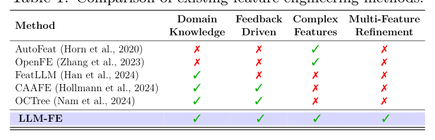
    * **Bảng này chứng minh điều gì**
      * LLM-FE là phương pháp duy nhất thỏa mãn cả 4 tiêu chí cốt lõi: tri thức miền, định hướng phản hồi, đặc trưng phức tạp và tinh chỉnh đa đặc trưng.
    * **Từ đâu mà thấy được**
      * Bảng ma trận so sánh các phương pháp (AutoFeat, OpenFE, FeatLLM, CAAFE, OCTree, LLM-FE) trên 4 cột tiêu chí.

  * Các phương pháp truyền thống thiếu tính thích ứng và sự hiểu biết ngữ cảnh sâu sắc, trong khi các phương pháp dựa trên LLM trước đây chỉ sinh các đặc trưng đơn giản (Küken et al., $2024$) hoặc dùng phản hồi để tinh chỉnh lặp chỉ một quy tắc đơn lẻ.
  * Ngược lại, LLM-FE hỗ trợ đồng thời cả $4$ khía cạnh cốt lõi nhờ kết hợp tri thức miền từ LLM và tối ưu hóa định hướng phản hồi:
    1. Tri thức miền (Domain Knowledge).
    2. Định hướng bằng phản hồi (Feedback Driven).
    3. Đặc trưng phức tạp (Complex Features).
    4. Tinh chỉnh đa đặc trưng (Multi-Feature Refinement).
  * **Bảng so sánh chi tiết các phương pháp (Table $1$):**
    * AutoFeat (Horn et al., $2020$): Domain Knowledge: ✗; Feedback Driven: ✗; Complex Features: ✓; Multi-Feature Refinement: ✗.
    * OpenFE (Zhang et al., $2023$): Domain Knowledge: ✗; Feedback Driven: ✗; Complex Features: ✓; Multi-Feature Refinement: ✗.
    * FeatLLM (Han et al., $2024$): Domain Knowledge: ✓; Feedback Driven: ✗; Complex Features: ✗; Multi-Feature Refinement: ✗.
    * CAAFE (Hollmann et al., $2024$): Domain Knowledge: ✓; Feedback Driven: ✓; Complex Features: ✗; Multi-Feature Refinement: ✗.
    * OCTree (Nam et al., $2024$): Domain Knowledge: ✓; Feedback Driven: ✓; Complex Features: ✗; Multi-Feature Refinement: ✗.
    * **LLM-FE (Đề xuất)**: Domain Knowledge: ✓; Feedback Driven: ✓; Complex Features: ✓; Multi-Feature Refinement: ✓.

* **Thiết lập thực nghiệm và hiệu năng khái quát hóa:**
  * LLM-FE được đánh giá thực nghiệm với hai mô hình nền LLM gồm Llama-3.1-8B-Instruct (Dubey et al., $2024$) và GPT-3.5-Turbo (OpenAI, $2023$).
  * Đánh giá bao trùm trên cả các tác vụ phân loại (classification) và hồi quy (regression) trên các tập dữ liệu dạng bảng đa dạng.
  * LLM-FE liên tục vượt trội hơn các phương pháp kỹ thuật đặc trưng tiên tiến nhất, xác định các đặc trưng phù hợp ngữ cảnh giúp tăng cường hiệu năng hạ nguồn.
  * Những cải thiện rõ rệt được ghi nhận trên các mô hình dạng bảng phổ biến gồm XGBoost (Chen & Guestrin, $2016$), TabPFN (Hollmann et al., $2023$), và MLP (Gorishniy et al., $2021$), nhấn mạnh tầm quan trọng của tìm kiếm tiến hóa trong việc đạt được kết quả vượt trội.

* **Các đóng góp chính của nghiên cứu (Major Contributions):**
  * **Đóng góp 1 — Khung làm việc LLM-FE:** Giới thiệu LLM-FE, một khung làm việc mới mô hình hóa kỹ thuật đặc trưng thành bài toán tối ưu hóa tiến hóa dưới sự định hướng của LLM, tích hợp chặt chẽ tri thức miền, đánh giá dựa trên dữ liệu, và bộ nhớ dài hạn phục vụ quá trình tinh chỉnh lặp.
  * **Đóng góp 2 — Hiệu năng vượt trội và tính khái quát hóa:** Kết quả thực nghiệm chứng minh tính hiệu quả của LLM-FE, thể hiện khả năng vượt trội so với các mô hình cơ sở tiên tiến nhất, đồng thời thể hiện khả năng khái quát hóa cao trên nhiều bộ dự đoán (predictors: XGBoost, TabPFN, MLP) và nhiều nền tảng LLM khác nhau.
  * **Đóng góp 3 — Phân tích loại trừ thành phần (Ablation Study):** Thông qua một nghiên cứu loại trừ toàn diện, công trình làm nổi bật vai trò cốt lõi của $4$ yếu tố: tri thức miền (domain knowledge), tìm kiếm tiến hóa (evolutionary search), phản hồi dựa trên dữ liệu (data-driven feedback), và các mẫu dữ liệu (data samples) trong việc dẫn dắt LLM khám phá không gian đặc trưng một cách hiệu quả và khám phá các đặc trưng có tác động lớn nhất.

## 2 Related Works

* **Kỹ thuật đặc trưng (Feature Engineering):**
  * Kỹ thuật đặc trưng liên quan đến việc tạo ra các đặc trưng có ý nghĩa từ dữ liệu thô nhằm cải thiện hiệu năng dự đoán (predictive performance) (Hollmann et al., 2024).
  * Sự phức tạp ngày càng tăng của các tập dữ liệu đã thúc đẩy việc tự động hóa kỹ thuật đặc trưng nhằm giảm thiểu công sức thủ công và tối ưu hóa việc khám phá đặc trưng.
  * Các phương pháp kỹ thuật đặc trưng tự động truyền thống bao gồm:
    * Khám phá dựa trên cây (tree-based exploration).
    * Liệt kê phép biến đổi (transformation enumeration).
    * Các phương pháp dựa trên học máy (learning-based methods) (Khurana et al., 2016; Kanter & Veeramachaneni, 2015; Nargesian et al., 2017; Zhang et al., 2023).
  * Hạn chế của các phương pháp truyền thống: thường không tận dụng được tri thức miền (domain knowledge) cho việc khám phá đặc trưng.
  * Ưu thế của mô hình ngôn ngữ lớn (LLMs): rất phù hợp cho các tác vụ dự đoán trên dữ liệu dạng bảng (tabular prediction tasks) nhờ vào khả năng hiểu biết ngữ cảnh miền từ trước (prior contextual domain understanding).

* **LLMs và tối ưu hóa (LLMs and Optimization):**
  * Những tiến bộ trong LLMs đã chứng minh khả năng thích ứng với các tác vụ mới thông qua kỹ thuật tạo câu nhắc (prompt engineering) và học theo ngữ cảnh (in-context learning) mà không cần huấn luyện lại mô hình (Brown et al., 2020; Wei et al., 2022).
  * Thách thức của LLMs: kết quả đầu ra có thể không nhất quán hoặc sai lệch thực tế (inconsistent or factually incorrect) (Madaan et al., 2024; Zhu et al., 2023), thúc đẩy các nghiên cứu về cơ chế tinh chỉnh hoặc ổn định các thế hệ sinh (refine or stabilize generations).
  * Khung làm việc kết hợp LLM với bộ đánh giá (evaluators) theo cơ chế lặp hoặc tiến hóa (iterative or evolutionary frameworks):
    * Tận dụng phản hồi (feedback), đột biến (mutation), và lai ghép (crossover) để dẫn dắt quá trình tìm kiếm giải pháp (Lehman et al., 2023; Wu et al., 2024; Meyerson et al., 2024).
    * Đạt được nhiều tiến bộ trong:
      * Tối ưu hóa câu nhắc (prompt optimization) (Yang et al., 2024b; Guo et al., 2024).
      * Tìm kiếm kiến trúc mạng nơ-ron (neural architecture search - NAS) (Zheng et al., 2023; Chen et al., 2023).
      * Khám phá phương pháp suy nghiệm toán học (mathematical heuristic discovery) (Romera-Paredes et al., 2024).
      * Hồi quy ký hiệu (symbolic regression) (Shojaee et al., 2025).
  * Định vị của khung làm việc LLM-FE: hiện thực hóa LLMs như các bộ tối ưu hóa tiến hóa (evolutionary optimizers), kết hợp tri thức tiên nghiệm phong phú với quy trình tinh chỉnh dựa trên dữ liệu có hệ thống (systematic, data-driven refinement) để khám phá các đặc trưng tinh gọn và đạt hiệu năng cao.

* **LLMs cho học trên dữ liệu bảng (LLMs for Tabular Learning):**
  * Việc áp dụng LLM cho dữ liệu có cấu trúc (structured data) thường dựa trên:
    * Chuyển đổi bảng thành biểu diễn văn bản (textual representations) (Dinh et al., 2022; Hegselmann et al., 2023; Wang et al., 2023).
    * Điều chỉnh chiến lược phân tách từ (tokenization) và tiền huấn luyện (pre-training) nhằm tăng độ bền vững trên dữ liệu bảng (Yan et al., 2024).
  * Trong tác vụ dự đoán trên dữ liệu bảng cụ thể:
    * LLM được sử dụng trong mô hình tinh chỉnh (fine-tuning) và học ít mẫu theo ngữ cảnh (few-shot in-context paradigms) (Hegselmann et al., 2023; Nam et al., 2023).
    * LLM được ứng dụng trực tiếp trong kỹ thuật đặc trưng:
      * FeatLLM (Han et al., 2024): tạo ra các quy tắc nhị phân (binary rules).
      * CAAFE (Hollmann et al., 2024): khai thác mô tả tác vụ để tạo ra các đặc trưng theo ngữ cảnh (contextual features).
      * OCTree (Nam et al., 2024): cải thiện đặc trưng lặp đi lặp lại thông qua suy luận cây quyết định (decision tree reasoning).
  * Hạn chế của các phương pháp tiếp cận hiện có: thường phụ thuộc vào việc tinh chỉnh tăng dần trên một ứng viên duy nhất (incremental refinement of a single candidate).
  * Giải pháp đột phá của LLM-FE:
    * Duy trì một tập hợp đa dạng các chương trình triển vọng (diverse pool of promising programs).
    * Áp dụng tìm kiếm tiến hóa (evolutionary search) để duyệt không gian đặc trưng hiệu quả.
    * Tận dụng đột biến (mutation) và lai ghép (crossover) để phát hiện các phép biến đổi vừa dựa trên dữ liệu vừa có khả năng diễn giải (interpretable and data-driven transformations).
    * Thiết kế này cho phép khám phá các đặc trưng không chỉ có năng lực dự đoán cao mà còn có thể diễn giải bởi con người, kết nối khoảng cách giữa suy luận dựa trên tri thức miền (domain-informed reasoning) và tối ưu hóa.
    * Phụ lục A (Appendix A) minh họa chi tiết thêm về sự khác biệt định tính giữa LLM-FE và các phương pháp đối chuẩn (baseline methods).

## 3 LLM-FE Approach

### 3.1 Problem Formulation

* **Định nghĩa tập dữ liệu bảng (tabular dataset) $D$ và siêu dữ liệu (metadata) $M$:**
  * Tập dữ liệu bảng $D$ bao gồm $N$ hàng (hoặc thực thể — instances), mỗi thực thể được đặc trưng bởi $d$ cột (hoặc đặc trưng — features).
  * Mỗi thực thể dữ liệu $x_i$ là một vector đặc trưng $d$ chiều ($d$-dimensional feature vector) với tên đặc trưng được ký hiệu bởi $C = \{c_j\}_{j=1}^d$.
  * Tập dữ liệu đi kèm với siêu dữ liệu (metadata) $M$ bao gồm mô tả đặc trưng (feature descriptions) và thông tin đặc thù của tác vụ (task-specific information).
* **Định nghĩa bài toán học có giám sát (supervised learning) trên dữ liệu bảng:**
  * Đối với các tác vụ học có giám sát, mỗi thực thể $x_i$ được liên kết với một nhãn tương ứng $y_i$.
  * Nhãn $y_i \in \{0, 1, \dots, K\}$ đối với các tác vụ phân loại (classification tasks) có $K$ lớp.
  * Nhãn $y_i \in \mathbb{R}$ đối với các tác vụ hồi quy (regression tasks).
  * Cho một tập dữ liệu bảng có nhãn $D = \{(x_i, y_i)\}_{i=1}^N$ và mô hình dự đoán $f$ ánh xạ từ không gian đặc trưng đầu vào $\mathcal{X}$ sang không gian nhãn tương ứng $\mathcal{Y}$.
* **Mục tiêu thiết kế đặc trưng (feature engineering objective) dưới dạng bài toán tối ưu hóa hai cấp (bilevel optimization):**
  * Mục tiêu của kỹ thuật thiết kế đặc trưng là xác định một chương trình biến đổi đặc trưng tối ưu (optimal feature transformation program) $T$, ánh xạ không gian đặc trưng ban đầu $\mathcal{X}$ sang một biểu diễn tăng cường $T(\mathcal{X})$ nhằm cải thiện hiệu năng dự đoán khi dùng để huấn luyện mô hình hạ nguồn (downstream model).
  * Tác vụ thiết kế đặc trưng được định nghĩa toán học thông qua bài toán tối ưu hai cấp:
    $$\max_{T} E(f^*(T(X_{\text{val}})), Y_{\text{val}}), \quad (1)$$
    với điều kiện:
    $$f^* \in \arg\min_{f} \mathcal{L}_f(f(T(X_{\text{tr}})), Y_{\text{tr}}), \quad (2)$$
    trong đó $(X_{\text{tr}}, Y_{\text{tr}})$ và $(X_{\text{val}}, Y_{\text{val}})$ lần lượt là tập con huấn luyện (sub-training set) và tập kiểm định (validation set) được tách ra từ dữ liệu huấn luyện $(X_{\text{train}}, Y_{\text{train}})$.
  * Mô hình dự đoán $f^*$ sau đó được huấn luyện trên dữ liệu huấn luyện đã biến đổi $T(X_{\text{train}})$ để tối thiểu hóa hàm mất mát (loss).
* **Sinh chương trình biến đổi đặc trưng bằng mô hình ngôn ngữ lớn (LLM):**
  * Chương trình biến đổi đặc trưng $T$ được sinh bởi LLM $\pi_\theta$ có điều kiện dựa trên câu nhắc (prompt) $p$.
  * Các chương trình ứng viên được lấy mẫu theo xác suất $T \sim \pi_\theta(p)$, trong đó $p$ được xây dựng từ siêu dữ liệu tập dữ liệu $M$, các mẫu dữ liệu $X$, và các chương trình đạt điểm cao từ các vòng lặp trước (detailed in Section 3.2).
* **Xấp xỉ tối ưu hóa hai cấp thông qua tìm kiếm tiến hóa (evolutionary search):**
  * Mục tiêu tối ưu hai cấp trong Eqs. (1)–(2) không thể giải trực tiếp (intractable to optimize directly) trên không gian tổ hợp (combinatorial space) của các chương trình biến đổi đặc trưng.
  * LLM-FE xấp xỉ mục tiêu này bằng tìm kiếm tiến hóa tại mỗi vòng lặp (iteration) (xem Algorithm 1).
  * Tại mỗi vòng lặp, $\pi_\theta$ đề xuất các chương trình ứng viên $\{T_j\}$ dựa trên điều kiện $p$.
  * Mỗi chương trình ứng viên được đánh giá bằng cách huấn luyện $f^*$ trên $T_j(X_{\text{tr}})$ và chấm điểm trên $T_j(X_{\text{val}})$.
  * Điểm đánh giá này đóng vai trò là tín hiệu độ thích nghi (fitness signal) để dẫn dắt quá trình tinh chỉnh lặp (iterative refinement).

### 3.2 Feature Generation

* Bước sinh đặc trưng (feature generation step) sử dụng một mô hình ngôn ngữ lớn (LLM - Large Language Model) để tạo ra nhiều chương trình biến đổi đặc trưng (feature transformation programs) mới, tận dụng tri thức tiên nghiệm (prior knowledge), năng lực suy luận (reasoning) và khả năng học trong ngữ cảnh (in-context learning) của mô hình nhằm khám phá không gian đặc trưng (feature space) một cách hiệu quả (minh họa tại Figure $1\text{(a)}$).

#### 3.2.1 Input Prompt

* Phương pháp nhắc lệnh có cấu trúc (structured prompting methodology) được phát triển nhằm tạo điều kiện thuận lợi cho việc tạo ra các chương trình khám phá đặc trưng (feature discovery programs) hiệu quả và phù hợp với ngữ cảnh.
  * Prompt được thiết kế để cung cấp: thông tin toàn diện đặc thù cho dữ liệu (comprehensive data-specific information), một chương trình biến đổi đặc trưng ban đầu làm điểm khởi đầu cho tiến hóa (evolution starting point), một hàm đánh giá (evaluation function), và một định dạng đầu ra được xác định rõ ràng (well-defined output format, xem chi tiết tại Appendix B.1).
  * Prompt đầu vào $p$ bao gồm các phần tử cốt lõi sau:
    * **Chỉ dẫn (Instruction)**:
      * LLM được giao nhiệm vụ tìm kiếm các đặc trưng phù hợp nhất để giúp giải quyết tác vụ cho trước.
      * Tác vụ nhấn mạnh việc sử dụng tri thức tiên nghiệm (prior knowledge) của LLM về miền dữ liệu (domain) của tập dữ liệu để sinh đặc trưng.
      * LLM được chỉ dẫn rõ ràng để sinh các đặc trưng mới lạ (novel features) và cung cấp lập luận từng bước (step-by-step reasoning) rõ ràng về mức độ liên quan của chúng đối với tác vụ dự đoán (prediction task).
      * Do các LLM có xu hướng sinh ra các đặc trưng đơn giản (simple features), nhóm tác giả chỉ dẫn cụ thể cho LLM sinh ra các đặc trưng phức tạp (complex features).
    * **Đặc tả tập dữ liệu (Dataset Specification)**:
      * Sau khi cung cấp chỉ dẫn, LLM được cung cấp thông tin đặc thù của tập dữ liệu từ siêu dữ liệu (metadata) $M$.
      * Thông tin này bao gồm mô tả chi tiết về tác vụ hạ nguồn dự kiến (intended downstream task), cùng với tên các đặc trưng $C$ và các mô tả tương ứng của chúng.
      * Cung cấp một số lượng giới hạn các mẫu đại diện từ tập dữ liệu dạng bảng (tabular dataset).
      * Nhằm cải thiện khả năng diễn giải dữ liệu hiệu quả, áp dụng phương pháp tuần tự hóa (serialization approach) từ các nghiên cứu trước (Dinh et al., 2022; Hegselmann et al., 2023; Han et al., 2024):
        $$\text{Serialize}(x_i, y_i, C) = \text{‘If } c_1 \text{ is } x_i^1, \dots, c_d \text{ is } x_i^d \text{. Then Result is } y_i\text{’} \tag{3}$$
      * Việc cung cấp các chi tiết đặc thù của tập dữ liệu giúp định hướng mô hình ngôn ngữ tập trung vào các đặc trưng thích hợp nhất theo ngữ cảnh, trực tiếp hỗ trợ tập dữ liệu và mục tiêu tác vụ.
    * **Hàm đánh giá (Evaluation Function)**:
      * Hàm đánh giá được tích hợp trực tiếp vào prompt, định hướng mô hình ngôn ngữ sinh ra các chương trình biến đổi đặc trưng phù hợp với các mục tiêu hiệu năng (performance objectives).
      * Các chương trình này làm giàu (augment) tập dữ liệu gốc bằng các đặc trưng mới; các đặc trưng này được đánh giá dựa trên hiệu năng của một mô hình dự đoán được huấn luyện trên dữ liệu đã làm giàu (augmented data).
      * Điểm số đánh giá của mô hình trên tập kiểm định làm giàu (augmented validation set) đóng vai trò là chỉ số đo lường chất lượng đặc trưng.
      * Bằng cách đưa hàm đánh giá vào prompt, LLM sinh ra các chương trình vốn dĩ đã phù hợp với các tiêu chí hiệu năng mong muốn.
    * **Minh họa trong ngữ cảnh (In-Context Demonstration)**:
      * Lấy mẫu $k$ minh họa có hiệu năng cao nhất từ các vòng lặp trước, cho phép LLM kế thừa và phát triển từ các đầu ra thành công.
      * Tương tác lặp lại giữa các kết quả đầu ra sinh của LLM và phản hồi của bộ đánh giá (evaluator), được định hướng bởi các ví dụ này, tạo điều kiện thuận lợi cho một quy trình tinh chỉnh có hệ thống (systematic refinement process).
      * Qua từng vòng lặp, LLM tiến bộ dần các đầu ra của mình bằng cách tận dụng các khuôn mẫu (patterns) và hiểu biết sâu sắc (insights) được xác định từ các minh họa thành công trước đó.

#### 3.2.2 Feature Sampling

* Tại mỗi vòng lặp $t$, prompt $p_t$ được xây dựng bằng cách lấy mẫu vòng lặp trước làm đầu vào cho LLM $\pi_\theta$, tạo ra đầu ra $T_1, \dots, T_b = \pi_\theta(p_t)$ đại diện cho một tập gồm $b$ chương trình được lấy mẫu.
* Nhằm thúc đẩy tính đa dạng và duy trì sự cân bằng giữa khám phá (exploration - tính sáng tạo) và khai thác (exploitation - tri thức tiên nghiệm), phương pháp lấy mẫu ngẫu nhiên dựa trên nhiệt độ (stochastic temperature-based sampling) được áp dụng.
* Kiểm tra tính thực thi và lọc chương trình:
  * Mỗi phép biến đổi đặc trưng được lấy mẫu ($T_i$) đều được thực thi trước khi đánh giá nhằm loại bỏ các chương trình dễ phát sinh lỗi (error-prone programs).
  * Cơ chế này đảm bảo chỉ các chương trình biến đổi đặc trưng hợp lệ và thực thi được (valid, executable) mới được đưa vào đường ống tối ưu hóa (optimization pipeline).
  * Nhằm đảm bảo hiệu quả tính toán (computational efficiency), một ngưỡng thời gian thực thi tối đa (maximum execution time threshold) được áp dụng; bất kỳ chương trình nào vượt quá ngưỡng này đều bị loại bỏ.

### 3.3 Data-Driven Evaluation (Feature Verification)

* **Tăng cường tập dữ liệu bằng các đặc trưng mới được sinh ra:**
  * Các đặc trưng mới sinh được áp dụng để tăng cường tập dữ liệu gốc với các thuộc tính mới được trích xuất (as illustrated in Figure $1\text{(b)}$).
  * Quy trình này tạo ra không gian biểu diễn mở rộng $T(X)$, kết hợp các đặc trưng nguyên bản cùng với các đặc trưng do chương trình biến đổi tạo ra.
* **Quy trình đánh giá đặc trưng hai giai đoạn (Two-stage feature evaluation process):**
  * Tương tự như các phương pháp tiền nhiệm trong tài liệu chuyên ngành (Hollmann et al., 2024; Nam et al., 2024), quy trình đánh giá chất lượng đặc trưng bao gồm hai giai đoạn độc lập:
    * **Giai đoạn (i) Huấn luyện mô hình trên tập dữ liệu tăng cường (Model training on the augmented dataset):**
      * Khớp (fit) một mô hình dự đoán dạng bảng (tabular predictive model) $f^*$ vào tập dữ liệu huấn luyện đã qua biến đổi $T(X_{\text{tr}})$.
      * Quá trình huấn luyện thực hiện cực tiểu hóa hàm mất mát $\mathcal{L}_f$ theo điều kiện tối ưu ở bài toán cấp dưới (lower-level optimization problem):
        $$f^* \in \arg\min_{f} \mathcal{L}_f(f(T(X_{\text{tr}})), Y_{\text{tr}}), \quad (2)$$
        như đã được thiết lập trong Eq. (1) và Eq. (2) tại Section 3.1.
    * **Giai đoạn (ii) Đánh giá hiệu năng để xác định chất lượng đặc trưng (Performance assessment for feature quality):**
      * Tiến hành đánh giá chất lượng của các phép biến đổi đặc trưng $T$ do LLM sinh ra bằng cách đo lường trực tiếp hiệu năng của mô hình $f^*$ trên tập kiểm định tăng cường $T(X_{\text{val}})$ (minh họa tại Figure $1\text{(c)}$).
      * Phép đánh giá này phản ánh khả năng khái quát hóa của tập đặc trưng mới khi áp dụng vào dữ liệu chưa thấy trong quá trình khớp mô hình:
        $$\max_{T} E(f^*(T(X_{\text{val}})), Y_{\text{val}}), \quad (1)$$
* **Mục tiêu tối ưu hóa và các thước đo hiệu năng ($E$):**
  * Như đã giải thích trong Section 3.1, mục tiêu tối thượng của quá trình đánh giá là tìm ra các đặc trưng tối ưu nhằm tối đa hóa thước đo hiệu năng $E$ (maximize performance $E$).
  * Đối với các tác vụ phân loại (classification tasks): thước đo hiệu năng $E$ là độ chính xác (accuracy).
  * Đối với các tác vụ hồi quy (regression tasks): thước đo hiệu năng $E$ là các thang đo sai số chuẩn (error metrics, chẳng hạn như RMSE).
  * Kết quả hiệu năng $E$ đóng vai trò là tín hiệu độ thích nghi (fitness signal) phản hồi cho cơ chế Quản lý Kinh nghiệm (Experience Management, Section 3.4) nhằm định hướng các vòng lặp sinh đặc trưng tiếp theo.

### 3.4 Experience Management

* **Mục tiêu và kiến trúc Quản lý Kinh nghiệm (Experience Management):**
  * Nhằm thúc đẩy việc khám phá đặc trưng đa dạng (diverse feature discovery) và tránh bị đình trệ tại các cực trị địa phương (avoid stagnation in local optima), LLM-FE sử dụng cơ chế quản lý kinh nghiệm tiến hóa đa quần thể (evolutionary multi-population experience management, minh họa tại Figure $1\text{(d)}$) để lưu trữ các chương trình khám phá đặc trưng (feature discovery programs) trong một cơ sở dữ liệu chuyên dụng (dedicated database).
  * Các mẫu (samples) từ cơ sở dữ liệu này được trích xuất để xây dựng các ví dụ trong ngữ cảnh (in-context examples) cho mô hình ngôn ngữ lớn (LLM), tạo điều kiện thuận lợi cho việc sinh ra các đặc trưng mới lạ (novel features).
  * Quy trình quản lý kinh nghiệm gồm hai thành phần cốt lõi:
    * (i) **Bộ nhớ đa quần thể (multi-population memory):** Duy trì một bộ đệm bộ nhớ dài hạn (long-term memory buffer).
    * (ii) **Lấy mẫu từ bộ đệm bộ nhớ (sampling from this memory buffer):** Dùng để kiến tạo các minh họa ví dụ trong ngữ cảnh (in-context example demonstrations).
  * Sau khi đánh giá các phép biến đổi đặc trưng ở vòng lặp $t$, cặp phép biến đổi đặc trưng và điểm số $(T, s)$ được lưu trữ vào bộ đệm quần thể $P_t$ để tinh chỉnh lặp (iteratively refine) quá trình tìm kiếm.

* **Mô hình Đa quần thể Hòn đảo (Multi-Population 'Island' Model):**
  * Để tiến hóa hiệu quả một quần thể các chương trình, nhóm tác giả áp dụng mô hình đa quần thể lấy cảm hứng từ mô hình 'hòn đảo' ('island' model) được sử dụng bởi Cranmer (2023), Romera-Paredes et al. (2024), và Shojaee et al. (2025).
  * Quần thể chương trình được phân chia thành $m$ hòn đảo độc lập ($m$ independent islands):
    * Mỗi đảo đều có quyền truy cập vào toàn bộ tập đặc trưng gốc ban đầu (full original feature set).
    * Mỗi đảo tiến hóa tách biệt độc lập (evolving separately).
    * Mỗi đảo được khởi tạo với một bản sao của ví dụ ban đầu do người dùng cung cấp (initialized with a copy of the user's initial example, xem Figure $9\text{(d)}$).
    * Cơ chế này cho phép khám phá song song không gian đặc trưng (parallel exploration of the feature space), giảm thiểu rủi ro sa vào các giải pháp dưới tối ưu (mitigating the risk of suboptimal solutions).
  * Tại mỗi vòng lặp $t$, một trong số $m$ hòn đảo được lựa chọn và các chương trình được lấy mẫu từ bộ đệm bộ nhớ để cập nhật prompt với các ví dụ ngữ cảnh mới.
  * Khi $b$ mẫu đặc trưng mới sinh được đánh giá, nếu điểm số $s_j$ của chúng vượt qua điểm số tốt nhất hiện tại, cặp biến đổi đặc trưng - điểm số $(T_j, s_j)$ sẽ được thêm vào chính hòn đảo mà từ đó các ví dụ trong ngữ cảnh đã được lấy mẫu.

* **Phân cụm dựa trên Chữ ký Chương trình (Program Signature Clustering):**
  * Nhằm bảo tồn tính đa dạng và đảm bảo các chương trình mang các đặc tính hiệu năng khác nhau vẫn được duy trì trong bộ đệm:
    * Tiến hành phân cụm các chương trình trong từng hòn đảo dựa trên chữ ký chương trình (program signature).
    * Chữ ký chương trình được định nghĩa bởi điểm số hiệu năng kiểm định (validation performance score) $s$.
    * Cụ thể, các chương trình biến đổi đặc trưng mang lại điểm số kiểm định giống hệt nhau (identical validation scores) được gom cụm vào cùng một cụm (consolidated into the same cluster).

* **Cơ chế Lấy mẫu Boltzmann (Boltzmann Sampling) và Cân bằng Thăm dò – Khai thác:**
  * Theo Romera-Paredes et al. (2024) và Shojaee et al. (2025), quy trình lấy mẫu gồm hai bước:
    * Bước 1: Lấy mẫu từ một trong $m$ hòn đảo khả dụng.
    * Bước 2: Lấy mẫu $k$ chương trình từ đảo đã chọn để tạo thành các ví dụ trong ngữ cảnh $k$-shot ($k$-shot in-context examples) cho LLM (xem Appendix B.1).
  * Quá trình lựa chọn cụm được thực hiện bằng phương pháp lấy mẫu Boltzmann (Boltzmann sampling, De La Maza & Tidor, 1992), cơ chế gán xác suất cao hơn cho các cụm có điểm số cao hơn.
  * Xác suất $P_i$ để chọn cụm thứ $i$ dựa trên điểm số được tính theo công thức:
    $$P_i = \frac{\exp(s_i / \tau_c)}{\sum_{i} \exp(s_i / \tau_c)}$$
    trong đó:
    * $s_i$: Điểm số trung bình (mean score) của cụm thứ $i$.
    * $\tau_c$: Tham số nhiệt độ (temperature parameter).
  * Tham số nhiệt độ $\tau_c$ kiểm soát sự đánh đổi giữa thăm dò và khai thác (exploration–exploitation trade-off):
    * Giá trị $\tau_c$ thấp hơn: Tập trung khối lượng xác suất vào cụm có điểm số cao nhất (khai thác - exploitation).
    * Giá trị $\tau_c$ cao hơn: Phân bổ xác suất đồng đều hơn trên tất cả các cụm (thăm dò - exploration).
  * Các chương trình biến đổi đặc trưng được lấy mẫu từ bộ đệm bộ nhớ sau đó được đưa vào prompt làm các ví dụ trong ngữ cảnh nhằm định hướng LLM sinh ra các biến đổi đặc trưng hiệu quả hơn (chi tiết mô tả chiến lược quản lý bộ nhớ, quy trình phân cụm và cơ chế lấy mẫu được trình bày tại Appendix B.1).

* **Mã giả Thuật toán LLM-FE (Algorithm 1 LLM-FE):**
  * Thuật toán 1 (Algorithm 1) mô tả mã giả của toàn bộ quy trình LLM-FE:
    * **Đầu vào yêu cầu (Require):** Tập dữ liệu $D$ (Dataset $D$), Siêu dữ liệu $M$ (Metadata $M$), Số vòng lặp $T$ (Iterations $T$), Mô hình dự đoán $f$ (Model $f$), Mô hình ngôn ngữ lớn $\pi_\theta$ (LLM $\pi_\theta$), Thước đo hiệu năng $E$ (Metric $E$).
    * **Dòng 1:** Khởi tạo bộ đệm bộ nhớ $P_0 \leftarrow \text{BufferInit}()$ với một quần thể ban đầu chứa một phép biến đổi đặc trưng đơn giản (đóng vai trò điểm xuất phát cho quá trình tìm kiếm tiến hóa các chương trình biến đổi đặc trưng ở các bước tiếp theo).
    * **Dòng 2:** Khởi tạo biến lưu trữ lời giải tối ưu: $T^*, s^* \leftarrow \text{null}, -\infty$.
    * **Dòng 3:** Cập nhật prompt ban đầu: $p \leftarrow \text{UpdatePrompt}(D, M)$.
    * **Dòng 4:** Vòng lặp tiến hóa từ $t = 1$ đến $T$ ($\text{for } t = 1 \text{ to } T \text{ do}$):
      * **Dòng 5:** Lấy mẫu $k$ ví dụ ngữ cảnh từ quần thể vòng trước $P_{t-1}$ thông qua hàm $\text{topk}$ để cập nhật prompt: $p_t \leftarrow p + P_{t-1}.\text{topk}()$.
      * **Dòng 6:** Gọi LLM $\pi_\theta$ với prompt $p_t$ để lấy mẫu $b$ chương trình mới: $\{T_j\}_{j=1}^b \leftarrow \pi_\theta(p_t)$.
      * **Dòng 7:** Vòng lặp đánh giá từng chương trình biến đổi từ $j = 1$ đến $b$ ($\text{for } j = 1 \text{ to } b \text{ do}$):
        * **Dòng 8:** Đánh giá điểm số của chương trình $T_j$ bằng hàm $\text{FeatureScore}$: $s_j \leftarrow \text{FeatureScore}(f, Tj, D, E)$, đại diện cho quy trình Đánh giá dựa trên Dữ liệu (Data-Driven Evaluation, Section 3.3).
        * **Dòng 9:** Kiểm tra điều kiện cải thiện: $\text{if } s_j > s^* \text{ then}$.
        * **Dòng 10:** Cập nhật kỷ lục tối ưu tốt nhất: $T^*, s^* \leftarrow T_j, s_j$.
        * **Dòng 11:** Kết thúc cấu trúc điều kiện: $\text{end if}$.
        * **Dòng 12:** Cập nhật bộ đệm quần thể: $P_t \leftarrow \text{UpdateBuffer}(P_{t-1}, T_j, s_j)$.
      * **Dòng 13:** Kết thúc vòng lặp đánh giá $j$: $\text{end for}$.
    * **Dòng 14:** Kết thúc vòng lặp thế hệ $t$: $\text{end for}$.
    * **Dòng 15:** Trả về kết quả tối ưu: $\text{return } T^*, s^*$, trong đó $T^*$ là chương trình đạt điểm cao nhất từ $P_t$ và $s^*$ là điểm số tối ưu tương ứng cho bài toán.

* **Cơ chế Tìm kiếm Tiến hóa Ngầm định qua Prompt (Implicit Evolutionary Search via Prompt Conditioning):**
  * LLM-FE áp dụng quy trình tìm kiếm lặp (iterative search) để hoàn thiện và tăng cường chất lượng của các chương trình, khai thác tối đa năng lực của mô hình ngôn ngữ lớn.
  * Bằng cách học hỏi từ kho kinh nghiệm liên tục tiến hóa trong bộ đệm, LLM tự định hướng quá trình tìm kiếm đến các giải pháp hiệu quả.
  * **Sự khác biệt với các thuật toán tiến hóa cổ điển (classical evolutionary algorithms):**
    * Các thuật toán tiến hóa cổ điển bắt buộc phải áp dụng các toán tử đột biến (mutation) hoặc lai ghép (crossover) một cách tường minh/hiển ngôn (explicit operators).
    * Trái lại, LLM-FE thực hiện các thao tác này một cách ngầm định (implicitly) thông qua quá trình sinh phụ thuộc điều kiện của prompt (prompt-conditioned generation).
  * Các chương trình thành công trước đó khi được đưa vào prompt dưới dạng các ví dụ trong ngữ cảnh (in-context examples) sẽ dẫn dắt LLM:
    * Sinh ra các biến thể của từng chương trình riêng lẻ (produce variants of individual programs).
    * Kết hợp các đặc trưng từ nhiều chương trình khác nhau (combinations of features from programs).

* **Tập lệnh chỉ dẫn thúc đẩy các phép toán biến đổi phức tạp trong kinh nghiệm:**
  * **Hình 8.** Ví dụ tập lệnh chỉ dẫn thúc đẩy các phép toán biến đổi phức tạp
    * 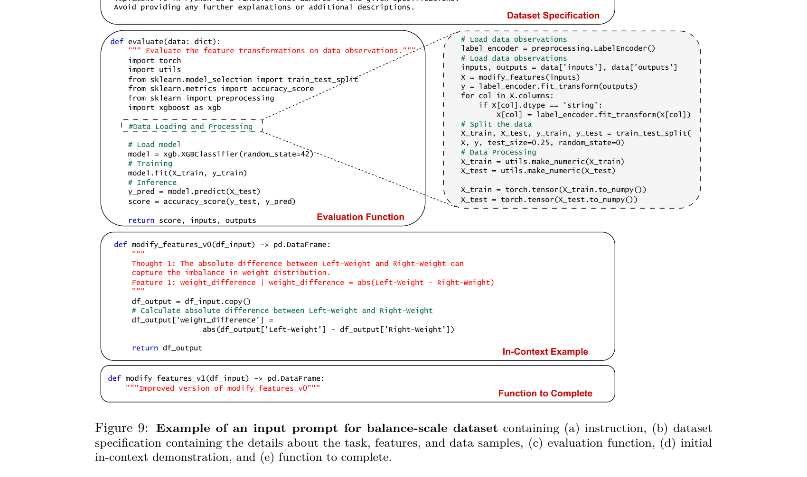
    * **Hình này chứng minh điều gì**
      * Minh họa cấu trúc câu nhắc hướng dẫn LLM vượt qua thiên lệch toán tử đơn giản để sử dụng các phép biến đổi phức tạp.
    * **Từ đâu mà thấy được**
      * Hình ảnh hiển thị chi tiết nội dung prompt mẫu với danh sách toán tử đa dạng.

## 4 Experimental Setup

* LLM-FE được đánh giá trên một loạt các tập dữ liệu bảng (tabular datasets), bao gồm các tác vụ phân loại (classification) và hồi quy (regression).
* Phân tích thực nghiệm bao gồm các so sánh định lượng (quantitative comparisons) với các đường cơ sở (baselines) và các nghiên cứu triệt tiêu chi tiết (ablation studies).
* Phương pháp tiếp cận được đánh giá cụ thể bằng cách sử dụng $3$ mô hình dự đoán dạng bảng (tabular predictive models) đã biết với các kiến trúc riêng biệt:
  * XGBoost: một mô hình dựa trên cây (tree-based model) (Chen & Guestrin, 2016).
  * MLP: một mô hình mạng nơ-ron (neural model) (Gorishniy et al., 2021).
  * TabPFN (Hollmann et al., 2023): một mô hình nền tảng dựa trên transformer (transformer-based foundation model) (Vaswani et al., 2017).
* Các kết quả làm nổi bật khả năng của LLM-FE trong việc sinh ra các đặc trưng hiệu quả, giúp cải thiện một cách nhất quán hiệu năng của nhiều mô hình dự đoán khác nhau trên các tập dữ liệu.

### 4.1 Baselines

* LLM-FE được đánh giá so sánh với các phương pháp tiếp cận feature engineering (kỹ thuật đặc trưng) tiên tiến (state-of-the-art):
  * Các phương pháp truyền thống bao gồm OpenFE (Zhang et al., $2023$) và AutoFeat (Horn et al., $2020$).
  * Các phương pháp dựa trên mô hình ngôn ngữ lớn (LLM-based methods) bao gồm CAAFE (Hollmann et al., $2024$), FeatLLM (Han et al., $2024$), và OCTree (Nam et al., $2024$).
* Cấu hình mặc định cho các mô hình dự đoán và mô hình nền tảng trong thực nghiệm so sánh:
  * XGBoost được sử dụng làm mô hình dự đoán dữ liệu dạng bảng mặc định (default tabular data prediction model) khi so sánh với các phương pháp đối chuẩn (baselines).
  * GPT-3.5-Turbo được sử dụng làm mô hình nền tảng LLM mặc định (default LLM backbone) cho tất cả các phương pháp tiếp cận dựa trên LLM (Bảng $2$ và Bảng $3$ / Tables $2$ and $3$).
* Thiết lập ngân sách nhằm đảm bảo tính so sánh công bằng (fair comparison):
  * Tất cả các phương pháp tiếp cận dựa trên LLM hoạt động dưới một ngân sách cố định gồm $20$ mẫu LLM ($20$ LLM samples), không áp dụng cơ chế dừng sớm (early stopping) hay tiêu chí hội tụ (convergence criterion).
  * Kết quả được báo cáo cuối cùng tương ứng với chương trình đạt điểm cao nhất (best-scoring program) được khám phá trong phạm vi ngân sách $20$ mẫu này.
* Các chi tiết cài đặt và triển khai bổ sung được trình bày tại Phụ lục B.2 (Appendix B.2).

### 4.2 Datasets

* Các bộ dữ liệu được lựa chọn theo Hollmann et al. ($2024$) từ các công trình feature engineering (kỹ thuật đặc trưng) trước đây, bao gồm Han et al. ($2024$), Hollmann et al. ($2024$), và Zhang et al. ($2023$), có chứa thông tin mô tả đặc trưng (descriptive feature information).
* Tập dữ liệu phân tích bao gồm $19$ bộ dữ liệu phân loại (classification) và $10$ bộ dữ liệu hồi quy (regression), mỗi bộ đều chứa các đặc trưng hỗn hợp dạng phân loại (categorical) và dạng số (numerical).
    * Nghiên cứu bổ sung $8$ bộ dữ liệu phân loại quy mô lớn, số chiều cao (large-scale, high-dimensional classification datasets) nhằm đảm bảo việc đánh giá toàn diện.
    * Nguồn thu thập dữ liệu đến từ các kho lưu trữ machine learning uy tín, bao gồm OpenML (Vanschoren et al., $2014$; Feurer et al., $2021$), UCI Machine Learning Repository (Asuncion et al., $2007$), và Kaggle.
* Thử nghiệm được tiến hành trên $5$ bộ dữ liệu phân loại từ Hollmann et al. ($2024$) và Bordt et al. ($2024$) được phát hành sau mốc thời gian cắt dữ liệu huấn luyện của GPT vào tháng $9$ năm $2021$ (September $2021$ GPT training cutoff date).
* Mỗi bộ dữ liệu đi kèm với metadata (siêu dữ liệu), bao gồm mô tả bằng ngôn ngữ tự nhiên về tác vụ dự đoán và tên các đặc trưng mang tính mô tả (descriptive feature names).
* Quy trình phân chia và đánh giá dữ liệu:
    * Mỗi bộ dữ liệu được phân chia thành tập huấn luyện (train set) và tập kiểm thử (test set) theo tỷ lệ $80$-$20$ ($80$-$20$ split).
    * Theo Hollmann et al. ($2024$), tất cả các phương pháp được đánh giá qua $5$ lần lặp (iterations), mỗi lần sử dụng một random seed (hạt ngẫu nhiên) và các phân chia train-test riêng biệt.
    * Chi tiết cụ thể được trình bày tại Appendix C.

### 4.3 LLM-FE Configuration

* **Các mô hình ngôn ngữ lớn nền tảng (backbone LLMs):**
  * Trong các thử nghiệm, nghiên cứu sử dụng GPT-3.5-Turbo và Llama-3.1-8B-Instruct làm các mô hình ngôn ngữ lớn nền tảng (backbone LLMs).
* **Tham số lấy mẫu và cấu hình quần đảo (sampling parameters and islands configuration):**
  * Nhiệt độ lấy mẫu (sampling temperature) được thiết lập ở mức $t = 0.8$.
  * Số lượng quần đảo trong mô hình tiến hóa được cấu hình là $m = 3$ đảo ($m = 3$ islands).
* **Sinh chương trình biến đổi đặc trưng (feature transformation program generation):**
  * Tại mỗi vòng lặp (iteration), LLM sinh $b = 3$ chương trình biến đổi đặc trưng (feature transformation programs) cho mỗi câu nhắc (per prompt) bằng ngôn ngữ Python.
  * Để đảm bảo tính nhất quán khi so sánh với các phương pháp cơ sở (baselines), LLM-FE cũng được cấu hình để sử dụng $20$ mẫu sinh LLM ($20$ LLM samples) cho mỗi thử nghiệm.
* **Lựa chọn chương trình khám phá đặc trưng (feature discovery program selection):**
  * Cuối cùng, quy trình lấy mẫu $m$ chương trình khám phá đặc trưng hàng đầu (top $m$ feature discovery programs, với $m$ là số lượng quần đảo) dựa trên điểm số kiểm định (validation scores) tương ứng của chúng.
* **Chi tiết triển khai bổ sung:**
  * Các chi tiết triển khai cụ thể hơn được cung cấp tại Phụ lục B.1 (Appendix B.1).

### 4.4 Results and Discussion

* Đánh giá so sánh hiệu năng trên $19$ tập dữ liệu phân loại (classification datasets) (Bảng $2$ / Table $2$):
  * **Bảng 2.** Hiệu năng của XGBoost trên các tập dữ liệu phân loại
    * 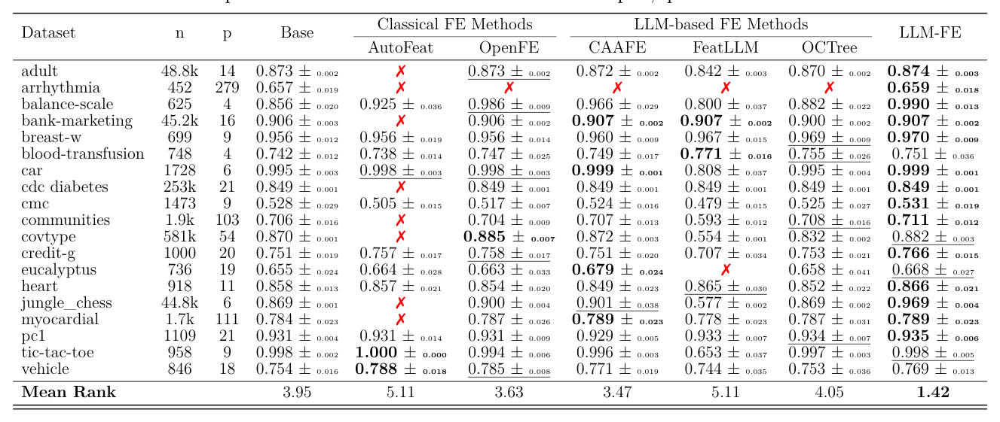
    * **Bảng này chứng minh điều gì**
      * LLM-FE đạt độ chính xác cao nhất hoặc nhì trên hầu hết 19 tập dữ liệu phân loại so với các baseline.
    * **Từ đâu mà thấy được**
      * Các giá trị in đậm và gạch chân trong cột LLM-FE vượt trội so với AutoFeat, OpenFE, CAAFE, FeatLLM, OCTree.
  * LLM-FE được so sánh đối chuẩn với nhiều phương pháp kỹ thuật đặc trưng (feature engineering baselines) tiên tiến.
  * Kết quả thực nghiệm chứng minh LLM-FE liên tục cải thiện hiệu năng dự đoán (predictive performance) so với mô hình cơ sở (base model) sử dụng dữ liệu thô (raw data).
  * LLM-FE đạt thứ hạng trung bình thấp nhất (lowest mean rank, đại diện cho hiệu năng tốt nhất / best performance) với chi phí tính toán thấp hơn (lower computational cost, xem Phần $5.1$ / Section $5.1$).
  * LLM-FE chứng minh tính hiệu quả vượt trội trong việc nâng cao và tăng cường khám phá đặc trưng (enhancing feature discovery) so với các phương pháp đối chuẩn hàng đầu khác (leading baselines).
* Mở rộng đánh giá thực nghiệm trên $10$ tập dữ liệu hồi quy (regression datasets):
  * **Bảng 3.** Hiệu năng của XGBoost trên các tập dữ liệu hồi quy
    * 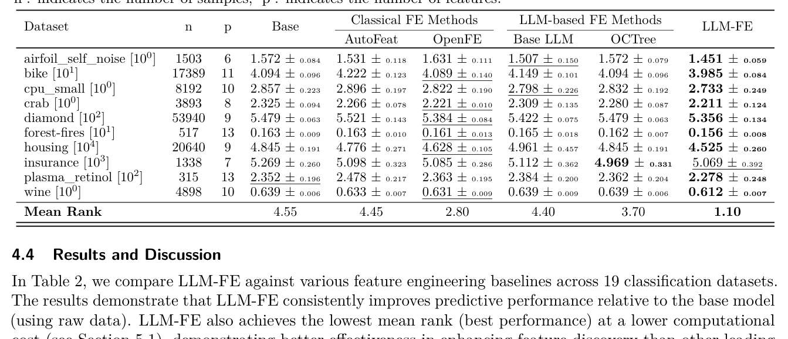
    * **Bảng này chứng minh điều gì**
      * LLM-FE đạt sai số RMSE thấp nhất trên các tập dữ liệu hồi quy, chứng minh tính ưu việt của các đặc trưng được tạo ra.
    * **Từ đâu mà thấy được**
      * Số liệu RMSE thấp nhất trên đa số 10 tập dữ liệu trong bảng.
  * Nghiên cứu tiến hành thực nghiệm trên $10$ tập dữ liệu hồi quy nhằm đánh giá sâu hơn tính hiệu quả của LLM-FE, sử dụng cùng các thiết lập đánh giá (evaluation settings) tương tự như đối với các tập dữ liệu phân loại.
  * Giới hạn phạm vi so sánh trong Bảng $3$ (Table $3$): do thiếu các triển khai cho dữ liệu hồi quy trong các cơ sở mã nguồn khả dụng (lack of regression data implementations in available codebases) của các phương pháp đối chuẩn dựa trên LLM (LLM-based baselines bao gồm CAAFE và FeatLLM), nghiên cứu giới hạn so sánh đối với:
    * Các phương pháp không dựa trên LLM (non-LLM methods): OpenFE và AutoFeat.
    * Mô hình LLM cơ sở (base LLM).
    * OCTree, phương pháp trước đó đã được kiểm chứng tính hợp lệ trên các tác vụ hồi quy (regression tasks).
  * Hiệu năng vượt trội: Kết quả chỉ ra rằng LLM-FE vượt trội hơn tất cả các phương pháp đối chuẩn (outperforms all baseline methods), đạt thứ hạng trung bình thấp nhất (lowest mean rank) và liên tục đem lại sự cải thiện trên tất cả các tập dữ liệu (consistently improving across all datasets).
* Các phân tích chuyên sâu bổ sung tại Phụ lục D (Appendix D):
  * Kiểm định xếp hạng có dấu Wilcoxon (Wilcoxon signed-rank tests) nhằm đánh giá ý nghĩa thống kê của các cải thiện hiệu năng.
  * Phân tích ảnh hưởng của quá trình tối ưu hóa siêu tham số (hyperparameter optimization) đối với hiệu năng của LLM-FE.
  * Đánh giá hiệu năng với các mô hình dự đoán thay thế (alternative predictive models) bao gồm CatBoost và Hồi quy Logistic (Logistic Regression).
* Nghiên cứu khả năng chuyển giao và tổng quát hóa của đặc trưng (transferability and generalizability of discovered features):
  * Đánh giá các đặc trưng được khám phá qua nhiều mô hình nền tảng LLM khác nhau (different LLM backbones).
  * Kết quả khẳng định LLM-FE duy trì độ bền vững (robust) và đạt hiệu quả cao dưới các mô hình hóa và kiến trúc đa dạng (varied modeling and architectures).

### 4.5 Ablation Study

* **Mục tiêu và thiết lập thực nghiệm nghiên cứu loại trừ thành phần (ablation study):**
  * Nghiên cứu loại trừ thành phần được thực hiện trên các tập dữ liệu phân loại (classification datasets) có quy mô dưới $10{,}000$ mẫu ($<10{,}000$ samples) được liệt kê trong Bảng $2$ (Table $2$) nhằm đánh giá đóng góp của từng thành phần trong LLM-FE.
  * Thiết lập mô hình thực nghiệm sử dụng XGBoost làm mô hình dự đoán và GPT-3.5-Turbo làm mô hình nền tảng ngôn ngữ lớn (LLM backbone).
  * Độ chính xác (Accuracy) được báo cáo dưới dạng tổng hợp và chuẩn hóa trên tất cả các tập dữ liệu (aggregated and normalized over all the datasets) so với mô hình LLM-FE cơ sở để tạo điều kiện so sánh công bằng.
* **Tác động của từng thành phần lên hiệu năng tổng thể của LLM-FE (Hình $2$ / Figure $2$):**
  * Hình $2$ minh họa tác động của từng thành phần riêng lẻ lên hiệu năng tổng thể của LLM-FE: (a) Data Examples, (b) Domain Knowledge, và (c) Evolutionary Refinement.
    * **Hình 2.** Kết quả ablation study các thành phần của LLM-FE
      * 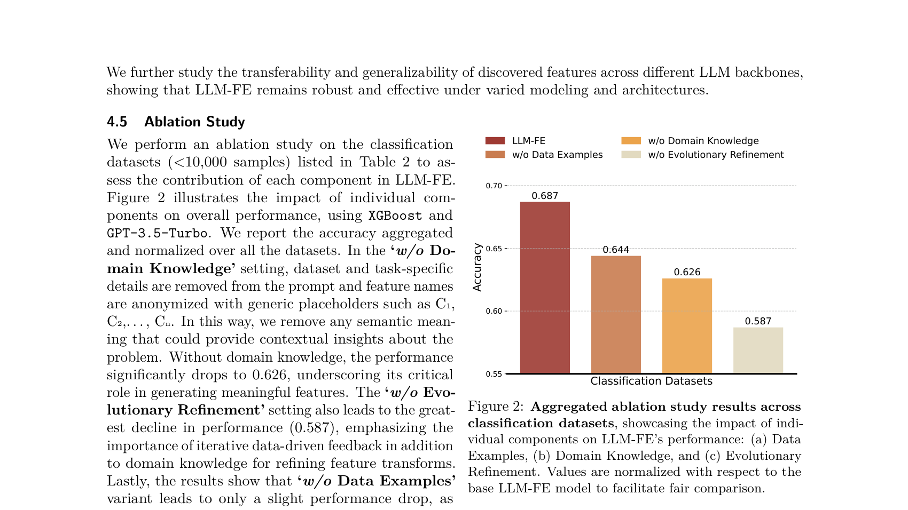
      * **Hình này chứng minh điều gì**
        * Tinh chỉnh tiến hóa và tri thức miền là hai thành phần cốt lõi giúp tối ưu độ chính xác phân loại.
      * **Từ đâu mà thấy được**
        * Trục tung thể hiện Accuracy ($0.55$–$0.70$) chuẩn hóa trên các tập dữ liệu phân loại.
        * Bốn cột giá trị giảm dần: LLM-FE ($0.687$), w/o Data Examples ($0.644$), w/o Domain Knowledge ($0.626$), w/o Evolutionary Refinement ($0.587$).
  * **Thiết lập không có tri thức miền (‘w/o Domain Knowledge’):**
    * Các chi tiết đặc thù về tập dữ liệu và tác vụ bị loại bỏ khỏi câu nhắc (prompt), đồng thời tên các đặc trưng được ẩn danh hóa bằng các ký hiệu giữ chỗ chung như $C_1, C_2, \dots, C_n$.
    * Cơ chế ẩn danh này loại bỏ bất kỳ ý nghĩa ngữ nghĩa (semantic meaning) nào có thể mang lại các hiểu biết sâu sắc theo ngữ cảnh (contextual insights) về bài toán.
    * Khi không có tri thức miền, hiệu năng sụt giảm đáng kể xuống $0.626$, nhấn mạnh vai trò quyết định của tri thức miền trong việc tạo ra các đặc trưng có ý nghĩa.
  * **Thiết lập không có tinh chỉnh tiến hóa (‘w/o Evolutionary Refinement’):**
    * Dẫn đến mức suy giảm hiệu năng lớn nhất (giảm xuống $0.587$).
    * Nhấn mạnh tầm quan trọng của cơ chế phản hồi lặp dựa trên dữ liệu (iterative data-driven feedback) kết hợp với tri thức miền đối với việc tinh chỉnh các phép biến đổi đặc trưng.
  * **Biến thể không có ví dụ dữ liệu mẫu (‘w/o Data Examples’):**
    * Chỉ dẫn đến sự suy giảm hiệu năng nhẹ (đạt mức $0.644$).
    * Nguyên nhân là do LLM có thể gặp khó khăn trong việc nắm bắt các sắc thái và quy luật tinh tế ẩn chứa bên trong các mẫu dữ liệu thực tế (nuances and patterns within the data samples).
  * **Kết luận chung:** LLM-FE hưởng lợi đáng kể từ từng thành phần riêng lẻ, giúp cải thiện rõ rệt hiệu năng tổng thể.

## 5 Analysis

### 5.1 Efficiency Analysis

* **Tầm quan trọng của việc đánh giá chất lượng đặc trưng trong các đường ống kỹ thuật đặc trưng tự động (automated feature engineering pipelines):**
  * Đánh giá chất lượng đặc trưng thông qua quy trình huấn luyện và kiểm định mô hình lặp đi lặp lại (repeated model training and validation) là một thành phần cơ bản (fundamental component) của các đường ống kỹ thuật đặc trưng tự động, được áp dụng đồng thời cho cả các phương pháp cổ điển (classical methods) và các phương pháp dựa trên mô hình ngôn ngữ lớn (LLM-based methods).
* **Thiết lập môi trường phần cứng và đo lường thời gian thực thi (runtime measurements):**
  * Tất cả các phép đo thời gian chạy đều được thực hiện trên một hệ thống phần cứng trang bị $4$ GPU NVIDIA RTX8000.
  * Quy ước tính toán thời gian chạy cho các phương pháp dựa trên LLM (LLM-based methods):
    * Đo lường toàn bộ thời gian của đường ống (full pipeline) từ thời điểm bắt đầu vòng lặp đầu tiên ($1^{\text{st}}$ iteration) đến khi hoàn thành vòng lặp cuối cùng (last iteration).
    * Thời gian này bao gồm độ trễ gọi giao diện lập trình ứng dụng LLM (LLM API latency), thời gian thực thi chương trình biến đổi đặc trưng (feature program execution), và thời gian huấn luyện mô hình (model training).
  * Quy ước tính toán thời gian chạy cho các phương pháp đối chuẩn cổ điển (classical baselines):
    * Bao gồm toàn bộ quy trình sinh đặc trưng (feature generation), lựa chọn đặc trưng (feature selection), và đánh giá đặc trưng (feature evaluation).
* **Hiệu quả tính toán và cơ chế tối ưu hóa chi phí gọi API trong LLM-FE:**
  * Mặc dù LLM-FE duy trì cấu trúc đa đảo tiến hóa (multiple evolutionary islands), thiết kế này trong thực tế không tạo thêm bất kỳ chi phí tính toán phụ trội nào (computational overhead).
  * LLM-FE thực hiện lấy mẫu đồng thời nhiều đầu ra cho mỗi lượt gọi LLM (samples multiple outputs per LLM call), nhờ đó giảm đáng kể tổng số lượng cuộc gọi API cần thiết.
* **Phân tích biên Pareto (Pareto analysis theo Figure 3) về sự đánh đổi giữa hiệu năng và thời gian chạy:**
  * Trên các tập dữ liệu quy mô lớn hơn từ Mục 4.4 (Section 4.4), LLM-FE liên tục nằm trên đường biên Pareto (Pareto frontier).
  * LLM-FE đạt hiệu năng dự đoán cao hơn với thời gian chạy gần tương đương so với OCTree, đồng thời đòi hỏi thời gian chạy ít hơn đáng kể so với CAAFE.
  * So sánh chi tiết với các phương pháp đối chuẩn cạnh tranh:
    * CAAFE và OpenFE đòi hỏi thời gian chạy nhiều hơn đáng kể.
    * OCTree không đạt được mức độ chính xác tương đương.
    * Mô hình cơ sở (base model) tuy có chi phí tính toán thấp nhất nhưng lại chịu mức thâm hụt hiệu năng nghiêm trọng (steep performance deficit).
  * **Hình 3.** Đồ thị Pareto so sánh sự đánh đổi giữa hiệu năng và thời gian chạy cho LLM-FE và các baseline.
    * 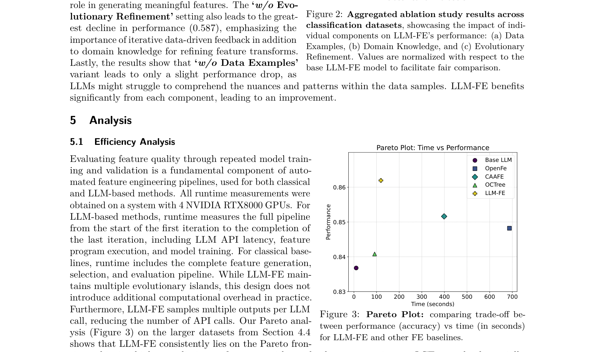
    * **Hình này chứng minh điều gì**
      * LLM-FE thiết lập biên Pareto tối ưu khi đạt hiệu năng cao nhất ($\approx 0.862$) với thời gian chạy chỉ $\approx 120\text{ s}$.
    * **Từ đâu mà thấy được**
      * Trục hoành là thời gian từ $0$ đến $700\text{ s}$ (các mốc chia $100$, $200$, $300$, $400$, $500$, $600$, $700$), trục tung là hiệu năng accuracy ($0.83$, $0.84$, $0.85$, $0.86$).
      * LLM-FE (dấu cộng vàng) đạt độ chính xác cao nhất ($\approx 0.862$) tại mốc $\approx 120\text{ s}$.
      * CAAFE (hình thoi) mất $\approx 400\text{ s}$ ($0.852$), OpenFe (hình vuông) mất $\approx 685\text{ s}$ ($0.848$), OCTree đạt $\approx 0.841$ tại $\approx 95\text{ s}$.
      * Base LLM (hình tròn) tốn ít thời gian nhất ($\approx 10\text{ s}$) nhưng chịu mức hiệu năng thấp nhất ($0.837$).
* **Kết luận về hiệu năng thực thi tổng thể của LLM-FE:**
  * LLM-FE đem lại sự đánh đổi giữa hiệu quả và hiệu năng (efficiency–performance trade-off) tối ưu nhất trong số tất cả các phương pháp được đánh giá.
  * Phương pháp đạt hiệu năng dự đoán tiên tiến hàng đầu (state-of-the-art predictive performance) trên các tập dữ liệu dạng bảng lớn và phức tạp mà không phát sinh thêm chi phí tính toán phụ trội nào.

### 5.2 Bias Mitigation

* Hiện tượng thiên lệch lựa chọn toán tử ở các mô hình ngôn ngữ lớn (Operator-selection bias in LLMs):
  * Khi được yêu cầu tạo các phép biến đổi đặc trưng (feature transformations), các LLM thể hiện một sự thiên lệch rõ rệt (pronounced bias) đối với một tập hợp hẹp các toán tử toán học đơn giản (narrow set of simple mathematical operators) như phép cộng (`addition`), phép trừ (`subtraction`), và giá trị tuyệt đối (`absolute value` / `abs`) (Küken et al., $2024$).
  * Nguồn gốc của thiên lệch: Phát sinh từ các kho ngữ liệu tiền huấn luyện (pretraining corpora), nơi các mẫu hình đơn giản (simple patterns) chiếm ưu thế áp đảo và do đó trở thành các chiến lược mặc định (default strategies).
* Hạn chế của các đường ống kỹ thuật đặc trưng dựa trên LLM ngây thơ (naive LLM-based feature engineering pipelines):
  * Các đường ống ngây thơ có xu hướng tạo ra các phép biến đổi lặp lại và có độ phức tạp thấp (repetitive, low-complexity transformations).
  * Các phép biến đổi này thất bại trong việc khai thác không gian cấu thành phong phú hơn (richer compositional space) của các phép toán có ý nghĩa trên dữ liệu bảng (meaningful tabular operations).
  * Xu hướng thiên vị ở phương pháp CAAFE: Theo minh họa tại Hình 4 (Figure $4$), CAAFE cũng có xu hướng thiên vị các phép biến đổi đơn giản, trong đó các phép toán nhân (`multiply`) và chia (`divide`) chiếm tới $75\%$ tổng số toán tử được sử dụng.
* Năng lực khám phá các phép biến đổi tinh vi thông qua tinh chỉnh tiến hóa trong LLM-FE:
  * Bất chấp thiên lệch cố hữu của LLM, LLM-FE thường xuyên khám phá và duy trì (regularly discovers and retains) các phép biến đổi đặc trưng tinh vi hơn nhờ cơ chế tinh chỉnh tiến hóa (evolutionary refinement).
  * Tần suất xuất hiện của các toán tử cấp cao: Các toán tử như `groupbythenmean`, `groupbythenmin`, `groupbythenmax`, `residual`, và `sigmoid` xuất hiện với tần suất cao hơn đáng kể dưới khuôn khổ tiến hóa của LLM-FE so với việc sinh trực tiếp từ LLM đơn thuần (direct LLM generation / Base LLM).
  * Giá trị biểu đạt của các toán tử cấp cao: Nắm bắt được cấu trúc tổng hợp (aggregation structure), sự biến thiên có điều kiện theo lớp (class-conditional variation), và các mối quan hệ phi tuyến (nonlinear relationships) mà các phép toán số học đơn giản không thể biểu đạt được.
* Cơ chế tìm kiếm tiến hóa chủ động triệt tiêu xu hướng thiên lệch đơn giản hóa:
  * Trong khi LLM đơn lẻ có xu hướng thiên lệch về các phép biến đổi bị đơn giản hóa quá mức (oversimplified transformations), cơ chế tìm kiếm tiến hóa của LLM-FE chủ động đối trọng và triệt tiêu xu hướng này thông qua $3$ cơ chế:
    1. Thúc đẩy tính đa dạng (promoting diversity).
    2. Đánh giá các phép biến đổi thông qua hiệu năng thực nghiệm (evaluating transformations through empirical performance).
    3. Tinh chỉnh lặp đi lặp lại các đặc trưng ứng viên (iteratively refining candidate features).
* Hiệu quả tổng hợp và vai trò giảm thiểu rủi ro của LLM-FE:
  * LLM-FE không chỉ làm giảm nguy cơ ghi nhớ vẹt dữ liệu (risk of memorization) mà còn giảm thiểu thiên lệch lựa chọn toán tử (operator-selection bias).
  * Tạo điều kiện phát hiện các đặc trưng giàu tính biểu đạt, phù hợp sâu sắc với miền bài toán (expressive, domain-relevant features) mà các phương pháp nhắc lệnh ngây thơ (naive prompting alone) hiếm khi tạo ra được.
* Phân tích so sánh tần suất toán tử kỹ thuật đặc trưng (Figure $4$ - Frequency of Feature Engineering Operators):
  * **Hình 4.** Tần suất xuất hiện các toán tử kỹ thuật đặc trưng
    * 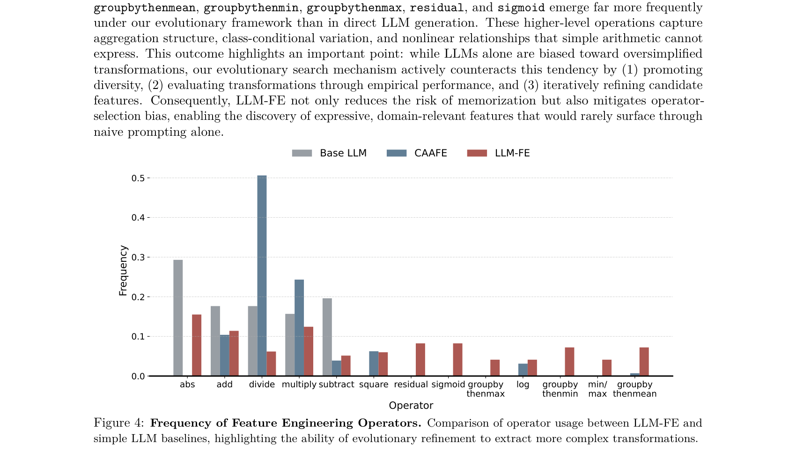
    * **Hình này chứng minh điều gì**
      * LLM-FE khai thác được nhiều toán tử phức tạp hơn nhiều so với các baseline LLM đơn giản vốn bị thiên lệch toán tử số học cơ bản.
    * **Từ đâu mà thấy được**
      * Biểu đồ phân bố tần suất toán tử so sánh tỷ lệ giữa LLM-FE và baseline.
  * So sánh tần suất sử dụng toán tử giữa LLM-FE và các đường ống LLM đối chuẩn đơn giản (Base LLM, CAAFE) qua các toán tử: `abs`, `add`, `divide`, `multiply`, `subtract`, `square`, `residual`, `sigmoid`, `groupbythenmax`, `log`, `groupbythenmin`, `min/max`, và `groupbythenmean`.
  * Khẳng định năng lực của tinh chỉnh tiến hóa trong việc trích xuất các phép biến đổi phức tạp hơn thay vì phụ thuộc vào các toán tử đơn giản.

### 5.3 Impact of Domain Knowledge and Evolutionary Refinement

* **Lợi ích định tính của việc tích hợp tri thức miền vào kỹ thuật đặc trưng (Figure 7):**
  * So sánh đối chiếu giữa hai phương pháp tiếp cận thiết kế đặc trưng trên cùng một tập dữ liệu y sinh:
    * **Kỹ thuật đặc trưng không có tri thức miền (Feature Engineering without domain knowledge - Figure 7(a)):**
      * Biến thể bất khả tri miền (domain-agnostic variant) thực hiện các phép biến đổi tùy tiện và thiếu căn cứ rõ ràng.
      * Tạo đặc trưng mới $\text{C10}$ bằng căn bậc hai của tích hai đặc trưng $\text{C1}$ và $\text{C3}$ nhằm nắm bắt mối quan hệ phi tuyến:
        $$\text{C10} = \sqrt{\text{C1} \times \text{C3}}$$
      * Loại bỏ đặc trưng $\text{C2}$ với giả định thiếu căn cứ rằng đây là đặc trưng ít mang thông tin.
      * Các phép biến đổi tùy tiện này dẫn đến các đầu ra không thể diễn giải được (uninterpretable outputs).
    * **LLM-FE có tri thức miền dẫn dắt (LLM-FE guided by domain knowledge - Figure 7(b)):**
      * LLM-FE tận dụng các hiểu biết sâu sắc đặc thù miền (domain-specific insights) và tri thức nhúng sẵn (embedded knowledge) để suy ra các đặc trưng có khả năng diễn giải và mang ý nghĩa lâm sàng:
        * **Ý tưởng 1 (Thought 1):** Nồng độ Insulin kết hợp với nồng độ Glucose cung cấp hiểu biết sâu sắc về trạng thái chuyển hóa (metabolic state).
        * **Đặc trưng 1 (`insulin_glucose_ratio`):** Tỷ lệ Insulin chia cho Glucose:
          $$\text{insulin\_glucose\_ratio} = \frac{\text{Insulin}}{\text{Glucose}}$$
        * **Ý tưởng 2 (Thought 2):** Chỉ số khối cơ thể (BMI) là một chỉ dấu về nguy cơ tiềm ẩn của bệnh tiểu đường (diabetes risk), đặc biệt khi kết hợp với độ tuổi (Age).
        * **Đặc trưng 2 (`bmi_age_ratio`):** Tỷ lệ BMI chia cho Tuổi:
          $$\text{bmi\_age\_ratio} = \frac{\text{BMI}}{\text{Age}}$$
      * Quá trình sinh đặc trưng đi kèm các mô tả lý giải logic chi tiết, đảm bảo tính minh bạch và giá trị thực tiễn trong phân tích y tế.

* **Đánh giá định lượng tác động của tri thức miền đối với độ chính xác mô hình (Figure 5):**
  * So sánh hiệu năng mô hình (Model Performance / Accuracy) trên cùng tập dữ liệu cho thấy sự khác biệt rõ rệt giữa các phương pháp:
    * Mô hình LLM-FE tích hợp tri thức miền đạt mức độ chính xác cao nhất trong số các cấu hình thử nghiệm.
    * Hiệu năng của LLM-FE cao hơn cả mô hình cơ sở (base model) và biến thể LLM-FE không sử dụng tri thức miền (LLM-FE w/o domain knowledge).
    * **Hình 5.** Tác động định lượng của tri thức miền lên độ chính xác mô hình
      * 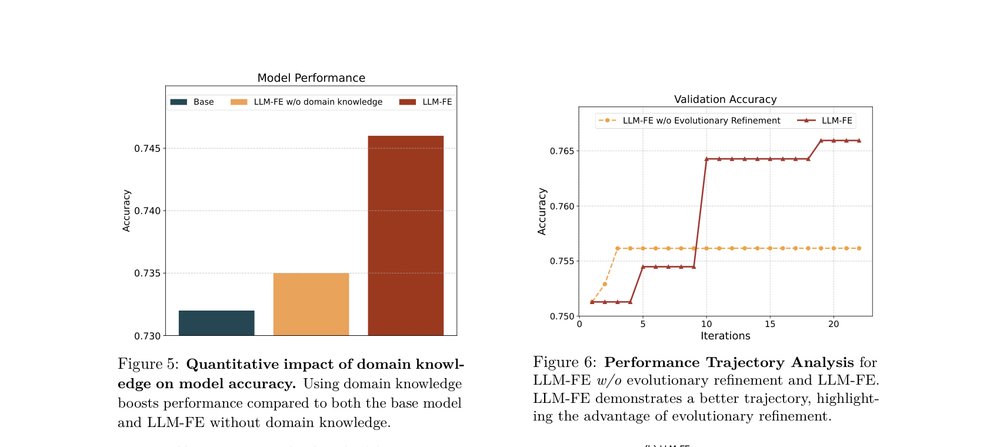
      * **Hình này chứng minh điều gì**
        * Tích hợp tri thức miền nâng cao độ chính xác so với mô hình cơ sở và biến thể không có tri thức miền.
      * **Từ đâu mà thấy được**
        * Cột LLM-FE đạt độ chính xác cao nhất khoảng $0.745$, cao hơn biến thể không có tri thức miền ($0.735$) và mô hình Base ($0.730$).

* **Phân tích quỹ đạo độ chính xác kiểm định và vai trò của tinh chỉnh tiến hóa (Figure 6):**
  * Khảo sát quỹ đạo độ chính xác kiểm định (Validation Accuracy) qua $20$ vòng lặp (iterations: $0, 5, 10, 15, 20$):
    * **Biến thể không có tinh chỉnh tiến hóa (LLM-FE w/o evolutionary refinement):**
      * Thể hiện sự cải thiện ở giai đoạn ban đầu nhưng nhanh chóng đi vào trạng thái bão hòa (plateaus).
      * Sự chững lại sớm biểu thị hiện tượng hội tụ về điểm tối ưu cục bộ (local optimum).
    * **LLM-FE đầy đủ (kết hợp tinh chỉnh tiến hóa):**
      * Duy trì đà cải thiện liên tục và nhất quán xuyên suốt các vòng lặp, đạt mức độ chính xác tổng thể cao hơn.
      * Cơ chế tinh chỉnh tiến hóa giúp mô hình thoát khỏi các điểm tối ưu cục bộ và tối ưu hóa không gian tìm kiếm một cách hiệu quả hơn.
    * **Hình 6.** Phân tích quỹ đạo hiệu năng giữa LLM-FE và biến thể không có tinh chỉnh tiến hóa
      * 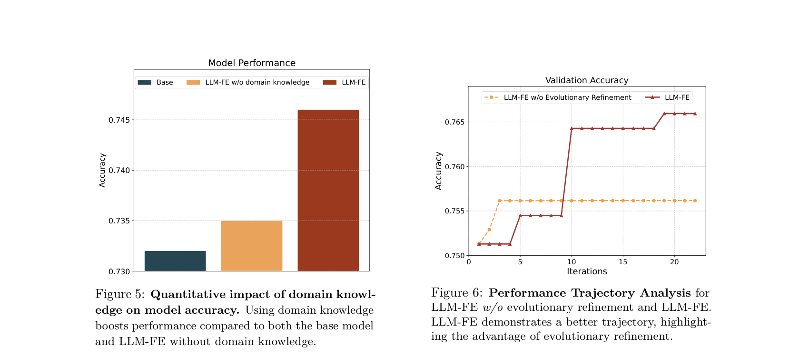
      * **Hình này chứng minh điều gì**
        * Tinh chỉnh tiến hóa giúp LLM-FE liên tục nâng cao độ chính xác và tránh bị đình trệ tại điểm tối ưu cục bộ.
      * **Từ đâu mà thấy được**
        * Đường LLM-FE tiếp tục tăng độ chính xác qua các vòng lặp (vượt mức $0.765$), trong khi biến thể không có tinh chỉnh sớm bão hòa quanh $0.758$.

* **Các phân tích bổ sung chuyên sâu:**
  * Các phân tích thực nghiệm và đánh giá mở rộng về tác động của tri thức miền và tinh chỉnh tiến hóa được cung cấp chi tiết tại Phụ lục E (Appendix E).

### 5.4 Memorization in Feature Engineering

* Hiện tượng ghi nhớ dữ liệu không mong muốn ở các mô hình ngôn ngữ lớn (Unintentional data memorization in LLMs):
  * Các công trình nghiên cứu gần đây chứng minh rằng các LLM có thể vô tình ghi nhớ dữ liệu huấn luyện trong những điều kiện nhất định (Carlini et al., $2021$; Bordt et al., $2024$).
  * Hiện tượng này làm dấy lên mối lo ngại sâu sắc về việc liệu những cải thiện hiệu năng đạt được là xuất phát từ năng lực suy luận thực sự của LLM (genuine LLM reasoning) hay chỉ đơn thuần là việc hồi tưởng lại các mẫu dữ liệu huấn luyện đã thấy (recalling training examples).
* Thiết lập thực nghiệm nhằm kiểm chứng và thăm dò hiện tượng ghi nhớ (Probing memorization):
  * Đánh giá mô hình XGBoost khi có và không có LLM-FE bằng cách sử dụng GPT-3.5-Turbo làm mô hình nền tảng (LLM backbone) trên hai nhóm tập dữ liệu đặc biệt:
    1. Các tập dữ liệu do Bordt et al. ($2024$) đề xuất: Được thiết kế và xây dựng một cách tường minh nhằm phát hiện hiện tượng ghi nhớ, đồng thời đã được xác minh là hoàn toàn vắng mặt trong kho ngữ liệu tiền huấn luyện của mô hình (confirmed to be absent from model pretraining).
    2. Các tập dữ liệu từ Hollmann et al. ($2024$): Được phát hành sau mốc giới hạn dữ liệu tiền huấn luyện tháng $9$ năm $2021$ của GPT (September $2021$ GPT training cutoff) và được cung cấp trên nền tảng Kaggle với các phân chia ẩn (hidden splits), khiến cho khả năng tiếp xúc trong giai đoạn tiền huấn luyện là cực kỳ thấp (pretraining exposure highly unlikely).
* Kết quả thực nghiệm đối chuẩn giữa XGBoost cơ sở và LLM-FE trên $5$ tập dữ liệu phân loại (Bảng 4 / Table $4$):
  * **Bảng 4.** So sánh hiệu năng giữa XGBoost có và không có LLM-FE trên $5$ tập dữ liệu phân loại (Comparison of XGBoost with and without LLM-FE on five classification datasets).
    * 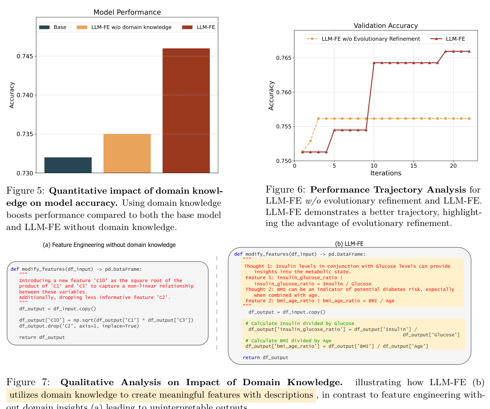
    * **Bảng này chứng minh điều gì**
      * LLM-FE mang lại mức cải thiện hiệu năng khiêm tốn nhưng ổn định và nhất quán (modest but consistent performance gains) trên toàn bộ $5/5$ tập dữ liệu phân loại được kiểm chứng, khẳng định năng lực sinh đặc trưng thực thụ thay vì ghi nhớ dữ liệu huấn luyện.
    * **Từ đâu mà thấy được**
      * Tập `kidney-stones`: XGBoost cơ sở đạt $0.761 \pm 0.024$, XGBoost kết hợp LLM-FE đạt $0.761 \pm 0.027$.
      * Tập `health-insurance`: XGBoost cơ sở đạt $0.756 \pm 0.001$, XGBoost kết hợp LLM-FE tăng lên $0.759 \pm 0.001$.
      * Tập `pharyngitis`: XGBoost cơ sở đạt $0.655 \pm 0.008$, XGBoost kết hợp LLM-FE tăng lên $0.660 \pm 0.023$.
      * Tập `fico`: XGBoost cơ sở đạt $0.715 \pm 0.006$, XGBoost kết hợp LLM-FE tăng lên $0.719 \pm 0.009$.
      * Tập `acs-income`: XGBoost cơ sở đạt $0.807 \pm 0.002$, XGBoost kết hợp LLM-FE tăng lên $0.809 \pm 0.003$.
  * Bảng số liệu chi tiết so sánh hiệu năng độ chính xác (Accuracy $\pm$ độ lệch chuẩn / $\text{mean} \pm \text{std}$):

| Tập dữ liệu (Dataset) | XGBoost cơ sở (Base) | LLM-FE |
| :--- | :---: | :---: |
| `kidney-stones` | $0.761 \pm 0.024$ | $0.761 \pm 0.027$ |
| `health-insurance` | $0.756 \pm 0.001$ | $0.759 \pm 0.001$ |
| `pharyngitis` | $0.655 \pm 0.008$ | $0.660 \pm 0.023$ |
| `fico` | $0.715 \pm 0.006$ | $0.719 \pm 0.009$ |
| `acs-income` | $0.807 \pm 0.002$ | $0.809 \pm 0.003$ |

* Phân tích kết quả và sự tương phản với các bộ sinh đặc trưng LLM ngây thơ (Naive LLM feature generators):
  * Như được chỉ ra tại Bảng 4, LLM-FE đem lại mức tăng trưởng hiệu năng khiêm tốn nhưng ổn định trên toàn bộ các tập dữ liệu.
  * Điều này tạo nên sự tương phản đáng chú ý với các bộ sinh đặc trưng LLM ngây thơ (naive LLM feature generators), vốn dễ vô tình rơi vào tình trạng quá khớp (overfit) hoặc tạo ra các mối quan hệ ảo tưởng về miền dữ liệu (hallucinate domain relationships).
* Cơ chế tinh chỉnh tiến hóa đóng vai trò như bộ lọc triệt tiêu hiện tượng ghi nhớ:
  * Thay vì chỉ phụ thuộc đơn thuần vào các đầu ra thô từ mô hình ngôn ngữ lớn (raw outputs of the LLM), LLM-FE lặp đi lặp lại việc chọn lọc, gây đột biến (mutates) và đánh giá các đặc trưng ứng viên (candidate features) dựa trên hiệu năng của mô hình hạ nguồn (downstream model performance).
  * Quy trình này vận hành như một bộ lọc (filter), triệt tiêu một cách có hệ thống các tạo tác sinh ra do ghi nhớ vẹt (memorization-driven artifacts) và thúc đẩy các đặc trưng có khả năng khái quát hóa (generalize) qua các vòng đánh giá lặp lại.
* Đánh giá rủi ro và khuyến nghị phương hướng nghiên cứu tương lai:
  * Mặc dù hiện tượng ghi nhớ vẫn là một rủi ro trọng yếu trong các quy trình xử lý dữ liệu dạng bảng định hướng bởi LLM (LLM-driven tabular workflows), kết quả thực nghiệm chỉ ra rằng cơ chế tinh chỉnh tiến hóa (evolutionary refinement) cung cấp một tấm lá chắn tự vệ hữu hiệu (effective safeguard).
  * Phát hiện này nhấn mạnh sự cần thiết phải xây dựng các bộ tiêu chuẩn đánh giá đối chuẩn (benchmarks) trong tương lai nhằm cô lập và kiểm tra áp lực (stress-test) các hành vi ghi nhớ này.

### 5.5 Generalizability Analysis

* **Đánh giá tính tổng quát hóa của LLM-FE trên nhiều kiến trúc và mô hình nền tảng (Generalizability Analysis)**:
  * **Mục tiêu đánh giá hệ thống**: Kiểm chứng năng lực phát hiện đặc trưng hữu ích và tính chuyển giao của khung LLM-FE trên nhiều lớp mô hình dự đoán dữ liệu bảng (tabular prediction models) và các mô hình ngôn ngữ lớn (LLM backbones) đa dạng.
  * **Thiết lập các mô hình thực nghiệm**:
    * **Mô hình ngôn ngữ lớn (LLM backbones)**: Khảo sát hai đại diện tiêu biểu gồm Llama-3.1-8B-Instruct (mã nguồn mở) và GPT-3.5-Turbo (thương mại).
    * **Mô hình dự đoán dạng bảng hạ nguồn**:
      * **XGBoost (Chen & Guestrin, 2016)**: Đường cơ sở dựa trên cây (tree-based baseline) có hiệu năng phân loại và hồi quy vượt trội trên dữ liệu cấu trúc.
      * **Multilayer Perceptron (MLP - Gorishniy et al., 2021)**: Kiến trúc mạng nơ-ron học sâu cạnh tranh cho dữ liệu bảng.
      * **TabPFN (Hollmann et al., 2023)**: Mô hình nền tảng transformer chuyên biệt cho dữ liệu bảng, được đánh giá trên $10.000$ mẫu ($\text{TabPFN}^*$) do giới hạn dung lượng tính toán.

* **Kết quả thực nghiệm cải thiện hiệu năng định lượng (Bảng 5)**:
  * Bảng 5 (Table 5 - Performance improvement by LLM-FE using different prediction models and LLM backbones):
    | Phương pháp (Method) | LLM Backbone | Phân loại (Classification Accuracy $\uparrow$) | Hồi quy (Regression NRMSE $\downarrow$) |
    | :--- | :--- | :--- | :--- |
    | **XGBoost Base** | – | $0.820 \pm 0.020$ | $0.324 \pm 0.016$ |
    | **XGBoost + LLM-FE** | Llama 3.1-8B | $0.832 \pm 0.021$ | $0.310 \pm 0.022$ |
    | **XGBoost + LLM-FE** | GPT-3.5 Turbo | $\mathbf{0.840 \pm 0.022}$ | $\mathbf{0.306 \pm 0.015}$ |
    | **MLP Base** | – | $0.745 \pm 0.034$ | $0.871 \pm 0.027$ |
    | **MLP + LLM-FE** | Llama 3.1-8B | $0.768 \pm 0.032$ | $0.794 \pm 0.016$ |
    | **MLP + LLM-FE** | GPT-3.5 Turbo | $\mathbf{0.791 \pm 0.029}$ | $\mathbf{0.631 \pm 0.043}$ |
    | **TabPFN* Base** | – | $0.852 \pm 0.028$ | $0.289 \pm 0.016$ |
    | **TabPFN* + LLM-FE** | Llama 3.1-8B | $0.856 \pm 0.017$ | $0.288 \pm 0.016$ |
    | **TabPFN* + LLM-FE** | GPT-3.5 Turbo | $\mathbf{0.863 \pm 0.018}$ | $\mathbf{0.286 \pm 0.015}$ |

* **Quy luật tổng quát hóa và sự ổn định của tập đặc trưng sinh bởi LLM-FE**:
  * **Cải thiện đồng nhất trên mọi kiến trúc**: LLM-FE đều nhất quán xác định các đặc trưng có giá trị thông tin cao và phù hợp với nhiệm vụ, giúp nâng cao độ chính xác phân loại và giảm mạnh sai số căn bậc hai trung bình chuẩn hóa (NRMSE) trên cả ba lớp mô hình dưới cả hai LLM backbone.
  * **Vượt trội so với mô hình gốc không có kỹ thuật đặc trưng**: Tập đặc trưng do LLM-FE kiến tạo luôn vượt trội hơn các mô hình không áp dụng kỹ thuật đặc trưng ($\text{Base}$), chứng minh lợi ích mạnh mẽ và khả năng thích ứng độc lập với lớp mô hình hay tác vụ cụ thể.
  * **Mở rộng trong phụ lục**: Các thực nghiệm bổ sung tại Phụ lục D.2 tiếp tục kiểm chứng tính tổng quát trên các LLM thế hệ mới (GPT-4o-mini, Qwen2.5-72B-Instruct, Gemini-2.5-Flash) và các mô hình dự đoán nhỏ hơn (CatBoost, Logistic Regression).

## 6 Conclusion

* Nghiên cứu giới thiệu khung làm việc (framework) mới LLM-FE, tận dụng các mô hình ngôn ngữ lớn (Large Language Models - LLMs) làm bộ tối ưu hóa tiến hóa (evolutionary optimizers) để khám phá các đặc trưng (features) mới cho các tác vụ dự đoán trên dữ liệu dạng bảng (tabular prediction tasks).
* Bằng cách kết hợp quá trình sinh giả thuyết do LLM điều hướng (LLM-driven hypothesis generation) với phản hồi dựa trên dữ liệu (data-driven feedback) và tìm kiếm tiến hóa (evolutionary search), LLM-FE tự động hóa quy trình kỹ thuật đặc trưng (feature engineering process) một cách hiệu quả.
* Thông qua các thực nghiệm toàn diện trên nhiều tác vụ học dữ liệu bảng đa dạng, LLM-FE liên tục vượt trội hơn các đường cơ sở tiên tiến nhất (state-of-the-art baselines), mang lại sự cải thiện đáng kể về hiệu năng dự đoán trên nhiều mô hình dự đoán dạng bảng khác nhau.
* Các hướng nghiên cứu trong tương lai:
  * Khám phá việc tích hợp các mô hình ngôn ngữ mạnh mẽ hơn hoặc các mô hình ngôn ngữ chuyên biệt theo miền (domain-specific language models) nhằm nâng cao độ phù hợp và chất lượng của các đặc trưng được tạo ra cho các bài toán thuộc từng miền cụ thể.
  * Mở rộng khung làm việc ra ngoài phạm vi kỹ thuật đặc trưng tới các giai đoạn khác của quy trình học trên dữ liệu bảng và quy trình lấy dữ liệu làm trung tâm (data-centric pipeline), bao gồm tăng cường dữ liệu (data augmentation), làm sạch dữ liệu tự động (automated data cleaning, gồm gán giá trị khuyết thiếu - imputation và phát hiện giá trị ngoại lai - outlier detection), và tinh chỉnh mô hình (model tuning).

### Impact Statement

* Khung làm việc LLM-FE cho kỹ thuật đặc trưng tự động do LLM dẫn dắt giúp nâng cao hiệu năng dự đoán đồng thời giảm thiểu công sức thủ công, đặc biệt trong các miền tiêu tốn nhiều tài nguyên (resource-intensive domains).
* Bằng cách kết hợp tri thức miền (domain knowledge) với tối ưu hóa tiến hóa (evolutionary optimization), LLM-FE hỗ trợ khám phá các biểu diễn đặc trưng (feature representations) hiệu quả vốn khó có thể thiết kế thủ công.
* Tiềm năng mở rộng của khung làm việc:
  * Mặc dù nghiên cứu này tập trung vào kỹ thuật đặc trưng, khung làm việc có thể mở rộng sang các giai đoạn liên quan trong quy trình học máy (ML pipeline) như làm sạch dữ liệu (data cleaning), phân tích khám phá (exploratory analysis), tăng cường dữ liệu (data augmentation), và tinh chỉnh mô hình (model tuning).
* Vấn đề quyền riêng tư dữ liệu (privacy considerations) và các giải pháp giảm thiểu rủi ro:
  * LLM-FE có thể đưa các mẫu dữ liệu đã được tuần tự hóa (serialized data samples) vào câu lệnh nhắc (prompts), đặt ra lưu ý quan trọng về quyền riêng tư dữ liệu trong các miền nhạy cảm (sensitive domains) (tương tự các phương pháp kỹ thuật đặc trưng dựa trên LLM trước đó vốn cũng dựa vào ví dụ trong prompt).
  * Các biện pháp giảm thiểu rủi ro khả thi trong thực tế:
    * LLM-FE có thể hoạt động với các mô hình mã nguồn mở được triển khai cục bộ (locally deployed open-source models) để tránh truyền dữ liệu ra bên ngoài.
    * Sử dụng các mẫu dữ liệu đã được ẩn danh (anonymized) hoặc dữ liệu tổng hợp (synthetic samples) thay cho dữ liệu thô.
    * Lược bỏ hoàn toàn các ví dụ mẫu dữ liệu khỏi prompt với mức suy giảm hiệu năng không đáng kể, như đã được chứng minh trong phân tích triệt tiêu (ablation analysis).
* Định vị trong lĩnh vực AutoML và vai trò con người trong vòng lặp (Human-in-the-loop AutoML):
  * Việc tự động hóa khám phá đặc trưng là hướng đi đã được xác lập vững chắc trong y văn AutoML, và LLM-FE tiếp nối quỹ đạo nghiên cứu này.
  * LLM-FE phụ thuộc cốt lõi vào các thông tin đầu vào từ người dùng như mô tả tác vụ (task descriptions), siêu dữ liệu đặc trưng (feature metadata), và ngữ cảnh miền (domain context), đóng vai trò là một ví dụ điển hình của AutoML có con người tham gia trong vòng lặp (human-in-the-loop AutoML).
  * LLM-FE được thiết kế để tăng cường năng lực cho các chuyên gia miền (augment domain experts) thay vì thay thế họ, giúp các nhà khoa học dữ liệu (data scientists) tập trung vào việc giải quyết vấn đề và ra quyết định ở cấp độ cao hơn.
  * Trong các miền quan trọng về độ an toàn (safety-critical domains), các kết quả đầu ra của LLM-FE cần được xem là các giả thuyết cần chuyên gia thẩm định (expert-reviewable hypotheses) thay vì các phép biến đổi có thể triển khai trực tiếp ngay lập tức.

### Reproducibility Statement

* Nhằm đảm bảo khả năng tái lập (reproducibility) của nghiên cứu, các chi tiết cài đặt toàn diện của LLM-FE được cung cấp đầy đủ:
  * Mục $3$ trình bày toàn bộ phương pháp luận (methodology).
  * Phụ lục $B.1$ cung cấp mô tả chuyên sâu về khung làm việc, bao gồm các câu nhắc LLM (LLM prompts) cụ thể được sử dụng.
  * Các tập dữ liệu được sử dụng trong các thực nghiệm được mô tả chi tiết tại Phụ lục $C$.
  * Mã nguồn và dữ liệu được công bố công khai tại: https://github.com/nikhilsab/LLMFE để tạo điều kiện thuận lợi cho các nghiên cứu tiếp theo.
* Lời cảm ơn và tài trợ:
  * Nghiên cứu này được hỗ trợ một phần bởi Quỹ Khoa học Quốc gia Hoa Kỳ (U.S. National Science Foundation - NSF) theo Mã tài trợ số $2416728$.

## Appendix A Comparison with LLM-based Baselines

* Mặc dù LLM-FE, CAAFE và OCTree đều tận dụng các mô hình ngôn ngữ lớn (Large Language Models — LLMs) cho kỹ thuật đặc trưng tự động (automated feature engineering), các phương pháp này có sự khác biệt căn bản trong cách thức khám phá và tinh chỉnh không gian đặc trưng (feature space).
* **Khám phá song song và đa đường (Parallel and Multi-Path Exploration):**
  * LLM-FE khám phá không gian đặc trưng một cách song song bằng cách tiến hóa đồng thời nhiều chương trình ứng viên (multiple candidate programs) trên nhiều đảo (across islands).
  * CAAFE và OCTree đều tuân theo quy trình tối ưu hóa đơn đường (single-path optimization process), trong đó LLM tinh chỉnh tăng dần từng ứng viên đơn lẻ hoặc từng quy tắc (rule) tại một thời điểm.
* **Bộ nhớ dựa trên quần thể (Population-Based Memory):**
  * Khác với CAAFE và OCTree, LLM-FE duy trì một bộ nhớ ngoài đa quần thể (multi-population external memory) lưu trữ các chương trình đặc trưng đa dạng và có hiệu năng cao qua các vòng lặp (iterations).
* **Thiết kế phản hồi và tinh chỉnh (Feedback and Refinement Design):**
  * LLM-FE áp dụng toán tử đột biến (mutation) và lai ghép (crossover) được định hướng bởi LLM (LLM-guided mutation and crossover) trên nhiều quần thể để thúc đẩy quá trình khám phá (exploration) và tái tổ hợp (recombination).
  * Ngược lại, OCTree dựa vào việc tinh chỉnh quy tắc từng bước (stepwise rule refinement) dựa trên thông tin phản hồi từ cây quyết định (decision-tree feedback).
  * CAAFE áp dụng phương pháp tinh chỉnh dựa trên câu nhắc (prompt-based refinement) mà không sử dụng các toán tử tiến hóa (evolutionary operators).
* **Tác động thực nghiệm (Empirical Impact):**
  * Chiến lược đa đảo (multi-island strategy) giúp giảm thiểu hiện tượng hội tụ sớm (premature convergence) bằng cách bảo tồn tính đa dạng giữa các đảo (preserving diversity across islands).
  * Cơ chế này mang lại mức cải thiện hiệu năng thực nghiệm nhất quán so với cả CAAFE và OCTree (được thể hiện tại Bảng 2 và Bảng 3 — Tables 2 and 3).
* **Độ phức tạp của đặc trưng (Feature Complexity):**
  * Các nghiên cứu trước đây (Küken et al., 2024) chỉ ra rằng các phương pháp dựa trên LLM thường có xu hướng thiên vị các toán tử đặc trưng đơn giản (simple feature operators).
  * Kết quả thực nghiệm tại Hình 4 (Figure 4) cho thấy LLM-FE giảm thiểu hiệu quả độ thiên lệch này (mitigates this bias):
    * Khoảng $45\%$ các đặc trưng được khám phá bởi LLM-FE đạt tiêu chuẩn đặc trưng phức tạp (complex features) theo định nghĩa của Küken et al. (2024).
    * Tỷ lệ đặc trưng phức tạp này là không đáng kể (negligible) đối với CAAFE và OCTree.

## Appendix B Implementation Details

### B.1 LLM-FE

#### Feature Generation

* Quy trình sinh đặc trưng (Feature Generation) sử dụng mô hình ngôn ngữ lớn (LLM) để đề xuất các chương trình biến đổi đặc trưng dựa trên prompt có cấu trúc:
  * Ví dụ về prompt đầu vào cho tập dữ liệu balance-scale được minh họa tại Figure $9$.
  * Prompt bắt đầu bằng các chỉ dẫn chung (general instructions), tiếp theo là thông tin chi tiết đặc thù của tập dữ liệu như mô tả tác vụ (task descriptions), mô tả đặc trưng (feature descriptions), và một tập con các mẫu dữ liệu được tuần tự hóa bằng ngôn ngữ tự nhiên.
  * Nhằm tạo tính đa dạng trong kỹ thuật nhắc lệnh (diversity in prompting), quy trình lấy mẫu ngẫu nhiên giữa cách tiếp cận này và một bộ chỉ dẫn thay thế (alternative set of instructions).
  * Bộ chỉ dẫn thay thế khuyến khích LLM khám phá dải toán tử rộng hơn từ OpenFE (Zhang et al., 2023), khắc phục xu hướng thiên lệch về các toán tử đơn giản hơn của các mô hình LLM trước đây (Küken et al., 2024) (xem Figure $8$).
    * **Hình 8.** Ví dụ bộ chỉ dẫn thay thế định hướng mô hình sử dụng toán tử phức tạp
      * 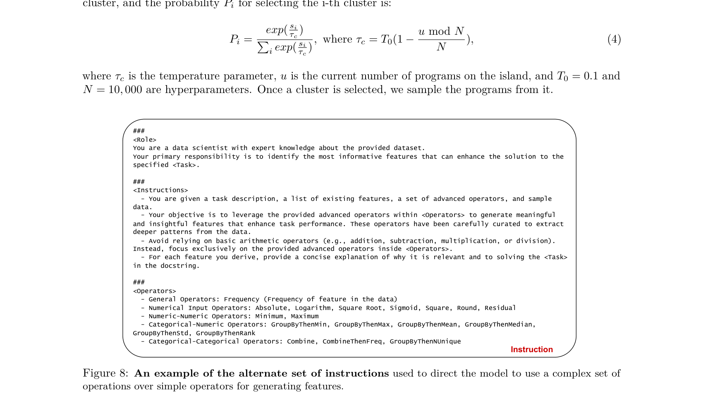
      * **Hình này chứng minh điều gì**
        * Prompt cấm rõ ràng các phép toán số học cơ bản và bắt buộc mô hình chỉ dùng danh mục toán tử nâng cao.
      * **Từ đâu mà thấy được**
        * Mục `<Instructions>` yêu cầu tránh phép toán cơ bản (cộng, trừ, nhân, chia) và tập trung vào `<Operators>`.
        * Mục `<Operators>` phân loại cụ thể các toán tử phức tạp cho đầu vào số và biến phân loại.
  * Chất lượng của các đặc trưng được sinh ra đã được phân tích chi tiết trong Appendix 5.2.
  * Ngữ cảnh có cấu trúc giúp mô hình tận dụng tri thức miền (domain knowledge) để sinh ra các giả thuyết có ý nghĩa ngữ nghĩa và ngữ cảnh cho các chương trình tối ưu hóa đặc trưng mới.

#### Data-Driven Evaluation

* Quy trình đánh giá dựa trên dữ liệu (Data-Driven Evaluation) kiểm định và xếp hạng các giả thuyết đặc trưng được sinh ra:
  * Sau khi gửi prompt cho LLM, lấy mẫu $b = 3$ đầu ra (outputs).
  * Dựa trên các thực nghiệm sơ bộ, nhiệt độ sinh đầu ra của LLM được thiết lập ở mức $t = 0.8$ nhằm cân bằng giữa tính sáng tạo / khám phá (creativity / exploration) và việc tuân thủ các ràng buộc bài toán cũng như khai thác tri thức tiên nghiệm (exploitation).
  * Quy trình sửa đổi dữ liệu (data modification process) được minh họa tại Figure $9\text{(c)}$, trong đó các đầu ra của LLM được sử dụng để biến đổi đặc trưng thông qua hàm `modify_features(input)`.
  * Các đặc trưng đã sửa đổi sau đó được đưa vào một mô hình dự đoán (prediction model), và điểm số kiểm định (validation score) tương ứng được tính toán.
  * Đánh giá chịu ràng buộc về thời gian và bộ nhớ nhằm đảm bảo hiệu quả tài nguyên trong quá trình tìm kiếm:
    * Giới hạn thời gian thực thi: $T = 30\text{ giây}$ ($30\text{s}$).
    * Giới hạn bộ nhớ: $M = 2\text{GB}$.
    * Các chương trình vượt quá các giới hạn này sẽ bị loại (disqualified) và gán điểm số `None`, bảo đảm tiến trình tìm kiếm không bị đình trệ.

#### Memory Management

* Quản lý bộ nhớ (Memory Management) kế thừa mô hình "các đảo" (islands model) (Cranmer, 2023; Shojaee et al., 2025; Romera-Paredes et al., 2024):
  * Các giả thuyết được tạo ra cùng với điểm số đánh giá được lưu trữ trong một bộ đệm bộ nhớ gồm nhiều đảo ($m = 3$) tiến hóa độc lập.
  * Mỗi đảo được khởi tạo với một chương trình biến đổi đặc trưng đơn giản đặc thù cho tập dữ liệu (`def modify_features_v0()` trong Figure $9\text{(d)}$).
  * Trong mỗi vòng lặp, các giả thuyết mới lạ và chỉ số kiểm định chỉ được nạp vào đảo tương ứng nếu chúng vượt qua điểm số tốt nhất hiện tại của đảo đó.
* Phân cụm dựa trên chữ ký (Signature-based clustering) để duy trì tính đa dạng:
  * Trong mỗi đảo, các chương trình khám phá đặc trưng được phân cụm dựa trên chữ ký (signature) đặc trưng bởi điểm số kiểm định.
  * Các chương trình tạo ra điểm số kiểm định giống hệt nhau được hợp nhất lại với nhau, tạo thành các cụm riêng biệt.
  * Chiến lược phân cụm giúp duy trì tính đa dạng (preserve diversity) bằng cách bảo đảm các chương trình có đặc tính hiệu năng khác nhau cùng tồn tại trong quần thể (population).
* Xây dựng prompt cho LLM từ bộ đệm các đảo:
  * Sau khi cập nhật mẫu prompt ban đầu với thông tin đặc thù của tập dữ liệu, tích hợp các ví dụ minh họa trong ngữ cảnh (in-context demonstrations) từ bộ đệm (Shojaee et al., 2025; Romera-Paredes et al., 2024).
  * Lựa chọn ngẫu nhiên một trong $m$ đảo khả dụng.
  * Trong đảo đã chọn, lấy mẫu $k = 3$ chương trình để làm ví dụ minh họa trong ngữ cảnh.
  * Lựa chọn cụm dựa trên chữ ký theo chiến lược lựa chọn Boltzmann (Boltzmann selection strategy) (De La Maza & Tidor, 1992), ưu tiên các cụm có điểm số cao hơn.
  * Với $s_i$ là điểm số của cụm thứ $i$, xác suất $P_i$ để lựa chọn cụm thứ $i$ được xác định bởi:
    $$P_i = \frac{\exp\left(\frac{s_i}{\tau_c}\right)}{\sum_i \exp\left(\frac{s_i}{\tau_c}\right)} \tag{4}$$
  * Trong đó tham số nhiệt độ $\tau_c$ được tính theo công thức:
    $$\tau_c = T_0 \left(1 - \frac{u \bmod N}{N}\right)$$
    * $\tau_c$ là tham số nhiệt độ (temperature parameter).
    * $u$ là số lượng chương trình hiện tại trên đảo.
    * $T_0 = 0.1$ và $N = 10, 000$ ($10{,}000$) là các siêu tham số (hyperparameters).
  * Sau khi một cụm được chọn, các chương trình sẽ được lấy mẫu từ cụm đó để đưa vào prompt.

### B.2 Baselines

* Nhóm tác giả triển khai và đánh giá nhiều phương pháp đường cơ sở kỹ thuật đặc trưng tiên tiến nhất (state-of-the-art feature engineering baselines), trải dài từ các phương pháp truyền thống (traditional methods) đến các phương pháp tiếp cận gần đây dựa trên mô hình ngôn ngữ lớn (recent LLM-based approaches), nhằm so sánh đối chuẩn với LLM-FE.
* Sau khi sinh các đặc trưng bằng từng phương pháp cơ sở, một đường ống tiền xử lý thống nhất (unified preprocessing pipeline) được áp dụng để chuẩn bị dữ liệu cho quá trình huấn luyện và đánh giá trên mô hình học máy (machine learning model).
* Các phương pháp đường cơ sở cụ thể được triển khai bao gồm:

#### FeatLLM

* **Nguyên lý hoạt động:**
  * FeatLLM sử dụng một LLM để sinh ra các quy tắc nhằm nhị phân hóa các đặc trưng (rules to binarize features).
  * Các đặc trưng nhị phân này sau đó được sử dụng làm đầu vào cho một mô hình đơn giản (simple model), chẳng hạn như mô hình hồi quy tuyến tính (linear regression).
* **Triển khai và hiệu chỉnh mô hình suy luận:**
  * Nhóm nghiên cứu tùy biến triển khai mã nguồn mở của FeatLLM (kho mã nguồn chính thức: `https://github.com/Sungwon-Han/FeatLLM`).
  * Đường ống thực thi được sửa đổi để sử dụng mô hình XGBoost cho tác vụ suy luận (inference).
* **Cấu hình dữ liệu và đảm bảo so sánh công bằng (fair comparison):**
  * Mô hình XGBoost được huấn luyện trên toàn bộ tập dữ liệu huấn luyện (entire training dataset).
  * LLM chỉ sử dụng một tập con gồm $10$ mẫu ($10$ samples) để sinh ra các đặc trưng nhị phân.
* **Cơ chế ghép nhóm (ensembling):**
  * Do FeatLLM sinh ra nhiều tập đặc trưng song song qua các lượt gọi LLM (parallel across LLM calls), kết quả được báo cáo thông qua việc ghép nhóm (ensemble) trên $3$ mẫu ($3$ samples) nhằm duy trì tính nhất quán khi so sánh với LLM-FE.

#### AutoFeat

* **Nguyên lý hoạt động:**
  * AutoFeat là một phương pháp tiếp cận kỹ thuật đặc trưng cổ điển (classical feature engineering approach).
  * Phương pháp sử dụng cơ chế lấy mẫu con đặc trưng lặp đi lặp lại (iterative feature subsampling) kết hợp với tìm kiếm chùm (beam search) để lựa chọn các đặc trưng mang nhiều thông tin (informative features).
* **Triển khai và cấu hình tham số:**
  * Nhóm tác giả sử dụng gói thư viện mã nguồn mở `autofeat` (kho mã nguồn: `https://github.com/cod3licious/autofeat.git`).
  * Toàn bộ các thiết lập tham số mặc định (default parameter settings) được giữ nguyên.
  * Các thiết lập tham số được tham chiếu trực tiếp từ các tệp ví dụ định dạng `.ipynb` được cung cấp trong kho lưu trữ chính thức của phương pháp.

#### CAAFE

* **Triển khai và thiết lập tham số:**
  * Nhóm tác giả sử dụng triển khai chính thức của CAAFE, đồng thời duy trì toàn bộ các thiết lập tham số theo đúng quy định trong kho lưu trữ gốc.
* **Phạm vi tác vụ và tiền xử lý dữ liệu:**
  * Kho lưu trữ của CAAFE được thiết kế chuyên biệt cho các tập dữ liệu phân loại (classification datasets).
  * Tuân theo quy trình công việc (workflow) của CAAFE, dữ liệu được tiền xử lý trước khi đưa vào mô hình dự đoán sau giai đoạn kỹ thuật đặc trưng.
* **Giới hạn về ghép nhóm (ensembling):**
  * Do CAAFE thực hiện quy trình tinh chỉnh đặc trưng tuần tự (sequential feature refinement) và chỉ tạo ra một giải pháp ứng viên độc lập duy nhất (single independent candidate solution), kỹ thuật ghép nhóm (ensembling) không thể áp dụng được (not applicable).

#### OCTree

* **Triển khai và chuẩn hóa hệ thống:**
  * Triển khai chính thức của OCTree được điều chỉnh nhằm giữ cho phần nạp dữ liệu (data loading) và phần khởi tạo mô hình (model initialization) dùng chung thống nhất với hệ thống thử nghiệm.
* **Giới hạn phạm vi tác vụ:**
  * OCTree chỉ được triển khai cho các tập dữ liệu phân loại (classification datasets), do mã nguồn chính thức bị giới hạn ở các tập dữ liệu phân loại.
  * Nhóm tác giả không tự ý chạy trên các tập dữ liệu hồi quy (regression datasets) nhằm tránh nguy cơ sai lệch trong quá trình triển khai (incorrect implementation).
* **Giới hạn về ghép nhóm (ensembling):**
  * Tương tự CAAFE, OCTree tuân theo quy trình tối ưu hóa tuần tự (sequential optimization procedure) và không sinh ra nhiều giải pháp độc lập, do đó không hỗ trợ kỹ thuật ghép nhóm (ensembling).

#### OpenFE

* **Nguyên lý hoạt động:**
  * OpenFE là một phương pháp kỹ thuật đặc trưng truyền thống tiên tiến nhất khác (state-of-the-art traditional feature engineering method).
  * Phương pháp tối ưu hóa không gian đặc trưng bằng cách sử dụng các thuật toán tăng cường đặc trưng (feature boosting) và cắt tỉa đặc trưng (pruning algorithms).
* **Triển khai và cấu hình tham số:**
  * Nhóm nghiên cứu sử dụng gói thư viện mã nguồn mở `openfe` với các thiết lập tham số tiêu chuẩn (standard parameter settings).

## Appendix C Dataset Details

* Các tập dữ liệu được tuyển chọn để đánh giá thực nghiệm trải rộng trên ba nhóm bài toán chính: ($1$) phân loại nhị phân (binary classification), ($2$) phân loại đa lớp (multi-class classification), và ($3$) các bài toán hồi quy (regression).
* Nguồn thu thập dữ liệu chủ yếu đến từ các nền tảng học máy tiêu chuẩn gồm OpenML (Vanschoren et al., $2014$; Feurer et al., $2021$), UCI Machine Learning Repository (Asuncion et al., $2007$), và Kaggle.
* Tiêu chí tuyển chọn đặc trưng:
  * Nhóm tác giả chủ đích lựa chọn các tập dữ liệu có tên đặc trưng mang tính mô tả (descriptive feature names).
  * Loại trừ các bộ dữ liệu chỉ sử dụng các định danh thuần số (merely numerical identifiers).
* Bối cảnh hóa tác vụ:
  * Mỗi tập dữ liệu đều đi kèm một phần mô tả tác vụ (task description), giúp tăng cường sự hiểu biết theo ngữ cảnh của người dùng và mô hình ngôn ngữ.
* Phổ phân bố quy mô mẫu và số chiều đặc trưng:
  * Tuyển tập dữ liệu bao gồm cả các tập kích thước nhỏ lẫn các tập mở rộng quy mô lớn, trong đó có các tập dữ liệu số chiều cao (high-dimensional datasets) với hơn $50$ đặc trưng.
  * Sự kết hợp phong phú này bao quát nhiều kịch bản thực tế với số chiều đặc trưng và quy mô mẫu biến thiên đa dạng, tạo nền tảng vững chắc để đánh giá các phương pháp kỹ thuật đặc trưng (feature engineering methods).
* Bảng 6 mô tả và thống kê chi tiết tập hợp các bộ dữ liệu được sử dụng trong đánh giá thực nghiệm:
  * **Bảng 6.** Thống kê các tập dữ liệu thực nghiệm (Dataset statistics).
    * 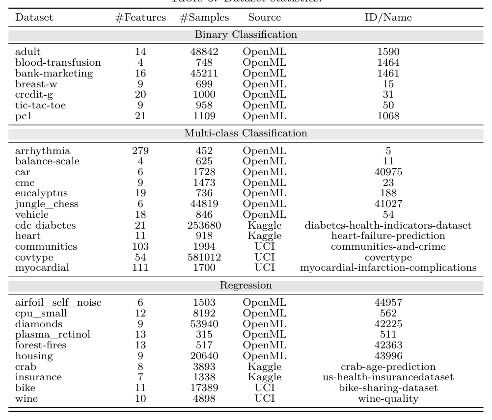
    * **Hình này chứng minh điều gì**
      * Nghiên cứu thiết lập một hệ thống đánh giá thực nghiệm phong phú gồm $29$ bộ dữ liệu dạng bảng phân bố trên $3$ nhóm bài toán: phân loại nhị phân ($7$ bộ), phân loại đa lớp ($12$ bộ) và hồi quy ($10$ bộ) với dải kích thước mẫu và số chiều đặc trưng rộng lớn.
    * **Từ đâu mà thấy được**
      * Bảng phân định rõ ba nhóm bài toán: $7$ tập Binary Classification, $12$ tập Multi-class Classification, và $10$ tập Regression.
      * Số chiều đặc trưng (#Features) dao động từ $4$ đến $279$ (arrhythmia: $279$, myocardial: $111$, communities: $103$).
      * Kích thước mẫu (#Samples) trải từ cỡ nhỏ $315$ mẫu (plasma_retinol) đến cỡ lớn $581.012$ mẫu (covtype) và $253.680$ mẫu (cdc diabetes).
      * Nguồn thu thập và mã định danh (Source, ID/Name) minh chứng nguồn gốc dữ liệu từ OpenML, Kaggle, và UCI.
* Chi tiết các tập dữ liệu theo nhóm bài toán được thống kê tại Bảng 6:
  * **Phân loại nhị phân (Binary Classification - $7$ tập dữ liệu):**
    * `adult`: $14$ đặc trưng, $48.842$ mẫu; nguồn OpenML (ID: $1590$).
    * `blood-transfusion`: $4$ đặc trưng, $748$ mẫu; nguồn OpenML (ID: $1464$).
    * `bank-marketing`: $16$ đặc trưng, $45.211$ mẫu; nguồn OpenML (ID: $1461$).
    * `breast-w`: $9$ đặc trưng, $699$ mẫu; nguồn OpenML (ID: $15$).
    * `credit-g`: $20$ đặc trưng, $1.000$ mẫu; nguồn OpenML (ID: $31$).
    * `tic-tac-toe`: $9$ đặc trưng, $958$ mẫu; nguồn OpenML (ID: $50$).
    * `pc1`: $21$ đặc trưng, $1.109$ mẫu; nguồn OpenML (ID: $1068$).
  * **Phân loại đa lớp (Multi-class Classification - $12$ tập dữ liệu):**
    * `arrhythmia`: $279$ đặc trưng, $452$ mẫu; nguồn OpenML (ID: $5$).
    * `balance-scale`: $4$ đặc trưng, $625$ mẫu; nguồn OpenML (ID: $11$).
    * `car`: $6$ đặc trưng, $1.728$ mẫu; nguồn OpenML (ID: $40975$).
    * `cmc`: $9$ đặc trưng, $1.473$ mẫu; nguồn OpenML (ID: $23$).
    * `eucalyptus`: $19$ đặc trưng, $736$ mẫu; nguồn OpenML (ID: $188$).
    * `jungle_chess`: $6$ đặc trưng, $44.819$ mẫu; nguồn OpenML (ID: $41027$).
    * `vehicle`: $18$ đặc trưng, $846$ mẫu; nguồn OpenML (ID: $54$).
    * `cdc diabetes`: $21$ đặc trưng, $253.680$ mẫu; nguồn Kaggle (`diabetes-health-indicators-dataset`).
    * `heart`: $11$ đặc trưng, $918$ mẫu; nguồn Kaggle (`heart-failure-prediction`).
    * `communities`: $103$ đặc trưng, $1.994$ mẫu; nguồn UCI (`communities-and-crime`).
    * `covtype`: $54$ đặc trưng, $581.012$ mẫu; nguồn UCI (`covertype`).
    * `myocardial`: $111$ đặc trưng, $1.700$ mẫu; nguồn UCI (`myocardial-infarction-complications`).
  * **Hồi quy (Regression - $10$ tập dữ liệu):**
    * `airfoil_self_noise`: $6$ đặc trưng, $1.503$ mẫu; nguồn OpenML (ID: $44957$).
    * `cpu_small`: $12$ đặc trưng, $8.192$ mẫu; nguồn OpenML (ID: $562$).
    * `diamonds`: $9$ đặc trưng, $53.940$ mẫu; nguồn OpenML (ID: $42225$).
    * `plasma_retinol`: $13$ đặc trưng, $315$ mẫu; nguồn OpenML (ID: $511$).
    * `forest-fires`: $13$ đặc trưng, $517$ mẫu; nguồn OpenML (ID: $42363$).
    * `housing`: $9$ đặc trưng, $20.640$ mẫu; nguồn OpenML (ID: $43996$).
    * `crab`: $8$ đặc trưng, $3.893$ mẫu; nguồn Kaggle (`crab-age-prediction`).
    * `insurance`: $7$ đặc trưng, $1.338$ mẫu; nguồn Kaggle (`us-health-insurancedataset`).
    * `bike`: $11$ đặc trưng, $17.389$ mẫu; nguồn UCI (`bike-sharing-dataset`).
    * `wine`: $10$ đặc trưng, $4.898$ mẫu; nguồn UCI (`wine-quality`).
* Thông tin mã nguồn mở của các phương pháp đối chuẩn (baseline repositories):
  * CAAFE: https://github.com/noahho/CAAFE
  * OCTree: https://github.com/jaehyun513/OCTree
  * OpenFE: https://github.com/IIIS-Li-Group/OpenFE.git

## Appendix D Additional Results

### D.1 LLM-FE and Hyperparameter Optimization (HPO)

* **Mục tiêu và thiết lập thực nghiệm đánh giá tác động của tối ưu hóa siêu tham số (HPO):**
  * Nhóm tác giả tiến hành thực nghiệm nhằm đánh giá tác động của tối ưu hóa siêu tham số (Hyperparameter Optimization - HPO) đối với phương pháp LLM-FE.
  * Các thử nghiệm được triển khai với hai mô hình học máy: XGBoost và Multilayer Perceptron (MLP).
  * Đánh giá được thực hiện trên $5$ tập dữ liệu phân loại (classification datasets) trong đó các mô hình đường cơ sở (baseline models) chỉ đạt độ chính xác (accuracies) dưới $0.8$ bao gồm: `eucalyptus`, `credit-g`, `cmc`, `blood-transfusion`, và `vehicle`.
* **Không gian tìm kiếm siêu tham số (hyperparameter search spaces):**
  * Không gian tìm kiếm siêu tham số cho mô hình XGBoost được thiết lập chi tiết theo Grinsztajn et al. ($2022$) gồm $10$ tham số điều chỉnh chính (chi tiết tại Bảng 7).
  * **Bảng 7.** Không gian tìm kiếm siêu tham số cho mô hình XGBoost
    * 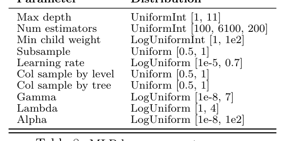
    * **Bảng này chứng minh điều gì**
      * Xác định phân phối xác suất và miền giá trị cho $10$ siêu tham số thuộc các nhóm cấu trúc cây, lấy mẫu, tốc độ học và điều chuẩn.
    * **Từ đâu mà thấy được**
      * Cột Parameter và Distribution liệt kê cấu trúc cây: Max depth UniformInt $[1, 11]$, Num estimators UniformInt $[100, 6100, 200]$, Min child weight LogUniformInt $[1, \text{1e2}]$.
      * Lấy mẫu ngẫu nhiên: Subsample, Col sample by level, Col sample by tree đều theo phân phối Uniform $[0.5, 1]$.
      * Tốc độ học và điều chuẩn theo LogUniform: Learning rate $[1\text{e-}5, 0.7]$, Gamma $[1\text{e-}8, 7]$, Lambda $[1, 4]$, Alpha $[1\text{e-}8, \text{1e2}]$.
  * Không gian tìm kiếm siêu tham số cho mô hình MLP được thiết lập chi tiết theo Gorishniy et al. ($2021$) gồm $7$ tham số kiến trúc và tối ưu (chi tiết tại Bảng 8).
  * **Bảng 8.** Không gian tìm kiếm siêu tham số cho mô hình MLP
    * 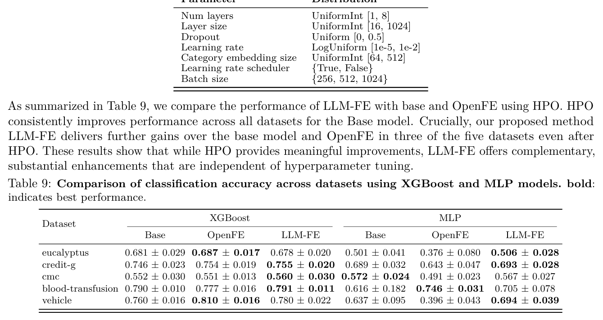
    * **Bảng này chứng minh điều gì**
      * Quy định cụ thể phân phối và miền giá trị cho toàn bộ 7 siêu tham số của mô hình MLP.
    * **Từ đâu mà thấy được**
      * Cột "Parameter" và "Distribution": các tham số kiến trúc gồm Num layers ($[1, 8]$), Layer size ($[16, 1024]$), Dropout ($[0, 0.5]$), Category embedding size ($[64, 512]$).
      * Các tham số tối ưu gồm Learning rate (LogUniform $[1\text{e-}5, 1\text{e-}2]$), Learning rate scheduler ($\{\text{True}, \text{False}\}$), Batch size ($\{256, 512, 1024\}$).
* **Quy trình tối ưu hóa và huấn luyện mô hình:**
  * Quá trình tối ưu hóa siêu tham số được thực hiện bằng Optuna (Akiba et al., $2019$).
  * Sử dụng $100$ lượt thử nghiệm (trials) với phương pháp lấy mẫu ngẫu nhiên (random sampling) trên nhiều phép phân chia tập dữ liệu (dataset splits).
  * Tất cả các mô hình MLP được huấn luyện tối đa lên tới $100$ epochs kết hợp cơ chế dừng sớm (early stopping).
  * Điểm kiểm tra (checkpoint) đạt điểm kiểm định (validation score) cao nhất được lưu giữ lại để đánh giá cuối cùng.
* **Kết quả so sánh hiệu năng khi áp dụng HPO (Bảng 9):**
  * Bảng 9 tóm tắt kết quả so sánh độ chính xác phân loại giữa mô hình cơ sở (Base), OpenFE và LLM-FE khi kết hợp HPO trên cả hai kiến trúc XGBoost và MLP.
  * HPO mang lại sự cải thiện hiệu năng nhất quán trên toàn bộ các tập dữ liệu đối với mô hình Base.
  * Phương pháp đề xuất LLM-FE mang lại mức tăng trưởng hiệu năng vượt trội hơn so với mô hình Base và OpenFE trên $3$ trong số $5$ tập dữ liệu ngay cả sau khi đã thực hiện HPO:
    * Đối với mô hình XGBoost: LLM-FE đạt độ chính xác cao nhất trên `credit-g` ($0.755 \pm 0.020$), `cmc` ($0.560 \pm 0.030$), và `blood-transfusion` ($0.791 \pm 0.011$).
    * Đối với mô hình MLP: LLM-FE đạt độ chính xác cao nhất trên `eucalyptus` ($0.506 \pm 0.028$), `credit-g` ($0.693 \pm 0.028$), và `vehicle` ($0.694 \pm 0.039$).
  * Chi tiết độ chính xác phân loại đầy đủ qua từng tập dữ liệu (mean $\pm$ standard deviation):
    * Tập dữ liệu `eucalyptus`:
      * Mô hình XGBoost: Base đạt $0.681 \pm 0.029$, OpenFE đạt $\mathbf{0.687 \pm 0.017}$ (tốt nhất), LLM-FE đạt $0.678 \pm 0.020$.
      * Mô hình MLP: Base đạt $0.501 \pm 0.041$, OpenFE đạt $0.376 \pm 0.080$, LLM-FE đạt $\mathbf{0.506 \pm 0.028}$ (tốt nhất).
    * Tập dữ liệu `credit-g`:
      * Mô hình XGBoost: Base đạt $0.746 \pm 0.023$, OpenFE đạt $0.754 \pm 0.019$, LLM-FE đạt $\mathbf{0.755 \pm 0.020}$ (tốt nhất).
      * Mô hình MLP: Base đạt $0.689 \pm 0.032$, OpenFE đạt $0.643 \pm 0.047$, LLM-FE đạt $\mathbf{0.693 \pm 0.028}$ (tốt nhất).
    * Tập dữ liệu `cmc`:
      * Mô hình XGBoost: Base đạt $0.552 \pm 0.030$, OpenFE đạt $0.551 \pm 0.013$, LLM-FE đạt $\mathbf{0.560 \pm 0.030}$ (tốt nhất).
      * Mô hình MLP: Base đạt $\mathbf{0.572 \pm 0.024}$ (tốt nhất), OpenFE đạt $0.491 \pm 0.023$, LLM-FE đạt $0.567 \pm 0.027$.
    * Tập dữ liệu `blood-transfusion`:
      * Mô hình XGBoost: Base đạt $0.790 \pm 0.010$, OpenFE đạt $0.777 \pm 0.016$, LLM-FE đạt $\mathbf{0.791 \pm 0.011}$ (tốt nhất).
      * Mô hình MLP: Base đạt $0.616 \pm 0.182$, OpenFE đạt $\mathbf{0.746 \pm 0.031}$ (tốt nhất), LLM-FE đạt $0.705 \pm 0.078$.
    * Tập dữ liệu `vehicle`:
      * Mô hình XGBoost: Base đạt $0.760 \pm 0.016$, OpenFE đạt $\mathbf{0.810 \pm 0.016}$ (tốt nhất), LLM-FE đạt $0.780 \pm 0.022$.
      * Mô hình MLP: Base đạt $0.637 \pm 0.095$, OpenFE đạt $0.396 \pm 0.043$, LLM-FE đạt $\mathbf{0.694 \pm 0.039}$ (tốt nhất).
* **Kết luận về tính độc lập và bổ trợ của LLM-FE đối với HPO:**
  * Mặc dù HPO đem lại những cải tiến có ý nghĩa đối với mô hình dự đoán, LLM-FE mang lại những nâng cao hiệu năng đáng kể và có tính chất bổ trợ (complementary, substantial enhancements).
  * Các cải tiến về mặt đặc trưng do LLM-FE tạo ra hoàn toàn độc lập với quá trình tinh chỉnh siêu tham số (independent of hyperparameter tuning).

### D.2 Generalizability Analysis

* Nghiên cứu mở rộng các kết quả thực nghiệm từ Section 4.4 nhằm minh chứng mức độ cải thiện hiệu năng đạt được bởi LLM-FE trên nhiều mô hình dự đoán (prediction models) khác nhau.
* Thiết lập thực nghiệm đánh giá trên các mô hình dự đoán đa dạng:
  * Cụ thể, nghiên cứu sử dụng XGBoost, MLP, và TabPFN để sinh các đặc trưng (generate features) và sau đó sử dụng chính các mô hình này cho tác vụ suy luận (inference).
  * Như được thể hiện trong Bảng 10 (Table 10), các đặc trưng được sinh bởi LLM-FE với mô hình nền tảng GPT-3.5-Turbo nhất quán cải thiện hiệu năng của mô hình trên các tập dữ liệu:
  * **Bảng 10.** Cải thiện hiệu năng với LLM-FE trên các mô hình dự đoán XGBoost, MLP và TabPFN
    * 
    * **Bảng này chứng minh điều gì**
      * Các đặc trưng được sinh bởi LLM-FE cải thiện nhất quán hiệu năng dự đoán trên hầu hết các bộ dữ liệu phân loại và hồi quy so với Base.
    * **Từ đâu mà thấy được**
      * Kết quả vượt trội trên 9/9 tập phân loại với XGBoost, 8/9 tập với MLP và TabPFN, và 5/5 tập hồi quy.
* Đánh giá mở rộng khả năng tổng quát hóa trên các mô hình ngôn ngữ lớn nền tảng (LLMs) khác nhau:
  * Thử nghiệm trên 3 LLM bổ sung gồm GPT-4o-mini, Qwen2.5-72B-Instruct và Gemini-2.5-Flash (Bảng 11 / Table 11):
  * **Bảng 11.** Khả năng tổng quát hóa trên các LLMs khác nhau với mô hình XGBoost
    * 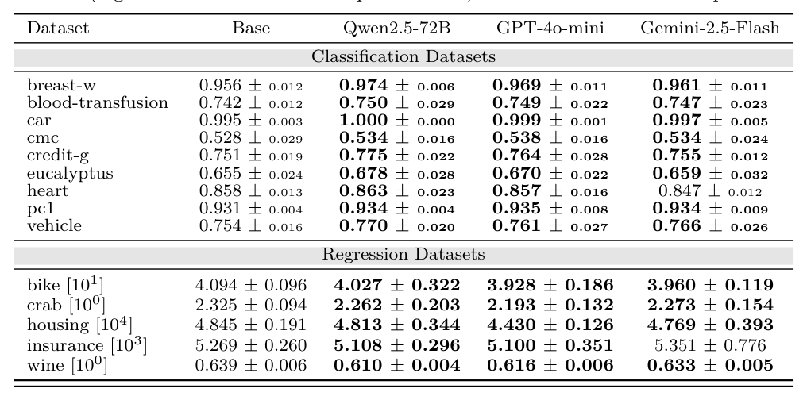
    * **Bảng này chứng minh điều gì**
      * Khung làm việc LLM-FE không phụ thuộc vào một LLM đơn lẻ; Qwen2.5, GPT-4o-mini và Gemini-2.5-Flash đều nâng cao hiệu năng một cách bền vững so với Base.
    * **Từ đâu mà thấy được**
      * Qwen2.5-72B cải thiện trên 9/9 tập phân loại, GPT-4o-mini dẫn đầu trên 4/5 tập hồi quy.
* Đánh giá mở rộng khả năng tổng quát hóa trên các mô hình dự đoán có kích thước nhỏ hơn:
  * Nghiên cứu triển khai thực nghiệm trên các mô hình dự đoán nhỏ hơn gồm CatBoost và Hồi quy Logistic (Bảng 12 / Table 12):
  * **Bảng 12.** Cải thiện hiệu năng với LLM-FE trên CatBoost và Logistic Regression
    * 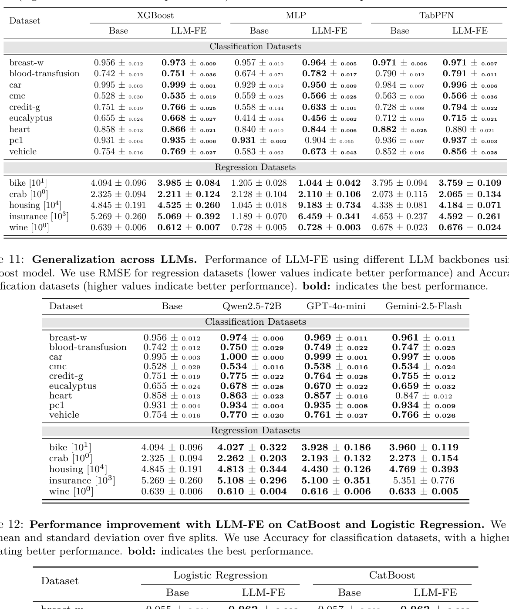
    * **Bảng này chứng minh điều gì**
      * LLM-FE mang lại sự cải thiện hiệu năng rõ rệt cho các mô hình nhỏ hơn như CatBoost và Hồi quy Logistic.
    * **Từ đâu mà thấy được**
      * Độ chính xác cải thiện trên 5/9 tập cho Logistic Regression và 6/9 tập cho CatBoost so với Base.
* Kết luận chung về khả năng tổng quát hóa:
  * Từ Bảng 10, Bảng 11 và Bảng 12 (Tables 10, 11, and 12), LLM-FE vượt trội hơn các mô hình cơ sở tương ứng trên phần lớn các bộ dữ liệu (LLM-FE outperforms the respective base models for most of the datasets).

### D.3 Transferability of Generated Features

* **Giới hạn của phương pháp truyền thống và khả năng chuyển giao đặc trưng (Transferability of Generated Features):**
  * Trong khi các phương pháp tiếp cận truyền thống (traditional approaches) thường sử dụng cùng một mô hình cho cả quá trình sinh đặc trưng (feature generation) lẫn suy luận (inference), nghiên cứu này chứng minh rằng các đặc trưng được sinh bởi một mô hình hoàn toàn có thể được tái sử dụng hiệu quả bởi các mô hình khác (cross-model utilization).
  * Kế thừa phương pháp từ Nam et al. (2024), nhóm tác giả sử dụng XGBoost — một mô hình dựa trên cây quyết định (decision tree-based model) có chi phí và hiệu quả tính toán vượt trội (computationally efficient) — để thực hiện sinh đặc trưng cho các kiến trúc mô hình phức tạp hơn trong giai đoạn suy luận (inference).
* **Kết quả thực nghiệm chuyển giao đặc trưng từ XGBoost sang MLP và TabPFN (minh họa tại Table 13):**
  * Các đặc trưng do XGBoost sinh ra (LLM-FE_XGB) đem lại sự cải thiện hiệu năng rõ rệt trên cả hai kiến trúc MLP và TabPFN so với Base:
  * **Bảng 13.** Phân tích so sánh hiệu năng của LLM-FE khi thực hiện chuyển giao đặc trưng
    * 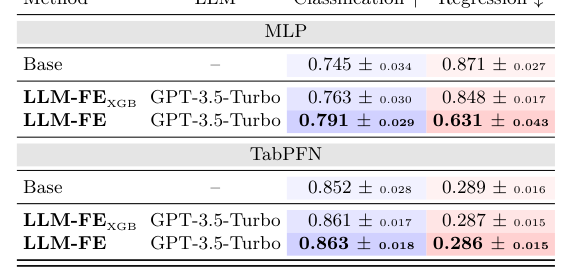
    * **Bảng này chứng minh điều gì**
      * Các đặc trưng do XGBoost sinh ra chuyển giao thành công sang MLP và TabPFN, cải thiện hiệu năng so với Base.
    * **Từ đâu mà thấy được**
      * Trên MLP phân loại đạt 0.763 (so với Base 0.745), trên TabPFN đạt 0.861 (so với Base 0.852).
* **Ý nghĩa học thuật của việc cải thiện hiệu năng xuyên kiến trúc (Cross-Architecture Performance Improvement):**
  * Sự cải thiện hiệu năng xuyên kiến trúc chứng minh rằng các đặc trưng được sinh bởi LLM-FE đã nắm bắt thành công các đặc tính dữ liệu có ý nghĩa thực chất (meaningful data characteristics).
  * Các đặc tính dữ liệu này mang giá trị biểu diễn phổ quát, hữu ích và có thể chuyển giao giữa các trường phái mô hình hóa khác nhau (different modeling paradigms).

### D.4 Statistical Analysis

* Nhằm đánh giá liệu kỹ nghệ đặc trưng (feature engineering) có mang lại sự cải thiện có ý nghĩa thống kê (statistically significant improvements) so với tập đặc trưng thô (raw feature set) hay không, nghiên cứu tiến hành các kiểm định Wilcoxon signed-rank một phía (one-tailed Wilcoxon signed-rank tests) so sánh LLM-FE với mô hình XGBoost cơ sở (base XGBoost model) trên tất cả các tập dữ liệu cho cả tác vụ phân loại (classification) và hồi quy (regression) (Bảng 14).
  * **Bảng 14.** Kiểm định ý nghĩa thống kê một phía Wilcoxon (Wilcoxon one-tailed significance test). In đậm: cải thiện có ý nghĩa thống kê ($p < 0.05$ cho phân loại, $p < 0.001$ cho hồi quy); gạch chân: cải thiện có ý nghĩa mức biên (marginally significant).
    * 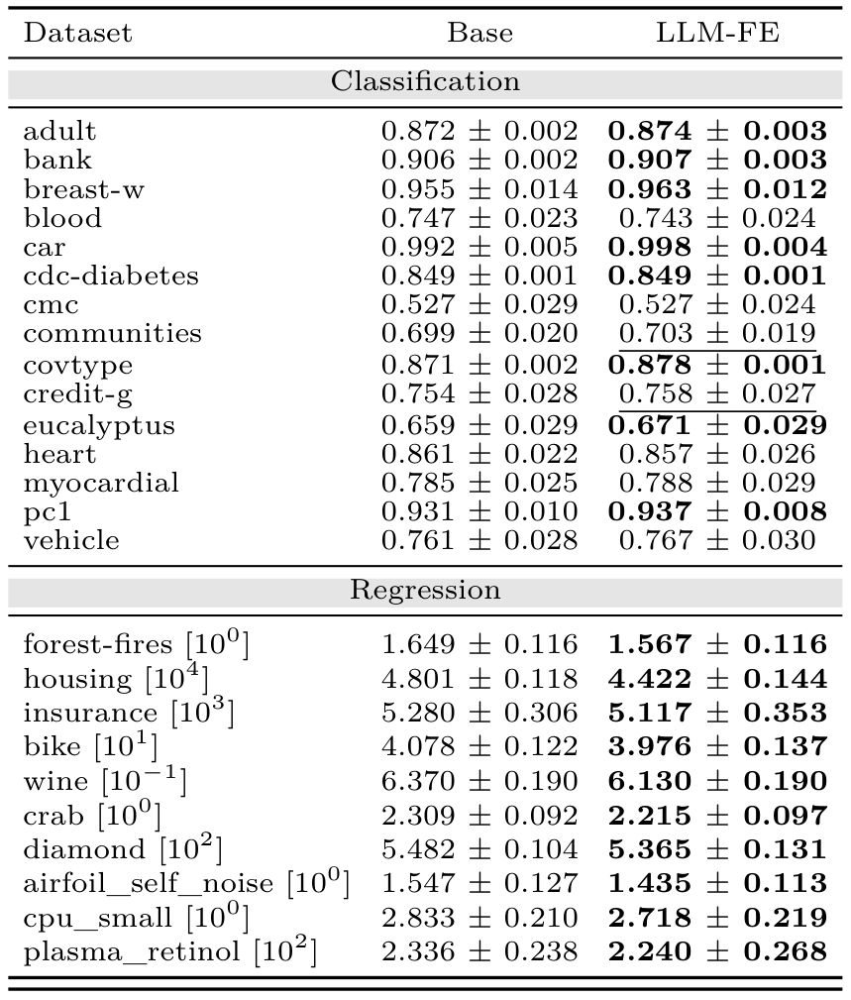
    * **Bảng này chứng minh điều gì**
      * Kỹ nghệ đặc trưng định hướng bởi LLM (LLM-FE) đem lại sự cải thiện hiệu năng có ý nghĩa thống kê so với mô hình XGBoost cơ sở trên toàn bộ $10/10$ tập dữ liệu hồi quy ($p < 0.001$) và đa số tập phân loại ($8/15$ tập đạt $p < 0.05$, $2/15$ tập đạt mức biên).
    * **Từ đâu mà thấy được**
      * Cột LLM-FE ở nhóm Regression in đậm toàn bộ $10/10$ bộ dữ liệu với sai số giảm nhất quán so với Base (tiêu biểu như housing từ $4.801 \pm 0.118$ giảm xuống $4.422 \pm 0.144 \times 10^4$).
      * Nhóm Classification có $8/15$ tập in đậm đạt cải thiện có ý nghĩa (như breast-w từ $0.955$ lên $0.963$, car từ $0.992$ lên $0.998$) và $2/15$ tập gạch chân đạt cải thiện mức biên (communities, credit-g).
      * Kiểm định Wilcoxon signed-rank một phía được thực hiện trên $25$ cặp quan sát phân bố qua $5$ random seeds và $5$-fold cross-validation với khoảng tin cậy $95\%$.
* Thiết lập thực nghiệm và giả thuyết của kiểm định thống kê:
  * Công thức kiểm định một phía (one-tailed formulation) là phù hợp do giả thuyết nghiên cứu mang tính định hướng nghiêm ngặt (strictly directional): kỹ nghệ đặc trưng phải cải thiện hiệu năng dự đoán (predictive performance) so với tập đặc trưng thô.
  * Các kiểm định được thực hiện trên $25$ quan sát theo cặp (paired observations) cho mỗi tập dữ liệu, thu được từ $5$ hạt ngẫu nhiên (random seeds) qua kiểm thực chéo $5$ lượt ($5$-fold cross-validation).
* Kết quả kiểm định mức ý nghĩa thống kê:
  * Với khoảng tin cậy $95\%$ ($95\%$ confidence intervals), LLM-FE đạt cải thiện có ý nghĩa thống kê so với mô hình cơ sở trên toàn bộ $10/10$ tập dữ liệu hồi quy ($p < 0.001$).
  * Đối với các tác vụ phân loại, LLM-FE đạt cải thiện có ý nghĩa thống kê trên $8/15$ tập dữ liệu ($p < 0.05$), cùng với cải thiện ở mức biên (marginal improvements) trên $2/15$ tập dữ liệu phân loại.
  * Mặc dù không phải mọi tập dữ liệu đều thể hiện cải thiện có ý nghĩa thống kê, nhưng sự gia tăng hiệu năng nhất quán trên hầu hết các tập dữ liệu hồi quy và nhiều tập dữ liệu phân loại cho thấy kỹ nghệ đặc trưng định hướng bởi LLM có thể đem lại những cải thiện có ý nghĩa so với không gian đặc trưng thô (raw feature space).
* Chi tiết định lượng kết quả kiểm định thống kê trên các tập dữ liệu phân loại (Classification datasets - chỉ số Accuracy $\uparrow$, biểu diễn Mean $\pm$ Std):
  * Tập `adult`: Base đạt $0.872 \pm 0.002$; LLM-FE đạt $\mathbf{0.874 \pm 0.003}$ (cải thiện có ý nghĩa thống kê).
  * Tập `bank`: Base đạt $0.906 \pm 0.002$; LLM-FE đạt $\mathbf{0.907 \pm 0.003}$ (cải thiện có ý nghĩa thống kê).
  * Tập `breast-w`: Base đạt $0.955 \pm 0.014$; LLM-FE đạt $\mathbf{0.963 \pm 0.012}$ (cải thiện có ý nghĩa thống kê).
  * Tập `blood`: Base đạt $0.747 \pm 0.023$; LLM-FE đạt $0.743 \pm 0.024$.
  * Tập `car`: Base đạt $0.992 \pm 0.005$; LLM-FE đạt $\mathbf{0.998 \pm 0.004}$ (cải thiện có ý nghĩa thống kê).
  * Tập `cdc-diabetes`: Base đạt $0.849 \pm 0.001$; LLM-FE đạt $\mathbf{0.849 \pm 0.001}$ (cải thiện có ý nghĩa thống kê).
  * Tập `cmc`: Base đạt $0.527 \pm 0.029$; LLM-FE đạt $0.527 \pm 0.024$.
  * Tập `communities`: Base đạt $0.699 \pm 0.020$; LLM-FE đạt $\underline{0.703 \pm 0.019}$ (cải thiện mức biên).
  * Tập `covtype`: Base đạt $0.871 \pm 0.002$; LLM-FE đạt $\mathbf{0.878 \pm 0.001}$ (cải thiện có ý nghĩa thống kê).
  * Tập `credit-g`: Base đạt $0.754 \pm 0.028$; LLM-FE đạt $\underline{0.758 \pm 0.027}$ (cải thiện mức biên).
  * Tập `eucalyptus`: Base đạt $0.659 \pm 0.029$; LLM-FE đạt $\mathbf{0.671 \pm 0.029}$ (cải thiện có ý nghĩa thống kê).
  * Tập `heart`: Base đạt $0.861 \pm 0.022$; LLM-FE đạt $0.857 \pm 0.026$.
  * Tập `myocardial`: Base đạt $0.785 \pm 0.025$; LLM-FE đạt $0.788 \pm 0.029$.
  * Tập `pc1`: Base đạt $0.931 \pm 0.010$; LLM-FE đạt $\mathbf{0.937 \pm 0.008}$ (cải thiện có ý nghĩa thống kê).
  * Tập `vehicle`: Base đạt $0.761 \pm 0.028$; LLM-FE đạt $0.767 \pm 0.030$.
* Chi tiết định lượng kết quả kiểm định thống kê trên các tập dữ liệu hồi quy (Regression datasets - chỉ số RMSE $\downarrow$, biểu diễn Mean $\pm$ Std):
  * Tập `forest-fires` ($[10^0]$): Base đạt $1.649 \pm 0.116$; LLM-FE đạt $\mathbf{1.567 \pm 0.116}$ (cải thiện có ý nghĩa thống kê).
  * Tập `housing` ($[10^4]$): Base đạt $4.801 \pm 0.118$; LLM-FE đạt $\mathbf{4.422 \pm 0.144}$ (cải thiện có ý nghĩa thống kê).
  * Tập `insurance` ($[10^3]$): Base đạt $5.280 \pm 0.306$; LLM-FE đạt $\mathbf{5.117 \pm 0.353}$ (cải thiện có ý nghĩa thống kê).
  * Tập `bike` ($[10^1]$): Base đạt $4.078 \pm 0.122$; LLM-FE đạt $\mathbf{3.976 \pm 0.137}$ (cải thiện có ý nghĩa thống kê).
  * Tập `wine` ($[10^{-1}]$): Base đạt $6.370 \pm 0.190$; LLM-FE đạt $\mathbf{6.130 \pm 0.190}$ (cải thiện có ý nghĩa thống kê).
  * Tập `crab` ($[10^0]$): Base đạt $2.309 \pm 0.092$; LLM-FE đạt $\mathbf{2.215 \pm 0.097}$ (cải thiện có ý nghĩa thống kê).
  * Tập `diamond` ($[10^2]$): Base đạt $5.482 \pm 0.104$; LLM-FE đạt $\mathbf{5.365 \pm 0.131}$ (cải thiện có ý nghĩa thống kê).
  * Tập `airfoil_self_noise` ($[10^0]$): Base đạt $1.547 \pm 0.127$; LLM-FE đạt $\mathbf{1.435 \pm 0.113}$ (cải thiện có ý nghĩa thống kê).
  * Tập `cpu_small` ($[10^0]$): Base đạt $2.833 \pm 0.210$; LLM-FE đạt $\mathbf{2.718 \pm 0.219}$ (cải thiện có ý nghĩa thống kê).
  * Tập `plasma_retinol` ($[10^2]$): Base đạt $2.336 \pm 0.238$; LLM-FE đạt $\mathbf{2.240 \pm 0.268}$ (cải thiện có ý nghĩa thống kê).

## Appendix E Qualitative Analysis

### E.1 Interpretability Analysis

* LLM-FE sinh các chương trình biến đổi đặc trưng (feature-transformation programs) bằng ngôn ngữ tự nhiên (natural language), qua đó hỗ trợ tính khả giải / khả năng diễn giải (interpretability) trực quan cho con người (minh họa tại Hình 11 / Figure 11).
  * Mỗi chương trình biến đổi đặc trưng được sinh ra đều được đánh giá độc lập (evaluated independently).
  * Các chương trình thành công được lưu trữ trong bộ đệm kinh nghiệm để phục vụ quá trình tinh chỉnh tiến hóa (evolutionary refinement).
  * Cơ chế này cho phép các phát hiện ban đầu (early discoveries) kết hợp, cấu thành các đặc trưng bậc cao hơn (higher-order features) trong khi vẫn bảo toàn trọn vẹn khả năng diễn giải.
* Phân tích quy kết thuộc tính (attribution analysis) bằng các giá trị SHAP (SHAP values) được tiến hành nhằm đánh giá độ thỏa dụng / tính hữu ích thực tế (utility) của các đặc trưng được sinh ra:
  * Kết quả thực nghiệm chứng minh rằng một tập con nhất quán các đặc trưng được khám phá nhận được điểm số quy kết thuộc tính cao (high attribution scores).
  * Điểm số SHAP cao chỉ ra rằng các đặc trưng này đóng góp tích cực và thực chất vào quy trình dự đoán (actively contribute to the prediction process), thay vì chỉ đóng vai trò là các phép tăng cường giả tạo (spurious augmentations) hay không được mô hình sử dụng (unused augmentations).
* Bằng chứng định lượng từ phân tích SHAP khẳng định các đặc trưng do LLM-FE khám phá nâng cao đáng kể hiệu năng mô hình và hỗ trợ ra quyết định (Bảng 15 / Table 15):
  * Cụ thể, $16{,}67\%$ các đặc trưng được sinh ra xếp hạng trong nhóm $10$ đặc trưng có tác động lớn nhất (top-$10$ most impactful features).
  * Hơn $60\%$ (chính xác là $62{,}96\%$) các đặc trưng được sinh xuất hiện trong nhóm $50$ đặc trưng có tác động lớn nhất (top-$50$).
  * Phân phối tỷ lệ tích lũy của các đặc trưng được sinh ra trong các nhóm top-$k$ theo SHAP:
    * Top-$10$: $16{,}67\%$
    * Top-$20$: $25{,}93\%$
    * Top-$30$: $37{,}04\%$
    * Top-$40$: $57{,}41\%$
    * Top-$50$: $62{,}96\%$
  * **Bảng 15.** Tỷ lệ phần trăm các đặc trưng được sinh ra xếp hạng trong top-$k$ đặc trưng có tác động lớn nhất theo SHAP (Table 15: Percentage of generated features ranked among the top-k most impactful features by SHAP).
    * 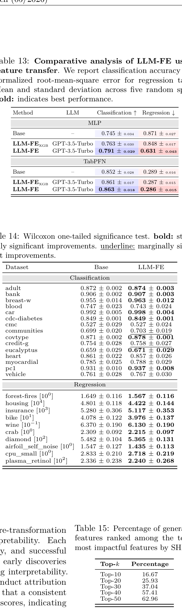
    * **Bảng này chứng minh điều gì**
      * Các đặc trưng do LLM-FE tạo ra đóng góp tích cực và chiếm tỷ trọng đáng kể trong các đặc trưng quan trọng nhất định hình dự đoán của mô hình, chứng minh tính hữu dụng thực chất thay vì là các đặc trưng rác hay biến đổi dư thừa.
    * **Từ đâu mà thấy được**
      * Cột `Percentage` trong Bảng 15 cho thấy $16{,}67\%$ đặc trưng lọt vào Top-$10$, hơn một phần tư ($25{,}93\%$) lọt vào Top-$20$, và tới gần hai phần ba ($62{,}96\%$) nằm trong Top-$50$ đặc trưng có trọng số SHAP cao nhất.

### E.2 Robustness to Noise

* Nhiễu (noise) là một thách thức phổ biến trong các tập dữ liệu thực tế (real-world datasets), phát sinh từ sự không hoàn hảo của cảm biến (sensor imperfections), lỗi của con người (human errors), biến động môi trường (environmental variability) và các giới hạn phần cứng (hardware constraints).
  * Hiện tượng dữ liệu bị hư hại / nhiễu loạn này có thể che khuất cấu trúc có ý nghĩa (meaningful structure) và cản trở khả năng của mô hình trong việc học các mối quan hệ thực sự tiềm ẩn (true underlying relationships).
* Phương pháp thực nghiệm đánh giá tính vững chắc trước nhiễu (robustness to noise):
  * Nhằm đánh giá khả năng của LLM-FE trong việc tận dụng tri thức tiên nghiệm (prior knowledge) và tìm kiếm tiến hóa (evolutionary search) để duy trì hiệu quả trong điều kiện nhiễu, nghiên cứu bổ sung nhiễu Gauss (Gaussian noise) với độ lệch chuẩn $\sigma \in \{0{,}0, 0{,}01, 0{,}05, 0{,}1\}$ vào các tập dữ liệu phân loại chỉ chứa đặc trưng dạng số (numerical classification datasets).
  * Đánh giá mô hình XGBoost kết hợp với nhiều phương pháp kỹ thuật đặc trưng (feature engineering approaches): Base (mô hình cơ sở không FE), OpenFE, CAAFE, và LLM-FE.
  * Sử dụng GPT-3.5-Turbo làm mô hình nền tảng (backbone LLM) đồng nhất cho tất cả các phương pháp dựa trên LLM.
  * Báo cáo độ chính xác trung bình (mean accuracy) trên $6$ tập dữ liệu phân loại chỉ chứa đặc trưng số.
* Kết quả phân tích tính vững chắc trước nhiễu (Hình 10 / Figure 10):
  * Trên tất cả các mức nhiễu ($\sigma = 0{,}0, 0{,}01, 0{,}05, 0{,}1$), LLM-FE luôn duy trì độ chính xác cao hơn rõ rệt và thể hiện tính vững chắc vượt trội so với các phương pháp cạnh tranh.
  * LLM-FE thể hiện khả năng chống chịu bền bỉ trước sự suy giảm hiệu năng do nhiễu gây ra (resilience to noise-induced degradation), nhờ cơ chế kết hợp giữa tri thức miền giúp lọc bỏ các biến đổi sai lệch và tìm kiếm tiến hóa giúp hội tụ về các đặc trưng bền vững.
  * **Hình 10.** Tác động của các mức nhiễu lên hiệu năng mô hình XGBoost giữa các phương pháp tiếp cận khác nhau trong điều kiện nhiễu tăng dần ($\sigma \in \{0{,}0, 0{,}1\}$) (Figure 10: Impact of Noise Levels on XGBoost model performance across different approaches under increasing noise conditions ($\sigma \in \{0{,}0, 0{,}1\}$)).
    * 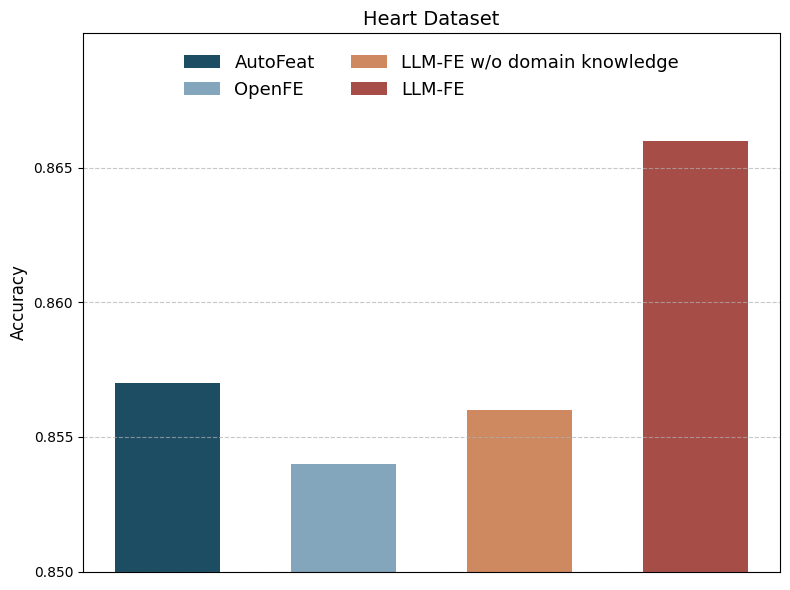
    * **Hình này chứng minh điều gì**
      * LLM-FE duy trì độ chính xác và tính vững chắc vượt trội nhất quán so với Base, OpenFE và CAAFE khi mức độ nhiễu Gauss tăng dần từ $\sigma = 0{,}0$ đến $\sigma = 0{,}1$ trên các tập dữ liệu phân loại số.
    * **Từ đâu mà thấy được**
      * Đồ thị của Hình 10 trên $6$ tập dữ liệu cho thấy đường biểu diễn của LLM-FE luôn nằm trên cùng (độ chính xác duy trì từ khoảng trên $0{,}90$ xuống $0{,}88$), có độ dốc suy giảm thoải hơn hẳn so với OpenFE, CAAFE và mô hình cơ sở Base.

### E.3 Impact of Domain Knowledge

* Lợi ích định tính (qualitative benefits) và định lượng (quantitative benefits) của các phép biến đổi đặc trưng đặc thù theo miền (domain-specific feature transforms) được làm rõ thông qua hai tập dữ liệu y tế (minh họa tại Hình 11 / Figure 11):
  * Tập dữ liệu `Breast-W`: tập trung vào bài toán phân biệt giữa khối u lành tính (benign) và u ác tính (malignant tumors).
  * Tập dữ liệu `Heart`: dự đoán nguy cơ mắc bệnh tim mạch (cardiovascular disease risk) dựa trên các thuộc tính lâm sàng của bệnh nhân.
  * Cả hai tác vụ đều khẳng định vai trò quyết định của tri thức miền (domain knowledge) trong việc phát hiện các đặc trưng có ý nghĩa thực tế.
* Nhờ tận dụng tri thức miền nhúng sẵn (embedded domain knowledge), LLM-FE không chỉ nâng cao đáng kể độ chính xác mô hình mà còn đưa ra lập luận biện giải (justification) rõ ràng cho việc lựa chọn đặc trưng, tạo nên một quy trình kỹ thuật đặc trưng có khả năng giải thích cao (interpretable feature engineering).
* Phân tích trường hợp trên tập dữ liệu `Heart`:
  * **LLM-FE (có tri thức miền)**: đề xuất đặc trưng `Log_Cholesterol` nhờ nhận thức được vai trò sống còn của nồng độ cholesterol huyết thanh (serum cholesterol) đối với sức khỏe tim mạch, áp dụng phép biến đổi logarit nhằm chuẩn hóa phân phối, giảm ảnh hưởng của các giá trị ngoại lai (outliers) và ổn định phương sai (stabilize variance):
    ```python
    def modify_features(df_input) -> pd.DataFrame:
        """
        Thought: Taking the logarithm of serum cholesterol
                 may help normalize the distribution and
                 emphasize the impact of extreme values.
        Feature: Log_Cholesterol | Log_Cholesterol = Logarithm(Cholesterol)
        """
        df_output = df_input.copy()
        # Calculate Log_Cholesterol
        df_output['Log_Cholesterol'] = df_output['Cholesterol'].apply(lambda x: np.log(x) if x > 0 else 0)
        return df_output
    ```
  * **Biến thể LLM-FE w/o Domain Knowledge (không có tri thức miền)**: chỉ kết hợp tùy tiện các đặc trưng hiện có dựa trên cấu trúc hình thức (tần suất giá trị phân loại `C_1_freq` hoặc giá trị trung bình nhóm `C_3_mean_by_C_1`), tạo ra các biến đổi không thể giải thích bản chất y khoa và làm suy giảm hiệu năng tổng thể (Hình 11(a) và 11(b)):
    ```python
    def modify_features(df_input) -> pd.DataFrame:
        """
        Thought: Considering the importance of categorical variables in the prediction task.
        Feature: Frequency of C_1.
        Feature: GroupByThenMean of C_3 based on C_1.
        """
        df_output = df_input.copy()
        # Frequency of C_1
        df_output['C_1_freq'] = df_output['C_1'].map(df_output['C_1'].value_counts())
        # GroupByThenMean of C_3 based on C_1
        df_output['C_3_mean_by_C_1'] = df_output.groupby('C_1')['C_3'].transform('mean')
        return df_output
    ```
* Phân tích trường hợp trên tập dữ liệu `Breast-W`:
  * **LLM-FE (có tri thức miền)**: xác định đặc trưng `proliferation_activity`, một chỉ số tương tác có ý nghĩa sinh học thực sự (biologically relevant metric) giữa hạch nhân bình thường và sự phân bào (`Normal_Nucleoli * Mitoses`), giúp nắm bắt hoạt động tăng sinh tế bào ác tính và cải thiện trực tiếp khả năng dự đoán bệnh:
    ```python
    def modify_features(df_input) -> pd.DataFrame:
        """
        Thought: Interaction between normal nucleoli and mitoses could capture
                 the proliferative activity and potentially enhance the
                 predictive power for malignancy.
        Feature: proliferation_activity | proliferation_activity = Normal_Nucleoli*Mitoses
        """
        df_output = df_input.copy()
        # Calculate the proliferation activity
        df_output['proliferation_activity'] = df_output['Normal_Nucleoli'] * df_output['Mitoses']
        return df_output
    ```
  * **Biến thể LLM-FE w/o Domain Knowledge (không có tri thức miền)**: chỉ thực hiện phép cộng gộp trung bình thô của tất cả các đặc trưng từ $C_0$ đến $C_8$ (`avg_C`), hoàn toàn thiếu vắng tính giải thích và ý nghĩa lâm sàng (clinical significance) (Hình 11(b) và 11(c)):
    ```python
    def modify_features(df_input) -> pd.DataFrame:
        """
        Adding a feature representing the average value of C_0 to C_8
        as a potential indicator of the overall severity
        """
        df_output = df_input.copy()
        df_output['avg_C'] = df_output[['C_0', 'C_1', 'C_2', 'C_3', 'C_4', 'C_5', 'C_6', 'C_7', 'C_8']].mean(axis=1)
        return df_output
    ```
* Hiệu năng định lượng so sánh trên mô hình XGBoost (Hình 11(a)):
  * Trên tập `Breast-W`: LLM-FE đạt độ chính xác xấp xỉ $0{,}970$, vượt trội rõ rệt so với biến thể không có tri thức miền ($\approx 0{,}960$) cũng như các phương pháp truyền thống AutoFeat ($\approx 0{,}9565$) và OpenFE ($\approx 0{,}9565$).
  * Trên tập `Heart`: LLM-FE đạt độ chính xác xấp xỉ $0{,}866$, vượt xa biến thể không có tri thức miền ($\approx 0{,}856$), AutoFeat ($\approx 0{,}857$), và OpenFE ($\approx 0{,}854$).
  * Sự suy giảm hiệu năng của các phương pháp truyền thống và biến thể không tri thức miền khẳng định rằng việc chỉ dựa vào toán tử tìm kiếm cơ học mà thiếu hiểu biết ngữ cảnh miền dữ liệu sẽ hạn chế tiềm năng tối ưu hóa.
* Tích hợp Hình 11:
  * **Hình 11.** Phân tích định lượng và định tính về tác động của tri thức miền đối với LLM-FE trên các tập dữ liệu Heart và Breast-W (Figure 11: Quantitative and Qualitative Analysis on Impact of Domain Knowledge for LLM-FE on Heart and Breast-W datasets).
    * 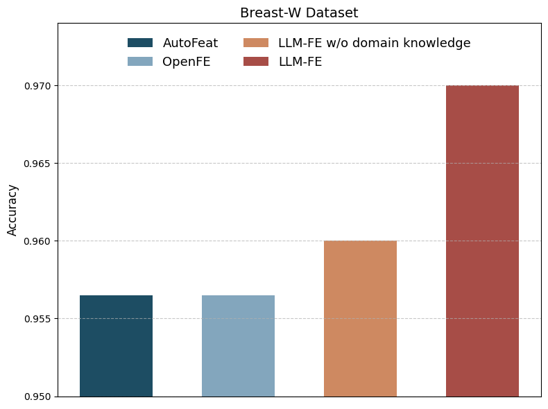
    * **Hình này chứng minh điều gì**
      * Việc tích hợp tri thức miền giúp LLM-FE đạt độ chính xác vượt trội trên cả hai tập dữ liệu y tế (Breast-W đạt $\approx 0{,}970$ và Heart đạt $\approx 0{,}866$), vượt xa biến thể không có tri thức miền ($\approx 0{,}960$ và $\approx 0{,}856$) cũng như các phương pháp truyền thống OpenFE và AutoFeat. Đồng thời, các chương trình khám phá đặc trưng do LLM-FE sinh ra mang tính diễn giải lâm sàng rõ ràng (như `Log_Cholesterol` và `proliferation_activity`) thay vì các phép kết hợp tùy tiện thiếu ý nghĩa.
    * **Từ đâu mà thấy được**
      * Biểu đồ so sánh hiệu năng của mô hình XGBoost ở Hình 11(a) cho thấy cột của LLM-FE cao vượt trội so với các cột còn lại trên cả hai tập dữ liệu Breast-W và Heart Dataset; kết hợp với các chương trình Python cụ thể ở Hình 11(b) và 11(c) thể hiện rõ ràng các hàm biến đổi đặc trưng dựa trên tri thức miền.

### E.4 Impact of Multi-Island Evolution

* Cơ chế phân hoạch quần đảo độc lập (multi-island partitioning):
  * Khi khởi tạo, quy trình khám phá đặc trưng được chia thành $k$ quần đảo độc lập (independent islands) bằng cách phân chia đồng đều tập đặc trưng ứng viên (candidate feature set).
  * Với một ngân sách tính toán cố định gồm $T$ vòng lặp (iterations), mỗi quần đảo nhận được xấp xỉ $T/k$ vòng lặp.
  * Số lượng quần đảo $k$ đóng vai trò là yếu tố kiểm soát cốt lõi đối với sự cân bằng đánh đổi giữa khám phá (exploration) và khai thác (exploitation):
    * Giá trị $k$ nhỏ hơn: cho phép tinh chỉnh sâu hơn trong từng quần đảo (deeper refinement within each island), nhấn mạnh vào khai thác tri thức hiện có (exploitation).
    * Giá trị $k$ lớn hơn: khuyến khích khám phá trên diện rộng hơn (broader exploration) nhờ kích hoạt đồng thời nhiều quỹ đạo tìm kiếm độc lập với độ sâu tinh chỉnh nông hơn (shallower refinement).
* Đánh giá thực nghiệm với các thiết lập đại diện $k \in \{1, 3, 5\}$ trên $6$ tập dữ liệu phân loại (Bảng 16 / Table 16):
  * Số lượng đảo vừa phải ($k = 3$) mang lại sự cân bằng tối ưu nhất quán giữa khám phá và tinh chỉnh:
    * Thiết lập $1$ đảo duy nhất ($k = 1$) hạn chế tính đa dạng của các đặc trưng được khám phá.
    * Thiết lập quá nhiều đảo ($k = 5$) làm giảm độ sâu tinh chỉnh phân bổ cho từng quỹ đạo tìm kiếm.
  * Hiệu năng tổng thể của mô hình thể hiện tính vững chắc (robust) trên các cấu hình số lượng đảo khác nhau.
  * Các quỹ đạo tìm kiếm độc lập bổ trợ hiệu quả cho nhau (complementary exploration), tạo ra kết quả ổn định và tối ưu khi ngân sách tính toán được phân bổ hợp lý.
* Chi tiết kết quả thực nghiệm từ Bảng 16 (Độ chính xác phân loại trung bình $\pm$ độ lệch chuẩn qua $5$ lần phân chia train/test, giá trị in đậm chỉ hiệu năng tốt nhất):
  * Tập dữ liệu `adult`:
    * $k = 1$: $\mathbf{0{,}874 \pm 0{,}002}$
    * $k = 3$: $\mathbf{0{,}874 \pm 0{,}002}$
    * $k = 5$: $\mathbf{0{,}874 \pm 0{,}003}$
  * Tập dữ liệu `bank`:
    * $k = 1$: $\mathbf{0{,}908 \pm 0{,}003}$
    * $k = 3$: $0{,}907 \pm 0{,}002$
    * $k = 5$: $0{,}907 \pm 0{,}003$
  * Tập dữ liệu `cmc`:
    * $k = 1$: $0{,}532 \pm 0{,}017$
    * $k = 3$: $\mathbf{0{,}535 \pm 0{,}019}$
    * $k = 5$: $0{,}528 \pm 0{,}010$
  * Tập dữ liệu `car`:
    * $k = 1$: $\mathbf{0{,}999 \pm 0{,}003}$
    * $k = 3$: $\mathbf{0{,}999 \pm 0{,}001}$ (độ lệch chuẩn thấp nhất)
    * $k = 5$: $0{,}998 \pm 0{,}003$
  * Tập dữ liệu `breast-w`:
    * $k = 1$: $0{,}966 \pm 0{,}014$
    * $k = 3$: $\mathbf{0{,}973 \pm 0{,}009}$
    * $k = 5$: $0{,}969 \pm 0{,}014$
  * Tập dữ liệu `vehicle`:
    * $k = 1$: $0{,}761 \pm 0{,}012$
    * $k = 3$: $0{,}769 \pm 0{,}013$
    * $k = 5$: $\mathbf{0{,}773 \pm 0{,}015}$
  * **Bảng 16.** Ảnh hưởng của số lượng quần đảo trong LLM-FE (Table 16: Effect of the number of islands in LLM-FE).
    * 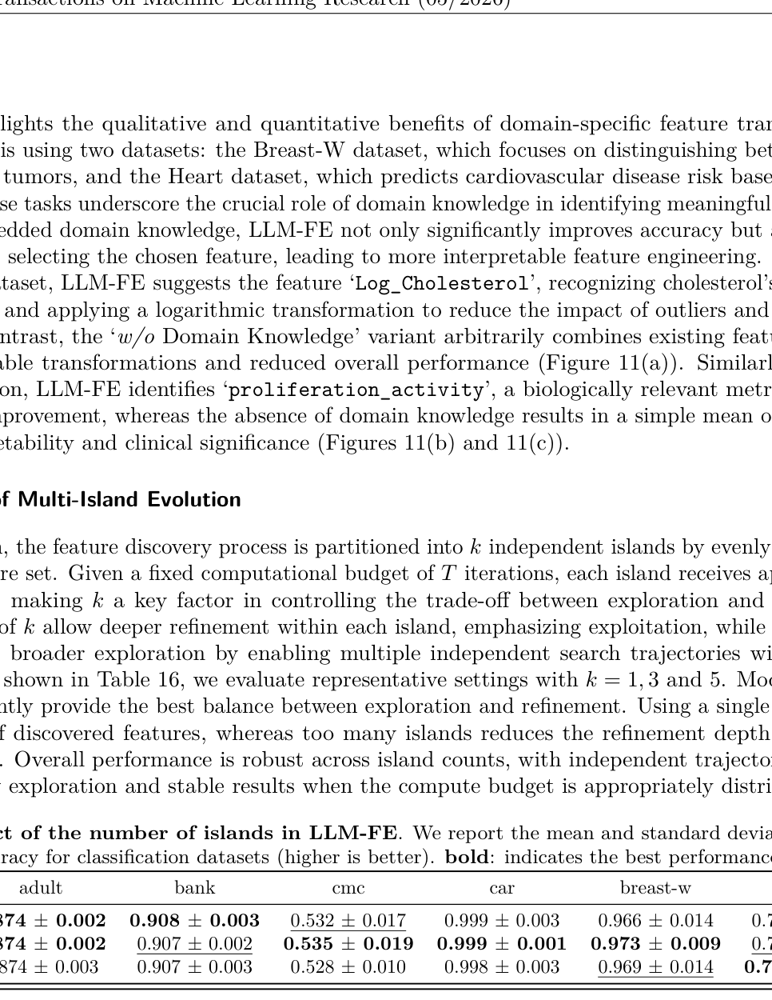
    * **Bảng này chứng minh điều gì**
      * Cấu hình số lượng quần đảo trung bình ($k = 3$) mang lại hiệu năng cao nhất trên phần lớn các tập dữ liệu (`cmc`, `breast-w`, `car`, `adult`), đồng thời hiệu năng tổng thể của mô hình rất vững chắc và ít nhạy cảm tiêu cực với việc thay đổi $k$.
    * **Từ đâu mà thấy được**
      * Cột $k = 3$ chiếm ưu thế về số lượng kết quả tốt nhất (in đậm) và duy trì độ lệch chuẩn nhỏ nhất (như $\pm 0{,}001$ ở `car` và $\pm 0{,}009$ ở `breast-w`), trong khi độ chênh lệch giữa $k=1$, $k=3$, $k=5$ trên toàn bộ các tập dữ liệu đều nằm trong phạm vi sai số thống kê nhỏ ($\le 0{,}012$).

### E.5 Impact of Evolutionary Refinement

* Phân tích quỹ đạo tiến triển hiệu năng (performance trajectory analysis) làm nổi bật lợi thế vượt trội của cơ chế tinh chỉnh tiến hóa (evolutionary refinement) so với biến thể không tinh chỉnh tiến hóa (`w/o Evolutionary Refinement`) (Hình 12 / Figure 12):
  * Đồ thị quỹ đạo chứng minh rằng LLM-FE, nhờ ứng dụng tìm kiếm tiến hóa, liên tục cải thiện độ chính xác kiểm định (validation accuracy) qua các vòng lặp.
  * Ngược lại, biến thể không có tinh chỉnh tiến hóa nhanh chóng bị đình trệ (stagnates) và bão hòa hiệu năng do mắc kẹt tại các cực trị cục bộ (local optima).
* Minh chứng cụ thể về hiện tượng tắc nghẽn cực trị cục bộ:
  * Trên tập dữ liệu `PC1`: biến thể không tinh chỉnh rơi vào trạng thái đi ngang / bão hòa (plateaus) chỉ sau $7$ vòng lặp (seven iterations).
  * Trên tập dữ liệu `Balance-Scale`: biến thể không tinh chỉnh bị đình trệ chỉ sau $5$ vòng lặp (five iterations).
  * Cơ chế tinh chỉnh tiến hóa của LLM-FE giúp mô hình thoát khỏi các cực trị cục bộ một cách hiệu quả với quy trình tối ưu hóa vững chắc hơn (more robust optimization), dẫn đến độ chính xác kiểm định cao hơn rõ rệt trên cả hai tập dữ liệu này.
* Quỹ đạo tiến triển độ chính xác kiểm định trên toàn bộ $12$ tập dữ liệu qua $20$ vòng lặp (Iterations từ $0$ đến $20$):
  * `Adult`: LLM-FE liên tục cải thiện độ chính xác từ $0{,}849$ đến trên $0{,}874$, trong khi biến thể không tinh chỉnh sớm chững lại.
  * `Bank`: Quỹ đạo của LLM-FE tăng đều trong dải $0{,}892$ – $0{,}933$.
  * `Balance-Scale`: Biến thể không tinh chỉnh đi ngang sau vòng $5$ ở mức $\approx 0{,}845$, trong khi LLM-FE liên tục bứt phá và đạt độ chính xác hoàn hảo $1{,}000$.
  * `Eucalyptus`: LLM-FE duy trì mức tăng trưởng ổn định trong dải độ chính xác $0{,}694$ – $0{,}775$.
  * `Blood`: LLM-FE vượt trội biến thể cơ sở trong dải $0{,}740$ – $0{,}807$.
  * `Car`: LLM-FE tiệm cận độ chính xác tuyệt đối $1{,}000$ (từ mức $0{,}974$).
  * `Cmc`: Sau vòng lặp thứ $10$, LLM-FE có bước nhảy vọt từ $0{,}538$ lên trên $0{,}552$, vượt qua trần $0{,}546$ mà biến thể không tinh chỉnh bị đình trệ.
  * `Heart`: LLM-FE nâng độ chính xác từ $0{,}836$ lên đỉnh $\approx 0{,}866$ ở vòng lặp thứ $15$, trong khi biến thể không tinh chỉnh dừng ở mức $0{,}843$.
  * `Credit-g`: LLM-FE tạo các bước tiến dạng bậc thang, vượt qua mốc $0{,}720$ ở các vòng lặp cuối, vượt trội biến thể dừng ở mức $\approx 0{,}709$.
  * `Junglechess`: LLM-FE bứt phá ngoạn mục sau vòng lặp thứ $10$ lên trên $0{,}965$, trong khi biến thể không tinh chỉnh phải chờ đến vòng $18$ mới có cải thiện muộn màng.
  * `Tic-tac-toe`: LLM-FE nhanh chóng chạm mốc độ chính xác $1{,}000$ từ vòng lặp $15$, trong khi biến thể không tinh chỉnh bị kẹt dưới mốc $0{,}995$ đến tận vòng $14$.
  * `Pc1`: Biến thể không tinh chỉnh bão hòa ở mức $\approx 0{,}951$ sau vòng $7$, trong khi LLM-FE liên tục tối ưu và vượt lên mức $\approx 0{,}965$.
* Tích hợp Hình 12:
  * **Hình 12.** Phân tích quỹ đạo hiệu năng: Tiến trình độ chính xác kiểm định (Validation Accuracy) của LLM-FE so với LLM-FE w/o evolutionary refinement (Figure 12: Performance Trajectory Analysis. Validation Accuracy progression for LLM-FE w/o evolutionary refinement and LLM-FE).
    * 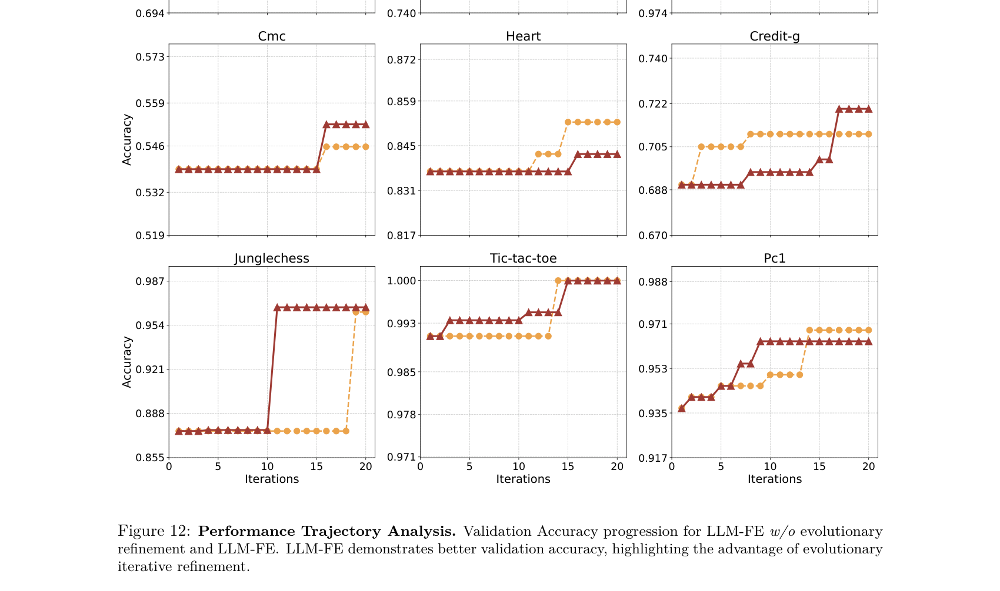
    * **Hình này chứng minh điều gì**
      * Tìm kiếm và tinh chỉnh tiến hóa lặp (evolutionary iterative refinement) đóng vai trò quyết định giúp LLM-FE thoát khỏi các cực trị cục bộ và liên tục nâng cao độ chính xác kiểm định, vượt trội hoàn toàn so với mô hình sinh đặc trưng không có cơ chế tiến hóa.
    * **Từ đâu mà thấy được**
      * Trên cả $12$ đồ thị tập dữ liệu, đường biểu diễn của LLM-FE (màu đỏ nâu, điểm đánh dấu hình tam giác) liên tục tạo các bước nhảy đi lên qua $20$ vòng lặp, trong khi đường nét đứt màu vàng (LLM-FE w/o Evolutionary Refinement, điểm đánh dấu hình tròn) sớm đi ngang và mắc kẹt ở mức hiệu năng thấp hơn.
