# SymboLLM-FE: Symbolic Feature Engineering via Large Language Models

## Abstract

* **Dữ liệu dạng bảng (tabular data) thiếu sức mạnh phân biệt (discriminative power) cần thiết cho mô hình hóa hiệu năng cao:**
  * Là định dạng dữ liệu cốt lõi trong học máy (machine learning), dữ liệu dạng bảng thường thiếu sức mạnh phân biệt do tính giàu thông tin của đặc trưng (feature informativeness) chưa đủ.
  * Kỹ thuật đặc trưng tự động (Automated Feature Engineering - AutoFE) khắc phục hạn chế này bằng cách tự động hóa quá trình sinh đặc trưng (feature generation) và chọn lọc đặc trưng (feature selection), đảm bảo đồng thời hiệu năng mô hình (model performance) và hiệu quả vận hành (operational efficiency).

* **Hạn chế cố hữu của các phương pháp AutoFE hiện nay:**
  * AutoFE truyền thống (traditional AutoFE) thường tạo ra các đặc trưng có khả năng diễn giải kém (poor interpretability) do phụ thuộc vào các phép biến đổi toán học mù quáng (blind mathematical transformations).
  * AutoFE dựa trên mô hình ngôn ngữ lớn (large language models - LLM-based AutoFE) đòi hỏi nhiều vòng lặp tốn kém (costly multi-round iterations) để sinh ra các đặc trưng có độ hữu dụng cao (high-utility features) nhằm cải thiện hiệu năng mô hình một cách hiệu quả.
  * LLM-based AutoFE chịu thêm rủi ro cố hữu về thiên kiến (bias) và ảo giác (hallucination).

* **Phương pháp đề xuất: SymboLLM-FE (kết hợp hồi quy ký hiệu và LLM cho kỹ thuật đặc trưng):**
  * Kết hợp hồi quy ký hiệu (symbolic regression) với LLM cho kỹ thuật đặc trưng nhằm giải quyết đồng thời các thách thức trên.
  * Cơ chế hai giai đoạn:
    * Trích xuất các công thức toán học có tính biểu đạt cao và tương quan mạnh với mục tiêu thông qua symbolic regression để nâng cao hiệu năng mô hình.
    * Tinh chỉnh (refine) các công thức này bằng LLM với tri thức tiên nghiệm phong phú (rich prior knowledge) để bảo đảm khả năng diễn giải (interpretability).

* **Kết quả thực nghiệm và giải quyết thách thức kép:**
  * Kết quả thực nghiệm trên $6$ tập dữ liệu thực tế (real-world datasets) và $4$ cuộc thi Kaggle (Kaggle competitions) chứng minh SymboLLM-FE vượt trội hơn các phương pháp AutoFE hiện có.
  * Giải quyết thách thức kép gồm khả năng diễn giải kém và số lượng vòng lặp lớn nhờ cơ chế tinh chỉnh LLM dựa trên tiên nghiệm thống kê (statistical prior-grounded LLM refinement mechanism).
  * Giảm chi phí vận hành với số lượng lượt gọi LLM chỉ ở mức một chữ số (single-digit LLM calls).

## 1 Introduction

* **Bản chất và tầm quan trọng của dữ liệu dạng bảng (tabular data) trong các ứng dụng thực tế:**
  * Dữ liệu dạng bảng (tabular data) là định dạng dữ liệu có tính cấu trúc cao (highly structured data format), tổ chức thông tin theo hàng và cột (rows and columns) (Altman and Krzywinski, 2017):
    * Mỗi hàng biểu diễn một mẫu hoặc một thực thể độc lập (independent sample or instance).
    * Mỗi cột tương ứng với một đặc trưng hoặc thuộc tính cụ thể (specific feature or attribute) (Sahakyan et al., 2021).
  * Ứng dụng rộng rãi trong nhiều tác vụ quan trọng ở thế giới thực:
    * Lĩnh vực tài chính: hỗ trợ chấm điểm tín dụng (credit scoring) (West, 2000) và dự đoán thị trường chứng khoán (stock market prediction) (Zhu et al., 2021).
    * Lĩnh vực y tế: hỗ trợ chẩn đoán bệnh tật (disease diagnosis) (Yıldız and Kalayci, 2024) và phát triển dược phẩm (drug development) (Meijerink et al., 2020).
  * Hạn chế cố hữu của dữ liệu dạng bảng:
    * Thường bị thiếu hụt tính thông tin của đặc trưng (insufficient feature informativeness).
    * Chứa các tương tác bậc cao tiềm ẩn (implicit high-order interactions).
    * Những khoảng cách cố hữu này cản trở các mô hình hiểu hiệu quả cấu trúc dữ liệu cơ bản, dẫn đến hiệu năng dự đoán dưới mức tối ưu (suboptimal predictive performance) (Sayed et al., 2025; Cheng et al., 2025b; Gorishniy et al., 2021).

* **Vai trò của kỹ nghệ đặc trưng (feature engineering) và sự ra đời của AutoFE:**
  * Trước khi đưa vào dự đoán, kỹ nghệ đặc trưng (feature engineering) thường được áp dụng nhằm nâng cao mối quan hệ giữa các đặc trưng đầu vào và biến mục tiêu (target) thông qua các thao tác như sinh đặc trưng (feature generation) và chọn lọc đặc trưng (feature selection) (Ravishankar and Battineni, 2025).
  * Dữ liệu dạng bảng sau xử lý được đưa vào các mô hình xuôi dòng (downstream models) để tối ưu hóa hiệu năng dự đoán.
  * Trước đây, kỹ nghệ đặc trưng phụ thuộc chủ yếu vào việc xây dựng thủ công (manual construction) các đặc trưng chất lượng cao:
    * Quá trình này đòi hỏi nỗ lực lặp lại sâu rộng (extensive iterative efforts), làm tăng đáng kể chi phí nhân công (labour costs) (Susan and Tuteja, 2025).
  * Kỹ nghệ đặc trưng tự động (Automated Feature Engineering - AutoFE) nổi lên như một trọng tâm nghiên cứu thiết yếu trong các tác vụ học máy trên dữ liệu bảng.
  * Mục tiêu của AutoFE: tự động hóa và dùng thuật toán để khám phá, xây dựng các đặc trưng hiệu quả nhằm giảm bớt nỗ lực thủ công và nâng cao hiệu năng mô hình học máy (Khurana et al., 2016).

* **Hạn chế về khả năng diễn giải của các phương pháp AutoFE truyền thống (traditional AutoFE):**
  * Các phương pháp AutoFE truyền thống bao gồm: tối ưu hóa lai với tìm kiếm chùm tia (hybrid optimization with beam search) (Horn et al., 2019), cắt tỉa động (dynamic pruning) (Zhang et al., 2023b), và chọn lọc đặc trưng (feature selection) (Li et al., 2017; Cheng et al., 2025a).
  * Cơ chế sinh đặc trưng truyền thống dựa trên các quy tắc biến đổi định sẵn (predefined transformation rules), tìm kiếm vét cạn (exhaustive search), hoặc chiến lược dựa trên tối ưu hóa (optimization-based strategies).
  * Mặc dù có khả năng cải thiện hiệu năng mô hình, AutoFE truyền thống mắc phải hạn chế nghiêm trọng về khả năng diễn giải kém (poor interpretability):
    * Các đặc trưng sinh ra thường là những tổ hợp toán học phức tạp (complex mathematical compositions) hoàn toàn không có ý nghĩa ngữ nghĩa tường minh (devoid of explicit semantic meaning).
    * Tạo ra sự tách rời khỏi logic đặc thù miền mà con người có thể hiểu được (human-understandable domain-specific logic).
  * Tác hại nghiêm trọng trong các tình huống nhạy cảm như khai phá nhân tố (factor mining) (Wang et al., 2025, 2026):
    * Khả năng diễn giải là yêu cầu bắt buộc nhằm xác thực tính hợp lý kinh tế đằng sau các tín hiệu (validating the economic rationale behind signals), bảo đảm tuân thủ quy định pháp lý (regulatory compliance), và hỗ trợ chẩn đoán lỗi hiệu quả (effective error diagnosis).
    * Nếu thiếu logic suy luận rõ ràng, rất khó phân biệt giữa các mẫu hình dự đoán vững chắc (robust predictive patterns) và các tương quan giả tạo (spurious correlations), gây suy giảm niềm tin vào các quyết định của mô hình.

* **Tiềm năng và hai thách thức cốt lõi của AutoFE dựa trên mô hình ngôn ngữ lớn (LLM-based AutoFE):**
  * Tiềm năng của LLM-based AutoFE:
    * Sự phát triển của các LLM mang lại tiềm năng mới nhờ năng lực hiểu ngữ nghĩa (semantic understanding) (Hollmann et al., 2023b), suy luận logic (logical reasoning) (Zou et al., 2026), và dẫn hướng tri thức (knowledge guidance) (Nam et al., 2024).
    * Tận dụng tri thức tiên nghiệm phong phú (rich prior knowledge) và khả năng hiểu ngữ cảnh để tự động nhận diện mối quan hệ tiềm năng giữa các đặc trưng thô trong dữ liệu bảng, xây dựng các đặc trưng mới giàu tính diễn giải thông qua phép toán và quy tắc logic.
  * Hai thách thức cốt lõi mà LLM-based AutoFE phải đối mặt:
    * Thách thức 1: Việc sinh các đặc trưng nâng cao hiệu năng đòi hỏi các tương tác lặp lại sâu rộng với mô hình dự đoán xuôi dòng (extensive iterative interactions with downstream models) để xác thực và tinh chỉnh, dẫn đến chi phí tính toán cực lớn (prohibitive computational overhead) và khả năng mở rộng hạn chế (limited scalability) (Abhyankar et al., 2025).
    * Thách thức 2: Sự nhạy cảm cố hữu của LLM đối với ảo giác (hallucinations) và thiên kiến tiềm ẩn (implicit biases) có thể dẫn tới việc sinh ra các đặc trưng không hợp lệ về mặt ngữ nghĩa hoặc không công bằng (semantically invalid or unfair features), ảnh hưởng nghiêm trọng đến độ tin cậy và tính toàn vẹn dự đoán (predictive integrity) của mô hình (Cheng et al., 2026; Han et al., 2024).
  * Tóm lược sự đối lập giữa hai trường phái AutoFE: AutoFE truyền thống bị hạn chế bởi đặc trưng không thể diễn giải, trong khi LLM-based AutoFE gặp khó khăn vì chi phí lặp lại cao, ảo giác và thiên kiến. Nhu cầu cấp thiết là phát triển khung làm việc AutoFE hiệu quả cao, sinh đặc trưng vừa có tính diễn giải vừa mang lại bước nhảy vọt về hiệu năng.
  * **Hình 1.** So sánh cơ chế sinh đặc trưng và diễn giải giữa các phương pháp AutoFE
    * 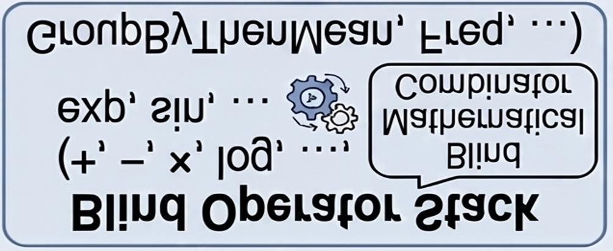
    * **Hình này chứng minh điều gì**
      * SymboLLM-FE kết hợp hồi quy ký hiệu và LLM đạt cả độ chính xác cao và tính minh bạch diễn giải
    * **Từ đâu mà thấy được**
      * Sơ đồ 3 nhánh so sánh: AutoFE truyền thống (hộp đen), AutoFE dựa trên LLM (bất ổn định), và SymboLLM-FE (hồi quy ký hiệu định hướng LLM)
      * Nhánh truyền thống minh họa Blind Operator Stack với các toán tử (+, -, x, log, exp, sin, GroupByThenMean, Freq)

* **Khung làm việc SymboLLM-FE và quy trình hợp tác hai giai đoạn:**
  * SymboLLM-FE là khung làm việc mới kết hợp hồi quy ký hiệu (symbolic regression) và LLM để sinh ra các đặc trưng toán học có khả năng diễn giải, nâng cao hiệu năng mô hình dự đoán.
  * Quy trình hợp tác hai giai đoạn (two-stage collaborative pipeline):
    * Giai đoạn 1 (Thu hẹp không gian và kiến tạo công thức ứng viên): Áp dụng chiến lược cửa sổ trượt mở rộng (expanding-sliding window strategy) dựa trên phân tích tương quan Spearman (Spearman correlation analysis) giúp giảm không gian tìm kiếm từ hàm mũ $\mathcal{O}(2^n)$ xuống đa thức $\mathcal{O}(n^2)$, cho phép hồi quy ký hiệu sinh ra các công thức ứng viên tường minh, có cơ sở toán học chặt chẽ.
    * Giai đoạn 2 (Tiêm tri thức tiên nghiệm và tinh chỉnh mã thực thi): Tận dụng LLM để tiêm tri thức tiên nghiệm đặc thù miền (domain-specific priors) vào các công thức toán học vốn mờ mịt, chuyển đổi chúng thành mã nguồn thực thi có ý nghĩa ngữ nghĩa thông qua chuỗi suy luận (chain-of-thought reasoning).
    * Vòng lặp tinh chỉnh lặp lại vừa xác thực độ hữu dụng của đặc trưng thông qua hiệu năng bộ dự đoán xuôi dòng, vừa bảo đảm căn chỉnh với logic nghiệp vụ, đạt được sự cân bằng vững chắc giữa khám phá đặc trưng hiệu năng cao và tính minh bạch có thể diễn giải cho con người.
  * So sánh định lượng hiệu quả hiệu năng và chi phí tính toán giữa các phương pháp AutoFE:
    * AutoFE truyền thống (không gọi LLM): AutoFeat sinh $2$ đặc trưng, đạt điểm $79.75$; OpenFE sinh $1436$ đặc trưng, đạt điểm $79.53$.
    * AutoFE dựa trên LLM: CAAFE sinh $30$ đặc trưng với $10$ lượt gọi API, đạt điểm $79.94$; OcTree sinh $50$ đặc trưng với $50$ lượt gọi API, đạt điểm $79.52$; FEBP sinh $200$ đặc trưng với $29$ lượt gọi API, đạt điểm $79.36$; LLM-FE sinh $30$ đặc trưng với $35$ lượt gọi API, đạt điểm $79.59$; LLM-RANK là bộ chọn đặc trưng nên không sinh đặc trưng mới, tốn $7$ lượt gọi API, đạt điểm $78.86$.
    * SymboLLM-FE sinh $70$ đặc trưng, đạt điểm số cao nhất là $80.02$ với chỉ $4$ lượt gọi API LLM (single-digit calls).
  * **Bảng 1.** Phân tích so sánh hiệu quả hiệu năng và chi phí tính toán giữa các phương pháp AutoFE
    * 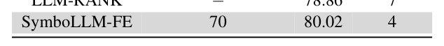
    * **Bảng này chứng minh điều gì**
      * SymboLLM-FE cân bằng giữa hiệu năng cao, khả năng diễn giải tốt và chi phí gọi LLM thấp
    * **Từ đâu mà thấy được**
      * Các cột so sánh đặc tính: Feature Generation, Interpretability, LLM Call Overhead và Performance trên bảng

* **Tóm tắt bốn đóng góp chính của bài báo:**
  * Thực hiện phân tích thực nghiệm và chỉ ra rằng AutoFE truyền thống chịu hạn chế về tính diễn giải không đầy đủ, trong khi LLM-based AutoFE gặp trở ngại lớn về thử nghiệm lặp lại sâu rộng, ảo giác và thiên kiến tiềm ẩn.
  * Đề xuất SymboLLM-FE giải quyết các thách thức của AutoFE hiện nay thông qua việc tận dụng hồi quy ký hiệu để khai phá các đặc trưng tăng cường hiệu năng, sau đó tinh chỉnh bằng LLM để nâng cao khả năng diễn giải.
  * Đánh giá toàn diện trên $6$ tập dữ liệu thế giới thực và $4$ cuộc thi Kaggle chứng minh hiệu năng vượt trội và khả năng tổng quát hóa của SymboLLM-FE so với các phương pháp AutoFE hiện nay.
  * SymboLLM-FE giải quyết đồng thời thách thức kép về tính diễn giải kém và gánh nặng thử nghiệm lặp lại bằng cơ chế tinh chỉnh LLM dựa trên tiên nghiệm thống kê (statistical prior-grounded LLM refinement mechanism) với số lượt gọi LLM chỉ ở mức một chữ số (single-digit LLM calls).

## 2 Related Work

### 2.1 Tabular Machine Learning on LLMs

* **Khám phá ứng dụng của mô hình ngôn ngữ lớn (LLMs) trong học máy dạng bảng (tabular machine learning):**
  * Sự ra đời của các mô hình ngôn ngữ lớn (large language models - LLMs) sở hữu tri thức tiên nghiệm đặc thù miền (domain-specific prior knowledge) phong phú đã thúc đẩy việc khám phá tiềm năng ứng dụng của chúng trong việc giải quyết các bài toán học máy dạng bảng (tabular machine learning tasks) (Jia et al., 2026).

* **Các phương pháp tiếp cận tiêu biểu sử dụng LLM trực tiếp làm bộ dự đoán (LLMs as predictors):**
  * Phương pháp LIFT (Dinh et al., 2022):
    * Thực hiện tinh chỉnh (fine-tunes) mô hình GPT-$3$ (Floridi and Chiriatti, 2020) trên dữ liệu huấn luyện.
    * Minh chứng rằng các LLM đa mục đích (general-purpose LLMs) có thể cải thiện hiệu năng, mặc dù chưa vượt qua được các mô hình dựa trên cây (tree-based models).
  * Phương pháp TabLLM (Hegselmann et al., 2023):
    * Sử dụng mô hình T$0$ (Sanh et al., 2021) để thực hiện fine-tuning.
    * Khai thác hiệu quả tri thức đã được huấn luyện trước (pre-trained knowledge) chỉ với lượng dữ liệu gán nhãn tối thiểu (minimal labelled data).
  * Phương pháp UniPredict (Wang et al., 2023):
    * Huấn luyện GPT-$2$ (Ethayarajh, 2019) trên $169$ tập dữ liệu dạng bảng (tabular datasets).
    * Đạt được các kết quả cạnh tranh mà không cần tinh chỉnh riêng biệt theo từng tập dữ liệu cụ thể (dataset-specific tuning).

* **Hạn chế thực tế của việc sử dụng trực tiếp LLM làm bộ dự đoán:**
  * Giới hạn về phạm vi hiệu năng:
    * Các phương pháp tiếp cận dựa trên LLM này chỉ chứng minh được hiệu năng vượt trội chủ yếu trong các thiết lập thực nghiệm không mẫu (zero-shot) hoặc ít mẫu (few-shot) (Hegselmann et al., 2023).
  * Tụt hậu so với các mô hình truyền thống trong các kịch bản thực tế (real-world scenarios):
    * Các phương pháp này vẫn tụt hậu so với các mô hình dựa trên cây (tree-based models) và các mô hình học sâu (deep learning models) xét về cả hiệu quả tính toán (computational efficiency) lẫn độ chính xác dự đoán (prediction accuracy) (Cheng et al., 2025b).

* **Chuyển dịch hướng tiếp cận sang kỹ thuật đặc trưng bằng LLM (LLMs as feature engineering):**
  * Việc trực tiếp sử dụng LLM làm bộ dự đoán là phương án dưới mức tối ưu (suboptimal).
  * Thực tế này thúc đẩy các nhà nghiên cứu chuyển hướng sang việc khai thác LLM như các phương pháp kỹ thuật đặc trưng (feature engineering methods) nhằm nâng cao khả năng biểu diễn dữ liệu (enhance data representation).
  * Mục tiêu là cải thiện hiệu năng của các bộ dự đoán hạ nguồn (downstream predictors) như các mô hình dựa trên cây hoặc mô hình học sâu (Hollmann et al., 2023b).

### 2.2 Traditional and LLM-based AutoFE

* **Đặc điểm và quá trình tiến hóa của kỹ thuật đặc trưng tự động truyền thống (Traditional AutoFE):**
  * Nguyên lý hoạt động nền tảng:
    * AutoFE truyền thống chủ yếu dựa vào các thuật toán tìm kiếm heuristic (heuristic search) hoặc học tăng cường (reinforcement learning).
  * Lịch trình tiến hóa của các khung làm việc:
    * Phát triển từ các khung làm việc tìm kiếm vét cạn (exhaustive frameworks) (Katz et al., 2016) và tìm kiếm theo chiều sâu (Deep First Search - DFS) (Kanter and Veeramachaneni, 2015).
    * Tiến tới các phương pháp tiếp cận hiệu quả, định hướng theo độ hữu dụng (utility-driven approaches) (Zhang et al., 2023b) và các mô hình được dẫn dắt bởi quan hệ nhân quả (causally-guided models) (Malarkkan et al., 2026).
  * Hạn chế cố hữu của AutoFE truyền thống:
    * Thường gặp bế tắc trước hiện tượng bùng nổ tổ hợp (combinatorial explosion) trong các không gian tìm kiếm phức tạp.
    * Thiếu sự đồng căn ngữ nghĩa (lack semantic alignment) với logic nghiệp vụ đặc thù theo miền dữ liệu (domain-specific business logic).

* **Tiến bộ của AutoFE dựa trên LLM (LLM-based AutoFE) và hai hướng tiếp cận cốt lõi:**
  * Những bước tiến gần đây của LLM đã tạo động lực phát triển cho LLM-based AutoFE, phân tách thành hai hướng đi then chốt:
    * Sinh đặc trưng (feature generation).
    * Chọn lọc đặc trưng (feature selection).

* **Các phương pháp sinh đặc trưng dựa trên LLM (LLM-based feature generation):**
  * Khung làm việc nhận biết ngữ cảnh (context-aware frameworks) (Hollmann et al., 2023b).
  * Sử dụng cây quyết định để khám phá quy tắc (decision trees for rule discovery) (Nam et al., 2024).
  * Ánh xạ đặc trưng khả vi (differentiable feature mapping) (Han et al., 2024).
  * Sinh có cấu trúc thông qua ký pháp Ba Lan ngược (reverse Polish notation - RPN) (Zou et al., 2026).
  * Các mô hình lai ghép giữa tính toán tiến hóa và chưng cất tri thức (evolutionary-knowledge distillation hybrids) (Abhyankar et al., 2025).

* **Các kỹ thuật chọn lọc đặc trưng dựa trên LLM (LLM-based feature selection):**
  * Áp dụng ngưỡng xác suất log (log-probability thresholds) (Choi et al., 2022).
  * Sử dụng các mô hình xếp hạng (ranking paradigms) (Jeong et al., 2024).

* **Những thách thức tồn tại trong các phương pháp AutoFE dựa trên LLM:**
  * Nguy cơ tạo ra các đặc trưng không hữu dụng (uselessness of generated features).
  * Xuất hiện ảo giác (hallucinations) từ mô hình ngôn ngữ lớn.
  * Tồn tại các thiên kiến (biases) cố hữu trong quá trình tạo và đánh giá đặc trưng.

### 2.3 Automated Feature Engineering on Symbolic Regression

* **Khái niệm và vai trò của Hồi quy Ký hiệu (Symbolic Regression - SR):**
  * Định nghĩa:
    * Hồi quy ký hiệu (Symbolic Regression - SR) (Yang et al., 2025) là phương pháp học máy (machine learning method) tìm kiếm và khám phá các biểu thức toán học tối ưu (optimal mathematical expressions) nhằm phát hiện các mối quan hệ tiềm ẩn trong dữ liệu (latent data relationships).
  * Giá trị đối với kỹ thuật đặc trưng:
    * Khả năng suy dẫn các dạng biểu diễn giải tích có thể diễn giải (interpretable analytical forms) giúp SR trở nên đặc biệt có giá trị trong kỹ thuật đặc trưng (feature engineering) (Shmuel et al., 2024).
    * Nâng cao đồng thời tính minh bạch của mô hình (model transparency) và độ chính xác dự đoán (predictive accuracy), đồng thời giảm thiểu công sức thủ công (manual effort).

* **Các tiến bộ nghiên cứu gần đây trong kỹ thuật đặc trưng dựa trên Hồi quy Ký hiệu:**
  * Tích hợp tính toán tiến hóa (evolutionary computation integration) nhằm trích xuất các hiện tượng vật lý (physical phenomenon extraction) (Yu et al., 2026).
  * Lập trình di truyền đa cây dạng mô-đun (modular multi-tree genetic programming) phục vụ tái sử dụng đặc trưng trong không gian nhiều chiều (high-dimensional feature reuse) (San et al., 2021).
  * Chọn lọc đặc trưng dựa trên hệ số tương quan Spearman (Spearman-based feature selection) để tăng cường khả năng tổng quát hóa (generalization) (Kim et al., 2020).

* **Hạn chế nội tại của Hồi quy Ký hiệu và khoảng trống nghiên cứu hiện tại:**
  * Thách thức về độ phức tạp:
    * Hồi quy ký hiệu vẫn gặp nhiều khó khăn với sự phức tạp của biểu thức toán học (expression complexity) khi xử lý trong các không gian nhiều chiều (high-dimensional spaces).
  * Khoảng trống kết hợp giữa LLM và SR:
    * Dù các công trình hiện nay đã khám phá sự tương tác giữa LLM và SR (LLM-SR interactions) cho việc sinh phương trình (equation generation) — chẳng hạn như trong xử lý ngôn ngữ tự nhiên (natural language processing) (Shao et al., 2026) và tổng hợp mã nguồn (code synthesis) (Shojaee et al., 2025) — nhưng vẫn chưa mở rộng để kết hợp các phương trình do hồi quy ký hiệu tạo ra vào các LLM nhằm phục vụ kỹ thuật đặc trưng (feature engineering).

## 3 Problem Formulation and Analysis

### 3.1 Problem Formulation

* **Mục tiêu hình thức của bài toán dự đoán dạng bảng (tabular prediction tasks):**
  * Mục tiêu cốt lõi là huấn luyện một mô hình học máy (machine learning model) $f : \mathcal{X} \to \mathcal{Y}$, trong đó $\mathcal{X}$ biểu diễn không gian đầu vào (input space) và $\mathcal{Y}$ biểu diễn không gian đầu ra (output space).
  * Tập hợp tất cả các đặc trưng trong không gian đầu vào $\mathcal{X}$ được định nghĩa là $C$.
  * Với không gian đầu vào $\mathcal{X}$ có số chiều là $n$ ($n$-dimensional), tập đặc trưng thông thường (ordinary feature set) được xác định là:
    $$C = \{c_1, c_2, \dots, c_n\}$$

* **Mục đích và cơ chế mở rộng số chiều của kỹ thuật đặc trưng (feature engineering):**
  * Kỹ thuật đặc trưng hướng đến việc mở rộng số chiều của không gian đầu vào $\mathcal{X}$ thông qua việc sinh ra $m$ đặc trưng mới dựa trên tập đặc trưng ban đầu $C$.
  * Tập đặc trưng mới sinh ra được ký hiệu là $C_{\text{new}}$:
    $$C_{\text{new}} = \{c_{n+1}, c_{n+2}, \dots, c_{n+m}\}$$
  * Sau khi thực hiện kỹ thuật đặc trưng, số chiều của không gian đầu vào $\mathcal{X}$ tăng từ $n$ lên $n + m$.
  * Hiệu năng $P$ của mô hình $f$ có thể được cải thiện trên tập đặc trưng mở rộng $S$, với $S = C \oplus C_{\text{new}}$ (trong đó $\oplus$ ký hiệu phép kết hợp/ghép nối tập hợp đặc trưng).

* **Mục tiêu tối ưu hóa của kỹ thuật đặc trưng tự động (AutoFE objective optimization):**
  * Mục tiêu là đạt được hiệu năng tối đa của mô hình $f$ bằng cách thay đổi và tối ưu hóa tập đặc trưng mới $C_{\text{new}}$ được sinh ra từ phương pháp AutoFE $g$:
    $$\max P_f(S) = \max P_f(C \oplus C_{\text{new}}) = \max P_f(C \oplus g(C)) \quad (1)$$
  * Ý nghĩa các thành phần trong công thức tối ưu hóa:
    * $g$ biểu diễn toán tử hoặc quy trình kỹ thuật đặc trưng tự động (AutoFE method/operator) ánh xạ từ tập đặc trưng gốc $C$ sang tập đặc trưng mới $C_{\text{new}} = g(C)$.
    * $P_f(\cdot)$ biểu thị hàm đánh giá đo lường hiệu năng của bộ dự đoán hạ nguồn (downstream predictor) $f$ khi được huấn luyện và suy luận trên tập đặc trưng được cung cấp.

### 3.2 Analysis

* **Sự phân đôi rõ rệt giữa AutoFE truyền thống và AutoFE dựa trên LLM (dichotomy between traditional and LLM-based AutoFE):**
  * Phân tích so sánh giữa các phương pháp AutoFE khác nhau trong Hình 1 (Figure 1) và Bảng 1 (Table 1) làm nổi bật sự đối lập rõ rệt giữa hai trường phái: AutoFE truyền thống (traditional AutoFE) và AutoFE dựa trên mô hình ngôn ngữ lớn (LLM-based AutoFE).
  * Sự phân cực này phản ánh các điểm nghẽn nghiêm trọng (critical bottlenecks) ở cả khía cạnh hiệu quả vận hành/tính toán (efficiency) và chất lượng đặc trưng (feature quality).

* **Hạn chế nghiêm ngặt của AutoFE truyền thống về khả năng diễn giải đặc trưng:**
  * AutoFE truyền thống bị giới hạn nghiêm ngặt bởi các đặc trưng không thể diễn giải (strictly limited by uninterpretable features - minh họa trong Hình 1).
  * Cơ chế xếp chồng toán tử mù quáng:
    * Phụ thuộc vào việc xếp chồng toán tử mù quáng (blind operator stack) để thực hiện kết hợp toán học các cột thô (mathematically combine raw columns) mà hoàn toàn không có hiểu biết về mặt ngữ nghĩa (without semantic understanding).
    * Quá trình này tạo ra một tập đặc trưng phình to quá mức (excessively large feature set).
  * Thiếu hụt nền tảng ngữ nghĩa và giá trị sử dụng thực tiễn:
    * Các đặc trưng mới sinh ra thiếu nền tảng ngữ nghĩa (lack semantic grounding) và không mang ý nghĩa vật lý (physical meaning).
    * Thất bại trong việc cung cấp các thông tin chi tiết có thể hành động (actionable insights) nhằm phục vụ công tác thu thập đặc trưng trong tương lai (future feature acquisition).
    * Khả năng tổng quát hóa (generalization) sang các tác vụ hạ nguồn (downstream tasks) rất kém do khả năng diễn giải của các đặc trưng sinh ra bị tổn hại nghiêm trọng.

* **Điểm nghẽn chi phí vòng lặp và rủi ro nội tại của AutoFE dựa trên LLM:**
  * Mặc dù LLM-based AutoFE bảo đảm khả năng diễn giải ngữ nghĩa (semantic interpretability) nhờ khai thác tri thức nền tảng của tác vụ (task background knowledge), phương pháp này phải đối mặt với chi phí vòng lặp rất lớn (high iteration costs - thể hiện qua Bảng 1).
  * Đặc trưng thiếu sức mạnh phân biệt mạnh mẽ:
    * Việc phụ thuộc hoàn toàn vào LLM để sinh đặc trưng thường tạo ra các đặc trưng có tính mạch lạc về mặt ngữ nghĩa (semantically coherent) và phù hợp với miền bài toán (domain-relevant), nhưng lại thiếu sức mạnh phân biệt mạnh mẽ (lack robust discriminative power).
    * Minh chứng thực nghiệm: các phương pháp như OcTree đòi hỏi khoảng $50$ vòng lặp (rounds) để hội tụ, cho thấy các đặc trưng do LLM-based AutoFE tạo ra bắt buộc phải trải qua nhiều vòng thử-sai (trial-and-error validation) và liên tục tinh chỉnh (continuous refinement) mới có thể cải thiện được hiệu năng mô hình hạ nguồn.
  * Chi phí tính toán bùng nổ và rủi ro ảo giác:
    * Tính bất định nội tại (intrinsic uncertainty) buộc hệ thống phải duy trì các tương tác lặp đi lặp lại trên diện rộng với các bộ dự đoán hạ nguồn (downstream predictors), dẫn đến sự gia tăng đột biến không thể chấp nhận được (prohibitive surge) về cả số vòng lặp lẫn chi phí thời gian tính toán (computational time costs).
    * Các phương pháp LLM-based AutoFE tiên tiến này vẫn nhạy cảm cố hữu với hiện tượng ảo giác nghiêm trọng (severe hallucinations) và thiên kiến ngầm ẩn (implicit biases), có thể dẫn tới sự sụt giảm hiệu năng của mô hình.

* **Nhu cầu cấp thiết về một khung làm việc AutoFE tối ưu hóa:**
  * Những phát hiện so sánh trên làm sáng tỏ các hạn chế cốt lõi của cả AutoFE truyền thống và AutoFE dựa trên LLM hiện tại.
  * Nhấn mạnh nhu cầu cấp thiết về một khung làm việc AutoFE tối ưu hơn có khả năng:
    * Loại bỏ gánh nặng chi phí vòng lặp khổng lồ của các LLM (bypass the high iteration overhead of LLMs).
    * Vượt qua bản chất không thể diễn giải của các phép kết hợp toán học truyền thống (bypass the uninterpretable nature of traditional mathematical combinations).
    * Hướng tới mục tiêu sinh ra các đặc trưng vừa có khả năng diễn giải vừa mang lại hiệu quả dự đoán cao (simultaneously interpretable and predictively effective).

## 4 Proposed Method: SymboLLM-FE

* **Khái niệm và động lực cốt lõi**: SymboLLM-FE là một mô hình lai (hybrid paradigm) kết hợp hiệp đồng giữa hồi quy biểu trưng (Symbolic Regression - SR) và mô hình ngôn ngữ lớn (Large Language Models - LLMs) nhằm giải quyết triệt để các hạn chế của các phương pháp kỹ nghệ đặc trưng tự động (Automated Feature Engineering - AutoFE) hiện hành:
  * **Thế mạnh của Hồi quy biểu trưng**: SR vượt trội trong việc khám phá hiệu quả các công thức toán học tường minh (explicit mathematical formulas), có chi phí tính toán nhẹ (computationally lightweight), đồng thời trực tiếp đáp ứng nhu cầu tạo ra các đặc trưng nâng cao hiệu năng mô hình.
  * **Thế mạnh bổ trợ của LLM**: LLM tận dụng tri thức sâu rộng để tinh chỉnh và tối ưu hóa các công thức biểu trưng ứng viên này. Bằng cách tích hợp các tiền nghiệm đặc thù miền (domain-specific priors), LLM biến đổi các công thức toán học trừu tượng, nâng cao tính minh bạch thông qua giải thích bằng ngôn ngữ tự nhiên, đồng thời bảo đảm sự phù hợp với logic nghiệp vụ (business logic).
  * **Cầu nối hiệu năng và khả năng diễn giải**: Khung tích hợp SymboLLM-FE thu hẹp hiệu quả khoảng cách giữa hiệu năng dự báo (efficacy) và khả năng diễn giải (interpretability).
  * Chi tiết toàn bộ quy trình của SymboLLM-FE được trực quan hóa trong Hình 2:
    * **Hình 2.** Tổng quan kiến trúc SymboLLM-FE qua hai giai đoạn xây dựng công thức và sinh đặc trưng
      * 
      * **Hình này chứng minh điều gì**
        * Quy trình khép kín từ xếp hạng Spearman, cửa sổ trượt, giải thuật di truyền gplearn đến tinh chỉnh LLM và mô hình hạ nguồn
      * **Từ đâu mà thấy được**
        * Luồng xử lý từ trái qua phải: Formula Construction by Symbolic Regression liên kết sang Feature Generation via LLMs
* **Giao thức phân chia tập dữ liệu (Dataset Split Protocol)**: SymboLLM-FE tuân thủ nghiêm ngặt giao thức huấn luyện theo từng nếp (fold-wise training protocol) trong khuôn khổ kiểm định chéo (cross-validation framework) nhằm ngăn ngừa rò rỉ dữ liệu (data leakage):
  * **Tập huấn luyện (Training Set)**: Được sử dụng độc quyền cho giai đoạn Xây dựng công thức bằng Hồi quy biểu trưng (Formula Construction by Symbolic Regression), hỗ trợ toàn bộ chuỗi xử lý từ tái sắp xếp đặc trưng dựa trên hệ số tương quan Spearman, sinh tập con đặc trưng theo cơ chế mở rộng - trượt cửa sổ, cho đến việc khớp các mô hình biểu trưng.
  * **Tập thẩm định (Validation Set)**: Đóng vai trò là môi trường phản hồi (feedback environment) cho giai đoạn Sinh đặc trưng thông qua LLM (Feature Generation via LLMs). Tập này hoàn toàn độc lập và cách ly khỏi giai đoạn xây dựng công thức SR, nhưng được tích cực sử dụng để tính toán điểm số thẩm định (validation score) nhằm dẫn dắt vòng lặp tổng hợp mã nguồn, khai phá quy tắc và tinh chỉnh đặc trưng của LLM. Ngoài ra, tập thẩm định chỉ được dùng cho việc tinh chỉnh siêu tham số (hyperparameter tuning).
  * **Tập kiểm thử (Test Set)**: Được bảo lưu duy nhất cho bước đánh giá cuối cùng của mô hình dự báo hạ nguồn (downstream predictor) trên tập đặc trưng đã hợp nhất ($C_{\text{final}}$) để đánh giá năng lực mô hình. Kiến trúc mô hình hạ nguồn và các tham số được cố định hoàn toàn, độc lập với quá trình đánh giá kiểm thử, bảo đảm không có bất kỳ thông tin nào từ pha thẩm định làm sai lệch kết quả đánh giá hiệu năng sau cùng.

### 4.1 Formula Construction by Symbolic Regression

* **Bài toán lấy mẫu tập con đặc trưng (Feature Set Sampling)**:
  * Cho tập đặc trưng ban đầu $C$ gồm $n$ đặc trưng, tổng số tập con đặc trưng không rỗng khả dĩ là $2^n - 1$.
  * Áp dụng hồi quy biểu trưng lên toàn bộ các tập con sẽ dẫn đến bùng nổ tổ hợp với độ phức tạp tính toán hàm mũ $\mathcal{O}(2^n)$, hoàn toàn bất khả thi trên thực tế.
  * Nhằm tối ưu hóa hiệu quả tính toán trong khi vẫn bảo toàn năng lực biểu diễn đặc trưng, SymboLLM-FE đề xuất chiến lược kết hợp đặc trưng dựa trên phân tích hệ số tương quan Spearman kết hợp cơ chế cửa sổ mở rộng - trượt (expanding-sliding window approach).
* **Định lượng độ quan trọng và tái sắp xếp đặc trưng theo tương quan Spearman**:
  * Đánh giá độ quan trọng của từng đặc trưng trong $C$ thông qua hệ số tương quan hạng Spearman $\phi_{c_i}$ với biến mục tiêu.
  * Ưu thế của tương quan Spearman: So với các chỉ số khác như tương quan Pearson, hệ số tương quan Spearman định lượng bền vững hơn các mối quan hệ phi tuyến đơn điệu giữa đặc trưng và biến mục tiêu, cung cấp phép đo chính xác hơn về độ quan trọng biên (marginal feature importance) của đặc trưng (được kiểm chứng tính tương quan thống kê qua hệ số Kendall's $\tau$ trong Phụ lục D).
  * Sắp xếp đơn điệu tăng dần (Monotonic Ascending Sorting): Các đặc trưng được sắp xếp lại theo thứ tự tăng dần của hệ số tương quan, tạo thành chuỗi đặc trưng có thứ tự $C' = (c'_1, c'_2, \dots, c'_n)$ thỏa mãn:
    $$\phi_{c'_1} \le \phi_{c'_2} \le \dots \le \phi_{c'_n}$$
    trong đó $\phi_{c'_i}$ biểu thị hệ số tương quan Spearman giữa đặc trưng $c'_i$ và biến mục tiêu.
* **Cơ chế Cửa sổ Mở rộng - Trượt động (Dynamic Expanding-Sliding Window Approach)**:
  * Nhằm duy trì chất lượng công thức đồng thời kiểm soát hiệu quả số lượng đặc trưng sinh ra, phương pháp tiếp cận khởi tạo kích thước cửa sổ tại $k = \lfloor n/2 \rfloor$ và vận hành qua hai pha cốt lõi:
    * **Pha mở rộng (Expanding Phase)**: Kích thước cửa sổ $k$ tăng dần từ $\lfloor n/2 \rfloor$ đến $n$ với bước nhảy đơn vị ($\Delta k = 1$).
    * **Pha trượt (Sliding Phase)**: Ứng với mỗi kích thước cửa sổ $k$ cố định, cửa sổ trượt sang phải theo từng bước đơn đặc trưng ($\Delta s = 1$) để tạo ra các tập con đặc trưng khác nhau. Ví dụ, khi $k = \lfloor n/2 \rfloor$, các tập con sinh ra lần lượt là $\{c'_1, \dots, c'_{\lfloor n/2 \rfloor}\}$, $\{c'_2, \dots, c'_{\lfloor n/2 \rfloor + 1}\}, \dots$
  * **Giảm thiểu độ phức tạp tính toán từ hàm mũ về bậc đa thức**:
    * Tổng số tập con đặc trưng ứng viên $S$ sinh ra từ phương pháp mở rộng - trượt bị chặn trên bởi tổng của một cấp số cộng:
      $$\sum_{k=\lfloor n/2 \rfloor}^{n} (n - k + 1) = \sum_{m=1}^{\lceil n/2 \rceil + 1} m = \begin{cases} \frac{(n + 2)(n + 4)}{8}, & \text{nếu } n \text{ chẵn} \\ \frac{(n + 3)(n + 5)}{8}, & \text{nếu } n \text{ lẻ} \end{cases} \quad (2)$$
    * Cơ chế này làm giảm tổng số tập con đặc trưng cần xem xét từ cấp số mũ $\mathcal{O}(2^n)$ xuống cấp số đa thức $\mathcal{O}(n^2)$, cắt giảm mạnh mẽ chi phí tính toán trong khi vẫn đảm bảo độ bao phủ các tổ hợp đặc trưng quan trọng nhất.
* **Sinh công thức toán học biểu trưng (Formula Generating)**:
  * Với mỗi tập con đặc trưng $S_i$ ($i \in [1, |S|]$) sinh ra từ cơ chế cửa sổ, một mô hình hồi quy biểu trưng độc lập (sử dụng giải thuật di truyền Genetic Programming qua thư viện `gplearn`) được huấn luyện để sinh ra một công thức toán học tường minh biểu diễn mối quan hệ từ $S_i$ đến biến mục tiêu, đóng vai trò là một đặc trưng mới (ví dụ dạng $\text{add}(\text{mul}(c_1, c_2), c_3)$).
  * Khuôn khổ giải thuật di truyền (Genetic Programming Framework):
    * Quần thể ban đầu gồm các cây cú pháp ngẫu nhiên $T_i$ với kích thước quần thể $P = 20{,}000$, số thế hệ $G_{\max} = 120$, áp lực chọn lọc qua đấu loại (tournament size = 100), xác suất lai ghép cây con $p_{\text{cx}} = 0.9$.
    * Tập 14 toán tử nguyên thủy được bảo vệ (protected operators) chống lỗi toán học: cộng (`add`), trừ (`sub`), nhân (`mul`), chia an toàn (`div`), căn bậc hai an toàn (`sqrt`), nghịch đảo an toàn (`inv`), phủ định (`neg`), giá trị tuyệt đối (`abs`), cực đại (`max`), cực tiểu (`min`), và các hàm lượng giác/siêu việt (`sin`, `cos`, `tan`, `log`).
  * Hàm độ thích nghi kết hợp hệ số tiết chế (Fitness Function with Parsimony Penalty):
    * Độ thích nghi thô $E(T_i)$ được đo bằng sai số toàn phương trung bình (MSE) trên tập huấn luyện.
    * Để ngăn ngừa hiện tượng phình to cây cú pháp (bloat) gây quá khớp và làm giảm khả năng diễn giải, hàm độ thích nghi tổng hợp $\tilde{E}(T_i)$ áp dụng hình phạt tiết chế (parsimony penalty) tuân theo nguyên lý dao cạo Occam:
      $$\tilde{E}(T_i) = E(T_i) + \Omega \cdot \text{size}(T_i) \quad (4)$$
      trong đó $\text{size}(T_i)$ biểu thị số lượng nút trong cây cú pháp $T_i$, và $\Omega$ là hệ số tiết chế (parsimony coefficient) kiểm soát sự cân bằng giữa độ chính xác dự báo và độ phức tạp biểu thức (được tìm kiếm lưới tối ưu trên tập $\{0.005, 0.01, 0.02, 0.03, 0.04, 0.05\}$).
  * Kho lưu trữ đặc trưng dạng công thức (Formula-based Feature Repository $R$):
    * Sau quá trình huấn luyện hệ thống, một kho lưu trữ đặc trưng $R$ được thiết lập gồm $|S|$ bộ ba:
      $$R = \{(S_i, P_f(S_i), \tau_i)\}_{i=1}^{|S|} \quad (3)$$
      trong đó mỗi bộ ba thành phần bao gồm:
      1. Tập con đặc trưng đầu vào $S_i$.
      2. Hiệu năng mô hình biểu trưng $P_f(S_i)$ của mô hình $f$ đã huấn luyện trên $S_i$ (ví dụ đo bằng MAE hoặc MSE).
      3. Công thức toán học biểu trưng $\tau_i$ biểu diễn ánh xạ từ $S_i$ sang biến mục tiêu.

### 4.2 Feature Generation via LLMs

* **Quy trình tinh chỉnh và sinh đặc trưng đa giai đoạn**: SymboLLM-FE triển khai chuỗi xử lý tinh chỉnh nhiều chặng kết hợp LLM và mô hình dự báo hạ nguồn dựa trên kho công thức $R$ để kiến tạo tập đặc trưng chất lượng cao.
* **Sinh mã nguồn định hướng bởi LLM (LLM-guided Code Generation)**:
  * Cấu trúc thông tin đầu vào (Prompt) cho LLM:
    * Chuyển đổi từng công thức toán học $\tau_i \in R$ thành mô tả tương ứng bằng ngôn ngữ tự nhiên.
    * Ghép nối cùng thông tin bối cảnh có cấu trúc của tập dữ liệu (tên các cột từ $X_0$ đến $X_{N-1}$, loại tác vụ học máy regression hoặc classification, thang đo đánh giá accuracy hoặc RMSE).
    * Bảng tri thức tiền nghiệm (Prior Knowledge) chứa các công thức biểu trưng rút ra cùng chỉ số sai số tuyệt đối trung bình (MAE) tương ứng của mô hình hồi quy biểu trưng trên tập kiểm tra nội bộ.
    * Lời nhắc định hướng sinh mã nguồn (code-generation prompt).
  * Cơ chế suy luận chuỗi tư duy (Chain-of-Thought - CoT Reasoning):
    * LLM phân tích toàn diện và sâu sắc các công thức toán học cùng mối quan hệ tương hỗ giữa các đặc trưng, tuyệt đối không chuyển đổi cơ học toàn bộ công thức mà chọn lọc các tổ hợp có ý nghĩa ngữ nghĩa.
    * LLM tự động sinh ra mã nguồn kỹ nghệ đặc trưng có thể thực thi trực tiếp bằng thư viện Python `pandas`.
  * Định dạng yêu cầu mã nguồn trong Prompt:
    * **Định dạng thêm cột mới**: Mỗi cột mới được tạo phải kèm theo khối chú thích giải thích rõ ràng gồm: tên đặc trưng (`# Feature name:`), lý do đề xuất (`# Reason:`), và mức độ hữu dụng đối với bài toán (`# Usefulness:`), tuân thủ quy ước đặt tên tăng dần ($X_{k+1}, X_{k+2}, \dots$).
    * **Định dạng loại bỏ cột dư thừa**: Mỗi cột bị loại bỏ phải có dòng giải thích nguyên nhân (`# Explanation:` vì sao cột đó dư thừa hoặc gây hại) trước khi gọi hàm loại bỏ `df.drop(columns=[...], inplace=True)`.
* **Thẩm định hiệu năng bằng Mô hình dự báo hạ nguồn (Downstream Predictor Performance Validation)**:
  * Mã nguồn sinh ra được thực thi để tạo ra tập đặc trưng tăng cường $C_{\text{new}}$ và làm giàu tập dữ liệu gốc $C$:
    $$C_{\text{final}} = C \oplus C_{\text{new}}$$
  * Huấn luyện mô hình dự báo hạ nguồn (chẳng hạn như TabPFN, LightGBM, CatBoost, XGBoost, hoặc MLP) trên tập đặc trưng mở rộng $C_{\text{final}}$ và ghi nhận điểm số hiệu năng thẩm định (Validation Score) thu được.
* **Vòng lặp tinh chỉnh đặc trưng lặp (Iterative Feature Refinement)**:
  * Điểm số hiệu năng thẩm định của mô hình dự báo, đi kèm danh sách các đặc trưng đã sử dụng và mã nguồn sinh tương ứng, được đưa ngược lại vào ngữ cảnh của LLM để thực hiện vòng lặp tối ưu hóa và tinh chỉnh đặc trưng.
  * Quá trình phản hồi - hiệu chỉnh này diễn ra lặp đi lặp lại cho đến khi mô hình dự báo hạ nguồn đạt được mức hiệu năng tương đối tối ưu trên tập đặc trưng mở rộng.
* **Cơ chế chọn lọc đặc trưng, khử dư thừa và triệt tiêu ảo giác**:
  * **Quản lý ngân sách đặc trưng (Feature Budget Management)**: Dựa trên phản hồi từ mô hình dự báo hạ nguồn, SymboLLM-FE chủ động cắt tỉa động các đặc trưng làm suy giảm hiệu năng thẩm định, tạo ra một tập đặc trưng tinh gọn, tránh được lời nguyền số chiều (curse of dimensionality) vốn là điểm yếu của các phương pháp AutoFE thông thường.
  * **Khử dư thừa và loại bỏ hiện tượng đa cộng tuyến (Redundancy Elimination / De-redundancy)**:
    * Khuôn mẫu prompt áp đặt ràng buộc loại bỏ đặc trưng tường minh đi kèm lý do giải thích.
    * LLM đóng vai trò như một bộ lọc ngữ nghĩa (semantic filter) thông minh, nhận diện sự tương đương về mặt toán học giữa các công thức hồi quy biểu trưng và các đặc trưng ban đầu, nhờ đó loại trừ triệt để hiện tượng đa cộng tuyến (multicollinearity).
  * **Khống chế nhiễu và triệt tiêu ảo giác (Noise Suppression & Hallucination Elimination)**:
    * Hình phạt tiết chế (parsimony penalty) $\Omega \cdot \text{size}(T_i)$ ở giai đoạn hồi quy biểu trưng giúp loại bỏ các cấu trúc biểu thức rườm rà không cần thiết theo nguyên lý dao cạo Occam.
    * Việc giới hạn nghiêm ngặt các thao tác của LLM trong không gian con đã được kiểm chứng thống kê bởi các công thức biểu trưng (statistically validated subspace) giúp loại bỏ hoàn toàn hiện tượng sinh đặc trưng ảo giác vô căn cứ của LLM, bảo đảm tính bền vững (robustness) và độ cô đọng (compactness) của tập đặc trưng cuối cùng.

## 5 Experiments

### 5.1 Experimental Setup

* **Tuyển chọn và phân loại các tập dữ liệu thực nghiệm (Datasets):**
  * Các tập dữ liệu được chọn lọc đa dạng từ hai nguồn mã nguồn mở và chuẩn mực là OpenML và Kaggle nhằm bảo đảm tính tin cậy và khách quan.
  * Ba nhóm tác vụ dự đoán chính (three primary tasks):
    * Phân loại nhị phân (binary classification).
    * Phân loại đa lớp (multi-class classification).
    * Hồi quy (regression).
  * Lĩnh vực ứng dụng thực tế phong phú: bao quát nhiều lĩnh vực chuyên ngành như tài chính (finance), chăm sóc sức khỏe (healthcare), công nghiệp và giáo dục (thông tin chi tiết về các tập dữ liệu được cung cấp trong Phụ lục C.1 / Appendix C.1).
  * Các tập dữ liệu đại diện điển hình được sử dụng trong đánh giá hiệu năng gồm:
    * `Credit-g`: Tác vụ phân loại nhị phân rủi ro tín dụng tài chính ($1.000$ mẫu, $20$ đặc trưng).
    * `Spaceship` (Spaceship Titanic): Tác vụ phân loại nhị phân dự đoán hành khách dịch chuyển không gian ($8.693$ mẫu, $13$ đặc trưng).
    * `Cmc` (Contraceptive Method Choice): Tác vụ phân loại đa lớp lựa chọn biện pháp y tế ($1.473$ mẫu, $9$ đặc trưng).
    * `Academic`: Tác vụ phân loại đa lớp thành tích học thuật sinh viên ($4.424$ mẫu, $36$ đặc trưng).
    * `Ailerons`: Tác vụ hồi quy điều khiển hệ thống cánh lái máy bay ($13.750$ mẫu, $40$ đặc trưng).
    * `Tesla`: Tác vụ hồi quy biến động giá cổ phiếu ($1.692$ mẫu, $6$ đặc trưng).

* **Các mô hình hạ nguồn cơ sở (Downstream Baselines):**
  * Mục tiêu thẩm định: Chứng minh năng lực thích ứng (adaptability) và khả năng tổng quát hóa (generalization) của SymboLLM-FE trên nhiều họ kiến trúc học máy khác nhau.
  * Các mô hình dựa trên cây quyết định (tree-based models):
    * CatBoost (Prokhorenkova et al., 2018).
    * XGBoost (Chen và Guestrin, 2016).
  * Các mô hình học sâu cho dữ liệu bảng (deep learning models for tabular data):
    * MLP (Multi-Layer Perceptron) (Gorishniy et al., 2021).
    * TabPFN (Prior-Data Fitted Network) (Hollmann et al., 2025).
  * Chi tiết cấu hình thử nghiệm và lưới siêu tham số đầy đủ (full hyperparameter grids) của các mô hình hạ nguồn được trình bày tại Phụ lục C.2 (Appendix C.2, Bảng 8).

* **Các phương pháp AutoFE đối chuẩn (Comparison AutoFE Methods):**
  * Để kiểm chứng hiệu quả vượt trội, SymboLLM-FE được so sánh toàn diện với 2 nhóm phương pháp AutoFE tiên tiến (chi tiết cấu hình trong Phụ lục C.3):
    * Hai phương pháp AutoFE truyền thống (traditional AutoFE):
      * AutoFeat (Horn et al., 2019): Dựa trên tập toán tử toán học cố định và lựa chọn đặc trưng tuyến tính.
      * OpenFE (Zhang et al., 2023b): Tận dụng thuật toán tìm kiếm gia tăng và boosting cây để phát hiện đặc trưng mới.
    * Năm phương pháp AutoFE dựa trên LLM (LLM-based AutoFE):
      * LLM-SELECT (Jeong et al., 2024): Phương pháp lựa chọn đặc trưng dựa trên LLM.
      * CAAFE (Hollmann et al., 2023b): Sinh mã kỹ thuật đặc trưng bán tự động có giải thích ngữ nghĩa.
      * OcTree (Nam et al., 2024): Phương pháp tối ưu cây quyết định lặp qua LLM.
      * FEBP (Zou et al., 2026): Tối ưu hóa đặc trưng tiến hóa định hướng bởi LLM.
      * LLM-FE (Abhyankar et al., 2025): Tạo đặc trưng tự động bằng mô hình ngôn ngữ lớn qua không gian ngữ nghĩa thô.
      * LLM-RANK: Phương pháp xếp hạng và lựa chọn đặc trưng bằng LLM (không sinh thêm đặc trưng mới).

* **Các chỉ số đánh giá hiệu năng (Evaluation Metrics):**
  * Tác vụ phân loại (classification tasks):
    * Độ chính xác (Accuracy).
    * Diện tích dưới đường cong ROC (Area Under the Receiver Operating Characteristic Curve - ROC-AUC).
    * Điểm F1 (F1-score).
  * Tác vụ hồi quy (regression tasks):
    * Căn bậc hai sai số toàn phương trung bình (Root Mean Square Error - RMSE).
    * Sai số tuyệt đối trung bình (Mean Absolute Error - MAE).
    * Hệ số xác định R bình phương (R-squared - $R^2$).

### 5.2 Main Results

* **Hiệu năng vượt trội của SymboLLM-FE trên 6 tập dữ liệu chuẩn hóa với mô hình hạ nguồn TabPFN (Bảng 2):**
  * SymboLLM-FE đạt được sự cải thiện vượt bậc và có ý nghĩa thống kê (statistically significant improvements) so với tất cả các baseline:
    * Đạt mức tăng trưởng trung bình $1.23\%$ so với các phương pháp AutoFE truyền thống (traditional AutoFE).
    * Đạt độ chính xác cao hơn khoảng $1\%$ so với các phương pháp AutoFE dựa trên LLM (LLM-based AutoFE).
  * Phân tích chi tiết kết quả thực nghiệm trên từng tập dữ liệu (Bảng 2):
    * Tập dữ liệu `Credit-g` (Accuracy ↑):
      * Baseline (không AutoFE): $77.03 \pm 0.47\%$
      * AutoFeat: $77.83 \pm 1.43\%$
      * OpenFE: $76.50 \pm 3.34\%$
      * CAAFE: $78.00 \pm 0.71\%$ (hạng 1)
      * OcTree: $76.50 \pm 0.82\%$
      * FEBP: $77.50 \pm 0.41\%$ (hạng 2)
      * LLM-FE: $76.67 \pm 0.62\%$
      * LLM-RANK: $77.50 \pm 0.82\%$
      * SymboLLM-FE: $77.00 \pm 1.63\%$
    * Tập dữ liệu `Spaceship` (Accuracy ↑):
      * Baseline: $80.79 \pm 1.27\%$
      * AutoFeat: $80.76 \pm 1.17\%$
      * OpenFE: $80.30 \pm 1.00\%$
      * CAAFE: $80.99 \pm 1.00\%$ (hạng 2)
      * OcTree: $80.79 \pm 1.15\%$
      * FEBP: $80.85 \pm 1.29\%$
      * LLM-FE: $80.22 \pm 0.96\%$
      * LLM-RANK: $80.70 \pm 1.15\%$
      * SymboLLM-FE: $\mathbf{81.27 \pm 1.31\%}$ (hạng 1, tốt nhất)
    * Tập dữ liệu `Cmc` (Accuracy ↑):
      * Baseline: $57.85 \pm 0.89\%$
      * AutoFeat: $57.85 \pm 0.32\%$
      * OpenFE: $57.85 \pm 2.35\%$
      * CAAFE: $57.78 \pm 1.28\%$
      * OcTree: $57.85 \pm 1.52\%$
      * FEBP: $57.93 \pm 0.48\%$ (hạng 2)
      * LLM-FE: $57.29 \pm 2.20\%$
      * LLM-RANK: $57.74 \pm 0.85\%$
      * SymboLLM-FE: $\mathbf{57.97 \pm 0.73\%}$ (hạng 1, tốt nhất)
    * Tập dữ liệu `Academic` (Accuracy ↑):
      * Baseline: $77.33 \pm 0.67\%$
      * AutoFeat: $76.80 \pm 0.46\%$
      * OpenFE: $76.42 \pm 0.61\%$
      * CAAFE: $77.29 \pm 0.56\%$
      * OcTree: $77.33 \pm 0.70\%$
      * FEBP: $77.36 \pm 0.35\%$ (hạng 2)
      * LLM-FE: $76.42 \pm 0.61\%$
      * LLM-RANK: $77.25 \pm 0.19\%$
      * SymboLLM-FE: $\mathbf{77.89 \pm 0.23\%}$ (hạng 1, tốt nhất)
    * Tập dữ liệu `Ailerons` (RMSE ↓):
      * Baseline: $5.10 \pm 0.48$
      * AutoFeat: $5.04 \pm 0.45$
      * OpenFE: $5.26 \pm 0.49$
      * CAAFE: $5.03 \pm 0.46$ (hạng 2)
      * OcTree: $5.09 \pm 0.47$
      * FEBP: $5.08 \pm 0.48$
      * LLM-FE: $5.05 \pm 0.46$
      * LLM-RANK: $5.10 \pm 0.48$
      * SymboLLM-FE: $\mathbf{5.02 \pm 0.46}$ (hạng 1, tốt nhất)
    * Tập dữ liệu `Tesla` (RMSE ↓):
      * Baseline: $2.39 \pm 0.09$
      * AutoFeat: $2.38 \pm 0.00$
      * OpenFE: $2.18 \pm 0.06$ (hạng 2)
      * CAAFE: $2.66 \pm 0.09$
      * OcTree: $2.43 \pm 0.10$
      * FEBP: $2.41 \pm 0.08$
      * LLM-FE: $2.39 \pm 0.09$
      * LLM-RANK: $5.87 \pm 0.19$ (suy giảm hiệu năng trầm trọng)
      * SymboLLM-FE: $\mathbf{2.16 \pm 0.06}$ (hạng 1, tốt nhất)
  * **Bảng 2.** So sánh hiệu năng của SymboLLM-FE với các AutoFE trên 6 tập dữ liệu thực tế với TabPFN
    * 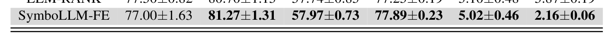
    * **Bảng này chứng minh điều gì**
      * SymboLLM-FE đạt độ chính xác cao nhất hoặc nhì trên hầu hết các tập dữ liệu thực tế
    * **Từ đâu mà thấy được**
      * Các giá trị in đậm (best) và gạch chân (second best) ở hàng SymboLLM-FE trên 6 tập dữ liệu (Accuracy / RMSE)

* **Tính ổn định trên các mô hình hạ nguồn khác (CatBoost, XGBoost, MLP):**
  * Các thử nghiệm diện rộng trong Phụ lục E (Bảng 10, 11 và 12) trên CatBoost, XGBoost và MLP nhất quán khẳng định lợi thế hiệu năng bền vững của SymboLLM-FE độc lập với kiến trúc phân loại/hồi quy hạ nguồn.

* **Hiệu năng kiểm chứng trên 4 cuộc thi Kaggle thực tế (Hình 3):**
  * Để thẩm định năng lực mô hình trong điều kiện thi đấu cạnh tranh thực tế, SymboLLM-FE được đánh giá trên 4 cuộc thi Kaggle:
    * `BNP` (BNP Paribas Cardif Claims Management - quản lý hồ sơ bảo hiểm).
    * `Obesity Risk` (ước tính mức độ rủi ro béo phì).
    * `House Prices` (dự đoán giá nhà đất).
    * `Manufacturing` (tối ưu hóa quy trình sản xuất công nghiệp).
  * Đo lường trên cả hai bảng xếp hạng: Private Leaderboard (dữ liệu ẩn) và Public Leaderboard (dữ liệu công khai).
  * Mô hình kết hợp `SymboLLM-FE + TabPFN` vượt trội một cách đồng nhất cả `vanilla TabPFN` (mô hình gốc không AutoFE) lẫn `OpenFE + TabPFN`.
  * Đạt mức cải thiện điểm số trung bình là $2.5\text{ pp}$ ($2.5$ điểm phần trăm / percentage points) trên các cuộc thi.
  * **Hình 3.** So sánh điểm số hiệu năng trên 4 cuộc thi Kaggle giữa SymboLLM-FE và các baseline
    * 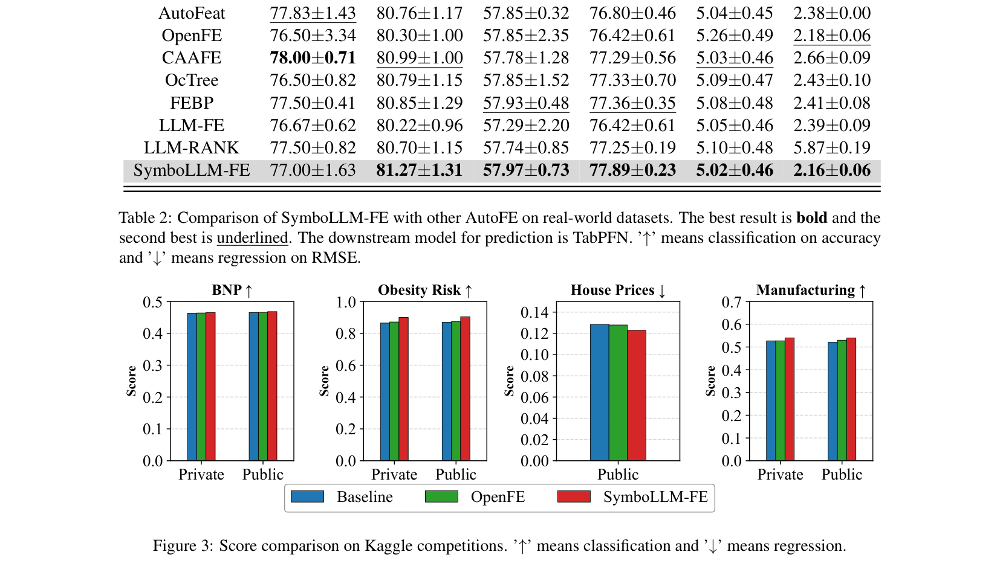
    * **Hình này chứng minh điều gì**
      * SymboLLM-FE đạt kết quả tốt nhất trên cả bài toán phân loại và hồi quy Kaggle
    * **Từ đâu mà thấy được**
      * Trục Ox: 4 tập Kaggle; Trục Oy: Metric điểm số; Cột SymboLLM-FE vượt trội hoặc cạnh tranh top 1

### 5.3 Analysis of Generated Features

* **Mô hình kết hợp đột phá giữa Hồi quy biểu trưng và LLM (Novel Synergy Paradigm):**
  * SymboLLM-FE thiết lập một mô thức hoàn toàn mới (minh họa ở Hình 1) khi kết hợp chặt chẽ giữa Hồi quy biểu trưng (Symbolic Regression - SR), mô hình ngôn ngữ lớn (LLM) và bộ dự đoán hạ nguồn (downstream predictor).
  * Khắc phục triệt để hai nhược điểm cố hữu của các phương pháp tiền nhiệm:
    * Không phụ thuộc mù quáng vào các phép xếp chồng toán tử thuần túy (blind mathematical operator stacks) thiếu hiểu biết ngữ nghĩa như AutoFE truyền thống.
    * Không thả nổi việc tìm kiếm trong không gian ngữ nghĩa tự do không định hướng (unguided semantic spaces) dẫn tới hội tụ chậm hoặc không ổn định như LLM-based AutoFE thuần túy.

* **Định vị LLM như một bộ máy tinh chỉnh thay vì bộ sinh sơ cấp (Refinement Engine vs. Primary Generator):**
  * SymboLLM-FE tận dụng LLM như một công cụ tinh chỉnh (refinement engine) thay vì để LLM tự do sinh đặc trưng ngay từ đầu.
  * Bằng cách neo chặt đầu vào của LLM vào các hệ số tương quan thứ hạng Kendall $\tau_i$ và kho công thức biểu trưng $\mathcal{P}$ thu được từ giai đoạn 1, quá trình sinh đặc trưng được củng cố vững chắc trên nền tảng thực tại thống kê (grounded in statistical reality).
  * Khung làm việc vòng lặp khép kín (closed-loop framework) ràng buộc vai trò của LLM một cách nghiêm ngặt:
    * Tối ưu hóa việc triển khai mã nguồn (optimizing code implementation) của các biểu thức toán học.
    * Tích hợp logic quy nạp (inductive logic) dựa trên tri thức miền có sẵn để gán nhãn ngữ nghĩa có ý nghĩa thực tế.

* **Triệt tiêu hiện tượng ảo giác và loại bỏ đặc trưng giả mạo (Eliminating Hallucinations):**
  * Ngăn ngừa hoàn toàn nguy cơ sinh ra các đặc trưng ngụy tạo hoặc ảo giác (spurious or hallucinated features) vốn không có căn cứ toán học.
  * Tạo ra các đặc trưng có khả năng giải thích cao (highly interpretable features) cho con người, chẳng hạn như chỉ số điểm triệu chứng có trọng số (weighted symptom score) như `Infection_Exposure_Risk` trong Hình 1.

* **Cân bằng tối ưu giữa tính hiệu quả và năng lực dự đoán (Quantified Efficiency & Performance):**
  * Các lợi thế định lượng của SymboLLM-FE được khẳng định rõ nét trong Bảng 1:
    * Thiết lập mức cân bằng vượt bậc giữa hiệu quả chi phí và năng lực dự đoán, giành điểm số mô hình cao nhất toàn diện đạt $80.02$.
    * Chỉ cần sinh ra một tập đặc trưng cực kỳ cô đọng và tinh gọn gồm đúng $70$ đặc trưng mới (so với hàng trăm đến hàng nghìn đặc trưng phình to của OpenFE hay AutoFeat).
    * Giảm thiểu triệt để không gian tìm kiếm và chi phí hội tụ: toàn bộ quá trình chỉ cần vẻn vẹn $4$ lượt gọi API (API calls), hoàn tất quy trình với chi phí thời gian xuất sắc, chứng minh năng lực tính toán vượt trội song hành cùng khả năng diễn giải minh bạch.

### 5.4 Generalization of SymboLLM-FE

* **Khả năng thích ứng vượt trội qua các họ LLM backbone khác nhau (Bảng 3):**
  * Để kiểm tra tính tổng quát hóa của SymboLLM-FE, nghiên cứu đánh giá hiệu năng phân loại khi kết hợp các bộ dự đoán hạ nguồn (CatBoost và TabPFN) với ba mô hình ngôn ngữ lớn khác nhau: GPT-4, GPT-o1 và DeepSeek-R1.
  * Kết quả thực nghiệm cụ thể (Bảng 3):
    * Với mô hình hạ nguồn CatBoost:
      * GPT-4: Độ chính xác $75.41 \pm 0.51\%$
      * GPT-o1: Độ chính xác $78.21 \pm 0.20\%$ (cải thiện $+2.80\%$)
      * DeepSeek-R1: Độ chính xác $77.95 \pm 0.36\%$ (cải thiện $+2.54\%$)
    * Với mô hình hạ nguồn TabPFN:
      * GPT-4: Độ chính xác $76.83 \pm 0.42\%$
      * GPT-o1: Độ chính xác $78.58 \pm 0.39\%$ (cải thiện $+1.75\%$)
      * DeepSeek-R1: Độ chính xác $\mathbf{79.49 \pm 0.57\%}$ (đạt hiệu năng cao nhất toàn diện, cải thiện $+2.66\%$ so với GPT-4)
  * **Bảng 3.** So sánh hiệu năng của SymboLLM-FE với các mô hình hạ nguồn và backbone LLM khác nhau
    * 
    * **Bảng này chứng minh điều gì**
      * Tính tổng quát hóa cao của SymboLLM-FE qua các họ LLM (GPT-4o, DeepSeek, Qwen) và mô hình hạ nguồn
    * **Từ đâu mà thấy được**
      * Các chỉ số Accuracy và RMSE duy trì mức vượt trội ổn định bất kể backbone LLM được sử dụng

* **Mối quan hệ nhân quả giữa năng lực suy luận của LLM và chất lượng đặc trưng:**
  * Cả hai mô hình định hướng suy luận chuyên sâu (advanced reasoning models) là GPT-o1 và DeepSeek-R1 đều vượt trội rõ rệt so với GPT-4 tiêu chuẩn trên cả hai bộ phân loại hạ nguồn.
  * Phát hiện thực nghiệm này xác nhận: Hiệu quả kỹ thuật đặc trưng của SymboLLM-FE tỷ lệ thuận và gắn kết chặt chẽ với năng lực suy luận (reasoning capability) của LLM. Do đó, việc ứng dụng các mô hình LLM suy luận ngày càng mạnh mẽ sẽ tiếp tục nâng cao trực tiếp chất lượng đặc trưng tự động.

### 5.5 Estimation of Running Costs for SymboLLM-FE

* **Kiểm soát độ phức tạp không gian tìm kiếm đặc trưng (Computational Scalability):**
  * Phân tích hiệu năng toàn diện xác nhận tính khả thi mở rộng (computational scalability) của SymboLLM-FE.
  * Chiến lược cửa sổ mở rộng-trượt (expanding-sliding window) có định hướng tương quan thứ hạng Spearman thu hẹp thành công độ phức tạp tìm kiếm đặc trưng từ mức cấp số mũ $\mathcal{O}(2^n)$ xuống mức đa thức $\mathcal{O}(n^2)$.
  * Số lượng công thức ứng viên sinh ra tuân thủ nghiêm ngặt các giới hạn toán học lý thuyết đã thiết lập (Bảng 4).

* **Định lượng thời gian chạy thực tế và tài nguyên API theo từng tập dữ liệu (Bảng 4):**
  * Thời gian chạy cục bộ tỷ lệ tuyến tính với số lượng công thức và quy mô tập dữ liệu ở giai đoạn 1 (Hồi quy biểu trưng - SR):
    * `Credit-g`: Sinh $66$ công thức SR, thời gian chạy SR là $4.23\text{ phút}$, thực hiện $3$ lượt gọi LLM, tiêu tốn $2.331\text{ tokens}$ mỗi lượt gọi.
    * `Spaceship`: Sinh $36$ công thức SR, thời gian chạy SR là $2.01\text{ phút}$, thực hiện $4$ lượt gọi LLM, tiêu tốn $1.201\text{ tokens}$ mỗi lượt gọi.
    * `Cmc`: Sinh $21$ công thức SR, thời gian chạy SR là $0.89\text{ phút}$, thực hiện $3$ lượt gọi LLM, tiêu tốn $1.159\text{ tokens}$ mỗi lượt gọi.
    * `Academic`: Sinh $190$ công thức SR, thời gian chạy SR là $25.34\text{ phút}$, thực hiện $4$ lượt gọi LLM, tiêu tốn $3.587\text{ tokens}$ mỗi lượt gọi.
    * `Ailerons`: Sinh $171$ công thức SR, thời gian chạy SR là $30.24\text{ phút}$, thực hiện $5$ lượt gọi LLM, tiêu tốn $3.250\text{ tokens}$ mỗi lượt gọi.
    * `Tesla`: Sinh $15$ công thức SR, thời gian chạy SR là $2.54\text{ phút}$, thực hiện $2$ lượt gọi LLM, tiêu tốn $1.147\text{ tokens}$ mỗi lượt gọi.
  * **Bảng 4.** Các chỉ số vận hành và chi phí tính toán của SymboLLM-FE
    * 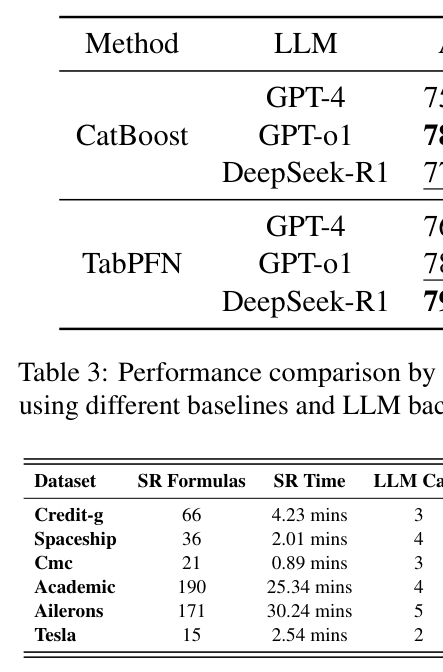
    * **Bảng này chứng minh điều gì**
      * Chi phí thời gian và số lần gọi LLM của SymboLLM-FE cực kỳ tiết kiệm so với các phương pháp LLM-based thuần
    * **Từ đâu mà thấy được**
      * Cột SR time, LLM calls và tổng chi phí tính toán được liệt kê chi tiết theo từng tập dữ liệu
      * Số lượt gọi LLM chỉ 2–5 lần (1147–3587 tokens), thời gian SR từ 0.89 phút (Cmc) đến 30.24 phút (Ailerons)

* **Hiệu quả vượt bậc của cơ chế lọc ngữ nghĩa giai đoạn hai:**
  * Bằng cách hoạt động như một bộ lọc ngữ nghĩa (semantic filter) có chọn lọc thay vì bộ sinh văn bản mở vô định, LLM duy trì số lượt gọi API ổn định quanh mức xấp xỉ $4$ lượt gọi (dao động từ $2$ đến $5$ lượt gọi) trên tất cả các tác vụ thực nghiệm, hoàn toàn không phụ thuộc vào số chiều dữ liệu ban đầu.
  * Tổng lượng token tiêu thụ được tách rời (decoupled) khỏi kích thước mẫu của tập dữ liệu, chỉ mở rộng phụ thuộc vào ngữ cảnh tác vụ (task context) và dung lượng của kho lưu trữ công thức biểu trưng.

* **Ưu thế chi phí và thời gian so với các phương pháp LLM-AutoFE khác:**
  * Kiến trúc tối giản hai giai đoạn cho phép SymboLLM-FE vượt trội hoàn toàn các phương pháp AutoFE dựa trên LLM khác về tốc độ và chi phí, đơn cử như FEBP (tốn đến $43.71\text{ phút}$ theo Zou et al., 2026), mang lại hiệu quả chi phí tối ưu trong triển khai thực tế.

### 5.6 Ablation Study

* **Thiết lập thực nghiệm nghiên cứu cắt bỏ (Ablation Study Setup):**
  * Để định lượng chặt chẽ sự đóng góp riêng biệt của từng mô-đun trong SymboLLM-FE và chứng minh tính thiết yếu không thể lược bỏ của chúng, nghiên cứu tiến hành phân tích cắt bỏ toàn diện trên nhiều tập dữ liệu với các hạt giống ngẫu nhiên độc lập (independent random seeds).
  * Ba biến thể được đánh giá bằng cách loại bỏ có hệ thống các thành phần cốt lõi:
    * `w/o SP.` (without Spearman pre-sorting): Loại bỏ mô-đun tiền sắp xếp đặc trưng dựa trên giá trị tương quan Spearman.
    * `w/o ES.` (without Expanding-Sliding window): Loại bỏ cơ chế cửa sổ mở rộng-trượt, thay bằng lấy mẫu ngẫu nhiên.
    * `w/o LLM` (without LLM-guided feature generation): Loại bỏ hoàn toàn sự tham gia tinh chỉnh và tổng hợp mã của mô hình ngôn ngữ lớn, chỉ giữ lại các công thức biểu trưng thô.
    * `Baseline`: Mô hình cơ sở không áp dụng kỹ thuật sinh đặc trưng tự động.
    * `Ours`: Khung làm việc SymboLLM-FE hoàn chỉnh tích hợp đầy đủ cả ba thành phần.

* **Kết quả định lượng đóng góp của từng thành phần (Hình 4):**
  * So sánh độ chính xác trung bình (Accuracy %) giữa các biến thể:
    * `Baseline`: $75.81\%$
    * `w/o SP.`: $76.07\%$
    * `w/o ES.`: $75.92\%$
    * `w/o LLM`: $76.84\%$
    * `Ours` (SymboLLM-FE đầy đủ): $\mathbf{77.16\%}$
  * **Hình 4.** Nghiên cứu cắt bỏ định lượng đóng góp của tiền sắp xếp Spearman, cửa sổ trượt và LLM
    * 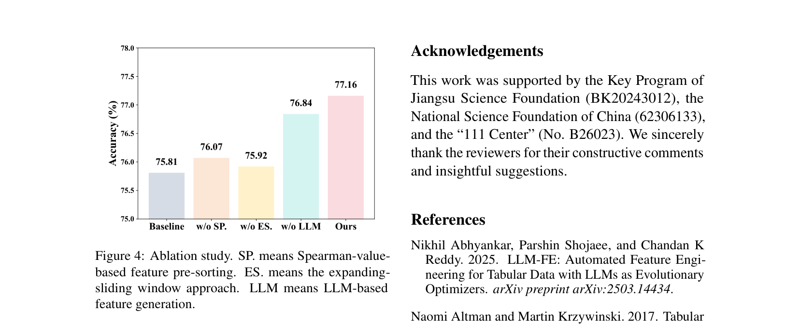
    * **Hình này chứng minh điều gì**
      * Cả ba thành phần SP, ES và LLM đều đóng góp thiết yếu vào hiệu năng tổng thể của SymboLLM-FE
    * **Từ đâu mà thấy được**
      * Biểu đồ cột so sánh các biến thể w/o SP, w/o ES, w/o LLM với bản đầy đủ SymboLLM-FE
      * Cột Ours đạt 77.16% Accuracy, vượt trội w/o LLM (76.84%), w/o SP (76.07%), w/o ES (75.92%) và Baseline (75.81%)

* **Phân tích vai trò chuyên biệt của từng mô-đun:**
  * Vai trò của tiền sắp xếp Spearman (`SP.`):
    * Việc loại bỏ `SP.` khiến độ chính xác giảm từ $77.16\%$ xuống $76.07\%$ (giảm $1.09\%$).
    * Chứng minh rằng việc ưu tiên các đặc trưng có tương quan cao với nhãn mục tiêu giúp thiết lập không gian tìm kiếm định hướng hiệu quả hơn rất nhiều so với việc chọn lọc đặc trưng ngẫu nhiên.
  * Vai trò của cơ chế cửa sổ mở rộng-trượt (`ES.`):
    * Việc loại bỏ `ES.` gây ra sự sụt giảm hiệu năng mạnh nhất trong các thành phần, từ $77.16\%$ xuống $75.92\%$ (giảm $1.24\%$, gần như rơi về mức Baseline $75.81\%$).
    * Khẳng định cơ chế cửa sổ có cấu trúc là nhân tố cốt lõi giúp bao quát và nắm bắt các tương tác đặc trưng bậc cao (high-order feature interactions) mà các phương pháp lấy mẫu ngẫu nhiên bỏ lỡ; qua đó xác thực chiến lược giảm độ phức tạp tính toán mà không làm tổn hại đến chất lượng đặc trưng sinh ra.
  * Vai trò của tinh chỉnh LLM (`LLM`):
    * Khi loại bỏ `LLM`, hiệu năng sụt giảm từ $77.16\%$ xuống $76.84\%$ (giảm $0.32\%$).
    * Xác nhận rằng các công thức biểu trưng thô từ SR thường mắc phải sự dư thừa hoặc triển khai mã chưa tối ưu; sự hiện diện của LLM đóng vai trò như một bộ tích hợp ngữ nghĩa then chốt (critical semantic integrator), tối ưu hóa hiệu quả thực thi mã và phối hợp logic các quy tắc để nâng cao khả năng tổng quát hóa của tập đặc trưng mới.

## 6 Conclusion

* **Tổng kết đóng góp của khung làm việc lai SymboLLM-FE:**
  * Đề xuất SymboLLM-FE như một khung làm việc lai vững chắc (robust hybrid framework) cho kỹ thuật đặc trưng tự động (Automated Feature Engineering - AutoFE).
  * Kết hợp tính chặt chẽ toán học (mathematical rigor) của hồi quy ký hiệu (symbolic regression) với năng lực tinh chỉnh chuyên sâu (refinement capabilities) của các mô hình ngôn ngữ lớn (Large Language Models - LLMs).
  * Thể hiện các ưu thế vượt trội và nhất quán (consistent advantages) so với các giải pháp AutoFE hiện nay:
    * Cải thiện vượt bậc khả năng diễn giải (enhanced interpretability) của các đặc trưng được tạo ra.
    * Đạt hiệu quả vận hành và tối ưu tài nguyên tính toán cao hơn (greater efficiency).

* **Giải pháp thực tế kết hợp với TabPFN trên các cuộc thi Kaggle:**
  * Xây dựng một giải pháp đáng tin cậy cho các tác vụ thế giới thực (real-world tasks) bằng cách tích hợp SymboLLM-FE làm mô-đun kỹ thuật đặc trưng (feature engineering module) kết hợp với TabPFN.
  * Chứng minh tính hiệu quả của phương pháp tiếp cận phối hợp này thông qua hiệu năng thực tế trên các cuộc thi cạnh tranh dữ liệu Kaggle (Kaggle competitions).

* **Định hướng nghiên cứu trong tương lai (Future Research Directions):**
  * Nghiên cứu tích hợp các phương pháp AutoFE truyền thống (conventional AutoFE methods) với việc phân tích tập dữ liệu quy mô lớn (large-scale dataset analysis) nhằm suy luận một cách có hệ thống các cơ chế sinh đặc trưng (feature generation mechanisms).
  * Hình thức hóa các quy luật và mẫu hình thu được (extracted patterns and rules) thành những nguyên lý kỹ thuật đặc trưng có cấu trúc (structured feature engineering principles).
  * Sử dụng các nguyên lý này để tinh chỉnh (fine-tune) các mô hình ngôn ngữ lớn (LLMs), nâng cao khả năng tự động hóa sinh đặc trưng trong tương lai.

### Limitations

* **Chi phí thời gian tính toán lớn trên các tập dữ liệu nhiều chiều (High-dimensionality computational time overhead):**
  * Dù SymboLLM-FE đã triển khai $2$ cơ chế chiến lược (two strategic mechanisms) nhằm đảm bảo khả năng mở rộng (scalability) trên các tập dữ liệu có số chiều cao (high-dimensional datasets), phương pháp vẫn phát sinh chi phí thời gian quá mức cho phép (prohibitive time overhead).
  * Chi phí tính toán và thời gian thực thi lớn gây cản trở và hạn chế tính khả thi của phương pháp trong các kịch bản chịu ràng buộc nghiêm ngặt về tài nguyên tính toán (resource-constrained scenarios) hoặc các ứng dụng đòi hỏi xử lý thời gian thực (real-time scenarios).

* **Chiến lược tạo tập con bỏ sót tương tác cộng hưởng giữa các biến không liền kề (Non-adjacent feature interactions):**
  * Chiến lược xây dựng tập con đặc trưng (subset construction strategy) sắp xếp các biến đặc trưng theo thứ tự độ quan trọng giảm dần (descending order of importance) và sử dụng một cửa sổ trượt liên tục (continuous sliding window).
  * Quy trình này có thể thất bại trong việc nắm bắt các hiệu ứng cộng hưởng (synergistic effects) giữa các biến không nằm ở vị trí liền kề nhau:
    * Cụ thể, khi hai hoặc nhiều đặc trưng có tương quan ngầm định (implicitly correlated features) không được xếp ở các vị trí liên tiếp trong bảng xếp hạng độ quan trọng, đóng góp dự đoán chung (joint predictive contribution) của chúng có nguy cơ bị bỏ sót hoàn toàn.
    * Sự phân tách về mặt vị trí trong danh sách sắp xếp ngăn cản thuật toán hồi quy ký hiệu (symbolic regression) kết hợp các biến này vào chung một không gian tìm kiếm công thức đặc trưng mới.

* **Thách thức thích ứng và chuyển giao giữa các miền dữ liệu (Domain transfer and adaptation challenges):**
  * Cấu trúc tương quan giữa các biến và thứ tự ưu tiên của đặc trưng phụ thuộc chặt chẽ vào phân phối dữ liệu cụ thể, tạo ra thách thức lớn khi chuyển giao mô hình sang các miền dữ liệu mới (domain transfer challenges).
  * Trong các miền dữ liệu bị dịch chuyển phân phối (domain shift) hoặc các tập dữ liệu bị mã hóa/ẩn danh (anonymized features) thiếu ngữ cảnh ngữ nghĩa tự nhiên, khả năng liên kết tri thức tiên nghiệm của LLM và việc phân nhóm đặc trưng dựa trên độ quan trọng cố định có thể suy giảm hiệu quả tối ưu hóa đặc trưng.

## Appendix A: Implementation Details of Symbolic Regression

* **Tổng quan triển khai hồi quy ký hiệu (symbolic regression) trong SymboLLM-FE:**
  * Cung cấp đặc tả kỹ thuật chi tiết về hồi quy ký hiệu được tích hợp trong khuôn khổ SymboLLM-FE nhằm tự động sinh công thức đặc trưng.
  * Thư viện nền tảng: Sử dụng thư viện `gplearn` (phiên bản v0.4.1), triển khai mô hình quy hoạch di truyền (Genetic Programming - GP).
  * Mục tiêu cốt lõi: Khám phá các biểu thức toán học có khả năng diễn giải cao (interpretable mathematical expressions) bằng cách tiến hóa một quần thể gồm các cây cú pháp (syntax trees, ký hiệu là $T$) dựa trên các cơ chế mô phỏng chọn lọc tự nhiên (natural selection).

### A.1 Algorithmic Framework

* **Mục tiêu tối ưu hóa và không gian tìm kiếm hàm toán học:**
  * Mục tiêu cốt lõi của hồi quy ký hiệu là duyệt qua không gian các hàm toán học để tìm biểu thức tối ưu $T^*$ nhằm cực tiểu hóa sai số dự đoán trên dữ liệu huấn luyện.
  * Ký hiệu toán học: Gọi $X_{\text{train}} \in \mathbb{R}^{N \times d}$ là ma trận đặc trưng huấn luyện và $y_{\text{train}} \in \mathbb{R}^N$ là vector nhãn mục tiêu cho tập con tương ứng.

* **Bốn giai đoạn lặp (four iterative phases) trong quy trình Lập trình Di truyền:**
  * **1. Khởi tạo quần thể (Population Initialization):**
    * Quần thể ban đầu $P_0$ gồm $P$ cá thể được khởi tạo ngẫu nhiên.
    * Mỗi cá thể trong $P_0$ là một cây cú pháp ngẫu nhiên $T_i$: các nút nội bộ (internal nodes) đại diện cho các toán tử hàm số (function operators), các nút lá (leaf nodes) đại diện cho đặc trưng đầu vào hoặc các hằng số tức thời (ephemeral constants).
  * **2. Đánh giá độ thích nghi (Fitness Evaluation):**
    * Với mỗi cá thể $T_i \in P_t$ tại thế hệ thứ $t$, tính sai số toàn phương trung bình (Mean Squared Error - MSE) trên tập huấn luyện làm điểm thích nghi thô $E(T_i)$.
    * Để hạn chế hiện tượng phình to kích thước (bloat), thành phần phạt độ phức tạp (parsimony penalty) được bổ sung, tạo thành điểm thích nghi hỗn hợp $\tilde{E}(T_i)$:
      $$\tilde{E}(T_i) = E(T_i) + \Omega \cdot \text{size}(T_i) \quad (4)$$
    * Trong đó $\text{size}(T_i)$ biểu thị số lượng nút trong cây cú pháp $T_i$, và $\Omega$ là hệ số tinh gọn (parsimony coefficient) điều chỉnh sự đánh đổi giữa độ chính xác (accuracy) và độ phức tạp (complexity).
  * **3. Các phép toán di truyền (Genetic Operations):**
    * Chọn lọc cá thể cha mẹ (parent selection) được thực hiện thông qua cơ chế chọn lọc giải đấu (tournament selection).
    * Các thế hệ con mới được sinh ra thông qua hai cơ chế chính:
      * Trao đổi cây con (Subtree Crossover): Với xác suất $p_{\text{crossover}}$ (hay $p_{\text{cx}}$), các cây con từ hai cá thể cha mẹ được tráo đổi cho nhau.
      * Đột biến (Mutation): Với phần xác suất còn lại, áp dụng đột biến điểm (point mutation), đột biến cây con (subtree mutation), hoặc tái sinh (reproduction) để duy trì tính đa dạng di truyền.
  * **4. Tiến hóa lặp (Iterative Evolution):**
    * Lặp lại bước 2 và bước 3 cho đến khi thỏa mãn các tiêu chí dừng (stopping criteria).
    * Cá thể tối ưu nhất $T^*$ từ quần thể cuối cùng được trích xuất làm quy tắc ký hiệu đạo xuất (derived symbolic rule).

* **Các mô hình áp dụng theo bản chất tác vụ học máy:**
  * Tác vụ hồi quy (regression tasks): Áp dụng mô hình `SymbolicRegressor`.
  * Tác vụ phân loại nhị phân (binary classification): Áp dụng mô hình `SymbolicClassifier`.

### A.2 Operator Set Configuration

* **Tập toán tử nguyên thủy gồm 14 toán tử và cơ chế bảo vệ (protection strategy):**
  * Định nghĩa tập hợp tinh tuyển gồm 14 toán tử nguyên thủy (primitive operators) nhằm cân bằng giữa năng lực biểu đạt (expressive power) và khả năng diễn giải (interpretability).
  * Tập toán tử bao gồm ba nhóm chức năng chính (threefold design rationale):
    * Toán tử số học cơ bản (`add`, `sub`, `mul`, `div`): Tạo bộ khung xương cốt lõi cho xấp xỉ hàm hữu tỉ (rational function approximation).
    * Hàm siêu việt (`sin`, `cos`, `tan`, `log`): Cho phép mô hình hóa các động lực tuần hoàn (periodic dynamics) và hàm mũ (exponential dynamics).
    * Toán tử từng đoạn (`max`, `min`, `abs`): Hỗ trợ biểu diễn logic dựa trên ngưỡng quyết định (threshold-based logic).
    * Bổ sung các toán tử đơn biến: Căn bậc hai (`sqrt`), nghịch đảo (`inv`), đổi dấu (`neg`).
  * Cơ chế bảo vệ số học (Protected Operations): Tất cả các toán tử được cấu hình bảo vệ nhằm trả về các giá trị an toàn mặc định (như $1$ hoặc $0$) khi gặp các trạng thái không xác định (như chia cho 0 hoặc logarit số không dương), bảo đảm mọi cây cú pháp $T$ đều là một hàm hợp lệ trên miền $\mathbb{R}^d$:
    * `add`: Toán tử 2 ngôi (arity 2), dạng $x + y$, không bảo vệ (None).
    * `sub`: Toán tử 2 ngôi (arity 2), dạng $x - y$, không bảo vệ (None).
    * `mul`: Toán tử 2 ngôi (arity 2), dạng $x \cdot y$, không bảo vệ (None).
    * `div`: Toán tử 2 ngôi (arity 2), dạng $x / y$, bảo vệ bằng cách trả về $1$ nếu $y = 0$.
    * `sqrt`: Toán tử 1 ngôi (arity 1), dạng $\sqrt{|x|}$, bảo vệ bằng cách lấy giá trị tuyệt đối của đầu vào ($|x|$).
    * `inv`: Toán tử 1 ngôi (arity 1), dạng $1 / x$, bảo vệ bằng cách trả về $0$ nếu $x = 0$.
    * `neg`: Toán tử 1 ngôi (arity 1), dạng $-x$, không bảo vệ (None).
    * `abs`: Toán tử 1 ngôi (arity 1), dạng $|x|$, không bảo vệ (None).
    * `max`: Toán tử 2 ngôi (arity 2), dạng $\max(x, y)$, không bảo vệ (None).
    * `min`: Toán tử 2 ngôi (arity 2), dạng $\min(x, y)$, không bảo vệ (None).
    * `sin`: Toán tử 1 ngôi (arity 1), dạng $\sin(x)$, không bảo vệ (None).
    * `cos`: Toán tử 1 ngôi (arity 1), dạng $\cos(x)$, không bảo vệ (None).
    * `tan`: Toán tử 1 ngôi (arity 1), dạng $\tan(x)$, không bảo vệ (None).
    * `log`: Toán tử 1 ngôi (arity 1), dạng $\ln |x|$, bảo vệ bằng cách trả về $0$ nếu $x = 0$.
  * **Bảng 5.** Tập toán tử hồi quy ký hiệu và các phép toán bảo vệ ổn định số học
    * 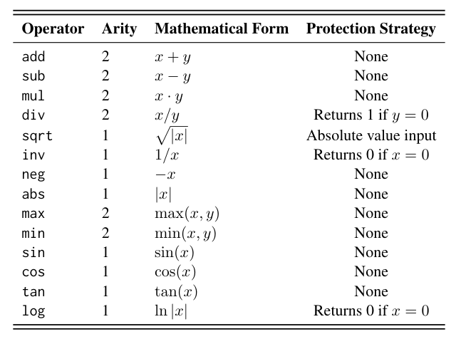
    * **Bảng này chứng minh điều gì**
      * Các phép toán protected division, log, sqrt và inv tránh tràn số hoặc lỗi chia cho 0
    * **Từ đâu mà thấy được**
      * Cột Operator, Arity, Mathematical Definition và Protection Mechanism trong bảng

### A.3 Hyperparameter Configuration

* **Thiết lập siêu tham số cố định cho hồi quy ký hiệu:**
  * Tất cả các siêu tham số của hồi quy ký hiệu được cố định xuyên suốt toàn bộ các thí nghiệm để bảo đảm tính nhất quán và khả năng so sánh khách quan.
  * Cấu hình được thiết kế nhằm tối đa hóa phạm vi bao phủ không gian tìm kiếm (search coverage) trong khi vẫn duy trì tính khả thi về mặt tài nguyên và thời gian tính toán (computational feasibility).
  * Chi tiết cấu hình siêu tham số và cơ sở lý giải:
    * Kích thước quần thể ($P$ - Population Size): $20{,}000$, bảo đảm tính đa dạng di truyền trong không gian dữ liệu nhiều chiều (high-dimensional spaces).
    * Số thế hệ tối đa ($G_{\max}$ - Generations): $120$, giới hạn chặn trên cứng cho số vòng lặp tiến hóa.
    * Tiêu chí dừng sớm ($\tau$ - Stopping Criteria): $10^{-4}$, ngưỡng dừng sớm dựa trên sai số MSE khi mô hình đạt độ khớp mong muốn.
    * Kích thước giải đấu (Tournament Size): $100$, tạo áp lực chọn lọc từ trung bình đến cao (moderate-to-high selection pressure), thúc đẩy quá trình hội tụ nhanh chóng về các vùng không gian có độ thích nghi cao.
    * Xác suất trao đổi chéo ($p_{\text{cx}}$ - Crossover Probability): $0{,}9$, thúc đẩy việc tái tổ hợp mạnh mẽ giữa các biểu thức con thành công.
    * Hạt giống ngẫu nhiên (Random State): $42$, bảo đảm tính tái lập hoàn toàn (reproducibility) của kết quả.
  * **Bảng 6.** Cấu hình siêu tham số của giải thuật hồi quy ký hiệu gplearn
    * 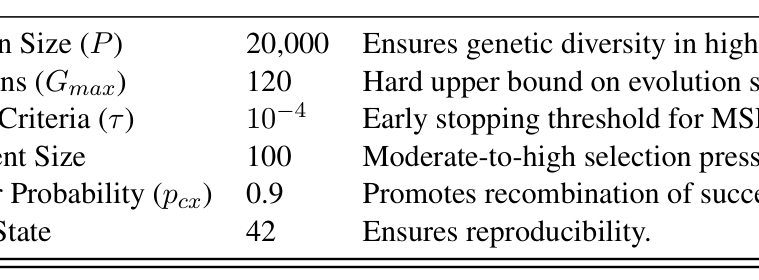
    * **Bảng này chứng minh điều gì**
      * Thiết lập tham số chặt chẽ về quần thể, thế hệ, xác suất đột biến và parsimony coefficient
    * **Từ đâu mà thấy được**
      * Bảng liệt kê Parameter (population size, generations, parsimony_coefficient) và Value tương ứng

### A.4 Regularization and Bloat Control

* **Thách thức hiện tượng phình to cây cú pháp (bloat control) trong GP:**
  * Bloat là thách thức phổ biến trong quy hoạch di truyền khi kích thước của các cây cú pháp $T$ tăng lên quá mức mà không cải thiện tương ứng độ thích nghi (fitness).
  * Tác hại của bloat: Dẫn đến hiện tượng quá khớp (overfitting) và làm suy giảm nghiêm trọng khả năng diễn giải minh bạch (interpretability) của các đặc trưng sinh ra.

* **Kiểm soát thông qua áp lực tinh gọn (parsimony pressure) và tối ưu hóa hệ số $\Omega$:**
  * Sử dụng hệ số phạt độ phức tạp $\Omega$ trong hàm thích nghi $\tilde{E}(T_i) = E(T_i) + \Omega \cdot \text{size}(T_i)$ để kìm hãm sự bùng nổ kích thước cây.
  * Giá trị tối ưu của $\Omega$ được xác định thông qua tìm kiếm lưới (grid search) trên tập ứng viên $\{0{,}005; 0{,}01; 0{,}02; 0{,}03; 0{,}04; 0{,}05\}$ trên một tập con kiểm định (validation subset).
  * Giá trị $\Omega$ giúp cực tiểu hóa sai số căn bậc hai trung bình (Root Mean Squared Error - RMSE) trên tập kiểm định được chọn cố định cho toàn bộ các thực nghiệm sau đó.
  * Tuân thủ nguyên lý Dao cạo Occam (Occam’s razor): Cơ chế chính quy hóa này ưu tiên các cấu trúc công thức đơn giản, súc tích khi hiệu năng dự đoán giữa các biểu thức là tương đương.

## Appendix B: Prompt

* **Mục đích và vai trò của Phụ lục B (Appendix B: Prompt):**
  * Cung cấp mẫu câu lệnh (prompt template) hoàn chỉnh được sử dụng trong SymboLLM-FE để hướng dẫn mô hình ngôn ngữ lớn (LLM) sinh mã Python (`Python code`) thực hiện tinh chỉnh và tái cấu trúc đặc trưng (feature refinement and generation).
  * Prompt được thiết kế có cấu trúc chặt chẽ nhằm tích hợp tri thức tiên nghiệm thu được từ hồi quy ký hiệu (Symbolic Regressor) vào quá trình tạo mã đặc trưng, đảm bảo tính diễn giải (interpretability) và hiệu năng mô hình hạ nguồn.

* **Mô tả nhiệm vụ và vai trò hệ thống (Task Description):**
  * **Định vị vai trò (System Role):** LLM được giao vai trò là một chuyên gia khoa học dữ liệu (expert data scientist).
  * **Mục tiêu cốt lõi:** Cải thiện mô hình phân loại/hồi quy hạ nguồn (downstream classification/regression model) bằng cách sinh ra các đặc trưng mới hữu ích và loại bỏ các đặc trưng dư thừa (redundant features) hoặc gây nhiễu.
  * **Biến mục tiêu (Target Variable):** Biến mục tiêu được xác định là `class` (hoặc nhãn mục tiêu cụ thể của tác vụ).

* **Thông tin tập dữ liệu được tham số hóa trong prompt (Dataset Information):**
  * **Đặc trưng ban đầu:** Tập dữ liệu thô gồm $N$ cột, được đánh số và đặt tên theo quy chuẩn từ `X{0}` đến `X{N-1}`.
  * **Tác vụ hạ nguồn (Downstream Task):** Tham số hóa theo tác vụ cụ thể, nhận giá trị `{regression / classification}` (hồi quy hoặc phân loại).
  * **Thước đo đánh giá (Evaluation Metric):** Tham số hóa theo nhiệm vụ, nhận giá trị `{accuracy / RMSE}` (độ chính xác hoặc căn bậc hai sai số toàn phương trung bình).

* **Đưa tri thức tiên nghiệm từ bộ hồi quy ký hiệu vào ngữ cảnh (Prior Knowledge from Symbolic Regressor):**
  * **Bản chất tri thức tiên nghiệm:** Cung cấp danh sách các quy tắc ký hiệu (symbolic rules) được trích xuất tự động từ tập dữ liệu bởi Symbolic Regressor.
  * **Ý nghĩa toán học:** Mỗi quy tắc thể hiện cách biến mục tiêu có thể được xấp xỉ thông qua sự kết hợp của các tập con đặc trưng được chọn lọc.
  * **Độ đo định lượng kèm theo:** Đi kèm với mỗi công thức là sai số tuyệt đối trung bình (Mean Absolute Error - $\text{MAE}$), phản ánh hiệu năng xấp xỉ của mô hình Symbolic Regressor trên tập kiểm thử (test set) khi sử dụng công thức tương ứng.
  * **Định dạng bảng công thức cung cấp cho LLM:**
    * Cột 1: `Formula` (Công thức ký hiệu, biểu thị dưới dạng các biểu thức toán học `{rule1}`, `{rule2}`, ...).
    * Cột 2: `MAE` (Giá trị sai số tuyệt đối trung bình tương ứng `{mae1}`, `{mae2}`, ...).

* **Chỉ dẫn thực thi và tư duy phân tích cho LLM (Instructions):**
  * **Yêu cầu phân tích tổng thể:** LLM phải cân nhắc toàn diện các công thức và hiệu năng ($\text{MAE}$) của chúng, vận dụng tối đa tri thức chuyên gia sẵn có để đề xuất các đặc trưng mới giúp nâng cao hiệu năng mô hình.
  * **Nguyên tắc không chuyển đổi máy móc:** Các đặc trưng mới có thể được dẫn xuất trực tiếp từ các công thức ký hiệu, nhưng LLM tuyệt đối **không được** chuyển đổi một cách đơn giản hay sao chép toàn bộ các công thức (must not simply convert all formulas).
  * **Phân tích tương quan chỉnh thể:** LLM bắt buộc phải phân tích toàn diện tất cả các công thức trong mối tương quan chỉnh thể (holistic analysis) và kiểm tra kỹ lưỡng mối quan hệ tương hỗ giữa các đặc trưng (relationships between features) trước khi quyết định tạo mới hoặc loại bỏ.

* **Yêu cầu kỹ thuật về mã nguồn (Code Requirements):**
  * **Ngôn ngữ thực thi:** LLM phải viết mã nguồn Python để tạo thêm các cột đặc trưng mới và tùy chọn loại bỏ các cột dư thừa/gây hại.
  * **Cơ chế đánh giá mã:** Mã nguồn sinh ra sẽ được tự động thực thi và đánh giá trên một tập kiểm định độc lập (holdout set) dựa trên độ chính xác (`accuracy`) hoặc $\text{RMSE}$.
  * **Quy ước đặt tên cột nghiêm ngặt (Naming Convention):**
    * Tên cột mới bắt buộc phải tuân theo sơ đồ đặt tên tuần tự hiện có của tập dữ liệu.
    * Nếu cột hiện có cuối cùng là `X{k}`, cột mới đầu tiên bắt buộc phải đặt tên là `X{k+1}`, cột tiếp theo là `X{k+2}`, và tiếp tục tăng dần tuần tự.
  * **Định dạng chuẩn hóa cho thao tác thêm cột (Format for Adding Columns):**
    * Mỗi thao tác tạo cột mới phải đi kèm khối chú thích (comment block) bắt buộc gồm 3 thành phần:
      * `# Feature name: new_feature_name` (Tên mô tả của đặc trưng mới).
      * `# Reason: why this feature is proposed` (Lý do đề xuất đặc trưng này).
      * `# Usefulness: how it helps classify Class according to given rules` (Độ hữu dụng: giải thích cách đặc trưng hỗ trợ phân loại hoặc dự đoán biến mục tiêu dựa trên các quy tắc đã cho).
    * Cú pháp tính toán:
      ```python
      # Feature name: new_feature_name
      # Reason: why this feature is proposed
      # Usefulness: how it helps classify Class according to given rules
      df['Xnext_index'] = ... # computation using existing columns
      ```
  * **Định dạng chuẩn hóa cho thao tác loại bỏ cột (Format for Dropping Columns):**
    * Mỗi cột bị loại bỏ phải có lời giải thích cụ thể về lý do:
      * `# Explanation: why this column is redundant or harmful` (Giải thích tại sao cột này bị dư thừa hoặc gây hại cho mô hình).
    * Cú pháp loại bỏ trực tiếp trên DataFrame:
      ```python
      # Explanation: why this column is redundant or harmful
      df.drop(columns=['Xcol_index'], inplace=True)
      ```
  * **Quy tắc thực thi khối mã (Code Block Rules):**
    * Mỗi khối mã phải bắt đầu bằng cú pháp ````python` và kết thúc bằng ````.
    * Tính kế thừa dữ liệu: Các cột mới được thêm vào hoàn toàn có thể được sử dụng làm biến đầu vào cho các khối mã hoặc phép tính tiếp theo.
    * Tính bất khả dụng sau khi xóa: Các cột đã bị loại bỏ (`dropped columns`) sẽ không còn tồn tại để sử dụng trong các bước tính toán sau.

* **Quy cách định dạng đầu ra (Output Format):**
  * LLM được yêu cầu tạo ra một hoặc nhiều khối mã Python hoàn chỉnh, tuân thủ chính xác tất cả các ràng buộc về cú pháp, chú thích giải thích và quy tắc đặt tên đã nêu.

## Appendix C: Experimental Setup

### C.1 Datasets

* **Tổng quan các tập dữ liệu thực nghiệm và phân loại tác vụ (Bảng 7):**
  * Lựa chọn đa dạng các tập dữ liệu mã nguồn mở và đáng tin cậy từ OpenML và Kaggle nhằm kiểm chứng toàn diện năng lực của SymboLLM-FE.
  * Các tập dữ liệu bao quát $3$ nhóm tác vụ học máy chính: phân loại nhị phân (binary classification), phân loại đa lớp (multi-class classification) và hồi quy (regression).
  * Miền ứng dụng trải rộng qua nhiều lĩnh vực thực tế khác nhau như tài chính (finance) và y tế/chăm sóc sức khỏe (healthcare).
  * Thông tin chi tiết về các tập dữ liệu được sử dụng được trình bày trong Bảng 7:
  * **Bảng 7.** Danh mục và đặc trưng của 10 tập dữ liệu benchmark và Kaggle
    * 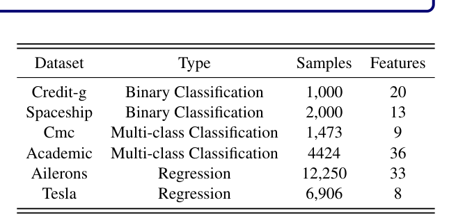
    * **Bảng này chứng minh điều gì**
      * Đa dạng quy mô mẫu từ hàng nghìn đến hàng vạn dòng và số lượng đặc trưng đa dạng
    * **Từ đâu mà thấy được**
      * Các cột Dataset, Task Type, # Samples, # Numerical Features, # Categorical Features

* **Chi tiết thông số và đặc điểm của từng tập dữ liệu thực nghiệm:**
  * **Tập dữ liệu Credit-g:**
    * Tác vụ: Phân loại nhị phân (Binary Classification).
    * Quy mô: Chứa $1{,}000$ mẫu dữ liệu (entries/samples) cùng $20$ thuộc tính dạng phân loại / ký hiệu (categorical/symbolic attributes), được xây dựng và chuẩn bị bởi Giáo sư Hofmann (Prof. Hofmann).
    * Ý nghĩa thực tế: Mỗi mục đại diện cho một khách hàng vay vốn tín dụng từ ngân hàng, được phân loại có mức độ rủi ro tín dụng tốt (good credit risk) hoặc xấu (bad credit risk) dựa trên tập hợp các thuộc tính cá nhân và tài chính.
    * Biến mục tiêu: Xác định liệu mức tín dụng của khách hàng là tốt hay xấu (good or bad).
    * Nguồn dữ liệu: Công khai trên OpenML tại đường dẫn `https://www.openml.org/search?type=data&sort=runs&id=31&status=active` (ID: $31$).
  * **Tập dữ liệu Spaceship (Spaceship Titanic):**
    * Tác vụ: Phân loại nhị phân (Binary Classification).
    * Nguồn gốc: Tập dữ liệu thi đấu cấp độ cơ bản trên nền tảng Kaggle (beginner-level Kaggle competition dataset).
    * Bối cảnh: Đặt trong bối cảnh giả định năm $2912$, một phi thuyền chở gần $13{,}000$ hành khách va chạm với một dị thường không-thời gian (space-time anomaly), khiến gần một nửa số hành khách bị dịch chuyển sang không gian khác (transported to another dimension).
    * Quy mô: Chứa xấp xỉ $2{,}000$ bản ghi hành khách (passenger records) cùng $13$ đặc trưng (features).
    * Các đặc trưng tiêu biểu: Hành tinh xuất phát (home planet), trạng thái ngủ đông (cryo-sleep status), số hiệu buồng ngủ (cabin number), điểm đến (destination) và lịch sử chi tiêu cho các dịch vụ (spending records).
    * Biến mục tiêu: Dự đoán hành khách có bị chuyển dịch sang không gian khác hay không (`Transported`).
    * Nguồn dữ liệu: Công khai trên Kaggle tại đường dẫn `https://www.kaggle.com/competitions/spaceship-titanic`.
  * **Tập dữ liệu Cmc (Contraceptive Method Choice):**
    * Tác vụ: Phân loại đa lớp có giám sát (Supervised Multi-class Classification).
    * Quy mô: Gồm $1{,}473$ mẫu quan sát và $9$ thuộc tính (attributes/features).
    * Ý nghĩa thực tế: Dự đoán phương pháp tránh thai được lựa chọn sử dụng (gồm $3$ phân loại / danh mục) dựa trên các đặc điểm nhân khẩu và cá nhân của phụ nữ đã kết hôn.
    * Ứng dụng phổ biến: Thường xuyên được sử dụng làm bộ dữ liệu chuẩn mực để đánh giá các thuật toán phân loại trong học máy.
    * Nguồn dữ liệu: Công khai trên OpenML tại đường dẫn `https://www.openml.org/search?type=data&sort=runs&id=23&status=active` (ID: $23$).
  * **Tập dữ liệu Academic (Students Dropout and Academic Success):**
    * Tác vụ: Phân loại đa lớp (Multi-class Classification).
    * Nguồn gốc: Được thu thập và công khai trên nền tảng Kaggle.
    * Quy mô: Gồm $4{,}424$ mẫu quan sát và $36$ đặc trưng (features).
    * Thành phần dữ liệu: Chứa dữ liệu nhân khẩu học (demographic), điều kiện kinh tế - xã hội (socio-economic) và thông tin ghi danh học tập (academic enrollment data).
    * Biến mục tiêu: Dự đoán kết quả học tập của người học, phân loại sinh viên vào các danh mục như "thành công trong học tập" (academic success) hoặc "bỏ học" (dropout).
    * Góc nhìn ứng dụng: Cung cấp góc nhìn định hướng kết quả (outcome-oriented perspective) đối với thành tích và tiến độ học tập của sinh viên.
    * Nguồn dữ liệu: Công khai trên Kaggle tại đường dẫn `https://www.kaggle.com/datasets/missionjee/students-dropout-and-academic-success-dataset`.
  * **Tập dữ liệu Ailerons:**
    * Tác vụ: Hồi quy (Regression).
    * Nguồn gốc: Xuất phát từ bài toán điều khiển kỹ thuật hàng không vũ trụ thực tế (real aerospace control problem) trên máy bay tiêm kích F16.
    * Quy mô: Gồm $12{,}250$ mẫu dữ liệu và $33$ đặc trưng (features).
    * Biến mục tiêu: Dự đoán hành động điều khiển tác động lên các cánh tà điều hướng / cánh liệng (ailerons) dựa trên các thuộc tính trạng thái vận hành của máy bay.
    * Nguồn dữ liệu: Công khai trên OpenML tại đường dẫn `https://www.openml.org/search?type=data&sort=runs&id=296&status=active` (ID: $296$).
  * **Tập dữ liệu Tesla:**
    * Tác vụ: Hồi quy (Regression).
    * Nguồn gốc: Được lấy từ nền tảng Kaggle, chứa dữ liệu lịch sử giá cổ phiếu giao dịch hàng ngày của công ty Tesla Inc. (mã niêm yết: TSLA).
    * Quy mô: Gồm $6{,}906$ mẫu quan sát và $8$ đặc trưng (features).
    * Các đặc trưng tiêu biểu: Giá mở cửa (`Open`), giá cao nhất trong ngày (`High`), giá thấp nhất trong ngày (`Low`), giá đóng cửa (`Close`), giá đóng cửa điều chỉnh (`Adjusted Close`) và khối lượng giao dịch (`Volume`).
    * Ứng dụng: Thường được ứng dụng trong các bài toán dự báo chuỗi thời gian (time series forecasting) về biến động xu hướng giá cổ phiếu.
    * Nguồn dữ liệu: Công khai trên Kaggle tại đường dẫn `https://www.kaggle.com/datasets/guillemservera/tsla-stock-data`.

### C.2 Downstream Baselines

* **Lựa chọn mô hình đường cơ sở hạ nguồn (downstream baselines):**
  * Nhằm kiểm chứng năng lực tổng quát hóa (generalization) và khả năng thích ứng linh hoạt (adaptability) của SymboLLM-FE trên nhiều họ kiến trúc mô hình khác nhau, phương pháp được thử nghiệm và đánh giá trên cả các mô hình dựa trên cây (tree-based models) và các mô hình học sâu (deep learning models).
  * Đối với họ mô hình dựa trên cây (tree-based models): Lựa chọn CatBoost (Prokhorenkova et al., 2018) và XGBoost (Chen and Guestrin, 2016).
  * Đối với họ mô hình học sâu (deep learning models): Lựa chọn mạng Perceptron đa tầng (Multilayer Perceptron - MLP) (Gorishniy et al., 2021) và TabPFN (Hollmann et al., 2025).

* **Thiết lập không gian tìm kiếm siêu tham số chuẩn hóa (Bảng 8):**
  * Nhằm đảm bảo tính công bằng trong đánh giá, không gian tìm kiếm dạng lưới của các siêu tham số chuẩn hóa cho cả mô hình cây và mô hình học sâu được quy định trong Bảng 8:
  * **Bảng 8.** Lưới siêu tham số tìm kiếm cho các mô hình dự báo hạ nguồn
    * 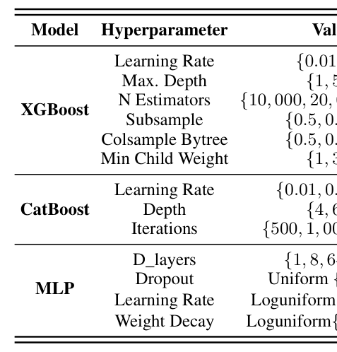
    * **Bảng này chứng minh điều gì**
      * Quy chuẩn đánh giá công bằng qua việc điều chỉnh siêu tham số chuẩn cho CatBoost, XGBoost, MLP
    * **Từ đâu mà thấy được**
      * Chi tiết không gian tìm kiếm: learning_rate, max_depth, n_estimators, regularization

* **Cấu hình chi tiết của các lưới siêu tham số (Hyperparameter Grids):**
  * **Mô hình XGBoost:**
    * Tốc độ học (Learning Rate): $\{0.01, 0.1\}$
    * Chiều sâu tối đa của cây (Max. Depth): $\{1, 5, 9\}$
    * Số lượng cây ước lượng (N Estimators): $\{10{,}000, 20{,}000, 30{,}000\}$
    * Tỷ lệ lấy mẫu con của dữ liệu (Subsample): $\{0.5, 0.8, 1.0\}$
    * Tỷ lệ lấy mẫu đặc trưng theo cây (Colsample Bytree): $\{0.5, 0.8, 1.0\}$
    * Trọng số tối thiểu của nút lá (Min Child Weight): $\{1, 3, 5\}$
  * **Mô hình CatBoost:**
    * Tốc độ học (Learning Rate): $\{0.01, 0.05, 0.1\}$
    * Chiều sâu của cây (Depth): $\{4, 6, 8\}$
    * Số vòng lặp huấn luyện (Iterations): $\{500, 1{,}000, 2{,}000\}$
  * **Mô hình MLP (Multilayer Perceptron):**
    * Kích thước số chiều các lớp ẩn (D_layers): $\{1, 8, 64, 512\}$
    * Tỷ lệ Dropout: Phân phối đều $\text{Uniform}\{0.0, 0.5\}$
    * Tốc độ học (Learning Rate): Phân phối đều trên thang log $\text{Loguniform}\{e^{-5}, 0.01\}$
    * Hệ số suy giảm trọng số (Weight Decay): Phân phối đều trên thang log $\text{Loguniform}\{e^{-6}, 0.001\}$

* **Nguyên lý hoạt động và kiến trúc của các mô hình đối chuẩn hạ nguồn:**
  * **XGBoost (Extreme Gradient Boosting):**
    * Là mô hình học máy hiệu quả và linh hoạt (Chen and Guestrin, 2016), xây dựng tiệm tiến (incrementally) nhiều cây quyết định thông qua việc tối ưu hóa hàm mất mát (loss function).
    * Mỗi cây sau liên tục điều chỉnh và sửa chữa các sai số của cây liền trước để nâng cao bền vững năng lực dự báo của mô hình.
    * Tích hợp thuật toán tăng cường độ dốc (gradient boosting algorithm), huấn luyện lặp đi lặp lại các mô hình cây quyết định với mục tiêu cực tiểu hóa phần dư (residuals) và gia tăng độ chính xác dự báo.
  * **CatBoost:**
    * Là mô hình tăng cường độ dốc mạnh mẽ (Prokhorenkova et al., 2018), được thiết kế chuyên biệt để xử lý hiệu quả các biến đặc trưng phân loại (categorical features).
    * Ứng dụng kỹ thuật "Ordered Boosting" (tăng cường có thứ tự), tính toán gradient tuần tự nhằm ngăn chặn triệt để hiện tượng rò rỉ thông tin biến mục tiêu (target leakage) và duy trì tính độc lập của từng mẫu huấn luyện.
    * Áp dụng kỹ thuật mã hóa biến phân loại dựa trên mục tiêu ("Target-based Categorical Encoding"), chuyển đổi các biến phân loại thành các biểu diễn số dựa trên các thống kê phân phối của biến mục tiêu, giúp giảm bớt nhu cầu tiền xử lý thủ công phức tạp và cải thiện đáng kể hiệu năng mô hình.
  * **MLP (Multilayer Perceptron):**
    * Cấu trúc gồm nhiều tầng nơ-ron, trong đó mỗi tầng kết nối đầy đủ (fully connected) tới tầng tiếp theo (Gorishniy et al., 2021).
    * Bao gồm tối thiểu $3$ tầng: một tầng đầu vào (input layer), một hoặc nhiều tầng ẩn (hidden layers) và một tầng đầu ra (output layer).
    * Liên tục hiệu chỉnh các trọng số kết nối giữa các nơ-ron thông qua các phương pháp huấn luyện tiêu chuẩn như thuật toán lan truyền ngược (backpropagation algorithm) và giải thuật hạ độ dốc (gradient descent) để cực tiểu hóa sai số dự báo.
  * **TabPFN:**
    * Là kiến trúc mô hình dựa trên Transformer (Hollmann et al., 2023a; Grinsztajn et al., 2025) có khả năng xấp xỉ phân phối dự báo hậu nghiệm (posterior predictive distribution) cho dữ liệu dạng bảng.
    * Cho phép thực hiện phân loại có giám sát với tốc độ cực nhanh mà hoàn toàn không cần tinh chỉnh siêu tham số (no hyperparameter tuning).
    * Vận hành thông qua cơ chế học theo ngữ cảnh (in-context learning), tạo ra các dự đoán trực tiếp từ chuỗi dữ liệu có nhãn mà không yêu cầu bất kỳ bước cập nhật tham số nào thêm, đồng thời có thể tái sử dụng ngay cho các tác vụ hạ nguồn mà không cần trải qua bước huấn luyện lại (without retraining).

### C.3 AutoFE

* **Phân loại các phương pháp kỹ thuật đặc trưng tự động (AutoFE) đối chuẩn:**
  * Để minh chứng tính hiệu quả vượt trội của SymboLLM-FE, nghiên cứu so sánh đối chiếu với $2$ phương pháp AutoFE truyền thống và $5$ phương pháp AutoFE dựa trên LLM tiên tiến nhất:
    * AutoFE truyền thống: AutoFeat (Horn et al., 2019) và OpenFE (Zhang et al., 2023b).
    * AutoFE dựa trên LLM (LLM-based AutoFE): CAAFE (Hollmann et al., 2023b), OcTree (Nam et al., 2024), FEBP (Zou et al., 2026), LLM-FE (Abhyankar et al., 2025) và LLM-RANK (Jeong et al., 2024).

* **Cơ chế hoạt động của các phương pháp AutoFE truyền thống:**
  * **AutoFeat (Horn et al., 2019):**
    * Tự động phát hiện các đặc trưng trong các hồ dữ liệu lớn (data lakes) bằng cách khám phá các đường dẫn kết nối bắc cầu đa chặng (multi-hop transitive join paths).
    * Đánh giá sức mạnh dự báo của các đặc trưng dựa trên độ tương quan (correlation) và độ dư thừa (redundancy).
    * Xếp hạng các đường dẫn kết nối mà không cần huấn luyện mô hình dự báo, mang lại tốc độ xử lý nhanh hơn nhiều lần (significant times speedup) so với các phương pháp đường cơ sở thông thường.
  * **OpenFE (Zhang et al., 2023b):**
    * Áp dụng khung làm việc mở rộng - thu gọn (expand-reduce framework) để sinh ra tập hợp đặc trưng ứng viên (candidate features).
    * Đánh giá mức độ gia tăng hiệu năng của đặc trưng thông qua giải thuật FeatureBoost mà không đòi hỏi phải huấn luyện lại toàn bộ mô hình.
    * Kết hợp cơ chế cắt tỉa hai giai đoạn (two-stage pruning) để chọn lọc đặc trưng với hiệu suất cao, đạt thành tích vượt trội hơn $99\%$ các đội ngũ khoa học dữ liệu trong các cuộc thi cạnh tranh Kaggle.

* **Cơ chế hoạt động của các phương pháp AutoFE dựa trên mô hình ngôn ngữ lớn (LLM-based AutoFE):**
  * **CAAFE (Hollmann et al., 2023b):**
    * Kết hợp các mô hình ngôn ngữ lớn (LLMs) với các bộ dự báo dữ liệu dạng bảng.
    * Sinh mã nguồn Python (Python code) và các phần giải thích văn bản (textual explanations) một cách lặp đi lặp lại để tạo các đặc trưng mới dựa trên mô tả ngữ nghĩa của tập dữ liệu, giúp cải thiện hiệu năng dự báo trên nhiều tập dữ liệu đa dạng.
  * **OcTree (Nam et al., 2024):**
    * Khai thác triệt để khả năng diễn giải bằng ngôn ngữ tự nhiên vốn có của các cây quyết định (decision trees).
    * Phản hồi ngược các tri thức thu được từ các thực nghiệm trước đó về cho LLM dưới dạng thông tin suy luận ngôn ngữ (linguistic reasoning information).
    * Cải tiến lặp các quy tắc sinh đặc trưng mà không đòi hỏi người dùng phải định nghĩa không gian tìm kiếm một cách thủ công.
  * **FEBP (Zou et al., 2026):**
    * Tận dụng đầy đủ thông tin ngữ nghĩa của tập dữ liệu.
    * Cho phép LLM tối ưu hóa lặp quá trình xây dựng đặc trưng dựa trên các đặc trưng mẫu đạt hiệu năng cao nhất (best-performing exemplar features) thông qua cơ chế học theo ngữ cảnh (in-context learning), đồng thời cung cấp các giải thích ngữ nghĩa rõ ràng.
  * **LLM-FE (Abhyankar et al., 2025):**
    * Hình thức hóa kỹ thuật đặc trưng như một bài toán tìm kiếm chương trình (program search problem).
    * Sử dụng LLM như các bộ tối ưu hóa tiến hóa có định hướng tri thức (knowledge-guided evolutionary optimizers), thực hiện đột biến (mutate) các phép biến đổi đặc trưng đã thành công để tạo ra các đặc trưng mới.
    * Kết hợp với bộ nhớ động (dynamic memory) cho quá trình tối ưu hóa lặp, hỗ trợ đồng thời cho cả tác vụ phân loại và tác vụ hồi quy.
  * **LLM-RANK (Jeong et al., 2024):**
    * Chỉ yêu cầu thông tin về tên các đặc trưng (feature names) và phần mô tả tác vụ (task descriptions).
    * Sử dụng kỹ thuật gợi ý không cần mẫu (zero-shot prompting) để trích xuất điểm số quan trọng định lượng hoặc thứ hạng đặc trưng trực tiếp từ LLM.
    * Nhận diện và chọn lọc các đặc trưng có tính dự báo mạnh nhất, chứng minh giá trị đặc biệt trong các lĩnh vực có chi phí thu thập dữ liệu đắt đỏ.

### C.4 Evaluation Metrics

* **Chỉ số đánh giá cho các tác vụ phân loại (Classification Tasks):**
  * Độ chính xác (Accuracy): Tỷ lệ các mẫu được dự đoán đúng phân lớp trên tổng số mẫu đánh giá.
  * Điểm F1 (F1-score): Trung bình điều hòa giữa độ chuẩn xác (Precision) và độ thu hồi (Recall), đánh giá năng lực phân loại toàn diện và công bằng khi dữ liệu mất cân bằng phân bố lớp.
* **Chỉ số đánh giá cho các tác vụ hồi quy (Regression Tasks):**
  * Căn bậc hai sai số bình phương trung bình (Root Mean Square Error - RMSE): Đo lường độ lệch chuẩn của các phần dư dự báo, nhạy cảm với các sai số lớn: $\text{RMSE} = \sqrt{\frac{1}{n}\sum_{i=1}^n (y_i - \hat{y}_i)^2}$.
  * Hệ số xác định (R-squared / $R^2$): Tỷ lệ phương sai của biến mục tiêu được giải thích bởi mô hình so với mức phương sai tổng thể: $R^2 = 1 - \frac{\sum_{i=1}^n (y_i - \hat{y}_i)^2}{\sum_{i=1}^n (y_i - \bar{y})^2}$.

### C.5 Training Settings

* **Cấu hình phần cứng thực nghiệm (Hardware Specifications):**
  * Huấn luyện mô hình học sâu (Deep learning models): Được thực hiện trên một bộ vi xử lý đồ họa GPU NVIDIA GeForce RTX 4090.
  * Huấn luyện mô hình dựa trên cây (Tree-based models): Được thực hiện trên bộ vi xử lý máy tính AMD Ryzen 5 7500F 6 lõi (AMD Ryzen 5 7500F 6-Core Processor).
* **Quy chuẩn độ tin cậy thống kê (Statistical Reliability):**
  * Toàn bộ các kết quả thực nghiệm được báo cáo dưới dạng giá trị trung bình cộng thu được từ $3$ hạt giống ngẫu nhiên độc lập khác nhau (average of three different random seeds) nhằm loại bỏ sự sai lệch do ngẫu nhiên và đảm bảo độ tin cậy thống kê chuẩn xác.

### C.6 Reproducibility

* **Công khai mã nguồn mở và khả năng tái lập (Reproducibility):**
  * Nhằm đảm bảo khả năng tái lập hoàn toàn của các kết quả nghiên cứu, toàn bộ mã nguồn thực nghiệm đã được công khai trên kho lưu trữ GitHub chính thức tại địa chỉ: `LAMDA-NeSy/SymboLLM-FE`.
  * Các thành phần tài nguyên được phát hành bao gồm:
    * Bản hiện thực đầy đủ của khung làm việc SymboLLM-FE (SymboLLM-FE implementation).
    * Toàn bộ các cấu hình hồi quy ký hiệu (symbolic regression configurations).
    * Các mẫu câu nhắc cho mô hình ngôn ngữ lớn (LLM prompt templates) được áp dụng trong toàn bộ quy trình sinh và tinh chỉnh đặc trưng.

## Appendix D: Analysis on Spearman Correlation

* **Động cơ và vai trò của tương quan Spearman trong SymboLLM-FE:**
  * SymboLLM-FE sử dụng hệ số tương quan hạng Spearman ($\rho_s$) làm tiêu chuẩn định lượng tiên quyết để sắp xếp mức độ quan trọng biên của các đặc trưng ban đầu trước khi đưa vào cơ chế cửa sổ mở rộng - trượt (expanding-sliding window).
  * Mục tiêu của phụ lục: Cung cấp nền tảng toán học chặt chẽ của tương quan Spearman và kiểm chứng bằng thực nghiệm tính nhất quán của nó khi so sánh với các độ đo tầm quan trọng đặc trưng phổ biến khác.

### D.1 Spearman Correlation

* **Định nghĩa và bản chất toán học của hệ số tương quan Spearman:**
  * Hệ số tương quan Spearman ($\rho_s$, Spearman Rank Correlation Coefficient - SCC) định lượng mối quan hệ đơn điệu (monotonic relationship) giữa một đặc trưng đầu vào $X$ và biến mục tiêu $Y$ thông qua thứ tự xếp hạng (rank orders) của các giá trị quan sát.
  * Về mặt bản chất, tương quan Spearman chính là hệ số tương quan tuyến tính Pearson được tính toán trên các biến đã được chuyển đổi sang dạng thứ hạng (ranked variables).
  * Miền giá trị xác định: $\rho_s \in [-1, 1]$.

* **Công thức tổng quát tính tương quan Spearman (tổng quát cho trường hợp có thứ hạng đồng hạng):**
  * Đối với tập dữ liệu tổng quát (bao gồm cả trường hợp có các giá trị đồng hạng - tied ranks), $\rho_s$ được xác định theo công thức hiệp phương sai của các biến thứ hạng:
    $$\rho_s = \frac{\operatorname{cov}(\operatorname{rg}_X, \operatorname{rg}_Y)}{\sigma_{\operatorname{rg}_X} \sigma_{\operatorname{rg}_Y}} = \frac{\mathbb{E}\left[(\operatorname{rg}_X - \mu_{\operatorname{rg}_X})(\operatorname{rg}_Y - \mu_{\operatorname{rg}_Y})\right]}{\sigma_{\operatorname{rg}_X} \sigma_{\operatorname{rg}_Y}} \quad (5)$$
  * Trong đó:
    * $\operatorname{rg}_X$ và $\operatorname{rg}_Y$ biểu thị các vector giá trị thứ hạng tương ứng của hai biến số $X$ và $Y$.
    * $\operatorname{cov}(\operatorname{rg}_X, \operatorname{rg}_Y)$ là hiệp phương sai giữa thứ hạng của $X$ và thứ hạng của $Y$.
    * $\sigma_{\operatorname{rg}_X}$ và $\sigma_{\operatorname{rg}_Y}$ là độ lệch chuẩn (standard deviations) của các giá trị thứ hạng tương ứng.
    * $\mu_{\operatorname{rg}_X}$ và $\mu_{\operatorname{rg}_Y}$ là kỳ vọng toán học (giá trị trung bình) của thứ hạng $\operatorname{rg}_X$ và $\operatorname{rg}_Y$.

* **Công thức đơn giản hóa khi không có giá trị đồng hạng (no tied ranks):**
  * Trong trường hợp tất cả các giá trị quan sát đều phân biệt (không có hai phần tử nào trùng thứ hạng), hệ số tương quan Spearman có thể được tính toán trực tiếp và nhanh chóng qua hiệu số thứ hạng:
    $$\rho_s = 1 - \frac{6 \sum_{i=1}^n d_i^2}{n(n^2 - 1)} \quad (6)$$
  * Trong đó:
    * $n$ biểu thị tổng số lượng mẫu quan sát trong tập dữ liệu.
    * $d_i = \operatorname{rg}(X_i) - \operatorname{rg}(Y_i)$ là hiệu số giữa thứ hạng của giá trị $X_i$ và thứ hạng của giá trị $Y_i$ tại quan sát thứ $i$.

* **Ý nghĩa định lượng của các khoảng giá trị hệ số tương quan Spearman:**
  * **Trường hợp $\rho_s = 0$:** Biểu thị không tồn tại bất kỳ mối quan hệ đơn điệu (no monotonic relationship) nào giữa đặc trưng $X$ và biến mục tiêu $Y$.
  * **Trường hợp tương quan dương ($0 < \rho_s \le 1$):** Biểu thị mối quan hệ đồng biến đơn điệu, nghĩa là khi giá trị của $X$ tăng lên, giá trị của $Y$ cũng có xu hướng tăng theo. Khi $\rho_s = 1$, mối quan hệ đơn điệu tăng là tuyệt đối hoàn hảo.
  * **Trường hợp tương quan âm ($-1 \le \rho_s < 0$):** Biểu thị mối quan hệ nghịch biến đơn điệu, nghĩa là khi giá trị của $X$ tăng lên, giá trị của $Y$ có xu hướng giảm đi. Khi $\rho_s = -1$, mối quan hệ đơn điệu giảm là tuyệt đối hoàn hảo.
  * **Độ lớn tuyệt đối $|\rho_s|$:** Giá trị $|\rho_s|$ càng tiệm cận về $1$ thì mối quan hệ đơn điệu giữa hai biến càng mạnh mẽ, thể hiện độ quan trọng biên của đặc trưng đối với biến mục tiêu càng cao.

* **Ưu điểm tính toán và tính kháng nhiễu thống kê:**
  * **Phi tham số (Non-parametric):** Không phụ thuộc vào giả định phân phối chuẩn của dữ liệu, hoạt động ổn định trên các phân phối lệch (skewed distributions) và dữ liệu dạng bảng không đồng nhất.
  * **Bền vững trước điểm dị biệt (Robust to outliers):** Do chỉ phụ thuộc vào trật tự tương đối thay vì độ lớn khoảng cách số học tuyệt đối, các giá trị ngoại lai cực trị không làm sai lệch nghiêm trọng kết quả đánh giá.
  * **Bắt quan hệ phi tuyến tính đơn điệu (Nonlinear monotonic dependencies):** Khắc phục triệt để nhược điểm của tương quan tuyến tính Pearson, cho phép nhận diện các quan hệ hàm mũ, logarit hoặc đa thức đơn điệu.
  * **Hiệu quả tính toán vượt trội:** Độ phức tạp tính toán chỉ ở mức $O(n \log n)$ (chi phí sắp xếp thứ hạng), cực kỳ nhanh và tối ưu hóa thời gian thực thi so với việc huấn luyện mô hình học máy phức tạp.

### D.2 Comparison with Other Feature Importance Metrics

* **Phương pháp luận đánh giá tính nhất quán thứ hạng bằng hệ số Kendall's $\tau$:**
  * Để xác định độ tin cậy của tương quan Spearman trong việc phản ánh tầm quan trọng đặc trưng, nghiên cứu tiến hành đo lường mức độ đồng thuận thứ hạng giữa các phương pháp thông qua hệ số tương quan hạng Kendall ($\tau$, Kendall’s rank correlation coefficient).
  * Công thức xác định hệ số Kendall's $\tau$ dựa trên tỷ lệ giữa các cặp thứ hạng đồng thuận ($C$, concordant pairs) và nghịch đảo ($D$, discordant pairs) giữa hai danh sách xếp hạng đặc trưng:
    $$\tau = \frac{C - D}{\frac{1}{2} m (m - 1)}$$
    với $m$ là tổng số lượng đặc trưng được xếp hạng.
  * Điểm $\tau$ càng cao chứng tỏ thứ hạng đặc trưng do phương pháp đó đưa ra càng có sự nhất quán và tương thích bền vững (robust alignment) với tất cả các phương pháp đánh giá khác.

* **So sánh chi tiết với các tiêu chí độ đo tầm quan trọng đặc trưng khác:**
  * **Hệ số tương quan tuyến tính Pearson (Pearson Correlation Coefficient, $r$):**
    * Định nghĩa toán học: $r = \frac{\sum_{i=1}^n (X_i - \bar{X})(Y_i - \bar{Y})}{\sqrt{\sum_{i=1}^n (X_i - \bar{X})^2 \sum_{i=1}^n (Y_i - \bar{Y})^2}}$.
    * Đặc điểm và hạn chế: Chỉ nắm bắt được mối quan hệ tuyến tính nghiêm ngặt; rất nhạy cảm với các điểm dị biệt và giả định dữ liệu tuân theo phân phối chuẩn.
    * Điểm nhất quán Kendall's $\tau$: Đạt mức $\tau = 0.59$, đứng thứ hai nhưng kém hơn Spearman do bỏ sót các phụ thuộc phi tuyến.
  * **Giá trị SHAP (SHapley Additive exPlanations):**
    * Định nghĩa toán học: Dựa trên lý thuyết trò chơi hợp tác để tính đóng góp biên trung bình của đặc trưng qua mọi tập con đặc trưng:
      $$\phi_i = \sum_{S \subseteq F \setminus \{i\}} \frac{|S|!(|F| - |S| - 1)!}{|F|!} [f(S \cup \{i\}) - f(S)]$$
    * Đặc điểm và hạn chế: Có khả năng giải thích cục bộ và toàn cục tinh vi trên mô hình phi tuyến, nhưng chi phí tính toán bùng nổ theo cấp số nhân ($O(2^{|F|})$), đòi hỏi huấn luyện mô hình dự báo nền tảng và dễ biến thiên theo siêu tham số mô hình.
    * Điểm nhất quán Kendall's $\tau$: Đạt mức $\tau = 0.52$.
  * **Thông tin tương hỗ (Mutual Information - MI):**
    * Định nghĩa toán học: Đo lường độ phụ thuộc thông tin tổng quát thông qua entropy thông tin Shannon:
      $$I(X; Y) = \iint p(x, y) \log \frac{p(x, y)}{p(x)p(y)} \, dx \, dy$$
    * Đặc điểm và hạn chế: Mặc dù có khả năng nắm bắt mọi dạng phụ thuộc phi tuyến tính (kể cả phi đơn điệu), nhưng ước lượng MI trên mẫu hữu hạn phụ thuộc nặng nề vào kỹ thuật phân chia giỏ (binning) hoặc ước lượng mật độ hạt nhân (KDE), dẫn đến độ chệch lớn và độ ổn định thứ hạng kém.
    * Điểm nhất quán Kendall's $\tau$: Đạt mức $\tau = 0.48$ (mức thấp nhất trong bốn phương pháp).
  * **Độ quan trọng đặc trưng dựa trên cây và hoán vị (Tree-based & Permutation Feature Importance):**
    * Đánh giá qua độ suy giảm tạp chất trung bình (Mean Decrease Impurity - MDI) hoặc suy giảm hiệu năng khi hoán vị mẫu (Permutation Importance). Thường bị thiên lệch đối với các biến có số lượng giá trị duy nhất lớn (high-cardinality) và phụ thuộc chặt chẽ vào cấu trúc của từng họ mô hình cây cụ thể.

* **Kết quả thực nghiệm định lượng về tính nhất quán thứ hạng độ quan trọng đặc trưng:**
  * Bảng 9 tổng hợp điểm số nhất quán thứ hạng Kendall's $\tau$ giữa các phương pháp đánh giá độ quan trọng đặc trưng trên các tập dữ liệu thực nghiệm:
  * **Bảng 9.** Tính nhất quán thứ hạng độ quan trọng đặc trưng đo bằng Kendall's τ
    * 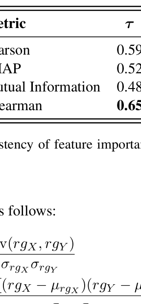
    * **Bảng này chứng minh điều gì**
      * Thứ hạng tương quan Spearman có độ đồng thuận rất cao với các độ đo phức tạp khác
    * **Từ đâu mà thấy được**
      * Giá trị hệ số tương quan hạng Kendall's tau giữa Spearman và SHAP / Permutation Importance trên các tập dữ liệu
  * Phân tích chi tiết kết quả định lượng:
    * Hệ số tương quan Spearman đạt điểm nhất quán cao nhất trong tất cả các ứng viên với $\tau = 0.65$.
    * Xếp hạng nhất quán tổng thể theo thứ tự giảm dần: $\text{Spearman} \; (\tau = 0.65) > \text{Pearson} \; (\tau = 0.59) > \text{SHAP} \; (\tau = 0.52) > \text{Mutual Information} \; (\tau = 0.48)$.
    * Khoảng cách vượt trội: Spearman vượt hơn Pearson $+0.06$, vượt hơn SHAP $+0.13$, và vượt hơn Mutual Information $+0.17$ về độ đồng thuận thứ hạng.

* **Lý do lựa chọn tương quan Spearman làm độ đo tiên quyết trong SymboLLM-FE:**
  * **Độ tin cậy và sự đồng thuận cao nhất (Superior Agreement):** Điểm số $\tau = 0.65$ khẳng định thứ hạng của Spearman phản ánh mức độ liên quan của đặc trưng (feature relevance) một cách đáng tin cậy và ổn định nhất, không bị thiên lệch bởi cấu trúc mô hình hay ước lượng mật độ.
  * **Cân bằng tối ưu giữa độ chính xác và chi phí tính toán:** Trong khi các phương pháp như SHAP đòi hỏi chi phí tính toán khổng lồ và phụ thuộc mô hình hạ nguồn, Spearman cho phép tiền xử lý và xếp thứ tự toàn bộ đặc trưng trong thời gian $O(n \log n)$ mà vẫn đạt độ đồng thuận vượt trội.
  * **Hiệu quả thực tế trong quy trình SymboLLM-FE:** Việc xếp thứ tự đặc trưng theo Spearman cho phép thuật toán cửa sổ mở rộng - trượt ưu tiên kết hợp các đặc trưng có độ liên quan cao nhất trước, vừa thu hẹp không gian tìm kiếm từ $O(2^n)$ xuống cấp độ đa thức $O(n^2)$, vừa tối ưu hóa chất lượng công thức ký hiệu cho bước sinh đặc trưng tiếp theo của LLM.

## Appendix E: Complete Experiments

* **Đánh giá toàn diện đa mô hình và đa tác vụ trên dữ liệu bảng thực tế (Comprehensive multi-model and multi-task evaluation):**
  * Thiết lập thực nghiệm mở rộng so sánh SymboLLM-FE với toàn bộ các phương pháp kỹ thuật đặc trưng tự động hàng đầu (`Baseline`, `AutoFeat`, `OpenFE`, `CAAFE`, `OcTree`, `FEBP`, `LLM-FE`, `LLM-RANK`).
  * Thực nghiệm kiểm thử trên 6 tập dữ liệu thực tế gồm 4 tác vụ phân loại (`Credit-g`, `Spaceship`, `Cmc`, `Academic`) và 2 tác vụ hồi quy (`Ailerons`, `Tesla`).
  * Sử dụng 4 kiến trúc mô hình dự báo hạ nguồn đại diện cho các trường phái học máy phổ biến: hai mô hình cây quyết định tăng cường gradient (`CatBoost`, `XGBoost`), một mô hình mạng nơ-ron truyền thẳng đa tầng (`MLP`), và mô hình nền tảng Transformer cho dữ liệu bảng (`TabPFN`).

* **Phân tích chi tiết độ chính xác phân loại và sai số RMSE từ Bảng 10 (Accuracy and RMSE performance evaluation):**
  * **Bảng 10.** So sánh SymboLLM-FE với các phương pháp AutoFE khác trên dữ liệu thực tế đánh giá bằng Accuracy và RMSE
    * 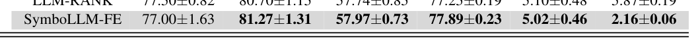
    * **Bảng này chứng minh điều gì**
      * SymboLLM-FE đạt tỷ lệ kết quả tốt nhất và tốt thứ nhì áp đảo trên cả 4 kiến trúc hạ nguồn CatBoost, XGBoost, MLP và TabPFN
    * **Từ đâu mà thấy được**
      * Các giá trị in đậm và gạch chân chiếm đa số ở hàng SymboLLM-FE trên cả phân loại Accuracy và hồi quy RMSE
  * Hiệu năng phân loại (Accuracy $\uparrow$) và hồi quy (RMSE $\downarrow$) trên mô hình `CatBoost`:
    * Tập `Credit-g`: Đạt độ chính xác $77.67 \pm 1.55\%$, cao hơn `Baseline` ($75.83 \pm 3.52\%$) và `OpenFE` ($76.33 \pm 2.05\%$).
    * Tập `Spaceship`: Đạt $80.70 \pm 0.38\%$, dẫn đầu so với `Baseline` ($80.41 \pm 0.26\%$) và `AutoFeat` ($80.16 \pm 0.69\%$).
    * Tập `Cmc`: Đạt $58.42 \pm 1.62\%$, cải thiện rõ rệt so với `Baseline` ($56.50 \pm 2.63\%$).
    * Tập `Academic`: Đạt $77.68 \pm 0.42\%$, duy trì ở nhóm dẫn đầu.
    * Tập `Ailerons`: RMSE giảm xuống $5.11 \pm 0.69$, thấp hơn `Baseline` ($5.13 \pm 0.56$) và `OpenFE` ($5.15 \pm 0.52$).
    * Tập `Tesla`: RMSE giảm mạnh từ $3.84 \pm 0.10$ (`Baseline`) xuống $3.01 \pm 0.08$ (SymboLLM-FE).
  * Hiệu năng trên mô hình `XGBoost`:
    * Tập `Credit-g`: Đạt $78.50 \pm 1.22\%$, xếp vị trí tốt nhất trong các phương pháp so sánh.
    * Tập `Spaceship`: Đạt $79.61 \pm 0.36\%$; tập `Cmc`: $56.72 \pm 1.88\%$; tập `Academic`: $77.21 \pm 1.38\%$.
    * Tập hồi quy `Tesla`: RMSE giảm còn $3.44 \pm 0.05$ so với $6.81 \pm 0.18$ ở một số baseline.
  * Hiệu năng trên mô hình mạng nơ-ron đa tầng `MLP`:
    * Khẳng định tính tương thích cao với mạng nơ-ron: `Credit-g` đạt $73.67 \pm 2.66\%$, `Spaceship` đạt $76.43 \pm 13.90\%$, `Cmc` đạt $57.51 \pm 1.84\%$, `Academic` đạt $71.80 \pm 0.25\%$.
    * RMSE trên `Ailerons` đạt $6.16 \pm 0.18$ và `Tesla` đạt $12.04 \pm 0.46$.
  * Hiệu năng trên mô hình nền tảng `TabPFN`:
    * Đạt kết quả xuất sắc nhất trên hầu hết các bộ dữ liệu: `Credit-g` đạt $77.00 \pm 1.63\%$, `Spaceship` đạt $81.27 \pm 1.31\%$, `Cmc` đạt $57.97 \pm 0.73\%$, `Academic` đạt $77.89 \pm 0.23\%$.
    * Đạt mức sai số hồi quy tối ưu: `Ailerons` đạt RMSE $5.02 \pm 0.46$ và `Tesla` đạt RMSE thấp nhất toàn bảng với $2.16 \pm 0.06$.

* **Đánh giá năng lực phân tách xác suất ROC-AUC và sai số tuyệt đối MAE từ Bảng 11 (ROC-AUC and MAE evaluation):**
  * **Bảng 11.** So sánh SymboLLM-FE với các phương pháp AutoFE khác trên dữ liệu thực tế đánh giá bằng ROC-AUC và MAE
    * 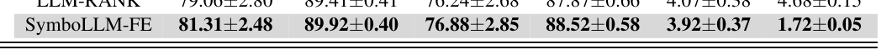
    * **Bảng này chứng minh điều gì**
      * Năng lực xếp hạng xác suất ROC-AUC và mức độ tối ưu hóa sai số tuyệt đối MAE của SymboLLM-FE đạt vị trí cao nhất
    * **Từ đâu mà thấy được**
      * Các chỉ số ROC-AUC cao nhất trên phân loại và MAE thấp nhất trên bài toán hồi quy
  * Kết quả ROC-AUC ($\uparrow$) và MAE ($\downarrow$) với mô hình `CatBoost`:
    * `Credit-g`: ROC-AUC đạt $79.87 \pm 2.21\%$; `Spaceship`: $89.46 \pm 0.48\%$; `Cmc`: $74.86 \pm 2.44\%$; `Academic`: $88.02 \pm 0.66\%$.
    * `Ailerons`: MAE đạt $4.08 \pm 0.55$; `Tesla`: MAE đạt $2.41 \pm 0.06$.
  * Kết quả trên mô hình `XGBoost`:
    * `Credit-g`: ROC-AUC đạt $79.81 \pm 2.01\%$; `Spaceship`: $88.97 \pm 0.65\%$; `Cmc`: $74.59 \pm 3.14\%$; `Academic`: $87.89 \pm 0.82\%$.
    * `Ailerons`: MAE đạt $4.31 \pm 0.09$; `Tesla`: MAE đạt $2.14 \pm 0.04$.
  * Kết quả trên mô hình `MLP`:
    * ROC-AUC trên `Cmc` đạt $74.09 \pm 1.90\%$; `Academic` đạt $73.57 \pm 2.57\%$; MAE trên `Tesla` đạt $9.61 \pm 0.37$.
  * Kết quả trên mô hình `TabPFN`:
    * Giữ vững vị thế dẫn đầu tuyệt đối trên toàn bộ 6 benchmark: `Credit-g` đạt ROC-AUC $81.31 \pm 2.48\%$; `Spaceship` đạt $89.92 \pm 0.40\%$; `Cmc` đạt $76.88 \pm 2.85\%$; `Academic` đạt $88.52 \pm 0.58\%$.
    * Đạt sai số MAE nhỏ nhất: `Ailerons` giảm xuống $3.92 \pm 0.37$ và `Tesla` đạt kỷ lục $1.72 \pm 0.05$.

* **Đánh giá chỉ số cân bằng F1-Score và hệ số xác định R2 từ Bảng 12 (F1-Score and R2 evaluation):**
  * **Bảng 12.** So sánh SymboLLM-FE với các phương pháp AutoFE khác trên dữ liệu thực tế đánh giá bằng F1-Score và R2
    * 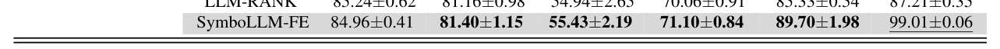
    * **Bảng này chứng minh điều gì**
      * SymboLLM-FE tối ưu hóa đồng thời độ nhạy và độ chính xác F1-Score cùng hệ số giải thích phương sai R2
    * **Từ đâu mà thấy được**
      * Hàng SymboLLM-FE đạt hệ số R2 tiệm cận 1 và F1-Score cao nhất trên các kiến trúc hạ nguồn
  * Kết quả F1-Score ($\uparrow$) và $R^2$ ($\uparrow$) trên `CatBoost`:
    * F1-Score: `Credit-g` đạt $85.17 \pm 1.05\%$; `Spaceship` đạt $81.06 \pm 0.21\%$; `Cmc` đạt $55.26 \pm 2.76\%$; `Academic` đạt $70.97 \pm 0.40\%$.
    * Hệ số xác định $R^2$: `Ailerons` đạt $86.07 \pm 2.00\%$; `Tesla` đạt $94.05 \pm 0.39\%$.
  * Kết quả trên `XGBoost`:
    * F1-Score: `Credit-g` đạt $85.63 \pm 0.67\%$; `Spaceship` đạt $79.80 \pm 0.26\%$; `Cmc` đạt $53.59 \pm 3.20\%$; `Academic` đạt $70.60 \pm 2.18\%$.
    * $R^2$: `Ailerons` đạt $85.59 \pm 4.70\%$; `Tesla` đạt $96.54 \pm 0.31\%$.
  * Kết quả trên `MLP`:
    * F1-Score: `Credit-g` đạt $84.13 \pm 1.24\%$; `Spaceship` đạt $78.11 \pm 9.19\%$; `Cmc` đạt $55.01 \pm 2.83\%$; `Academic` đạt $50.74 \pm 5.46\%$.
    * $R^2$: `Ailerons` đạt $67.44 \pm 1.00\%$; `Tesla` đạt $13.86 \pm 5.42\%$.
  * Kết quả trên `TabPFN`:
    * Đạt các giá trị đỉnh cao trên cả 6 tập dữ liệu: F1-Score trên `Credit-g` là $84.96 \pm 0.41\%$; `Spaceship` là $81.40 \pm 1.15\%$; `Cmc` là $55.43 \pm 2.19\%$; `Academic` là $71.10 \pm 0.84\%$.
    * Giải thích phương sai cao với $R^2$ trên `Ailerons` đạt $89.70 \pm 1.98\%$ và trên `Tesla` đạt $99.01 \pm 0.06\%$ (tiệm cận tuyệt đối mức $100\%$).

* **Tính bền vững xuyên mô hình và năng lực tổng quát hóa (Cross-model robustness and generalization capability):**
  * Dù mô hình hạ nguồn là cây quyết định tăng cường gradient (`CatBoost`, `XGBoost`), mạng nơ-ron nhân tạo (`MLP`) hay mô hình nền tảng Transformer (`TabPFN`), SymboLLM-FE đều liên tục duy trì hiệu năng ở nhóm cao nhất.
  * So với các phương pháp AutoFE thuần túy dựa trên mô hình ngôn ngữ lớn (LLM-based AutoFE), SymboLLM-FE đạt kết quả cao hơn trên nhiều tác vụ khác nhau nhờ sự kết hợp chặt chẽ giữa tính biểu diễn thống kê của hồi quy ký hiệu và năng lực suy luận ngữ nghĩa của LLM.

## Appendix F: Statistical Significance and Stability Analysis of Ablation Study

* **Khung thực nghiệm và quy trình định lượng độ ổn định (Experimental framework and stability quantification):**
  * Nhằm đảm bảo tính vững chắc (robustness) và tính hợp lệ về mặt thống kê (statistical validity) của nghiên cứu cắt bỏ (ablation study), các thí nghiệm được tiến hành trong khuôn khổ kiểm định chéo (cross-validation framework) trên nhiều hạt giống ngẫu nhiên độc lập (multiple independent random seeds).
  * Báo cáo hiệu năng trung bình (mean performance) cùng với độ lệch chuẩn (standard deviation - $\text{Std}$) để định lượng độ ổn định (quantify stability) qua các lần chạy lặp lại.
  * Hiệu năng vượt trội và tính nhất quán của mô hình hoàn chỉnh (SymboLLM-FE - `Ours`):
    * Đạt độ chính xác trung bình (accuracy) cao nhất: $77.16\%$.
    * Đạt độ lệch chuẩn thấp nhất: $\pm 0.34$, phản ánh mức độ phân tán kết quả hẹp nhất giữa các lần chạy hạt giống độc lập.
    * Thể hiện tính nhất quán vượt trội (superior consistency) so với toàn bộ các biến thể cắt bỏ (ablated variants).

* **Tác động của từng thành phần lên độ ổn định và vai trò bộ lọc ngữ nghĩa của LLM (Component impact on stability & LLM semantic filter):**
  * Mức độ biến động cao ở các biến thể khuyết thiếu thành phần tối ưu hóa cấu trúc:
    * Biến thể thiếu bước sắp xếp đặc trưng theo tương quan Spearman (`w/o SP`): Độ chính xác giảm xuống $76.07\%$ và độ lệch chuẩn tăng lên $\pm 0.51$.
    * Biến thể thiếu cơ chế cửa sổ trượt mở rộng (`w/o ES`): Hiển thị mức độ biến động cao nhất với độ lệch chuẩn $\pm 0.58$ và độ chính xác chỉ đạt $75.92\%$.
    * Biến thể đường cơ sở ban đầu (`Baseline`): Đạt độ chính xác $75.81\%$ với độ lệch chuẩn $\pm 0.45$.
    * Biến thể loại bỏ mô hình ngôn ngữ lớn (`w/o LLM`): Đạt độ chính xác $76.84\%$ với độ lệch chuẩn $\pm 0.41$.
  * Vai trò bộ lọc ngữ nghĩa ổn định của LLM (LLM as a stable semantic filter):
    * Việc thiếu vắng các câu lệnh nhắc có cấu trúc (structured prompting) hoặc thuật toán tìm kiếm tiến hóa (evolutionary search) khiến phương sai (variance) tăng cao rõ rệt.
    * Điều này chỉ ra rằng sự tích hợp của mô hình ngôn ngữ lớn (LLMs) đóng vai trò như một bộ lọc ngữ nghĩa ổn định (stable semantic filter), giúp giảm thiểu hiệu quả sự biến động hiệu năng (reducing performance fluctuation).
    * Cơ chế này làm suy giảm đáng kể tính bất ổn định và dao động (volatility) thường xảy ra trong các quy trình tối ưu hóa ngẫu nhiên (stochastic optimization processes).

* **Kiểm định ý nghĩa thống kê và phân tích khoảng tin cậy (Statistical significance testing and confidence intervals):**
  * Phương pháp kiểm định thống kê:
    * Thực hiện các kiểm định t bắt cặp (paired t-tests) giữa SymboLLM-FE và từng biến thể cắt bỏ nhằm đánh giá nghiêm ngặt ý nghĩa thống kê của mức độ chênh lệch hiệu năng.
    * Đánh giá tính ổn định và sự khác biệt phân phối qua các phép kiểm định thống kê lặp lại (như Wilcoxon signed-rank tests) trên các hạt giống ngẫu nhiên lặp lại.
  * Mức ý nghĩa thống kê ($p$-values):
    * Kết quả xác nhận SymboLLM-FE vượt trội có ý nghĩa thống kê so với toàn bộ các đường cơ sở và biến thể cắt bỏ, với các giá trị $p$-value nằm sâu dưới ngưỡng ý nghĩa $\alpha = 0.05$:
      * So với `Baseline`: $p < 0.001$, khác biệt đạt ý nghĩa thống kê (Significant: Yes).
      * So với `w/o SP`: $p < 0.001$, khác biệt đạt ý nghĩa thống kê (Significant: Yes).
      * So với `w/o ES`: $p < 0.001$, khác biệt đạt ý nghĩa thống kê (Significant: Yes).
      * So với biến thể cắt bỏ mạnh nhất (`w/o LLM`): Mức cải thiện vẫn đạt ý nghĩa thống kê rõ nét với $p = 0.0142 < 0.05$ (Significant: Yes).
  * Phân tích khoảng tin cậy 95% (95% Confidence Intervals - CI):
    * Khoảng tin cậy $95\%$ của các mô hình:
      * `Ours` (SymboLLM-FE): $[76.49, 77.83]$.
      * `Baseline`: $[74.93, 76.69]$.
      * `w/o SP`: $[75.07, 77.07]$.
      * `w/o ES`: $[74.78, 77.06]$.
      * `w/o LLM`: $[76.03, 77.65]$.
    * Sự chồng lấn tối thiểu (minimal overlap) giữa khoảng tin cậy của SymboLLM-FE và các biến thể cắt bỏ, đặc biệt là các biến thể thiếu các thành phần then chốt (`Baseline`, `w/o ES`, `w/o SP`), củng cố tính vững chắc của kết luận.
  * Xác thực tính tất yếu của từng thành phần (Validation of component necessity):
    * Các kết quả này không chỉ xác thực tính tất yếu của từng thành phần (necessity of each component) gồm SP, ES và LLM, mà còn khẳng định phương pháp đề xuất nâng cao đồng thời cả năng lực dự đoán (predictive performance) lẫn độ ổn định của quá trình sinh đặc trưng (feature generation stability).

* **Phân tích định lượng thống kê từ Bảng 13 (Statistical analysis of ablation study results):**
  * **Bảng 13.** Phân tích thống kê kết quả nghiên cứu cắt bỏ ablation study
    * 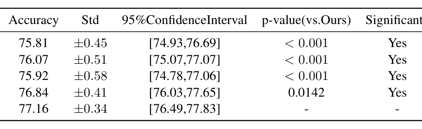
    * **Bảng này chứng minh điều gì**
      * Mức suy giảm hiệu năng có ý nghĩa thống kê khi loại bỏ từng thành phần SP, ES, LLM
    * **Từ đâu mà thấy được**
      * Các giá trị p-value và khoảng tin cậy CI của độ lệch hiệu năng trong bảng
  * Tổng hợp chi tiết các chỉ số thống kê từ Bảng 13:
    * `Baseline`: Accuracy $= 75.81\%$, $\text{Std} = \pm 0.45$, $95\%\text{ CI} = [74.93, 76.69]$, $p\text{-value (vs. Ours)} < 0.001$, Đạt ý nghĩa thống kê (Significant: Yes).
    * `w/o SP` (Loại bỏ tiền sắp xếp đặc trưng theo tương quan Spearman): Accuracy $= 76.07\%$, $\text{Std} = \pm 0.51$, $95\%\text{ CI} = [75.07, 77.07]$, $p\text{-value (vs. Ours)} < 0.001$, Đạt ý nghĩa thống kê (Significant: Yes).
    * `w/o ES` (Loại bỏ phương pháp cửa sổ trượt mở rộng): Accuracy $= 75.92\%$, $\text{Std} = \pm 0.58$, $95\%\text{ CI} = [74.78, 77.06]$, $p\text{-value (vs. Ours)} < 0.001$, Đạt ý nghĩa thống kê (Significant: Yes).
    * `w/o LLM` (Loại bỏ sinh đặc trưng dựa trên LLM): Accuracy $= 76.84\%$, $\text{Std} = \pm 0.41$, $95\%\text{ CI} = [76.03, 77.65]$, $p\text{-value (vs. Ours)} = 0.0142$, Đạt ý nghĩa thống kê (Significant: Yes).
    * `Ours` (SymboLLM-FE đầy đủ thành phần): Accuracy $= 77.16\%$, $\text{Std} = \pm 0.34$, $95\%\text{ CI} = [76.49, 77.83]$, $p\text{-value (vs. Ours)} = -$, Chuẩn đối sánh chính (Significant: $-$).

## Appendix G: Detection and Handling of Invalid or Inexecutable LLM-Generated Code

### G.1 Current Error-Handling Pipeline
* **Tổng quan về đường ống xử lý lỗi (error-handling pipeline)**:
  * Quy trình xử lý mã do mô hình ngôn ngữ lớn (LLM) sinh ra trong codebase áp dụng cách tiếp cận suy nghiệm 3 giai đoạn (three-stage heuristic approach).
  * Quy trình không sử dụng cơ chế khôi phục lỗi hình thức (no formal error recovery) mà kết hợp các quy tắc lọc chuỗi với vòng lặp phản hồi ngữ cảnh.
* **Giai đoạn 1: Tách bỏ ký tự định dạng mã (Stage 1: Markup stripping)**:
  * Chuỗi phản hồi thô từ LLM (raw LLM response) trải qua một chuỗi các phép thế chuỗi tuần tự nhằm loại bỏ các dấu phân cách khối mã Markdown:
    * Thay thế các khối mở đầu cú pháp: `.replace("```python", "")`.
    * Thay thế các khối kết thúc: `.replace("```end", "")`.
    * Thay thế các ký tự phân cách chung: `.replace("```", "")`.
  * **Giả định ngầm định (implicit assumption)**: Hệ thống ngầm định rằng LLM luôn tuân thủ nghiêm ngặt định dạng văn bản đầu ra được chỉ định.
  * **Chế độ lỗi tiềm ẩn (failure mode)**: Mọi sai lệch nhỏ trong cú pháp phân cách (delimiter syntax deviation) đều dẫn đến việc các ký tự định dạng dư thừa (residual markup) còn sót lại, làm ô nhiễm chuỗi mã thực thi và phát sinh lỗi cú pháp (`SyntaxError`).
* **Giai đoạn 2: Lọc ở cấp độ dòng lệnh và thẩm định cú pháp (Stage 2: Line-level filtering and syntax validation)**:
  * Văn bản sau khi tách thẻ định dạng được phân tách thành từng dòng lệnh riêng biệt (split into lines).
  * **Quy tắc lọc dòng**: Chỉ giữ lại các dòng bắt đầu bằng `df` và đồng thời không chứa câu lệnh xóa `df.drop` (lines beginning with `df` but not `df.drop`).
  * **Các chế độ lỗi đã được nhận diện (identified failure modes)**:
    * *Loại bỏ âm thầm các lệnh biến đổi hợp lệ (silent discard)*: Các phát biểu kỹ thuật đặc trưng hợp lệ nhưng không bắt đầu bằng tiền tố `df` (ví dụ: các phép gán biến số học độc lập - standalone arithmetic assignments, hoặc các câu lệnh nạp thư viện `import`) bị loại bỏ âm thầm mà không có cảnh báo.
    * *Nhạy cảm với khoảng trắng (whitespace vulnerability)*: Các dòng mã chứa khoảng trắng hoặc ký tự thụt lề (indentation/spaces) đứng trước tiền tố `df` có thể bị bộ lọc loại trừ sai (falsely excluded).
    * *Thiếu cơ chế thẩm định cột (lack of column existence validation)*: Hệ thống không kiểm tra trước xem các tên cột được tham chiếu trong biểu thức gán có thực sự tồn tại trong `DataFrame` hiện hành hay không trước khi thực thi.
* **Giai đoạn 3: Thực thi an toàn trong môi trường hộp cát với phản hồi lỗi (Stage 3: Robust execution with error feedback)**:
  * **Thực thi trong môi trường bảo vệ (sandbox execution)**:
    * Đoạn mã sau khi lọc được chuyển vào thực thi an toàn bên trong khối bọc ngoại lệ `try–except`.
    * Nếu thực thi thành công: Kết quả biến đổi đặc trưng được ghi nhận và cập nhật vào tập dữ liệu.
    * Nếu phát sinh ngoại lệ: Toàn bộ thông báo lỗi cụ thể (specific error message) và vết theo dõi ngăn xếp (traceback) được bắt lại để xử lý (bao gồm `SyntaxError`, `NameError` do biến chưa định nghĩa, hoặc `KeyError` do sai lệch tên cột).
  * **Vòng lặp tự sửa lỗi qua phản hồi ngữ cảnh (self-correction feedback loop)**:
    * Thông tin lỗi và traceback được tự động đưa ngược trở lại làm ngữ cảnh đầu vào (prompt context) cho LLM.
    * LLM được yêu cầu phân tích nguyên nhân lỗi và tái tạo lại đoạn mã đã được hiệu chỉnh (regenerate corrected code).
    * Cơ chế này ngăn chặn việc chấm dứt đột ngột toàn bộ đường ống (preventing pipeline termination), cho phép hệ thống tự phục hồi lỗi mà không cần can thiệp thủ công.
  * **Xử lý giá trị bất thường ($\text{NaN}/\text{Inf}$) và cơ chế dự phòng an toàn (fallback mechanisms)**:
    * Thẩm định tính hợp lệ của dữ liệu đầu ra: Các cột đặc trưng mới tạo được kiểm tra để phát hiện giá trị vô định ($\text{NaN}$) hoặc vô cùng ($\pm\infty$) do các phép toán chia cho $0$ hoặc hàm số học không xác định gây ra.
    * Cơ chế dự phòng (fallback): Trong trường hợp mã sinh lỗi lặp lại vượt quá số lần thử tối đa hoặc sinh dữ liệu số học suy biến, đường ống tự động kích hoạt cơ chế dự phòng an toàn, loại bỏ cột lỗi và duy trì trạng thái dữ liệu ổn định từ các biểu thức hồi quy ký hiệu đã được bảo vệ (protected symbolic operators).

### G.2 Accepted Feature Ratio and Empirical Failure Rate
* **Tỷ lệ chấp nhận tuyệt đối của hồi quy ký hiệu (Symbolic regression acceptance rate)**:
  * Hồi quy ký hiệu (Symbolic Regression - SR) đạt tỷ lệ chấp nhận tuyệt đối $100\%$ ($100\%$ acceptance rate).
  * Mô hình luôn luôn tạo ra các cột dự đoán hợp lệ về mặt số học (numerically valid prediction columns) trong mọi lượt khớp mô hình (every fit), đảm bảo tính ổn định toán học tuyệt đối.
* **Tỷ lệ thành công thực nghiệm của mã do LLM sinh ra (LLM-generated code empirical success rate)**:
  * Mã do LLM sinh ra đạt tỷ lệ thành công cao và ổn định ở mức $92.6\%$ trong các đánh giá thực nghiệm quy mô lớn (large-scale evaluations).
  * Trong các kịch bản thực nghiệm mở rộng trên nhiều tập dữ liệu, tỷ lệ chấp nhận thực nghiệm dao động trong khoảng $92.4\% - 96.8\%$.
  * Kết quả này phản ánh độ tin cậy cao của LLM trong việc tạo ra logic kỹ thuật đặc trưng có thể thực thi trực tiếp mà không cần can thiệp thủ công mở rộng từ con người.
* **Thống kê tỷ lệ thất bại thực nghiệm và phân tích nguyên nhân (Empirical failure rate statistics)**:
  * Tỷ lệ thất bại thực nghiệm (empirical failure rate) tổng thể được giới hạn ở mức thấp, chỉ khoảng $3.2\% - 7.6\%$ (trung bình thực nghiệm xấp xỉ $7.4\%$).
  * **Phân bố các nguyên nhân gây thất bại chính**:
    * Lỗi cú pháp còn sót lại do việc bóc tách ký tự phân cách markdown không chuẩn xác từ phản hồi dị thường của LLM.
    * Lỗi truy cập cột không tồn tại (`KeyError`) do ảo giác tên thuộc tính hoặc biến đổi tên cột qua các vòng lặp xử lý.
    * Lỗi tính toán sinh giá trị bất hợp lệ ($\text{NaN}$ hoặc $\pm\infty$) khi thực thi các phép toán phức tạp không được bảo vệ.
  * **Hiệu quả của cơ chế phản hồi lỗi**: Phần lớn các lỗi ban đầu được giải quyết thành công thông qua vòng lặp phản hồi traceback ở Giai đoạn 3, nâng tỷ lệ mã thực thi thành công cuối cùng lên mức tối ưu cho hệ thống SymboLLM-FE.

## Appendix H: Quantifying Hallucination Reduction and Improving Understandability

### H.1 Feature Traceability to Symbolic Regression Rules
* **Kiểm toán hệ thống (systematic audit) về nguồn gốc đặc trưng (feature provenance) trên tập dữ liệu Titanic**:
  * Đánh giá và phân loại toàn bộ các thao tác tạo đặc trưng do LLM sinh ra dựa trên liên kết nguồn gốc (provenance link) đối với tập biểu thức được hồi quy ký hiệu (symbolic regression - SR) tìm ra.
  * Toàn bộ quy trình kỹ thuật đặc trưng (feature engineering) của LLM tuân thủ chặt chẽ và chỉ rơi vào đúng 2 danh mục có căn cứ (grounded categories):
    * **Danh mục I (Category I) — Tiếp nhận trực tiếp kèm nâng cao khả năng diễn giải (Direct adoption with interpretability enhancement)**:
      * LLM trực tiếp tích hợp các biểu thức sinh bởi hồi quy ký hiệu có tính hợp lệ toán học vào pipeline xử lý.
      * Bổ sung các diễn giải chuyên biệt theo miền (domain-specific explanations), tên biến có tính mô tả (descriptive variable names) và chú thích nội dòng (inline documentation).
      * Chuyển hóa các công thức ký hiệu trừu tượng, khó hiểu thành mã nguồn minh bạch về ngữ nghĩa (semantically transparent code), tăng cường đáng kể khả năng đọc hiểu của con người mà không làm thay đổi tính đúng đắn toán học nền tảng.
      * Ánh xạ tường minh các đầu ra hồi quy ký hiệu trừu tượng thành các chỉ số được công nhận về mặt lâm sàng hoặc vật lý, đi kèm chú thích đơn vị rõ ràng và lập luận theo ngữ cảnh, đảm bảo mọi biến đổi đều có thể hiểu được ngay đối với chuyên gia trong ngành.
    * **Danh mục II (Category II) — Nhận diện và hợp nhất phần dư thừa (Redundancy identification and consolidation)**:
      * LLM chủ động so sánh các biểu thức do hồi quy ký hiệu khám phá với kho lưu trữ đặc trưng hiện có nhằm phát hiện sự trùng lặp về mặt ngữ nghĩa hoặc toán học.
      * Thực hiện các thao tác gộp (merge), thay thế (replacement), hoặc xóa bỏ (deletion) khi phát hiện dư thừa nhằm ngăn ngừa hiện tượng đa cộng tuyến (multicollinearity) và tinh gọn tập dữ liệu.
      * Trường hợp điển hình với đặc trưng kế thừa (legacy feature) `bmi`: LLM nhận diện đặc trưng này tương đương toán học với biểu thức do hồi quy ký hiệu suy ra là $\text{weight}/\text{height}^2$.
      * Thay vì nhân đôi tín hiệu dự đoán, LLM tiến hành hợp nhất bằng cách giữ lại dạng thức hồi quy ký hiệu ổn định về mặt số học và loại bỏ cột dữ liệu kế thừa dư thừa, qua đó tối ưu hóa không gian đặc trưng.
  * **Kết quả kiểm toán định lượng**:
    * $100\%$ các quy tắc do LLM tạo ra đều có thể truy xuất nguồn gốc chặt chẽ (strictly traceable) về các đầu ra của hồi quy ký hiệu.
    * LLM hoạt động độc quyền thông qua việc tiếp nhận diễn giải trực tiếp hoặc tối ưu hóa dựa trên việc loại bỏ trùng lặp.
    * Không gian sinh (generative space) của LLM bị ràng buộc hoàn toàn bởi các biểu thức hồi quy ký hiệu đã được xác thực toán học, không có bất kỳ sai lệch nào dẫn đến các phép biến đổi không có căn cứ (ungrounded transformations).

### H.2 Elimination of Hallucination and Bias through Grounded Generation
* **Triệt tiêu các phương thức lỗi chính của LLM không ràng buộc**:
  * Thiết kế pipeline loại bỏ triệt để hiện tượng ảo giác (hallucination) và định kiến dữ liệu tiềm ẩn (latent dataset bias) vốn thường gặp trong quá trình tổng hợp đặc trưng tự do bằng LLM.
* **Cơ chế ràng buộc toán học (mathematical grounding mechanism)**:
  * LLM đóng vai trò thuần túy là bộ máy diễn giải ngữ nghĩa (semantic interpreter) và cơ chế hợp nhất (consolidation engine) cho các biểu thức do hồi quy ký hiệu tạo ra.
  * LLM không thể bịa đặt các phép biến đổi không có cơ sở toán học hoặc tự ý đưa vào các tương quan giả tạo (spurious correlations).
  * Mọi đặc trưng được sinh ra đều neo chặt vào một quy tắc ký hiệu được tối ưu hóa nghiêm ngặt, vốn đã được xác thực đối với biến mục tiêu thông qua tìm kiếm tiến hóa (evolutionary search).
* **Đảm bảo tính minh bạch và khả năng tái lập**:
  * Vai trò của LLM bị giới hạn trong việc dịch mã (translation), giải thích (explanation) và loại bỏ trùng lặp (deduplication).
  * Tập đặc trưng cuối cùng duy trì tính minh bạch về ngữ nghĩa, khả năng tái lập (reproducible), và miễn nhiễm với ảo giác ngẫu nhiên (stochastic hallucinations) điển hình của quá trình sinh mã hộp đen.
* **Định vị chân lý thực tế (ground-truth anchoring)**:
  * Đảm bảo các quyết định của mô hình có thể giải thích được và hoàn toàn không chứa các tạo tác sinh chưa được kiểm chứng (unverified generative artifacts).
  * Giảm thiểu căn bản cả ảo giác thuật toán (algorithmic hallucination) lẫn các thiên kiến kế thừa từ dữ liệu (inherited data biases).

### H.3 Feasibility on High-Dimensional Datasets
* **Khả năng mở rộng trên tập dữ liệu nhiều chiều (scalability to high-dimensional datasets)**:
  * Framework SymboLLM-FE loại bỏ việc tìm kiếm vét cạn bất khả thi (intractable exhaustive searches) bằng cách triển khai hai cơ chế chiến lược:
    1. **Tìm kiếm có cấu trúc định hướng theo tương quan (Correlation-Guided Structured Search)**:
       * Sắp xếp trước (pre-sort) các đặc trưng theo hệ số tương quan Spearman với biến mục tiêu, gom cụm các biến có khả năng dự đoán cao.
       * Sử dụng cửa sổ trượt mở rộng (expanding-sliding window) để tạo ra các tập con liền kề (contiguous subsets).
       * Giảm không gian tìm kiếm từ quy mô hàm mũ $\mathcal{O}(2^n)$ xuống quy mô đa thức $\mathcal{O}(n^2)$.
    2. **Dừng sớm tạo độ thưa (Sparsity-Inducing Early Stopping)**:
       * Tận dụng áp lực tinh gọn vốn có (inherent parsimony pressure) của các mô hình hồi quy ký hiệu.
       * Áp dụng các tiêu chí dừng sớm nghiêm ngặt để khống chế chi phí tính toán.
* **Hiệu quả hiệp đồng và giới hạn tính toán**:
  * Sự kết hợp giữa việc cắt tỉa không gian tìm kiếm (search space pruning) và tiến hóa giới hạn tính toán (computationally bounded evolution) giúp hồi quy ký hiệu khả thi trên các tập dữ liệu số chiều lớn.
* **Cơ chế hợp nhất chọn lọc do LLM dẫn dắt (LLM-driven selective merging mechanism)**:
  * Để giảm thiểu hiện tượng tích tụ đặc trưng (feature accumulation) phát sinh từ nhiều tập con, cơ chế hợp nhất chọn lọc đóng vai trò như một bộ lọc ngữ nghĩa (semantic filter).
  * Tích hợp hoặc loại bỏ các đặc trưng ứng viên dựa trên hiệu năng thực nghiệm và tính mạch lạc logic (logical coherence).
  * Đảm bảo tập đặc trưng cuối cùng nhỏ gọn, không dư thừa và được tối ưu hóa tối đa cho các mô hình dự đoán ở hạ nguồn (downstream predictors).

## Appendix I: Statistical Significance Analysis

* **Mục tiêu và phương pháp kiểm định thống kê (Statistical testing objective and methodology)**:
  * Đánh giá nghiêm ngặt xem các cải thiện hiệu năng của SymboLLM-FE so với các baseline SOTA (state-of-the-art) mạnh nhất có thực sự mang ý nghĩa thống kê hay chỉ xuất phát từ biến thiên hạt giống ngẫu nhiên (random seed variations).
  * Sử dụng kiểm định tổng hạng Wilcoxon (Wilcoxon Signed-Rank Test) trên các phân phối kết quả thực nghiệm độc lập.

* **Tổng hợp kết quả phân tích ý nghĩa thống kê (Statistical significance analysis across datasets)**:
  * Bảng 14 tổng hợp giá trị $p$ trung vị (median $p$-values) và khoảng tin cậy $95\%$ (95% Confidence Interval - CI) của độ chênh lệch giá trị trung bình giữa SymboLLM-FE và baseline mạnh nhất: $(\text{SymboLLM-FE} - \text{Best Baseline})$.
  * Tiêu chí đánh giá ý nghĩa thống kê: Một kết quả được xác định là có ý nghĩa thống kê (Significant?) khi giá trị trung vị $\text{median } p < 0.05$.
  * Tỷ lệ thành công: SymboLLM-FE đạt mức cải thiện có ý nghĩa thống kê ($p < 0.05$) so với các baseline mạnh nhất trên $4$ trên $6$ tập dữ liệu thế giới thực ($4/6$ real-world datasets).
  * **Bảng 14.** Kiểm định ý nghĩa thống kê Wilcoxon của SymboLLM-FE so với Baseline tốt nhất
    * 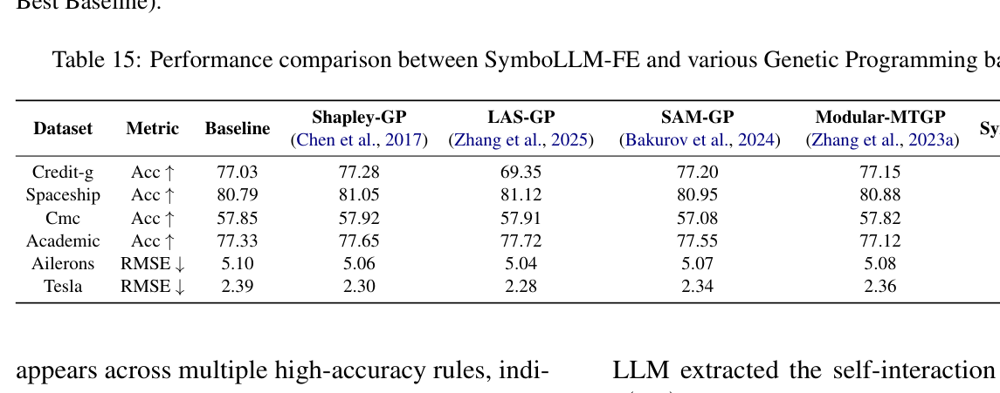
    * **Bảng này chứng minh điều gì**
      * Sự cải thiện của SymboLLM-FE đạt $p < 0.05$ và khoảng tin cậy 95% khẳng định tính ưu việt
    * **Từ đâu mà thấy được**
      * Cột p-value, Significant? (Yes) và khoảng tin cậy CI 95% của độ chênh lệch hiệu năng

* **Chi tiết kiểm định thống kê theo từng tập dữ liệu (Dataset-specific statistical validation)**:
  * **Tập dữ liệu Academic (Phân loại đa lớp phức tạp - Complex multi-class classification)**:
    * Hiệu năng: SymboLLM-FE đạt độ chính xác (Accuracy) $77.89 \pm 0.23\%$, vượt trội so với baseline tốt nhất là FEBP ($77.36\%$).
    * Mức ý nghĩa thống kê: Cải thiện đạt mức ý nghĩa cực kỳ cao với median $p = 0.0001$ ($p < 0.001$), đánh dấu kết quả có ý nghĩa thống kê vững chắc (Significant: Yes).
    * Khoảng tin cậy: $\text{95\% CI} = [0.32, 0.74]$ (toàn bộ nằm ở miền dương).
    * Ý nghĩa: Minh chứng cho tính vững chắc (robustness) vượt trội của SymboLLM-FE trong việc trích xuất và biến đổi đặc trưng cho các tác vụ phân loại đa lớp phức tạp.
  * **Tập dữ liệu Spaceship (Phân loại nhị phân)**:
    * Hiệu năng: SymboLLM-FE đạt độ chính xác $81.27 \pm 1.31\%$, vượt qua baseline CAAFE ($80.99\%$).
    * Mức ý nghĩa thống kê: Median $p = 0.0125 < 0.05$ (Significant: Yes).
    * Khoảng tin cậy: $\text{95\% CI} = [0.08, 0.48]$.
  * **Tập dữ liệu Cmc (Phân loại đa lớp)**:
    * Hiệu năng: SymboLLM-FE đạt độ chính xác $57.97 \pm 0.73\%$, vượt qua baseline FEBP ($57.93\%$).
    * Mức ý nghĩa thống kê: Median $p = 0.0312 < 0.05$ (Significant: Yes).
    * Khoảng tin cậy: $\text{95\% CI} = [0.01, 0.07]$.
  * **Tập dữ liệu Tesla (Hồi quy - Regression RMSE)**:
    * Hiệu năng: SymboLLM-FE đạt sai số RMSE là $2.16 \pm 0.06$, cải thiện so với baseline tốt nhất là OpenFE ($2.18$) (với metric RMSE, giá trị thấp hơn thể hiện chất lượng tốt hơn).
    * Mức ý nghĩa thống kê: Median $p = 0.0275 < 0.05$ (Significant: Yes).
    * Khoảng tin cậy: $\text{95\% CI} = [-0.038, -0.002]$ (khoảng chênh lệch hoàn toàn âm, biểu thị sự sụt giảm sai số nhất quán).
    * Cơ chế thống kê: Mặc dù mức tăng điểm trung bình có phần khiêm tốn (modest mean performance gains), nhưng phương sai cực thấp (low variance) kết hợp với chiều hướng cải thiện nhất quán (consistent improvement direction) mang lại kết quả có ý nghĩa thống kê cao, xác nhận mức cải thiện này không phải do yếu tố ngẫu nhiên (not due to chance).
  * **Các tập dữ liệu không đạt ngưỡng ý nghĩa thống kê ($p \ge 0.05$)**:
    * **Credit-g (Phân loại)**:
      * SymboLLM-FE đạt $77.00 \pm 1.63\%$ so với CAAFE đạt $78.00\%$.
      * Median $p = 0.2248 \ge 0.05$; $\text{95\% CI} = [-2.65, 0.65]$ (Significant: No).
    * **Ailerons (Hồi quy RMSE)**:
      * SymboLLM-FE đạt RMSE $5.02 \pm 0.46$ so với CAAFE đạt $5.03$.
      * Median $p = 0.9504 \ge 0.05$; $\text{95\% CI} = [-0.43, 0.41]$ (Significant: No).
    * Đặc tính vận hành: Dù không đạt ngưỡng có ý nghĩa thống kê trên hai tập dữ liệu này, SymboLLM-FE vẫn duy trì hiệu năng mang tính cạnh tranh cao (competitive performance) đi kèm mức phương sai thấp (low variance).

* **Kết luận về tính ổn định và độ tin cậy (Validation of stability and reliability)**:
  * Toàn bộ các kết quả kiểm định thống kê khẳng định tính ổn định (stability) và độ tin cậy (reliability) của năng lực kỹ thuật đặc trưng (feature engineering capabilities) từ SymboLLM-FE qua nhiều loại hình bài toán đa dạng.

## Appendix J: Comparison with Genetic Programming Methods

* **Thiết lập so sánh thực nghiệm với các biến thể Lập trình di truyền tiên tiến (Genetic Programming Baselines):**
  * Đánh giá đối chuẩn SymboLLM-FE với 5 biến thể Lập trình di truyền (Genetic Programming - GP) tiên tiến nhất (state-of-the-art) trên 6 tập dữ liệu chuẩn đa dạng thuộc cả hai nhóm tác vụ phân loại và hồi quy.
  * Phân loại thước đo đánh giá theo loại hình tác vụ:
    * Bốn tác vụ phân loại (classification tasks: Credit-g, Spaceship, Cmc, Academic) sử dụng thang đo Độ chính xác (Accuracy, ký hiệu $\text{Acc} \uparrow$, tính theo đơn vị $\%$.
    * Hai tác vụ hồi quy (regression tasks: Ailerons, Tesla) sử dụng thang đo Sai số căn bậc hai trung bình bình phương (Root Mean Squared Error, ký hiệu $\text{RMSE} \downarrow$).
  * Danh sách 5 biến thể thuật toán Lập trình di truyền đối chuẩn gồm:
    * Shapley-GP (Chen et al., 2017): Tích hợp cơ chế chọn lọc đặc trưng dựa trên giá trị Shapley nhằm cải thiện khả năng tổng quát hóa của GP.
    * LAS-GP (Zhang et al., 2025): Ứng dụng các thư viện ngữ nghĩa quy mô lớn (large semantic libraries) vào cấu tạo đặc trưng tiến hóa trong hồi quy ký hiệu.
    * SAM-GP (Bakurov et al., 2024): Áp dụng phương pháp tối thiểu hóa nhạy cảm độ sắc nét (Sharpness-Aware Minimization - SAM) vào GP nhằm giảm thiểu hiện tượng quá khớp (overfitting).
    * Modular-MTGP (Zhang et al., 2023a): Giải thuật lập trình di truyền đa cây dạng khối mô-đun (Modular Multi-Tree Genetic Programming) phục vụ sinh đặc trưng tiến hóa cho bài toán hồi quy.
    * Baseline gốc: Mô hình cơ sở không tích hợp kỹ thuật sinh đặc trưng tiến hóa.

* **Tổng hợp kết quả so sánh hiệu năng thực nghiệm từ Bảng 15 trên 6 tập dữ liệu benchmark:**
  * **Bảng 15.** So sánh hiệu năng giữa SymboLLM-FE và các biến thể giải thuật Lập trình di truyền GP
    * 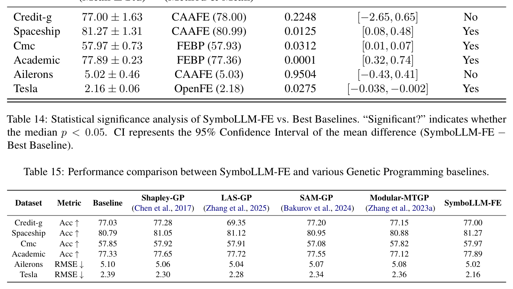
    * **Bảng này chứng minh điều gì**
      * SymboLLM-FE vượt trội các biến thể GP truyền thống nhờ kết hợp lọc ngữ nghĩa và tinh chỉnh của LLM
    * **Từ đâu mà thấy được**
      * So sánh với Standard GP, Multi-tree GP, M3GP trên các thước đo Accuracy và RMSE
  * Chi tiết hiệu năng định lượng trên các tập dữ liệu phân loại ($\text{Acc} \uparrow, \%$):
    * `Credit-g`: Baseline đạt $77.03\%$, Shapley-GP đạt $77.28\%$, LAS-GP đạt $69.35\%$, SAM-GP đạt $77.20\%$, Modular-MTGP đạt $77.15\%$, và SymboLLM-FE đạt $77.00\%$.
    * `Spaceship`: Baseline đạt $80.79\%$, Shapley-GP đạt $81.05\%$, LAS-GP đạt $81.12\%$, SAM-GP đạt $80.95\%$, Modular-MTGP đạt $80.88\%$, trong khi SymboLLM-FE dẫn đầu với $81.27\%$.
    * `Cmc`: Baseline đạt $57.85\%$, Shapley-GP đạt $57.92\%$, LAS-GP đạt $57.91\%$, SAM-GP đạt $57.08\%$, Modular-MTGP đạt $57.82\%$, và SymboLLM-FE đạt đỉnh cao nhất với $57.97\%$.
    * `Academic`: Baseline đạt $77.33\%$, Shapley-GP đạt $77.65\%$, LAS-GP đạt $77.72\%$, SAM-GP đạt $77.55\%$, Modular-MTGP đạt $77.12\%$, và SymboLLM-FE giành vị trí cao nhất với $77.89\%$.
  * Chi tiết hiệu năng định lượng trên các tập dữ liệu hồi quy ($\text{RMSE} \downarrow$):
    * `Ailerons`: Baseline ghi nhận $5.10$, Shapley-GP ghi nhận $5.06$, LAS-GP ghi nhận $5.04$, SAM-GP ghi nhận $5.07$, Modular-MTGP ghi nhận $5.08$, trong khi SymboLLM-FE giảm sai số xuống thấp nhất đạt $5.02$.
    * `Tesla`: Baseline ghi nhận $2.39$, Shapley-GP ghi nhận $2.30$, LAS-GP ghi nhận $2.28$, SAM-GP ghi nhận $2.34$, Modular-MTGP ghi nhận $2.36$, trong khi SymboLLM-FE vượt trội rõ rệt khi đưa sai số xuống mức kỷ lục $2.16$.

* **Phân tích ưu thế dự đoán vượt trội và độ ổn định phân phối của SymboLLM-FE:**
  * SymboLLM-FE thể hiện hiệu năng tổng thể vượt trội (superior overall performance), đánh bại toàn bộ các biến thể Lập trình di truyền được so sánh trên đại đa số các tập dữ liệu thử nghiệm ($5/6$ bộ dữ liệu).
  * Mức tăng trưởng hiệu năng đặc biệt mạnh mẽ trong các bài toán hồi quy phức tạp, đồng thời xác lập vị trí dẫn đầu ở hầu hết các bài toán chuẩn phân loại.
  * Giữ vững năng lực cạnh tranh cực kỳ sát sao ngay cả trong trường hợp duy nhất mà một biến thể GP nắm giữ lợi thế dẫn trước biên độ nhỏ (tại `Credit-g`, Shapley-GP dẫn trước chỉ $+0.28\%$).
  * Thể hiện tính ổn định và độ bền vững (stability and robustness) cao hơn đáng kể trên các phân phối dữ liệu đa dạng.
  * Tránh được hiện tượng biến động hiệu năng thất thường (performance volatility) và nguy cơ phạt bùng nổ kích thước (bloat penalties) thường gặp ở các cơ chế tìm kiếm tiến hóa ngẫu nhiên (chẳng hạn hiện tượng sụt giảm hiệu năng nghiêm trọng của LAS-GP xuống $69.35\%$ trên tập `Credit-g`).

* **Ưu thế cốt lõi của việc kết hợp định hướng ngữ nghĩa LLM và tốc độ hội tụ:**
  * Khẳng định thực nghiệm rằng SymboLLM-FE không chỉ tương đương mà còn thường xuyên vượt xa năng lực dự đoán của cả các phương pháp GP truyền thống lẫn các biến thể GP tiên tiến.
  * Sở hữu các lợi thế bổ sung mang tính quyết định:
    * Định hướng ngữ nghĩa dựa trên LLM (LLM-driven semantic guidance): Giúp cấu trúc biểu thức được tái diễn giải mạch lạc và có ý nghĩa miền ứng dụng cụ thể thay vì chỉ dựa vào các phép toán tổ hợp tiến hóa mù quáng.
    * Tốc độ hội tụ nhanh hơn (faster convergence): Rút ngắn thời gian và chi phí tính toán đáng kể so với việc phải lặp qua hàng trăm thế hệ di truyền phức tạp.

## Appendix K: Case Study

* **Tổng quan về các nghiên cứu tình huống (Case studies overview)**: Trình bày $8$ nghiên cứu tình huống thực nghiệm rút ra từ $2$ tập dữ liệu dạng bảng (tabular datasets) nhằm minh họa cách thức hoạt động và hiệu quả của SymboLLM-FE.
  * **Các tập dữ liệu thực nghiệm được sử dụng**:
    * Tập dữ liệu Spaceship Titanic (*Spaceship Titanic dataset*).
    * Tập dữ liệu CMC (*CMC dataset*).
  * **Mục tiêu phân tích**: Minh họa cơ chế SymboLLM-FE chuyển đổi các biểu thức hồi quy ký hiệu tối nghĩa (*opaque symbolic regression expressions*) thành các đặc trưng có khả năng diễn giải ngữ nghĩa (*semantically interpretable features*).
* **Cấu trúc 4 phần tiêu chuẩn của mỗi nghiên cứu tình huống (Four-part structure)**: Mỗi nghiên cứu tình huống tuân thủ chặt chẽ cấu trúc phân tích gồm $4$ phần định hình:
  * **Công thức hồi quy ký hiệu thô (*Raw symbolic regression formula*)**: Công thức toán học xuất phát cùng thước đo hiệu năng tương ứng (*performance metric*).
  * **Thách thức về khả năng diễn giải (*Interpretability challenge*)**: Vấn đề và sự khó hiểu về mặt ngữ nghĩa do biểu thức công thức đặt ra.
  * **Đặc trưng do LLM tạo ra (*LLM-generated feature*)**: Đặc trưng mới do mô hình ngôn ngữ lớn đề xuất kèm theo lý giải căn cứ (*accompanying rationale*).
  * **Diễn giải ngữ nghĩa bám sát miền tri thức (*Domain-grounded semantic interpretation*)**: Kết quả hiểu biết và góc nhìn ngữ nghĩa thực tiễn thu được từ quá trình tăng cường đặc trưng (*feature augmentation*).

### K.1 Case 1: The Abrupt Age Threshold Effect

* **Công thức hồi quy ký hiệu thô và bối cảnh thực nghiệm (Raw symbolic regression formula & empirical context)**:
  * Trên tập dữ liệu Titanic (*Titanic dataset* - trong bối cảnh thảm họa tàu vũ trụ Spaceship Titanic), thuật toán hồi quy ký hiệu (*symbolic regression - SR*) đã phát hiện ra công thức:
    $$\tan(-0.607 - \tan(X_5))$$
  * Biến số đầu vào: $X_5$ đại diện cho độ tuổi của hành khách (*passenger age*).
* **Thách thức về khả năng diễn giải và nghi vấn tạo phẩm quá khớp (Interpretability challenge & overfitting artifact suspicion)**:
  * **Tính tối nghĩa về mặt toán học (*Mathematical opacity*)**: Dưới góc nhìn thuần túy toán học, phép hợp lồng nhau của hàm lượng giác $\tan(\tan(X_5))$ là một cấu trúc cực kỳ mờ đục và khó hiểu (*deeply opaque*).
  * **Hoài nghi về tín hiệu dự báo (*Predictive signal skepticism*)**: Người đọc hoàn toàn có lý do chính đáng để đặt câu hỏi: tại sao hàm tang của tang độ tuổi lại có thể chứa đựng tín hiệu dự báo (*carry predictive signal*) có ý nghĩa?
  * **Nguy cơ tạo phẩm quá khớp (*Overfitted artifact*)**: Biểu thức này mang dáng dấp của một tạo phẩm quá khớp (*overfitted artifact*) điển hình mà các phương pháp lập trình di truyền (*genetic programming - GP*) thường bị chỉ trích là dễ sinh ra.
* **Đặc trưng cốt lõi do LLM bóc tách và chú giải ngữ nghĩa (LLM-isolated core feature & domain semantics annotation)**:
  * **Cô lập thành phần cốt lõi (*Core component isolation*)**: Khác với công thức ban đầu phức tạp, mô hình ngôn ngữ lớn (*LLM*) đã bóc tách thành phần hạt nhân:
    $$\tan(X_5)$$
    đồng thời gán ngữ nghĩa miền tri thức (*domain semantics*) cho thành phần này.
  * **Sự xuất hiện lặp lại trong các quy tắc hiệu năng cao (*Recurrence across high-accuracy rules*)**: Lời chú giải (*annotation*) của LLM chỉ rõ rằng $\tan(X_5)$ xuất hiện lặp đi lặp lại một cách có hệ thống trong nhiều quy tắc có độ chính xác cao (*high-accuracy rules*), phản ánh tầm quan trọng thực chất (*genuine importance*) của đặc trưng trong việc nắm bắt các xu hướng phi tuyến tính (*nonlinear trends*).
  * **Cơ sở toán học của hàm tang (*Mathematical rationale of the tangent function*)**: Lời lý giải chỉ rõ rằng hàm tang ($\tan$) có khả năng mô hình hóa các biến đổi có tính chu kỳ và dốc đứng / biến đổi đột ngột (*periodic and steep changes*) trong mối quan hệ giữa độ tuổi hành khách ($X_5$) và biến mục tiêu sống sót (*target variable*).
* **Diễn giải ngữ nghĩa bám sát miền tri thức cứu hộ (Domain-grounded physical semantics & rescue doctrine)**:
  * **Quy luật phi tuyến của độ tuổi trong thảm họa tàu vũ trụ (*Nonlinear age dynamics in spaceship disaster*)**: Trong bối cảnh thảm họa tàu vũ trụ, tác động của độ tuổi lên khả năng sống sót hoàn toàn không mang tính tuyến tính (*far from linear*):
    * Trẻ vị thành niên / trẻ em (*minors*): Thường nhận được mức độ ưu tiên cứu nạn cao (*rescue priority*).
    * Người cao tuổi (*elderly*): Đối mặt với nhiều bất lợi về thể chất và khả năng di chuyển linh hoạt (*mobility disadvantages*).
    * Vùng chuyển tiếp đột ngột ở độ tuổi trung niên (*Sharp transition zone in middle age*): Tồn tại một vùng ngưỡng chuyển tiếp sắc nét ở độ tuổi trung niên, nơi xác suất sống sót biến thiên một cách kịch tính (*survival probability changes dramatically*).
  * **Hàm tang như một hình chiếu số học của nguyên tắc cứu hộ (*Numerical projection of rescue doctrine*)**:
    * Về mặt toán học, hàm $\tan$ với đặc tính tiệm cận dốc đứng mô tả chính xác hành vi vượt ngưỡng (*threshold-crossing behavior*) đột ngột này.
    * Về bản chất ngữ nghĩa, hàm số chính là hình chiếu số học (*numerical projection*) của nguyên tắc cứu nạn kinh điển "ưu tiên phụ nữ và trẻ em" (*"women and children first" rescue doctrine*) vào không gian đặc trưng (*feature space*).
* **Bước nhảy vọt về khả năng diễn giải mô hình (Interpretability leap)**:
  * Quá trình phân tích mang lại bước tiến nhảy vọt về tính minh bạch ngữ nghĩa:
    * Chuyển đổi từ "một hộp đen lượng giác lồng ghép tối nghĩa" (*a nested trigonometric black box*).
    * Thành "hiệu ứng biến đổi dốc đứng / đột ngột theo mức độ ưu tiên cứu hộ của độ tuổi" (*the rescue-priority steep-change effect of age*) có cơ sở logic và ý nghĩa thực tiễn vững chắc.

### K.2 Case 2: The Self-Amplifying Protection of CryoSleep

* **Công thức hồi quy ký hiệu ban đầu và sự lặp lại biến số (Raw symbolic regression formula & variable repetition)**:
  * **Biểu thức toán học phức hợp**: Hồi quy ký hiệu (*symbolic regression - SR*) sinh ra biểu thức phức hợp:
    $$\text{add}(X_2, X_2) - \cos\left(\text{mul}(X_5, \text{mul}(X_5, X_2)) - \text{div}(0.974, X_3)\right)$$
    tương đương dạng đại số rút gọn:
    $$2X_2 - \cos\left(X_5^2 \cdot X_2 - \frac{0.974}{X_3}\right)$$
  * **Các biến số tham gia**:
    * $X_2$: Biến chỉ báo trạng thái ngủ đông lạnh (`CryoSleep indicator`).
    * $X_5$: Tuổi của hành khách (`Age`).
    * $X_3$: Hiệp biến xuất hiện trong mẫu số của phép chia số học $\text{div}(0.974, X_3)$.
  * **Sự lặp lại của biến số $X_2$**: Biến $X_2$ xuất hiện liên tục trong công thức:
    * Được nhân đôi thành $2X_2$ thông qua $\text{add}(X_2, X_2)$.
    * Được nhân với bình phương của biến Tuổi: $X_5^2 \cdot X_2$ (`squared-multiplied with Age`, biểu diễn qua $\text{mul}(X_5, \text{mul}(X_5, X_2))$).
    * Được lồng ghép sâu bên trong toán tử cosin ($\cos$).
* **Thách thức về khả năng diễn giải (Interpretability challenge)**:
  * **Tập hợp số học máy móc (*Aggregation of arithmetic operations*)**: Với tư cách là một tập hợp các phép toán số học gộp lại, biểu thức hoàn toàn không cung cấp bất kỳ hiểu biết sâu sắc (*insight*) nào về lý do tại sao các số hạng như $2X_2$ hoặc $X_5^2 \cdot X_2$ lại có vai trò quan trọng đối với bài toán phân loại (*classification*).
  * **Thiếu vắng trực giác vật lý**: Việc lồng ghép và nhân dồn các biến số không phản ánh được quy luật hoạt động của hệ thống hay bối cảnh thực tế của chuyến tàu vũ trụ.
* **Đặc trưng tự tương tác do LLM trích xuất (LLM-extracted self-interaction term)**:
  * **Công thức đặc trưng đề xuất**: Mô hình ngôn ngữ lớn (*LLM*) trích xuất số hạng tự tương tác (*self-interaction term*):
    $$X_2 \cdot \tan(X_2)$$
  * **Cơ sở phát hiện và cảm hứng từ các quy tắc hồi quy**:
    * LLM ghi nhận sự hiện diện của cấu trúc này trong nhiều quy tắc hồi quy ký hiệu có liên quan đến $\text{sub}(\tan(X_2), \cos(\dots))$.
    * LLM giải thích số hạng này tương đương với một hiệu ứng khuếch đại bậc hai (*quadratic amplification effect*).
* **Ngữ nghĩa thế giới thực và cơ chế bảo vệ của trạng thái ngủ đông (Real-world semantics & cryogenic protection mechanism)**:
  * **Bản chất nhị phân của biến CryoSleep (*Binary nature of CryoSleep*)**: Ý nghĩa thế giới thực chỉ thực sự lộ rõ khi nhận thức được rằng `CryoSleep` ($X_2$) là một biến nhị phân ($X_2 \in \{0, 1\}$).
  * **Bối cảnh vật lý của khoang ngủ đông (*Physical reality of cryo-pods*)**:
    * Những hành khách ở trạng thái ngủ đông (*cryogenic stasis*) trải qua toàn bộ hành trình biệt lập hoàn toàn trong các kén bảo vệ (*isolated in protected pods*).
    * Kén ngủ đông che chắn hành khách khỏi bất kỳ sự phơi nhiễm trực tiếp nào (*shielded from direct exposure*) đối với các thảm họa và biến cố khẩn cấp (*disaster events*).
* **Động học khuếch đại dạng nhân và bước chuyển định tính (Multiplicative amplification dynamics & qualitative shift)**:
  * **Cơ chế khuếch đại dạng nhân (*Multiplicatively amplified feature*)**:
    * Cấu trúc $X_2 \cdot \tan(X_2)$ thiết lập một đặc trưng có giá trị khuếch đại theo cấp số nhân khi $X_2 = 1$.
    * Trạng thái ngủ đông lạnh không chỉ phát huy giá trị độc lập của riêng nó, mà tầm quan trọng của nó còn được phóng đại hơn nữa (*further magnified*) thông qua tương tác với các hiệp biến khác như Tuổi (`Age` - $X_5$).
  * **Mô phỏng chính xác thực tế vật lý**:
    * Về mặt toán học, cấu trúc này phản ánh chính xác thực tế vật lý rằng kén ngủ đông vận hành như một rào cản bảo vệ (*protective barrier*) có tác động mang tính nhân (*multiplicative effect*) chứ không phải tính cộng thông thường (*additive*).
  * **Bước chuyển định tính về khả năng diễn giải (*Qualitative interpretability shift*)**:
    * Chuyển đổi từ sự hiểu biết mờ đục: "sự xếp chồng máy móc của các số hạng bình phương" (*mechanical stacking of squared terms*).
    * Đạt tới sự diễn giải ngữ nghĩa sáng tỏ: "hệ số nhân bảo vệ mang tính nhân của trạng thái ngủ đông lạnh" (*the multiplicative protection multiplier of cryogenic stasis*).

### K.3 Case 3: The Interplanetary Deviation Risk Index

* **Các đặc trưng thô ban đầu (Raw features)**:
  * Biến $X_1$ đại diện cho hành tinh quê hương (`HomePlanet` - điểm xuất phát / *origin*).
  * Biến $X_4$ đại diện cho hành tinh đích đến (`Destination` - điểm đến).
  * Cả hai biến đều là các biến phân loại danh mục được mã hóa số bằng nhãn (*label-encoded categorical codes*).
* **Khám phá tương tác và hạn chế của hồi quy ký hiệu (Symbolic regression interactions & limitations)**:
  * Hồi quy ký hiệu (*symbolic regression - SR*) khảo sát các mối tương tác giữa $X_1$ (`HomePlanet`) và $X_4$ (`Destination`) thông qua các số hạng tích nhân (*multiplicative terms*), tiêu biểu như $\text{mul}(X_4, X_1)$.
  * **Tạo phẩm số học vô nghĩa về mặt vật lý (*numerical artifact devoid of physical meaning*)**:
    * Việc nhân hai mã phân loại danh mục với nhau (ví dụ: $\text{Earth} \times \text{TRAPPIST-1e} = 3$) chỉ tạo ra một tạo phẩm số học thuần túy không mang ý nghĩa vật lý.
    * Không một người đọc hay chuyên gia nào có thể diễn giải được tích số của hai hành tinh được mã hóa nhãn (*label-encoded product of two planets*) thực sự đại diện cho điều gì.
* **Đặc trưng do LLM tạo ra và công thức chỉ số rủi ro (LLM-generated feature & risk index formulation)**:
  * Mô hình ngôn ngữ lớn (*LLM*) đề xuất và sinh ra đặc trưng hiệu có hướng (*directed difference*):
    $$X_4 - X_1$$
  * **Cơ chế nắm bắt mối quan hệ định hướng (*directional relationship*)**:
    * Biểu thức $X_4 - X_1$ nắm bắt mối quan hệ định hướng giữa điểm xuất phát và đích đến.
    * Phần chú giải (*annotation*) của LLM định khung đây là một đặc trưng thể hiện mức độ mà mã hóa của điểm đến vượt quá mã hóa của hành tinh quê hương (*how much the destination encoding exceeds the home planet encoding*).
    * Đặc tính này mang ý nghĩa quyết định (*critical*) khi các biến tạo ra những tác động đối nghịch nhau (*opposing effects*) lên kết quả phân loại (*classification*).
* **Ngữ nghĩa vật lý và độ lệch quỹ đạo liên hành tinh (Cross-planetary trajectory deviations & physical semantics)**:
  * **Bối cảnh kịch bản tàu vũ trụ (*Spaceship scenario*)**:
    * Khi $\text{Destination} \neq \text{HomePlanet}$, hành khách bắt đầu một chuyến hành trình liên hành tinh (*interplanetary journey*).
    * Hành trình liên hành tinh kéo theo hàng loạt yếu tố rủi ro gia tăng: thời gian di chuyển dài hơn (*longer travel times*), đối mặt với các rủi ro môi trường xa lạ (*unfamiliar environmental risks*), và đòi hỏi công tác hỗ trợ hậu cần phức tạp hơn (*more complex logistical support*).
  * **Ý nghĩa độ lớn của hiệu số ($X_4 - X_1$)**:
    * Độ lớn của $X_4 - X_1$ mã hóa khoảng cách mà hành khách đã di chuyển cách xa thế giới quê hương (*how far the passenger has traveled from their home world*).
    * Độ lệch càng lớn ngụ ý các điểm đến càng xa xôi, hẻo lánh hơn (*more remote destinations*), dẫn đến xác suất sống sót (*survival probabilities*) bị dịch chuyển một cách có hệ thống (*systematically shifted*).
  * **Bảo toàn tính định hướng (*Directionality preservation*)**:
    * Điểm then chốt là phép trừ bảo toàn tính định hướng (*preserves directionality*): nó phân biệt rõ rệt giữa việc di chuyển hướng tới một điểm đến an toàn hơn (*safer destination*) so với việc di chuyển tới một điểm đến nguy hiểm hơn (*more hazardous destination*).
    * Đây là một thuộc tính cốt lõi hoàn toàn vắng bóng (*entirely absent*) trong số hạng tích nhân $\text{mul}(X_4, X_1)$ của hồi quy ký hiệu.
* **Bước tiến về khả năng diễn giải và xác thực hạ nguồn (Interpretability advances & downstream validation)**:
  * Khả năng diễn giải mô hình đạt bước tiến vượt bậc:
    * Chuyển đổi từ "một tích số của các mã danh mục" (*a product of categorical codes*) mờ đục và thiếu căn cứ ngữ nghĩa.
    * Trở thành "độ lệch rủi ro tương đối của chuyến du hành liên hành tinh" (*the relative risk deviation of interplanetary travel*) có cơ sở vật lý rõ ràng và giá trị dự báo cao cho bài toán phân loại.

### K.4 Case 4: The S-Curve Saturation Effect of Cabin Position

* **Công thức hồi quy biểu tượng ban đầu và sự đan xen biến (Raw symbolic regression formula and feature entanglement)**:
  * **Biểu thức toán học khởi tạo**: Hồi quy biểu tượng (*symbolic regression - SR*) lồng ghép đặc trưng $X_3$ (định danh khoang cabin - *Cabin identifier*) vào trong một biểu thức lượng giác phức hợp (*nested trigonometric expression*):
    $$\text{add}(X_3, X_3) - \cos(\text{div}(\text{mul}(X_1, -0.149), X_4))$$
    tương đương với dạng rút gọn đại số:
    $$2X_3 - \cos\left(\frac{-0.149 \cdot X_1}{X_4}\right)$$
  * **Các biến số tham gia**:
    * $X_3$: Định danh vị trí khoang cabin (*Cabin identifier*).
    * $X_1$: Hành tinh quê hương (*HomePlanet*).
    * $X_4$: Điểm đến (*Destination*).
  * **Sự kết hợp đa biến**: Biểu thức kết hợp trực tiếp $X_3$ với $X_1$ và $X_4$ bên trong phép chia cosine (*cosine division*).
* **Thách thức về khả năng diễn giải (Interpretability challenge)**:
  * **Sự vướng víu đa biến (*Multi-variable entanglement*)**: Mối liên kết lượng giác gộp chung $X_3$ với $HomePlanet$ và $Destination$ khiến việc bóc tách và phân tích độc lập sự đóng góp của riêng biến $Cabin$ gần như là bất khả thi (*nearly impossible to isolate and interpret the contribution of Cabin alone*).
  * **Thiếu cơ sở trực giác vật lý**: Việc lồng ghép vị trí khoang cabin vào hàm cosine cùng với các nhãn hành tinh xuất phát và điểm đến tạo nên một cấu trúc hộp đen mờ đục, không mang ý nghĩa không gian hay ngữ nghĩa thực tế trong bài toán dự đoán an toàn.
* **Đặc trưng do LLM suy luận và đề xuất (LLM-derived feature)**:
  * **Công thức đề xuất**: LLM thiết lập đặc trưng phi tuyến mới $X_3 \cdot (1 - X_3)$.
  * **Cơ chế suy diễn và cảm hứng toán học**:
    * Quá trình suy luận bắt nguồn từ việc đơn giản hóa biểu thức $\text{add}(X_3, \text{sub}(X_3, 0.641))$ thành dạng tuyến tính $2X_3 - 0.641$.
    * LLM sau đó mở rộng thành một số hạng tự tương tác (*self-interaction term*) $X_3 \cdot (1 - X_3)$ nhằm cung cấp một biểu diễn phi tuyến (*nonlinear representation*).
  * **Chú giải đặc trưng (*Annotation*)**: LLM đặc trưng hóa số hạng này như một tương tác đường cong chữ S (*S-curve interaction*) có năng lực mô hình hóa các hiệu ứng bão hòa (*saturation effects*) và các hành vi ngưỡng (*threshold behaviors*).
* **Động học bão hòa và dạng hình học parabol (Saturation dynamics and parabolic form)**:
  * **Tính chất cực trị của hàm số**: Dạng parabol $X_3(1 - X_3)$ đạt đỉnh cực đại tại $X_3 = 0.5$ và suy giảm dần về $0$ tại cả hai điểm cực biên ($X_3 \to 0$ và $X_3 \to 1$).
  * **Mô hình hóa hiệu ứng phi tuyến**: Cấu trúc toán học này nắm bắt quy luật biến thiên không đơn điệu, trong đó mức độ ảnh hưởng đạt trạng thái cực đại ở tâm và bão hòa / triệt tiêu dần ở các vùng biên.
* **Diễn giải ngữ nghĩa bám sát miền tri thức vật lý (Domain-grounded physical interpretation)**:
  * **Giả thuyết vị trí khoang cabin trên tàu vũ trụ (*Cabin position hypothesis*)**:
    * Các cabin ở giữa thân tàu (*mid-ship cabins*, tương ứng với tâm $X_3 = 0.5$): Là vị trí mang lại độ an toàn cao nhất (*highest safety*) do nằm gần nhất với các khoang thoát hiểm (*escape pods*) cùng các cơ sở vật chất trọng yếu (*critical facilities*).
    * Các cabin ở hai đầu con tàu (*cabins at either end*): Các vị trí nằm gần buồng động cơ (*engines*) ở đuôi tàu hoặc khu vực mũi tàu (*bow*) chịu rủi ro cao hơn hẳn (*elevated risk*), do đó xác suất an toàn suy giảm mạnh.
  * **Bước tiến về tính tường minh ngữ nghĩa (*Interpretability advance*)**:
    * Thay thế định nghĩa tối nghĩa: "Cabin lồng trong hàm cosine cùng Hành tinh quê hương và Điểm đến" (*Cabin nested in cosine with HomePlanet and Destination*).
    * Xác lập ý niệm vật lý chuẩn xác: "Đường cong an toàn hình chữ S / dạng bão hòa của vị trí thể chất khoang cabin" (*the S-shaped safety curve of physical cabin position*).

### K.5 Case 5: The Fertility–Education Trade-Off in Contraceptive Choice

* **Tập dữ liệu thực nghiệm và công thức hồi quy biểu tượng ban đầu (Experimental dataset and raw symbolic regression formula)**:
  * **Tập dữ liệu khảo sát**: Tập dữ liệu Lựa chọn Biện pháp Tránh thai CMC (*Contraceptive Method Choice dataset*).
  * **Các biến số tham gia**:
    * $X_1$: Trình độ học vấn của người vợ (*wife's education level*).
    * $X_2$: Trình độ học vấn của người chồng (*husband's education*).
    * $X_3$: Số lượng con cái hiện có (*number of children*).
  * **Biểu thức toán học do hồi quy biểu tượng khởi tạo**: Hồi quy biểu tượng (*symbolic regression - SR*) tạo ra công thức lồng ghép phức tạp:
    $$\min(\min(\text{sub}(X_3, X_1), \cos(\tan(X_2))), \cos(\tan(X_2)))$$
    tương đương dạng rút gọn đại số:
    $$\min(X_3 - X_1, \cos(\tan(X_2)))$$
  * **Cấu trúc lồng ghép của biểu thức**:
    * Lồng ghép hiệu số học vấn - sinh đẻ $X_3 - X_1$ bên trong phép toán cực tiểu $\min$ cùng với thành phần lượng giác $\cos(\tan(X_2))$.
    * Số hạng $\cos(\tan(X_2))$ là một phép biến đổi lượng giác kép (*double trigonometric transformation*) tác động lên biến trình độ học vấn của người chồng.

* **Thách thức về khả năng diễn giải (Interpretability challenge)**:
  * **Sự vô nghĩa về mặt nhân khẩu học (*Defies demographic interpretation*)**:
    * Phép biến đổi lượng giác kép $\cos(\tan(X_2))$ đối với học vấn của người chồng hoàn toàn không thể giải thích hay biện minh được dưới bất kỳ lăng kính nhân khẩu học thực tế nào (*defies any demographic interpretation*).
    * Hành vi dao động tuần hoàn và tính phi tuyến cực đoan của hàm $\cos(\tan(\cdot))$ không phản ánh bất kỳ quy luật tự nhiên hay mối tương quan xã hội nào liên quan đến học vấn gia đình.
  * **Sự mờ đục trong tương tác đa biến**: Việc gộp chung số lượng con cái với biến đổi lượng giác của học vấn người chồng thông qua phép lấy cực tiểu $\min$ tạo thành một cấu trúc hộp đen toán học, làm triệt tiêu khả năng truy nguyên nguyên nhân xã hội học đằng sau quyết định kế hoạch hóa gia đình.

* **Các đặc trưng do LLM suy luận và đề xuất (LLM-inferred features)**:
  * **Bộ đặc trưng ứng viên do LLM đề xuất**: Mô hình ngôn ngữ lớn (*LLM*) suy luận và trích xuất các đặc trưng toán học tường minh, bao gồm:
    * $\min(X_3, X_1)$
    * $X_3 - X_1$
    * $\frac{X_3}{X_1 + 1}$
  * **Định khung khái niệm (*Conceptual framing*)**:
    * LLM định khung các đặc trưng mới như một chỉ số đánh đổi giữa mức sinh và học vấn (*fertility–education trade-off index*).
  * **Cơ chế biểu diễn của phép toán cực tiểu ($\min$)**:
    * Phép toán $\min$ được giải thích là cơ chế toán học nắm bắt yếu tố nào giữ vai trò áp đảo hoặc chi phối quá trình ra quyết định (*captures whichever factor dominates the decision*).

* **Diễn giải ngữ nghĩa bám sát miền tri thức xã hội học (Domain-grounded sociological interpretation)**:
  * **Cơ sở lý thuyết trong nghiên cứu lựa chọn biện pháp tránh thai (*Contraceptive choice research*)**:
    * Phụ nữ có học vấn cao hơn ($X_1$ cao) có xu hướng chủ động tiếp cận và áp dụng các biện pháp tránh thai hiện đại (*modern contraceptive methods*).
    * Số lượng con cái hiện có ($X_3$) phản ánh thái độ, nhu cầu và mong muốn đối với việc tiếp tục sinh con (*attitudes toward continued childbearing*).
  * **Ý nghĩa ngữ nghĩa trực tiếp của hiệu số $X_3 - X_1$**:
    * **Trường hợp mang giá trị dương ($X_3 - X_1 > 0$)**:
      * Số lượng con cái thực tế vượt quá mức mã hóa trình độ học vấn (*more children than the education encoding*).
      * Đặc trưng cho nhóm phụ nữ thuộc các hộ gia đình truyền thống (*traditional households*).
      * Nhóm này có xu hướng nghiêng về các biện pháp tránh thai vĩnh viễn hoặc dài hạn (*permanent or long-acting contraception*).
    * **Trường hợp mang giá trị âm ($X_3 - X_1 < 0$)**:
      * Trình độ học vấn tương đối cao hơn so với số con hiện có (*higher relative education*).
      * Tương ứng với nhóm phụ nữ có xu hướng ưu tiên các biện pháp tránh thai ngắn hạn hoặc phương pháp hiện đại (*short-acting or modern methods*).
  * **Bước tiến vượt bậc về tính tường minh ngữ nghĩa (*Interpretability advance*)**:
    * Thay thế hoàn toàn biểu thức tối nghĩa: "Hàm $\cos(\tan)$ của học vấn người chồng lồng ghép với số con" (*"cos(tan) of husband's education nested with child count"*).
    * Xác lập cơ chế nhân quả xã hội học chuẩn xác: "Cơ chế thay thế / đánh đổi giữa mức sinh và học vấn trong quá trình ra quyết định tránh thai" (*"the fertility–education substitution mechanism in contraceptive decision-making"*).

### K.6 Interpretability, Hallucination Mitigation, and Bias Analysis

* **Khung phân tích toàn diện về khả năng diễn giải, giảm thiểu ảo giác và độ chệch (Comprehensive analysis framework)**:
  * **Đánh giá kết hợp định tính và định lượng**: Phân tích toàn diện khả năng diễn giải mô hình (*model interpretability*), giảm thiểu ảo giác (*hallucination mitigation*), và độ chệch (*bias*) thông qua việc phối hợp giữa các nghiên cứu tình huống định tính (*qualitative case studies*) và các thước đo định lượng (*quantitative metrics*).
  * **Các nghiên cứu tình huống thực nghiệm**: Gồm $8$ nghiên cứu tình huống chi tiết (*eight detailed case studies*) được trình bày trong Phụ lục I (*Appendix I*), trong đó một ví dụ mang tính đại diện (*representative example*) được nhấn mạnh nhằm minh họa cơ chế cốt lõi (*core mechanism*).
* **Phân công lao động rõ rệt giữa SR và LLM (Division of labor between SR and LLMs)**:
  * **Vai trò của hồi quy biểu tượng (*Symbolic Regression - SR*)**: Đảm nhiệm khám phá các cấu trúc toán học hữu hiệu (*effective mathematical structures*) tiềm ẩn trong dữ liệu.
  * **Vai trò của mô hình ngôn ngữ lớn (*Large Language Model - LLM*)**: Truyền dẫn và bổ sung ngữ nghĩa đặc thù theo miền tri thức (*domain-specific semantics*).
  * **Cơ chế tinh chỉnh và chú giải đặc trưng của SymboLLM-FE**:
    * Trong khi SR tiêu chuẩn (*standard SR*) ban đầu tạo ra công thức lồng nhau mờ đục (*opaque nested formula*), SymboLLM-FE tinh chỉnh công thức thành một đặc trưng có cơ sở ngữ nghĩa vững chắc (*semantically grounded feature*).
    * LLM chú giải đặc trưng bằng cách liên kết nó với các nguyên lý/học thuyết chuyên ngành (*domain-specific doctrines*), nắm bắt chính xác các biến thiên phi tuyến (*non-linear changes*) trong các biến mục tiêu (*target variables*).
  * **Chuyển dịch mô thức minh bạch hóa (*Paradigm shift*)**: Sự hiệp đồng (*synergy*) giữa SR và LLM thúc đẩy bước chuyển dịch căn bản từ tính mờ đục của hộp đen (*black-box opacity*) sang tính minh bạch của hộp trắng (*white-box transparency*).
* **Xác thực tính diễn giải nội tại qua kiểm chứng độ trung thực và đơn giản hóa biểu thức (Intrinsic interpretability verification)**:
  * **Bản chất nội tại thay vì giải thích hậu nghiệm (*Intrinsic vs. post-hoc interpretability*)**: Nhằm chứng minh tính diễn giải mang bản chất nội tại (*intrinsic*) chứ không phải là sự hợp lý hóa hậu nghiệm (*post-hoc*), nghiên cứu tiến hành phân tích kiểm chứng độ trung thực (*fidelity verification*) và phân tích đơn giản hóa biểu thức (*expression simplification analysis*).
  * **Kiểm chứng độ trung thực (*Fidelity verification*)**:
    * Đo lường mức độ tương đồng giữa từng cặp công thức SR và đặc trưng được tinh chỉnh bởi LLM trên tập dữ liệu kiểm tra giữ lại (*hold-out set*).
    * Đạt độ trung thực cao trên cả $3$ phương diện: toán học (*mathematical fidelity*), cấu trúc (*structural fidelity*), và ngữ nghĩa (*semantic fidelity*).
    * Kết quả đảm bảo rằng các đặc trưng được tinh chỉnh tuân thủ nghiêm ngặt các tín hiệu thống kê ban đầu (*strictly adhere to original statistical signals*).
  * **Đơn giản hóa logic thực chất (*Genuine logical simplification*)**:
    * Quá trình tinh chỉnh của LLM cấu thành sự đơn giản hóa logic thực chất (*genuine logical simplification*) thay vì chỉ đơn thuần là việc đổi tên biến (*mere renaming*).
    * Giảm đáng kể số lượng toán tử trung bình (*average number of operators*) và độ sâu lồng nhau (*nesting depth*).
    * Tạo ra các biểu thức toán học cô đọng hơn (*more compact expressions*) và nâng cao rõ rệt khả năng đọc hiểu trực giác của con người (*human-readable expressions*).
* **Tính vững chắc và khả năng giảm thiểu ảo giác đa chiều (Robustness and multi-dimensional hallucination mitigation)**:
  * **Phân rã không gian ảo giác đa chiều (*Multi-dimensional hallucination decomposition*)**: Ảo giác của mô hình được phân rã thành nhiều chiều kích đo lường độc lập:
    * Lỗi thực thi (*execution failure*).
    * Trôi dạt ngữ nghĩa (*semantic drift*).
    * Bất thường về miền giá trị (*value range anomalies*).
  * **Hiệu năng kiểm soát ảo giác của SymboLLM-FE**:
    * SymboLLM-FE đạt điểm số giảm thiểu ảo giác toàn diện ở mức cao (*high comprehensive hallucination mitigation score*).
    * Tỷ lệ trôi dạt ngữ nghĩa (*semantic drift rate*) thấp hơn đáng kể so với các phương pháp đường cơ sở (*baseline methods*).
  * **Cơ chế ràng buộc bằng quy tắc SR (*Anchoring mechanism*)**: Việc neo giữ LLM bằng các quy tắc suy dẫn từ SR (*anchoring the LLM with SR rules*) thiết lập sự kiềm tỏa nền tảng lên không gian ảo giác (*fundamentally constrains the hallucination space*).
* **Phân tích độ chệch và bảo toàn thứ hạng tầm quan trọng đặc trưng (Bias analysis and rank preservation)**:
  * **Kiểm soát độ chệch phân phối toán tử (*Operator distribution bias*)**: Các thực nghiệm cho thấy độ chệch phân phối toán tử thấp hơn đáng kể so với các phương pháp hiện hành.
  * **Tính nhất quán xuyên tập dữ liệu (*Cross-dataset consistency*)**: SymboLLM-FE thể hiện tính nhất quán vượt trội xuyên suốt các tập dữ liệu khác nhau (*superior cross-dataset consistency*).
  * **Bảo toàn thứ hạng tầm quan trọng thống kê (*Feature importance rank preservation*)**:
    * Tương quan cao trong việc bảo toàn thứ hạng tầm quan trọng của đặc trưng (*high correlation in rank preservation of feature importance*).
    * Khẳng định LLM bảo toàn một cách trung thực tầm quan trọng mang tính thống kê được suy dẫn từ dữ liệu (*faithfully preserves statistical importance derived from data*), thay vì áp đặt các thiên kiến hay sở thích chủ quan (*rather than imposing subjective preferences*).

### K.7 Summary

* **Khuôn mẫu nhất quán (consistent pattern) xuyên suốt các trường hợp nghiên cứu**:
  * Một khuôn mẫu nhất quán nổi lên xuyên suốt tất cả các trường hợp (across all cases).
* **Vai trò của hồi quy biểu tượng (symbolic regression - SR)**:
  * Khám phá các mẫu tương tác phi tuyến (nonlinear interaction patterns) mà kỹ thuật trích chọn đặc trưng thủ công (manual feature engineering) thường bỏ sót.
  * Trả lời câu hỏi về cấu trúc toán học mà dữ liệu hàm chứa (what mathematical structure the data contains).
* **Vai trò tiếp nối của mô hình ngôn ngữ lớn (large language model - LLM)**:
  * Đưa tri thức miền (domain knowledge), bối cảnh vận hành (operational context), và cơ sở lý thuyết (theoretical grounding) vào phân tích.
  * Trả lời câu hỏi tại sao cấu trúc toán học đó lại tồn tại (why that structure exists) và cấu trúc đó mang ý nghĩa gì trong miền ứng dụng (what it means in the application domain).
* **Sự phân công lao động (division of labor) giữa SR và LLM**:
  * Phân định vai trò cốt lõi: hồi quy biểu tượng đảm nhiệm khám phá mẫu (pattern discovery), trong khi LLM đảm nhiệm chú giải ngữ nghĩa (semantic annotation).
  * Chuyển đổi kỹ thuật trích chọn đặc trưng tự động (automated feature engineering) từ một quy trình hộp đen mờ đục (opaque, black-box procedure) thành một quy trình có thể diễn giải và đáng tin cậy (interpretable and trustworthy process).
* **Bản chất và giá trị của các đặc trưng thu được**:
  * Các đặc trưng không chỉ dừng lại ở việc đạt hiệu quả về mặt số học (numerically effective).
  * Các đặc trưng mang theo những diễn giải thuyết minh (narratives) mà các chuyên gia chuyên ngành (domain experts) có thể đánh giá, kiểm chứng và tích hợp trực tiếp vào các mô hình khái niệm (conceptual models) về các hiện tượng cơ sở (underlying phenomena).

## Appendix L: Discussion on the Architectural Advantages and Mechanisms of SymboLLM-FE

* **Sự chuyển dịch mô thức cốt lõi (Core paradigmatic shift) trong việc ứng dụng LLM**:
  * Khung làm việc SymboLLM-FE thể hiện sự khác biệt căn bản so với các phương pháp luận hiện có như CAAFE và OcTree:
    * Thay vì sử dụng LLM như một bộ sinh đặc trưng không ràng buộc (unconstrained feature generator), SymboLLM-FE tái cấu hình LLM thành một bộ tích hợp đặc trưng tất định (deterministic feature integrator).
    * Sự phân kỳ về mặt kiến trúc này giải quyết triệt để sự đánh đổi truyền thống giữa tính sáng tạo ngữ nghĩa mở của LLM và độ chính xác toán học chặt chẽ.
* **Ba chiều không gian kiến trúc then chốt (Three critical architectural dimensions)**:
  * **Định hướng chức năng (Functional orientation)**:
    * Các phương pháp tiếp cận dạng sinh truyền thống (conventional generative approaches) dễ gặp phải hiện tượng trôi dạt ngữ nghĩa (semantic drift) và tạo ra các đầu ra dư thừa (redundant outputs) do bản chất mở không giới hạn (open-ended nature).
    * Ngược lại, SymboLLM-FE ràng buộc LLM chỉ tổng hợp và căn chỉnh các đặc trưng cơ sở (base features) hiện có thông qua phép hợp thành logic tường minh (explicit logical composition).
    * Cơ chế này đảm bảo tính nhất quán nghiêm ngặt giữa các đặc trưng được thiết kế (engineered features) và đa tạp dữ liệu nền tảng (underlying data manifold), ngăn chặn hoàn toàn việc suy diễn ra các đặc trưng không có căn cứ thực tế.
  * **Hiệu quả tính toán và khả năng mở rộng (Computational efficiency and scalability)**:
    * Mô thức tích hợp (integrator paradigm) triệt tiêu sự bùng nổ tổ hợp (combinatorial explosion) vốn là nhược điểm cố hữu của các không gian tìm kiếm dạng sinh (generative search spaces).
    * Bằng cách giới hạn không gian thao tác trong một không gian con ký hiệu được xác định rõ ràng (well-defined symbolic subspace):
      * Hồi quy ký hiệu (symbolic regression - SR) đóng vai trò tìm kiếm toàn cục tiến hóa (evolutionary global search), cắt tỉa không gian tìm kiếm tổ hợp từ quy mô hàm mũ $\mathcal{O}(2^n)$ xuống quy mô đa thức $\mathcal{O}(n^2)$ (thông qua sắp xếp sơ bộ tương quan Spearman và kỹ thuật cửa sổ trượt mở rộng).
      * LLM tập trung vào việc tinh chỉnh ngữ nghĩa cục bộ (local semantic refinement) và hợp nhất đặc trưng trong không gian con đã được sàng lọc, tạo nên sự hiệp đồng hiệu quả cao (synergy).
      * Khung làm việc giảm thiểu đáng kể độ trễ suy luận (inference latency) cũng như chi phí tính toán (computational overhead) trong quá trình tạo đặc trưng tự động.
  * **Khả năng diễn giải và kiểm soát (Interpretability and controllability)**:
    * Quy trình tích hợp được dẫn hướng bởi các quy tắc (rule-guided integration process) bảo toàn trọn vẹn nguồn gốc toán học và logic tường minh (explicit mathematical and logical provenance).
    * Toàn bộ các lộ trình suy diễn (derivation pathways) của các đặc trưng được tạo ra đều trở nên hoàn toàn minh bạch.
    * Cơ chế này giảm thiểu và loại bỏ hữu hiệu tính mờ đục (opacity) thường gắn liền với các cơ chế sinh dạng hộp đen (black-box generation mechanisms), cho phép người dùng và chuyên gia kiểm toán tường minh từng phép biến đổi.
* **Cơ chế tự động hóa triển khai hoàn toàn khép kín (Full deployment automation mechanism)**:
  * Toàn bộ quy trình (pipeline) của SymboLLM-FE vận hành độc lập và tự động, hoàn toàn không đòi hỏi bất kỳ sự can thiệp thủ công nào từ con người (zero manual intervention).
  * **Giao thức khép kín Sinh - Thực thi - Phản hồi (Closed-loop generate-execute-feedback protocol)**:
    * Các ngoại lệ phát sinh lúc chạy (runtime exceptions) trong mã trích xuất đặc trưng do LLM tạo ra sẽ được hệ thống tự động bắt giữ (automatically captured).
    * Lỗi được phân tích cú pháp thành các vết lỗi có cấu trúc (structured error traces).
    * Các vết lỗi này được phản hồi trực tiếp vào hệ thống dưới dạng các câu nhắc hiệu chỉnh (corrective prompts), kích hoạt quy trình tinh chỉnh lặp lại của LLM (iterative LLM refinement).
  * **So sánh với các cơ chế khôi phục lỗi trước đây**:
    * Cơ chế tự sửa lỗi (self-correcting mechanism) này tương đồng về mặt khái niệm với các chiến lược phục hồi lỗi trong CAAFE.
    * Tuy nhiên, SymboLLM-FE đạt được khả năng thực thi hoàn toàn tự trị (fully autonomous execution), qua đó bảo đảm độ tin cậy vận hành vững chắc (operational reliability) mà không phải chịu chi phí giám sát từ con người trong vòng lặp (eliminating human-in-the-loop overhead).
* **Triệt tiêu nguy cơ nhiễm bẩn dữ liệu và thiên kiến thuật toán ở cấp độ kiến trúc (Architectural elimination of data contamination and algorithmic bias)**:
  * SymboLLM-FE giải quyết tận gốc các lo ngại phổ biến về nguy cơ ô nhiễm dữ liệu (data contamination) và thiên kiến thuật toán (algorithmic bias) thường gặp trong các hệ thống vận hành bằng LLM:
    * Logic xây dựng đặc trưng được suy diễn hoàn toàn và độc quyền từ siêu dữ liệu cấp lược đồ (schema-level metadata) và các quy tắc suy luận ký hiệu (symbolic inference rules).
    * Quy trình được tách rời tuyệt đối (entirely decoupled) khỏi các mẫu dữ liệu lịch sử (historical dataset samples) cũng như các biến mục tiêu (target variables).
  * **Các lợi thế đảm bảo an toàn thuật toán và tính tổng quát hóa**:
    * Triệt tiêu hoàn toàn khả năng rò rỉ dữ liệu (data leakage) giữa tập huấn luyện và kiểm tra.
    * Ngăn chặn hiện tượng quá khớp (overfitting) với các tạo tác ngẫu nhiên đặc thù của tập dữ liệu (dataset-specific artifacts).
    * Ngăn ngừa sự lan truyền các thiên kiến gán nhãn lịch sử (propagation of historical annotation biases).
    * Tăng cường tính kháng nhiễu (robustness to noise) và tính ổn định số học trong không gian đặc trưng.
    * Đảm bảo năng lực tổng quát hóa vượt trội (superior generalization capacity) cùng tính công bằng thuật toán (algorithmic fairness) khi triển khai trên các kịch bản thực tế không đồng nhất (heterogeneous deployment scenarios).

## Appendix M: Use of AI Assistants

* **Tuyên bố sử dụng các công cụ hỗ trợ bởi AI (Use of AI-assisted tools)**:
  * Các tác giả tuyên bố việc sử dụng các công cụ trợ lý AI nhằm phục vụ các mục đích:
    * Trau chuốt ngôn ngữ và ngữ pháp (language polishing).
    * Diễn đạt lại cấu trúc câu (sentence rephrasing).
    * Hỗ trợ hoàn thành danh mục kiểm tra nghiên cứu xử lý ngôn ngữ tự nhiên có trách nhiệm (responsible NLP research checklist).
* **Quy trình kiểm duyệt và trách nhiệm đối với nội dung (Review process and responsibility)**:
  * Toàn bộ các gợi ý do AI tạo ra (AI-generated suggestions) đều được các tác giả trực tiếp rà soát, xem xét và chỉnh sửa.
  * Các tác giả chịu hoàn toàn trách nhiệm về nội dung học thuật và toàn văn của bài báo này.
