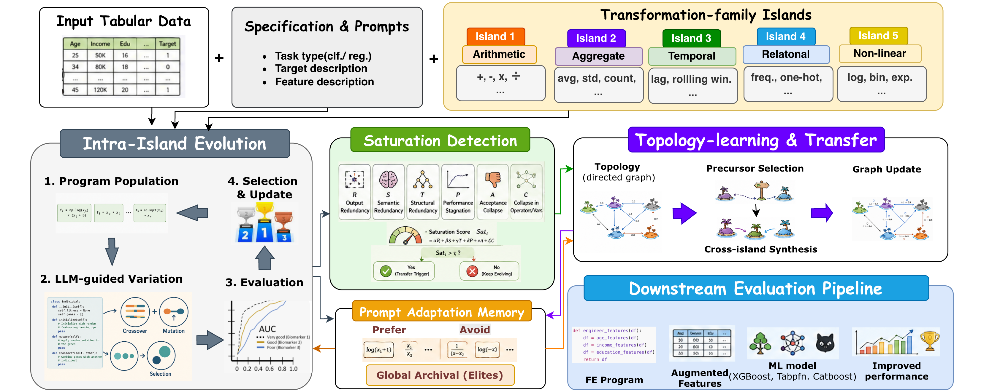
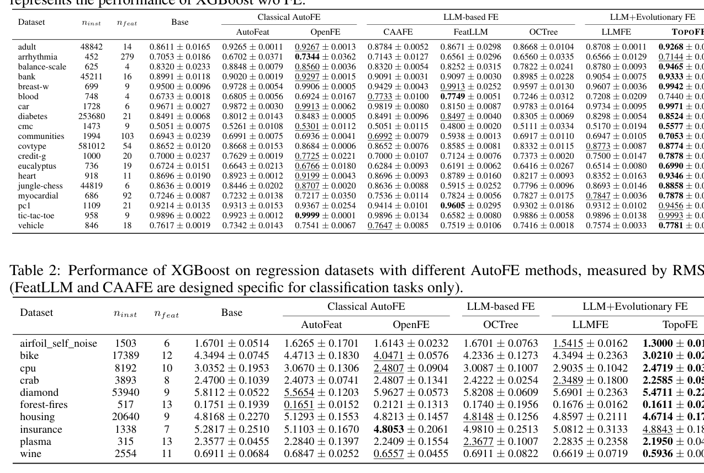
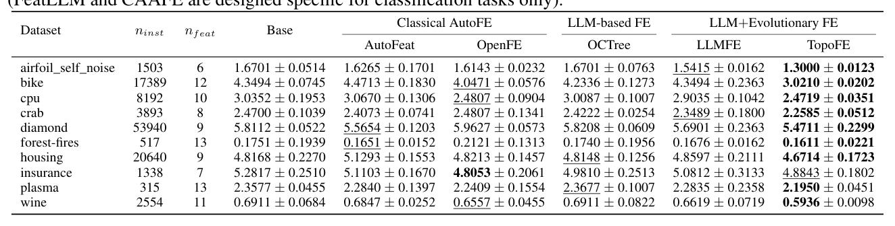
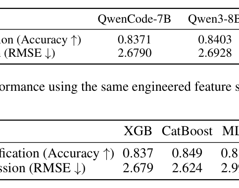
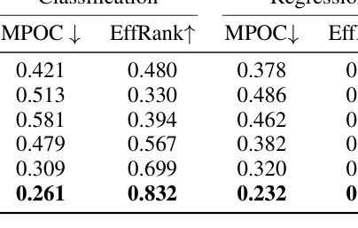
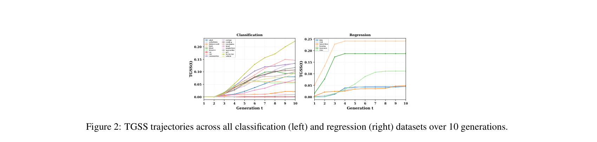
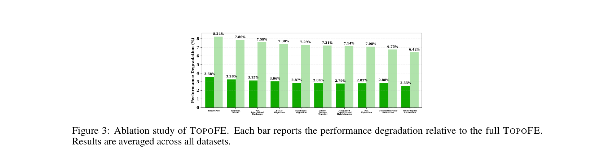

# TopoFE: Topology-Aware Feature Engineering with Large Language Models

## Abstract

* **Thách thức cốt lõi của kỹ thuật đặc trưng tự động cho dữ liệu dạng bảng:**
  * Kỹ thuật đặc trưng tự động (Automatic feature engineering - AutoFE) cho dữ liệu dạng bảng (tabular data) đòi hỏi phải khám phá các phép biến đổi giàu thông tin (informative transformations) từ một không gian chương trình (program space) có quy mô bùng nổ tổ hợp và tính chất dị thể (combinatorially large and heterogeneous).

* **Ba hạn chế căn bản của các hướng tiếp cận AutoFE hiện tại:**
  * Các phương pháp cổ điển (classical methods) phụ thuộc vào các thư viện toán tử cố định (fixed operator libraries) với khả năng biểu đạt hạn chế (limited expressivity).
  * Các phương pháp dựa trên mô hình ngôn ngữ lớn (Large Language Models - LLMs) tạo các đề xuất từ những câu lệnh nhắc tĩnh (static prompts) mà không lưu giữ lại kinh nghiệm tìm kiếm trước đó (prior search experience).
  * Các phương pháp tiến hóa (evolutionary methods) áp dụng các chính sách di cư cố định (fixed migration policies), bỏ qua độ hữu dụng chuyển giao liên họ (cross-family transfer utility) mang tính đặc thù theo từng nhiệm vụ cụ thể (task-specific).

* **Khung làm việc đề xuất: $\text{TOPOFE}$:**
  * $\text{TOPOFE}$ mô hình hóa bài toán AutoFE dưới dạng tìm kiếm chương trình tiến hóa đa đảo có cấu trúc đồ thị (graph-structured multi-island evolutionary program search).
  * Không gian biến đổi (transformation space) được phân hoạch thành các họ nhất quán về mặt ngữ nghĩa (semantically coherent families), trong đó mỗi họ được khám phá chuyên sâu bởi một đảo riêng biệt (dedicated island) thông qua các toán tử đột biến (mutation) và lai ghép (crossover) dưới sự dẫn dắt của LLM.
  * Mỗi đảo duy trì một Bộ nhớ thích ứng câu lệnh nhắc (Prompt Adaptation Memory) nhằm tích lũy phản hồi chấp nhận/từ chối (accept/reject feedback), giúp định hướng các đề xuất tiếp theo tiến vào các vùng tìm kiếm hiệu quả mà không cần cập nhật tham số mô hình (without parameter updates).
  * Để điều phối quá trình khám phá toàn cục (global exploration), $\text{TOPOFE}$ học động một đồ thị tô-pô có hướng (directed topology graph) với trọng số cạnh mã hóa độ hữu dụng chuyển giao thực nghiệm (empirical transfer utility) giữa các họ biến đổi.
  * Quá trình chuyển giao liên đảo (cross-island transfer) được kích hoạt bởi cơ chế phát hiện bão hòa thích ứng (adaptive saturation detection) và thực hiện thông qua tổng hợp lai do LLM làm trung gian (LLM-mediated hybrid synthesis), cho phép khám phá các chương trình đặc trưng có tính hợp thành (compositional feature programs) vốn không thể hình thành từ quá trình tìm kiếm cục bộ riêng lẻ (isolated local search).

* **Kết quả thực nghiệm và các phát hiện chính:**
  * Thực nghiệm trên $29$ tập dữ liệu dạng bảng chứng minh $\text{TOPOFE}$ liên tục vượt trội so với hầu hết các phương pháp AutoFE tiên tiến nhất (state-of-the-art AutoFE methods) trên cả nhiệm vụ phân loại (classification) và hồi quy (regression).
  * Vượt trên hiệu năng dự đoán (predictive performance), $\text{TOPOFE}$ tạo ra các tập đặc trưng có độ dư thừa thấp hơn (lower redundancy) và độ bao phủ biểu diễn cao hơn (higher representational coverage).
  * Đồ thị tô-pô học được tự động tích lũy cấu trúc chuyển giao đặc thù theo nhiệm vụ có ý nghĩa, tương quan chặt chẽ với mức cải thiện hiệu năng hạ nguồn (downstream gains).
  * Các chương trình đặc trưng được khám phá có khả năng chuyển giao đáng tin cậy qua nhiều mô hình dự đoán hạ nguồn (downstream predictors) và các kiến trúc LLM nền tảng (LLM backbones) khác nhau, chứng minh các cải tiến bắt nguồn trực tiếp từ cấu trúc tìm kiếm và cơ chế điều phối thích ứng của $\text{TOPOFE}$ thay vì phụ thuộc vào năng lực sinh đặc thù của mô hình nền tảng.

## 1 Introduction

* Kỹ thuật đặc trưng (Feature Engineering - FE) là quá trình chuyển đổi các biến thô thành các biểu diễn có khả năng dự đoán nhằm làm lộ ra cấu trúc ẩn của một bài toán học máy [Dong and Liu, 2018]:
    * FE vẫn là một trong những giai đoạn có tầm ảnh hưởng lớn nhất nhưng lại ít mang tính nguyên lý nhất (least principled) trong quy trình học máy dạng bảng (tabular machine learning pipeline).
    * Trong các thiết lập dữ liệu dạng bảng, nơi dữ liệu mang tính không đồng nhất (heterogeneous), giàu ngữ nghĩa (semantically rich) và thường chứa đựng cấu trúc đặc thù theo miền (domain-specific structure), chất lượng của các đặc trưng được thiết kế thường quyết định hiệu năng của mô hình nhiều hơn so với các lựa chọn về mặt kiến trúc hay tinh chỉnh siêu tham số (hyperparameter tuning) [Zhang et al., 2023a, Hollmann et al., 2023a].
    * Xây dựng các đặc trưng có giá trị cao đòi hỏi nhiều hơn là sự liệt kê về mặt cú pháp (syntactic enumeration):
        * Ví dụ: một tỷ số rủi ro có ý nghĩa lâm sàng (clinically meaningful risk ratio), một chỉ báo biến động tài chính (financial volatility indicator), hoặc một đặc trưng tần suất hành vi (behavioral frequency feature) đòi hỏi sự thấu hiểu về ý nghĩa của các biến, cách chúng tương tác nhân quả (causally interact), và những phép biến đổi nào được chấp nhận về mặt ngữ nghĩa (semantically admissible).
        * Tri thức ngữ nghĩa này nằm ngoài phạm vi những gì các thư viện toán tử cố định (fixed operator libraries) có thể mã hóa.
* Quá trình chuyển dịch mô hình từ AutoFE cổ điển dựa trên ngữ pháp sang tổng hợp chương trình bằng mô hình ngôn ngữ lớn (LLM):
    * Các hệ thống kỹ thuật đặc trưng tự động (Automated Feature Engineering - AutoFE) ban đầu định dạng bài toán thành quá trình tìm kiếm trên một ngữ pháp biến đổi được định nghĩa trước (predefined transformation grammar) [Olson and Moore, 2016, Horn et al., 2019, Zhang et al., 2023a].
    * Dù khả thi về mặt tính toán (tractable), công thức hóa cổ điển bị giới hạn căn bản bởi năng lực biểu đạt của thư viện toán tử: các đặc trưng đòi hỏi suy luận ngữ nghĩa liên biến (cross-variable semantic reasoning) nằm ngoài không gian có thể tiếp cận được theo thiết kế (outside the reachable space by construction).
    * Sự xuất hiện của các mô hình ngôn ngữ lớn (Large Language Models - LLM) mang lại một năng lực khác biệt về chất:
        * Thông qua tiền huấn luyện trên các kho ngữ liệu khổng lồ về văn bản khoa học, toán học và chuyên ngành, LLM có thể giả định các phép biến đổi có ý nghĩa từ tên cột (column names), mô tả tác vụ (task descriptions) và tri thức nền tảng (background knowledge).
        * Năng lực này dịch chuyển mô hình một cách hiệu quả từ việc lựa chọn toán tử cố định sang tổng hợp chương trình đặc trưng mở (open-ended feature program synthesis) [Hollmann et al., 2023a, Han et al., 2024].
    * Khiếm khuyết cấu trúc nghiêm trọng của các phương pháp AutoFE dựa trên LLM hiện tại: các đề xuất được tạo ra từ câu nhắc tĩnh (static prompts) không có bộ nhớ về các lần đánh giá trước, dẫn đến việc lặp lại đề xuất, không thích ứng được với các mẫu hình đặc thù của bộ dữ liệu, và không có cơ chế tổng hợp các đặc trưng đòi hỏi đồng thời toán tử từ nhiều họ biến đổi (multiple transformation families).
* Giới hạn của việc kết hợp LLM với tìm kiếm tiến hóa và phương thức thất bại khóa chặt liên họ (Cross-family Lock-in):
    * Các nỗ lực gần đây kết hợp LLM với tìm kiếm tiến hóa (evolutionary search) giảm thiểu một phần hạn chế trên bằng cách duy trì một bộ đệm kinh nghiệm (experience buffer) gồm các chương trình đạt điểm số cao làm mẫu minh họa trong ngữ cảnh (in-context demonstrations) [Abhyankar et al., 2025, Gong et al., 2025].
    * Tuy nhiên, các phương pháp này vẫn vận hành trên một quần thể đơn nhất không phân hóa (single undifferentiated population).
    * Không gian chương trình đặc trưng không hề đồng nhất mà cấu thành từ các họ biến đổi (transformation families) khác biệt về chất:
        * Tương tác số học (arithmetic interactions),
        * Tập hợp thống kê (statistical aggregates),
        * Động học thời gian (temporal dynamics),
        * Mã hóa quan hệ (relational encodings),
        * Ánh xạ phi tuyến đơn biến (nonlinear univariate maps).
        * Mỗi họ mã hóa một thiên kiến quy nạp (inductive bias) khác nhau về nguồn gốc phát sinh tín hiệu dự đoán.
    * Tìm kiếm trên quần thể đơn nhất bỏ qua cấu trúc này:
        * Khi một vài chương trình thành công từ một họ thống trị làm bão hòa bộ đệm kinh nghiệm, các đề xuất tiếp theo của LLM dần dần bị giam cầm trong chính họ đó.
        * Các họ trực giao (orthogonal families) bị khám phá dưới mức tiềm năng.
        * Các cấu thành liên họ (cross-family compositions) — vốn thường mang lại những đặc trưng có tính biểu đạt cao nhất và bổ trợ tốt nhất — trở nên bất khả tiếp cận về mặt cấu trúc (structurally unreachable).
    * Sự khóa chặt liên họ (cross-family lock-in) là phương thức thất bại trung tâm (central failure mode) của các phương pháp LLM-tiến hóa hiện hành, và chưa có công trình nào cung cấp cơ chế có nguyên tắc để phát hiện hoặc hiệu chỉnh hiện tượng này.
* Ba hạn chế liên đới cố hữu trong y văn hiện tại (Three Interrelated Limitations):
    * $(\text{L1})$ Động lực tìm kiếm đồng nhất (Homogeneous search dynamics): Tiến hóa trên quần thể đơn nhất suy thoái vào một tập con hạn hẹp các loại biến đổi, bị thiên lệch về các mô-típ đạt hiệu năng cao ban đầu và mù quáng trước cấu trúc đa phương thức (multi-modal structure) của không gian chương trình.
    * $(\text{L2})$ Truy vấn LLM không trạng thái (Stateless LLM querying): Quá trình sinh đặc trưng thiếu bộ nhớ dai dẳng (persistent memory) về các thăm dò trước đó, ngăn cản sự thích ứng tích lũy (cumulative adaptation) đối với các mẫu hình đặc thù của bộ dữ liệu.
    * $(\text{L3})$ Cấu trúc chuyển giao cứng nhắc (Rigid transfer structure): Khi sử dụng nhiều quần thể, cơ chế di cư (migration) mang tính định kỳ hoặc ngẫu nhiên, không nhận biết được thời điểm chuyển giao mang lại lợi ích và họ nguồn nào bổ trợ tốt nhất cho một đảo đích đang rơi vào trạng thái trì trệ (stagnating target island).
* Khung làm việc TOPOFE mô hình hóa kỹ thuật đặc trưng thành tìm kiếm chương trình tiến hóa đa đảo cấu trúc đồ thị:
    * TOPOFE dựa trên ba nguyên lý thiết kế nền tảng:
        * Phân tách thiên kiến quy nạp (Inductive bias decomposition): Không gian chương trình được phân vùng thành các họ biến đổi khác nhau, mỗi họ được gán cho một đảo chuyên dụng (dedicated island) nhằm tiến hóa các chương trình chuyên biệt hóa dưới các tiên nghiệm riêng theo họ, bảo toàn tính đa dạng trên các loại biến đổi theo thiết kế.
        * Học topo thích ứng (Adaptive topology learning): Thay vì sử dụng lịch trình di cư cố định hoặc suy nghiệm (heuristic), TOPOFE duy trì một đồ thị có hướng có trọng số trên các đảo, trong đó trọng số cạnh được cập nhật trực tuyến từ mức cải thiện chuyển giao liên họ quan sát được từ thực nghiệm, học một mô hình định hướng dữ liệu về tính bổ trợ giữa các họ.
        * Chuyển giao ngữ nghĩa qua tổng hợp LLM (Semantic transfer via LLM synthesis): Chuyển giao tri thức liên đảo không được thực hiện bằng cách sao chép chương trình, mà thông qua tổng hợp lai (hybrid synthesis) do LLM điều phối, trong đó các chương trình từ đảo nguồn và đảo đích được cùng trình bày làm ngữ cảnh, và LLM sinh ra một chương trình mới về mặt cấu thành kế thừa các phần tử cấu trúc từ cả hai họ.
    * Tiêu chí bão hòa (Saturation criterion):
        * Chuyển giao được kích hoạt bởi tiêu chí bão hòa — một ước lượng cửa sổ trượt (sliding-window estimate) về mức cải thiện biên (marginal improvement) của từng đảo nhằm phát hiện khi nào tìm kiếm cục bộ đã thực sự cạn kiệt vùng hữu ích.
        * Tiêu chí này tách rời việc chuyển giao khỏi số lượng thế hệ tính theo thời gian thực (wall-clock generation count) và đảm bảo ngân sách đánh giá được hướng vào thăm dò liên họ chính xác vào thời điểm có giá trị cao nhất.
    * Bộ nhớ thích ứng câu nhắc (Prompt Adaptation Memory - PAM):
        * Duy trì lịch sử chấp nhận/từ chối trên từng đảo và một bản tóm tắt ngắn gọn bằng ngôn ngữ tự nhiên về các mẫu biến đổi được ưu tiên và cần tránh, được đưa vào mỗi lệnh gọi LLM.
        * Thành phần này cho phép thích ứng tích lũy, đặc thù theo bộ dữ liệu trong toàn bộ quá trình tìm kiếm mà không cần bất kỳ sự cập nhật tham số nào (without any parameter update).
* Bốn đóng góp chính của nghiên cứu:
    * (i) Công thức hóa nhận biết cấu trúc topo (Topology-aware formulation): Định dạng AutoFE thành bài toán tìm kiếm chương trình đa đảo cấu trúc đồ thị, phân vùng không gian đặc trưng thành các đảo chuyên biệt hóa theo từng họ và thay thế cơ chế di cư suy nghiệm bằng một đồ thị topo có hướng học được, có trọng số cạnh mã hóa độ hữu dụng chuyển giao liên họ quan sát được trên thực nghiệm và cập nhật trực tuyến thông qua quy tắc kiểu bandit (bandit-style rule).
    * (ii) Chuyển giao thích ứng kích hoạt bởi độ bão hòa (Saturation-triggered adaptive transfer): Giới thiệu tiêu chí bão hòa dựa trên độ hữu dụng để kích hoạt chuyển giao liên đảo khi tìm kiếm cục bộ cạn kiệt; kết hợp thành phần Prompt Adaptation Memory tích lũy các mẫu chương trình được chấp nhận và từ chối trên từng đảo, cho phép thích ứng tích lũy theo bộ dữ liệu trong suốt quá trình tìm kiếm mà không cần cập nhật tham số.
    * (iii) Khung đánh giá có nguyên tắc (Principled evaluation framework): Giới thiệu ba độ đo chuyên dụng:
        * Hệ số tương quan đầu ra từng cặp trung bình (Mean Pairwise Output Correlation - $\text{MPOC}$) và Hạng hiệu dụng (Effective Rank - $\text{EffRank}$): cùng mô tả mức độ dư thừa đặc trưng và độ bao phủ không gian con (subspace coverage).
        * Điểm chuyên biệt hóa đồ thị topo (Topology Graph Specialisation Score - $\text{TGSS}$): định lượng mức độ đồ thị topo tiếp thu tri thức chuyển giao liên họ đặc thù theo tác vụ trong quá trình tìm kiếm.
    * (iv) Xác thực thực nghiệm toàn diện (Empirical validation): Trên $29$ bộ dữ liệu, chứng minh TOPOFE vượt trội nhất quán so với phần lớn các baseline AutoFE cổ điển và dựa trên LLM, tạo ra các tập đặc trưng có độ dư thừa thấp hơn và độ bao phủ cao hơn, đồng thời hiệu năng duy trì tính ổn định qua nhiều mô hình dự đoán hạ nguồn và các mô hình nền LLM có năng lực khác nhau.

## 2 Preliminary

### 2.1 Feature Engineering (FE)

* **Định nghĩa tập dữ liệu bảng và không gian đặc trưng:**
  * Cho $\mathcal{D} = \{(\mathbf{x}_i, y_i)\}_{i=1}^N$ là một tập dữ liệu dạng bảng (tabular dataset) gồm $N$ cá thể (instances).
  * Mỗi cá thể được biểu diễn bởi một vector đặc trưng $d$ chiều: $\mathbf{x}_i \in \mathcal{X} \subseteq \mathbb{R}^d$.
  * Biến mục tiêu tương ứng là $y_i \in \mathcal{Y}$.
* **Siêu dữ liệu có cấu trúc $\mathcal{M}$ (structured metadata):**
  * Mỗi tập dữ liệu được đi kèm với siêu dữ liệu có cấu trúc $\mathcal{M} = \{\mathcal{M}_{\text{task}}, \mathcal{M}_{\text{feat}}\}$.
  * $\mathcal{M}_{\text{task}}$ mã hóa loại tác vụ học máy (task type).
  * $\mathcal{M}_{\text{feat}}$ mã hóa các bộ mô tả ngữ nghĩa cho từng đặc trưng riêng biệt (per-feature semantic descriptors).
* **Mô hình dự báo hạ nguồn và tối thiểu hóa rủi ro thực nghiệm (Empirical Risk Minimization - ERM):**
  * Xét một phép biến đổi đặc trưng $T : \mathcal{X} \rightarrow \tilde{\mathcal{X}}$.
  * Gọi $\mathcal{F}$ là lớp các mô hình dự báo hạ nguồn (class of downstream predictive models) và $\mathcal{L}$ là hàm mất mát phù hợp với tác vụ (task-appropriate loss function).
  * Mô hình hạ nguồn tối ưu $f_T^*$ thu được thông qua quá trình tối thiểu hóa rủi ro thực nghiệm trên phân chia tập huấn luyện $\{X_{\text{tr}}, y_{\text{tr}}\}$:
    $$f_T^* = \arg\min_{f \in \mathcal{F}} \mathcal{L}(f(T(X_{\text{tr}})), y_{\text{tr}}) \quad (1)$$
* **Mục tiêu của kỹ thuật đặc trưng (Feature Engineering objective):**
  * Mục tiêu của kỹ thuật đặc trưng là tìm kiếm phép biến đổi tối ưu $T^*$ nhằm tối đa hóa hiệu năng tổng quát hóa (generalization performance) trên tập dữ liệu kiểm định giữ lại (held-out validation data):
    $$T^* = \arg\max_{T} \mathbb{E}[\text{Perf}(f_T^*, T(X_{\text{val}}), y_{\text{val}})] \quad (2)$$
  * Trong đó $\text{Perf}$ là thước đo hiệu năng phù hợp với tác vụ (ví dụ: độ chính xác — accuracy).
* **Bản chất tối ưu hóa hai cấp (Bilevel optimization) và thách thức tìm kiếm:**
  * Bài toán thiết kế đặc trưng cấu thành một bài toán tối ưu hóa hai cấp (bilevel optimization):
    * Bài toán cấp trong (inner problem): khớp / huấn luyện mô hình $f$ dưới một phép biến đổi đặc trưng $T$ cố định.
    * Bài toán cấp ngoài (outer problem): tìm kiếm chính phép biến đổi đặc trưng tối ưu $T$.
  * Hàm mục tiêu cấp ngoài là phi khả vi (non-differentiable) đối với phép biến đổi $T$.
  * Mỗi lượt đánh giá đều đòi hỏi phải khớp lại mô hình $f$ từ đầu (re-fitting $f$ from scratch).
  * Do đó, các chiến lược tìm kiếm hiệu quả về mặt mẫu (sample-efficient search strategies) đóng vai trò thiết yếu.

### 2.2 AutoFE as LLM-guided Program Search

* **Cụ thể hóa không gian biến đổi $\mathcal{T}$ thành không gian chương trình đặc trưng:**
  * Không gian phép biến đổi $\mathcal{T}$ được cụ thể hóa thành không gian các chương trình đặc trưng thực thi được (executable feature programs) trên một thư viện toán tử hữu hạn có định kiểu (finite typed operator library) $\mathcal{O} = \{o_q\}_{q=1}^Q$.
  * Mỗi toán tử $o_q$ có bậc toán tử (arity — số lượng toán hạng) và nhãn kiểu xác định (type signature) (ví dụ: $+$, $-$, $\times$, $\div$, $\log$, $\exp$).
* **Định nghĩa chương trình đặc trưng $p \in \mathcal{P}$ và không gian chương trình $\mathcal{P}$:**
  * Một chương trình đặc trưng $p \in \mathcal{P}$ là một hàm bất kỳ $p : \mathcal{X} \rightarrow \mathbb{R}$ được tạo thành bằng cách kết hợp/hợp thành các toán tử từ thư viện $\mathcal{O}$ lên tới độ sâu giới hạn $L_{\max}$:
    $$\mathcal{P} := \left\{ p \mid p = o^{(L)} \circ \cdots \circ o^{(1)}, \, o^{(\ell)} \in \mathcal{O}, \, L \le L_{\max} \right\} \quad (3)$$
  * Mỗi chương trình $p \in \mathcal{P}$ được biểu diễn dưới dạng một hàm Python thực thi được (executable Python function).
* **Ma trận thiết kế biến đổi và mô hình hạ nguồn tối ưu tương ứng:**
  * Một tập đặc trưng $S \subseteq \mathcal{P}$ sinh ra một ma trận thiết kế biến đổi (transformed design matrix):
    $$T_S(X) = [p(X)]_{p \in S} \in \mathbb{R}^{N \times |S|}$$
  * Trong đó mỗi cột tương ứng với giá trị đầu ra của một chương trình đặc trưng $p \in S$.
  * Mô hình hạ nguồn tối ưu trên ma trận thiết kế biến đổi $T_S$ được xác định theo:
    $$f_S^* = \arg\min_{f \in \mathcal{F}} \mathcal{L}(f(T_S(X_{\text{tr}})), y_{\text{tr}}) \quad (4)$$
* **Công thức hóa AutoFE dưới dạng bài toán tìm kiếm chương trình tổ hợp (Combinatorial program search):**
  * Mục tiêu kỹ thuật đặc trưng tự động (AutoFE) được công thức hóa thành bài toán tìm kiếm chương trình mang tính tổ hợp:
    $$S^* = \arg\max_{S \subseteq \mathcal{P}} \mathbb{E}[\text{Perf}(f_S^*, T_S(X_{\text{val}}), y_{\text{val}})] \quad (5)$$
* **Tính bất khả thi của tìm kiếm bằng duyệt toàn bộ và đặc tính phi khả vi:**
  * Không gian tìm kiếm là bất khả thi để giải quyết bằng phương pháp liệt kê/duyệt toàn bộ (intractable by enumeration) vì kích thước không gian $|\mathcal{P}|$ tăng trưởng theo cấp siêu mũ (super-exponentially) theo độ sâu $L_{\max}$.
  * Mục tiêu tìm kiếm phi khả vi đối với cấu trúc chương trình rời rạc (discrete program structure).
* **Chi phí tính toán và ước lượng tín hiệu thích nghi (Fitness signal estimation):**
  * Mỗi lượt đánh giá tiêu tốn chi phí $\mathcal{O}(k_{\text{cv}} \cdot C_{\text{fit}}(N, |S|))$ dưới quy trình kiểm định chéo $k_{\text{cv}}$ nếp ($k_{\text{cv}}$-fold cross-validation).
  * Trong đó $C_{\text{fit}}(N, |S|)$ biểu thị chi phí huấn luyện mô hình trên $N$ thực thể và $|S|$ đặc trưng được thiết kế.
  * Tín hiệu độ thích nghi (fitness signal) $\hat{\Phi}(S)$ được ước lượng thông qua trung bình trên các nếp kiểm định:
    $$\hat{\Phi}(S) = \frac{1}{k_{\text{cv}}} \sum_{k=1}^{k_{\text{cv}}} \text{Perf}\left(f_{S,k}^*, T_S(X_{\text{val}}^k), y_{\text{val}}^k\right) \quad (6)$$
  * Trong đó $f_{S,k}^*$ được huấn luyện trên nếp huấn luyện thứ $k$ và được đánh giá trên nếp kiểm định giữ lại tương ứng $(X_{\text{val}}^k, y_{\text{val}}^k)$.
* **Vai trò của siêu dữ liệu $\mathcal{M}$ làm tiên nghiệm ngữ nghĩa cho LLM:**
  * Siêu dữ liệu $\mathcal{M}$ đóng vai trò ràng buộc không gian $\mathcal{P}$, chỉ cho phép các chương trình hợp lệ về mặt ngữ nghĩa (semantically valid programs).
  * Đồng thời, $\mathcal{M}$ cung cấp một phân phối tiên nghiệm bằng ngôn ngữ tự nhiên (natural-language prior) được khai thác trực tiếp bởi quá trình tổng hợp chương trình có sự định hướng của LLM (LLM-guided synthesis).

## 3 TOPOFE

* Dựa trên các cơ sở lý thuyết tại § 2.2, bài toán tìm kiếm chương trình tổ hợp (combinatorial program search) trên không gian $\mathcal{P}$ là bất khả thi bằng phương pháp liệt kê vét cạn (enumeration) và không thể tiếp cận bằng các phương pháp dựa trên gradient (gradient-based methods).
* Quá trình tìm kiếm đòi hỏi một cơ chế đề xuất được dẫn dắt bởi mô hình ngôn ngữ lớn (LLM-guided proposal mechanism) thỏa mãn ba đặc tính:
  * (i) Sinh các chương trình hợp lệ về cú pháp (syntactically valid) và có ý nghĩa về mặt ngữ nghĩa (semantically meaningful) trên một không gian toán tử không đồng nhất (heterogeneous operator space) mà không cần liệt kê toàn bộ.
  * (ii) Khai thác tri thức miền đặc thù của tác vụ (task-specific domain knowledge) trong siêu dữ liệu $\mathcal{M}$ nhằm định hướng thiên kiến tìm kiếm về phía các phép biến đổi triển vọng và khả thi (promising and admissible transformations).
  * (iii) Hỗ trợ đa dạng các chế độ đề xuất (diverse proposal modes) trong một giao diện hợp nhất, cho phép vừa khai thác (exploitation) các chương trình chất lượng cao đã biết, vừa khám phá (exploration) các vùng chưa được khảo sát của không gian $\mathcal{P}$.
* Khung làm việc TOPOFE được đề xuất nhằm tổ chức tìm kiếm chương trình cho kỹ thuật đặc trưng tự động (AutoFE - Automated Feature Engineering) thông qua ba thành phần phối hợp chặt chẽ:
  * Phân tách đa đảo (multi-island decomposition): Phân hoạch không gian $\mathcal{P}$ thành $M$ họ biến đổi ngữ nghĩa nhất quán (semantically coherent transformation families), mỗi họ được khám phá bởi một đảo chuyên biệt nhằm ngăn ngừa hiện tượng hội tụ sớm vào một họ duy nhất (§ 3.1).
  * Bộ nhớ thích ứng prompt (Prompt Adaptation Memory - PAM): Duy trì trạng thái tìm kiếm trên từng đảo để liên tục điều chỉnh các đề xuất của LLM dựa trên lịch sử chấp nhận/từ chối tích lũy mà không cần bất kỳ cập nhật tham số mô hình nào (§ 3.2).
  * Cơ chế chuyển giao liên đảo nhận biết cấu trúc topo (topology-aware cross-island transfer): Điều phối dòng chảy tri thức giữa các đảo thông qua một đồ thị có hướng được học (learned directed graph), kích hoạt quá trình tổng hợp lai (hybrid synthesis) từ các họ bổ trợ khi quá trình tìm kiếm cục bộ bão hòa (§ 3.3).
* Ba thành phần này cùng nhau thiết lập trạng thái cân bằng giữa khai thác chuyên biệt hóa (specialized exploitation) trong nội bộ các họ biến đổi và khám phá có cấu trúc (structured exploration) giữa các họ.
* Khung làm việc TOPOFE phân tách bài toán tìm kiếm chương trình kỹ thuật đặc trưng thành nhiều đảo họ biến đổi với quá trình tiến hóa cục bộ dẫn dắt bởi LLM, cơ chế phát hiện bão hòa thích ứng, tổng hợp lai liên đảo nhận biết topo và chọn lọc dựa trên kho lưu trữ nhằm tạo ra tập đặc trưng đa dạng giúp nâng cao hiệu năng dự đoán trên dữ liệu bảng (minh họa tại Hình 1, quy trình hoàn chỉnh được tóm tắt trong Thuật toán 1 - Algorithm 1):
  - **Hình 1.** Tổng quan khung làm việc kỹ thuật đặc trưng TOPOFE
    - 
    - **Hình này chứng minh điều gì**
      - Cụ thể hóa kiến trúc tương tác gồm 5 đảo biến đổi, vòng lặp tiến hóa 4 bước, điều kiện kích hoạt chuyển giao $\text{Sat}_i > \tau$ và đường ống kiểm chứng hạ nguồn.
    - **Từ đâu mà thấy được**
      - Hàng trên cùng hiển thị dữ liệu bảng đầu vào phân phối về 5 đảo: Arithmetic, Aggregate, Temporal, Relational và Non-linear.
      - Vòng lặp Intra-Island tiến hành qua 4 bước đánh số 1 đến 4, kích hoạt khối Topology-learning & Transfer khi đạt ngưỡng $\text{Sat}_i > \tau$ để xuất chương trình sang Downstream Evaluation Pipeline.

### 3.1 Intra-island Evolution

#### 3.1.1 Multi-island Decomposition

* **Tính không đồng nhất của không gian chương trình đặc trưng $\mathcal{P}$ (heterogeneity of feature program space):**
  * Không gian chương trình đặc trưng $\mathcal{P}$ không đồng nhất (not homogeneous).
  * Các chương trình cụm lại một cách tự nhiên thành các vùng mạch lạc về mặt ngữ nghĩa (semantically coherent regions) dựa theo lớp toán tử (class of operations) mà chúng áp dụng.
  * Mỗi vùng mã hóa một thiên kiến quy nạp (inductive bias) riêng biệt về cách thức tín hiệu dự đoán (predictive signal) được kiến tạo từ các đặc trưng thô (raw features).
* **Định nghĩa 1 — Họ biến đổi (Definition 1: Transformation Family):**
  * Một họ biến đổi (transformation family) $\mathcal{P}_i \subseteq \mathcal{P}$ là một tập con mạch lạc về ngữ nghĩa gồm các chương trình đặc trưng cùng chia sẻ một thiên kiến quy nạp về cách kiến tạo tín hiệu dự đoán từ các đặc trưng thô, tức là các chương trình áp dụng cùng một lớp toán tử nguyên thủy (primitive operations).
* **Năm họ biến đổi chuẩn tắc (five canonical transformation families):**
  * Tương tác số học (arithmetic interactions) $\mathcal{P}_1$: bao gồm các phép nhân (products), tỷ số (ratios), và hiệu (differences).
  * Tập hợp thống kê (statistical aggregates) $\mathcal{P}_2$: bao gồm trung bình mức nhóm (group-level means), độ lệch chuẩn (standard deviations), số lượng đếm (counts), và trung vị (medians).
  * Đặc trưng thời gian (temporal features) $\mathcal{P}_3$: bao gồm các độ trễ (lags), cửa sổ trượt (rolling windows), và trung bình động lũy thừa (exponential moving averages).
  * Mã hóa quan hệ (relational encodings) $\mathcal{P}_4$: bao gồm đếm tần suất (frequency counts), mã hóa mục tiêu (target encodings), và các phép biến đổi dựa trên thứ hạng (rank-based transforms).
  * Ánh xạ đơn biến phi tuyến (nonlinear univariate maps) $\mathcal{P}_5$: bao gồm các phép biến đổi logarit (logarithmic), hàm mũ (exponential), phân nhóm/rời rạc hóa (binned), và đa thức (polynomial transformations).
* **Mối quan hệ giao thoa và sự phân tách của các họ biến đổi:**
  * Các họ biến đổi có thể giao thoa lẫn nhau (tức là $\mathcal{P}_i \cap \mathcal{P}_j \neq \emptyset$ nói chung), nhưng mỗi họ đại diện cho một vùng phân biệt về mặt cấu trúc trong $\mathcal{P}$.
  * Phép phân chia này có thể mở rộng (extensible) cho các họ biến đổi bổ sung khi cần thiết.
  * Cùng nhau, các họ biến đổi tạo thành một phủ xấp xỉ (approximate cover):
    $$\mathcal{P} \approx \bigcup_{i=1}^M \mathcal{P}_i$$
    qua đó phân rã không gian tìm kiếm đơn khối (monolithic search space) thành $M$ không gian con được định kiểu ngữ nghĩa (semantically typed subspaces), mỗi không gian con thích ứng cho việc tìm kiếm chuyên biệt (specialized search).
* **Hạn chế của quần thể tiến hóa đơn lẻ và giải pháp phân tách đa đảo của TOPOFE:**
  * Trong một quần thể tiến hóa đơn lẻ (single evolutionary population), các chương trình đạt điểm cao từ một họ thống trị sẽ nhanh chóng làm bão hòa bộ đệm kinh nghiệm (experience buffer).
  * Sự bão hòa này giam cầm các đề xuất tiếp theo của LLM vào vùng lân cận của họ thống trị đó, khiến các họ trực giao (orthogonal families) vĩnh viễn không được khám phá.
  * TOPOFE giải quyết vấn đề này thông qua phân tách đa đảo có cấu trúc (structured multi-island decomposition), phân bổ một quần thể con chuyên biệt (dedicated subpopulation) cho từng $\mathcal{P}_i$, giúp bảo toàn các thiên kiến quy nạp đặc thù của từng họ và ngăn chặn bất kỳ họ đơn lẻ nào độc chiếm ngân sách tìm kiếm (search budget).
* **Định nghĩa 2 — Đảo tiến hóa (Definition 2: Island):**
  * Đảo thứ $i$ tại thế hệ $t$ là một bộ giá trị (tuple):
    $$I_i^{(t)} = (\Pi_i^{(t)}, \mathcal{A}_i, \mathcal{H}_i^{(t)}, \rho_i^{(t)})$$
    trong đó:
    * (i) $\Pi_i^{(t)} \subset \mathcal{P}_i$ là quần thể hiện tại (current population) gồm tối đa $n_{\max}$ chương trình đặc trưng, được xếp hạng theo độ thích nghi (fitness) $\hat{\Phi}$.
    * (ii) $\mathcal{A}_i \subset \mathcal{P}_i$ là kho lưu trữ tinh hoa dài hạn (long-term archive of elite programs) được phát hiện bởi đảo $i$.
    * (iii) $\mathcal{H}_i^{(t)}$ là lịch sử chấp nhận/từ chối (accept/reject history) được dùng để thích ứng câu nhắc đột biến (mutation prompt).
    * (iv) $\rho_i^{(t)} \in \mathbb{R}^s$ là một vector bộ nhớ câu nhắc (prompt-memory vector) mã hóa tín hiệu cô đọng dạng "ưu tiên/tránh né" ("prefer/avoid") bắt nguồn từ $\mathcal{H}_i^{(t)}$.
* **Vai trò của bốn thành phần trong việc duy trì trạng thái tìm kiếm hoàn chỉnh của đảo:**
  * $\Pi_i^{(t)}$ dẫn dắt việc tìm kiếm cục bộ (local search).
  * $\mathcal{A}_i^{(t)}$ tích lũy những phát hiện tốt nhất và đóng vai trò làm nhóm mẫu thị phạm theo ngữ cảnh (in-context demonstration pool) cho các đề xuất của LLM.
  * $\mathcal{H}_i^{(t)}$ cung cấp tín hiệu thô (raw signal) cho quá trình thích ứng câu nhắc (prompt adaptation).
  * $\rho_i^{(t)}$ chuyển dịch tín hiệu đó thành hướng dẫn bằng ngôn ngữ tự nhiên (natural-language guidance) được chèn vào mỗi lượt gọi LLM.

#### 3.1.2 LLM-guided Intra-island Evolution (Specialized Exploration)

* **Quy trình tiến hóa độc lập tại mỗi thế hệ $t$:**
  * Tại mỗi thế hệ $t$, đảo $i$ tiến hóa quần thể của mình một cách độc lập thông qua hai toán tử do LLM dẫn dắt, cả hai đều phụ thuộc có điều kiện vào ngữ cảnh siêu dữ liệu $\mathcal{M}$ (metadata context) của đảo và bộ nhớ câu nhắc $\rho_i^{(t)}$:
* **Toán tử đột biến (Mutation operator):**
  * Lấy mẫu một chương trình cha mẹ đơn lẻ $p \sim \Pi_i^{(t)}$ với xác suất tỷ lệ thuận với độ thích nghi $\hat{\Phi}(p)$.
  * Nhắc (prompt) LLM tạo ra một chương trình đã biến đổi $p' \in \mathcal{P}_i$ nhằm cải thiện dựa trên $p$ đồng thời tuân thủ các tín hiệu được mã hóa trong $\rho_i^{(t)}$.
* **Toán tử lai ghép (Crossover operator):**
  * Lấy mẫu hai chương trình cha mẹ $(p_a, p_b) \sim \Pi_i^{(t)}$ và trình bày chúng dưới dạng các mẫu thị phạm theo ngữ cảnh (in-context demonstrations).
  * LLM sau đó được nhắc để tổng hợp một chương trình con $p' \in \mathcal{P}_i$ kết hợp các yếu tố cấu thành (compositional elements) từ cả hai chương trình cha mẹ.
* **Quy trình kiểm định và đánh giá độ thích nghi thống nhất (unified validation and fitness pipeline):**
  * Cả hai toán tử đều đi qua một quy trình kiểm định và thích ứng thống nhất: mỗi ứng viên $p'$ được kiểm tra tính hợp lệ cú pháp (syntactic validity) và khả năng chấp nhận ngữ nghĩa (semantic admissibility) dưới $\mathcal{M}$.
  * Sau đó ứng viên được đánh giá thông qua hàm oracle $\hat{\Phi}$.
  * Quần thể $\Pi_i^{(t+1)}$ giữ lại top-$n_{\max}$ chương trình có độ thích nghi cao nhất.
  * Kho lưu trữ tinh hoa $\mathcal{A}_i^{(t)}$ và bộ nhớ câu nhắc $\rho_i^{(t)}$ được cập nhật theo các quy tắc xác định trong mục §3.2.

#### 3.1.3 Global Objective

* **Tổng hợp tập đặc trưng cuối cùng từ tinh hoa của tất cả các đảo:**
  * Hệ thống đa đảo tập hợp tập đặc trưng cuối cùng bằng cách gộp (pooling) các chương trình tinh hoa từ tất cả các đảo:
    $$S^* = \arg\max_{S \subseteq \bigcup_{i} \mathcal{A}_i} \hat{\Phi}(S), \quad (7)$$
    thỏa mãn các điều kiện ràng buộc:
    $$|S| \le d'_{\max}, \quad \sum_{i=1}^K |\Pi_i^{(t)}| \le B,$$
    trong đó:
    * $B$ là tổng ngân sách đánh giá (total evaluation budget).
    * $d'_{\max}$ là số lượng đặc trưng tối đa được chọn.
    * $K$ là tổng số đảo (tương ứng với số lượng họ biến đổi).
* **Yêu cầu đóng góp tín hiệu dự đoán không dư thừa (non-redundant predictive signal):**
  * Mỗi chương trình $p$ được giữ lại trong tập đặc trưng tối ưu $S^*$ bắt buộc phải đóng góp tín hiệu dự đoán không dư thừa:
    $$\hat{\Phi}(\{p\} \mid S^* \setminus \{p\}) > 0, \quad \forall p \in S^*.$$

### 3.2 Prompt Adaptation Memory

* Vai trò của tri thức tiền huấn luyện (pretrained knowledge) của mô hình ngôn ngữ lớn (LLM):
  * Cung cấp một tiên nghiệm mạnh mẽ (strong prior) đối với các chương trình đặc trưng (feature programs).
* Thách thức trong quá trình tìm kiếm đặc trưng hiệu quả:
  * Đòi hỏi cơ chế đề xuất (proposal mechanism) phải thích ứng trực tuyến (adapt online) với địa hình cảnh quan đang biến đổi liên tục (evolving landscape) của từng đảo (island).
  * Nếu không có sự thích ứng trực tuyến, LLM sẽ lặp đi lặp lại việc đề xuất các chương trình trong những vùng không gian đã được xác định là không hiệu quả (unproductive regions), dẫn đến lãng phí nghiêm trọng ngân sách đánh giá (evaluation budget).
* Đề xuất cơ chế Bộ nhớ thích ứng prompt (Prompt Adaptation Memory - PAM):
  * PAM là một cơ chế gọn nhẹ trên từng đảo (lightweight per-island mechanism), liên tục định hình phân phối đề xuất (proposal distribution) của LLM dựa trên kinh nghiệm tìm kiếm tích lũy (accumulated search experience).
  * PAM vận hành hoàn toàn không cần bất kỳ sự cập nhật tham số mô hình nào (without any parameter update).
  * PAM hoạt động thông qua $3$ quy tắc cập nhật phối hợp chặt chẽ (coordinated update rules), được áp dụng sau mỗi thế hệ tìm kiếm (generation).

#### 3.2.1 Prompt-memory Update

* Định nghĩa tập hợp lịch sử trượt:
  * Ký hiệu $\mathcal{H}^+_i(t)$ và $\mathcal{H}^-_i(t)$ lần lượt là tập con các chương trình được chấp nhận (accepted subset) và tập con các chương trình bị từ chối (rejected subset) trong cửa sổ lịch sử trượt (sliding history window) $[t - W, t]$.
* Cơ chế hình thành tín hiệu định hướng:
  * Các loại toán tử (operator types) tập trung chủ yếu trong số các chương trình được chấp nhận ($\mathcal{H}^+_i(t)$) được củng cố thành các tín hiệu ưu tiên (prefer signals).
  * Các loại toán tử tập trung trong số các chương trình bị từ chối ($\mathcal{H}^-_i(t)$) được gắn cờ thành các tín hiệu cần tránh (avoid signals).
* Quy tắc cập nhật bộ nhớ prompt hình thức hóa:
  $$\rho^{(t+1)}_i = \text{Summarize}\left(\mathcal{H}^+_i(t), \mathcal{H}^-_i(t), \rho^{(t)}_i\right) \tag{8}$$
  * Trong đó:
    * $\rho^{(t)}_i$ là chuỗi bộ nhớ prompt của đảo $i$ tại thế hệ $t$.
    * $\rho^{(t+1)}_i$ là chuỗi bộ nhớ prompt của đảo $i$ được cập nhật cho thế hệ $t+1$.
    * $\text{Summarize}(\cdot)$ là một lệnh gọi LLM (LLM call) có nhiệm vụ tổng hợp và tạo ra một chuỗi ngôn ngữ tự nhiên cô đọng (compact natural-language string).
    * Ví dụ về chuỗi bộ nhớ được sinh ra: *"prefer ratio features with lagged denominators, avoid log transforms of sparse columns"* (ưu tiên các đặc trưng tỷ lệ có mẫu số trễ, tránh các phép biến đổi log trên các cột dữ liệu thưa).
    * Chuỗi ngôn ngữ tự nhiên này được gắn vào phần đầu (prepended) của tất cả các prompt tiếp theo dành cho đảo $i$.

#### 3.2.2 Elite Archive Update

* Quy trình cập nhật kho lưu trữ tinh hoa sau mỗi thế hệ:
  * Sau mỗi thế hệ $t$, kho lưu trữ tinh hoa $\mathcal{A}^{(t)}_i$ của đảo $i$ hợp nhất các chương trình mới được chấp nhận, xếp hạng lại theo hàm mục tiêu $\hat{\Phi}$, và cắt tỉa về dung lượng tối đa $|\mathcal{A}|_{\max}$.
* Công thức cập nhật kho lưu trữ tinh hoa:
  $$\mathcal{A}^{(t+1)}_i = \text{TopK}\left(\mathcal{A}^{(t)}_i \cup \{p : a_t = 1\}, |\mathcal{A}|_{\max}, \hat{\Phi}\right) \tag{9}$$
  * Trong đó:
    * $\mathcal{A}^{(t)}_i$ là kho lưu trữ tinh hoa hiện tại của đảo $i$ ở thế hệ $t$.
    * $\{p : a_t = 1\}$ là tập hợp các chương trình ứng viên $p$ mới được chấp nhận tại thế hệ $t$ ($a_t = 1$).
    * $|\mathcal{A}|_{\max}$ là dung lượng giới hạn tối đa của kho lưu trữ (archive capacity).
    * $\hat{\Phi}$ là hàm mục tiêu dùng để đánh giá và xếp hạng độ ưu tú của các chương trình đặc trưng.
    * $\text{TopK}(\cdot)$ là toán tử chọn ra $K$ chương trình có điểm số cao nhất theo hàm đánh giá $\hat{\Phi}$.
* Điều kiện sàng lọc tính mới về mặt cấu trúc (structural novelty):
  * Các chương trình ứng viên có khoảng cách chỉnh sửa cây chuẩn hóa (normalized tree-edit distance) tới bất kỳ thành viên hiện hữu nào trong kho lưu trữ nhỏ hơn ngưỡng $\delta_{\min}$ sẽ bị loại bỏ trước khi chèn vào kho.
  * Tiêu chí này bắt buộc đảm bảo tính mới về mặt cấu trúc (enforcing structural novelty) cho tập hợp các chương trình đặc trưng tinh hoa.
* Vai trò kép của kho lưu trữ tinh hoa:
  * Đóng vai trò là tập biểu diễn mẫu trong ngữ cảnh (in-context demonstration pool) phục vụ cho các đề xuất tiến hóa nội đảo (intra-island proposals).
  * Đóng vai trò là nguồn ứng viên (candidate source) cung cấp đầu vào cho quá trình tổng hợp liên đảo (cross-island synthesis).

#### 3.2.3 Proposal Conditioning

* Điều kiện hóa ngữ cảnh cho các lệnh gọi LLM:
  * Mọi lệnh gọi LLM cho đảo $i$ tại thế hệ $t$ đều được điều kiện hóa trên bộ ba ngữ cảnh $\text{Context}^{(t)}_i$:
    $$\text{Context}^{(t)}_i = \left\langle \mathcal{M}, \rho^{(t)}_i, \text{Sample}\left(\mathcal{A}^{(t)}_i, n\right) \right\rangle \tag{10}$$
    * Trong đó:
      * $\mathcal{M}$ neo giữ đề xuất trong tri thức miền (domain knowledge) của tập dữ liệu.
      * $\rho^{(t)}_i$ định hướng đề xuất bằng các sở thích tìm kiếm tích lũy (accumulated search preferences) từ bộ nhớ prompt.
      * $\text{Sample}\left(\mathcal{A}^{(t)}_i, n\right)$ minh họa đề xuất thông qua các chương trình đạt điểm cao nhất được phát hiện cho đến nay (nguồn văn bản nêu lấy mẫu $n$ chương trình và minh họa bằng $m$ chương trình có điểm số cao nhất).
* Cơ chế khép kín vòng lặp phản hồi (closed feedback loop):
  * Việc điều kiện hóa ba chiều này hoàn tất và khép kín vòng lặp phản hồi trong tìm kiếm tiến hóa:
    * Lịch sử định hình bộ nhớ (history shapes memory): các quyết định chấp nhận/từ chối trong cửa sổ trượt cập nhật nên bộ nhớ prompt $\rho^{(t)}_i$.
    * Bộ nhớ định hướng đề xuất (memory steers proposals): chuỗi $\rho^{(t)}_i$ dẫn dắt và uốn nắn phân phối đề xuất của LLM.
    * Đề xuất được chấp nhận làm phong phú kho lưu trữ (accepted proposals enrich the archive): các ứng viên thành công tiếp tục được bổ sung vào $\mathcal{A}^{(t)}_i$.

### 3.3 Topology-Aware Cross-Island Transfer

* **Giới hạn của phân rã đa đảo (multi-island decomposition) và nhu cầu chuyển giao liên họ:**
  * Phân rã đa đảo giúp ngăn ngừa hiện tượng bão hòa nội họ (within-family saturation), nhưng không thể tự khám phá các đặc trưng đòi hỏi sự kết hợp đồng thời của các toán tử từ nhiều họ khác nhau.
  * *Ví dụ minh chứng*: Đặc trưng $\frac{\text{rolling\_mean}(\text{sales}, 7)}{\text{lag}(\text{sales}, 3)}$ kết hợp các toán tử thời gian (temporal operators - $\mathcal{P}_3$) với các toán tử số học (arithmetic operators - $\mathcal{P}_1$), mà không một họ đơn lẻ nào có thể tự sinh ra được.
* **Cơ chế chuyển giao liên đảo nhận biết cấu trúc topo (topology-aware cross-island transfer):**
  * TOPOFE giới thiệu cơ chế chuyển giao liên đảo nhận biết cấu trúc topo nhằm khám phá một cách có hệ thống các cấu thành liên họ (cross-family compositions) như vậy.
  * Cơ chế được tổ chức xoay quanh ba câu hỏi cốt lõi:
    * Khi nào chuyển giao (phát hiện bão hòa - saturation detection)?
    * Chuyển giao từ đâu / tới đâu (lựa chọn đảo tiền thân/nguồn - precursor selection)?
    * Chuyển giao cái gì (tổng hợp lai - hybrid synthesis)?
* **Định nghĩa 3 (Đồ thị Topo - Topology Graph):**
  * Đồ thị topo $G(t) = (V, E, W(t))$ là một đồ thị có hướng có trọng số (directed weighted graph), trong đó:
    * $V$ là tập hợp các đảo (set of islands).
    * $E$ là tập hợp các cạnh chuyển giao có hướng (set of directed transfer edges).
    * $w_{j \to i}^{(t)} \in W(t)$ mã hóa độ hữu dụng quan sát được từ thực nghiệm (empirically observed utility) của việc chuyển giao tri thức từ đảo $j$ sang đảo $i$ tính đến thế hệ $t$.
* **Khởi tạo và quy tắc cập nhật trực tuyến trọng số cạnh:**
  * Trọng số cạnh được khởi tạo đồng nhất tại thế hệ $t = 0$:
    $$w_{j \to i}^{(0)} = \frac{1}{M - 1} \quad \text{với } j \ne i$$
    trong đó $M$ là tổng số đảo.
  * Trọng số cạnh được cập nhật trực tuyến (online) sau mỗi sự kiện chuyển giao thông qua trung bình trượt hàm mũ (EMA - Exponential Moving Average):
    $$w_{j \to i}^{(t+1)} = (1 - \alpha) w_{j \to i}^{(t)} + \alpha \Delta_{\text{cross}}^{(j \to i)}(t) \tag{11}$$
    trong đó:
    * $\alpha \in (0, 1)$ là hệ số suy giảm (decay coefficient).
    * $\Delta_{\text{cross}}^{(j \to i)}(t)$ là mức tăng độ thích nghi quan sát được (observed fitness gain) từ sự kiện chuyển giao tri thức từ đảo $j$ sang đảo $i$.
  * Quy tắc cập nhật này biến $G(t)$ thành một mô hình định hướng bởi dữ liệu (data-driven model) liên tục được tinh chỉnh về tính bổ trợ liên họ (cross-family complementarity), được cập nhật trực tuyến trong suốt quá trình tìm kiếm.

#### 3.3.1 When to Transfer: Saturation Detection

* **Định nghĩa trạng thái bão hòa (saturated island):**
  * Một đảo được coi là bão hòa khi nó đã khai thác cạn kiệt thông tin hữu ích có thể trích xuất được dưới họ biến đổi (transformation family) hiện tại của mình.
  * Khi đã bão hòa, việc tiếp tục tìm kiếm cục bộ nội đảo chỉ mang lại hiệu suất suy giảm dần (diminishing returns).
* **Hình thức hóa toán học cho điều kiện phát hiện bão hòa:**
  * Đảo $i$ rơi vào trạng thái bão hòa tại thế hệ $t$ nếu mức cải thiện biên kỳ vọng (expected marginal improvement) từ các đề xuất nội đảo giảm xuống dưới ngưỡng $\varepsilon > 0$ trong một cửa sổ trượt gồm $W$ thế hệ liên tiếp:
    $$\frac{1}{W} \sum_{\tau=t-W+1}^{t} \Delta_i(\tau) \le \varepsilon \tag{12}$$
    trong đó:
    * $\Delta_i(\tau) = \mathbb{E}[U_i^{\max}(\tau + 1) - U_i^{\max}(\tau)]$ là mức cải thiện độ thích nghi kỳ vọng giữa thế hệ $\tau$ và $\tau+1$.
    * $U_i^{\max}(\tau) = \max_{p \in \Pi_i^{(\tau)}} \hat{\Phi}(p)$ biểu thị điểm thích nghi cao nhất trong quần thể chương trình $\Pi_i^{(\tau)}$ của đảo $i$ tại thế hệ $\tau$, với $\hat{\Phi}(p)$ là ước lượng độ thích nghi của chương trình đặc trưng $p$.
* **Ý nghĩa cơ chế của phát hiện bão hòa:**
  * Cơ chế phát hiện bão hòa tách rời (decouples) việc chuyển giao tri thức khỏi các lịch trình cố định (fixed schedules).
  * Chỉ kích hoạt giao tiếp liên đảo khi quá trình tìm kiếm cục bộ thực sự rơi vào trạng thái đình trệ (genuinely stagnated).

#### 3.3.2 Where to Transfer: Precursor Selection

* **Tiêu chí lựa chọn đảo tiền thân / đảo cho tặng (precursor / donor island):**
  * Khi đảo $i$ rơi vào trạng thái bão hòa, TOPOFE chọn một đảo tiền thân $j^*$, đóng vai trò là bên cho tặng (donor) mà tri thức của nó có khả năng cao nhất giúp giải tỏa tình trạng đình trệ của đảo $i$:
    $$j^* = \arg\max_{j \ne i} w_{j \to i}^{(t)} \tag{13}$$
  * Các trường hợp hòa điểm (ties) được phân định ngẫu nhiên (broken at random).
* **Định hướng ngân sách tìm kiếm theo đồ thị topo:**
  * Theo thời gian tìm kiếm, đồ thị $G(t)$ tự động nhận diện các lộ trình chuyển giao có độ hữu dụng cao bền vững (persistently high-utility transfer pathways) (ví dụ: chuyển giao từ toán tử thời gian $\to$ toán tử số học / temporal $\to$ arithmetic).
  * Việc này giúp tập trung ngân sách tìm kiếm (search budget) vào các cấu thành liên họ mang lại hiệu quả cao (productive cross-family compositions).

#### 3.3.3 What to Transfer: Cross-Island Synthesis

* **Không gian thành phần chung (joint composition space):**
  * Cho trước đảo bị bão hòa $i$ và đảo tiền thân $j^*$, quá trình tổng hợp liên đảo sinh ra các chương trình lai (hybrid programs) trong không gian thành phần chung:
    $$\mathcal{P}_{i \leftarrow j^*} \subseteq \mathcal{P}_i \cup (\mathcal{P}_i \circ \mathcal{P}_{j^*}) \tag{14}$$
    trong đó $\circ$ ký hiệu phép kết hợp ở cấp độ toán tử (operator-level composition).
* **Cơ chế điều phối nhắc lệnh cho LLM (LLM-prompted hybrid synthesis):**
  * Mô hình ngôn ngữ lớn (LLM) được cung cấp prompt chứa:
    * Top-$m$ chương trình từ quần thể $\Pi_i^{(t)}$ làm ngữ cảnh đích (target context).
    * Top-$m$ chương trình từ quần thể $\Pi_{j^*}^{(t)}$ làm ngữ cảnh cho tặng (donor context).
    * Siêu dữ liệu tác vụ (task metadata) $\mathcal{M}$.
  * LLM sinh ra các chương trình mới tích hợp các phần tử cấu trúc từ họ $\mathcal{P}_{j^*}$, trong khi vẫn duy trì tính nhất quán với thiên kiến quy nạp (inductive bias) của họ đích $\mathcal{P}_i$.
* **Điểm khác biệt căn bản so với sao chép trực tiếp:**
  * Tổng hợp lai do LLM làm trung gian (LLM-mediated hybrid synthesis) khác biệt căn bản so với việc sao chép chương trình trực tiếp (direct program copying).
  * Cơ chế này cho phép sinh ra các chương trình nằm ngoài tầm với nếu chỉ thực hiện tìm kiếm nội đảo đơn thuần (unreachable by intra-island search alone).
* **Cập nhật quần thể và phản hồi độ hữu dụng:**
  * Các chương trình ứng viên được chấp nhận sẽ được cập nhật vào quần thể $\Pi_i^{(t)}$ và kho lưu trữ $\mathcal{A}_i^{(t)}$.
  * Mức tăng độ thích nghi thực nghiệm quan sát được sẽ cập nhật trọng số cạnh $w_{j^* \to i}^{(t)}$ thông qua Phương trình (11).
  * Đảm bảo rằng các quyết định định tuyến chuyển giao trong tương lai phản ánh chính xác độ hữu dụng thực nghiệm của lộ trình chuyển giao này.

#### 3.3.4 Unified Objective

* **Mục tiêu tối ưu hóa đa tiêu chí đồng thời:**
  * Hàm mục tiêu toàn diện của TOPOFE tối ưu hóa đồng thời bốn yếu tố: hiệu năng dự đoán (predictive performance), tính bổ trợ đặc trưng (feature complementarity), độ ổn định (stability), và hiệu quả tính toán (computational efficiency).
* **Kho ứng viên gộp và ràng buộc lực lượng:**
  * Đặt $\mathcal{A} = \bigcup_{i=1}^M \mathcal{A}_i$ là kho lưu trữ ứng viên gộp (pooled candidate archive) tập hợp từ các kho lưu trữ thành phần của tất cả các đảo.
  * Tập đặc trưng kỹ thuật cuối cùng $S^* \subseteq \mathcal{A}$ được lựa chọn thông qua cơ chế chọn lọc nhận biết độ dư thừa (redundancy-aware selection) dưới ràng buộc lực lượng (cardinality constraint):
    $$|S^*| \le d'_{\max}$$
* **Hình thức hóa toán học của hàm mục tiêu hợp nhất:**
  * Bài toán tối ưu hóa được định nghĩa như sau:
    $$\max_{\{\Pi_i\}, G, S^* \subseteq \mathcal{A}} \mathbb{E}[\text{Perf}(f^*_{S^*}, T_{S^*}(X_{\text{val}}), y_{\text{val}})] - \lambda_1 \text{Redundancy}(S^*) + \lambda_2 \text{Stability}(S^*) - \lambda_3 \text{Cost}(B) \tag{15}$$
    thỏa mãn điều kiện:
    $$|S^*| \le d'_{\max}$$
* **Chi tiết các thành phần trong hàm mục tiêu:**
  * **Số hạng hiệu năng dự đoán (Predictive term)**:
    * $\mathbb{E}[\text{Perf}(f^*_{S^*}, T_{S^*}(X_{\text{val}}), y_{\text{val}})]$ đánh giá hiệu năng khái quát hóa hạ nguồn (downstream generalization performance) của mô hình $f^*$ được huấn luyện trên tập đặc trưng kỹ thuật $S^*$.
  * **Số hạng phạt độ dư thừa (Redundancy penalty)**:
    * Ngăn chặn các chương trình đặc trưng có tương quan cao với nhau:
      $$\text{Redundancy}(S) = \frac{1}{|S|(|S|-1)} \sum_{p \ne p' \in S} |\text{Corr}(p(X), p'(X))|$$
    * $\text{Corr}(\cdot, \cdot)$ biểu thị hệ số tương quan thứ hạng Spearman (Spearman rank correlation) được tính toán trên các đầu ra đặc trưng (feature outputs).
    * Công thức này loại trừ tương quan bản thân (self-correlations) và chỉ phạt độ dư thừa từng cặp (pairwise redundancy) giữa các chương trình đặc trưng phân biệt.
  * **Số hạng độ ổn định (Stability term)**:
    * $\text{Stability}(S)$ đo lường nghịch đảo phương sai (inverse variance) của ước lượng độ thích nghi $\hat{\Phi}(S)$ qua các fold kiểm định chéo (cross-validation folds).
    * Khuyến khích các tập đặc trưng duy trì hiệu năng nhất quán dưới các phân vùng tập huấn luyện - kiểm định (train-validation partitions) khác nhau.
  * **Số hạng chi phí tính toán (Computational cost term)**:
    * $\text{Cost}(B)$ biểu thị tổng ngân sách đánh giá kiểm thử qua hàm mục tiêu chuẩn (total oracle evaluation budget) bị tiêu tốn trong suốt quá trình tìm kiếm.
  * **Các siêu tham số đánh đổi (Trade-off hyperparameters)**:
    * Các hệ số $\lambda_1, \lambda_2, \lambda_3 \ge 0$ kiểm soát sự đánh đổi giữa độ chính xác dự đoán, độ đa dạng đặc trưng, độ vững chắc (robustness), và hiệu quả tính toán.
* **Quy trình hậu xử lý xây dựng tập đặc trưng cuối cùng (post-search feature selection):**
  * Sau khi kết thúc tìm kiếm, tập đặc trưng cuối cùng được xây dựng bằng cách chọn tham lam (greedily selecting) các chương trình điểm cao từ $\mathcal{A}$ theo thứ tự giảm dần của hiệu năng kiểm định (validation performance).
  * Đồng thời loại bỏ các ứng viên có tương quan tuyệt đối với bất kỳ đặc trưng nào đã được chọn trước đó vượt quá ngưỡng định trước $\tau_{\text{red}}$.

### 3.4 Computational Complexity

* **Chi phí tính toán của phương pháp tìm kiếm đặc trưng tiến hóa đơn quần thể chuẩn (standard single-population evolutionary feature search):**
  * Phương pháp tìm kiếm tiến hóa đơn quần thể chuẩn thực hiện đánh giá $n$ ứng viên trên mỗi thế hệ (evaluates $n$ candidates per generation).
  * Mỗi ứng viên tiêu tốn một chi phí đánh giá là $C_{\text{eval}}$ (each at cost $C_{\text{eval}}$).
  * Tổng chi phí tính toán qua $T$ thế hệ (total cost over $T$ generations) đạt mức tiệm cận:
    $$\mathcal{O}(T \cdot n \cdot C_{\text{eval}})$$

* **Phân bổ ứng viên và chi phí mỗi thế hệ trong TOPOFE:**
  * TOPOFE phân phối $n$ ứng viên trên $M$ đảo tiến hóa (distributes $n$ candidates across $M$ islands) thỏa mãn điều kiện bảo toàn tổng số lượng ứng viên:
    $$\sum_{i=1}^M n_i = n$$
    trong đó $n_i$ là số lượng ứng viên được phân bổ cho đảo thứ $i$.
  * Chi phí tính toán phát sinh trên mỗi thế hệ (per-generation cost) của TOPOFE được xác định bởi:
    $$\mathcal{O}\left(\sum_{i=1}^M n_i \cdot C_{\text{eval}} + |E_t| \cdot C_{\text{transfer}}\right) \quad (16)$$
  * Ý nghĩa các thành phần trong công thức (16):
    * $\sum_{i=1}^M n_i \cdot C_{\text{eval}}$ biểu thị tổng chi phí đánh giá nội đảo (intra-island evaluation cost) trên toàn bộ $M$ đảo trong một thế hệ.
    * $|E_t|$ là số lượng cạnh chuyển giao đang hoạt động (number of active transfer edges) tại thế hệ $t$.
    * $C_{\text{transfer}}$ là chi phí cho một lần gọi phép tổng hợp lai đơn lẻ (cost of a single hybrid synthesis call) thông qua mô hình ngôn ngữ lớn (LLM).

* **Hành vi tiệm cận dưới phân bổ cân bằng và tính không đáng kể của chi phí phụ trội chuyển giao:**
  * Dưới phân bổ cân bằng ($n_i \approx \frac{n}{M}$), chi phí mỗi thế hệ rút gọn về:
    $$\mathcal{O}(n \cdot C_{\text{eval}} + |E_t| \cdot C_{\text{transfer}})$$
    khớp hoàn toàn với đường cơ sở đơn quần thể (matches single-population baseline) ngoại trừ phần chi phí phụ trội chuyển giao (transfer overhead).
  * Chi phí phụ trội chuyển giao là không đáng kể (transfer overhead is negligible): do cơ chế chuyển giao được kích hoạt theo điều kiện bão hòa (saturation-triggered transfer) thay vì áp dụng liên tục ở mọi thế hệ, số lượng cạnh chuyển giao hoạt động $|E_t|$ duy trì ở mức rất nhỏ trong thực tế ($|E_t|$ remains small in practice).

* **Khả năng song song hóa (Parallelism) và mức tăng tốc thời gian thực tế (wall-clock speedup):**
  * Các lượt đánh giá trên từng đảo là độc lập lẫn nhau (island evaluations are mutually independent).
  * Tất cả $M$ đảo được thực thi song song đồng thời (all $M$ islands execute in parallel).
  * Thời gian thực tế trên mỗi thế hệ (wall-clock time per generation) giảm mạnh từ $\mathcal{O}(n \cdot C_{\text{eval}})$ xuống còn:
    $$\mathcal{O}\left(\max_i n_i \cdot C_{\text{eval}}\right)$$
  * Cơ chế thực thi song song đem lại tốc độ tăng tốc xấp xỉ $k$ lần (approximate $k$-fold speedup, với $k \approx M$) trong điều kiện phân vùng cân bằng ($n_i \approx \frac{n}{M}$).

* **Quy trình hoàn chỉnh của Thuật toán 1: TOPOFE (Algorithm 1: TOPOFE):**
  * **Đầu vào (Input):**
    * Tập dữ liệu bảng $\mathcal{D}$ (tabular dataset).
    * Số lượng đảo $M$ (number of islands).
    * Tập các họ biến đổi đặc trưng $\{\mathcal{P}_i\}_{i=1}^M$ (transformation families).
    * Tổng ngân sách đánh giá $B$ (evaluation budget).
    * Kích thước cửa sổ trượt $W$ (sliding window size for saturation detection).
    * Ngưỡng phát hiện bão hòa $\varepsilon$ (saturation threshold).
    * Hệ số suy giảm/học $\alpha$ (decay rate).
  * **Đầu ra (Output):**
    * Tập đặc trưng tối ưu $S^*$ (optimal engineered feature set).
  * **Khởi tạo (Initialization):**
    * Đối với mỗi đảo $i = 1, \dots, M$:
      * Sinh quần thể ban đầu qua LLM: $\Pi_i^{(0)} \leftarrow \text{LLM-Seed}(\mathcal{P}_i, \mathcal{M})$ dựa trên họ biến đổi $\mathcal{P}_i$ và siêu dữ liệu $\mathcal{M}$.
      * Khởi tạo kho lưu trữ tinh hoa rỗng: $\mathcal{A}_i^{(0)} \leftarrow \emptyset$.
      * Khởi tạo bộ nhớ câu nhắc rỗng: $\rho_i^{(0)} \leftarrow \emptyset$.
    * Khởi tạo đồ thị topo $\mathcal{G}^{(0)}$ với trọng số cạnh chuyển giao ban đầu đồng nhất giữa tất cả các cặp đảo phân biệt:
      $$w_{j \to i}^{(0)} = \frac{1}{M - 1}, \quad \forall j \neq i$$
    * Khởi tạo chỉ số thế hệ $t \leftarrow 0$ và bộ đếm ngân sách đã sử dụng $b \leftarrow 0$.
  * **Vòng lặp tiến hóa chính (trong khi ngân sách $b < B$):**
    * **Tiến hóa nội đảo song song (Parallel intra-island evolution):**
      * Với mỗi đảo $i = 1, \dots, M$ thực hiện **song song (in parallel)**:
        * Đề xuất ứng viên biến đổi: $p' \leftarrow \text{LLM-Mutate/Crossover}(\mathcal{A}_i^{(t)}, \mathcal{M}, \rho_i^{(t)})$.
        * Đánh giá ứng viên: Tính toán độ thích nghi $\hat{\Phi}(p')$ và tăng bộ đếm ngân sách $b \leftarrow b + 1$.
        * Cập nhật trạng thái đảo: Cập nhật quần thể $\Pi_i^{(t+1)}$, kho tinh hoa $\mathcal{A}_i^{(t+1)}$, lịch sử đánh giá $\mathcal{H}_i^{(t+1)}$, và bộ nhớ prompt $\rho_i^{(t+1)}$ theo Eqs. (8) và (9).
    * **Chuyển giao liên đảo nhận biết topo (Topology-aware cross-island transfer):**
      * Duyệt qua từng đảo $i = 1, \dots, M$:
        * Kiểm tra bão hòa: Nếu $\text{Saturated}(i, W, \varepsilon)$ trả về True:
          * Lựa chọn đảo tiền thân (precursor island) tối ưu: $j^* \leftarrow \arg\max_{j \neq i} w_{j \to i}^{(t)}$.
          * Tổng hợp lai liên đảo qua LLM: $p' \leftarrow \text{LLM-HybridSynth}(\mathcal{A}_i^{(t)}, \mathcal{A}_{j^*}^{(t)}, \mathcal{M})$.
          * Đánh giá ứng viên lai: Tính toán $\hat{\Phi}(p')$ và tăng bộ đếm ngân sách $b \leftarrow b + 1$.
          * Cập nhật quần thể và kho tinh hoa của đảo đích: $\Pi_i^{(t+1)}, \mathcal{A}_i^{(t+1)}$.
          * Cập nhật trọng số topo trên cạnh $j^* \to i$ theo quy tắc làm mịn hàm mũ:
            $$w_{j^* \to i}^{(t+1)} \leftarrow (1 - \alpha) w_{j^* \to i}^{(t)} + \alpha \Delta_{\text{cross}}^{(j^* \to i)}(t)$$
    * Cập nhật thế hệ: $t \leftarrow t + 1$.
  * **Lựa chọn tập đặc trưng cuối cùng (Final feature selection):**
    * Trả về tập đặc trưng tối ưu $S^*$ bằng cách lựa chọn tham lam từ hợp của tất cả các kho tinh hoa:
      $$S^* \leftarrow \text{GreedySelect}\left(\bigcup_{i=1}^M \mathcal{A}_i^{(t)}, d_{\max}'\right)$$
      trong đó $d_{\max}'$ là số lượng đặc trưng tối đa được giữ lại.

* **Hiệu quả sử dụng mẫu (Sample Efficiency) và tốc độ hội tụ:**
  * Cơ chế chuyển giao kích hoạt khi bão hòa (saturation-triggered transfer) tập trung các lượt đánh giá oracle (oracle evaluations) vào các vùng có độ hữu dụng cao (high-utility regions) trong không gian tìm kiếm $\mathcal{P}$.
  * Quá trình này làm giảm đáng kể số lượng thế hệ $T$ cần thiết để hội tụ so với tìm kiếm tiến hóa đơn quần thể (single-population search).
  * TOPOFE đạt được độ phức tạp tiệm cận (asymptotic complexity) tương đương với đường cơ sở đơn quần thể, đồng thời vượt trội trên hai phương diện cốt lõi:
    * Cải thiện hiệu quả thời gian thực tế (wall-clock efficiency) nhờ khả năng thực thi song song giữa các đảo độc lập.
    * Đẩy nhanh tốc độ hội tụ (convergence speed) nhờ cơ chế khám phá liên họ có nguyên lý (principled cross-family exploration) kết hợp giữa đồ thị topo động và mô hình ngôn ngữ lớn.

## 4 Experiments

* Thực nghiệm được thiết kế nhằm giải quyết $6$ câu hỏi nghiên cứu (Research Questions - RQ) cốt lõi:
  * **RQ1**: Liệu TOPOFE có vượt trội hơn các phương pháp AutoFE tiên tiến nhất (state-of-the-art AutoFE methods) trên các tác vụ học dữ liệu bảng và đặc tính bộ dữ liệu đa dạng không? (§5.1)
  * **RQ2**: Hiệu năng của TOPOFE có bền vững (robust) trước việc lựa chọn mô hình nền LLM (LLM backbone) với các mức năng lực khác nhau không? (§5.2)
  * **RQ3**: Các chương trình đặc trưng (feature programs) được TOPOFE phát hiện có khả năng chuyển giao (transferable) qua các mô hình dự đoán hạ nguồn có kiến trúc khác biệt vượt ra ngoài mô hình đánh giá lúc tìm kiếm không? (§5.3)
  * **RQ4**: TOPOFE có tạo ra các tập đặc trưng đa dạng hơn, độ dư thừa thấp hơn và bổ trợ thông tin tốt hơn so với các phương pháp cạnh tranh không? (§5.4)
  * **RQ5**: Đồ thị topo thích ứng (adaptive topology graph) có thu nhận được tri thức đặc thù tác vụ có ý nghĩa về độ hữu dụng chuyển giao liên họ (cross-family transfer utility) trong quá trình tìm kiếm không? (§5.5)
  * **RQ6**: Từng thành phần cấu thành TOPOFE đóng góp như thế nào vào hiệu năng tổng thể của phương pháp? (§5.6)

### Datasets

* Đánh giá thực nghiệm được thực hiện trên $29$ bộ dữ liệu bảng công khai (public tabular datasets) bao gồm $19$ tác vụ phân loại (classification tasks) và $10$ tác vụ hồi quy (regression tasks).
  * Nguồn dữ liệu được thu thập từ UCI Machine Learning Repository (Asuncion et al., $2007$), Kaggle, và OpenML (Vanschoren et al., $2014$), tuân thủ theo giao thức lựa chọn bộ dữ liệu của các nghiên cứu tiền nhiệm (Hollmann et al., Han et al., $2024$, Abhyankar et al., $2025$).
  * Bộ chuẩn đối sánh (benchmark) bao quát đa dạng tác vụ dự đoán, quy mô mẫu dữ liệu ($n_{\text{inst}} \in [315, 581012]$), số chiều đặc trưng ($n_{\text{feat}} \in [4, 279]$), cùng các kiểu đặc trưng không đồng nhất bao gồm biến số (numerical), biến phân loại (categorical), và biến thời gian (temporal variables).
  * Thống kê chi tiết về các bộ dữ liệu được trình bày tại Bảng 1 (Table 1) và Bảng 2 (Table 2).
* Mỗi bộ dữ liệu đi kèm với siêu dữ liệu có cấu trúc $\mathcal{M}$ (structured metadata) gồm phần mô tả cấp tác vụ (task-level descriptions) và các chú giải ngữ nghĩa trên từng đặc trưng (per-feature semantic annotations) dùng để điều kiện hóa quá trình sinh của LLM.
* Giao thức phân chia dữ liệu và đánh giá thực nghiệm:
  * Tất cả các bộ dữ liệu được phân chia cố định theo tỷ lệ tập huấn luyện / kiểm thử là $80/20$ (fixed $80/20$ train/test split).
  * Phân vùng huấn luyện (training partition) được sử dụng độc quyền cho việc tìm kiếm đặc trưng, kiểm định chéo (cross-validation), và khớp mô hình (model fitting).
  * Phân vùng kiểm thử (test partition) được giữ lại hoàn toàn phục vụ đánh giá khách quan cuối cùng (final unbiased evaluation).
  * Tất cả các thực nghiệm được lặp lại qua $5$ lượt chạy (five runs) với các hạt ngẫu nhiên (random seeds) và phân chia dữ liệu khác nhau; kết quả được báo cáo dưới dạng trung bình $\pm$ độ lệch chuẩn ($\text{mean} \pm \text{std}$).

### Baselines

* TOPOFE được đối chuẩn so sánh với $6$ phương pháp AutoFE tiên tiến nhất (SOTA AutoFE methods) thuộc $3$ nhóm chính:
  * (i) Các phương pháp cổ điển (classical methods): OpenFE (Zhang et al., $2023\text{a}$) và AutoFeat (Horn et al., $2019$).
  * (ii) Các phương pháp dựa trên LLM (LLM-based methods): CAAFE (Hollmann et al., $2023\text{a}$), FeatLLM (Han et al., $2024$), và OCTree (Nam et al., $2024$).
  * (iii) Tìm kiếm tiến hóa dẫn dắt bởi LLM (LLM-guided evolutionary search): LLM-FE (Abhyankar et al., $2025$), phương pháp đối chuẩn cơ sở có mối liên hệ mật thiết nhất khi cùng chia sẻ kiến trúc tiến hóa đa quần thể (multi-population evolutionary architecture).
* Kiểm soát điều kiện thử nghiệm công bằng: Tất cả các phương pháp dựa trên LLM đều sử dụng chung một mô hình nền (backbone model) và cùng cấu hình sinh (generation settings) như TOPOFE để đảm bảo việc so sánh có kiểm soát (controlled comparison).

### Evaluation Protocol

* Tiêu chuẩn đo lường hiệu năng:
  * Hiệu năng phân loại được đo bằng độ chính xác (accuracy $\uparrow$).
  * Hiệu năng hồi quy được đo bằng căn bậc hai sai số toàn phương trung bình (Root Mean Square Error - RMSE $\downarrow$).
* Quy trình đánh giá đặc trưng gồm hai giai đoạn (two-stage feature evaluation procedure):
  * Giai đoạn 1: Với tập đặc trưng ứng viên $S$, thực thi từng chương trình $p \in S$ trên dữ liệu huấn luyện để xây dựng biểu diễn tăng cường $T_S(X_{\text{tr}})$.
  * Giai đoạn 2: Huấn luyện bộ dự đoán hạ nguồn $f_S^*$ trên tập huấn luyện tăng cường và đánh giá tín hiệu độ thích nghi $\hat{\Phi}(S)$ trên tập kiểm định giữ lại qua kiểm định chéo phân tầng 5 lượt (5-fold stratified cross-validation) theo định nghĩa tại Công thức (6).
* Bộ dự đoán hạ nguồn mặc định:
  * XGBoost được sử dụng làm bộ dự đoán hạ nguồn mặc định (default downstream predictor) cho tất cả các phương pháp để đảm bảo so sánh công bằng.
  * Các phương pháp áp dụng đồng nhất giao thức huấn luyện/kiểm định, ngân sách đánh giá (evaluation budgets), và cấu hình mô hình (model configurations), trừ khi có quy định khác rõ ràng.

### Implementation Details

* Triển khai mô hình nền LLM và tham số sinh:
  * Tất cả các phương pháp dựa trên LLM được triển khai với ba mô hình nền (backbone models): Qwen3-8B (Yang et al., $2025\text{a}$), Qwen2.5-Coder (Hui et al., $2024$), và GPT-4o-mini (Hurst et al., $2024$).
  * Nhiệt độ lấy mẫu (sampling temperature) được đặt là $\tau = 0.8$ cho tất cả các lượt gọi sinh LLM, trừ khi có chỉ định khác.
* Thiết lập hệ thống đảo tiến hóa của TOPOFE:
  * Khởi tạo $M = 5$ đảo chuyên biệt hóa theo họ biến đổi (family-specialised islands) tương ứng với 5 họ biến đổi chuẩn tắc xác định tại §3.1: tương tác số học ($P_1$), tổng hợp thống kê ($P_2$), đặc trưng thời gian ($P_3$), mã hóa quan hệ ($P_4$), và ánh xạ phi tuyến đơn biến ($P_5$).
  * Tại mỗi thế hệ, mỗi lượt gọi LLM sinh ra $b = 3$ chương trình đặc trưng ứng viên (candidate feature programs) dưới dạng các hàm Python thực thi được (executable Python functions).
* Cấu trúc prompt đầu vào cho LLM gồm 4 thành phần:
  * (i) Siêu dữ liệu cấp tác vụ $\mathcal{M}_{\text{task}}$ tóm tắt mục tiêu dự đoán và biến mục tiêu (target variable).
  * (ii) Siêu dữ liệu cấp đặc trưng $\mathcal{M}_{\text{feat}}$ gồm tên đặc trưng, kiểu giá trị, và mô tả ngữ nghĩa một câu, kèm theo các giá trị danh mục tiêu biểu đối với biến phân loại.
  * (iii) Trực quan hóa mẫu trong ngữ cảnh (in-context demonstrations) trích xuất từ kho lưu trữ tinh hoa của đảo $\mathcal{A}_i^{(t)}$, cung cấp các chương trình chất lượng cao đã phát hiện trước đó làm hình mẫu cho quá trình đột biến (mutation), lai ghép (crossover), hoặc tổng hợp lai (hybrid synthesis).
  * (iv) Đặc tả định dạng đầu ra nghiêm ngặt (strict output format specification) yêu cầu một hàm biến đổi đặc trưng Python hợp lệ về mặt cú pháp.
  * Bổ sung ngữ cảnh tác vụ: Một số lượng nhỏ các mẫu huấn luyện tuần tự hóa kèm nhãn thực tế (serialized training instances with ground-truth labels) được đưa vào ngữ cảnh tác vụ theo Dinh et al. ($2022$) và Han et al. ($2024$).
* Quy trình kiểm định hệ thống chương trình:
  * Tất cả các chương trình do LLM sinh ra đều trải qua quy trình kiểm định hệ thống (systematic validation) trước khi đánh giá độ thích nghi, bao gồm: kiểm tra cú pháp (syntax checking), xác minh tính nhất quán kiểu (type consistency verification), lọc an toàn số học (numerical-safety filtering, ví dụ: chốt chặn chia cho 0 và tràn số), và kiểm tra tính nhất quán với siêu dữ liệu (metadata-consistency checks).
* Tham số cấu hình bộ nhớ thích ứng prompt PAM (Prompt Adaptation Memory):
  * Cửa sổ lịch sử trượt (sliding history window) được thiết lập ở mức $W = 5$ thế hệ.
  * Chuỗi bộ nhớ prompt (prompt-memory string) được cập nhật sau mỗi thế hệ thông qua một lượt gọi tóm tắt LLM có điều kiện trên tập thành công $\mathcal{H}_i^+(t)$ và tập thất bại $\mathcal{H}_i^-(t)$.
  * Dung lượng kho lưu trữ tinh hoa (elite archive capacity): $|\mathcal{A}|_{\max} = 20$ chương trình cho mỗi đảo.
  * Tính mới cấu trúc (structural novelty) được thực thi nghiêm ngặt qua ngưỡng khoảng cách chỉnh sửa cây chuẩn hóa (normalized tree-edit distance threshold): $\delta_{\min} = 0.1$.
* Tham số cấu hình đồ thị topo và hàm mục tiêu hợp nhất:
  * Hệ số suy giảm trung bình động lũy thừa (exponential moving average decay coefficient): $\alpha = 0.3$.
  * Ngưỡng bão hòa (saturation threshold): $\varepsilon = 0.01$ trên cửa sổ trượt $W = 5$ thế hệ liên tiếp.
  * Các trọng số trong hàm mục tiêu hợp nhất (unified objective, Công thức 15):
    * Hệ số phạt dư thừa (redundancy penalty coefficient): $\lambda_1 = 0.3$.
    * Trọng số độ ổn định (stability weight): $\lambda_2 = 0.1$.
    * Trọng số chi phí tính toán (cost weight): $\lambda_3 = 0.1$.
* Quy trình lắp ráp tập đặc trưng cuối cùng (final feature set assembly):
  * Sau khi kết thúc tìm kiếm, tập đặc trưng cuối cùng được tổng hợp bằng cách gom chung các chương trình tinh hoa từ kho lưu trữ của tất cả các đảo.
  * Lựa chọn tối đa $5$ chương trình không dư thừa thông qua thuật toán tham lam xếp hạng theo điểm kiểm định (greedy validation-score-ranked selection).
  * Loại bỏ các ứng viên có hệ số tương quan Spearman tuyệt đối (absolute Spearman correlation) với bất kỳ đặc trưng nào đã được chọn trước đó vượt quá ngưỡng $\tau_{\text{red}} = 0.9$.

## 5 Results and Analysis

### 5.1 Main Results

* Giao thức đánh giá thống nhất trên toàn bộ tập dữ liệu:
    * Bảng 1 và Bảng 2 báo cáo độ chính xác phân loại ($\text{Accuracy} \uparrow$) và sai số bình phương trung bình hồi quy ($\text{RMSE} \downarrow$) trên toàn bộ phương pháp đối chuẩn.
    * Tất cả phương pháp đều ghép cặp với bộ phân loại $\text{XGBoost}$ giống nhau; toàn bộ phương pháp dựa trên $\text{LLM}$ chia sẻ cùng mô hình nền tảng $\text{Qwen3-8B}$.
* Kết quả thực nghiệm trên tác vụ phân loại ($\text{Classification}$):
    * **Bảng 1.** Hiệu năng phân loại (Accuracy ↑) của XGBoost với các phương pháp AutoFE
        * 
        * **Bảng này chứng minh điều gì**
            * TOPOFE đạt độ chính xác phân loại cao nhất trên 15/19 bộ dữ liệu nhờ cơ chế chuyển giao liên đảo khi bão hòa.
        * **Từ đâu mà thấy được**
            * Cột TOPOFE in đậm kết quả tốt nhất ở 15/19 hàng: adult ($0.9268 \pm 0.0025$), balance-scale ($0.9465 \pm 0.0046$), bank ($0.9333 \pm 0.0182$), breast-w ($0.9942 \pm 0.0014$), car ($0.9971 \pm 0.0051$).
            * Cột TOPOFE tiếp tục dẫn đầu ở diabetes ($0.8524 \pm 0.0021$), cmc ($0.5577 \pm 0.0078$), communities ($0.7053$), credit-g ($0.7878$), eucalyptus ($0.6990$), heart ($0.9346$).
    * $\text{TOPOFE}$ đạt hiệu năng tốt nhất trên $15/19$ tập dữ liệu phân loại trong khi duy trì độ biến thiên ổn định qua các lần chạy:
        * Trên tập dữ liệu bão hòa, số chiều thấp (`adult`, `tic-tac-toe`), các phương pháp cổ điển như $\text{OpenFE}$ ($0.9267$) vẫn cạnh tranh và biên độ chênh lệch của $\text{TOPOFE}$ ($0.9268$) là không đáng kể.
        * Trên tập dữ liệu độ phức tạp trung bình đòi hỏi tương tác hợp thành (`heart`, `balance-scale`, `credit-g`, `eucalyptus`), $\text{TOPOFE}$ tạo bước nhảy vọt: `balance-scale` đạt $0.9465 \pm 0.0046$ so với $\text{AutoFeat}$ ($0.8848$) và $\text{LLMFE}$ ($0.8780$).
        * Trên tập dữ liệu quy mô lớn (`diabetes` với $253,680$ mẫu), $\text{TOPOFE}$ đạt kết quả cao nhất $0.8524 \pm 0.0021$ trong khi $\text{LLMFE}$ sụp đổ ($0.8298$).
* Kết quả thực nghiệm trên tác vụ hồi quy ($\text{Regression}$):
    * **Bảng 2.** Hiệu năng RMSE của XGBoost trên tập dữ liệu hồi quy
        * 
        * **Bảng này chứng minh điều gì**
            * Khoảng cách sai số RMSE giữa LLM-FE và TOPOFE nới rộng theo độ phức tạp của bộ dữ liệu do quần thể đơn của LLM-FE bị sụp đổ.
        * **Từ đâu mà thấy được**
            * Cột TopoFE in đậm giá trị RMSE thấp nhất ở 9/10 hàng: từ airfoil_self_noise ($1.3000 \pm 0.0123$) đến wine ($0.5936 \pm 0.0098$).
            * Hàng bike và airfoil_self_noise cho thấy TopoFE ($3.0210$ và $1.3000$) tạo cách biệt lớn trước OCTree ($4.2336$) và LLMFE ($1.5415$).
    * $\text{TOPOFE}$ đạt $\text{RMSE}$ thấp nhất trên $9/10$ tập dữ liệu hồi quy:
        * Mức cải thiện sai số tỷ lệ thuận với mức độ giàu tương tác giữa các biến: tập `bike` giảm $28.7\%$ $\text{RMSE}$ so với $\text{OCTree}$ ($3.0210$ so với $4.2336$), tập `airfoil_self_noise` giảm $15.7\%$ so với $\text{LLM-FE}$ ($1.3000$ so với $1.5415$).
        * Chênh lệch thu hẹp ở các tập dữ liệu mà một họ biến đổi đơn lẻ là đủ (`cpu`: $2.4719$ so với $2.4807$; `forest-fires`: $0.1611$ so với $0.1651$).
        * Khoảng cách hiệu năng giữa $\text{LLM-FE}$ và $\text{TOPOFE}$ nới rộng theo độ phức tạp dữ liệu do thiết kế quần thể đơn của $\text{LLM-FE}$ bị sụp đổ vào một họ biến đổi duy nhất.
    * Độ lệch chuẩn thấp của $\text{TOPOFE}$ khẳng định $\text{Prompt Adaptation Memory}$ theo từng đảo kết hợp với tổng hợp ràng buộc lược đồ giúp triệt tiêu sự thiếu ổn định cố hữu của mô hình sinh $\text{LLM}$.

### 5.2 Generalizability

* Đánh giá tính tổng quát hóa (generalizability) nhằm kiểm chứng xem hiệu quả của $\text{TOPOFE}$ có bị phụ thuộc vào một mô hình nền tảng $\text{LLM}$ (LLM backbone) cụ thể hay không.
    * Khởi tạo $\text{TOPOFE}$ với ba mô hình nền tảng đại diện cho một phổ năng lực điển hình (representative capability range):
        * `Qwen2.5-Coder-7B` (Hui et al., $2024$): mô hình mã nguồn mở chuyên biệt cho mã nguồn (code-specialised open-source model).
        * `Qwen3-8B` (Yang et al., $2025\text{a}$): mô hình mã nguồn mở đa năng (general-purpose open-source model).
        * `GPT-4o-mini` (Hurst et al., $2024$): mô hình thương mại độc quyền có năng lực mạnh hơn (stronger proprietary model).
    * Tất cả các thành phần hệ thống khác của $\text{TOPOFE}$ đều được giữ nguyên đồng nhất giữa các cấu hình thử nghiệm.
* Bảng 3 xác lập hai phát hiện thực nghiệm quan trọng:
    * **Bảng 3.** Hiệu suất trung bình của TOPOFE trên tất cả các tập dữ liệu phân loại và hồi quy dưới ba mô hình nền tảng LLM
      * 
      * **Bảng này chứng minh điều gì**
        * TOPOFE duy trì hiệu suất mạnh mẽ và ổn định trên cả tác vụ phân loại và hồi quy bất kể mô hình LLM nền tảng là mã nguồn mở hay thương mại, khẳng định tính độc lập với mô hình nền (backbone-agnostic).
      * **Từ đâu mà thấy được**
        * Hàng phân loại (Accuracy ↑) đạt 0.8371 (QwenCode-7B), 0.8403 (Qwen3-8B) và 0.8468 (GPT-4o-mini); hàng hồi quy (RMSE ↓) đạt 2.6790, 2.6928 và 2.6342, cho thấy độ biến thiên hiệu suất rất nhỏ giữa các mô hình khác biệt về năng lực.
    * Phát hiện 1: $\text{TOPOFE}$ đạt hiệu suất mạnh mẽ và nhất quán trên cả ba mô hình nền tảng đối với cả hai loại tác vụ (phân loại và hồi quy).
        * Mức độ biến thiên hiệu suất nhỏ giữa các mô hình nền tảng vốn khác biệt về năng lực và phương pháp huấn luyện xác nhận rằng các cải tiến cốt lõi của $\text{TOPOFE}$ được thúc đẩy chủ yếu bởi các cơ chế kiến trúc (architectural mechanisms) và chỉ bị ảnh hưởng nhẹ bởi năng lực sinh của các $\text{LLM}$ (generative capability of LLMs).
        * Khung tiến hóa (evolutionary framework) bù đắp hiệu quả cho chất lượng đề xuất chương trình yếu hơn thông qua cơ chế chọn lọc lặp dựa trên độ thích nghi (iterative fitness-guided selection).
    * Phát hiện 2: Độ chính xác phân loại ($\text{Accuracy} \uparrow$) cải thiện đơn điệu (improves monotonically) theo năng lực của mô hình nền tảng:
        * Điểm số $\text{Accuracy}$ tăng dần theo năng lực mô hình: `QwenCode-7B` ($0.8371$) $\to$ `Qwen3-8B` ($0.8403$) $\to$ `GPT-4o-mini` ($0.8468$).
        * Kết quả này phù hợp với cơ chế mô hình mạnh hơn tạo ra nhiều chương trình tuân thủ lược đồ (schema-compliant programs) hơn ngay trong lần thử đầu tiên, giúp giảm lãng phí ngân sách đánh giá (wasted evaluation budget).
    * Kết quả trên tác vụ hồi quy ($\text{RMSE} \downarrow$):
        * Giá trị $\text{RMSE}$ của `QwenCode-7B` là $2.6790$, `Qwen3-8B` là $2.6928$, và `GPT-4o-mini` đạt $2.6342$.
        * Sai số hồi quy duy trì trong biên độ rất hẹp giữa các mô hình nền tảng khác nhau, khẳng định tính vững chắc của các đặc trưng sinh ra.
* Kết luận về tính khả thi thực tế: $\text{TOPOFE}$ độc lập với mô hình nền tảng (backbone-agnostic) theo nghĩa thực tiễn quan trọng, có thể triển khai trên nhiều ràng buộc tài nguyên đa dạng mà không cần sửa đổi kiến trúc (deployable across diverse resource constraints without architectural modification).

### 5.3 Feature Transferability

* **Đặc tính cốt lõi của phương pháp kỹ thuật đặc trưng (Feature Engineering):**
  * Các phép biến đổi đặc trưng được khám phá phải mã hóa cấu trúc nội tại của tập dữ liệu (dataset-intrinsic structure), thay vì là các tạo tác của mô hình được dùng trong quá trình tìm kiếm (artifacts of the search-time model).
* **Thiết lập thực nghiệm đánh giá khả năng chuyển giao đặc trưng (Experimental Setup for Transferability):**
  * Cố định các chương trình đặc trưng được tiến hóa khi sử dụng XGBoost làm mô hình tìm kiếm mặc định.
  * Áp dụng ma trận đặc trưng tăng cường (augmented feature matrix) thu được trực tiếp sang các mô hình khác mà không tái tạo (without regenerating), không chọn lọc lại (reselecting), hay chỉnh sửa (modifying):
    * CatBoost [Prokhorenkova et al., 2018].
    * MLP [tau, 2017].
    * TabPFN [Hollmann et al., 2023b].
  * Sử dụng mô hình ngôn ngữ lớn Qwen2.5-Coder-7B làm bộ khung nền tảng (backbone LLM).
* **Ba phát hiện thực nghiệm chính từ Bảng 4 về khả năng chuyển giao đặc trưng (Three findings from Table 4):**
  * **Bảng 4.** Hiệu suất hạ nguồn trung bình của tập đặc trưng TOPOFE
    * 
    * **Bảng này chứng minh điều gì**
      * Tập đặc trưng do TOPOFE tiến hóa với XGBoost mã hóa cấu trúc nội tại của dữ liệu, có khả năng chuyển giao vững chắc sang các mô hình dự đoán hạ nguồn có kiến trúc thuật toán khác biệt mà không bị suy giảm hiệu năng.
    * **Từ đâu mà thấy được**
      * Hai hàng tác vụ (Classification - Accuracy ↑ và Regression - RMSE ↓) đối chiếu qua 4 cột mô hình dự đoán (XGB, CatBoost, MLP, TabPFN).
      * Cột CatBoost và TabPFN đều vượt trội so với mốc đối chuẩn XGB ở cả hai hàng (TabPFN dẫn đầu với 0.873 và 2.591), trong khi cột MLP đạt 0.816 và 2.993 do độ nhạy với đặc trưng chưa qua chuẩn hóa.
  * **Phát hiện 1 — Khả năng chuyển giao trơn tru trên các biến thể Gradient Boosting (CatBoost):**
    * CatBoost đạt độ chính xác $0.849$ ($+1.43\%$) và RMSE $2.624$ ($-2.05\%$).
    * Khẳng định các đặc trưng của TOPOFE chuyển giao mà không bị suy giảm chất lượng (transfer without degradation) qua các biến thể gradient-boosting có cơ chế thuật toán khác biệt căn bản.
    * Minh chứng rằng các đặc trưng không bị quá khớp (not overfit) vào thuật toán tìm điểm phân chia (split-finding algorithm) của XGBoost.
  * **Phát hiện 2 — Hiệu năng của mạng nơ-ron (MLP) và nguyên nhân do phân phối đặc trưng:**
    * MLP có hiệu năng kém hơn (độ chính xác $0.816$ cho phân loại và RMSE $2.993$ cho hồi quy).
    * Kết quả này bắt nguồn từ độ nhạy đã được chứng minh rõ trong y văn của các bộ tối ưu hóa mạng nơ-ron đối với phân phối đặc trưng bị lệch và chưa qua chuẩn hóa (unnormalized skewed feature distributions) [Ioffe and Szegedy, 2015], chứ không phải là sự thất bại của khả năng chuyển giao.
    * Việc áp dụng kỹ thuật chuẩn hóa tiêu chuẩn (standard normalization) được kỳ vọng sẽ thu hẹp đáng kể khoảng cách hiệu năng này.
  * **Phát hiện 3 — Hiện tượng siêu chuyển giao (Super-transfer result) trên TabPFN:**
    * TabPFN đạt hiệu năng cao nhất trên cả hai tác vụ (độ chính xác $0.873$ và RMSE $2.591$).
    * Vượt qua cả mô hình tiên tri XGBoost chuẩn dùng khi tìm kiếm (search-time XGBoost oracle: độ chính xác $0.837$ và RMSE $2.679$) với mức cải thiện lần lượt là $4.30\%$ và $3.29\%$.
    * Kết quả siêu chuyển giao này chứng minh các chương trình của TOPOFE mã hóa cấu trúc phong phú hơn mức mà một mô hình đại diện đơn lẻ (single surrogate) có thể khai thác trọn vẹn.
    * Cơ chế chú ý siêu học (meta-learned attention mechanism) của TabPFN đặc biệt phù hợp để khai thác các biểu diễn trực giao về số học, thời gian, thứ hạng và tập hợp do các đảo chuyên biệt theo họ (family-specialized islands) của TOPOFE tạo ra.
* **Tính ổn định và tổng quát của khả năng chuyển giao đặc trưng:**
  * Khả năng chuyển giao là một đặc tính ổn định, bất biến với tác vụ (stable, task-agnostic property) của các chương trình đặc trưng TOPOFE.
  * Mức độ cải thiện hiệu năng tỷ lệ thuận với năng lực của từng bộ dự đoán trong việc khai thác các biểu diễn có cấu trúc và độ dư thừa thấp (structured low-redundancy representations).

### 5.4 Feature Diversity

* **Mục tiêu đánh giá và hai thước đo đa dạng bổ trợ hình học:**
  * Để đánh giá chất lượng cấu trúc (structural quality) và độ phong phú thông tin (informational richness) của các tập đặc trưng do từng phương pháp tạo ra, nghiên cứu định nghĩa hai thước đo đa dạng mang tính bổ trợ về mặt hình học (two geometrically complementary diversity metrics).
  * Hai thước đo này bao gồm tương quan đầu ra cặp trung bình (Mean Pairwise Output Correlation — MPOC) và hạng hiệu dụng (Effective Rank — EffRank).
* **Định nghĩa toán học và ý nghĩa hình học của chỉ số MPOC (Mean Pairwise Output Correlation):**
  * MPOC đo lường độ dư thừa cặp cục bộ (local pairwise redundancy) dưới dạng tương quan hạng Spearman (Spearman rank correlation) tuyệt đối trung bình giữa tất cả các cặp vector đầu ra trong tập đặc trưng kỹ thuật được chấp nhận $\Phi$:
    $$\text{MPOC}(\Phi) = \frac{2}{|\Phi|(|\Phi| - 1)} \sum_{i < j} \rho_{\text{sp}}(\phi_i(X), \phi_j(X)), \quad (17)$$
    trong đó $\rho_{\text{sp}}$ biểu thị tương quan hạng Spearman được đánh giá trên tập huấn luyện (training set).
  * Ý nghĩa hình học: Giá trị MPOC càng thấp chứng tỏ các đặc trưng được chấp nhận mang càng ít thông tin dư thừa, với các vector đầu ra trải rộng trên một không gian con lớn hơn của $\mathbb{R}^n$ thay vì sụp đổ thành một khối tương quan có hạng thấp (low-rank correlated block).
* **Định nghĩa toán học và ý nghĩa hình học của chỉ số EffRank (Effective Rank):**
  * EffRank đo lường độ bao phủ chiều toàn cục (global dimensional coverage) từ phổ giá trị suy biến chuẩn hóa (normalized singular-value spectrum) của ma trận đặc trưng kỹ thuật:
    $$\text{EffRank}(\Phi) = \exp \left( -\sum_{k=1}^r \tilde{\sigma}_k \log \tilde{\sigma}_k \right), \quad \tilde{\sigma}_k = \frac{\sigma_k}{\sum_{j=1}^r \sigma_j}, \quad (18)$$
    trong đó $\{\sigma_k\}_{k=1}^r$ là các giá trị suy biến (singular values).
  * Ý nghĩa hình học: Giá trị EffRank càng cao biểu thị độ bao phủ càng rộng của các hướng đặc trưng độc lập (independent feature directions).
  * Chuẩn hóa theo kích thước tập đặc trưng: EffRank được báo cáo dưới dạng chuẩn hóa theo $|\Phi|$ để đảm bảo tính so sánh công bằng giữa các phương pháp có số lượng đặc trưng được chấp nhận khác nhau.
* **Đánh giá thực nghiệm qua Bảng 5 (Table 5) về tính tối ưu đồng thời của TOPOFE:**
  * Bảng 5 (Table 5) tiết lộ rằng TOPOFE đạt $\text{MPOC}$ thấp nhất và $\text{EffRank}$ cao nhất trên cả hai nhóm bài toán phân loại (classification) và hồi quy (regression), thiết lập tính tối ưu đồng thời (joint optimality) trong việc triệt tiêu dư thừa và bao phủ không gian con mà không phương pháp cạnh tranh nào đạt được:
    - **Bảng 5.** MPOC và Effective Rank trung bình trên các tập dữ liệu phân loại và hồi quy
      - 
      - **Bảng này chứng minh điều gì**
        - Bảng số liệu định lượng ưu thế vượt trội đồng thời của TOPOFE trong việc triệt tiêu trùng lặp cục bộ và tối đa hóa độ bao phủ không gian con đặc trưng trên cả hai loại bài toán.
      - **Từ đâu mà thấy được**
        - Các hàng tương ứng 6 phương pháp; các cột biểu thị hai nhóm tác vụ Classification và Regression với hai chỉ số $\text{MPOC} \downarrow$ và $\text{EffRank} \uparrow$.
        - Hàng TOPOFE (dòng cuối, in đậm) đạt tối ưu tuyệt đối: ở Classification đạt $\text{MPOC} = 0.261$ (thấp nhất) và $\text{EffRank} = 0.832$ (cao nhất); ở Regression đạt $\text{MPOC} = 0.232$ (thấp nhất, vượt xa các đối chuẩn $0.320 - 0.486$).
  * Kết quả định lượng chi tiết trên các tập dữ liệu phân loại (Classification):
    - TOPOFE đạt $\text{MPOC} = 0.261$ (thấp nhất) và $\text{EffRank} = 0.832$ (cao nhất).
    - LLMFE đạt $\text{MPOC} = 0.309$ và $\text{EffRank} = 0.699$.
    - OpenFE đạt $\text{MPOC} = 0.421$ và $\text{EffRank} = 0.480$.
    - CAAFE đạt $\text{MPOC} = 0.479$ và $\text{EffRank} = 0.567$.
    - AutoFeat đạt $\text{MPOC} = 0.513$ và $\text{EffRank} = 0.330$.
    - FeatLLM đạt $\text{MPOC} = 0.581$ (cao nhất) và $\text{EffRank} = 0.394$.
  * Kết quả định lượng chi tiết trên các tập dữ liệu hồi quy (Regression):
    - TOPOFE đạt $\text{MPOC} = 0.232$ (thấp nhất) và $\text{EffRank} = 0.680$ (cao nhất).
    - LLMFE đạt $\text{MPOC} = 0.320$ và $\text{EffRank} = 0.631$.
    - OpenFE đạt $\text{MPOC} = 0.378$ và $\text{EffRank} = 0.448$.
    - CAAFE đạt $\text{MPOC} = 0.382$ và $\text{EffRank} = 0.412$.
    - FeatLLM đạt $\text{MPOC} = 0.462$ và $\text{EffRank} = 0.389$.
    - AutoFeat đạt $\text{MPOC} = 0.486$ (cao nhất) và $\text{EffRank} = 0.309$ (thấp nhất).
* **Phân tích cơ chế hỏng hóc riêng biệt của các phương pháp cơ sở (failure modes):**
  * AutoFeat đạt $\text{MPOC}$ cao nhất ($0.513$ ở phân loại, $0.486$ ở hồi quy) và $\text{EffRank}$ thấp nhất ($0.330$ ở phân loại, $0.309$ ở hồi quy): Do phép liệt kê đa thức (polynomial enumeration) sinh ra các đặc trưng có mối liên hệ đơn điệu mạnh (strongly monotone-related features), làm sụp đổ phổ giá trị suy biến thành một vài hướng chủ đạo.
  * FeatLLM chịu tình trạng $\text{MPOC}$ cao ($0.581$ ở phân loại, $0.462$ ở hồi quy) và $\text{EffRank}$ thấp ($0.394$ ở phân loại, $0.389$ ở hồi quy): Do hiện tượng gom cụm theo chủ đề (thematic clustering) của các đề xuất LLM không trạng thái (stateless LLM proposals), vốn mạch lạc về mặt ngữ nghĩa nhưng dư thừa về mặt thông tin (semantically coherent but informatively redundant).
  * CAAFE và OpenFE chiếm vùng trung gian (intermediate regime): Phản hồi lặp (iterative feedback) và tăng cường đặc trưng (feature boosting) triệt tiêu một phần độ dư thừa, nhưng vẫn bị giam hãm trong một ngữ pháp toán tử đơn lẻ (single operator grammar), ngăn cản đạt $\text{EffRank}$ cao.
  * LLM-FE đạt cải thiện đáng kể ($\text{MPOC}$ $0.309$/$0.320$, $\text{EffRank}$ $0.699$/$0.631$): Tuy nhiên phương pháp này cuối cùng vẫn bị giới hạn bởi các đảo thuần nhất vô ngữ pháp (homogeneous, grammar-agnostic islands), làm tập trung ma trận đặc trưng vào một không gian con toán tử đơn lẻ không phân hóa (undifferentiated operator subspace).
* **Giải thích nguyên nhân ưu thế hình học và kiến trúc vượt trội của TOPOFE:**
  * Ưu thế vượt trội đồng thời của TOPOFE được giải thích bằng hai cơ chế bổ trợ hoàn toàn vắng mặt trong tất cả các công trình trước đây:
    - Bộ lọc độ dư thừa tường minh trong tìm kiếm (explicit within-search redundancy filter): Ngăn chặn sự tích lũy của các cụm đặc trưng tương quan (correlated clusters), giúp kéo giảm trực tiếp $\text{MPOC}$ xuống.
    - Lược đồ họ không đồng nhất kết hợp tổng hợp lai chéo họ (heterogeneous family schema combined with cross-family hybrid synthesis): Nhập khẩu các khuôn mẫu trực giao về mặt cấu trúc (structurally orthogonal templates) từ các đảo tiền thân (precursor islands) vào ngữ pháp mục tiêu (target grammar), giúp đẩy mạnh $\text{EffRank}$ lên cao.
  * Sự kết hợp của hai cơ chế này cấu thành dấu ấn hình học (geometric signature) chứng minh tính ưu việt về mặt kiến trúc của TOPOFE.

### 5.5 Topology Graph Specialization

* **Mục tiêu và Định nghĩa Điểm số Chuyên biệt hóa Đồ thị Topo (TGSS - Topology Graph Specialization Score)**:
  * Nhằm đánh giá liệu đồ thị topo (topology graph) của TOPOFE có tiếp thu tri thức đặc thù theo tác vụ (task-specific knowledge) về mức hữu dụng chuyển giao liên họ (cross-family transfer utility) trong suốt tiến trình tìm kiếm hay không, nhóm tác giả định nghĩa chỉ số TGSS.
  * Ký hiệu $W^{(t)} \in \mathbb{R}^{M \times M}$ là ma trận trọng số chuyển giao (transfer-weight matrix) của đồ thị topo tại thế hệ thứ $t$:
    * Mỗi phần tử ngoài đường chéo (off-diagonal entry) $w_{j \to i}^{(t)} \in [-1, 1]$ mã hóa độ hữu dụng học được (learned utility) của đảo $j$ đóng vai trò làm tiền thân (precursor) cho đảo bão hòa $i$.
    * Trọng số này được cập nhật theo Công thức (11).
  * Chỉ số $\text{TGSS}$ được định nghĩa là phương sai thực nghiệm (empirical variance) của các trọng số chuyển giao ngoài đường chéo:
    $$\text{TGSS}(t) = \frac{1}{M(M - 1)} \sum_{\substack{j,i=1 \\ j \ne i}}^{M} \left( w_{j \to i}^{(t)} - \bar{w}^{(t)} \right)^2 \tag{19}$$
  * Trong đó, trọng số ngoài đường chéo trung bình (mean off-diagonal weight) $\bar{w}^{(t)}$ được tính theo:
    $$\bar{w}^{(t)} = \frac{1}{M(M - 1)} \sum_{\substack{j,i=1 \\ j \ne i}}^{M} w_{j \to i}^{(t)} \tag{20}$$

* **Ý nghĩa định lượng và Cơ chế phản ánh của TGSS**:
  * $\text{TGSS}$ định lượng mức độ phân kỳ cấu trúc (structural divergence) của ma trận trọng số so với trạng thái khởi tạo đồng nhất (uniform initialization):
    * $\text{TGSS}(0) = 0$ chính xác khi tất cả các trọng số bằng nhau.
    * $\text{TGSS}$ tăng dần khi đồ thị phát triển các thiên hướng phân hóa (differentiated preferences) trên từng cặp đảo.
  * Giá trị $\text{TGSS}$ cao chứng minh đồ thị topo đã nhận diện được các hướng chuyển giao cực kỳ hiệu quả (strongly productive) và cực kỳ kém hiệu quả (strongly unproductive) đặc thù cho tác vụ hiện tại, từ đó tập trung định tuyến chuyển giao tương ứng.
  * Giá trị $\text{TGSS}$ gần bằng $0$ (near-zero) phản ánh rằng mọi cặp đảo đều mang lại mức hữu dụng chuyển giao xấp xỉ ngang nhau và đồ thị vẫn duy trì gần với phân phối tiên nghiệm phi thông tin (uninformative prior).
  * $\text{TGSS}$ đo lường trực tiếp liệu cơ chế topo thích ứng (adaptive topology mechanism) có tích lũy được tri thức đặc thù theo tác vụ để phân biệt TOPOFE với các giải pháp thay thế chuyển giao cố định hoặc ngẫu nhiên (fixed or random transfer alternatives) hay không.

* **Quỹ đạo tiến hóa của TGSS qua 10 thế hệ (Figure 2)**:
  * Figure 2 báo cáo các quỹ đạo $\text{TGSS}$ trên toàn bộ các tập dữ liệu phân loại (classification) và hồi quy (regression) qua $10$ thế hệ (generations).
  * Tất cả các tập dữ liệu đều khởi đầu tại $\text{TGSS}(0) = 0$ và tăng đơn điệu (increase monotonically), xác nhận đồ thị topo liên tục chuyên biệt hóa rời xa phân phối tiên nghiệm đồng nhất khi các sự kiện chuyển giao tích lũy dần — một điều kiện tiên quyết cần thiết để việc định tuyến thích ứng mang lại ưu thế so với việc lựa chọn tiền thân ngẫu nhiên (random precursor selection).
  * **Hình 2.** Quỹ đạo TGSS trên các tập dữ liệu phân loại (trái) và hồi quy (phải) qua $10$ thế hệ
    * 
    * **Hình này chứng minh điều gì**
      * Đồ thị topo chuyên biệt hóa tăng đơn điệu từ $TGSS(0) = 0$ và mức độ chuyên biệt phụ thuộc từng bài toán, xác nhận kiến trúc thích ứng (adaptive topology) là tất yếu.
      * Bài toán hồi quy đạt plateau sớm hơn phân loại do tín hiệu fitness ổn định hơn, giúp bandit update hội tụ trọng số nhanh hơn.
    * **Từ đâu mà thấy được**
      * Phân loại (trái): $TGSS$ phân hóa trong $[0{,}00, 0{,}22]$ với vehicle đạt $\approx 0{,}22$ trong khi tic-tac-toe và blood gần $0$; các đường tiếp tục tăng đến thế hệ $10$.
      * Hồi quy (phải): $TGSS$ nằm trong $[0{,}04, 0{,}24]$ với forest-fires cao nhất ($\approx 0{,}24$); phần lớn đường cong đi ngang ngay sau thế hệ $3$--$4$.
  * Ba quy luật chính (three patterns) rút ra từ phân tích phối hợp:
    * **Thứ nhất — Phương sai liên tập dữ liệu đáng kể khi hội tụ (substantial inter-dataset variance at convergence)**:
      * Trải rộng trong khoảng $[0.00, 0.22]$ đối với bài toán phân loại và $[0.04, 0.24]$ đối với bài toán hồi quy.
      * Khẳng định mức độ cấu trúc hữu dụng liên họ có thể học được thực sự phụ thuộc vào tập dữ liệu (dataset-dependent) thay vì là một đặc tính thuật toán cố định (fixed algorithmic property).
      * Kiểm chứng thiết kế thích ứng của TOPOFE: một cấu trúc topo cố định sẽ là dưới mức tối ưu (suboptimal) cho toàn bộ các tập dữ liệu, trong khi đồ thị học được có khả năng thích ứng linh hoạt với cấu trúc hữu dụng liên họ đặc thù của từng bài toán.
    * **Thứ hai — TGSS là chỉ báo dự đoán thực tiễn về lợi ích chuyển giao (predictive indicator)**:
      * Các tập dữ liệu duy trì $\text{TGSS}$ gần bằng $0$ xuyên suốt quá trình, đặc biệt là `tic-tac-toe` và `blood` (ở tác vụ phân loại), chính là những tập dữ liệu mà ưu thế hiệu năng của TOPOFE so với các đường cơ sở đơn họ (single-family baselines) ở mức nhỏ nhất.
      * Kết quả này thiết lập $\text{TGSS}$ như một chỉ báo dự đoán hữu ích trong thực tiễn để nhận biết thời điểm chuyển giao liên họ có khả năng mang lại lợi ích.
      * Ngược lại, tập `vehicle` (phân loại, $\text{TGSS} \approx 0.22$) và `forest-fires` (hồi quy, $\text{TGSS} \approx 0.24$) đạt độ chuyên biệt hóa cao nhất, hoàn toàn phù hợp với các tương tác đặc trưng không đồng nhất (heterogeneous feature interactions) giữa nhiều họ toán tử tạo ra độ hữu dụng phân hóa mạnh mẽ giữa các cặp đảo.
    * **Thứ ba — Tốc độ đạt trạng thái bình nguyên sớm bất đối xứng (asymmetric early plateau behavior)**:
      * Các tập dữ liệu hồi quy biểu hiện hành vi đạt trạng thái bình nguyên sớm hơn (faster early plateau behavior), hầu hết các đường cong đều đi ngang (flatten) sau thế hệ $3\text{--}4$.
      * Trong khi đó, các đường cong phân loại tiếp tục tăng trưởng xuyên suốt tới thế hệ $10$.
      * Sự bất đối xứng này phản ánh tín hiệu độ thích nghi (fitness signals) của bài toán hồi quy mượt mà và ổn định hơn, cho phép quy tắc cập nhật kiểu multi-armed bandit đạt được ước lượng trọng số tự tin và tin cậy chỉ sau ít lượt thử nghiệm chuyển giao.
      * Ngược lại, các tác vụ phân loại sở hữu cảnh quan độ hữu dụng nhiễu hơn (noisier utility landscapes), đòi hỏi lấy mẫu chuyển giao duy trì liên tục để phân giải sự khác biệt hữu dụng liên họ.
      * Quan sát thực nghiệm này tạo động lực cho việc nghiên cứu lập lịch ngân sách chuyển giao đặc thù theo loại tác vụ (task-type-specific transfer budget scheduling) trong tương lai.

### 5.6 Ablation Study

- Mục tiêu phân tích cắt bỏ (Ablation study): Định lượng đóng góp riêng lẻ của từng thành phần kiến trúc trong TOPOFE bằng cách loại bỏ hoặc điều chỉnh tuần tự các cơ chế then chốt trong khi giữ cố định tất cả các thành phần còn lại.
- Thiết kế thực nghiệm khảo sát $10$ biến thể được tổ chức thành $4$ nhóm quyết định kiến trúc cốt lõi:
  - Nhóm 1: Phân rã đảo (Island decomposition):
    - (i) `Single Pool`: Loại bỏ phân rã đảo và cơ chế di cư (migration), thu gọn TOPOFE về tìm kiếm trên một quần thể đơn lẻ duy nhất (single-population search).
    - (ii) `Random Island`: Phân chia quần thể thành các đảo ngẫu nhiên nhưng không gán theo họ biến đổi đặc trưng (without family-aware assignment).
  - Nhóm 2: Chiến lược di cư (Migration strategy):
    - (iii) `w/o Inter-island Exchange`: Duy trì phân rã theo họ biến đổi đặc trưng nhưng vô hiệu hóa hoàn toàn việc trao đổi / di cư liên đảo (cross-island migration).
    - (iv) `Static Migration`: Thay thế cơ chế kích hoạt chuyển giao khi bão hòa (saturation-triggered transfer) bằng di cư theo chu kỳ khoảng thời gian cố định (fixed-interval migration).
    - (v) `Stochastic Migration`: Lựa chọn các đảo tiền thân (precursor islands) ngẫu nhiên đồng đều (uniformly at random) thay vì định hướng theo đồ thị topo.
  - Nhóm 3: Cơ chế chuyển giao (Transfer mechanism):
    - (vi) `Direct Transfer` (Direct Feature Transfer): Sao chép trực tiếp các chương trình đặc trưng từ đảo tiền thân mà không qua tổng hợp lai (without hybrid synthesis).
    - (vii) `Unguided Hybridisation` (Unguided Cross-Island Hybridization): Cho phép tổng hợp lai với các đảo tiền thân chọn ngẫu nhiên, vô hiệu hóa sự dẫn dắt cấu trúc của đồ thị topo (disabling topology guidance).
    - (viii) `w/o Hybridisation` (w/o Hybridization / w/o Hybration): Bảo tồn việc lựa chọn tiền thân có hướng dẫn của đồ thị topo nhưng loại bỏ cơ chế tổng hợp chương trình do LLM làm trung gian (LLM-mediated synthesis).
  - Nhóm 4: Phát hiện bão hòa (Saturation detection):
    - (ix) `Correlation-Only` (Correlation-Only Saturation): Thay thế tiêu chí bão hòa kết hợp bằng một tín hiệu tương quan đầu ra đơn lẻ (single output-correlation signal).
    - (x) `Multi-signal Saturation` (Multi-Signal Saturation): Khôi phục cơ chế phát hiện bão hòa thích ứng đa tín hiệu hoàn chỉnh mà không có các thành phần khác của toàn hệ thống.
- Đánh giá tổng quan suy giảm hiệu năng (Performance degradation) trên cả hai loại tác vụ (Classification và Regression):
  - Mức suy giảm hiệu năng lớn nhất xảy ra ở biến thể `Single Pool` (suy giảm $3.58\%$ trên phân loại và $8.24\%$ trên hồi quy), khẳng định tìm kiếm quần thể đơn không cấu trúc là nút thắt chính:
    - Khi thiếu phân rã đảo, không gian tìm kiếm sụp đổ (collapses) về các mẫu biến đổi áp đảo, gây hội tụ sớm (premature convergence) và làm suy giảm độ đa dạng đặc trưng.
    * **Hình 3.** Nghiên cứu cắt bỏ các thành phần kiến trúc TOPOFE
      * 
      * **Hình này chứng minh điều gì**
        * Cắt bỏ phân rã quần thể (Single Pool) gây suy giảm hiệu năng nặng nề nhất trong toàn bộ 10 biến thể kiến trúc, khẳng định việc thiếu cấu trúc đa đảo là tổn thất lớn nhất.
      * **Từ đâu mà thấy được**
        * Ox: 10 biến thể cắt bỏ kiến trúc; Oy: Mức suy giảm hiệu năng relative to full TOPOFE ($0 - 8\,\%$); mỗi biến thể gồm 2 cột cho 2 loại tác vụ.
        * Cặp cột Single Pool đạt đỉnh suy giảm cao nhất ($3.58\,\%$ và $8.24\,\%$), vượt trội so với Random Island ($3.28\,\%$ và $7.86\,\%$) và giảm dần về Multi-Signal Saturation ($2.55\,\%$ và $6.42\,\%$).
  - Đóng góp quy nạp của phân rã có nhận thức họ biến đổi (Family-aware decomposition):
    - Sự cải thiện hiệu năng từ `Random Island` (suy giảm $3.28\%$ và $7.86\%$) sang `w/o Inter-island Exchange` (suy giảm $3.15\%$ và $7.59\%$) chứng minh phân rã theo họ đóng góp cấu trúc quy nạp có ý nghĩa vượt trên phép phân vùng ngẫu nhiên đơn thuần.
    - Phân rã theo họ cải thiện hiệu quả tối ưu hóa cục bộ nhờ điều kiện hóa các đề xuất của LLM trên một ngữ cảnh toán tử đồng nhất (homogeneous operator context).
  - Tác động của định thời và chất lượng đảo tiền thân trong chiến lược di cư:
    - Hiệu quả chuyển giao phụ thuộc mang tính quyết định vào cả thời điểm kích hoạt lẫn chất lượng của đảo tiền thân.
    - `Static Migration` (suy giảm $3.06\%$ và $7.38\%$) gây lãng phí ngân sách chuyển giao khi quá trình tìm kiếm cục bộ nội đảo vẫn đang sinh lợi.
    - `Stochastic Migration` (suy giảm $2.87\%$ và $7.29\%$) tiếp tục suy giảm hiệu năng do đưa vào các biến đổi không liên quan về mặt cấu trúc, làm xáo trộn các quần thể đã thích ứng cục bộ.
  - Sự cần thiết của cơ chế tổng hợp thành phần liên họ (Compositional synthesis):
    - `Direct Transfer` (suy giảm $2.84\%$ và $7.21\%$) chỉ đem lại mức cải thiện hạn chế do các chương trình sao chép vẫn bị ràng buộc bởi thiên kiến quy nạp của họ nguồn.
    - Quá trình tổng hợp do LLM dẫn dắt (`LLM-mediated synthesis`) khắc phục hạn chế này bằng cách sinh ra các chương trình kết hợp trải rộng qua nhiều họ đặc trưng mà tìm kiếm nội đảo đơn lẻ không thể chạm tới.
    - `Unguided Hybridization` (suy giảm $2.79\%$ và $7.14\%$) và `w/o Hybridization` (suy giảm $2.83\%$ và $7.08\%$) vẫn dưới mức tối ưu, chứng minh tính đồng vận (synergistic) chặt chẽ giữa định hướng topo và tổng hợp lai:
      - Việc lựa chọn tiền thân đã học đảm bảo quá trình lai ghép nhắm đúng các cặp họ bổ trợ lẫn nhau, tối đa hóa xác suất sinh ra các cấu trúc dự đoán không dư thừa.
  - Tính thiết yếu của cơ chế phát hiện bão hòa đa tín hiệu (Multi-signal stagnation detection):
    - `Correlation-Only Saturation` (suy giảm $2.88\%$ và $6.75\%$) hoạt động kém do chỉ riêng tương quan đầu ra không thể phân biệt giữa bão hòa thực sự và dư thừa thoáng qua:
      - Một đảo có thể bị đình trệ hiệu năng trong khi vẫn duy trì tương quan thấp, hoặc biểu hiện tương quan cao từ các đề xuất dư thừa cô lập trong khi nhìn chung vẫn tạo ra giá trị mới.
    - Tiêu chí kết hợp đa tín hiệu (`Multi-signal Saturation`, suy giảm $2.55\%$ và $6.42\%$) phân biệt chính xác các trường hợp này, chỉ kích hoạt chuyển giao khi tìm kiếm nội đảo thực sự cạn kiệt trên tất cả các chiều kích thước của độ đa dạng và hiệu năng.

## 6 Related Work

* **Tổng quan các hướng tiếp cận liên quan:**
  * TOPOFE kết nối và định vị sự đổi mới giữa ba lĩnh vực nghiên cứu chính:
    * Kỹ thuật đặc trưng tự động (Automated Feature Engineering - AutoFE).
    * Mô hình ngôn ngữ lớn cho học dữ liệu dạng bảng (LLMs for Tabular Data Learning).
    * Tìm kiếm tiến hóa có hướng dẫn bởi mô hình ngôn ngữ lớn (LLM-guided Evolutionary Search).

### 6.1 Automatic Feature Engineering

* **Tiến trình phát triển của Kỹ thuật đặc trưng tự động (Automated Feature Engineering - AutoFE):**
  * AutoFE đã tiến hóa qua ba mô hình lớn (three broad paradigms):
    * Phương pháp dựa trên tìm kiếm (Search-based methods).
    * Phương pháp dẫn dắt bởi LLM (LLM-guided methods).
    * Phương pháp tiến hóa kết hợp LLM (LLM-evolutionary methods).
* **Phương pháp dựa trên tìm kiếm (Search-based methods):**
  * *Bản chất mô hình hóa:* Xử lý việc xây dựng đặc trưng (feature construction) như một bài toán tối ưu hóa tổ hợp (combinatorial optimization problem).
  * *Các thuật toán tìm kiếm tiêu biểu:*
    * Lập trình di truyền (genetic programming) [Olson and Moore, 2016].
    * Tìm kiếm vét cạn (exhaustive search) [Horn et al., 2019].
    * Tìm kiếm tham lam (greedy search) [Zhang et al., 2023a].
  * *Hạn chế cốt lõi:*
    * Chi phí tính toán đắt đỏ (computationally expensive).
    * Bất khả tri miền dữ liệu và hoàn toàn thiếu vắng sự định hướng ngữ nghĩa (domain-agnostic without semantic guidance).
* **Phương pháp dẫn dắt bởi LLM (LLM-guided methods):**
  * *Cơ chế hoạt động:* Tận dụng các mô hình ngôn ngữ tiền huấn luyện (pretrained LMs) để đề xuất đặc trưng [Han et al., 2024; Ko et al., 2025; Nam et al., 2024] dựa trên mô tả nhiệm vụ (task descriptions) và siêu dữ liệu tập dữ liệu (dataset metadata) [Hollmann et al., 2023a].
  * *Các mở rộng suy luận tiên tiến gần đây:*
    * Áp dụng suy luận Cây suy nghĩ (Tree-of-Thought reasoning) [Zhang et al., 2025].
    * Khung làm việc đa tác tử (multi-agent frameworks) [Ouyang et al., 2025].
    * Các tác tử dựa trên ReAct (ReAct-based agents) [Burghardt et al., 2026] để định hướng quá trình khám phá đặc trưng (feature discovery).
  * *Hạn chế cốt lõi:*
    * Hoàn toàn phụ thuộc vào kỹ thuật nhắc lệnh thuần túy (rely on prompting).
    * Dẫn đến việc lặp lại các đề xuất đặc trưng (repeated proposals).
    * Không có khả năng thích ứng theo từng tập dữ liệu cụ thể (no dataset-specific adaptation).
    * Không hỗ trợ khả năng tổ hợp và liên kết giữa các họ biến đổi khác nhau (no cross-family composition).
* **Phương pháp tiến hóa kết hợp LLM (LLM-evolutionary methods):**
  * *Cơ chế hoạt động:* Kết hợp khả năng sinh chương trình của LLM (LLM-based generation) với tìm kiếm tiến hóa (evolutionary search) [Abhyankar et al., 2025; Gong et al., 2025; Batista, 2025].
  * *Ưu thế:* Đạt được sự cải tiến rõ rệt so với phương pháp nhắc lệnh tĩnh (static prompting).
  * *Hạn chế cốt lõi:*
    * Chỉ vận hành trên một quần thể đơn lẻ (single population) mà không có sự phân tách cấu trúc của không gian chương trình (without structural decomposition of the program space).
    * Ngăn cản quá trình lai ghép liên họ (precluding cross-family hybridization).
    * Khiến quá trình tìm kiếm dễ rơi vào bẫy hội tụ sớm (premature convergence) bên trong một họ biến đổi chiếm ưu thế (dominant transformation family).
* **Giải pháp khắc phục của TOPOFE:**
  * TOPOFE giải quyết trực tiếp các hạn chế trên thông qua ba cơ chế tích hợp:
    * Phân tách đa đảo (multi-island decomposition).
    * Bộ nhớ thích ứng prompt (prompt adaptation memory - PAM).
    * Chuyển giao tri thức liên họ theo định hướng của đồ thị tô pô (topology-guided cross-family transfer).

### 6.2 LLMs for Tabular Data Learning

* **Hai mô hình tiếp cận chính trong học trên dữ liệu dạng bảng (Tabular learning):**
  * Các tiến bộ gần đây trong học dữ liệu bảng đã hội tụ về hai mô hình chính (two main paradigms):
    * Mô hình nền tảng dạng bảng (Tabular foundation models).
    * Phương pháp dữ liệu bảng dựa trên LLM (LLM-based tabular methods).
* **Mô hình nền tảng dạng bảng (Tabular foundation models):**
  * *Mục tiêu theo đuổi:* Khả năng chuyển giao xuyên bảng (cross-table transferability) thông qua tiền huấn luyện quy mô lớn (large-scale pretraining).
  * *Các hướng nghiên cứu tiêu biểu:*
    * Xấp xỉ suy diễn Bayes (Bayesian inference approximation) thông qua Mạng khớp dữ liệu tiên nghiệm (Prior-Data Fitted Networks - TabPFN) [Hollmann et al., 2023b, 2025].
    * Mở rộng quy mô ở cấp độ kiến trúc (architecture-level scaling) phục vụ học trong ngữ cảnh (in-context learning) [Gardner et al., 2024; Arazi et al., 2026; Qu et al., 2025].
    * Suy diễn tăng cường truy xuất (retrieval-augmented inference) mà không cần tinh chỉnh mô hình theo tác vụ cụ thể (without task-specific fine-tuning) [Ma et al., 2025].
* **Phương pháp dữ liệu bảng dựa trên LLM (LLM-based tabular methods):**
  * *Cơ chế hoạt động:* Tái sử dụng (repurpose) các mô hình ngôn ngữ tiền huấn luyện (pretrained LMs) cho nhiều nhiệm vụ khác nhau:
    * Dự đoán với ít mẫu dữ liệu (few-shot prediction) [Hegselmann et al., 2023; Dinh et al., 2022].
    * Khái quát hóa ngữ nghĩa dựa trên siêu dữ liệu dạng văn bản (semantic generalization via textual metadata) [Ye et al., 2024a; Kim et al., 2024; Yan et al.].
    * Thực hiện các tác vụ phụ trợ (auxiliary tasks):
      * Tăng cường dữ liệu (data augmentation) [Zhang et al., 2023b; Borisov et al.].
      * Làm sạch dữ liệu (data cleaning) [Bendinelli et al.].
      * Sinh đặc trưng (feature generation) [Hollmann et al., 2023a].
* **Hạn chế chung và đóng góp của TOPOFE:**
  * Bất chấp các tiến bộ kể trên, các phương pháp hiện tại phần lớn vẫn phụ thuộc vào sự thích ứng trên từng tác vụ (per-task adaptation).
  * Thiếu các cơ chế tìm kiếm có nguyên tắc (principled search mechanisms) trên không gian đặc trưng (feature space).
  * TOPOFE được thiết kế chuyên biệt để cung cấp chính xác cơ chế tìm kiếm có nguyên tắc này.

### 6.3 LLM-guided Evolutionary Search

* **Tích hợp LLM làm toán tử tiến hóa (LLMs as evolutionary operators):**
  * Một khối lượng công trình nghiên cứu đang gia tăng nhanh chóng trong việc tích hợp LLM làm các toán tử tiến hóa trên nhiều lĩnh vực:
    * *Tối ưu hóa câu nhắc (prompt optimization):* [Guo et al., 2023; Fernando et al.; Suzgun et al., 2026; Agrawal et al.].
    * *Khám phá chương trình và thuật toán (program and algorithm discovery):* [Šurina et al.; Assumpção et al., 2025; Novikov et al., 2025; Sharma; Lange et al., 2025].
    * *Khám phá khoa học (scientific discovery):* [Shojaee et al.; Yang et al., 2025b; Chen et al., 2026; Abhyankar et al., 2026].
* **Động lực học quần thể trong các hệ thống tiến hóa dẫn dắt bởi LLM:**
  * Các hệ thống hiện tại có sự biến thiên chủ yếu ở động lực học quần thể (population dynamics):
    * Sử dụng MAP-Elites [Novikov et al., 2025].
    * Tiến hóa dựa trên mô hình đảo (island-based evolution) [Assumpção et al., 2025].
    * Tối ưu hóa trên biên Pareto (Pareto frontier optimization) [Agrawal et al.].
    * Chọn lọc định hướng bởi độ đa dạng (diversity-driven selection) [Sharma].
  * Các khung làm việc nâng cao hơn tích hợp:
    * Đồng tiến hóa và siêu phản xạ (co-evolution and meta-reflection) [Liu et al.; Ye et al., 2024b].
    * Tiến hóa tác tử lặp lại (iterative agent evolution) [Yuan et al., 2025; Shang et al.].
* **Hạn chế cốt lõi của các phương pháp hiện hữu và vai trò trung tâm của TOPOFE:**
  * Bất chấp tính hiệu quả của chúng, các phương pháp hiện tại vẫn đối xử với không gian tìm kiếm như một không gian đồng nhất về mặt cấu trúc (structurally uniform).
  * Hoàn toàn không tích hợp các cơ chế cốt lõi:
    * Phân tách ngữ nghĩa (semantic decomposition).
    * Điều kiện hóa đề xuất thích ứng theo tác vụ (task-adaptive proposal conditioning).
    * Chuyển giao tri thức được kích hoạt bởi sự bão hòa (saturation-triggered transfer).
  * Cả ba cơ chế trên đều là những thành phần trọng tâm, mang tính nền tảng của TOPOFE.

## 7 Conclusion

* **Đề xuất khung làm việc TOPOFE cho kỹ thuật đặc trưng tự động (Automated Feature Engineering - AutoFE):**
  * TOPOFE là khung làm việc sinh đặc trưng tự động có hướng dẫn bởi mô hình ngôn ngữ lớn (Large Language Models - LLMs), mô hình hóa không gian tìm kiếm thành quá trình tiến hóa đa đảo có cấu trúc đồ thị (graph-structured multi-island evolution) trên các họ biến đổi không đồng nhất (heterogeneous transformation families).
  * Giải quyết ba hạn chế cốt lõi và căn bản của các phương pháp AutoFE hiện hữu:
    * *Động lực học tìm kiếm đồng nhất (homogeneous search dynamics):* Tránh sự suy thoái không gian tìm kiếm khi áp dụng chung một cơ chế tìm kiếm đơn điệu cho mọi loại đặc trưng.
    * *Truy vấn LLM không trạng thái (stateless LLM querying):* Khắc phục việc gọi LLM rời rạc không tích lũy ngữ cảnh lịch sử tìm kiếm.
    * *Tô pô di cư cứng nhắc (rigid migration topology):* Loại bỏ các cấu trúc liên kết tĩnh định sẵn vốn không thích ứng được với sự tương tác giữa các phép biến đổi.

* **Ba cơ chế kiến trúc trụ cột của TOPOFE:**
  * *Các đảo chuyên biệt hóa theo họ biến đổi (family-specialised islands):* Bảo toàn tính đa dạng của phép biến đổi (transformation diversity) ngay từ khâu thiết kế cấu trúc (by construction).
  * *Đồ thị tô pô có hướng học được (learned directed topology graph):* Định tuyến quá trình chuyển giao tri thức liên họ (cross-family transfer) hướng về các cặp đảo biến đổi mang lại hiệu quả thực nghiệm cao nhất (empirically productive island pairs).
  * *Tổng hợp lai qua trung gian LLM kích hoạt bởi sự bão hòa (saturation-triggered LLM-mediated hybrid synthesis):* Thực thi chuyển giao tri thức dưới dạng sinh chương trình hợp thành (compositional program generation) chuẩn xác vào thời điểm không gian tìm kiếm cục bộ (local search) tại đảo đã cạn kiệt.

* **Hiệu năng thực nghiệm vượt trội trên diện rộng:**
  * Đánh giá thực nghiệm trên $19$ bộ dữ liệu chuẩn phân loại (classification benchmarks) và $10$ bộ dữ liệu chuẩn hồi quy (regression benchmarks).
  * TOPOFE nhất quán vượt trội hơn tất cả các phương pháp cơ sở và đối chuẩn so sánh (consistently outperforms all baselines).
  * Mức cải thiện lớn nhất ghi nhận trên các tập dữ liệu đòi hỏi sự tương tác đặc trưng phức tạp giữa các họ biến đổi khác nhau (cross-family feature interactions).

* **Ba chỉ số đo lường chuyên biệt xác thực nền tảng cơ chế (mechanistic basis):**
  * *$\text{MPOC}$ và $\text{EffRank}$ (Effective Rank):* Chứng minh các tập đặc trưng do TOPOFE tạo ra có độ dư thừa thấp hơn (lower redundancy) và độ bao phủ không gian biểu diễn cao hơn (higher coverage) so với tất cả các phương pháp cạnh tranh.
  * *$\text{TGSS}$ (Topology Graph Specialisation Score):* Xác nhận đồ thị tô pô tiếp thu một cách đáng tin cậy tri thức chuyển giao đặc thù cho từng bài toán (task-specific transfer knowledge).
  * Mức độ chuyên biệt hóa đồ thị tô pô tương quan thuận trực tiếp (correlating directly) với mức cải thiện hiệu năng so với các đường cơ sở chỉ sử dụng đơn họ biến đổi (single-family baselines).

* **Khả năng chuyển giao kiến trúc và tính ổn định độc lập với mô hình:**
  * Các chương trình đặc trưng (feature programs) chuyển giao tin cậy (transfer reliably) qua các bộ dự đoán có kiến trúc khác biệt rõ rệt (architecturally distinct predictors).
  * Hiệu năng duy trì tính ổn định trên nhiều mô hình nền tảng LLM có năng lực suy luận khác nhau (LLM backbones of varying capability).
  * Khẳng định kết quả vượt trội được thúc đẩy bởi chính các cơ chế kiến trúc (architectural mechanisms) của khung làm việc chứ không phụ thuộc vào một mô hình cụ thể nào.

* **Ý nghĩa đóng góp lý luận và các định hướng nghiên cứu tương lai:**
  * Khẳng định tính bổ trợ liên họ (inter-family complementarity) là một đại lượng hoàn toàn có thể học được và khai thác được (learnable and exploitable quantity) mà các phương pháp AutoFE trước đây bỏ quên.
  * Mở ra các định hướng nghiên cứu đầy triển vọng:
    * Tự động quy nạp lược đồ họ biến đổi (automated family schema induction).
    * Lập lịch chuyển giao tri thức đặc thù theo từng loại bài toán (task-type-specific transfer scheduling).
    * Mở rộng khung làm việc sang các thiết lập dữ liệu bảng đa phương thức (multi-modal tabular settings).

## Appendix A: Comparison with LLM-based Baseline

* **Mục tiêu so sánh tổng quan**: So sánh và tổng kết các khác biệt cốt lõi giữa TOPOFE và các phương pháp kỹ thuật đặc trưng tự động dựa trên mô hình ngôn ngữ lớn (LLM-based Automated Feature Engineering - AutoFE) khác, bao gồm CAAFE, FeatLLM, OCTree và LLM-FE, xuyên suốt 7 khía cạnh thiết kế kiến trúc.

* **(i) Chiến lược khám phá (Exploration Strategy):**
  * **CAAFE**: Khám phá theo chiến lược tham lam và tuần tự (*greedily and sequentially*): đề xuất từng đặc trưng ứng viên đơn lẻ tại một thời điểm, chấp nhận (*accept*) hoặc từ chối (*reject*) dựa trên hiệu năng trên tập kiểm định (*validation performance*), và lặp lại quy trình này trong một số lượng vòng lặp cố định (*fixed number of iterations*).
  * **FeatLLM**: Thực thi đồng thời nhiều truy vấn LLM độc lập song song (*independent LLM queries in parallel*), nhưng các thử nghiệm (*trials*) hoàn toàn tách biệt và không bao giờ tương tác với nhau (*never interact with one another*).
  * **OCTree**: Tuân theo quy trình tối ưu hóa lặp đơn quỹ đạo (*single-trajectory iterative optimization*), tinh chỉnh từng quy tắc một trước khi chuyển sang xử lý đặc trưng tiếp theo.
  * **LLM-FE**: Thực hiện tìm kiếm tiến hóa (*evolutionary search*) trên một quần thể đơn lẻ được phân tách thành các bộ đệm đảo (*island buffers*), trong đó các toán tử đột biến (*mutation*) và lai ghép (*crossover*) được hiện thực hóa một cách ngầm định (*implicitly*) thông qua quá trình sinh phụ thuộc câu nhắc (*prompt-conditioned generation*).
  * **TOPOFE**: Tiến hóa song song nhiều đảo chuyên biệt hóa theo từng họ toán tử (*family-specialized islands*), mỗi đảo sở hữu các toán tử đột biến và lai ghép tường minh do LLM điều khiển (*explicit LLM-driven mutation and crossover operators*), đồng thời bổ sung tầng khám phá liên đảo được kích hoạt bởi sự bão hòa (*saturation-triggered cross-island exploration*).
  * **Điểm khác biệt căn bản (*Essential delta*)**: Mọi phương pháp đối chuẩn đều khám phá theo:
    * Hoặc một đường dẫn duy nhất (CAAFE, OCTree);
    * Hoặc các đường dẫn độc lập không tương tác (FeatLLM);
    * Hoặc các đường dẫn có thể thay thế cho nhau (*interchangeable paths*) mà không có sự phân hóa chuyên biệt (LLM-FE).
    * Ngược lại, TOPOFE là phương pháp duy nhất có các đường dẫn tìm kiếm được phân hóa dựa trên thiên kiến quy nạp (*differentiated by inductive bias*) và được phối hợp một cách chủ động (*actively coordinated*): từng đảo nhận biết rõ loại đặc trưng chuyên biệt mà nó đang tìm kiếm và học được đảo nào khác để tiếp nhận chuyển giao tri thức (*learns which other island to borrow from*).

* **(ii) Không gian tìm kiếm (Search Space):**
  * **CAAFE**: Không gian tìm kiếm gồm các biểu thức mã lệnh không ràng buộc (*unconstrained code expressions*), nhưng trên thực tế (*in practice*) thường bị suy biến (*collapse*) thành các phép tổ hợp số học đơn giản (*simple arithmetic combinations*).
  * **FeatLLM**: Chủ động giới hạn không gian tìm kiếm trong phạm vi các quy tắc ngưỡng (*per-class threshold rules*) và quy tắc thành viên (*membership rules*) theo từng lớp trên các đặc trưng riêng lẻ (*individual features*).
  * **OCTree**: Tìm kiếm trên không gian các quy tắc bằng ngôn ngữ tự nhiên (*natural-language rules*) mà sau đó mới được chuyển đổi sang mã thực thi, hoàn toàn không có không gian toán tử định sẵn (*no pre-defined operator space*).
  * **LLM-FE**: Tìm kiếm trong không gian của toàn bộ các chương trình biến đổi đặc trưng hoàn chỉnh (*full feature-transformation programs*), nhưng chỉ dựa trên một ngữ pháp đồng nhất, không phân hóa (*undifferentiated grammar*).
  * **TOPOFE**: Cũng tìm kiếm trong không gian các chương trình biến đổi hoàn chỉnh, nhưng thực hiện phân vùng (*partitions*) không gian đó thành các không gian con có kiểu ngữ nghĩa (*semantically typed subspaces*), đồng thời mở rộng khả năng tiếp cận các không gian kết hợp đồng thời (*joint compositional spaces*) giữa các họ toán tử thông qua cơ chế tổng hợp lai (*hybrid synthesis*).
  * **Điểm khác biệt căn bản**: TOPOFE là phương pháp duy nhất phân rã không gian chương trình thành các không gian con định kiểu và coi việc kết hợp liên họ (*cross-family compositions*) là các mục tiêu tường minh, được kích hoạt có chủ đích (*deliberately-triggered targets*):
    * LLM-FE có cùng khả năng biểu đạt thô (*raw expressiveness*) nhưng chỉ có một ngữ pháp phẳng;
    * FeatLLM chủ ý tự giới hạn vào các quy tắc đơn giản;
    * CAAFE về nguyên tắc là không ràng buộc nhưng thực tế lại chỉ tạo ra các biểu thức đơn giản.

* **(iii) Quản lý bộ nhớ (Memory Management):**
  * **CAAFE**: Chỉ ghi nhớ các đặc trưng đã được chấp nhận và lỗi thực thi gần nhất (*most recent execution error*); các đặc trưng bị từ chối hoàn toàn không để lại dấu vết, dẫn đến nguy cơ lặp lại các ý tưởng thất bại tương tự (*near-duplicates of failed ideas can recur*).
  * **FeatLLM**: Hoàn toàn không lưu trạng thái (*fully stateless*); mỗi lần thử nghiệm là một lượt gọi LLM độc lập và không có bất kỳ bộ nhớ nào xuyên suốt các lần thử nghiệm.
  * **OCTree**: Lưu giữ toàn bộ quỹ đạo tối ưu hóa (*full optimization trajectory*) của các quy tắc trước đó, điểm số đánh giá, cùng với chuỗi lập luận liên quan, và gửi lại toàn bộ thông tin này cho LLM trong mỗi lượt gọi.
  * **LLM-FE**: Duy trì một bộ đệm chứa các chương trình đạt điểm số cao (*buffer of high-scoring programs*), nhưng chỉ lưu trữ duy nhất các ứng viên chiến thắng (*winners only*).
  * **TOPOFE**: Duy trì cơ chế bộ nhớ kép (*dual memory*):
    * Một kho lưu trữ tinh hoa (*elite archive*) lưu các chương trình mẫu mực (*exemplar programs*).
    * Một Bộ nhớ Thích ứng Câu nhắc (*Prompt Adaptation Memory - PAM*) tóm tắt cả lịch sử các ứng viên được chấp nhận lẫn bị từ chối của từng đảo thành một tín hiệu ngôn ngữ tự nhiên cô đọng "ưu tiên/tránh" (*compact natural-language "prefer/avoid" signal*), được cập nhật liên tục trong suốt tiến trình tìm kiếm.

* **(iv) Quản lý tinh hoa (Elite Management):**
  * **CAAFE**: Không có kho lưu trữ tinh hoa tường minh (*no explicit archive*); tập đặc trưng đang được chấp nhận ở thời điểm hiện tại đóng vai trò là tập tinh hoa duy nhất.
  * **FeatLLM**: Hoàn toàn không lưu giữ bất kỳ cá thể tinh hoa nào; mô hình kết hợp cuối cùng (*final ensemble*) chỉ đơn giản lấy trung bình đầu ra của toàn bộ các thử nghiệm.
  * **OCTree**: Chỉ lưu giữ duy nhất một quy tắc đạt điểm cao nhất cho mỗi đặc trưng (*best-scoring rule per feature*), hoàn toàn không duy trì một quần thể ứng viên phía sau (*no population behind it*).
  * **LLM-FE**: Duy trì một bộ đệm tinh hoa phân cụm theo điểm số (*score-clustered elite buffer*), được lấy mẫu để cung cấp các mẫu minh họa trong ngữ cảnh (*in-context demonstrations*), và khử trùng lặp các chương trình dựa trên đặc trưng nhận diện hiệu năng (*performance signature*).
  * **TOPOFE**: Duy trì một kho lưu trữ tinh hoa có giới hạn dung lượng cho từng đảo (*bounded per-island elite archive*) và áp đặt tính mới về cấu trúc (*structural novelty*): các ứng viên có cú pháp quá tương đồng với các thành viên hiện có sẽ bị loại bỏ.
  * **Vai trò kép và tầm quan trọng của kho tinh hoa trong TOPOFE**:
    * Kho lưu trữ vừa làm nguồn cung cấp mẫu minh họa trong ngữ cảnh (*in-context demonstration pool*), vừa làm vật liệu hiến tặng (*donor material*) cho quá trình lai ghép liên đảo (*cross-island hybridization*).
    * Việc khử trùng lặp theo cấu trúc giúp kho tinh hoa duy trì sự đa dạng cả về hành vi (*behaviorally*) lẫn cú pháp (*syntactically*). Điều này có ý nghĩa sống còn vì các cá thể tinh hoa đóng vai trò là cá thể cha mẹ phục vụ lai ghép và chuyển giao; nếu cha mẹ bị dư thừa (*redundant parents*) thì thế hệ con sinh ra cũng sẽ bị dư thừa (*redundant offspring*).

* **(v) Tín hiệu phản hồi dẫn dắt LLM (Optimization ObjectivM):**
  * *Đặc thù thuật ngữ trong tài liệu*: Tiêu đề trong nguyên bản văn bản in là *"Optimization ObjectivM"*, tập trung phân tích bản chất của tín hiệu phản hồi được gửi về cho LLM định hướng sinh đặc trưng.
  * **CAAFE**: Chỉ phản hồi một giá trị thay đổi hiệu năng dạng vô hướng (*scalar performance change*) kèm theo thông báo lỗi thực thi (nếu có).
  * **FeatLLM**: Không cung cấp bất kỳ phản hồi lặp nào (*no iterative feedback*); LLM chỉ quan sát các ví dụ trong câu nhắc few-shot ban đầu.
  * **OCTree**: Phản hồi các điểm số kiểm định kết hợp với lập luận suy diễn từ cây quyết định (*decision-tree reasoning*) được diễn đạt bằng ngôn ngữ tự nhiên, cung cấp cho LLM tri thức về cấu trúc của tập dữ liệu (*structural knowledge about the dataset*).
  * **LLM-FE**: Phản hồi các điểm số kiểm định kèm theo các chương trình có điểm cao đóng vai trò làm mẫu minh họa trong ngữ cảnh (*in-context exemplars*).
  * **TOPOFE**: Phản hồi đồng thời điểm độ thích nghi (*fitness score*), các chương trình mẫu mực từ kho tinh hoa (*elite exemplars*), và tín hiệu định hướng sở thích đã được chắt lọc (*distilled preference signal*) từ bộ nhớ câu nhắc (*prompt memory*).
  * **Khác biệt cốt lõi trong nhóm "phản hồi phong phú" (*rich feedback*)**:
    * Cây quyết định của OCTree tóm tắt thuộc tính dữ liệu (*summarizes the data*).
    * Bộ nhớ câu nhắc của TOPOFE tóm tắt kinh nghiệm tìm kiếm (*summarizes the search experience*).
    * Hai hình thức phản hồi có cấu trúc này mang tính trực giao (*orthogonal*). Nhờ đó, TOPOFE định hướng phân phối đề xuất (*proposal distribution*) của LLM bằng một bản ghi chép lũy tích, rõ ràng về những khu vực nào trong không gian tìm kiếm là hiệu quả và khu vực nào là bế tắc (*productive or dead regions*).

* **(vi) Hàm mục tiêu tối ưu hóa (Feedback Signal to the LLM):**
  * *Đặc thù thuật ngữ trong tài liệu*: Tiêu đề trong nguyên bản văn bản in là *"Feedback Signal to the LLM"*, nhưng nội dung tập trung phân định hàm mục tiêu toán học và tiêu chí chất lượng mà phương pháp tối ưu hóa.
  * **CAAFE**: Tối đa hóa hiệu năng phân loại trên tập kiểm định (*validation classification performance*).
  * **FeatLLM**: Tối thiểu hóa hàm mất mát (*loss*) của một mô hình đơn giản được khớp trên các đặc trưng quy tắc nhị phân (*binary rule features*).
  * **OCTree**: Tối thiểu hóa hàm mất mát kiểm định một cách độc lập cho từng quy tắc (*minimizes validation loss for each rule independently*).
  * **LLM-FE**: Tối đa hóa điểm kiểm định của chương trình tốt nhất tìm được (*validation score of the best program found*).
  * **TOPOFE**: Là phương pháp duy nhất tối ưu hóa một hàm mục tiêu đa thành phần tường minh (*explicitly multi-term objective*) tích hợp:
    1. Hiệu năng mô hình dự đoán ở hạ nguồn (*downstream predictive performance*);
    2. Thành phần phạt độ dư thừa (*redundancy penalty*) tính trên hệ số tương quan từng cặp giữa các đặc trưng (*pairwise feature correlations*);
    3. Thành phần độ ổn định (*stability term*) tưởng thưởng tính nhất quán của đặc trưng qua các tập gấp kiểm định (*validation folds*);
    4. Thành phần chi phí tính toán (*computational cost term*).
  * **Ý nghĩa cơ chế**: Mọi phương pháp đối chuẩn đều xem hiệu năng dự đoán là tiêu chí duy nhất (*sole criterion*), trong khi TOPOFE hình thức hóa chất lượng đặc trưng thành một thuộc tính đa tiêu chí (*multi-criteria property*). Đây chính là nguyên nhân giải thích vì sao TOPOFE giành chiến thắng vượt trội trên cả các thước đo độ dư thừa ($\text{MPOC}$) lẫn độ bao phủ không gian con ($\text{EffRank}$), thay vì chỉ tập trung vào độ chính xác đơn thuần (*accuracy alone*).

* **(vii) Tính song song và hiệu quả tính toán (Parallelism and Efficiency):**
  * **CAAFE và OCTree**: Vốn mang bản chất tuần tự (*inherently sequential*); mỗi vòng lặp bắt buộc phải chờ đợi kết quả của vòng lặp trước đó.
  * **FeatLLM**: Các thử nghiệm độc lập có thể thực hiện song song hóa một cách hiển nhiên (*trivially parallel*).
  * **LLM-FE**: Về mặt nguyên tắc, các đảo tiến hóa có khả năng song song hóa được (*parallelizable in principle*).
  * **TOPOFE**: Được thiết kế để song song hóa ngay từ cấu trúc (*parallel by design*):
    * Việc đánh giá hiệu năng trên các đảo là hoàn toàn độc lập với nhau (*mutually independent*), do đó thời gian thực tế (*wall-clock time*) trên mỗi thế hệ được quyết định bởi hòn đảo chậm nhất chứ không bị tỷ lệ thuận theo tổng số lượng cá thể ứng viên.
    * Cơ chế chuyển giao tri thức liên đảo chỉ được kích hoạt khi phát hiện bão hòa (*saturation-triggered*) thay vì truyền tin liên tục (*continuous transfer*), giúp giữ cho chi phí điều phối (*coordination overhead*) ở mức tối thiểu và không đáng kể (*negligible*).

## Appendix B: Prompt Design

* **Mục đích tài liệu hóa**: Phần này ghi lại toàn bộ hệ thống prompt của TOPOFE, được tổ chức và phân loại theo chức năng chuyên biệt (*organized by function*).

### B.1 Feature-Understanding Call

* **Mục tiêu của lời gọi hiểu đặc trưng (*Feature-Understanding Call*)**: Khởi tạo hiểu biết ngữ cảnh về bộ dữ liệu và tác vụ dự đoán trước khi tiến hành sinh chương trình kỹ thuật đặc trưng (*feature engineering program generation*).
* **Cấu trúc vai trò (`<Role>`)**:
  * Định vị mô hình là nhà khoa học làm việc trên tác vụ tạo chương trình kỹ thuật đặc trưng: *"You are an scientist working on feature engineering program generation."*
* **Đặc tả nhiệm vụ (`<Task>`)**:
  * Yêu cầu trước tiên phải hiểu các đặc trưng của bộ dữ liệu và nhiệm vụ học máy cần giải quyết.
  * Lập luận tường minh (*explicitly reason*) về mối quan hệ giữa các đặc trưng đầu vào và mục tiêu dự đoán (*prediction target*).
  * Giả định tất cả các đặc trưng đầu vào đều có thể sử dụng được; không loại trừ hoặc hạ thấp mức độ ưu tiên của bất kỳ cột nào (*do not exclude or de-prioritize any column*).
  * Đầu vào tác vụ gồm hai trường:
    * `Target: {task_description}`: Mô tả biến mục tiêu của bài toán.
    * `Columns: {comma-separated columns}`: Danh sách các cột đầu vào phân tách bằng dấu phẩy.
* **Quy cách định dạng đầu ra (`<Output>`)**:
  * Yêu cầu trả về các gạch đầu dòng súc tích (*concise bullets*) gồm ba nội dung:
    1. Các mối quan hệ tiềm năng giữa đặc trưng và mục tiêu dự đoán (chiều biến thiên / *direction*, tính phi tuyến / *nonlinearity*, ngưỡng / *thresholds*, hiệu ứng đơn điệu / *monotonic effects* khi hợp lý).
    2. Các tương tác, tỷ lệ (*ratios*) hoặc phép tổng hợp (*aggregations*) giữa các đặc trưng có khả năng nâng cao hiệu năng dự đoán mục tiêu.
    3. Ý tưởng biến đổi cụ thể (*concrete transformation ideas*) cho từng nhóm đặc trưng chính: dữ liệu số (*numeric*), dữ liệu phân loại (*categorical*), và dữ liệu hỗn hợp (*mixed*).

### B.2 Generation Context

* **Bản chất của ngữ cảnh sinh (*Generation Context*)**: Là thành phần prompt ngữ cảnh chung được đặt ở đầu (*prepended*) cho tất cả các bước khởi tạo (*initialize*), đột biến (*mutation*), lai ghép (*crossover*), và lai liên đảo (*hybrid*).
* **Đặc tả mục tiêu sinh (`<Objective>`)**:
  * Sứ mệnh cốt lõi (*Primary mission*): Trích xuất, biến đổi và chọn lọc các biến từ dữ liệu thô bằng cách sinh mã Python kỹ thuật đặc trưng dựa trên phân tích, giúp các mô hình học máy (*machine learning models*) đạt độ chính xác và hiệu quả cao hơn (*"extract, transform, and select variables from raw data by generating feature engineering Python codes based on the analysis, making machine learning models more accurate and efficient."*).
  * Mục tiêu sinh cụ thể (*Generation objective*): Tạo ra các đặc trưng được thiết kế nắm bắt đồng thời cả hai yếu tố:
    * Mối quan hệ giữa đặc trưng và mục tiêu (*feature-to-target relationships*).
    * Mối quan hệ giữa đặc trưng với đặc trưng liên quan đến việc dự đoán mục tiêu (*feature-to-feature relationships relevant to target prediction*).
  * Giới hạn ràng buộc: Tránh các phép biến đổi tùy tiện không gắn liền với tín hiệu hữu ích cho dự đoán mục tiêu (*avoid arbitrary transformations that are not tied to target-relevant signal*).
  * Yêu cầu chú thích: Bắt buộc mở đầu mã nguồn bằng một câu chuỗi tài liệu (*docstring*) ngắn gọn mô tả mục đích biến đổi (*transformation intent*).

### B.3 Generation Rules

* **Vai trò chuyên gia (`<Role>`)**:
  * Định vị mô hình là nhà khoa học dữ liệu (*data scientist*) có kiến thức chuyên sâu về bộ dữ liệu được cung cấp.
  * Vai trò cụ thể là nhận diện và thiết kế các đặc trưng giàu thông tin nhằm giải quyết tác vụ `<Task>` một cách hiệu quả.
* **Bộ chỉ dẫn sinh mã (`<Instructions>`)**:
  * Chỉ trả về các dòng mã Python thuần túy (*Return Python code lines only*).
  * Đảm bảo mã nguồn hoàn toàn có thể thực thi được (*Ensure the code is executable*).
  * Viết phần thân (*BODY*) của hàm `generated_feature(df)`.
  * Không sử dụng các biến giữ chỗ hoặc tên chưa được định nghĩa (*placeholders/undefined names*) như `member1`, `feature1`, `x`, `y`.
  * Không tạo các dataframe mẫu hoặc thử nghiệm (*toy/sample dataframes*); chỉ thao tác trực tiếp trên `df` được truyền vào.
  * Tránh cung cấp bất kỳ mô tả hay văn bản giải thích bổ sung nào bên ngoài mã nguồn.
  * Sử dụng các lệnh gọi toán tử hợp lệ với đối số là chuỗi dữ liệu (*Series*) của dataframe.
  * Toán tử được phép áp dụng cho họ đặc trưng hiện tại được quy định qua biến `{family_guide}`.
  * Họ đặc trưng hiện tại được xác định bởi tham số `{family_name}`.

### B.4 Initialization Prompt

* **Mục tiêu của prompt khởi tạo (*Initialization Prompt*)**: Gieo mầm (*seeds*) cho từng đảo biến đổi bằng một chương trình đường cơ sở mạnh (*strong baseline program*).
* **Cấu trúc ghép nối prompt**:
  * Kết hợp ngữ cảnh sinh và quy tắc sinh theo mẫu: `{prompt_context}{generation_rules}`.
* **Nhiệm vụ sinh đặc trưng cơ sở**:
  * Tạo ra duy nhất MỘT (*Produce ONE*) chương trình đặc trưng ban đầu thuộc họ `{family_name}`.
  * Sử dụng ít nhất hai cột nguồn (*two source columns*), hoặc một phép tổng hợp theo trục `axis=1` trên nhiều cột (*aggregation across many columns*).
  * Dựa vững trên các ghi chú phân tích (*analysis notes*); bảo đảm đây là một chương trình đường cơ sở mạnh mẽ, độc lập (*strong, self-contained baseline*) cho họ toán tử này.

### B.5 Mutation Prompt

* **Mục tiêu của prompt đột biến (*Mutation Prompt*)**: Điều chỉnh, biến đổi một chương trình cha đơn lẻ (*single parent program*) có điều kiện hóa dựa trên các tín hiệu phản hồi từ bộ nhớ thích ứng PAM (*Prompt Adaptation Memory*).
* **Cấu trúc ngữ cảnh đầu vào**:
  * Ghép nối `{prompt_context}{generation_rules}` cùng các trường điều kiện:
    * `Family: {family_name}`: Xác định họ biến đổi đang xử lý.
    * `Parent program: {parent.code}`: Mã nguồn của chương trình cha cần đột biến.
    * `Preferred patterns (recently rewarded): {prefer}`: Các mẫu hình được ưu tiên (đã nhận thưởng gần đây).
    * `Avoid patterns (recently rejected/redundant): {avoid}`: Các mẫu hình cần tránh (bị từ chối hoặc dư thừa gần đây).
* **Yêu cầu kỹ thuật đối với phép đột biến**:
  * Đột biến chương trình cha thành một đặc trưng `{family_name}` khác biệt và mạnh hơn.
  * Thay đổi cấu trúc một cách thực chất (*meaningfully*): hoán đổi một toán tử, bổ sung một phép biến đổi ổn định hóa (*stabilizing transform*), hoặc đưa thêm một cột dữ liệu khác nhằm tránh việc đầu ra chỉ là phiên bản co giãn tỷ lệ (*rescaled version*) của chương trình cha.
* **Cơ chế dẫn đường từ bộ nhớ PAM**:
  * Các trường `{prefer}` và `{avoid}` được trích xuất trực tiếp từ vector bộ nhớ prompt $\rho_i(t)$ (*prompt-memory vector*).
  * Cung cấp chỉ dẫn định hướng tường minh thu được từ lịch sử tích lũy chấp nhận / từ chối (*accumulated accept/reject history*) của đảo thứ $i$ theo Phương trình (8) (Eq. 8).

### B.6 Crossover Prompt

* **Mục tiêu của prompt lai ghép (*Crossover Prompt*)**: Tổng hợp một chương trình con mới từ hai chương trình cha cùng thuộc một đảo biến đổi (*within the same island*).
* **Cấu trúc ngữ cảnh đầu vào**:
  * Ghép nối `{prompt_context}{generation_rules}` kèm thông tin hai cha:
    * `Family: {family_name}`: Họ biến đổi chung của cả hai cha.
    * `Parent A: {p1.code}`: Mã nguồn chương trình cha A.
    * `Parent B: {p2.code}`: Mã nguồn chương trình cha B.
* **Chỉ dẫn tổng hợp cấu trúc**:
  * Kết hợp ý tưởng cấu trúc hữu ích nhất từ mỗi cha thành một đặc trưng mới thuộc họ `{family_name}`.
  * Nghiêm cấm việc ghép nối nguyên văn (*verbatim*); phải tổng hợp thành một tín hiệu nhất quán, có khả năng cải thiện so với cả hai chương trình cha và duy trì độ dư thừa thấp (*low-redundancy*).

### B.7 Cross-Island Hybrid Synthesis Prompt

* **Cơ chế kích hoạt và không gian tìm kiếm**:
  * Được kích hoạt khi phát hiện trạng thái bão hòa (*saturation detection*) trên đảo đích.
  * Sinh các chương trình nằm trong không gian hợp thành chung $P_i \circ P_j$ (*joint composition space*).
* **Cấu trúc ngữ cảnh đầu vào**:
  * Ghép nối `{prompt_context}{generation_rules}` cùng đặc tả hai họ:
    * `TARGET FAMILY: {target.family_name}`: Họ đặc trưng của đảo đích.
    * `DONOR FAMILY: {donor.family_name}`: Họ đặc trưng của đảo cho (*donor*).
    * `Target parent (stay in this family’s style): {p_t.code}`: Chương trình cha của đảo đích (yêu cầu duy trì phong cách của họ đích).
    * `Donor parent (borrow ONE idea from a different family): {p_d.code}`: Chương trình cha của đảo cho (mượn MỘT ý tưởng từ họ khác).
* **Yêu cầu tổng hợp lai (*Hybrid Synthesis*)**:
  * Ngữ cảnh kích hoạt: Đảo đích đã rơi vào trạng thái đình trệ (*stagnated*).
  * Nhập khẩu duy nhất một ý tưởng cấu trúc hữu ích từ đảo cho: một toán tử (*operator*), một phép chuẩn hóa (*normalization*), hoặc một chiến lược gom nhóm (*grouping strategy*).
  * Tái diễn đạt (*re-express*) ý tưởng đó dưới dạng một đặc trưng thuộc họ đích `{target.family_name}`.
  * Không sao chép nguyên trạng bất kỳ cha nào; kết quả tạo ra phải bền vững (*robust*), phi tầm thường (*non-trivial*), và mới lạ về mặt cấu trúc (*structurally novel*) so với các đặc trưng hiện có của đảo đích.
