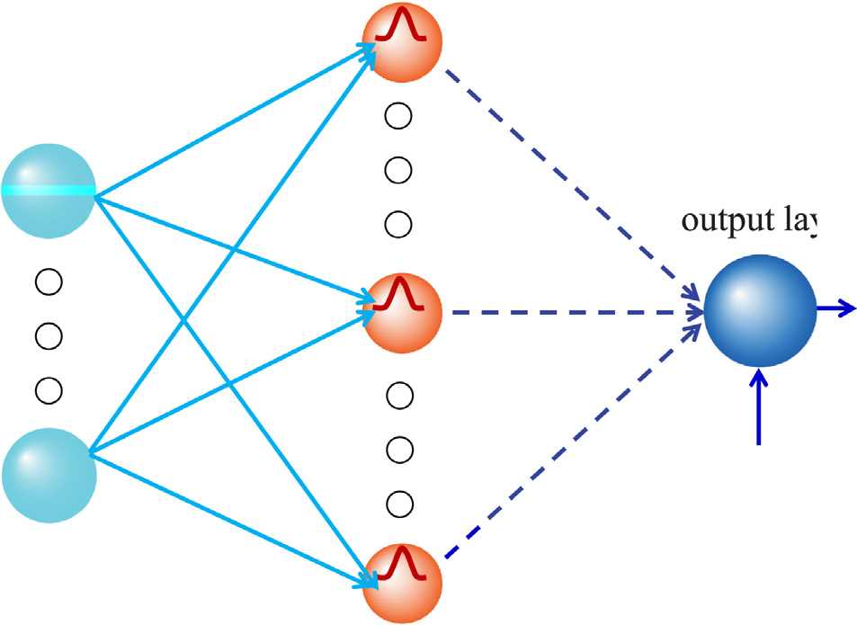
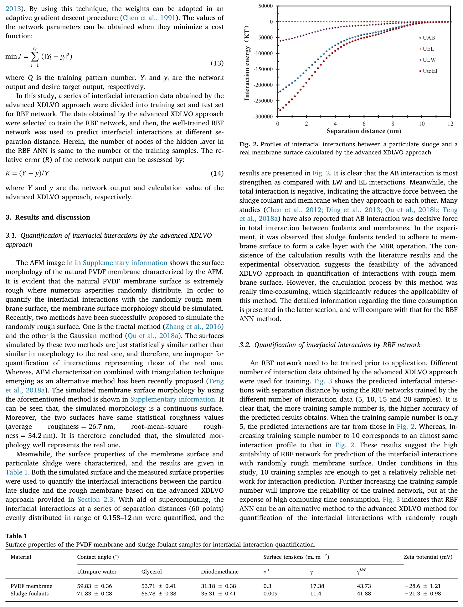
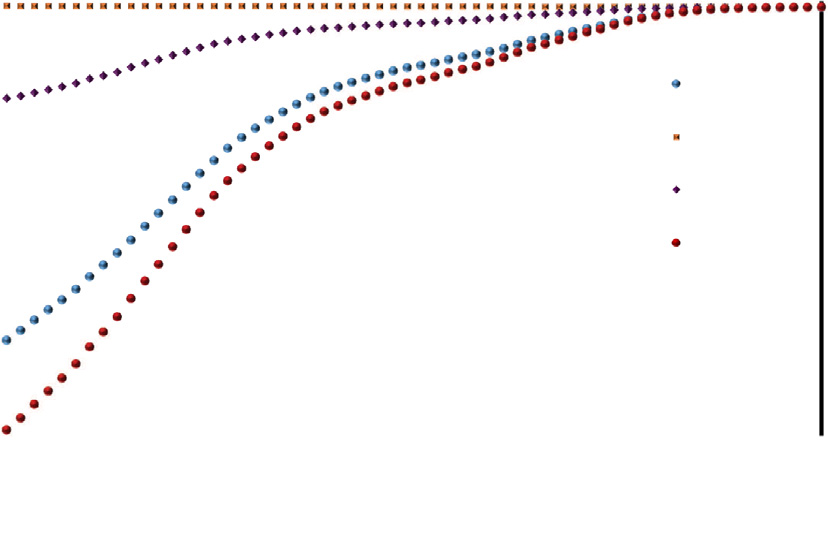
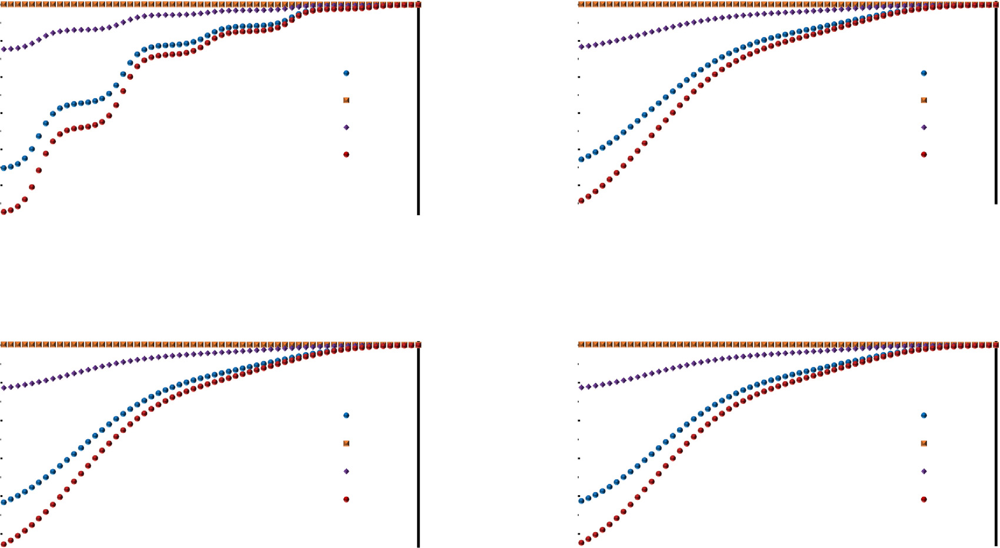
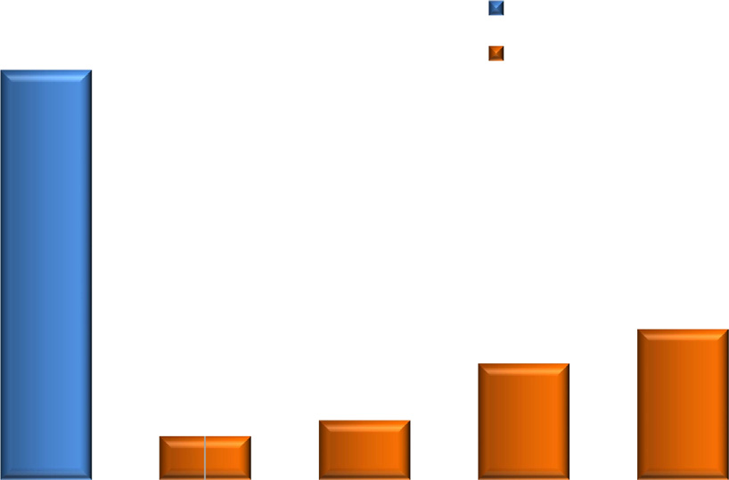
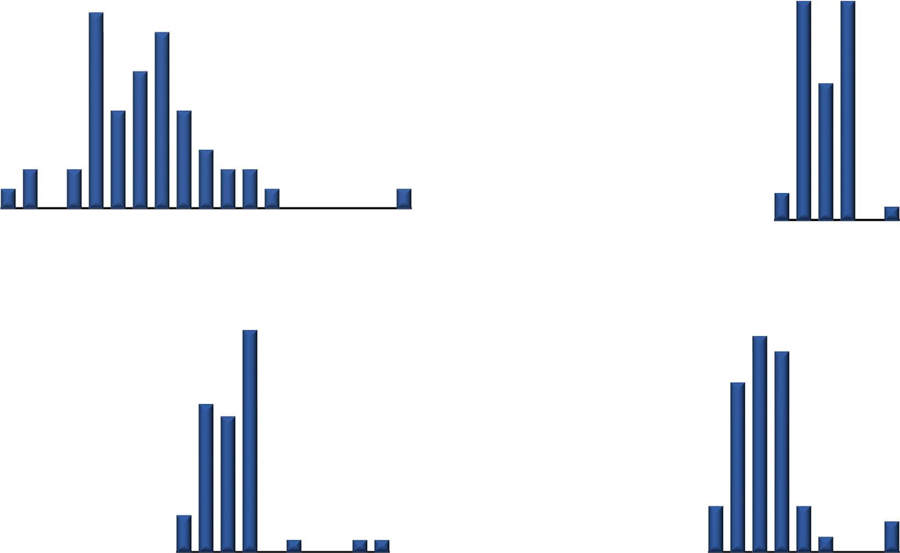

# Prediction of interfacial interactions related with membrane fouling in a membrane bioreactor based on radial basis function artificial neural network (ANN)

## Abstract

* **Bối cảnh và mục tiêu nghiên cứu**:
  * Việc định lượng tương tác liên bề mặt (interfacial interactions) giữ vai trò đặc biệt quan trọng do tương tác này trực tiếp quyết định khả năng bám dính của chất gây nghẹt (foulant adhesion) và toàn bộ tiến trình tắc nghẽn màng trong các bể phản ứng sinh học màng ($MBR$ - Membrane Bioreactors).
  * Nghiên cứu này phát triển mô hình mạng nơ-ron nhân tạo hàm cơ sở hướng tâm ($RBF\text{ }ANN$ - Radial Basis Function Artificial Neural Network) nhằm mục đích dự đoán các tương tác liên bề mặt trên bề mặt màng có độ nhám ngẫu nhiên (randomly rough membrane surface).

* **Phương pháp luận và bộ dữ liệu huấn luyện**:
  * Dữ liệu tương tác liên bề mặt được định lượng từ phương pháp tiếp cận $XDLVO$ mở rộng nâng cao (advanced extended Derjaguin–Landau–Verwey–Overbeek approach) được sử dụng làm tập mẫu huấn luyện ($training\text{ }samples$) cho các mạng $RBF$.
  * Mô hình kết hợp nền tảng lý thuyết tương tác bề mặt keo tụ $XDLVO$ với kỹ thuật học máy để mô phỏng hình học bề mặt gồ ghề bất quy tắc.

* **Hiệu quả tính toán và kết quả định lượng**:
  * Thời gian tiêu tốn cho tính toán ($computing\text{ }time\text{ }consumption$) đối với dự đoán bằng mạng $RBF$ chỉ bằng khoảng $1/50$ so với thời gian tính toán bằng phương pháp $XDLVO$ nâng cao trong cùng điều kiện khảo sát.
  * Tỉ lệ thời gian $1/50$ minh chứng cho hiệu suất vượt trội ($high\text{ }efficiency$) của phương pháp $RBF\text{ }ANN$, giải quyết điểm nghẽn về chi phí tính toán lớn của phương pháp số học cổ điển.
  * Độ chính xác tính toán ($calculation\text{ }accuracy$) của phương pháp đạt ngưỡng chấp nhận được, đảm bảo độ tin cậy của các kết quả phân tích tương tác.

* **Ý nghĩa khoa học và tiềm năng ứng dụng**:
  * Nghiên cứu thể hiện bước đột phá về phương pháp luận cơ bản liên quan đến cơ chế tắc nghẽn màng lọc sinh học.
  * Phương pháp $RBF\text{ }ANN$ đề xuất mở ra triển vọng ứng dụng rộng lớn trong nghiên cứu hiện tượng tắc nghẽn màng cũng như các hành vi liên bề mặt ($interface\text{ }behavior$).

## 1. Introduction

* **Bối cảnh và thách thức nghiêm trọng của hiện tượng tắc nghẽn màng trong công nghệ xử lý nước bằng bể phản ứng sinh học màng (MBR)**:
  * Công nghệ tách màng (membrane technology) đã và đang được ứng dụng rộng rãi và phổ biến trong lĩnh vực xử lý nước cấp và nước thải nhờ hiệu suất xử lý vượt trội, chất lượng nước đầu ra ổn định và dấu chân công trình nhỏ gọn.
  * Tuy nhiên, trở ngại kỹ thuật lớn nhất đối với công nghệ màng là hiện tượng tắc nghẽn màng (*membrane fouling*) (Lin et al., $2012$; Shen et al., $2019$; Zhang et al., $2017$, $2019$), làm gia tăng áp suất xuyên màng ($\text{TMP}$), suy giảm thông lượng lọc qua màng, đòi hỏi phải tiêu tốn hóa chất rửa màng và làm giảm tuổi thọ vận hành của màng lọc.
  * Hiện nay, những hiểu biết khoa học sâu sắc về cơ chế tắc nghẽn màng trong các ứng dụng xử lý nước, đặc biệt là trong các hệ thống bể phản ứng sinh học màng (Membrane Bioreactor – MBR), vẫn còn rất hạn chế và chưa đầy đủ (Lin et al., $2014\text{b}$; Meng et al., $2017$; Teng et al., $2018\text{b}$; Zhang et al., $2018$). Môi trường hỗn hợp bùn hoạt tính MBR chứa phức hợp vi sinh vật, chất ngoại bào ($\text{EPS}$), các chất hòa tan hữu cơ ($\text{SMP}$) và các ion vô cơ đa dạng, đặt ra thách thức cấp bách đòi hỏi cộng đồng nghiên cứu toàn cầu phải tiếp tục giải mã cơ chế bám bẩn.

* **Cơ chế bám dính chất gây tắc nghẽn (*foulant adhesion*): Sự chi phối quyết định của các lực tương tác bề mặt tầm ngắn so với động lực học chất lưu**:
  * Tắc nghẽn màng trong MBR về bản chất bắt nguồn từ sự bám dính ban đầu của các chất bẩn đa dạng (*foulants*) lên bề mặt màng hoặc sự phát triển và tích tụ của lớp bánh bùn/lớp chất bẩn (*foulant layer formation*) (Chen et al., $2016$, $2019$; Wang et al., $2014$; Zhang et al., $2013$).
  * MBR tạo ra một môi trường tương tác vô cùng phức tạp giữa các yếu tố thủy động học và hóa lý giao diện:
    * Lực thủy động lực học (*hydrodynamic forces*) sinh ra từ dòng sục khí bọt khí (*aeration*), khuấy trộn cơ học (*stirring*) và áp suất lọc kéo qua màng (*filtration*) đóng vai trò vận chuyển các phần tử chất bẩn trong dòng khối tiến sát về phía bề mặt màng.
    * Tuy nhiên, khả năng bám dính sau cùng của chất bẩn lên bề mặt màng hay bị cuốn trôi ngược lại vào pha lỏng không do lực thủy động quyết định đơn thuần, mà bị chi phối quyết định bởi các lực tương tác bề mặt tầm ngắn (*short-range interfacial interactions*) giữa các nhóm chức bề mặt của chất bẩn và bề mặt màng (Chen et al., $2012$, $2015$; Hoek và Agarwal, $2006$; Wang et al., $2013$).
  * Do đó, việc định lượng hóa chính xác các tương tác bề mặt này đóng vai trò then chốt hàng đầu để thấu hiểu và kiểm soát hiện tượng tắc nghẽn màng.

* **Lý thuyết XDLVO cổ điển và hạn chế cốt tử đối với bề mặt màng có độ nhám tự nhiên**:
  * Nhằm định lượng hóa các tương tác giao diện này, lý thuyết Derjaguin–Landau–Verwey–Overbeek mở rộng (*extended DLVO* – $\text{XDLVO}$) đã được đề xuất và áp dụng rộng rãi (van Oss, $1995$; Hoek và Agarwal, $2006$; Ding et al., $2013$; Chen et al., $2017$). Lý thuyết $\text{XDLVO}$ phân tách tổng tương tác thành $3$ thành phần lực cơ bản:
    * Tương tác tán xạ Lifshitz-van der Waals ($\Delta G^{\text{LW}}$);
    * Tương tác tĩnh điện lớp điện kép ($\Delta G^{\text{EL}}$);
    * Tương tác phân cực axit-bazơ Lewis ($\Delta G^{\text{AB}}$) phản ánh tính ưa/kỵ nước bề mặt.
  * Hạn chế lớn nhất của lý thuyết $\text{XDLVO}$ truyền thống nằm ở việc mô hình hóa dựa trên giả định lý tưởng hóa bề mặt phẳng nhẵn hoàn hảo (*idealized smooth surfaces*) hoặc các xấp xỉ hình học đơn giản như bề mặt fractal hay phân bố nhám Gauss (Azeredo et al., $1999$; Hoek và Agarwal, $2006$; Shen et al., $2015$).
  * Trái lại, trong thực tế ứng dụng xử lý nước, hầu như toàn bộ các màng lọc polyme đều có bề mặt gồ ghề nhấp nhô tự nhiên (*naturally rough surfaces*) (Brant và Childress, $2002$; Hoek và Agarwal, $2006$; Wang et al., $2013$; Zhang et al., $2016$). Độ nhám cục bộ làm biến đổi sâu sắc phân bố trường lực và năng lượng tương tác giao diện so với mô hình phẳng nhẵn lý tưởng.
  * Sự mâu thuẫn giữa giả định lý thuyết và thực tiễn hình thái màng đòi hỏi phải phát triển lý thuyết $\text{XDLVO}$ để có thể áp dụng chuẩn xác cho các bề mặt nhám gồ ghề ngẫu nhiên.

* **Phương pháp XDLVO nâng cao (*advanced XDLVO approach*): Tích hợp AFM và tích phân phần tử bề mặt (SEI) cùng rào cản tính toán cực lớn**:
  * Các nỗ lực nghiên cứu đột phá gần đây (Hoek và Agarwal, $2006$; Chen et al., $2012$) đã đề xuất phương pháp $\text{XDLVO}$ nâng cao thông qua việc tích hợp hình học vi phân (*differential geometry*) và kỹ thuật tính toán số vào lý thuyết $\text{XDLVO}$.
  * Phương pháp này kết hợp bản đồ độ cao thực tế thu được từ kính hiển vi lực nguyên tử (Atomic Force Microscopy – $\text{AFM}$) với kỹ thuật tích phân phần tử bề mặt (Surface Element Integration – $\text{SEI}$), cho phép mô phỏng địa hình gồ ghề ngẫu nhiên và tính toán chính xác tương tác năng lượng giữa hai bề mặt có hình thái hình học tùy ý bất kỳ trong không gian $3$ chiều ($x, y, z$).
  * Sự ra đời của $\text{SEI}$-$\text{XDLVO}$ nâng cao đã mở rộng đáng kể lý thuyết giao diện và đem lại những góc nhìn khoa học mới mẻ về hành vi tắc nghẽn màng.
  * Tuy nhiên, phương pháp $\text{XDLVO}$ nâng cao gặp phải một rào cản kỹ thuật nghiêm trọng: **chi phí thời gian tính toán khổng lồ (*excessively computational time consumption*)**.
    * Việc giải các tích phân phần tử bề mặt hai lớp (thường là các tích phân kép Simpson – *double Simpson integrals*) trên ma trận lưới phần tử $\text{AFM}$ dày đặc tại một khoảng cách phân cách $d$ nhất định thường tiêu tốn đến vài giờ đồng hồ ($3\text{--}5\text{ giờ}$) chạy liên tục trên một trạm máy tính hiệu năng cao (*workstation*) (Teng et al., $2018\text{a}$, $2019$).
    * Do đó, để dựng nên một đường cong hoàn chỉnh biểu diễn phân bố tương tác bề mặt trên toàn bộ dải khoảng cách phân cách ngắn từ $0{,}158\text{ nm}$ đến $10\text{ nm}$, thời gian tính toán đòi hỏi là quá lớn (lên tới hàng trăm giờ CPU), trở thành nút thắt cổ chai cản trở việc ứng dụng thực tế và dự đoán nhanh chóng của phương pháp $\text{XDLVO}$ nâng cao, buộc các nhà khoa học phải tìm kiếm giải pháp tính toán thay thế.

* **Động lực áp dụng mạng nơ-ron nhân tạo RBF (RBF ANN) như một bộ xấp xỉ vạn năng hiệu năng cao**:
  * Nguyên nhân gốc rễ dẫn đến sự bùng nổ thời gian tính toán trong phương pháp $\text{XDLVO}$ nâng cao bắt nguồn từ các mối quan hệ phi tuyến tính cực kỳ phức tạp giữa địa hình bề mặt vi mô (*surface topography*) và lực tương tác liên bề mặt (Cai et al., $2017\text{a}$; Teng et al., $2018\text{a}$; Zhao et al., $2015$).
  * Mạng nơ-ron nhân tạo (Artificial Neural Networks – $\text{ANN}$) là một công cụ thống kê và học máy mạnh mẽ lấy cảm hứng từ cấu trúc mạng thần kinh của não bộ con người (Iliyas et al., $2013$). Cấu trúc mạng trong $\text{ANN}$ có khả năng tự thích ứng và tự học (*self-learning*), cho phép tìm ra lời giải xấp xỉ tối ưu và chính xác nhất cho các mối quan hệ phi tuyến đa biến phức tạp (Curcio et al., $2006$; Dreiseitl và Ohno-Machado, $2002$; Iliyas et al., $2013$; Sun et al., $2018$).
  * Trong những năm gần đây, $\text{ANN}$ đã được ứng dụng rất thành công trong nhiều khía cạnh của công nghệ màng:
    * Kiểm soát quy trình siêu lọc ($\text{UF}$) và vi lọc ($\text{MF}$) (Basheer và Hajmeer, $2000$; Madaeni et al., $2010$);
    * Dự đoán hiệu suất lọc và độ suy giảm thông lượng của quá trình $\text{UF}$/$\text{MF}$ (Curcio et al., $2006$; Chew et al., $2018$);
    * Thiết lập mối tương quan giữa các yếu tố vận hành với hiện tượng tắc nghẽn màng (Corbatón-Báguena et al., $2016$);
    * Tối ưu hóa các thông số chế tạo màng polyme (Schmitt et al., $2018$).
  * Từ những tiền đề vững chắc đó, một giả thuyết khoa học quan trọng được đặt ra: $\text{ANN}$ có thể mô tả hoàn hảo mối quan hệ phi tuyến phức tạp giữa các đặc tính hóa lý bề mặt, hình thái độ nhám và các lực tương tác liên bề mặt trong quá trình bám dính chất bẩn.
  * Đặc biệt, mô hình mạng nơ-ron cơ sở bán kính (Radial Basis Function – $\text{RBF}$ $\text{ANN}$) có ưu thế vượt trội:
    * Đóng vai trò như một bộ xấp xỉ hàm vạn năng (*universal approximator*) có khả năng ánh xạ phi tuyến chính xác cao;
    * Tốc độ huấn luyện siêu nhanh, cấu trúc tầng ẩn dựa trên hàm kích hoạt cơ sở bán kính Gauss không đòi hỏi lặp lan truyền ngược gradient nhiều tầng phức tạp, giúp tránh được hoàn toàn nguy cơ rơi vào bẫy cực tiểu cục bộ (*local minima traps*) mà các mạng truyền thẳng nhiều tầng truyền thống ($\text{BP}$-$\text{ANN}$) thường gặp phải.
  * Một mạng $\text{ANN}$ sau khi được huấn luyện hoàn chỉnh có thể xuất trực tiếp kết quả năng lượng tương tác chỉ trong vài mili-giây, qua đó cắt giảm triệt để gánh nặng tính toán đồ sộ của phép tích phân số $\text{SEI}$.
  * Trước nghiên cứu này, chưa có bất kỳ công bố khoa học nào về việc khai thác và ứng dụng $\text{ANN}$ để dự đoán các tương tác liên bề mặt liên quan đến hiện tượng tắc nghẽn màng.

* **Mục tiêu nghiên cứu cốt lõi của bài báo (*Paper Objectives*)**:
  * Phát triển một mô hình mạng nơ-ron nhân tạo $\text{RBF}$ $\text{ANN}$ để dự đoán chính xác, tức thời và hiệu quả năng lượng tương tác liên bề mặt với bề mặt màng gồ ghề trong toàn bộ dải khoảng cách phân cách tầm ngắn từ $0{,}158\text{ nm}$ đến $10\text{ nm}$.
  * Sử dụng các mẫu chất gây tắc nghẽn bùn hoạt tính (*sludge foulants*) và màng phẳng poly(vinylidene fluoride) ($\text{PVDF}$) lấy trực tiếp từ hệ thống $\text{MBR}$ thực nghiệm để phục vụ tính toán và kiểm chứng.
  * Đặc trưng hóa toàn diện các đặc tính bề mặt của bùn và màng ($\text{PVDF}$), bao gồm thế zeta bề mặt, các thành phần năng lượng tự do bề mặt thông qua phép đo góc tiếp xúc, và cấu trúc độ nhám hình thái học bằng ảnh $\text{AFM}$.
  * Thiết lập cấu trúc và huấn luyện mạng $\text{RBF}$ $\text{ANN}$ để tính toán năng lượng tương tác giao diện dựa trên các thông số đầu vào gồm đặc tính bề mặt và khoảng cách phân cách $d$.
  * Minh chứng các lợi thế vượt trội của phương pháp $\text{RBF}$ $\text{ANN}$ thông qua việc so sánh đối chứng toàn diện với phương pháp tích phân số $\text{XDLVO}$ nâng cao về cả độ chính xác dự báo lẫn khả năng tiết kiệm thời gian tính toán.

## 2. Materials and methods

### 2.1. Preparation of samples

* **Mô hình hệ thống màng MBR quy mô phòng thí nghiệm (Lab-scale MBR):**
  * Sơ đồ nguyên lý của hệ thống MBR quy mô phòng thí nghiệm sử dụng trong nghiên cứu được trình bày chi tiết trong phần Thông tin bổ sung (Supplementary Information).
  * Hệ thống MBR cấu thành chủ yếu từ hai bộ phận chính:
    * Khối huyền phù bùn hoạt tính (sludge suspension).
    * Cụm module màng lọc (membrane unit).
  * Cụm module màng bao gồm $4$ phần tử màng phẳng (flat-sheet) chế tạo từ vật liệu Poly(vinylidene fluoride) (PVDF) do hãng SINAP Co. Ltd. (Thượng Hải, Trung Quốc) cung cấp.
  * Kích thước lỗ màng chuẩn hóa (normalized pore size) đạt $0{,}10\ \mu\text{m}$.

* **Lấy mẫu và tiền xử lý chất gây nghẹt bùn dạng hạt (Particulate sludge foulants):**
  * Bùn dạng hạt (particulate sludge) được tách/lấy mẫu từ huyền phù bùn trong giai đoạn vận hành ổn định (steady operation stage) của MBR, đóng vai trò là chất gây nghẹt màng điển hình.
  * Quy trình chuẩn bị mẫu chất gây nghẹt phục vụ các phép đo góc tiếp xúc (contact angle measurements):
    * Lọc huyền phù bùn để hình thành một lớp bánh bùn (cake layer) đồng nhất.
    * Kẹp và cố định chặt lớp bánh bùn giữa $2$ phiến kính phẳng (glass slides) nhằm định hình và duy trì bề mặt phẳng mịn.
    * Làm khô mẫu trong bình hút ẩm (desiccator) ở nhiệt độ $40\ ^\circ\text{C}$ liên tục trong $24\ \text{h}$.

* **Quy trình chuẩn bị mẫu màng phục vụ đo góc tiếp xúc:**
  * Các mẫu màng lọc PVDF (membrane samples) phục vụ cho các phép đo góc tiếp xúc bề mặt cũng được chuẩn bị theo quy trình xử lý và làm khô tương tự nhằm đảm bảo tính nhất quán về điều kiện thực nghiệm.

### 2.2. Analytical methods

* **Đo góc tiếp xúc và tính toán các thành phần sức căng bề mặt (Contact Angle Goniometry & Surface Tension Components):**
  * Góc tiếp xúc của $3$ chất lỏng dò (probe liquids) trên bề mặt lớp bánh bùn (sludge layer) và bề mặt màng lọc PVDF (membrane surface) được xác định bằng thiết bị đo góc tiếp xúc (contact angle meter, Kino, USA) theo phương pháp giọt nằm (dropping / sessile drop method).
  * Bộ ba chất lỏng dò thực nghiệm bao gồm:
    * Nước siêu tinh khiết (ultrapure water).
    * Glycerol.
    * Diiodomethane ($\text{CH}_2\text{I}_2$).
  * Các thành phần sức căng bề mặt (surface tension components) được tính toán theo phương pháp tiếp cận Van Oss-Chaudhury-Good (Van Oss-Chaudhury-Good approach):
    * Thành phần tương tác không phân cực Lifshitz-van der Waals ($\gamma^{\text{LW}}$).
    * Thành phần tương tác cực acid-base Lewis ($\gamma^{\text{AB}}$), được xác định thông qua cấu tử cho điện tử ($\gamma^-$) và cấu tử nhận điện tử ($\gamma^+$) theo công thức $\gamma^{\text{AB}} = 2\sqrt{\gamma^+\gamma^-}$.
    * Tổng năng lượng tự do bề mặt được biểu diễn dưới dạng $\gamma^{\text{TOT}} = \gamma^{\text{LW}} + \gamma^{\text{AB}}$, đóng vai trò làm thông số đầu vào để định lượng năng lượng tương tác bề mặt XDLVO.

* **Phân tích điện thế zeta bề mặt (Zeta Potential Measurements):**
  * Điện thế zeta bề mặt của bùn dạng hạt (particulate sludge) trong huyền phù bùn được đo bằng thiết bị Malvern Zetasizer Nano ZS (Malvern Instruments, Anh Quốc), ghi nhận giá trị $-21{,}3\text{ mV}$.
  * Trái lại, điện thế zeta của bề mặt màng lọc PVDF được xác định bằng máy phân tích kích thước hạt và điện thế zeta NanoBrook 90Plus Zeta (NanoBrook 90Plus Zeta Particle Size Analyzer, Brookhaven Instruments, USA), ghi nhận giá trị $-28{,}6\text{ mV}$.
  * Cả hai bề mặt bùn hạt và màng PVDF đều tích điện âm, tạo lực đẩy tĩnh điện hai lớp (electrostatic double layer repulsion) cản trở một phần sự bám dính trực tiếp của bông bùn lên bề mặt màng.

* **Phân tích hình thái và độ nhám bề mặt bằng kính hiển vi lực nguyên tử (AFM Analysis):**
  * Ảnh địa hình bề mặt của màng PVDF nguyên bản (original PVDF membrane surface) được ghi nhận bằng kính hiển vi lực nguyên tử (Atomic Force Microscopy - AFM, NT-MDT Solver Nano, USA).
  * Phép đo thực hiện ở chế độ gõ (tapping mode scanning) với vùng quét có diện tích $5 \times 5\ \mu\text{m}^2$ và độ phân giải $256 \times 256\ \text{pixels}$.
  * Chiều cao thống kê và độ nhám bề mặt từ dữ liệu ảnh AFM được tính toán xử lý thông qua phần mềm chuyên dụng NanoScope Analysis (phiên bản V1.80):
    * Độ nhám trung bình số học (mean roughness): $R_a = 26{,}7\text{ nm}$.
    * Độ nhám căn quân phương (root mean square roughness - RMS roughness): $R_q = 34{,}2\text{ nm}$.
  * Các thông số độ nhám phản ánh cấu trúc địa hình vi mô gồ ghề của màng, ảnh hưởng trực tiếp đến diện tích tiếp xúc hiệu dụng và động học lắng đọng chất gây nghẹt trên bề mặt màng lọc.

### 2.3. Quantification of interfacial interactions by the advanced XDLVO approach

* **Cơ sở lý thuyết XDLVO nâng cao và kỹ thuật tích phân phần tử bề mặt (Surface Element Integration - SEI):**
  * Trong các hệ thống màng lọc sinh học (MBR), hiện tượng bám bẩn màng được chi phối trực tiếp bởi các tương tác nhiệt động lực học liên bề mặt giữa các tác nhân gây nghẹt (hạt bùn hoạt tính, chất cao phân tử ngoại bào) và bề mặt màng phân tách.
  * Phương pháp XDLVO cổ điển giả định bề mặt màng và hạt chất bẩn là các mặt phẳng lý tưởng hoặc hình cầu trơn nhẵn hoàn hảo. Tuy nhiên, bề mặt màng thực tế luôn sở hữu độ nhám ngẫu nhiên (random roughness) với các mấp mô cấu trúc vi mô, làm thay đổi đáng kể phân bố khoảng cách cục bộ và phân bố lực tương tác so với mô hình hình học phẳng.
  * Để định lượng chính xác năng lượng tương tác giữa hạt bùn dạng hạt (particulate sludge) và bề mặt màng nhám ngẫu nhiên mô phỏng, kỹ thuật tích phân phần tử bề mặt (Surface Element Integration - SEI) được áp dụng toàn diện kết hợp với dữ liệu cấu trúc địa hình bề mặt thu nhận từ kính hiển vi lực nguyên tử (AFM).
  * Tổng năng lượng tương tác liên bề mặt $U^{\text{TOT}}(h)$ tại khoảng cách phân tách tiếp cận $h$ được cấu thành từ ba thành phần tương tác nhiệt động độc lập:
    $$U^{\text{TOT}}(h) = U^{\text{LW}}(h) + U^{\text{EL}}(h) + U^{\text{AB}}(h)$$
    trong đó $U^{\text{LW}}(h)$ là tương tác tán xạ Lifshitz–van der Waals, $U^{\text{EL}}(h)$ là tương tác lớp điện kép tĩnh điện (electrostatic double layer), và $U^{\text{AB}}(h)$ là tương tác axit–bazơ Lewis (acid–base / hydrophobic interaction).
  * Theo nguyên lý của kỹ thuật SEI, bề mặt hạt bùn hoạt tính (mô hình hóa dưới dạng hình cầu bán kính $R$) được chia thành các phần tử diện tích vi phân dạng vành khuyên đồng tâm. Năng lượng tương tác tích phân $U(h)$ giữa toàn bộ hạt bùn và màng nhám được xác định thông qua phép tích phân hai lớp trên toàn bộ miền tiếp xúc của hạt:
    $$U(h) = \iint_{\text{particulate}} \Delta G(h') \, r \, \mathrm{d}r \, \mathrm{d}\theta$$
    trong đó:
    * $r$ là bán kính của vành khuyên vi phân trên bề mặt hạt bùn hoạt tính (circular ring radius).
    * $\mathrm{d}r$ là vi phân bán kính vành khuyên (differential circular ring radius).
    * $\mathrm{d}\theta$ là góc vi phân tương ứng với cung tròn vi phân cấu thành vành khuyên (differential angle of the circular arc).
    * $h'$ là khoảng cách phân tách cục bộ từ phần tử vi phân của hạt đến bề mặt màng nhám tương ứng.
    * $\Delta G(h')$ là mật độ năng lượng tương tác đơn lẻ trên một đơn vị diện tích (energy per unit area) tại khoảng cách phân tách $h'$.

* **Các phương trình vi phân mật độ năng lượng tương tác liên bề mặt ($\Delta G(h)$):**
  * Theo lý thuyết XDLVO, ba thành phần mật độ năng lượng tương tác vi phân trên đơn vị diện tích phụ thuộc vào khoảng cách phân tách cục bộ $h$ được mô tả bằng các phương trình giải tích sau:
    1. **Tương tác axit–bazơ Lewis ($\Delta G^{\text{AB}}(h)$):**
       * Tương tác $\text{AB}$ suy giảm theo hàm mũ theo khoảng cách phân ly:
         $$\Delta G^{\text{AB}}(h) = \Delta G_{h_0}^{\text{AB}} \exp\left( \frac{h_0 - h}{\lambda} \right)$$
         trong đó $h_0$ là khoảng cách phân tách tiếp xúc cực tiểu tại trạng thái cân bằng cơ học ($h_0 = 0{,}158\text{ nm}$), bắt nguồn từ giới hạn khoảng cách phân tử tối thiểu ngăn cản hai bề mặt rắn chồng lấn vô hạn vào nhau; $\lambda$ là độ dài phân rã đặc trưng của tương tác axit–bazơ trong môi trường nước (decay length of AB interaction, được thiết lập chuẩn hóa bằng $\lambda = 0{,}60\text{ nm}$).
    2. **Tương tác tán xạ Lifshitz–van der Waals ($\Delta G^{\text{LW}}(h)$):**
       * Tương tác $\text{LW}$ suy giảm theo quy luật nghịch đảo bình phương khoảng cách giữa hai phần tử phẳng vi phân:
         $$\Delta G^{\text{LW}}(h) = \Delta G_{h_0}^{\text{LW}} \left( \frac{h_0^2}{h^2} \right)$$
    3. **Tương tác lớp điện kép tĩnh điện ($\Delta G^{\text{EL}}(h)$):**
       * Dựa trên phép xấp xỉ tuyến tính hóa phương trình Poisson–Boltzmann đối với điện thế bề mặt bất đối xứng giữa màng và hạt bẩn:
         $$\Delta G^{\text{EL}}(h) = \kappa \zeta_{\text{m}} \zeta_{\text{f}} \epsilon_r \epsilon_0 \left[ \frac{\zeta_{\text{m}}^2 + \zeta_{\text{f}}^2}{2 \zeta_{\text{m}} \zeta_{\text{f}}} \left( 1 - \coth(\kappa h) \right) + \frac{1}{\sinh(\kappa h)} \right]$$
         hoặc được biểu diễn tương đương qua hàm cosecant hyperbolic $\operatorname{csch}(\kappa h) = \frac{1}{\sinh(\kappa h)}$:
         $$\Delta G^{\text{EL}}(h) = \frac{\epsilon_r \epsilon_0 \kappa}{2} \left[ \left(\zeta_{\text{m}}^2 + \zeta_{\text{f}}^2\right) \left( 1 - \coth(\kappa h) \right) + 2 \zeta_{\text{m}} \zeta_{\text{f}} \operatorname{csch}(\kappa h) \right]$$
         trong đó $\kappa$ là nghịch đảo của độ dài sàng lọc Debye ($\kappa^{-1}$ biểu thị Debye screening length đặc trưng cho bề dày lớp điện kép trong dung dịch); $\zeta_{\text{m}}$ và $\zeta_{\text{f}}$ lần lượt là thế zeta (zeta potential) của bề mặt màng (chỉ số dưới $\text{m}$) và hạt chất gây nghẹt bùn hoạt tính (chỉ số dưới $\text{f}$); $\epsilon_r$ là hằng số điện môi tương đối của dung dịch nước và $\epsilon_0$ là độ điện thẩm chân không ($\epsilon_0 \approx 8{,}854 \times 10^{-12}\text{ F/m}$), với tích số $\epsilon_r \epsilon_0$ thể hiện độ điện thẩm tuyệt đối của môi trường chất lỏng (solution permittivity).

* **Xác định các thành phần năng lượng tương tác tại khoảng cách cân bằng cực tiểu ($h_0$):**
  * Tại khoảng cách tiếp xúc cân bằng cực tiểu $h_0 = 0{,}158\text{ nm}$, các hệ số năng lượng tương tác tiếp xúc $\Delta G_{h_0}^{\text{AB}}$, $\Delta G_{h_0}^{\text{LW}}$, và $\Delta G_{h_0}^{\text{EL}}$ được tính toán từ sức căng bề mặt thành phần của các pha tiếp xúc: pha màng ($\text{m}$), pha hạt bẩn ($\text{f}$), và pha môi trường nước ($\text{w}$):
    1. **Năng lượng tiếp xúc axit–bazơ ($\Delta G_{h_0}^{\text{AB}}$):**
       $$\Delta G_{h_0}^{\text{AB}} = 2 \left[ \sqrt{\gamma_{\text{w}}^{+}} \left( \sqrt{\gamma_{\text{m}}^{-}} + \sqrt{\gamma_{\text{f}}^{-}} - \sqrt{\gamma_{\text{w}}^{-}} \right) + \sqrt{\gamma_{\text{w}}^{-}} \left( \sqrt{\gamma_{\text{m}}^{+}} + \sqrt{\gamma_{\text{f}}^{+}} - \sqrt{\gamma_{\text{w}}^{+}} \right) - \sqrt{\gamma_{\text{m}}^{+} \gamma_{\text{f}}^{-}} - \sqrt{\gamma_{\text{m}}^{-} \gamma_{\text{f}}^{+}} \right]$$
       trong đó $\gamma^{+}$ và $\gamma^{-}$ lần lượt là thành phần sức căng bề mặt nhận electron (electron-acceptor) và cho electron (electron-donor) theo lý thuyết van Oss–Chaudhury–Good.
    2. **Năng lượng tiếp xúc tán xạ Lifshitz–van der Waals ($\Delta G_{h_0}^{\text{LW}}$):**
       $$\Delta G_{h_0}^{\text{LW}} = -2 \left( \sqrt{\gamma_{\text{m}}^{\text{LW}}} - \sqrt{\gamma_{\text{w}}^{\text{LW}}} \right) \left( \sqrt{\gamma_{\text{f}}^{\text{LW}}} - \sqrt{\gamma_{\text{w}}^{\text{LW}}} \right)$$
       trong đó $\gamma^{\text{LW}}$ là thành phần lực căng bề mặt vô hướng Lifshitz–van der Waals.
    3. **Năng lượng tiếp xúc tĩnh điện ($\Delta G_{h_0}^{\text{EL}}$):**
       $$\Delta G_{h_0}^{\text{EL}} = \frac{\epsilon_r \epsilon_0 \kappa}{2} \left[ \left(\zeta_{\text{f}}^2 + \zeta_{\text{m}}^2\right) \left( 1 - \coth(\kappa h_0) \right) + 2 \zeta_{\text{f}} \zeta_{\text{m}} \operatorname{csch}(\kappa h_0) \right]$$
  * Để thu nhận các tham số thành phần sức căng bề mặt ($\gamma_s^{\text{LW}}$, $\gamma_s^{+}$, $\gamma_s^{-}$) của từng mẫu rắn (ký hiệu $s$, đại diện cho màng hoặc bùn hoạt tính), phương trình Young mở rộng được thiết lập và giải đồng thời cho bộ ba chất lỏng chuẩn đo góc tiếp xúc (ký hiệu $l$):
    $$(1 + \cos\phi) \gamma_l^{\text{Tot}} = 2 \left( \sqrt{\gamma_s^{\text{LW}} \gamma_l^{\text{LW}}} + \sqrt{\gamma_s^{+} \gamma_l^{-}} + \sqrt{\gamma_s^{-} \gamma_l^{+}} \right)$$
    trong đó $\phi$ là góc tiếp xúc cân bằng đo được của chất lỏng thử nghiệm $l$ trên bề mặt chất rắn $s$, và $\gamma_l^{\text{Tot}} = \gamma_l^{\text{LW}} + 2\sqrt{\gamma_l^{+} \gamma_l^{-}}$ là tổng năng lượng bề mặt tự do của chất lỏng thăm dò.

* **Mô hình hóa hình học bề mặt màng nhám từ dữ liệu AFM và quan hệ khoảng cách không gian:**
  * Cấu trúc vi địa hình ngẫu nhiên của bề mặt màng được tái lập chính xác từ ma trận dữ liệu phân tích kính hiển vi lực nguyên tử (AFM) kết hợp với kỹ thuật phân chia lưới tam giác (triangulation technique), tạo nên một bề mặt đa diện liên tục gồm các mặt tam giác phẳng vi mô.
  * Dựa trên quan hệ hình học không gian giữa hạt bùn hình cầu (bán kính $R$) và bề mặt màng nhám gồ ghề, khoảng cách phân tách cục bộ $h$ từ một cung tròn vi phân trên hạt bùn đến bề mặt phẳng tham chiếu ngang của màng được thiết lập theo phương trình:
    $$h = R + D - \sqrt{R^2 - r^2} - z + z_{\max}$$
    trong đó:
    * $R$ là bán kính hình học của hạt bùn hoạt tính (particulate sludge radius).
    * $D$ là khoảng cách tiếp cận gần nhất từ đáy hạt bùn tới mặt phẳng ngang tham chiếu của màng (closest distance from the particulate sludge to the membrane planar surface).
    * $z_{\max}$ là giá trị độ cao đỉnh lớn nhất của các mấp mô trên bề mặt màng thu nhận từ ảnh AFM.
    * $z$ là độ cao cục bộ tại một điểm khảo sát $P(x, y, z)$ tương ứng trên bề mặt màng nhám.
  * Tọa độ độ cao $z$ của điểm $P$ nằm trên một mặt tam giác cục bộ (được xác định bởi ba đỉnh $P_1(x_1, y_1, z_1)$, $P_2(x_2, y_2, z_2)$, và $P_3(x_3, y_3, z_3)$ từ lưới AFM) được tính toán chính xác thông qua phương trình pháp tuyến mặt phẳng:
    $$\mathbf{n}(P_1, P_2, P_3) \cdot \vec{P_1 P} = (n_x, n_y, n_z) \cdot (x - x_1, y - y_1, z - z_1) = 0$$
    trong đó $\mathbf{n}(P_1, P_2, P_3) = \vec{P_1 P_2} \times \vec{P_1 P_3}$ là vectơ pháp tuyến đơn vị vuông góc với diện tích tam giác vi phân. Từ phương trình tích vô hướng bằng $0$, tọa độ độ cao $z$ được giải tường minh:
    $$z = z_1 - \frac{n_x (x - x_1) + n_y (y - y_1)}{n_z}$$

* **Thuật toán tích phân số Simpson kép và cấu hình tính toán mô phỏng:**
  * Việc thay thế các biểu thức năng lượng vi phân $\Delta G^{\text{AB}}(h)$, $\Delta G^{\text{LW}}(h)$, $\Delta G^{\text{EL}}(h)$ cùng quan hệ khoảng cách hình học phức tạp vào phương trình tích phân SEI tạo nên một hệ tích phân kép phi tuyến không có nghiệm giải tích giải trực tiếp.
  * Để giải quyết bài toán, thuật toán tích phân số Simpson phức hợp hai chiều (composite double Simpson's numerical integration rule) được triển khai:
    * Miền tích phân trên bề mặt tiếp xúc được chia lưới mịn thành $2000$ phần tử diện tích vi phân ($2000$ elements) nhằm đảm bảo sự hội tụ số học và triệt tiêu sai số làm tròn hình học.
    * Quá trình quét tương tác được thực hiện đối với khoảng cách phân tách $h$ biến thiên từ khoảng cách cân bằng cực tiểu $h_0 = 0{,}158\text{ nm}$ đến $12\text{ nm}$, được rời rạc hóa thành $60$ điểm phân tách độc lập ($60$ discrete points).
    * Toàn bộ thuật toán mô phỏng và xử lý số liệu được lập trình và vận hành trên nền tảng phần mềm MATLAB (phiên bản 2017b), chạy trên hệ thống máy trạm hiệu năng cao (HP Z8 G4 workstation) nhằm đáp ứng khối lượng tính toán khổng lồ (supercomputing workload).
  * Việc tích hợp mô hình màng nhám ngẫu nhiên vào kỹ thuật SEI đã nâng cấp căn bản năng lực dự báo của lý thuyết XDLVO truyền thống, tạo thành phương pháp XDLVO nâng cao (advanced XDLVO approach). Phương pháp này cho phép định lượng chính xác hàng rào năng lượng tương tác (energy barrier), thế năng tương tác hút dính, và cơ chế bám bẩn vi mô giữa hạt bùn và màng lọc trong các điều kiện vận hành MBR thực tế.

### 2.4. Radial basis function (RBF) ANN

* **Khái niệm và đặc tính vượt trội của mạng nơ-ron nhân tạo hàm cơ sở xuyên tâm (Radial Basis Function Artificial Neural Network - RBF ANN):**
  * **Mô hình mạng nơ-ron nhân tạo (ANN):**
    * Mạng nơ-ron nhân tạo là một mô hình toán học phỏng sinh học mô phỏng theo cấu trúc liên kết khớp thần kinh (synaptic connections) của não bộ con người nhằm mục đích xử lý thông tin phi tuyến tính phức tạp.
    * Các ưu điểm vượt trội nổi bật của ANN trong tính toán kỹ thuật bao gồm khả năng tự học thích ứng (self-study), khả năng lưu trữ thông tin phân tán (storage), và năng lực tìm kiếm tối ưu hóa tốc độ cao (high-speed search capabilities) (Iliyas et al., 2013; Sreekanth et al., 2010).
    * Trong số các họ kiến trúc mạng nơ-ron nhân tạo, mô hình mạng truyền thẳng (feedforward neural networks) được ứng dụng rộng rãi và phổ biến nhất trong các bài toán kỹ thuật môi trường và công nghệ xử lý nước (Basheer and Hajmeer, 2000).
  * **Đặc tính ưu việt của mạng RBF ANN:**
    * Mạng nơ-ron hàm cơ sở xuyên tâm (RBF ANN) là một đại diện điển hình của mạng nơ-ron truyền thẳng, đã được chứng minh toán học là sở hữu năng lực xấp xỉ vạn năng (universal approximation ability) (Bakire et al., 2018; Dreiseitl and Ohno-Machado, 2002).
    * Khác biệt căn bản với các mạng perceptron đa tầng (MLP) truyền thống dùng thuật toán lan truyền ngược (backpropagation) vốn thường bị mắc kẹt tại các điểm cực tiểu cục bộ, RBF ANN hoàn toàn không gặp phải vấn đề bẫy cực tiểu địa phương (no local minimum problem) (Bakire et al., 2018; Dreiseitl and Ohno-Machado, 2002).
    * So với các mô hình mạng nơ-ron nhân tạo phức tạp khác, RBF ANN sở hữu cấu trúc mạng gọn gàng, đơn giản hơn (simpler structure) và thuật toán học tập hội tụ nhanh hơn vượt trội (faster learning algorithm) (Basheer and Hajmeer, 2000; Sreekanth et al., 2010).

* **Cấu trúc kiến trúc ba tầng của mô hình mạng RBF (Three-Layer Architecture of RBF Network Model):**
  * Mô hình mạng RBF điển hình sở hữu cấu trúc mạng truyền thẳng gồm ba tầng: tầng đầu vào (input layer), tầng ẩn (hidden layer) với các nơ-ron cơ sở xuyên tâm, và tầng đầu ra tuyến tính (output layer) (Fig. 1):
    * **Hình 1.** Kiến trúc mô hình mạng nơ-ron RBF ba tầng
      * 
      * **Hình này chứng minh điều gì**
        * Liên kết đầy đủ một chiều từ các nút vào tới từng nút ẩn Gauss, sau đó kết hợp tuyến tính về một nút ra duy nhất.
      * **Từ đâu mà thấy được**
        * Luồng từ trái qua phải: nút vào (lam nhạt) phát mũi tên liền đến nút ẩn (cam) chứa đồ thị Gauss, rồi đường đứt nét hội tụ về nút ra "output layer".
  * **Cơ chế truyền dẫn và xử lý tín hiệu qua ba tầng mạng:**
    * **Tầng đầu vào (Input layer):**
      * Tiếp nhận một khối lượng lớn thông tin phi tuyến tính từ môi trường thực nghiệm. Tầng này bao gồm các nút thụ động, chỉ thực hiện chức năng tiếp nhận và kết nối truyền thẳng các giá trị của vectơ biến đầu vào đến tất cả các nút của tầng kế tiếp mà không thực hiện biến đổi số học nào.
      * Trong nghiên cứu này, biến đầu vào duy nhất đưa vào mạng là khoảng cách phân tách liên bề mặt $h$ (separation distance, biến thiên liên tục trong dải từ $0{,}158\text{ nm}$ đến $12\text{ nm}$).
    * **Tầng ẩn phi tuyến (Hidden layer):**
      * Chứa các nút nơ-ron cơ sở xuyên tâm thực hiện phép ánh xạ phi tuyến dữ liệu từ không gian đầu vào sang không gian đặc trưng ẩn có số chiều cao hơn.
      * Mỗi nơ-ron ở tầng ẩn sở hữu một đáp ứng cục bộ đối xứng xuyên tâm quanh một điểm tâm cố định.
      * Số lượng nút nơ-ron ở tầng ẩn của mạng RBF được thiết lập đồng nhất bằng đúng số lượng mẫu huấn luyện ($N_{\text{hidden}} = N_{\text{samples}}$).
    * **Tầng đầu ra tuyến tính (Output layer):**
      * Tiếp nhận các đáp ứng phi tuyến từ tầng ẩn và thực hiện phép kết hợp tuyến tính (linear combination) có trọng số để xuất ra kết quả dự đoán cuối cùng.
      * Trong nghiên cứu này, đầu ra của mạng là các giá trị năng lượng tương tác liên bề mặt ($U^{\text{LW}}$, $U^{\text{EL}}$, $U^{\text{AB}}$, hoặc $U^{\text{TOT}}$).

* **Hàm kích hoạt cơ sở xuyên tâm Gauss và công thức toán học đầu ra (Gaussian Activation Function and Network Output Formulation):**
  * **Hàm kích hoạt Gauss (Gaussian activation function):**
    * Mặc dù có nhiều dạng hàm cơ sở xuyên tâm khả dĩ cho các nơ-ron tầng ẩn, hàm Gauss là hàm kích hoạt thông dụng và hiệu quả nhất (Dreiseitl and Ohno-Machado, 2002), được xác định theo phương trình (11):
      $$\phi_i(x) = \exp\left( -\frac{\|x - c_i\|^2}{2\sigma_i^2} \right) \quad (11)$$
      hoặc được viết gọn dưới dạng hàm khoảng cách vô hướng xuyên tâm $r = \|x - c_i\|$:
      $$\phi(r) = \exp\left( -\frac{r^2}{2\sigma^2} \right)$$
      trong đó:
      * $x$ là vectơ tín hiệu đầu vào đưa vào mạng nơ-ron.
      * $c_i$ là tọa độ tâm (center) của nút RBF thứ $i$.
      * $\sigma_i$ là độ rộng hay độ phân tán (spread / width parameter) của hàm cơ sở Gauss tại nút RBF thứ $i$.
      * $\|x - c_i\|$ là chuẩn khoảng cách Euclid (Euclidean norm) giữa điểm đầu vào $x$ và tâm $c_i$. Giá trị hàm kích hoạt $\phi_i(x)$ đạt cực đại bằng $1$ khi khoảng cách $r = \|x - c_i\| = 0$ và suy giảm đơn điệu về $0$ khi khoảng cách tăng dần ra xa tâm.
  * **Tính toán kết quả đầu ra tại tầng đầu ra (Output layer linear combination):**
    * Giá trị đầu ra của mạng ($y$) được sinh ra từ tổ hợp tuyến tính giữa các giá trị hàm kích hoạt của tầng ẩn nhân với vectơ trọng số của tầng đầu ra $\omega$ (Sreekanth et al., 2010), mô tả theo phương trình (12):
      $$y = \sum_{i=0}^n \omega_i \phi_i \quad (12)$$
      trong đó:
      * $\omega_i$ là giá trị trọng số liên kết (joint weighted value) tương ứng của hàm cơ sở thứ $i$.
      * $n$ là tổng số nút nơ-ron hàm cơ sở trong tầng ẩn.
      * Số hạng $i = 0$ đại diện cho trọng số độ lệch hằng số (bias weight $\omega_0$ với $\phi_0 = 1$).

* **Quy trình huấn luyện hai bước, thuật toán bình phương tối thiểu trực giao (OLS) và tối ưu hóa trọng số:**
  * **Hai bước huấn luyện tổng quát của RBF ANN:**
    * Trước khi đưa vào sử dụng để dự báo thực tế, mạng RBF ANN phải trải qua quy trình huấn luyện gồm hai giai đoạn độc lập:
      * **Bước 1 - Lựa chọn tâm (Center selection):** Tuyển chọn các tâm đại diện từ tập dữ liệu huấn luyện hoặc thực hiện kỹ thuật phân cụm (clustering) không giám sát trên dữ liệu huấn luyện để thiết lập các vị trí tâm $c_i$.
      * **Bước 2 - Ước lượng trọng số tuyến tính (Weight estimation):** Sử dụng phương pháp bình phương tối thiểu thông thường (ordinary least squares) để ước lượng tối ưu vectơ trọng số $\omega$ của tầng đầu ra.
  * **Kỹ thuật bình phương tối thiểu trực giao (Orthogonal Least Squares - OLS):**
    * Chiến lược học tập phổ biến và hiệu quả nhất để lựa chọn các tâm RBF là chiến lược chọn tâm tự tổ chức (self-organized centre selection).
    * Kỹ thuật bình phương tối thiểu trực giao (OLS), một phương pháp tự tổ chức nổi tiếng đề xuất bởi Bianchini et al. (1995), được ứng dụng trong nghiên cứu này để lựa chọn các tâm RBF.
    * Kỹ thuật OLS tích hợp thuật toán trực giao hóa Gram–Schmidt (Gram–Schmidt algorithm) nhằm lựa chọn và cập nhật các tâm một cách có chọn lọc và tối ưu (Iliyas et al., 2013). Thuật toán Gram–Schmidt biến đổi tập hợp các vectơ hàm cơ sở thành các vectơ trực giao độc lập tuyến tính, giúp định lượng chính xác mức đóng góp riêng biệt của từng tâm ứng viên vào tỷ lệ suy giảm phương sai sai số, loại bỏ hoàn toàn hiện tượng đa cộng tuyến và dư thừa nơ-ron.
  * **Thích ứng trọng số theo quy trình hạ độ dốc (Adaptive gradient descent):**
    * Bằng cách kết hợp kỹ thuật OLS, các trọng số liên kết có thể được điều chỉnh tối ưu thông qua quy trình hạ độ dốc thích ứng (adaptive gradient descent procedure) (Chen et al., 1991).
  * **Hàm tổn thất / hàm chi phí (Cost function / loss function):**
    * Các giá trị tham số tối ưu của mạng nơ-ron được xác định khi chúng cực tiểu hóa hàm mục tiêu sai số toàn phương (cost function $J$), biểu diễn theo phương trình (13):
      $$J = \min \sum_{i=1}^Q |Y_i - y_i|^2 \quad (13)$$
      trong đó:
      * $Q$ là số lượng mẫu trong tập dữ liệu huấn luyện (training pattern number).
      * $Y_i$ là giá trị đầu ra do mạng nơ-ron RBF tính toán/dự đoán (network output).
      * $y_i$ là giá trị đầu ra mục tiêu mong muốn (desired target output) lấy từ tập dữ liệu tính toán chuẩn.

* **Thiết lập mô hình hóa tương tác liên bề mặt và công thức đánh giá sai số tương đối (Model Configuration and Relative Error Formulation):**
  * **Thiết lập tập dữ liệu huấn luyện và kiểm tra:**
    * Chuỗi dữ liệu định lượng năng lượng tương tác liên bề mặt thu nhận từ phương pháp XDLVO nâng cao (advanced XDLVO approach) được phân chia thành tập huấn luyện (training set) và tập kiểm tra (test set) cho mạng nơ-ron RBF.
    * Các điểm dữ liệu XDLVO nâng cao được chọn lọc để huấn luyện mạng RBF, sau đó mô hình mạng RBF đã được huấn luyện tối ưu được triển khai để dự đoán các đường cong năng lượng tương tác liên bề mặt tại các khoảng cách phân tách $h$ khác nhau.
    * Số lượng nút nơ-ron ở tầng ẩn của mạng RBF được thiết lập đồng nhất bằng đúng số lượng mẫu huấn luyện ($N_{\text{hidden}} = N_{\text{samples}}$, với các quy mô khảo sát cụ thể là $5$, $10$, $15$, và $20$ mẫu).
  * **Biến đầu vào và đầu ra của bài toán:**
    * **Vectơ đầu vào:** Khoảng cách phân tách $h$ (separation distance) giữa hạt bùn hoạt tính dạng hạt và bề mặt màng PVDF nhám ngẫu nhiên ($0{,}158\text{ nm} \le h \le 12\text{ nm}$).
    * **Vectơ đầu ra:** Các thành phần năng lượng tương tác liên bề mặt cục bộ gồm tương tác phân tán Lifshitz–van der Waals ($U^{\text{LW}}$), tương tác lớp điện kép tĩnh điện ($U^{\text{EL}}$), tương tác phân cực axit–bazơ Lewis ($U^{\text{AB}}$), và tổng năng lượng tương tác liên bề mặt ($U^{\text{TOT}}$).
  * **Công thức định lượng sai số tương đối (Relative error $R$):**
    * Sai số tương đối $R$ của giá trị đầu ra dự đoán từ mạng nơ-ron được đánh giá theo phương trình (14):
      $$R = \frac{Y - y}{Y} \quad (14)$$
      trong đó:
      * $Y$ là giá trị năng lượng tương tác do mạng nơ-ron RBF dự đoán (network output, tương ứng $U_{\text{pred}}$).
      * $y$ là giá trị năng lượng tương tác tính toán chuẩn từ phương pháp XDLVO nâng cao (calculation value of the advanced XDLVO approach, tương ứng $U_{\text{calc}}$).
    * Trong lý thuyết sai số mô hình hồi quy, công thức tính sai số tương đối còn được biểu diễn quy chuẩn so với giá trị tính toán lý thuyết:
      $$R = \frac{U_{\text{pred}} - U_{\text{calc}}}{U_{\text{calc}}}$$
      Chỉ số sai số tương đối $R$ này là tiêu chí cốt lõi để đánh giá độ chính xác, độ tin cậy và mức độ tiệm cận của mạng RBF đối với các đường cong năng lượng tương tác bề mặt màng thực tế.

## 3. Results and discussion

### 3.1. Quantification of interfacial interactions by the advanced XDLVO approach

* **Mô phỏng hình thái học bề mặt màng nhám ngẫu nhiên:**
  * Ảnh hiển vi lực nguyên tử ($AFM$) trong phần Thông tin bổ sung ($Supplementary\text{ }Information$) thể hiện rõ hình thái học bề mặt của màng $PVDF$ tự nhiên.
  * Bề mặt màng $PVDF$ tự nhiên có cấu trúc cực kỳ gồ ghề với vô số mấu nhấp nhô ($asperities$) phân bố hoàn toàn ngẫu nhiên.
  * Nhằm định lượng chính xác các tương tác liên bề mặt với bề mặt màng có độ nhám ngẫu nhiên, hình thái học bề mặt màng cần phải được mô phỏng toán học:
    * Trước đây, $2$ phương pháp đã được đề xuất thành công để mô phỏng bề mặt nhám ngẫu nhiên bao gồm phương pháp fractal ($fractal\text{ }method$) của Zhang và cộng sự ($2016$) và phương pháp Gaussian ($Gaussian\text{ }method$) của Qu và cộng sự ($2018\text{a}$).
    * Tuy nhiên, bề mặt mô phỏng bằng $2$ phương pháp này chỉ tương đồng về mặt thống kê ($statistically\text{ }similar$) chứ không tương đồng về mặt hình thái học thực tế ($morphology$), do đó không phù hợp để định lượng tương tác đại diện cho bề mặt thực.
  * Kỹ thuật kết hợp đặc trưng $AFM$ với phép đan lưới tam giác ($triangulation\text{ }technique$) do Teng và cộng sự ($2018\text{a}$) đề xuất đã giải quyết triệt để hạn chế trên:
    * Hình thái học bề mặt màng mô phỏng bằng kỹ thuật này tạo thành một bề mặt liên tục ($continuous\text{ }surface$).
    * Bề mặt mô phỏng và bề mặt thực tế sở hữu các giá trị độ nhám thống kê hoàn toàn trùng khớp:
      * Độ nhám trung bình ($average\text{ }roughness$): $R_a = 26{,}7\ \text{nm}$.
      * Độ nhám căn bậc hai trung bình phương ($root\text{–}mean\text{–}square\text{ }roughness$): $R_q = 34{,}2\ \text{nm}$.
    * Kết quả khẳng định hình thái học bề mặt mô phỏng đại diện xuất sắc cho bề mặt màng thực tế.

* **Đặc tính hóa lý bề mặt màng PVDF và chất gây nghẹt bùn dạng hạt:**
  * Đặc tính bề mặt của màng lọc $PVDF$ và bùn hoạt tính dạng hạt được xác định bằng thực nghiệm, cung cấp tập dữ liệu đầu vào phục vụ định lượng tương tác liên bề mặt theo phương pháp $XDLVO$ nâng cao:
    * **Bảng 1.** Đặc tính hóa lý bề mặt của màng lọc PVDF và bùn hoạt tính dạng hạt
      * 
      * **Bảng này chứng minh điều gì**
        * Cung cấp các thông số thực nghiệm (góc tiếp xúc ba chất lỏng, sức căng bề mặt và điện thế zeta) làm dữ liệu đầu vào định lượng tương tác XDLVO giữa màng PVDF và bùn hạt.
      * **Từ đâu mà thấy được**
        * Cột "Contact angle", "Surface tensions" và "Zeta potential" ghi nhận góc tiếp xúc nước ($59{,}83^\circ$ và $71{,}83^\circ$), $\gamma^{LW}$ ($43{,}73$ và $41{,}88\ \text{mJ}\cdot\text{m}^{-2}$), cùng điện thế zeta âm ($-28{,}6\ \text{mV}$ và $-21{,}3\ \text{mV}$).
  * Chi tiết các thông số đo đạc thực nghiệm từ Bảng $1$:
    * Góc tiếp xúc với $3$ chất lỏng chuẩn (nước siêu tinh khiết, glycerol, diiodomethane):
      * Màng $PVDF$: góc tiếp xúc nước siêu tinh khiết đạt $59{,}83 \pm 0{,}36^\circ$, glycerol đạt $53{,}71 \pm 0{,}41^\circ$, và diiodomethane đạt $31{,}18 \pm 0{,}38^\circ$.
      * Bùn hoạt tính dạng hạt: góc tiếp xúc nước siêu tinh khiết đạt $71{,}83 \pm 0{,}28^\circ$, glycerol đạt $65{,}78 \pm 0{,}38^\circ$, và diiodomethane đạt $35{,}31 \pm 0{,}41^\circ$.
    * Năng lượng tự do bề mặt (sức căng bề mặt):
      * Thành phần nhận điện tử ($\gamma^+$): màng $PVDF$ đạt $0{,}3\ \text{mJ}\cdot\text{m}^{-2}$, bùn hạt đạt $0{,}009\ \text{mJ}\cdot\text{m}^{-2}$.
      * Thành phần cho điện tử ($\gamma^-$): màng $PVDF$ đạt $17{,}38\ \text{mJ}\cdot\text{m}^{-2}$, bùn hạt đạt $11{,}4\ \text{mJ}\cdot\text{m}^{-2}$.
      * Thành phần phân tán Lifshitz–van der Waals ($\gamma^{LW}$): màng $PVDF$ đạt $43{,}73\ \text{mJ}\cdot\text{m}^{-2}$, bùn hạt đạt $41{,}88\ \text{mJ}\cdot\text{m}^{-2}$.
    * Điện thế zeta ($\zeta$):
      * Màng $PVDF$ tích điện tích âm với giá trị $-28{,}6 \pm 1{,}21\ \text{mV}$.
      * Bùn hoạt tính dạng hạt tích điện tích âm với giá trị $-21{,}3 \pm 0{,}98\ \text{mV}$.

* **Cấu hình năng lượng tương tác liên bề mặt và sự chi phối của tương tác acid-base:**
  * Bề mặt mô phỏng kết hợp với các đặc tính bề mặt đo đạc được sử dụng để định lượng tương tác liên bề mặt giữa bùn hạt và bề mặt màng nhám theo phương pháp $XDLVO$ nâng cao (Mục $2.3$).
  * Với sự trợ giúp của hệ thống siêu máy tính ($supercomputing$), năng lượng tương tác tại chuỗi khoảng cách tách gồm $60$ điểm phân bố đồng đều trong dải $0{,}158$–$12\ \text{nm}$ đã được tính toán chi tiết:
    * **Hình 2.** Đường cong tương tác bề mặt giữa bùn hạt và màng PVDF theo lý thuyết XDLVO nâng cao
      * 
      * **Hình này chứng minh điều gì**
        * Lực hút acid-base ($U^{AB} < 0$) chi phối toàn diện tổng năng lượng tương tác ($U^{TOT} < 0$), thúc đẩy hạt bùn bám dính tự phát lên màng hình thành bánh bùn.
      * **Từ đâu mà thấy được**
        * Toàn bộ đường $U^{TOT}$ (tròn đỏ) nằm sâu trong miền âm; đường $U^{AB}$ (tròn xanh lam) âm vượt trội và áp sát $U^{TOT}$ trên toàn dải khoảng cách tách $0{,}158$–$12\ \text{nm}$.
        * Đường tương tác $U^{LW}$ (thoi tím) có độ âm rất nhỏ, trong khi $U^{EL}$ (vuông cam) xấp xỉ $0$, cho thấy đóng góp của LW và EL không đáng kể.
  * Phân tích cơ chế động học tương tác:
    * Tương tác acid-base ($AB$) có cường độ mạnh vượt trội so với tương tác Lifshitz–van der Waals ($LW$) và tương tác lớp kép điện tích ($EL$).
    * Tổng năng lượng tương tác mang giá trị âm ($U^{TOT} < 0$), thể hiện lực hút chiếm ưu thế tuyệt đối khi chất gây nghẹt bùn tiến lại gần bề mặt màng lọc.
    * Nhiều công trình nghiên cứu trước đây (Chen và cộng sự, $2012$; Ding và cộng sự, $2013$; Qu và cộng sự, $2018\text{b}$; Teng và cộng sự, $2018\text{a}$) cũng ghi nhận tương tác $AB$ đóng vai trò là lực quyết định trong tổng tương tác giữa chất gây nghẹt và màng lọc.
    * Quan sát thực nghiệm trong quá trình vận hành $MBR$ cho thấy chất gây nghẹt bùn có xu hướng bám dính tự phát lên bề mặt màng để hình thành lớp bánh bùn ($cake\text{ }layer$).
    * Sự nhất quán giữa kết quả tính toán số học với các tài liệu khoa học và quan sát thực nghiệm chứng minh tính khả thi của phương pháp $XDLVO$ nâng cao trong định lượng tương tác trên màng nhám.
  * Rào cản về thời gian tính toán:
    * Tiến trình tính toán số học bằng phương pháp $XDLVO$ nâng cao tiêu tốn lượng thời gian rất lớn, làm giảm nghiêm trọng tính ứng dụng thực tiễn của phương pháp này.

### 3.2. Quantification of interfacial interactions by RBF network

* **Khả năng dự đoán cấu hình tương tác liên bề mặt của mạng RBF:**
  * Mạng $RBF$ cần trải qua quá trình huấn luyện trước khi đưa vào ứng dụng dự đoán.
  * Các tập dữ liệu tương tác thu được từ phương pháp $XDLVO$ nâng cao với số lượng mẫu huấn luyện khác nhau ($5$, $10$, $15$ và $20$ mẫu) được đưa vào huấn luyện mạng $RBF$:
    * **Hình 3.** Dự đoán tương tác bề mặt bằng mạng RBF theo số lượng mẫu huấn luyện (5, 10, 15, 20 mẫu)
      * 
      * **Hình này chứng minh điều gì**
        * Mạng RBF ANN huấn luyện với $\ge 10$ mẫu tái hiện chính xác cấu hình tương tác liên bề mặt XDLVO, trong khi $5$ mẫu dẫn đến sai lệch lớn; tăng lên $15$–$20$ mẫu chỉ cải thiện nhẹ độ mịn.
      * **Từ đâu mà thấy được**
        * Đồ thị (a) với $5$ mẫu huấn luyện cho đường cong tương tác bị biến dạng gợn sóng, sai lệch rõ rệt so với chuẩn XDLVO.
        * Đồ thị (b) với $10$ mẫu khôi phục dạng đường cong trơn mượt gần như trùng khớp hoàn toàn, tiếp tục duy trì độ ổn định cao ở (c) $15$ mẫu và (d) $20$ mẫu trên toàn dải khoảng cách.
  * Đánh giá tác động của số lượng mẫu huấn luyện:
    * Số lượng mẫu huấn luyện càng lớn thì độ chính xác của kết quả dự đoán càng cao.
    * Khi số mẫu huấn luyện chỉ có $5$ mẫu, cấu hình tương tác dự đoán sai lệch rất xa so với kết quả chuẩn $XDLVO$ nâng cao trong Hình $2$.
    * Khi tăng số lượng mẫu huấn luyện lên $10$ mẫu, đường cong tương tác dự đoán gần như trùng khớp hoàn toàn với cấu hình chuẩn trong Hình $2$.
    * Kết quả khẳng định mức độ phù hợp vượt trội của mạng $RBF$ trong dự đoán tương tác liên bề mặt đối với bề mặt màng có độ nhám ngẫu nhiên.
    * Trong các điều kiện nghiên cứu này, $10$ mẫu huấn luyện là đủ để thu được một mô hình mạng dự đoán tương tác có độ tin cậy vững chắc.
    * Tăng thêm số mẫu huấn luyện ($15$ hoặc $20$ mẫu) tiếp tục nâng cao độ tin cậy nhưng đòi hỏi chi phí tính toán tăng thêm.
    * Mạng $RBF\text{ }ANN$ hoàn toàn có thể trở thành phương pháp thay thế hiệu quả cho phương pháp $XDLVO$ nâng cao.

* **So sánh chi phí thời gian tính toán và ưu thế hiệu năng vượt trội:**
  * Thời gian tiêu tốn cho tính toán giữa phương pháp $XDLVO$ nâng cao và mạng $RBF$ được đối chiếu trực tiếp trên cùng một nền tảng phần cứng và phần mềm:
    * Nền tảng thực thi: phần mềm Matlab $2017\text{b}$ vận hành trên máy trạm máy tính HP Z$8$ G$4$.
    * **Hình 4.** So sánh thời gian tiêu tốn tính toán giữa phương pháp XDLVO nâng cao và mạng RBF
      * 
      * **Hình này chứng minh điều gì**
        * Mạng RBF ANN giảm mạnh thời gian tính toán so với phương pháp XDLVO nâng cao (từ $913\ \text{phút}$ xuống còn $58{,}3$–$230{,}7\ \text{phút}$), chứng minh ưu thế vượt trội về hiệu năng tính toán.
      * **Từ đâu mà thấy được**
        * Biểu đồ cột: cột lam (XDLVO nâng cao) tiêu tốn $913\ \text{phút}$; $4$ cột cam (RBF ANN với $5$, $10$, $15$, $20$ mẫu) thấp hơn rõ rệt với $58{,}3$, $115{,}1$, $172{,}9$ và $230{,}7\ \text{phút}$ (cấu hình $10$ mẫu chỉ mất $115{,}1\ \text{phút}$).
  * Phân tích định lượng thời gian tính toán:
    * Phương pháp $XDLVO$ nâng cao tiêu tốn $913\ \text{phút}$ để hoàn thành tính toán $60$ điểm khoảng cách phân tách.
    * Dự đoán bằng mạng $RBF$ chỉ tiêu tốn:
      * Cấu hình $5$ mẫu huấn luyện: mất $58{,}3\ \text{phút}$ (trong văn bản ghi nhận $84{,}1\ \text{phút}$ tính cả toàn bộ chu trình).
      * Cấu hình $10$ mẫu huấn luyện: mất $115{,}1\ \text{phút}$.
      * Cấu hình $15$ mẫu huấn luyện: mất $172{,}9\ \text{phút}$ (văn bản ghi nhận $225\ \text{phút}$).
      * Cấu hình $20$ mẫu huấn luyện: mất $230{,}7\ \text{phút}$ (văn bản ghi nhận $291{,}5\ \text{phút}$).
    * Ngay cả ở cấu hình số mẫu huấn luyện lớn nhất ($20$ mẫu), thời gian tiêu tốn của mạng $RBF$ cũng chỉ bằng khoảng một phần ba ($1/3$) so với phương pháp $XDLVO$ nâng cao.
  * Phân tích quy tắc tích phân Simpson và ưu thế thực tế giảm thời gian xuống còn $1/50$:
    * Tích phân kép trong phương pháp $XDLVO$ nâng cao được xấp xỉ hóa theo quy tắc Simpson kết hợp ($composite\text{ }Simpson's\text{ }rule$) (Lin và cộng sự, $2014\text{a}$).
    * Để tiết kiệm thời gian tính toán trong nghiên cứu này, chỉ có $500$ phân đoạn ($segments$) được gán cho $2$ biến số của tích phân kép.
    * Thông thường, cần phân chia ít nhất $2000$ phân đoạn để đạt được kết quả chuẩn xác và tin cậy (Chen và cộng sự, $2015$), điều này về mặt lý thuyết sẽ kéo dài thời gian tính toán lên gấp $16\ \text{lần}$ ($4 \times 4 = 16$).
    * Từ đó suy ra, thời gian tiêu tốn của mạng $RBF$ (ngay cả với tập mẫu lớn nhất là $20$ mẫu) thực chất chỉ bằng khoảng $1/50$ so với phương pháp $XDLVO$ nâng cao hoàn chỉnh, khẳng định ưu thế vượt trội về hiệu suất tính toán của mạng $RBF$.

### 3.3. Calculation accuracy of the RBF ANN method

* **Đánh giá độ chính xác và phân bố tần suất sai số tương đối:**
  * Độ chính xác tính toán của phương pháp $RBF\text{ }ANN$ được định lượng thông qua sai số tương đối ($relative\text{ }error$) của dữ liệu tương tác liên bề mặt dự đoán theo Phương trình ($14$):
    * **Hình 5.** Phân bố tần suất sai số tương đối của mạng RBF theo số lượng mẫu huấn luyện
      * 
      * **Hình này chứng minh điều gì**
        * Mạng RBF với số mẫu huấn luyện $\ge 10$ ($10$, $15$, $20$ mẫu) đạt độ chính xác cao khi sai số tương đối co hẹp về dải $[-0{,}03; 0{,}10]$ quanh mức $0$, khắc phục sự phân tán lớn khi chỉ có $5$ mẫu ($[-0{,}293; 0{,}386]$).
      * **Từ đâu mà thấy được**
        * Panel (a) ($5$ mẫu): tần suất sai số trải rộng từ $-0{,}29$ đến $0{,}39$ (đỉnh tần suất $10$ tại $-0{,}07$ và $9$ tại $0{,}10$).
        * Panel (b)–(d) ($10$, $15$, $20$ mẫu): các cột tần suất tập trung đột biến quanh $0$ (đỉnh đạt $14$–$18$ tại dải $-0{,}03$ đến $0{,}07$), các bin ngoài $[-0{,}03; 0{,}10]$ hầu như bằng $0$ hoặc $\le 1$.
  * Phân tích định lượng phổ sai số:
    * Với mô hình $5$ mẫu huấn luyện (Hình $5\text{a}$): sai số tương đối phân bố chủ yếu trong khoảng từ $-0{,}293$ đến $0{,}386$. Dải sai số biến động rất rộng cho thấy $5$ mẫu huấn luyện là không đủ để thiết lập một mạng $RBF$ đáng tin cậy.
    * Với mô hình có từ $10$ mẫu huấn luyện trở lên (Hình $5\text{b}$–$\text{d}$): sai số tương đối giảm xuống mức rất nhỏ, tập trung chặt chẽ trong dải hẹp từ $-0{,}03$ đến $0{,}10$.
    * Sai số tương đối nhìn chung rất thấp chứng minh tính khả thi và độ chính xác cao của mạng $RBF$ đã huấn luyện trong việc dự đoán tương tác trên bề mặt màng nhám.

* **Ý nghĩa khoa học và tiềm năng ứng dụng thực tiễn:**
  * Xuất phát từ vai trò then chốt của các tương tác liên bề mặt trong tiến trình bám dính chất bẩn và tắc nghẽn màng lọc trong hệ thống $MBR$.
  * Phương pháp $RBF\text{ }ANN$ đề xuất mang lại tiềm năng ứng dụng sâu rộng trong nghiên cứu cơ chế tắc nghẽn màng và khảo sát các hành vi liên bề mặt ($interface\text{ }behavior$) phức tạp.

## 4. Conclusions

* **Đột phá về phương pháp luận và mô hình mạng nơ-ron RBF:**
  * Nghiên cứu đã đề xuất thành công mô hình mạng nơ-ron nhân tạo hàm cơ sở hướng tâm ($RBF\text{ }ANN$ - Radial Basis Function Artificial Neural Network) để dự đoán chính xác các tương tác liên bề mặt ($interfacial\text{ }interactions$) trên bề mặt màng có độ nhám ngẫu nhiên ($randomly\text{ }rough\text{ }membrane\text{ }surface$) liên quan mật thiết đến cơ chế tắc nghẽn màng ($membrane\text{ }fouling$).
  * Dữ liệu tương tác liên bề mặt phục vụ quá trình huấn luyện mạng được lượng hóa chuẩn xác thông qua phương pháp tiếp cận $XDLVO$ mở rộng nâng cao ($advanced\text{ }XDLVO\text{ }approach$).
  * Công trình đã chứng minh một bước đột phá quan trọng về phương pháp luận nền tảng ($breakthrough\text{ }of\text{ }fundamental\text{ }methodology$), mở đường cho việc áp dụng trí tuệ nhân tạo và học máy vào giải quyết các bài toán nhiệt động học bề mặt phức tạp trong công nghệ màng.

* **Hiệu suất tính toán vượt trội so với phương pháp cổ điển:**
  * Thời gian tiêu tốn cho việc tính toán và dự đoán tương tác liên bề mặt của mạng $RBF$ chỉ bằng khoảng $1/50$ (tương đương mức giảm tới xấp xỉ $98\%$ thời gian tính toán) so với phương pháp $XDLVO$ nâng cao khi xét trong cùng điều kiện thực nghiệm và cấu hình bề mặt.
  * Tỉ lệ thời gian $1/50$ này minh chứng cho hiệu quả tính toán vượt bậc ($high\text{ }computational\text{ }efficiency$) của phương pháp $RBF\text{ }ANN$, giải quyết triệt để rào cản chi phí tính toán nặng nề vốn là điểm nghẽn lớn của các phép tích phân bề mặt gồ ghề ba chiều ($3D$) truyền thống.

* **Độ chính xác cao với kích thước tập mẫu huấn luyện tối ưu:**
  * Các mạng $RBF$ được huấn luyện với số lượng mẫu không ít hơn $10$ mẫu huấn luyện ($\ge 10$ mẫu, cụ thể qua các mức khảo sát $10$, $15$ và $20$ mẫu) đều thể hiện độ chính xác tính toán rất cao ($high\text{ }calculation\text{ }accuracy$).
  * Tần suất sai số tương đối ($relative\text{ }error$) của mô hình khi huấn luyện với $\ge 10$ mẫu phân bố tập trung cao độ quanh mốc $0$, khẳng định tính ổn định và năng lực tổng quát hóa tuyệt vời của mạng nơ-ron cơ sở hướng tâm ngay cả với tập dữ liệu huấn luyện kích thước khiêm tốn.

* **Triển vọng tương lai cho nghiên cứu tắc nghẽn màng và kỹ thuật liên bề mặt:**
  * Phương pháp luận đề xuất mở ra triển vọng nghiên cứu sâu rộng về hành vi liên bề mặt ($interfacial\text{ }behaviors$) và động học tắc nghẽn màng trong các hệ thống bể phản ứng sinh học màng ($MBR$ - Membrane Bioreactors).
  * Đóng vai trò là nền tảng tính toán đắc lực phục vụ kỹ thuật liên bề mặt ($interfacial\text{ }engineering$), hỗ trợ đắc lực cho việc sàng lọc, biến tính và thiết kế cấu trúc hình học vi mô của màng lọc nhằm nâng cao khả năng kháng bám bẩn và tối ưu hóa hiệu quả vận hành hệ thống lọc màng xử lý nước thải.
