# Modeling nutrient removal by membrane bioreactor at a sewage treatment plant using machine learning models

## Abstract

- Phát triển các mô hình machine learning (ML - học máy) nhằm dự đoán hiệu suất loại bỏ chất dinh dưỡng (nutrient removal) trong hệ thống màng lọc sinh học kỵ khí - thiếu khí - hiếu khí ($A^2O\text{-MBR}$ / anaerobic-anoxic-oxic membrane bioreactor).
- Ứng dụng mô hình extreme gradient boosting (XGBoost) kết hợp chiến lược tối ưu hóa tìm kiếm theo lưới (Grid-XGBoost / grid search strategy) để dự đoán hiệu suất loại bỏ các chất dinh dưỡng gồm ammonium ($\text{NH}_4$), tổng phốt pho ($\text{TP}$ / total phosphorus), và tổng nitơ ($\text{TN}$ / total nitrogen).
- Đối chứng và kiểm chứng hiệu năng mô hình với mạng nơ-ron nhân tạo multilayer perceptron (MLP - perceptron đa tầng) phổ biến.
- Phân chia các thông số đầu vào (input parameters) thành hai nhóm:
  - Nhóm điều kiện vận hành (operating conditions): oxy hòa tan ($\text{DO}$ / dissolved oxygen), thế oxy hóa - khử ($\text{ORP}$ / oxidation-reduction potential), và nồng độ chất rắn lơ lửng trong hỗn hợp bùn lỏng ($\text{MLSS}$ / mixed liquor suspended solids).
  - Nhóm đặc tính nước thải đầu vào (influent characteristics): $\text{NH}_4$, $\text{TN}$, $\text{TP}$, tổng hàm lượng carbon hữu cơ ($\text{TOC}$ / total organic content), nhu cầu oxy hóa học ($\text{COD}$ / chemical oxygen demand), và chất rắn lơ lửng ($\text{SS}$ / suspended solids).
- Phát triển tổng cộng $9$ mô hình cho mỗi kỹ thuật ML, khảo sát độc lập trên từng bộ dữ liệu điều kiện vận hành, đặc tính nước đầu vào và kết hợp cả hai bộ dữ liệu cho từng chất dinh dưỡng mục tiêu (trên tập dữ liệu gồm $7{,}897$ mẫu / samples).
- Việc chỉ sử dụng riêng rẽ nhóm thông số điều kiện vận hành hoặc nhóm đặc tính nước đầu vào làm đầu vào cho mô hình XGBoost và MLP đều mang lại kết quả dự đoán kém.
- Hiệu quả dự đoán (predictive efficacy) của mô hình được cải thiện đáng kể khi kết hợp đồng thời toàn bộ các thông số để dự đoán loại bỏ chất dinh dưỡng mục tiêu.
- Dự đoán hiệu suất loại bỏ $\text{NH}_4$ bằng mô hình XGBoost đạt các giá trị hệ số xác định ($R^2$) cao nhất:
  - $R^2 = 0.763$ khi chỉ sử dụng nhóm thông số điều kiện vận hành.
  - $R^2 = 0.814$ khi chỉ sử dụng nhóm thông số đặc tính nước đầu vào.
  - $R^2 = 0.876$ khi kết hợp cả hai nhóm thông số (combined dataset).
- Mô hình ensemble XGBoost thể hiện hiệu suất vượt trội so với mô hình MLP trong tất cả các kịch bản thử nghiệm.
- Cả hai mô hình (XGBoost và MLP) đều không đạt yêu cầu độ chính xác (inadequate) khi dự đoán hiệu suất loại bỏ $\text{TN}$ và $\text{TP}$ trong mọi kịch bản.
- Mô hình XGBoost đề xuất chứng minh là một kỹ thuật ML tin cậy và mạnh mẽ (reliable and robust) cho dự đoán loại bỏ $\text{NH}_4$, hỗ trợ hiệu quả công tác ra quyết định trước để nâng cao hiệu suất vận hành hệ thống $A^2O\text{-MBR}$.

## 1. Introduction

* Phú dưỡng (eutrophication) là dạng ô nhiễm nguồn nước do tích tụ dinh dưỡng (nutrient-based water pollution), bắt nguồn chủ yếu từ sự xả thải các hợp chất chứa nitơ (nitrogen compounds) và phốt pho (phosphorus compounds) phát sinh từ các quá trình tự nhiên hoặc nhân tạo (anthropogenic processes):
  * Các nguồn phát thải nhân tạo chính dẫn đến phú dưỡng bao gồm hoạt động canh tác nông nghiệp (agricultural sites), quá trình đốt nhiên liệu hóa thạch (fossil fuel combustion), các trạm xử lý nước thải (wastewater treatment), và dòng chảy tràn đô thị khi có mưa bão (stormwater runoff from urban areas).
  * Tác động môi trường nghiêm trọng của phú dưỡng gồm làm thay đổi vị (taste), mùi (odor), màu sắc (color), độ đục (opacity) của nguồn nước tự nhiên, đồng thời dẫn đến suy thoái đa dạng sinh học (biodiversity degradation) và làm cạn kiệt nguồn oxy hòa tan trong các thủy vực (depletion of oxygen in water resources).
  * Việc loại bỏ triệt để các chất dinh dưỡng khỏi các dòng thải là lĩnh vực nghiên cứu cấp thiết nhằm bảo vệ tài nguyên nước mặt.

* Đánh giá các công nghệ loại bỏ chất dinh dưỡng hiện hành và ưu thế của bể phản ứng màng tích hợp:
  * Các công nghệ sinh học (biological), hóa học (chemical), và công nghệ màng (membrane technologies) đã được áp dụng rộng rãi để xử lý dinh dưỡng trong nước thải:
    * Phương pháp sinh học truyền thống không thể đáp ứng ổn định các tiêu chuẩn xả thải khắt khe đối với tổng nitơ ($\text{TN}$ - total nitrogen) và tổng phốt pho ($\text{TP}$ - total phosphorus).
    * Phương pháp xử lý hóa học làm gia tăng đáng kể lượng bùn thải phát sinh (sludge production), kéo theo chi phí xử lý và chôn lấp bùn tốn kém.
  * Phương pháp màng kết hợp với các quá trình hóa học và sinh học là giải pháp giàu triển vọng, giúp nâng cao tính khả thi về mặt kỹ thuật lẫn kinh tế (technical and economic feasibility) của toàn bộ hệ thống.
  * Bể phản ứng sinh học màng (MBR - membrane bioreactors) là lựa chọn tối ưu cho mục tiêu tái sử dụng nước (potable reuse) nhờ giảm dấu chân sinh thái / diện tích mặt bằng (ecological footprint), hiệu quả khử mầm bệnh cao (pathogen reduction), và chi phí đầu tư ban đầu hợp lý (low capital costs).
  * Hệ thống bể phản ứng sinh học màng kỵ khí - thiếu khí - hiếu khí ($\text{A}^2\text{O-MBR}$ - anaerobic-anoxic-oxic membrane bioreactor) đạt hiệu suất vượt trội nhờ áp dụng hiệu quả quy trình nạp dòng phân đoạn thiếu khí - hiếu khí (step-feed anoxic-oxic process) trong việc loại bỏ đồng thời nitơ và phốt pho.
  * Việc bổ sung các giá thể nhựa lơ lửng (floating plastic carriers) kết hợp quy trình nạp phân đoạn thiếu khí - hiếu khí trong các ngăn hiếu khí mang lại tiềm năng nâng cấp, cải tạo lớn cho các nhà máy xử lý nước thải hiện hữu.
  * Mục tiêu nền tảng là khảo sát toàn diện hệ thống $\text{A}^2\text{O-MBR}$ xử lý dinh dưỡng tại trạm xử lý nước thải quy mô thực tế (full-scale wastewater treatment plant).

* Thách thức trong tối ưu hóa vận hành và giới hạn của các phương pháp mô hình hóa truyền thống:
  * Hiệu suất loại bỏ dinh dưỡng của hệ thống $\text{A}^2\text{O-MBR}$ chịu sự chi phối phức tạp bởi các điều kiện vận hành (operating conditions) và đặc tính dòng vào (influent characteristics).
  * Kỹ thuật mô hình hóa từng yếu tố đơn lẻ tại một thời điểm (OFAT - one-factor-at-a-time modeling technique) thường được dùng để tối ưu hóa và kiểm soát các hệ thống xử lý nước thải:
    * Việc triển khai hàng loạt thí nghiệm kiểm chứng trong phòng thí nghiệm (laboratory experiments) theo các phương pháp mô hình hóa thông thường/động học truyền thống (ASM) rất tốn kém chi phí (expensive) và tiêu tốn nhiều thời gian (time-consuming).
    * Các phương pháp mô hình hóa giải tích/cơ học cổ điển không thể mô phỏng chính xác các cơ chế sinh học - hóa lý phi tuyến cực kỳ phức tạp bên trong hệ thống $\text{A}^2\text{O-MBR}$.

* Tiềm năng và ứng dụng thực tiễn của các công cụ học máy (ML - machine learning) trong xử lý nước thải:
  * Các công cụ học máy có năng lực vượt bậc trong việc giải quyết các khó khăn mà phương pháp mô hình hóa truyền thống gặp phải.
  * Mạng nơ-ron nhân tạo ($\text{ANN}$ - artificial neural network) mô hình hóa hiệu quả các hệ thống xử lý nước thải sinh học phi tuyến và phức tạp (complex and non-linear biological wastewater treatment systems) so với các kỹ thuật giải tích thông thường.
  * Bằng chứng thực nghiệm từ các nghiên cứu trước đây khẳng định hiệu quả của học máy trong nhiều lĩnh vực kỹ thuật môi trường:
    * Mô phỏng hệ thống xử lý nước thải để loại bỏ kim loại nặng, cũng như mô hình hóa sự hấp phụ kim loại nặng trong đất và các thủy vực tự nhiên.
    * Theo dõi hiệu suất loại bỏ dinh dưỡng của dòng chảy triều trong đất ngập nước kiến tạo (tidal flow in constructed wetlands) và quá trình nitrat hóa bán phần (partial nitrification process) thông qua mô hình $\text{ANN}$.
    * Tối ưu hóa quá trình sản xuất axit hypocloro ($\text{HClO}$ - hypochlorous acid) nhờ kết hợp $\text{ANN}$ với phương pháp bề mặt đáp ứng ($\text{RSM}$ - response surface methodology).
    * Dự đoán chính xác khả năng loại bỏ đồng ($\text{Cu}$) qua quá trình hấp phụ bằng $\text{ANN}$ và dự đoán mức độ ô nhiễm kim loại nặng bằng mô hình học kết hợp (ensemble model).
    * Sử dụng $\text{ANN}$ trong quá trình siêu lọc tăng cường micelle (MEUF - micellar-enhanced ultrafiltration) để nâng cao độ chính xác dự đoán loại bỏ ion kim loại nặng.
    * Tích hợp $\text{ANN}$ với giải thuật di truyền ($\text{GA}$ - genetic algorithms) để tối ưu hóa quá trình sinh khí sinh học (biogas) và khí metan ($\text{CH}_4$) trong mô hình pilot bể phản ứng bùn kỵ khí dòng chảy ngược ($\text{UASB}$ - up-flow anaerobic sludge blanket).
    * Theo dõi quá trình loại bỏ dinh dưỡng trong bể $\text{MBR}$ tăng cường điện trường (electrically enhanced MBR) nhằm xác lập mối tương quan với các thông số đầu vào.
    * Dự đoán nhu cầu oxy hóa học ($\text{COD}$ - chemical oxygen demand) trong hệ sinh học đa bậc xử lý nước thải nhà máy lọc dầu (petroleum refinery wastewater).
    * Ứng dụng máy vector hỗ trợ ($\text{SVM}$ - support vector machine) kết hợp giải thuật di truyền gia tốc ($\text{AGA}$ - accelerating genetic algorithm) tối ưu hóa hệ thống $\text{A}^2\text{O}$ quy mô thực tế để loại bỏ dinh dưỡng.
    * Ứng dụng thuật toán học tăng cường $\text{Q-learning}$ nhằm tối đa hóa hiệu quả loại bỏ phốt pho sinh học tăng cường (EBPR) thông qua chiến lược kiểm soát đáp ứng đặc tính dòng vào (influent response control approach).

* Đánh giá hạn chế của nghiên cứu ứng dụng mô hình $\text{LSTM}$ trên hệ thống $\text{A}^2\text{O-MBR}$ trước đây:
  * Mô hình bộ nhớ ngắn hạn dài ($\text{LSTM}$ - long short-term memory) từng được áp dụng để dự đoán hiệu suất loại bỏ dinh dưỡng của trạm $\text{A}^2\text{O-MBR}$ thực tế dựa trên mối liên hệ giữa các biến:
    * Tập biến đầu vào bao gồm oxy hòa tan ($\text{DO}$ - dissolved oxygen), thế oxy hóa - khử ($\text{ORP}$ - oxidation-reduction potential), chất rắn lơ lửng bùn lỏng ($\text{MLSS}$ - mixed liquor suspended solids), tổng cacbon hữu cơ ($\text{TOC}$ - total organic carbon), tổng nitơ ($\text{TN}$), tổng phốt pho ($\text{TP}$), $\text{COD}$, amoni ($\text{NH}_4$), và chất rắn lơ lửng ($\text{SS}$ - suspended solids).
    * Mô hình $\text{LSTM}$ dự đoán đồng thời cả ba thành phần dinh dưỡng đầu ra ($\text{NH}_4$, $\text{TN}$, $\text{TP}$) trong một kiến trúc mô hình duy nhất (single model).
    * Việc đánh giá hiệu năng mô hình $\text{LSTM}$ chỉ dựa vào hai chỉ số thống kê đơn lẻ: sai số bình phương trung bình ($\text{MSE}$ - mean-square-error) và tỷ số giữa $\text{RMSE}$ trên độ lệch chuẩn của dữ liệu quan sát ($\text{RSR}$ - root-MSE-observation standard deviation ratio).
  * Hai khoảng trống nghiên cứu cốt lõi chưa được giải quyết trong các công bố trước:
    * Khoảng trống 1: Chưa phân tách để khảo sát độc lập ảnh hưởng của các điều kiện vận hành (operating conditions) so với ảnh hưởng của các đặc tính nước thải đầu vào (influent characteristics) đối với khả năng loại bỏ từng chất dinh dưỡng riêng biệt ($\text{NH}_4$, $\text{TN}$, $\text{TP}$).
    * Khoảng trống 2: Thiếu sự nghiên cứu so sánh đối chứng liên mô hình (comparative study) với các cấu trúc học máy tiên tiến khác, đồng thời việc kiểm định mô hình mới chỉ dừng lại ở các thước đo hiệu năng hạn chế.

* Cơ sở lý thuyết của các mô hình học máy được lựa chọn nghiên cứu:
  * Mạng nơ-ron nhiều tầng ($\text{MLP}$ - multilayer perceptron):
    * Là dạng kiến trúc mạng nơ-ron truyền thẳng (feed-forward neural network) tiêu chuẩn, trong đó luồng dữ liệu truyền theo chiều xuôi từ tầng đầu vào (input layer) qua các tầng ẩn (hidden layers) đến tầng đầu ra (output layer).
    * Được ứng dụng chủ đạo trong các bài toán dự đoán chuỗi và xấp xỉ hàm phi tuyến phức tạp.
  * Thuật toán tăng cường gradient cực đại ($\text{XGBoost}$ - extreme gradient boosting):
    * Sở hữu nhiều tính năng vượt trội về tinh chỉnh siêu tham số mô hình (model tuning), tối ưu hóa môi trường tính toán song song, và nâng cấp thuật toán nền tảng.
    * Hỗ trợ cơ chế tinh chỉnh sâu kết hợp bổ sung các số hạng điều chuẩn (regularization parameters) giúp ngăn ngừa hiện tượng quá khớp (overfitting).
    * Khả năng thực thi ba dạng thuật toán tăng cường gradient (GB - gradient boosting) chủ đạo: tăng cường gradient tiêu chuẩn (GB), tăng cường gradient có điều chuẩn (regularized GB), và tăng cường gradient ngẫu nhiên (stochastic GB).

* Đóng góp mới và mục tiêu cụ thể của nghiên cứu:
  * Tính mới khoa học: Đây là nghiên cứu tiên phong áp dụng mô hình $\text{XGBoost}$ và $\text{MLP}$ để mô phỏng và dự đoán hiệu suất loại bỏ dinh dưỡng trên hệ thống $\text{A}^2\text{O-MBR}$ quy mô thực tế.
  * Thiết kế nghiên cứu đa kịch bản (multiple input scenarios): Thiết lập 9 kịch bản phân tách (kết hợp các nhóm biến đặc tính nước vào và điều kiện vận hành) để đánh giá tầm quan trọng của việc lựa chọn đặc trưng (feature selection), từ đó nâng cao năng lực học máy trong việc dự đoán từng chất dinh dưỡng riêng rẽ.
  * Ba mục tiêu nghiên cứu cụ thể:
    * Mục tiêu (i): Phát triển các mô hình $\text{XGBoost}$ và $\text{MLP}$ để dự đoán chính xác hiệu suất loại bỏ từng chất dinh dưỡng ($\text{NH}_4$, $\text{TN}$, $\text{TP}$) dưới các kịch bản đầu vào và đầu ra khác nhau.
    * Mục tiêu (ii): Kiểm định và đánh giá toàn diện hiệu năng của các mô hình $\text{XGBoost}$ và $\text{MLP}$ dựa trên hệ thống các chỉ số thống kê chuẩn hóa gồm hệ số xác định ($R^2$), sai số toàn phương trung bình ($\text{RMSE}$ - root mean square error), sai số tuyệt đối trung bình ($\text{MAE}$ - mean absolute error), và sai số phần trăm tuyệt đối trung bình ($\text{MAPE}$ - mean absolute percentage error).
    * Mục tiêu (iii): So sánh đối chứng hiệu năng giữa $\text{XGBoost}$, $\text{MLP}$ và mô hình $\text{LSTM}$ được công bố trước đó nhằm xác định mô hình tối ưu nhất cho bài toán quan trắc và dự đoán loại bỏ dinh dưỡng tại trạm xử lý nước thải $\text{A}^2\text{O-MBR}$ quy mô thực tế.

## 2. Methodology

### 2.1. Description of the selected wastewater treatment plant
- Hiệu suất loại bỏ chất dinh dưỡng (đối với $\text{NH}_4$, $\text{TN}$ và $\text{TP}$) của hệ thống $A_2O\text{-MBR}$ được theo dõi trong vòng một năm vận hành tại một trạm xử lý nước thải (WWTP) ở Okcheon, Hàn Quốc (Republic of Korea).
- Sơ đồ khối quy trình xử lý tại trạm Okcheon bao gồm một bể lắng sơ cấp (primary sedimentation tank); các bể phản ứng màng kỵ khí (anaerobic), thiếu khí (anoxic) và hiếu khí (oxic membrane bioreactor - MBR); cùng một bể lắng trong (clarifier) (Hình 1).
    - **Hình 1.** Sơ đồ khối quy trình xử lý nước thải Okcheon
      - 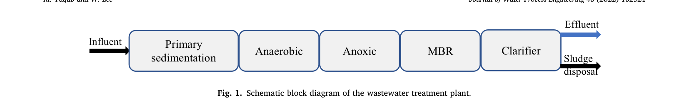
      - **Hình này chứng minh điều gì**
        - Dây chuyền xử lý bố trí nối tiếp từ lắng sơ cấp qua Anaerobic, Anoxic, MBR đến Clarifier để tách dòng nước và bùn.
      - **Từ đâu mà thấy được**
        - Hướng đọc từ trái sang phải: Influent lần lượt đi qua 5 khối chức năng theo chiều mũi tên.
        - Tại khối Clarifier, dòng ra tách thành mũi tên xanh phía trên (Effluent) và mũi tên đen phía dưới (Sludge disposal).
  - Bể lắng sơ cấp tiếp nhận nước thải đầu vào (influent) nhằm tăng cường quá trình axit hóa (acidification) và thủy phân (hydrolysis) các chất dạng hạt (particulate matter), từ đó duy trì lưu lượng dòng vào ổn định đến bể kỵ khí.
  - Các thiết bị khuấy trộn (mixers) được bố trí trong bể kỵ khí và bể thiếu khí để nâng cao hiệu quả xử lý và thích ứng với các điều kiện vi sinh thông qua động học phản ứng (reaction kinetics).
- Các thông số kỹ thuật và cấu tạo của hệ thống màng MBR:
  - Tổng diện tích bề mặt màng của MBR đạt $64,000\text{ m}^2$.
  - Kích thước lỗ màng danh định (nominal pore size) là $0.4\ \mu\text{m}$.
  - Vật liệu chế tạo màng là polyvinylidene fluoride (PVDF).
  - MBR được cấu thành từ nhiều module màng sợi rỗng (hollow-fiber membrane modules) đặt trong bể phản ứng kèm hệ thống đĩa phân phối khí (air diffusers) để duy trì nồng độ oxy hòa tan ($\text{DO}$).
  - Một bơm hút (suction pump) được vận hành liên tục cho quá trình lọc màng MBR.
- Quy trình vệ sinh và giới hạn vận hành màng:
  - Khi áp suất qua màng (transmembrane pressure - TMP) tăng vượt quá $40\text{ kPa}$, module màng được nhấc ra khỏi bể phản ứng và rửa sạch bằng nước cùng dung dịch natri hypoclorit $0.5\%$ ($0.5\%\text{ sodium hypochlorite}$).
  - Nồng độ chất rắn lơ lửng trong hỗn hợp bùn lỏng ($\text{MLSS}$) trong bể hiếu khí oxic-MBR luôn được duy trì trong giới hạn tiêu chuẩn.
- Các thông số vận hành và đặc tính nước thải được quan trắc tại trạm gồm: $\text{DO}$, thế oxy hóa khử ($\text{ORP}$), $\text{MLSS}$, tổng carbon hữu cơ ($\text{TOC}$), tổng phospho ($\text{TP}$), tổng nitơ ($\text{TN}$), nhu cầu oxy hóa học ($\text{COD}$), amoni ($\text{NH}_4$), và chất rắn lơ lửng ($\text{SS}$).
  - Các điều kiện vận hành có thể kiểm soát và đặc tính nước vào cung cấp thông tin thiết yếu về các thông số chất có thể oxy hóa (oxidizable matter parameters), giữ vai trò then chốt trong xử lý nước thải [33].
  - Các chất dinh dưỡng gốc nitơ và phospho là các chất gây ô nhiễm đáng lo ngại do tác động tiêu cực đến môi trường thủy sinh [34].
  - Tất cả các thông số quan trắc đều được đưa vào phát triển mô hình học máy (machine learning - ML) nhằm xác lập mối quan hệ giữa các biến đầu vào và hiệu quả loại bỏ dinh dưỡng mục tiêu trong hệ thống $A_2O\text{-MBR}$.

### 2.2. Analytical methods
- Phương pháp đo đạc trực tuyến (online monitoring):
  - Nhiệt độ (temperature), $\text{ORP}$, $\text{DO}$ và $\text{pH}$ được đo và ghi nhận liên tục bằng các cảm biến trực tuyến (installed online sensors).
  - Nồng độ $\text{TOC}$ và $\text{TN}$ được phân tích trực tuyến bằng máy phân tích Shimadzu TOC-L (Shimadzu TOC-L online analyzer).
- Phương pháp phân tích trong phòng thí nghiệm: Các thông số $\text{MLSS}$, $\text{COD}$, $\text{NH}_4$, $\text{SS}$ và $\text{TP}$ được kiểm nghiệm theo các phương pháp tiêu chuẩn phân tích nước và nước thải [35].
- Tần suất quan trắc: Toàn bộ các thông số được giám sát và ghi nhận theo từng giờ (every hour) trong suốt chu kỳ nghiên cứu kéo dài một năm.

### 2.3. Prediction models
- Các thông số đầu vào của bộ dữ liệu và ký hiệu viết tắt tương ứng được phân loại thành nhóm điều kiện vận hành (operating conditions) và nhóm đặc tính nước vào (influent characteristics) (Hình 2).
    - **Hình 2.** Các thông số đầu vào và ký hiệu viết tắt
      - 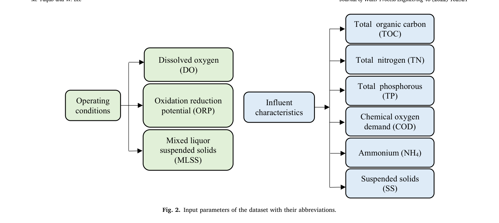
      - **Hình này chứng minh điều gì**
        - Cấu trúc rẽ nhánh chuẩn hóa tên gọi đầy đủ tương ứng từng ký hiệu viết tắt cho nhóm điều kiện vận hành và đặc tính nước vào.
      - **Từ đâu mà thấy được**
        - Hướng đọc từ trái sang phải: khối "Operating conditions" bên trái nối mũi tên sang DO, ORP và MLSS.
        - Khối "Influent characteristics" ở giữa nối mũi tên sang TOC, TN, TP, COD, $\text{NH}_4$ và SS.
- Hai mô hình máy học dự đoán gồm XGBoost và MLP được phát triển theo các kịch bản đầu vào và đầu ra khác nhau để dự đoán hiệu suất loại bỏ dinh dưỡng của WWTP (Hình 3).
    - **Hình 3.** Khung kiến trúc các kịch bản đầu vào và đầu ra
      - 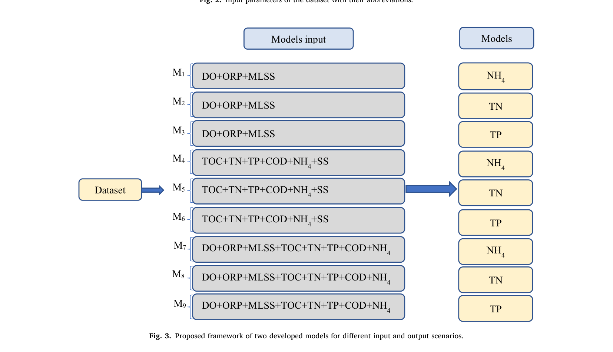
      - **Hình này chứng minh điều gì**
        - Thiết kế đơn đầu ra độc lập: mỗi mô hình ($M_1$–$M_9$) dự đoán riêng một chỉ tiêu $\text{NH}_4$, $\text{TN}$ hoặc $\text{TP}$.
        - Chi tiết hóa các biến đầu vào: $M_1$–$M_3$ nhận 3 biến, $M_4$–$M_6$ nhận 6 biến, $M_7$–$M_9$ nhận 8 biến.
      - **Từ đâu mà thấy được**
        - Đọc từ trái sang phải: khối Dataset dẫn vào cột Models input, qua mũi tên lớn chỉ sang cột Models.
        - Các hàng $M_1, M_4, M_7$ xuất ra $\text{NH}_4$; $M_2, M_5, M_8$ xuất ra $\text{TN}$; $M_3, M_6, M_9$ xuất ra $\text{TP}$.

#### 2.3.1. XGBoost model
- Giới thiệu và ưu điểm của mô hình XGBoost:
  - XGBoost là một cải tiến tiềm năng từ phương pháp tăng cường độ dốc (gradient boosting) sang cấu trúc tăng cường cây quy mô lớn đầu-cuối (scalable end-to-end tree-boosting structure), được ứng dụng rộng rãi trong khoa học kỹ thuật [36].
  - XGBoost thường được ưu tiên sử dụng nhờ khả năng tinh chỉnh siêu tham số mô hình dễ dàng [37].
  - Trái ngược với các phương pháp truyền thống phải dựa vào khuyến nghị tài liệu, kinh nghiệm chuyên gia và thử-sai (trial-and-error) để giảm thiểu sai số [38], XGBoost tối ưu hóa bằng phương pháp tìm kiếm lưới (grid search) thông qua các tham số tăng cường (booster parameters) gồm `max_depth`, số vòng lặp boosting (`boosting iterations`), `eta` và `gamma`.
- Vai trò của các siêu tham số trong XGBoost:
  - `max_depth` quản lý độ sâu của cây quyết định nhằm hạn chế nguy cơ quá khớp (overfitting) và nâng cấp hàm mất mát trong giới hạn xác định.
  - Tăng cường số lần lặp (boosting iterations) hỗ trợ ngăn ngừa hiện tượng quá khớp mô hình.
  - `eta` (tốc độ học - learning rate) điều chỉnh trọng số đặc trưng (feature weights) để đạt tới các giá trị tối ưu.
  - `gamma` kiểm soát mức độ điều chuẩn (regularization) để giảm thiểu quá khớp, đồng thời quản lý các biến thiên về trọng số và độ lệch (bias) qua từng lần lặp [39].
- Cấu trúc hàm mất mát mục tiêu điều chuẩn trong XGBoost:
  - Mô hình XGBoost đề xuất các cải tiến đối với phương pháp cây quyết định truyền thống áp dụng cho các bài toán hồi quy.
  - Hàm mục tiêu mất mát điều chuẩn $f(L)$ ở lần lặp thứ $L$ được tính toán theo Phương trình (1):
    $$f(L) = \sum_{i=1}^{n} l\left(y_i, y_p^L\right) + \sum_{j=1}^{L} \phi\left(f_j\right) \quad (1)$$
    - Trong đó: $n$ là số lượng mẫu quan sát; $y_p^L$ là giá trị dự đoán của mẫu thứ $i$ tại lần lặp $L$; $l$ đại diện cho hàm mất mát (loss function); $\phi$ thể hiện thành phần điều chuẩn (regularization event).
  - Thành phần điều chuẩn $\phi(f)$ được tính toán theo Phương trình (2):
    $$\phi(f) = \gamma N + \frac{1}{2}\sigma \sum_{j=1}^{N} \omega_j^2 \quad (2)$$
    - Trong đó: $N$ là số lượng nút lá (leaf nodes); $\sigma$ và $\omega$ là các hằng số dùng để kiểm soát điều chuẩn.
- Tối ưu hóa số lượng cây: Số lượng cây trong mô hình hồi quy được tối ưu hóa nhằm tạo ra các kết quả dự đoán chính xác cho một số lần lặp xác định [39].
- Đánh giá hiệu suất thống kê của các mô hình hồi quy XGBoost trên tập kiểm tra:
  - Hiệu suất thống kê của 9 kịch bản mô hình XGBoost ($M_1$–$M_9$) được đánh giá trên tập kiểm tra qua các chỉ số sai số MAE, RMSE, MAPE, $R^2$ và $md$ (Bảng 2).
    - **Bảng 2.** Đánh giá hiệu suất 9 mô hình XGBoost trên tập kiểm tra
      - 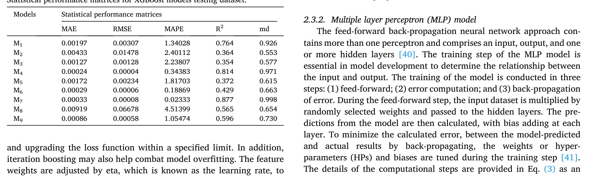
      - **Bảng này chứng minh điều gì**
        - Ba mô hình $M_1, M_4, M_7$ có độ chính xác vượt trội ($R^2 \ge 0.764$, $md \ge 0.926$), trong khi các mô hình còn lại đều có hiệu suất dự báo thấp ($R^2 \le 0.596$).
      - **Từ đâu mà thấy được**
        - Cột "$R^2$" và "md": hàng $M_7$ đạt cao nhất ($0.877$ và $0.998$), kế tiếp là $M_4$ ($0.814$ và $0.971$) và $M_1$ ($0.764$ và $0.926$); hàng $M_3$ có $R^2$ thấp nhất ($0.354$).
        - Cột sai số (MAE, RMSE, MAPE): hàng $M_4$ có MAE ($0.00024$) và RMSE ($0.00004$) nhỏ nhất, hàng $M_7$ có MAPE nhỏ nhất ($0.02333$); hàng $M_8$ có sai số lớn nhất ($\text{RMSE} = 0.06678$, $\text{MAPE} = 4.51399$).
  - Tương quan giữa giá trị thực tế và giá trị dự đoán của mô hình XGBoost qua các kịch bản khác nhau được thể hiện thông qua các đồ thị phân tán (scatter plots) (Hình 4).
    - **Hình 4.** Đồ thị phân tán giữa giá trị thực tế và dự đoán
      - 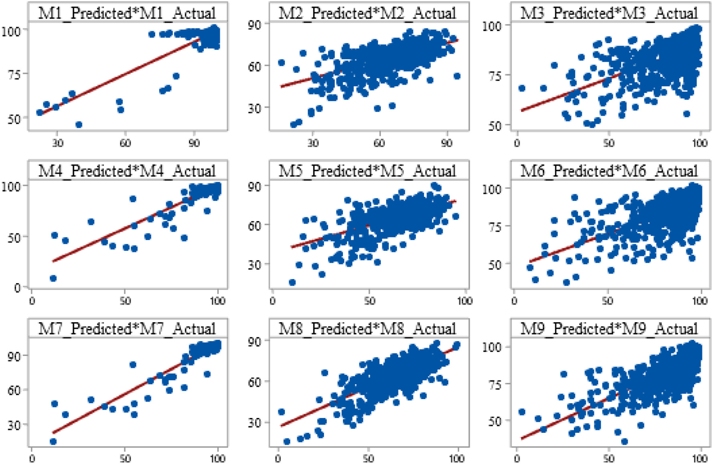
      - **Hình này chứng minh điều gì**
        - Cột mô hình NH4 (M1, M4, M7) có các điểm bám sát đường hồi quy đỏ vượt trội so với TN và TP ở cả ba kịch bản.
      - **Từ đâu mà thấy được**
        - Ox: giá trị thực tế (Actual), dải đo $0$–$100$. Oy: giá trị dự đoán (Predicted), dải đo $0$–$100$.
        - Cột trái (M1, M4, M7 của NH4): dữ liệu tập trung sát đường hồi quy đỏ; hai cột còn lại (TN: M2, M5, M8; TP: M3, M6, M9) phân tán rộng ra xa.

#### 2.3.2. Multiple layer perceptron (MLP) model
- Cấu trúc mạng perceptron nhiều lớp:
  - Mạng nơ-ron truyền thẳng lan truyền ngược (feed-forward back-propagation neural network) bao gồm nhiều hơn một perceptron và cấu thành từ một tầng đầu vào (input layer), một tầng đầu ra (output layer) cùng một hoặc nhiều tầng ẩn (hidden layers) [40].
- Ba bước trong quy trình huấn luyện mô hình MLP:
  - Quá trình huấn luyện là bước thiết yếu trong phát triển mô hình để xác định mối quan hệ giữa biến đầu vào và biến đầu ra.
  - Quy trình huấn luyện gồm 3 bước:
    1. Lan truyền thẳng (feed-forward): Dữ liệu đầu vào được nhân với các trọng số được lựa chọn ngẫu nhiên và truyền tới các tầng ẩn; dự đoán đầu ra được tính toán với độ lệch (bias) được cộng thêm ở từng tầng.
    2. Tính toán sai số (error computation): Tính toán mức độ sai lệch giữa kết quả mô hình dự đoán và kết quả thực tế.
    3. Lan truyền ngược sai số (back-propagation of error): Tinh chỉnh các trọng số/siêu tham số (HPs) và độ lệch (biases) nhằm giảm thiểu sai số tính toán giữa giá trị thực tế và giá trị dự đoán [41].
- Hàm tính toán nơ-ron trong mô hình MLP:
  - Chi tiết các bước tính toán được biểu diễn thông qua hàm nơ-ron ở Phương trình (3):
    $$y = f\left(\sum_{i=1}^{n} W_i x_i + b\right) \quad (3)$$
    - Trong đó: $x_i$ biểu thị các biến đầu vào; $y$ đại diện cho biến đầu ra; $f$ là hàm kích hoạt (activation function); $W_i$ là trọng số của nơ-ron thứ $i$; và $b$ biểu thị độ lệch (bias).
  - Sai số giữa giá trị dự đoán và kết quả thực tế có thể được giảm thiểu thông qua việc biến thiên các trọng số và độ lệch qua quá trình lặp.
- Mục đích phát triển mô hình MLP: Trong nghiên cứu này, các mô hình MLP được phát triển để đối chứng và thẩm định các mô hình XGBoost đề xuất phục vụ nghiên cứu so sánh; thông tin chi tiết về mô hình MLP có thể tham khảo từ các nghiên cứu trước [39,42].

### 2.4. Data analysis and preparation
- Vai trò của phân tích dữ liệu: Trong mô hình học máy, phân tích dữ liệu là bước bắt buộc để hiểu rõ các xu hướng bên trong bộ dữ liệu.
- Thu thập dữ liệu và phân tách bài toán đánh giá:
  - Dữ liệu đầu vào (các thông số vận hành) và đặc tính nước thải đầu vào ($\text{TOC}$, $\text{TN}$, $\text{TP}$, $\text{COD}$, $\text{NH}_4\text{-N}$, $\text{SS}$, $\text{DO}$, $\text{ORP}$, và $\text{MLSS}$) được thu thập thông qua nghiên cứu thực nghiệm.
  - Nhằm đánh giá hiệu quả của hệ thống $A_2O\text{-MBR}$ tại trạm xử lý nước thải, hiệu quả loại bỏ từng chất dinh dưỡng ($\text{NH}_4$, $\text{TN}$, và $\text{TP}$) được khảo sát riêng rẽ.
- Quy mô bộ dữ liệu: Tổng số lượng quan sát là $7897$ mẫu và tổng số biến số khảo sát là $9$ biến.
- Xu hướng phân bố dữ liệu theo từng chất dinh dưỡng:
  - Hiệu quả loại bỏ $\text{NH}_4$ cho thấy ít điểm ngoại lai (outliers) nhất và giảm độ nhiễu; do đó xu hướng biến thiên mượt mà hơn so với $\text{TN}$ và $\text{TP}$.
  - Điều này đồng nghĩa quá trình học kỳ vọng của các mô hình ML sẽ đạt độ chính xác cao hơn nhờ độ phân tán nhỏ so với giá trị trung bình trong bộ dữ liệu.
- Phân tích thống kê mô tả và độ lệch của bộ dữ liệu:
  - Phân tích thống kê bộ dữ liệu thực nghiệm thể hiện độ lệch âm và dương nhẹ ở các biến đầu vào, trong khi các biến đầu ra có độ lệch âm lớn (Bảng 1).
    - **Bảng 1.** Phân tích thống kê mô tả của bộ dữ liệu
      - 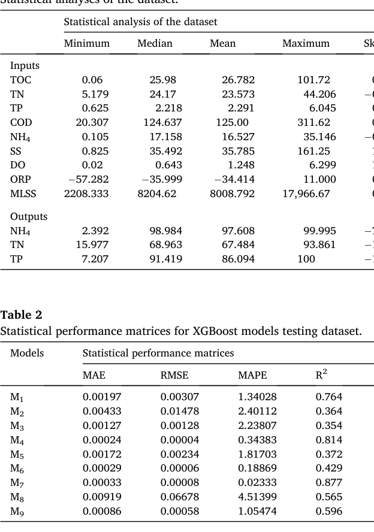
      - **Bảng này chứng minh điều gì**
        - 9 thông số đầu vào biến thiên trên dải rộng (như $\text{MLSS}$ từ $2208.333$ đến $17,966.67$), còn 3 thông số đầu ra duy trì giá trị trung bình cao ($\text{NH}_4$ đạt $97.608$, $\text{TP}$ đạt $86.094$).
      - **Từ đâu mà thấy được**
        - Cột "Minimum" và "Maximum": hàng $\text{MLSS}$ ($2208.333$–$17,966.67$) và $\text{COD}$ ($20.307$–$311.62$) có khoảng giá trị rộng nhất ở nhóm Inputs.
        - Cột "Mean": nhóm Outputs ghi nhận giá trị trung bình cao nhất ở $\text{NH}_4$ ($97.608$), tiếp theo là $\text{TP}$ ($86.094$) và $\text{TN}$ ($67.484$).
        - Lưu ý: hình ghi Median, văn bản ghi standard deviation.
  - Phân bố độ lệch (skewness) của các thông số đầu vào:
    - Các thông số đầu vào có độ lệch âm nhẹ gồm $\text{TN}$ ($-0.198$) và $\text{NH}_4$ ($-0.697$).
    - Các thông số đầu vào có độ lệch dương nhẹ gồm $\text{TOC}$ ($0.681$), $\text{TP}$ ($0.615$), $\text{COD}$ ($0.312$), $\text{ORP}$ ($0.968$), và $\text{MLSS}$ ($0.702$).
    - Các thông số đầu vào có độ lệch dương cao hơn gồm $\text{SS}$ ($1.140$) và $\text{DO}$ ($1.009$).
  - Phân bố độ lệch của các thông số đầu ra: Cả ba thông số đầu ra đều có độ lệch âm rất lớn, cụ thể $\text{NH}_4$ ($-7.843$), tiếp theo là $\text{TP}$ ($-1.949$) và $\text{TN}$ ($-1.119$).

## 3. Models development

- Phân loại toàn bộ thông số đầu vào thành hai nhóm: đặc tính dòng vào (influent characteristics) và điều kiện vận hành (operating conditions).
  - Tập dữ liệu được phân chia thành ba kịch bản (scenarios):
    - Kịch bản thứ nhất ($M_1, M_2, M_3$) xem xét các điều kiện vận hành.
    - Kịch bản thứ hai ($M_4, M_5, M_6$) xem xét các thông số đầu vào.
    - Kịch bản thứ ba ($M_7, M_8, M_9$) xem xét đồng thời điều kiện vận hành cùng với đặc tính dòng vào (xem Hình 2).
  - Trong mỗi kịch bản, ba mô hình được phát triển cho cả $\text{XGBoost}$ và $\text{MLP}$ để dự đoán từng chỉ tiêu loại bỏ chất dinh dưỡng ($\text{NH}_4$, $\text{TN}$, $\text{TP}$).
  - Hiệu suất của các mô hình được so sánh tập trung vào các thông số đầu vào nhằm xác định mô hình tối ưu.
  - Một kịch bản bị loại bỏ trong mỗi lượt đánh giá nhằm xác định mô hình kinh tế nhất (most economical model).
- Mục đích phân chia tập dữ liệu đầu vào thành các kịch bản là để khảo sát tầm quan trọng của các đặc trưng được lựa chọn (selected features) đối với hiệu quả loại bỏ dinh dưỡng khỏi nước thải.
  - Sơ đồ khung của hai mô hình đề xuất ($\text{XGBoost}$ và $\text{MLP}$) được thể hiện tại Hình 3.
  - Số lượng biến đầu vào quy định từng kịch bản: kịch bản thứ nhất gồm $3$ đầu vào cho mỗi mô hình; kịch bản thứ hai gồm $6$ đầu vào; kịch bản thứ ba gồm $9$ đầu vào.
  - Biến đầu ra tập trung vào hiệu suất loại bỏ chất dinh dưỡng được bố trí dưới dạng một nút đơn (single node) ở tầng đầu ra.

### 3.1. Development of XGBoost model

- Môi trường và thư viện phát triển mô hình $\text{XGBoost}$:
  - Phần mềm Python phiên bản 3.9 (2021-06-05) được sử dụng để xây dựng mô hình $\text{XGBoost}$.
  - Thư viện `sklearn` được sử dụng để phân chia dữ liệu thành tập huấn luyện (training dataset) và tập kiểm tra (testing dataset) thông qua hàm `train_test_split` và các hàm phân chia tập con (subset functions).
  - Tập dữ liệu lớn được phân chia ngẫu nhiên thành $90\%$ cho huấn luyện và $10\%$ cho kiểm tra.
- Tinh chỉnh siêu tham số (hyperparameter tuning) mô hình $\text{XGBoost}$:
  - Tinh chỉnh siêu tham số là bước then chốt trong phát triển mô hình, với các kỹ thuật tiềm năng như Grid Search, Random Search hoặc Bayes Search để tìm thông số tối ưu.
  - Kỹ thuật `GridSearch` được lựa chọn dựa trên tài liệu tham khảo do số lượng tổ hợp thông số khảo sát trong nghiên cứu ở mức giới hạn.
  - Phương pháp `GridSearch` được áp dụng với tham số `n_estimators` trong khoảng $10\text{–}1000$ để thu được bộ siêu tham số tối ưu cho mô hình $\text{XGBoost}$.
- Bộ tham số cấu hình của mô hình $\text{XGBoost}$:
  - `base_score` = $0.1$.
  - `booster` = 'gbtree'.
  - `colsample_bylevel` = $1$, `colsample_bynode` = $1$, `colsample_bytree` = $1$.
  - `gamma` = $0$.
  - `gpu_id` = $-1$.
  - `importance_type` = 'gain'.
  - `interaction_constraints` = ''.
  - `learning_rate` = $0.001$.
  - `max_delta_step` = $0$.
  - `max_depth` = $9$.
  - `min_child_weight` = $1$.
  - `monotone_constraints` = '()'.
  - `n_estimators` = $1000$.
  - `n_jobs` = $4$.
  - `num_parallel_tree` = $2$.
  - `random_state` = $5$.
  - `reg_alpha` = $0$, `reg_lambda` = $1$.
  - `scale_pos_weight` = $1$.
  - `subsample` = $1$.
  - `tree_method` = 'exact'.
  - `validate_parameters` = $1$.
  - `verbosity` = $0$.
  - Hàm kích hoạt (activation function) là hàm sigmoid do tập dữ liệu biến thiên trong khoảng giữa $0$ và $1$.
- Các siêu tham số được tinh chỉnh bằng Grid Search kết hợp với mô hình $\text{XGBoost}$ nhằm đạt sai số nhỏ nhất, với các giá trị tối ưu được đưa vào xây dựng mô hình để kiểm soát phần dư dự đoán qua các kịch bản:
  - Phân bố phần dư (residual) trên tập kiểm tra của các mô hình $\text{XGBoost}$ phản ánh mức độ hội tụ sai số theo từng kịch bản:
    - **Hình 5.** Biểu đồ phần dư của các mô hình XGBoost
      - 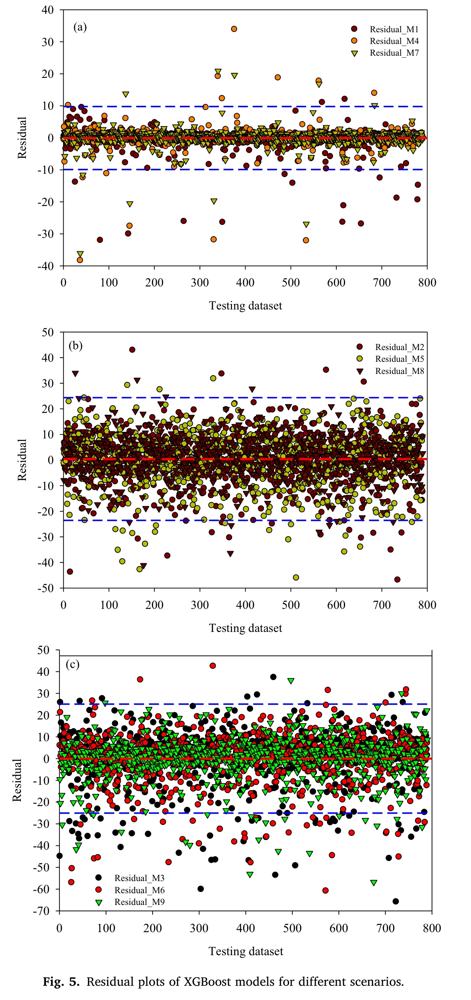
      - **Hình này chứng minh điều gì**
        - Phần dư của $M_7$ gom sát nhất quanh trục $0$ trong dải $[-10, 10]$, ít điểm dị biệt hơn rõ rệt so với $M_1$ và $M_4$.
      - **Từ đâu mà thấy được**
        - Ox: tập dữ liệu kiểm tra (Testing dataset), dải $0$–$800$. Oy: sai số phần dư (Residual), đường đỏ là vạch $0$.
        - Đồ thị (a) ($\text{NH}_4$): ký hiệu tam giác $M_7$ nén chặt trong dải $[-10, 10]$ (hai đường nét đứt xanh), đối xứng qua trục $0$.
        - Đồ thị (b) ($\text{TN}$) và (c) ($\text{TP}$): sai số phân tán rộng vượt xa hai biên xanh $\pm 25$, trong đó $\text{TP}$ rơi sâu đến $-70$.

### 3.2. Development of MLP model

- Môi trường và cấu trúc mạng của mô hình $\text{MLP}$:
  - Phần mềm Python phiên bản 3.9 (2021-06-05) được sử dụng để phát triển mô hình $\text{MLP}$.
  - Mô hình $\text{MLP}$ được xây dựng bằng cách nhập các thư viện: `sklearn.preprocessing` để chuẩn hóa dữ liệu, `sklearn.model_selection` với hàm `train_test_split`, và `sklearn.neural_network` với lớp `MLPRegressor`.
  - Tập dữ liệu lớn được phân chia ngẫu nhiên thành $90\%$ cho huấn luyện và $10\%$ cho kiểm tra.
  - Dữ liệu đầu vào được đưa vào mô hình với $1$ tầng ẩn (one hidden layer).
  - Số lượng nơ-ron khác nhau trong tầng ẩn được thử nghiệm cho từng kịch bản.
  - Hàm kích hoạt tuyến tính chỉnh lưu (ReLU / rectified linear activation function) được lựa chọn nhằm khắc phục hiện tượng triệt tiêu gradient (vanishing gradient problem), giúp mô hình học nhanh hơn và hoạt động tốt hơn; đây cũng là hàm kích hoạt mặc định khi phát triển các mô hình $\text{MLP}$.
- Quy trình tinh chỉnh siêu tham số mô hình $\text{MLP}$:
  - Việc tinh chỉnh siêu tham số mô hình $\text{MLP}$ được thực hiện chủ yếu bằng phương pháp thử và sai (trial-and-error method) để xác định các siêu tham số quan trọng gồm: tốc độ học (learning rate), số nơ-ron trong tầng ẩn, trạng thái ngẫu nhiên (random state) và số vòng lặp (iterations).
  - Trạng thái ngẫu nhiên (`random_state`) được áp dụng để tái lập tập dữ liệu đồng nhất qua các lần chạy, với số giả ngẫu nhiên được sinh ngẫu nhiên.
  - Tốc độ học (`learning_rate`) là siêu tham số then chốt điều tiết mức độ biến đổi phản ứng của mô hình dựa trên sai số phát sinh và hỗ trợ điều chỉnh trọng số của mô hình.
- Bộ siêu tham số then chốt được tinh chỉnh cho từng kịch bản mô hình bằng cách thay đổi giá trị nhằm đạt kết quả dự đoán tốt nhất:
  - `hidden_layer_sizes` = $(4\text{–}30)$.
  - `activation` = 'ReLU'.
  - `solver` = 'lbfgs'.
  - `alpha` = $(0.01\text{–}0.000001)$.
  - `random_state` = $(3\text{–}19)$.
  - `max_iter` = $(100\text{–}100)$.
  - `warm_start` = True.
- Kiểm tra hiệu suất mô hình $\text{MLP}$ trên tập dữ liệu kiểm tra:
  - Hiệu suất mô hình được kiểm tra thông qua việc vẽ biểu đồ phần dư và xác định các giá trị $R^2$ cùng các chỉ số hiệu suất thống kê trên tập dữ liệu kiểm tra:
    - **Bảng 3.** Hiệu suất thống kê của mô hình MLP trên tập kiểm tra
      - 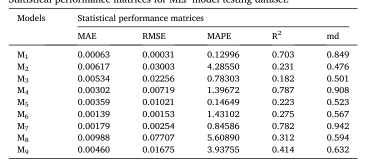
      - **Bảng này chứng minh điều gì**
        - Mô hình M4 đạt $R^2$ cao nhất ($0.787$), M3 thấp nhất ($0.182$), sai số $\text{RMSE}$ dao động từ $0.00031$ (M1) đến $0.07707$ (M8).
      - **Từ đâu mà thấy được**
        - Cột $R^2$: hàng M4 đạt giá trị cao nhất ($0.787$), hàng M3 thấp nhất ($0.182$).
        - Cột $\text{RMSE}$ và $\text{MAE}$: hàng M1 thấp nhất ($0.00031$ và $0.00063$), hàng M8 cao nhất ($0.07707$ và $0.00988$).
  - Mối tương quan giữa giá trị thực tế và giá trị do mô hình dự đoán được kiểm tra trên đồ thị phân tán (scatter plots) cho các kịch bản khác nhau:
    - **Hình 6.** Đồ thị phân tán thực tế và dự đoán mô hình MLP
      - 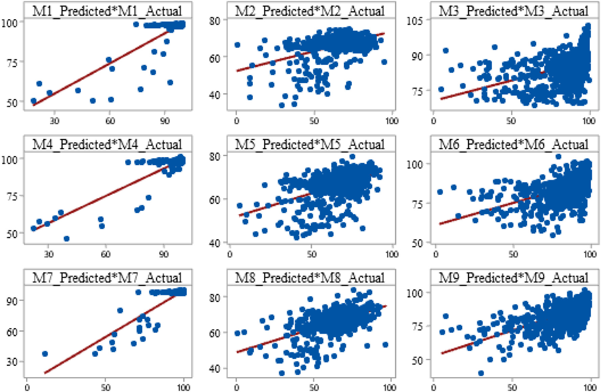
      - **Hình này chứng minh điều gì**
        - Mô hình $M_4$ bám sát thực tế tốt nhất ($>78\%$), trong khi việc tích hợp toàn bộ thông số ở $M_7$–$M_9$ không cải thiện được độ phân tán của MLP.
      - **Từ đâu mà thấy được**
        - Ox: giá trị thực tế (Actual), dải đo $0$–$100$. Oy: giá trị dự đoán (Predicted), dải đo $30$–$105$.
        - Cột $\text{NH}_4$ ($M_1, M_4, M_7$): dữ liệu gom sát đường hồi quy đỏ (chặt nhất ở $M_4$); hai cột $\text{TN}$ ($M_2, M_5, M_8$) và $\text{TP}$ ($M_3, M_6, M_9$) phân tán rộng thành đám mây ngang.

### 3.3. Model performance matrices

- Hiệu suất của các mô hình dự đoán đã phát triển được đánh giá dựa trên các thước đo thống kê:
  - Căn bậc hai sai số toàn phương trung bình ($\text{RMSE}$ / root mean squared error).
  - Phần trăm sai số tuyệt đối trung bình ($\text{MAPE}$ / mean absolute percentage error).
  - Sai số tuyệt đối trung bình ($\text{MAE}$ / mean absolute error).
  - Hệ số xác định ($R^2$ / coefficient of determination).
  - Chỉ số thống nhất cải tiến ($m_d$ / modified index of agreement).
- Các ma trận hiệu suất được tính toán theo các phương trình từ $(4)$ đến $(8)$:
  - Sai số tuyệt đối trung bình ($\text{MAE}$):
    $$\text{MAE} = \frac{1}{n} \sum_{i=1}^{n} [p_i - y_i] \quad (4)$$
  - Căn bậc hai sai số toàn phương trung bình ($\text{RMSE}$):
    $$\text{RMSE} = \sqrt{\frac{1}{n} \sum_{i=1}^{n} [p_i - y_i]^2} \quad (5)$$
  - Phần trăm sai số tuyệt đối trung bình ($\text{MAPE}$):
    $$\text{MAPE} = \frac{1}{n} \sum_{i=1}^{n} \left[ \frac{p_i - y_i}{y_i} \right] \quad (6)$$
  - Hệ số xác định ($R^2$):
    $$R^2 = 1 - \frac{\sum (p_i - y_i)^2}{\sum (p_i - u_a)^2} \quad (7)$$
  - Chỉ số thống nhất cải tiến ($m_d$):
    $$m_d = 1 - \frac{\sum_{i=1}^{n} [y_i - p_i]}{\sum_{i=1}^{n} [p_i - \bar{y}] + [y_i - \bar{y}]} \quad (8)$$
- Ký hiệu và định nghĩa các biến trong các phương trình hiệu suất:
  - $n$: biểu thị tổng số mẫu dữ liệu (total number of datasets).
  - $y_i$: biểu thị giá trị thực tế (actual values).
  - $p_i$: biểu thị giá trị dự đoán (predicted values).
  - $u_a$: giá trị trung bình của các giá trị dự đoán $p_i$ (mean of $p_i$ values).
  - $\bar{y}$: giá trị trung bình của các giá trị thực tế (average of the actual values).
  - $i$: số thứ tự quan sát (number of observations).

## 4. Results and discussion

### 4.1. XGBoost model predictions

- Đánh giá khả năng dự đoán và độ tin cậy của mô hình Extreme Gradient Boosting (XGBoost) sau quá trình huấn luyện bằng tập dữ liệu kiểm tra chưa từng thấy (unseen testing dataset) gồm $790$ dòng (chiếm $10\%$ tổng số dữ liệu quan trắc).
- Bộ tiêu chí đánh giá định lượng hiệu năng mô hình bao gồm $5$ chỉ số thống kê (trình bày tại Bảng 2):
  - Sai số tuyệt đối trung bình ($\text{MAE}$ / mean absolute error).
  - Căn bậc hai sai số toàn phương trung bình ($\text{RMSE}$ / root mean square error).
  - Sai số phần trăm tuyệt đối trung bình ($\text{MAPE}$ / mean absolute percentage error).
  - Hệ số xác định ($R^2$ / coefficient of determination).
  - Chỉ số đồng thuận hiệu chỉnh ($m_d$ / modified index of agreement).
  - Trạng thái khớp hoàn hảo (good fit) giữa giá trị dự đoán và kết quả thực tế xảy ra khi sai số bằng $0$, tuy nhiên kịch bản sai số triệt tiêu bằng $0$ là điều gần như không thể đạt được trong điều kiện vận hành thực tế.
- Khả năng học và độ chính xác dự đoán vượt trội đối với ammonium ($\text{NH}_4$) so với tổng nitơ ($\text{TN}$ / total nitrogen) và tổng phốt pho ($\text{TP}$ / total phosphorus):
  - Mô hình XGBoost thể hiện năng lực học tập tốt nhất đối với bài toán dự đoán $\text{NH}_4$ ở tất cả các kịch bản khảo sát, nhờ tập dữ liệu quan trắc $\text{NH}_4$ duy trì xu hướng biến thiên nhất quán và ổn định.
  - Mức độ biến động và sai lệch cao trong tập dữ liệu của $\text{TN}$ và $\text{TP}$ làm suy giảm khả năng học của thuật toán, dẫn đến độ chính xác dự đoán của các chất dinh dưỡng này thấp hơn rõ rệt trên tập kiểm tra.
  - Các giá trị tối ưu nhất của $\text{MAE}$, $\text{RMSE}$, $\text{MAPE}$, $R^2$, và $m_d$ đều ghi nhận ở các mô hình dự đoán $\text{NH}_4$ ($M_1$, $M_4$, và $M_7$).
  - Giá trị $\text{RMSE}$ nhỏ nhất xuất hiện ở bài toán dự đoán loại bỏ $\text{NH}_4$ của hệ thống $A^2O\text{-MBR}$ (anaerobic-anoxic-oxic membrane bioreactor / bể phản ứng sinh học màng kỵ khí - thiếu khí - hiếu khí), khẳng định mô hình hóa XGBoost có thể dự đoán hiệu quả quá trình loại bỏ $\text{NH}_4$.
  - Quá trình loại bỏ $\text{TN}$ và $\text{TP}$ có thể được xem xét đồng thời, nhưng cần tích hợp thêm các yếu tố ảnh hưởng trọng yếu khác chi phối cơ chế sinh học của chúng để nâng cao độ chính xác.
- Đánh giá chi tiết hiệu năng $9$ mô hình XGBoost theo $3$ kịch bản thông số đầu vào (Bảng 2):
  - Kịch bản 1 ($M_1$–$M_3$): Chỉ sử dụng $3$ thông số điều kiện vận hành (operating conditions gồm oxy hòa tan $\text{DO}$, thế oxy hóa - khử $\text{ORP}$, và chất rắn lơ lửng trong bùn lỏng $\text{MLSS}$):
    - Mô hình $M_1$ (dự đoán $\text{NH}_4$): $\text{MAE} = 0.00197$, $\text{RMSE} = 0.0031$ ($0.00307$), $\text{MAPE} = 1.34\%$ ($1.34028$), $R^2 = 0.764$, và $m_d = 0.926$.
    - Mô hình $M_2$ (dự đoán $\text{TN}$): $\text{MAE} = 0.00433$, $\text{RMSE} = 0.01478$, $\text{MAPE} = 2.40112$, $R^2 = 0.364$, và $m_d = 0.553$.
    - Mô hình $M_3$ (dự đoán $\text{TP}$): $\text{MAE} = 0.00127$, $\text{RMSE} = 0.00128$, $\text{MAPE} = 2.23807$, $R^2 = 0.354$, và $m_d = 0.577$.
  - Kịch bản 2 ($M_4$–$M_6$): Chỉ sử dụng $6$ thông số đặc tính nước thải đầu vào (influent characteristics gồm $\text{TOC}$, $\text{TN}$, $\text{TP}$, $\text{COD}$, $\text{NH}_4\text{-N}$, và $\text{SS}$):
    - Mô hình $M_4$ (dự đoán $\text{NH}_4$): $\text{MAE} = 0.00024$, $\text{RMSE} = 0.00004$, $\text{MAPE} = 0.34383$, $R^2 = 0.814$, và $m_d = 0.971$, đạt độ chính xác dự đoán vượt trên $80\%$ và vượt trội hơn mô hình $M_1$.
    - Mô hình $M_5$ (dự đoán $\text{TN}$): $\text{MAE} = 0.00172$, $\text{RMSE} = 0.00234$, $\text{MAPE} = 1.81703$, $R^2 = 0.372$, và $m_d = 0.615$.
    - Mô hình $M_6$ (dự đoán $\text{TP}$): $\text{MAE} = 0.00029$, $\text{RMSE} = 0.00006$, $\text{MAPE} = 0.18869$, $R^2 = 0.429$, và $m_d = 0.663$.
  - Kịch bản 3 ($M_7$–$M_9$): Tích hợp đồng thời toàn bộ $9$ thông số (kết hợp cả điều kiện vận hành và đặc tính nước thải đầu vào):
    - Mô hình $M_7$ (dự đoán $\text{NH}_4$): $\text{MAE} = 0.00033$, $\text{RMSE} = 0.00008$, $\text{MAPE} = 0.02333$, $R^2 = 0.877$ ($0.876$), và $m_d = 0.998$, là cấu hình tối ưu nhất toàn diện trong nghiên cứu.
    - Mô hình $M_8$ (dự đoán $\text{TN}$): $\text{MAE} = 0.00919$, $\text{RMSE} = 0.06678$, $\text{MAPE} = 4.51399$, $R^2 = 0.565$, và $m_d = 0.654$, có độ chính xác tiệm cận khoảng $56\%$.
    - Mô hình $M_9$ (dự đoán $\text{TP}$): $\text{MAE} = 0.00086$, $\text{RMSE} = 0.00058$, $\text{MAPE} = 1.05474$, $R^2 = 0.596$, và $m_d = 0.730$, có độ chính xác tiệm cận khoảng $59\%$.
  - Hiệu năng của các mô hình dự đoán $\text{NH}_4$ xếp theo thứ tự tăng dần là $M_7 > M_4 > M_1$, trong khi các mô hình dự đoán chất dinh dưỡng còn lại đều cho kết quả kém.
  - Cấu hình $M_7$ tối ưu nhất nhờ khả năng mô phỏng và truy vết chính xác mối quan hệ phi tuyến phức tạp giữa các biến đầu vào và đầu ra, chứng minh tính cấp thiết của việc xem xét đồng thời cả điều kiện vận hành và đặc tính dòng vào.
- Phân tích tương quan thực tế và dự đoán qua đồ thị phân tán (scatter plots, Hình 4):
  - Giá trị thực nghiệm và giá trị dự đoán của mô hình $M_1$ bám rất sát đường hồi quy chuẩn, trong khi xuất hiện sự phân tán và dao động rất lớn ở mô hình $M_2$ và $M_3$.
  - Mô hình $M_4$ vượt trội hơn $M_1$ với độ chính xác đạt trên $80\%$; ngược lại, $M_5$ và $M_6$ ghi nhận kết quả dao động gần như tương tự với $M_1$ và $M_2$.
  - Kịch bản kết hợp toàn bộ thông số (Kịch bản 3) đem lại kết quả dự đoán cao nhất; trong đó quy luật học của mô hình đạt tối ưu đối với $\text{NH}_4$, còn độ chính xác dự đoán của $\text{TN}$ và $\text{TP}$ dù có cải thiện vẫn nằm dưới ngưỡng $60\%$.
  - Mọi cấu hình mô hình dự đoán $\text{NH}_4$ đều nằm trong dải sai số chấp nhận được, trong khi các mô hình cho các chất dinh dưỡng khác thể hiện kết quả kém do độ lệch lớn trong tập dữ liệu làm giảm năng lực học; nhấn mạnh tầm quan trọng của phân tích tiền xử lý dữ liệu trước khi chọn loại thuật toán học máy.
- Giới hạn chấp nhận kỹ thuật và khả năng ứng dụng thực tế:
  - Khả năng dự đoán loại bỏ $\text{NH}_4$ vượt trội rõ rệt so với $\text{TN}$ ($\approx 56\%$) và $\text{TP}$ ($\approx 59\%$), vốn tiệm cận nhưng vẫn nằm dưới ngưỡng giới hạn chấp nhận được tối thiểu là $70\%$.
  - Mô hình XGBoost xác định hiệu quả các mối tương quan quy luật khi dữ liệu đầu vào được đo đạc và thu thập chính xác, không bị biến động hay phân tán dữ liệu quá mức.
  - Hỗ trợ công tác phân tích nồng độ dinh dưỡng dòng ra tại trạm xử lý nước thải ($\text{WWTP}$ / wastewater treatment plant), trợ giúp người vận hành chủ động điều chỉnh các thông số kiểm soát được nhằm đảm bảo quy chuẩn xả thải và tối ưu hóa hệ thống $A^2O\text{-MBR}$.
- Đánh giá phân bố sai số qua biểu đồ phần dư (residual plots) củng cố hiệu năng mô hình:
  - Phân tích sai số phần dư (residual) giữa kết quả dự đoán của mô hình và giá trị kiểm tra thực nghiệm cho từng chất dinh dưỡng nhằm định lượng độ chính xác:
    - Nhóm mô hình dự đoán $\text{NH}_4$ ($M_1$, $M_4$, và $M_7$) có sai số phần dư đạt mức tối thiểu, dao động chặt chẽ quanh trục $0$ trong phạm vi $0 \pm 10$.
    - Nhóm mô hình dự đoán $\text{TN}$ và $\text{TP}$ kém chính xác hơn rõ rệt với sai số phần dư dao động phân tán lớn trong khoảng $\pm 25$ (và mở rộng sâu đến $-70$ hoặc $-80$ đối với $\text{TP}$).
    - Khẳng định các mô hình XGBoost đề xuất ($M_1, M_4, M_7$) là giải pháp tối ưu nhất cho bài toán dự đoán loại bỏ $\text{NH}_4$ trong hệ thống $A^2O\text{-MBR}$, trong khi chưa đáp ứng yêu cầu dự đoán hiệu suất loại bỏ $\text{TN}$ và $\text{TP}$.
    - **Hình 7.** Biểu đồ phần dư của các mô hình MLP
      - 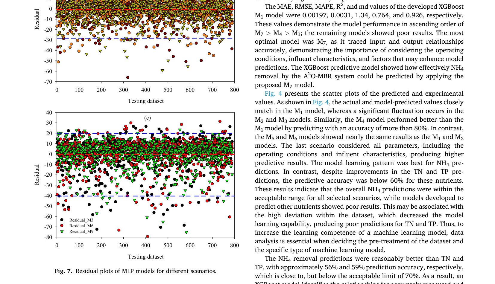
      - **Hình này chứng minh điều gì**
        - Sai số phần dư của nhóm $\text{NH}_4$ ($M_1, M_4, M_7$) tập trung hẹp sát $0$ ($\pm 10$), trong khi nhóm $\text{TN}$ và $\text{TP}$ phân tán rộng và lệch âm lớn.
      - **Từ đâu mà thấy được**
        - Ox: tập dữ liệu kiểm tra (Testing dataset), dải $0$–$800$. Oy: phần dư (Residual), dải $-80$ đến $50$.
        - Đồ thị (a) $\text{NH}_4$ gom chặt giữa hai đường đứt nét xanh $\pm 10$; đồ thị (b) $\text{TN}$ phân tán $\pm 25$; đồ thị (c) $\text{TP}$ lệch âm từ $+20$ đến $-40$ với điểm cực trị tới $-80$.

### 4.2. MLP model predictions

- Kiến trúc và quy trình phát triển mô hình $\text{MLP}$ (multilayer perceptron - mạng perceptron đa tầng):
  - Số lượng nơ-ron ở tầng đầu vào (input layer) được điều chỉnh theo thiết lập định trước cho từng kịch bản ($1$ trong $9$ kịch bản).
  - Cấu trúc mạng gồm $1$ tầng ẩn (hidden layer) và $1$ tầng đầu ra (output layer) chứa duy nhất $1$ nơ-ron.
  - Trọng tâm chính trong phát triển mô hình $\text{MLP}$ là việc lựa chọn hàm kích hoạt (activation function) và cấu hình tầng đầu ra.
  - Tín hiệu sai số được lan truyền ngược (back-propagated) để liên tục cập nhật mô hình cho đến khi sai số giảm xuống dưới ngưỡng quy định của hàm mất mát sai số toàn phương trung bình ($\text{MSE}$ / mean square error).
  - Mục tiêu huấn luyện là đạt giá trị hàm mất mát nhỏ nhất trong từng kịch bản khảo sát.
  - Kiến trúc tối ưu có sự khác biệt giữa các mô hình và được xác định thông qua phương pháp thử và sai (trial-and-error method).
  - Các thử nghiệm điều chỉnh siêu tham số (hyperparameters) được thực hiện liên tục cho đến khi hiện tượng quá khớp (overfitting) và thiếu khớp (underfitting) được kiểm soát ở mức không đáng kể.
  - Kết quả hiệu suất dự đoán của từng kịch bản dựa trên các thước đo thống kê được tổng hợp trong Bảng $3$.
- Hiệu suất tổng quan và so sánh giữa các chỉ tiêu dinh dưỡng:
  - Mặc dù độ chính xác của các mô hình $\text{MLP}$ nhìn chung thấp hơn so với $\text{XGBoost}$, xu hướng dự đoán tổng thể giữa hai kỹ thuật này là tương đồng.
  - Dự đoán của mô hình $\text{MLP}$ đạt kết quả tốt đối với amoni ($\text{NH}_4$), nhờ vào xu hướng biến thiên nhất quán và ổn định trong tập dữ liệu (consistent trends in the dataset).
  - Dự đoán đối với các chất dinh dưỡng còn lại gồm tổng nitơ ($\text{TN}$) và tổng phốt pho ($\text{TP}$) kém chính xác hơn do tập dữ liệu có độ biến động rất cao (high variations).
  - Các giá trị tối ưu của các chỉ số sai số tuyệt đối trung bình ($\text{MAE}$), căn bậc hai sai số toàn phương trung bình ($\text{RMSE}$), phần trăm sai số tuyệt đối trung bình ($\text{MAPE}$), hệ số xác định ($R^2$), và chỉ số thống nhất Willmott ($m_d$) xuất hiện ở các mô hình $\text{M1}$, $\text{M4}$, và $\text{M7}$.
  - Sai số $\text{RMSE}$ đạt giá trị nhỏ nhất trong việc dự đoán hiệu suất loại bỏ $\text{NH}_4$ của hệ thống $A^2O\text{-MBR}$, được củng cố đồng bộ bởi toàn bộ các thước đo hiệu suất thống kê khác, chứng minh mô hình dự đoán chính xác hiệu suất loại bỏ $\text{NH}_4$.
- Đánh giá định lượng mô hình $\text{MLP}$ tối ưu:
  - Mô hình $\text{MLP}$ $\text{M1}$ đề xuất đạt các thông số thống kê gồm: $\text{MAE} = 0.00063$, $\text{RMSE} = 0.00031$, $\text{MAPE} = 0.1299$, $R^2 = 0.703$, và $m_d = 0.849$.
  - Thứ tự hiệu suất của mô hình dựa trên giá trị $R^2$ được xếp hạng theo chiều $\text{M4} > \text{M7} > \text{M1}$; tất cả các mô hình còn lại đều cho kết quả kém (poor results).
  - Mô hình tối ưu nhất là $\text{M4}$ do phản ánh chính xác mối tương quan giữa thông số đầu vào và đầu ra, chứng minh vai trò then chốt của việc xem xét các đặc tính nước thải đầu vào (influent characteristics).
  - Hiệu suất dự đoán của mô hình gia tăng khi bổ sung thêm các thông số đầu vào khác.
  - Mô hình $\text{MLP}$ có khả năng dự đoán hiệu suất loại bỏ $\text{NH}_4$ trong hệ thống $A^2O\text{-MBR}$ trong các giới hạn cho phép chấp nhận được (within acceptable limits).
- Vai trò của các nhóm biến đầu vào và so sánh với mô hình $\text{XGBoost}$:
  - Khác biệt cơ bản giữa $\text{MLP}$ và $\text{XGBoost}$ là ở mô hình $\text{MLP}$, cả điều kiện vận hành và đặc tính nước đầu vào đều chi phối khả năng loại bỏ chất dinh dưỡng.
  - Tuy nhiên, trong mô hình $\text{MLP}$, các thông số đặc tính nước đầu vào quan trọng hơn hẳn khi có thể đạt độ chính xác $78\%$ chỉ bằng việc sử dụng riêng rẽ nhóm đặc tính này.
  - Đồ thị phân tán giữa giá trị thực nghiệm và giá trị dự đoán của mô hình (Hình $6$):
    - Giá trị thực tế và giá trị dự đoán bám sát nhau ở mô hình $\text{M1}$, trong khi dao động đáng kể xuất hiện ở các mô hình $\text{M2}$ và $\text{M3}$.
    - Mô hình $\text{M4}$ vượt trội hơn $\text{M1}$ khi dự đoán hiệu suất loại bỏ chất dinh dưỡng với độ chính xác trên $78\%$.
    - Các mô hình $\text{M5}$ và $\text{M6}$ cho kết quả gần như tương đương với các mô hình $\text{M1}$ và $\text{M2}$.
    - Kịch bản tích hợp toàn bộ các thông số (gồm cả điều kiện vận hành và đặc tính nước đầu vào) giúp nâng cao độ chính xác dự đoán ở mô hình $\text{XGBoost}$, nhưng điều này không xảy ra đối với mô hình $\text{MLP}$.
- Năng lực học tập của mô hình $\text{MLP}$ và định hướng nghiên cứu:
  - Khả năng học (learning capability) của mô hình $\text{MLP}$ đạt hiệu quả cao nhất ở dự đoán $\text{NH}_4$, trong khi độ chính xác dự đoán $\text{TN}$ và $\text{TP}$ chỉ đạt lần lượt xấp xỉ $30\%$ và $40\%$.
  - Độ chính xác dự đoán $\text{NH}_4$ vượt trên $70\%$ ở tất cả các kịch bản được khảo sát, trong khi các mô hình dự đoán các chất dinh dưỡng khác thể hiện kết quả yếu kém.
  - Nguyên nhân chủ yếu xuất phát từ độ lệch dữ liệu lớn (high deviation) trong tập dữ liệu, làm suy giảm năng lực học của mô hình và dẫn đến độ chính xác dự đoán thấp cho $\text{TN}$ và $\text{TP}$.
  - Mô hình $\text{XGBoost}$ hỗ trợ phân tích nồng độ chất dinh dưỡng trong dòng ra và hỗ trợ các nhà vận hành/quyết định điều chỉnh các thông số kiểm soát nhằm tuân thủ quy chuẩn xả thải.
  - Các mô hình đề xuất có thể hỗ trợ dự đoán chính xác loại bỏ $\text{NH}_4$, trong khi việc mô hình hóa chính xác $\text{TN}$ và $\text{TP}$ trong hệ thống $A^2O\text{-MBR}$ đòi hỏi các nghiên cứu sâu hơn.
  - Các nghiên cứu tương lai có thể bổ sung thêm các thông số khác nhằm xác định mối quan hệ tối ưu, giúp dự đoán hiệu suất loại bỏ $\text{TN}$ và $\text{TP}$ tại trạm xử lý nước thải ($\text{WWTP}$) với độ chính xác và độ tin cậy cao.
- Phân tích sai số phần dư (residuals) và kiểm chứng mô hình:
  - Các đồ thị phần dư cho từng kịch bản và từng chất dinh dưỡng riêng lẻ (Hình $7$) được phân tích để đối chứng sai số giữa dự đoán mô hình và giá trị thực tế.
  - Phần dư giữa dự đoán của các mô hình $\text{M1}$, $\text{M4}$, $\text{M7}$ và dữ liệu thử nghiệm thực tế đối với $\text{NH}_4$ là rất tương đồng và chỉ dao động nhỏ trong biên độ $\pm 10$.
  - Ngược lại, dự đoán cho $\text{TN}$ và $\text{TP}$ kém chính xác hơn rõ rệt với phần dư biến động lớn, dao động lần lượt trong khoảng $0 \pm 25$ và từ $+20$ đến $-40$.
  - Khẳng định các mô hình $\text{MLP}$ đề xuất ($\text{M1}$, $\text{M4}$, và $\text{M7}$) là các mô hình tối ưu nhất cho bài toán dự đoán loại bỏ $\text{NH}_4$ trong hệ thống $A^2O\text{-MBR}$, nhưng không hiệu quả trong việc dự đoán loại bỏ $\text{TN}$ và $\text{TP}$.
  - Phân bố phần dư thông qua biểu đồ violin (Hình $8$) phản ánh trực quan sự khác biệt rõ rệt về sai số giữa $\text{NH}_4$ và các chất dinh dưỡng $\text{TN}$, $\text{TP}$ trên cả hai mô hình $\text{MLP}$ và $\text{XGBoost}$:
    - **Hình 8.** Phân bố phần dư của các mô hình MLP và XGBoost
      - 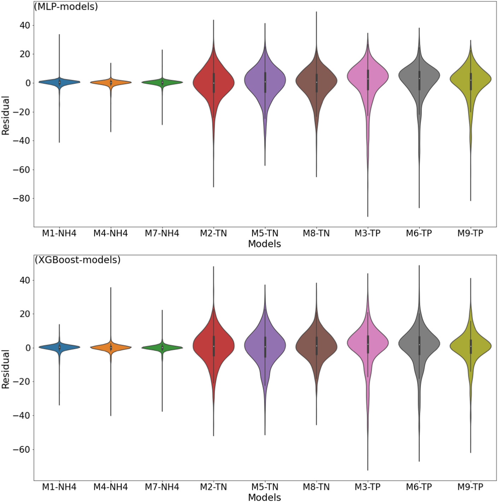
      - **Hình này chứng minh điều gì**
        - Dải phần dư nén sát $0$ ở nhóm $\text{NH}_4$ và mở rộng với đuôi âm kéo dài ở nhóm $\text{TN}$, $\text{TP}$ trên cả hai mô hình.
      - **Từ đâu mà thấy được**
        - Ox: 9 kịch bản mô hình (M1-NH4 đến M9-TP). Oy: sai số phần dư (Residual), vạch chia từ $-80$ đến $40$.
        - Ba violin đầu ($\text{NH}_4$) dẹt sát vạch $0$; các violin $\text{TN}$ và $\text{TP}$ phình rộng với đuôi âm MLP vượt $-80$, còn XGBoost vượt $-60$.

### 4.3. Comparative study of the proposed models

- So sánh toàn diện mô hình XGBoost và MLP (Multilayer Perceptron - perceptron đa tầng) thông qua phân tích đồ thị phần dư (residual plots) giữa giá trị dự đoán và giá trị thực tế của toàn bộ các mô hình được phát triển:
  - Đồ thị violin (violin plots, Fig. 8) biểu diễn sai số phần dư (residual error) cho tất cả các kịch bản của mô hình MLP và XGBoost:
    - Ở giữa mỗi đường cong mật độ (density curve) là một biểu đồ hộp (box plot) nhỏ, với hình chữ nhật thể hiện giới hạn của tứ phân vị thứ nhất ($Q_1$) và thứ ba ($Q_3$) và điểm chấm ở giữa là giá trị trung vị (median).
    - Các phần phình rộng và thu hẹp trong hình dạng phân bố của đồ thị phần dư tương ứng đại diện cho xác suất xuất hiện cao hơn và thấp hơn.
    - Hình dạng phân bố phần dư (rất hẹp ở hai đầu cực trị và phình rộng ở phần giữa) chỉ ra rằng trọng số của các giá trị sai số phần dư tập trung cao độ xung quanh giá trị trung vị.
  - Phân tích khoảng tứ phân vị (interquartile range): đồ thị violin của phần dư giữa giá trị dự đoán và thực tế đạt khoảng tứ phân vị thấp nhất ở các kịch bản $\text{M1}$, $\text{M4}$ và $\text{M7}$ đối với cả hai mô hình MLP và XGBoost.
  - Thứ tự hiệu năng tổng thể của các mô hình đề xuất được xác định theo thứ bậc: $\text{M7} > \text{M4} > \text{M1}$.
- Phân tích tính ổn định, độ nhạy và tính vượt trội của XGBoost so với MLP:
  - Hiệu năng tổng thể của mô hình XGBoost vượt trội hơn hẳn so với MLP nhờ dải phân bố sai số phần dư đối với $\text{NH}_4$ là nhỏ nhất (minimum residual distribution).
  - Khả năng khái quát hóa và độ ổn định của XGBoost trong các kịch bản phức tạp: kết quả dự đoán của XGBoost theo kịch bản $\text{M8}$ và $\text{M9}$ đối với $\text{TN}$ và $\text{TP}$ (khi xét đồng thời cả đặc tính nước thải đầu vào và điều kiện vận hành) đạt mức hợp lý hơn so với kết quả dự đoán của MLP.
  - Dự đoán hiệu suất loại bỏ $\text{NH}_4$ gần như bám sát hoàn toàn với kết quả thực tế, mặc dù có ghi nhận một số sai lệch nhỏ ở giai đoạn đầu của chuỗi thu thập dữ liệu.
  - Dữ liệu trực quan hóa xu hướng loại bỏ $\text{NH}_4$ ít nhiễu hơn (less noisy) và ổn định hơn (more stable) so với xu hướng loại bỏ $\text{TN}$ và $\text{TP}$ trong hệ thống $A^2O\text{-MBR}$.
  - Dựa trên đánh giá các kịch bản khác nhau, các mô hình $\text{M1}$, $\text{M4}$ và $\text{M7}$ thể hiện hiệu năng vượt trội nhất, được minh chứng bởi các giá trị sai số thống kê thấp hơn hẳn so với các mô hình XGBoost và MLP khác.
  - Quá trình học của mô hình (model learning) đạt mức tối ưu nhất khi dự đoán loại bỏ $\text{NH}_4$ ở cả XGBoost và MLP, trong đó kết quả tổng thể của mô hình XGBoost luôn dẫn đầu so với MLP trên cả tập huấn luyện (training), tập kiểm tra (testing) và các chỉ số thống kê đánh giá hiệu năng (performance measuring statistics gồm $\text{MAE}$, $\text{RMSE}$, $\text{MAPE}$ và $R^2$ / $\text{R-Sq}$, trình bày tại Table 2 và Table 3).
- So sánh hiệu năng mô hình qua đồ thị hồi quy (regression plots) và dải tin cậy $95\%$ (Fig. 9):
  - Thiết lập đồ thị hồi quy cho các mô hình tốt nhất ($\text{M1}$, $\text{M4}$ và $\text{M7}$) sử dụng kỹ thuật XGBoost và MLP để quan sát độ khớp giữa giá trị dự đoán và kết quả thực nghiệm:
    - **Hình 9.** Đồ thị hồi quy dải tin cậy 95% của XGBoost và MLP
      - 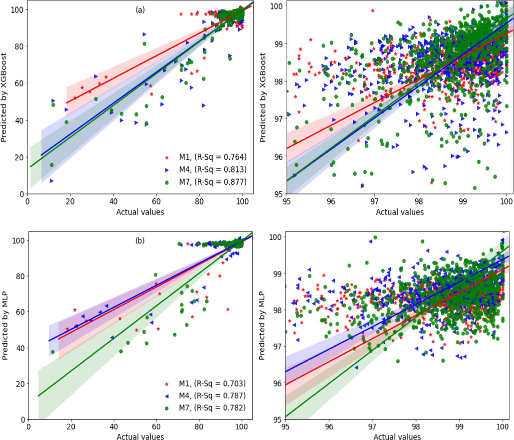
      - **Hình này chứng minh điều gì**
        - XGBoost vượt trội hơn MLP với hệ số xác định cao hơn trên cả 3 kịch bản ($R^2$ từ $0.764$–$0.877$ so với $0.703$–$0.787$), trong đó M7 của XGBoost đạt độ chính xác cao nhất.
      - **Từ đâu mà thấy được**
        - Ox: giá trị thực tế (Actual values), dải $0$–$100$ và dải phóng đại $95$–$100$. Oy: giá trị dự đoán (Predicted by XGBoost/MLP), cùng thang đo.
        - Đồ thị (a) XGBoost: chú giải ghi R-Sq đạt $0.764$ (M1, sao đỏ), $0.813$ (M4, tam giác lam), $0.877$ (M7, tròn lục); các điểm bám dày sát đường chéo ở dải phóng đại.
        - Đồ thị (b) MLP: chú giải ghi R-Sq thấp hơn đạt $0.703$ (M1), $0.787$ (M4), $0.782$ (M7); dải tô bóng tin cậy 95% mở rộng và phân tán xa đường hồi quy hơn.
  - Trong các mô hình XGBoost, đồ thị dự đoán loại bỏ $\text{NH}_4$ khớp tốt nhất với các quan sát thực nghiệm, trong khi các dự đoán loại bỏ $\text{TN}$ và $\text{TP}$ kém chính xác hơn đối với hệ thống $A^2O\text{-MBR}$.
  - Giá trị $R^2$ của các mô hình $\text{M1}$, $\text{M4}$ và $\text{M7}$ phát triển bằng kỹ thuật XGBoost lần lượt đạt $0.764$, $0.813$ và $0.877$.
  - Các mô hình MLP trên cùng tập kịch bản tương ứng chỉ đạt giá trị $R^2$ lần lượt là $0.703$ (cho $\text{M1}$), $0.787$ (cho $\text{M4}$) và $0.782$ (cho $\text{M7}$).
  - Kết quả khẳng định XGBoost hoạt động hiệu quả hơn mô hình MLP trong cùng kịch bản dự đoán hiệu suất loại bỏ $\text{NH}_4$ bằng hệ thống $A^2O\text{-MBR}$.
- Đối chứng với các nghiên cứu tiền nhiệm (mô hình LSTM) và phân tích vai trò của các đặc trưng:
  - Kết quả nghiên cứu đồng thuận với các phát hiện trước đây phát triển mô hình bộ nhớ dài-ngắn hạn (LSTM - Long Short-Term Memory) để dự đoán hiệu suất loại bỏ chất dinh dưỡng trong hệ thống $A^2O\text{-MBR}$: mô hình LSTM trước đây đã mô phỏng thành công mối quan hệ giữa biến đầu vào - đầu ra khi xem xét đồng thời cả $3$ đầu ra $\text{NH}_4$, $\text{TN}$ và $\text{TP}$ trong cùng một mô hình $[32]$.
  - Trong nghiên cứu này, mô hình học máy kết hợp (ensemble ML model) XGBoost được thử nghiệm và so sánh với mạng nơ-ron MLP bằng cách khảo sát từng kịch bản tham số đầu vào và dự đoán độc lập từng chất dinh dưỡng tại một thời điểm:
    - Mục tiêu là khám phá tầm quan trọng của từng đặc trưng (significance of the features) khi tách biệt giữa điều kiện vận hành và đặc tính nước thải đầu vào.
    - Kết quả chỉ ra rằng toàn bộ các đặc trưng đều giữ vai trò quan trọng trong việc mô hình hóa hệ thống $A^2O\text{-MBR}$ để dự đoán khả năng loại bỏ từng chất dinh dưỡng riêng lẻ.
    - XGBoost chứng minh khả năng lần theo và nắm bắt chính xác mối quan hệ phi tuyến phức tạp giữa thông số đầu vào và đầu ra để dự đoán hiệu suất loại bỏ chất dinh dưỡng trong trạm xử lý nước thải ($\text{WWTP}$ / wastewater treatment plant).
  - So sánh với ứng dụng trong các lĩnh vực xử lý nước khác: nghiên cứu trước đó đã chứng minh XGBoost là mô hình vượt trội (so với các công cụ học máy khác) trong việc dự đoán loại bỏ kim loại mangan ($\text{Mn}$) khỏi môi trường nước $[44]$.
- Tiềm năng ứng dụng và giải pháp vượt qua thách thức trong mô hình hóa học máy:
  - Các kết quả củng cố cơ sở khoa học cho thấy mô hình học máy có thể được áp dụng rộng rãi trong các quy trình xử lý nước thải phức tạp nhằm cung cấp thông tin kịp thời cho các nhà vận hành và ra quyết định, hỗ trợ tối ưu hóa quy trình để tuân thủ các quy chuẩn môi trường.
  - Mặc dù yếu tố "bất ngờ" (surprise / độ bất định không lường trước) trong các mô hình học máy dự đoán là tương đối cao, việc kết hợp các công cụ phân tích dữ liệu, lựa chọn thuật toán tối ưu, tinh chỉnh siêu tham số (selection of hyperparameters), cùng quy trình huấn luyện và kiểm định mô hình trên tập dữ liệu chưa từng thấy (unseen dataset) là chìa khóa then chốt để khắc phục nguy cơ thất bại của mô hình.

## 5. Conclusion

- Phát triển và kiểm chứng mô hình học quần thể (ensemble model) XGBoost đối chứng với mạng nơ-ron đa tầng ($MLP$ / multilayer perceptron) nhằm dự đoán hiệu suất loại bỏ ammonium ($\text{NH}_4$), tổng nitơ ($\text{TN}$ / total nitrogen), và tổng phốt pho ($\text{TP}$ / total phosphorus) bằng hệ thống $A^2O\text{-MBR}$ tại trạm xử lý nước thải ($\text{WWTP}$ / wastewater treatment plant).
- Thiết lập và so sánh các kịch bản mô hình hóa khác nhau dựa trên việc xem xét riêng rẽ hoặc kết hợp giữa các thông số điều kiện vận hành và đặc tính nước thải đầu vào:
  - Nhóm điều kiện vận hành (operating conditions): oxy hòa tan ($\text{DO}$ / dissolved oxygen), thế oxy hóa - khử ($\text{ORP}$ / oxidation-reduction potential), và nồng độ chất rắn lơ lửng trong hỗn hợp bùn lỏng ($\text{MLSS}$ / mixed liquor suspended solids).
  - Nhóm thông số dòng vào (influent parameters): tổng carbon hữu cơ ($\text{TOC}$ / total organic carbon), tổng nitơ ($\text{TN}$), tổng phốt pho ($\text{TP}$), nhu cầu oxy hóa học ($\text{COD}$ / chemical oxygen demand), ammonium dạng nitơ ($\text{NH}_4\text{-N}$), và chất rắn lơ lửng ($\text{SS}$ / suspended solids).
  - Kiểm định hiệu quả của các kịch bản qua $9$ mô hình ($M_1$–$M_9$) được xây dựng bằng cả hai kỹ thuật XGBoost và MLP.
- Khả năng dự đoán của mô hình XGBoost đề xuất đạt mức tối ưu nhất sau khi tinh chỉnh các siêu tham số ($\text{HPs}$ / hyperparameters) đối với bài toán dự đoán loại bỏ $\text{NH}_4$ ($M_1$, $M_4$, và $M_7$).
  - Dự đoán hiệu suất loại bỏ $\text{NH}_4$ đạt độ chính xác cao nhất nhờ tập dữ liệu có đặc tính ít nhiễu hơn, ổn định hơn và có lượng giá trị ngoại lai tối thiểu (minimum outliers).
  - Các mô hình đề xuất mang lại kết quả có độ chính xác cao nhất trên tập dữ liệu kiểm tra chưa từng thấy (unseen testing datasets).
- Dự đoán hiệu suất loại bỏ $\text{TN}$ và $\text{TP}$ tương đối kém chính xác hơn (comparatively inaccurate) do độ lệch và phân tán cao (high deviation) trong các tập dữ liệu tương ứng.
- Mô hình MLP được kiểm thử trên cùng các kịch bản để đối chứng và kiểm chứng mô hình XGBoost:
  - Cùng một tập hợp kịch bản ($M_1$, $M_4$, và $M_7$) thể hiện kết quả vượt trội ở cả hai mô hình XGBoost và MLP.
  - Các kết quả được củng cố và chứng minh qua các giá trị đánh giá hiệu năng thống kê gồm sai số tuyệt đối trung bình ($\text{MAE}$ / mean absolute error), căn bậc hai sai số toàn phương trung bình ($\text{RMSE}$ / root mean square error), sai số phần trăm tuyệt đối trung bình ($\text{MAPE}$ / mean absolute percentage error), hệ số xác định ($R^2$), và chỉ số đồng thuận điều chỉnh ($m_d$ / modified index of agreement).
  - Khẳng định mô hình hóa hệ thống $A^2O\text{-MBR}$ tại $\text{WWTP}$ đạt độ tin cậy và chính xác cao khi tập dữ liệu có mức độ nhiễu tối thiểu.
- Đóng góp khoa học và so sánh với nghiên cứu tiền nhiệm:
  - Nghiên cứu là bước mở rộng phát triển từ nghiên cứu trước đây vốn ứng dụng mô hình mạng bộ nhớ ngắn hạn dài ($\text{LSTM}$ / long short-term memory) để mô phỏng cùng hệ thống nhằm dự đoán sự loại bỏ của tất cả chất dinh dưỡng dưới dạng một đầu ra duy nhất (one output).
  - Các mô hình XGBoost và MLP trong nghiên cứu này cung cấp hiểu biết sâu sắc hơn về các kịch bản mô hình hóa khác nhau, cho phép xác định rõ cấu hình mô hình nào tối ưu nhất cho từng kịch bản cụ thể.
- Khuyến nghị vận hành và định hướng nghiên cứu tiếp theo:
  - Trong các nghiên cứu tương lai, phương pháp mô hình hóa có thể hỗ trợ dự đoán loại bỏ chất dinh dưỡng bằng hệ thống $A^2O\text{-MBR}$ và dự báo sớm nồng độ dinh dưỡng tiềm năng dự kiến (tentative concentration) cho các hệ thống xử lý nước thải.
  - Các phát hiện từ nghiên cứu mang lại giá trị thiết thực cho các nhà nghiên cứu và người vận hành trong việc kiểm soát các thông số vận hành điều khiển được (operable parameters) tại trạm xử lý nước thải ($\text{WWTP}$).
