# Impact of salinity on anaerobic ceramic membrane bioreactor for textile wastewater treatment: Process performance, membrane fouling and machine learning models

## Abstract

* Bể phản ứng sinh học màng kỵ khí (anaerobic membrane bioreactor - AnMBR) thể hiện tiềm năng lớn trong xử lý nước thải dệt nhuộm (textile wastewater treatment), nhưng độ mặn cao (high salinity) trong dòng vào có thể làm suy giảm hiệu suất vận hành của hệ thống.
* Nghiên cứu đánh giá tác động của độ mặn đến hiệu suất xử lý của hệ AnMBR cấu hình tầng bùn kỵ khí dòng chảy ngược (upflow anaerobic sludge blanket - UASB) sử dụng màng gốm tấm phẳng (flat sheet ceramic membrane):
    * Độ mặn được tăng từng bước ($0$, $5$, $10$ và $20\text{ g/L}$) qua $4$ giai đoạn vận hành của hệ AnMBR.
* Sự gia tăng độ mặn làm suy giảm hiệu quả loại bỏ COD của AnMBR từ $92\%$ xuống $73\%$, nhưng chỉ gây ảnh hưởng không đáng kể đến hiệu quả loại bỏ chất màu (dye removal efficacy), duy trì ở mức $90\text{--}96\%$.
* Độ mặn thấp ($5\text{ g/L}$) thúc đẩy sản lượng khí sinh học (biogas production), trong khi độ mặn cao ($>10\text{ g/L}$) gây tác động tiêu cực đến quá trình sinh khí.
* Sự gia tăng độ mặn dẫn đến nồng độ sản phẩm vi sinh vật hòa tan (soluble microbial products / soluble microbial production - SMP) tăng vọt và tốc độ tắc nghẽn màng (membrane fouling rate) gia tăng:
    * Nồng độ SMP và tốc độ tắc nghẽn màng đạt đỉnh tại độ mặn $10\text{ g/L}$ (Giai đoạn III / Phase III), sau đó hồi phục trở lại mức thấp hơn tại độ mặn $20\text{ g/L}$ (Giai đoạn IV / Phase IV).
    * Kết quả này chỉ ra sự diễn ra của một quá trình chuyển tiếp (transition) tại ngưỡng độ mặn $10\text{ g/L}$ (Giai đoạn III).
* Các phân tích đa dạng vi sinh vật (microbial diversity analyses) cho thấy sự chuyển dịch từ các vi sinh vật nhạy cảm với độ mặn (salinity-sensitive microbes) sang các vi sinh vật chịu mặn (salinity-tolerant microbes):
    * Vi sinh vật nhạy cảm với độ mặn bao gồm: *Aminiphilus*, *Caldatribacterium*, *Mesotoga*, *Methanobrevibacter*, *Methanobacterium*, và *Methanosaeta*.
    * Vi sinh vật chịu mặn bao gồm: *Longilinea*, *Ignavibacterium*, *Rhodovarius*, *Bosea*, và *Flexilinea*.
    * Quá trình chuyển dịch vi sinh vật này liên quan mật thiết với sự gia tăng nồng độ SMP và hiện tượng nghẽn màng nghiêm trọng hơn trong Giai đoạn III, các hiện tượng này được giảm thiểu sau khi hệ thống đạt trạng thái cân bằng mới khi quần thể vi sinh vật thích nghi với độ mặn cao.
* Một mô hình học máy sử dụng thuật toán Adaboost (machine learning model of the Adaboost algorithm) đã được thiết lập để dự đoán khả năng loại bỏ COD dưới các mức độ mặn khác nhau.
* Nghiên cứu chứng minh rằng hiệu suất quá trình AnMBR và sự vận hành màng có thể được duy trì ổn định đối với nước thải dệt nhuộm độ mặn cao nhờ sự phát triển của quần xã vi sinh vật ưa mặn (halophilic microbial community) dưới áp lực chọn lọc của độ mặn cao.

## 1. Introduction

* Ngành công nghiệp dệt nhuộm (textile industry) đang phát triển mạnh mẽ và trở thành nhân tố đóng góp quan trọng cho sự phát triển kinh tế quốc dân của nhiều quốc gia:
    * Ngành dệt nhuộm có xu hướng tiêu thụ lượng nước rất lớn và hơn $90\%$ lượng nước tiêu thụ chuyển thành nước thải.
    * Nước thải dệt nhuộm chứa nồng độ độ mặn (salinity) cao với $5\text{--}6\%$ $\text{NaCl}$, độ màu (color), chất rắn (solids), nhu cầu oxy hóa học (chemical oxygen demand - $\text{COD}$) và kim loại nặng (heavy metals).
    * Việc xả thải nước thải từ ngành dệt nhuộm vào các thủy vực tự nhiên tạo ra mối nguy hại tiềm tàng lớn đối với sinh vật thủy sinh và sức khỏe cộng đồng do độc tính cao (high toxicity) và khả năng gây đột biến (mutagenicity).
    * Nước thải dệt nhuộm có thể được xử lý bằng các quy trình sinh học hiếu khí (aerobic) và kỵ khí (anaerobic), cũng như các quy trình hóa lý (physio-chemical processes) như keo tụ (coagulation) và tạo bông (flocculation).
    * Phương pháp xử lý sinh học, đặc biệt là quy trình kỵ khí, nổi bật nhờ chi phí thấp và hiệu quả cao.
* Bể phản ứng sinh học màng kỵ khí (anaerobic membrane bioreactors - AnMBR) kết hợp quy trình xử lý sinh học kỵ khí với công nghệ tách màng (membrane separation technology), mang lại nhiều ưu thế trong xử lý nước thải dệt nhuộm:
    * Hệ AnMBR thể hiện các ưu điểm nổi bật bao gồm hiệu quả khử màu cao, tiết kiệm năng lượng, thu hồi khí sinh học (biogas recovery) và phát sinh bùn thấp (low sludge production).
    * Nghiên cứu của Yurtsever và cộng sự (2015) trên nước thải dệt nhuộm nhân tạo (synthetic textile wastewater) chỉ ra rằng AnMBR có thể đạt hiệu quả khử màu hoàn toàn và hiệu suất loại bỏ $\text{COD}$ đạt khoảng $94\%$.
    * Nghiên cứu của Berkessa và cộng sự (2020) đánh giá tính khả thi của bể phản ứng màng động học kỵ khí (anaerobic dynamic membrane bioreactor) trong xử lý nước thải phẩm nhuộm anthraquinone (anthraquinone dye) cho thấy có thể loại bỏ $98.5\%$ $\text{COD}$ hòa tan và hơn $97.5\%$ độ màu.
    * Tuy nhiên, nước thải dệt nhuộm không chỉ chứa phẩm nhuộm mà còn chứa nhiều hóa chất trợ ngấm/phụ trợ (auxiliary chemicals) và các hợp chất ức chế (inhibitory compounds) có thể ảnh hưởng tiêu cực đến hiệu suất xử lý.
    * Nghiên cứu của Yurtsever và cộng sự (2020) khi khảo sát hiệu suất xử lý của AnMBR đối với nước thải dệt nhuộm thực tế (real textile wastewater) ghi nhận hiệu suất loại bỏ $\text{COD}$ chỉ đạt $84\%$.
* Độ mặn cao trong nước thải dệt nhuộm ức chế hiệu suất xử lý sinh học và gây gia tăng tắc nghẽn màng (membrane fouling):
    * Sự ức chế hiệu suất xử lý bắt nguồn từ tác động tiêu cực của nồng độ muối cao lên hoạt tính trao đổi chất của vi sinh vật, từ đó làm giảm hiệu quả phân hủy chất ô nhiễm.
    * Nghiên cứu của Chen và cộng sự (2019) đánh giá tác động của độ mặn ($\text{NaCl}$ $0\text{--}40\text{ g/L}$) lên AnMBR chỉ ra rằng hiệu suất loại bỏ $\text{COD}$ bị ức chế, suy giảm từ $96.4\%$ xuống $77.7\%$.
    * Độ mặn cao không chỉ ảnh hưởng đến hiệu suất xử lý mà còn dẫn đến hiện tượng tắc nghẽn màng nghiêm trọng hơn, nhiều khả năng do sự gia tăng hàm lượng sản phẩm vi sinh vật hòa tan (soluble microbial products - SMP) dưới áp lực muối cao (high salt stress).
    * Các nghiên cứu trước đây đánh giá tác động của độ mặn lên hiệu suất AnMBR chủ yếu tập trung vào cấu hình bể phản ứng khuấy trộn liên tục (continuous stirred tank reactor - CSTR).
    * Hệ AnMBR cấu hình tầng bùn kỵ khí dòng chảy ngược (upflow anaerobic sludge blanket - UASB) dường như có khả năng giảm thiểu tắc nghẽn màng so với cấu hình CSTR nhờ sự lắng đọng lớp cặn nghẽn (fouling layer deposition) ít hơn.
    * UASB là một bể phản ứng kỵ khí tốc độ cao (high-rate anaerobic reactor) điển hình thường được ứng dụng trong xử lý nước thải dệt nhuộm, do đó việc sử dụng AnMBR cấu hình UASB rất thuận lợi cho việc cải tạo/nâng cấp (refurbishment) các trạm xử lý hiện hữu.
    * Tuy nhiên, các nghiên cứu về tác động của độ mặn đối với hệ AnMBR cấu hình UASB trong xử lý nước thải dệt nhuộm hiện còn rất hạn chế.
* Quá trình sinh học trong AnMBR diễn ra phức tạp, tạo tiền đề cho việc ứng dụng các thuật toán máy học (machine learning - ML) nhằm mô hình hóa và dự đoán hiệu suất:
    * Hiệu suất xử lý của AnMBR chịu ảnh hưởng bởi nhiều yếu tố, trong khi mối quan hệ giữa các biến số vận hành và hiệu quả loại bỏ chất ô nhiễm vẫn chưa được làm sáng tỏ sâu sắc.
    * Máy học là kỹ thuật phân loại (classification) và hồi quy (regression) dựa trên dữ liệu hoặc kinh nghiệm trong quá khứ, hiện được ứng dụng rộng rãi trong lĩnh vực xử lý nước thải.
    * Một số mô hình đã được xây dựng để dự đoán hiệu suất AnMBR, chẳng hạn như nghiên cứu của Huang và cộng sự (2018) đã sử dụng mô hình mạng nơ-ron lan truyền ngược (back propagation neural network - BPNN) để dự đoán hiệu suất AnMBR (loại bỏ $\text{COD}$ và kháng sinh) trong xử lý nước thải dược phẩm.
    * Tuy nhiên, rất ít nghiên cứu xem xét việc đưa tác động của độ mặn vào các mô hình dự đoán hiệu suất xử lý của hệ AnMBR.
    * Adaboost (Adaptive Boosting), cây quyết định (decision trees) và rừng ngẫu nhiên (random forests) là các thuật toán máy học tiêu biểu:
        * Thuật toán Adaboost kết hợp nhiều bộ phân loại yếu (weak classifiers) thành một bộ phân loại mạnh (strong classifier), mang lại hiệu năng phân loại cao và có khả năng dự đoán tốt nồng độ chất ô nhiễm.
        * So với cây quyết định và rừng ngẫu nhiên, Adaboost có xu hướng đạt độ chính xác cao hơn và ít xảy ra hiện tượng quá khớp (overfitting), mang lại các dự đoán sát với thực tế hơn.
* Mục tiêu và nội dung chính của nghiên cứu này:
    * Mục tiêu chung: đánh giá tác động của độ mặn lên hệ AnMBR màng gốm (ceramic membrane) cấu hình UASB trong xử lý nước thải dệt nhuộm nhân tạo.
    * Đánh giá tác động của việc tăng dần từng bước độ mặn ($0\text{--}20\text{ g/L}$ $\text{NaCl}$) đến quá trình khử màu (decolorization), phân hủy chất hữu cơ (organic degradation), quá trình kỵ khí (anaerobic process) và hiện tượng tắc nghẽn màng của hệ AnMBR màng gốm cấu hình UASB.
    * Phân tích cấu trúc quần xã vi sinh vật (microbial community structure) nhằm làm rõ sự biến đổi của quần thể vi sinh vật dưới các mức áp lực muối khác nhau.
    * Xây dựng mô hình dự đoán $\text{COD}$ đầu ra (effluent $\text{COD}$) dựa trên thuật toán máy học Adaboost nhằm thiết lập mối quan hệ giữa $\text{COD}$ đầu ra và các yếu tố môi trường trong AnMBR.

## 2. Materials and methods

### 2.1. UASB-configured AnMBR setup and operational conditions

* Hệ thống AnMBR gồm một bể phản ứng kỵ khí tầng bùn dòng chảy ngược (upflow anaerobic sludge blanket - UASB) thể tích $6.4\text{ L}$ (đường kính $0.045\text{ m} \times$ chiều cao $0.6\text{ m}$) kết hợp với một bể màng đặt ngoài (external membrane tank) (Fig. 1):
    * **Hình 1.** Schematic of AnMBR set-up.
        * 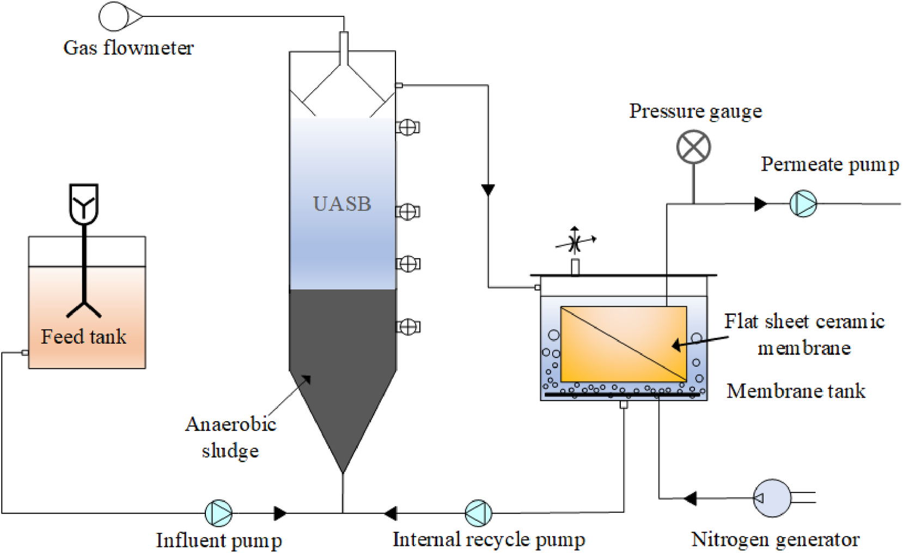
    * Cấu tạo hệ thống gồm bể cấp liệu (Feed tank), bể UASB kỵ khí, bể màng ngoài (Membrane tank) và máy tạo khí nitơ (Nitrogen generator).
    * Dòng nước thải được bơm vào đáy bể UASB; khí sinh học thoát lên đỉnh qua bộ thu khí và đồng hồ đo lưu lượng khí (Gas flowmeter).
    * Bể màng bố trí tấm màng gốm phẳng (Flat sheet ceramic membrane) ngập trong nước kèm hệ thống phân phối khí $\text{N}_2$ từ đáy để kiểm soát nghẽn màng.
    * Dòng thấm được hút qua màng bằng bơm hút permeate kèm đồng hồ áp suất; bùn từ đáy bể màng được tuần hoàn về đáy UASB qua bơm tuần hoàn nội bộ (Internal recycle pump).
* Bùn cấy (inoculated sludge) và điều kiện cấp nước thải vào bể UASB:
    * Bể phản ứng UASB được cấy $1.6\text{ L}$ bùn bông kỵ khí (anaerobic flocculent sludge) với nồng độ chất rắn tổng $46\text{ g TS L}^{-1}$ và chất rắn bay hơi $26\text{ g VS L}^{-1}$, thu thập tại địa phương từ bể phân hủy kỵ khí xử lý bùn đô thị (Ninh Ba, Chiết Giang, Trung Quốc - Ningbo, Zhejiang, China).
    * Nước thải dệt nhuộm nhân tạo (synthetic textile wastewater) chứa $1000\text{ mg/L}$ glucose, $100\text{ mg/L}$ methyl orange (MO) và các nguyên tố vi lượng (trace elements) (Yurtsever et al., 2016) được bơm vào bể UASB bằng bơm nhu động (peristaltic pump; mã hiệu YZ1515X, Longer, Baoding, Trung Quốc).
    * Nồng độ natri clorua ($\text{NaCl}$) được thay đổi tùy theo từng giai đoạn vận hành.
* Các thông số vận hành thủy lực và nhiệt độ:
    * Thời gian lưu nước (hydraulic retention time - $\text{HRT}$) khoảng $21\text{ h}$ và thời gian lưu chất rắn (solids retention time - $\text{SRT}$) khoảng $100\text{ d}$.
    * Nhiệt độ của bể phản ứng được duy trì ở mức $35 \pm 1^\circ\text{C}$ bằng bể điều nhiệt cách thủy (water bathing).
    * Sản lượng khí sinh học (biogas) được theo dõi liên tục bằng đồng hồ đo lưu lượng khí (gas flow meter; mã hiệu LML-1, Senlod, Nam Kinh, Trung Quốc).
* Đặc tính bể màng ngoài và chế độ tuần hoàn dòng lưu giữ (retentate):
    * Dòng chảy tràn từ bể UASB đi vào bể màng có thể tích $5.3\text{ L}$ (kích thước $0.3 \times 0.1 \times 0.2\text{ m}$).
    * Dòng bùn lưu giữ (retentate) được tuần hoàn ngược về bể UASB để duy trì vận tốc dòng chảy ngược (upflow velocity) trong khoảng $0.8\text{--}1.0\text{ m/h}$.
* Thông số module màng và biện pháp sục khí kiểm soát nghẽn màng:
    * Sử dụng màng gốm tấm phẳng vật liệu $\text{Al}_2\text{O}_3$ (flat sheet $\text{Al}_2\text{O}_3$ ceramic membrane; kích thước lỗ lọc $0.1\ \mu\text{m}$, diện tích màng $0.065\text{ m}^2$, Tianjian Water Company, Hàng Châu, Trung Quốc).
    * Khí nitơ ($\text{N}_2$) được sục vào bể màng như một giải pháp thay thế cho khí sinh học để kiểm soát nghẽn màng, tuân thủ các quy định an toàn và sức khỏe trong phòng thí nghiệm.
    * Khí nitơ được tạo từ máy phát khí nitơ (TN-10, Tainuo, Sơn Đông, Trung Quốc) và điều chỉnh lưu lượng bằng lưu lượng kế (LZB-6WB, Shengzhiyuan, Thường Châu, Trung Quốc).
    * Nhu cầu khí riêng trên một đơn vị diện tích màng (specific gas demand per unit membrane area - $\text{SGD}_m$) được duy trì ở mức $2.0\text{ m}^3\text{ m}^{-2}\text{ h}^{-1}$.
    * Các nghiên cứu trong tương lai về ảnh hưởng của thành phần khí sinh học lên đặc tính bùn khối (bulk sludge) và hiện tượng nghẽn màng là rất cần thiết.
* Chế độ lọc và giám sát áp suất qua màng:
    * Thông lượng màng (membrane flux) được duy trì ở mức $5\text{ L m}^{-2}\text{ h}^{-1}$ với chu kỳ lọc $9\text{ phút}$ và nghỉ (relaxation) $1\text{ phút}$.
    * Áp suất qua màng (transmembrane pressure - $\text{TMP}$) được thu thập bằng đồng hồ đo áp suất ($-0.1\text{--}0.15\text{ MPa}$, Yichuan, Thượng Hải, Trung Quốc) và ghi lại trong bộ lưu dữ liệu (data logger).
    * Tốc độ nghẽn màng với các giá trị $\mathrm{d}\text{TMP}/\mathrm{d}t$ trong giai đoạn tăng TMP chậm và giai đoạn tăng TMP đột ngột cũng được tính toán (Yoon, 2015).
* Trình tự thí nghiệm và tóm tắt các điều kiện vận hành ở từng giai đoạn được trình bày trong Table 1:
    * **Bảng 1.** Summary of AnMBR operational conditions.
        * 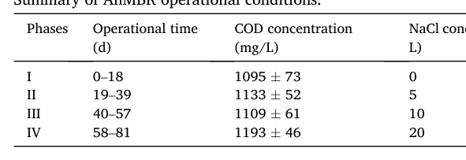
    * Bảng tóm tắt điều kiện vận hành AnMBR qua $4$ giai đoạn ($\text{Phase I--IV}$) với tổng thời gian $81\text{ ngày}$: $\text{Phase I}$ ($0\text{--}18\text{ ngày}$), $\text{Phase II}$ ($19\text{--}39\text{ ngày}$), $\text{Phase III}$ ($40\text{--}57\text{ ngày}$) và $\text{Phase IV}$ ($58\text{--}81\text{ ngày}$).
    * Nồng độ $\text{NaCl}$ dòng vào tăng theo từng bậc độ mặn: $0\text{ g/L}$ ($\text{Phase I}$), $5\text{ g/L}$ ($\text{Phase II}$), $10\text{ g/L}$ ($\text{Phase III}$) và $20\text{ g/L}$ ($\text{Phase IV}$).
    * Nồng độ $\text{COD}$ dòng vào được duy trì ổn định qua các giai đoạn: $1095 \pm 73\text{ mg/L}$ ($\text{Phase I}$), $1133 \pm 52\text{ mg/L}$ ($\text{Phase II}$), $1109 \pm 61\text{ mg/L}$ ($\text{Phase III}$) và $1193 \pm 46\text{ mg/L}$ ($\text{Phase IV}$).
* Phân chia giai đoạn thí nghiệm, quy trình lấy mẫu và rửa màng:
    * Đợt vận hành thí nghiệm được chia thành $4$ giai đoạn dựa trên nồng độ $\text{NaCl}$ dòng vào khác nhau ($0\text{ g/L}$, $5\text{ g/L}$, $10\text{ g/L}$, $20\text{ g/L}$), mỗi giai đoạn kéo dài khoảng $20\text{--}30\text{ ngày}$.
    * Dòng ra của AnMBR được lấy mẫu định kỳ $2\text{--}3\text{ ngày}$ một lần để đo $\text{COD}$ và phẩm nhuộm azo (methyl orange).
    * Hỗn dịch trong bể màng (membrane tank mixed liquor) được lấy mẫu định kỳ $2\text{--}3\text{ ngày}$ một lần để xác định hàm lượng chất rắn lơ lửng hỗn dịch (mixed liquor suspended solids - $\text{MLSS}$) và nồng độ các sản phẩm vi sinh vật hòa tan (soluble microbial products - $\text{SMP}$).
    * Khi màng bị tắc nghẽn với $\text{TMP}$ đạt $30\text{ kPa}$, module màng trước hết được rửa cơ học (physically cleaned), sau đó được ngâm trong dung dịch natri hypoclorit ($\text{NaClO}$) $0.5\%$ trong $24\text{ h}$.

### 2.2. Microbial community analysis

* Công nghệ giải trình tự thông lượng cao (high-throughput sequencing technology) được áp dụng để phân tích quần thể vi sinh vật trong bùn bông kỵ khí từ bể phản ứng UASB sau khi kết thúc mỗi giai đoạn vận hành.
* Bảo quản mẫu và chiết tách DNA:
    * Mẫu bùn thu thập được lưu trữ ở nhiệt độ $-20^\circ\text{C}$ trước khi thực hiện chiết tách DNA.
    * Quá trình chiết tách DNA được tiến hành bằng bộ kit MagBind® Soil DNA Kit (Omega, Hoa Kỳ).
* Khuyếch đại đoạn gen đích:
    * Cặp mồi phổ quát (universal primers) 515FmodF và 806RmodR được sử dụng để nhân bản trình tự gen 16S rDNA của cả vi khuẩn (bacteria) và vi khuẩn cổ (archaea).
* Đơn vị thực hiện phân tích:
    * Đa dạng vi sinh vật được phân tích bởi Công ty TNHH Công nghệ Dược phẩm Sinh học Majorbio Thượng Hải (Shanghai Majorbio Biopharm Technology Co., Ltd, Thượng Hải, Trung Quốc).

### 2.3. Adaptive boosting (adaboost) model development

* Khái niệm và nguyên lý thuật toán Adaboost:
    * Adaboost là một thuật toán tăng cường (boosting algorithm) kết hợp nhiều bộ phân loại yếu (weak classifiers) thành một bộ phân loại mạnh (strong classifier) (Freund và Schapire, 1997).
* Xây dựng mô hình và cấu trúc biến số:
    * Khoảng $40$ bộ thông số được sử dụng để xây dựng mô hình Adaboost.
    * Các biến đầu vào (input variables) của mô hình gồm: nồng độ $\text{COD}$ dòng vào (influent COD concentration), nồng độ $\text{NaCl}$, các giai đoạn vận hành khác nhau (different phases) và thời gian phơi nhiễm (time of exposure).
    * Biến đầu ra (output variable) được thiết lập là nồng độ $\text{COD}$ dòng ra (effluent COD concentration).
* Tiền xử lý và phân chia tập dữ liệu:
    * Dữ liệu trước tiên được chuẩn hóa (normalized) và phân chia ngẫu nhiên thành hai tập: tập huấn luyện (training set, chiếm $70\%$) và tập kiểm tra (test set, chiếm $30\%$).
    * Tập huấn luyện được sử dụng để xây dựng và hiệu chuẩn mô hình (model construction and calibration).
    * Tập kiểm tra được dùng để dự đoán thông số (parameter prediction).
* Quy trình huấn luyện mô hình:
    * Mô hình Adaboost huấn luyện các bộ phân loại yếu bằng cách khởi tạo phân phối trọng số trên các biến đầu vào, kết hợp chúng lặp đi lặp lại thành bộ phân loại mạnh, và áp dụng các thuật toán học phân phối tiến (forward distribution learning algorithms) để thu được kết quả dự đoán (Rätsch et al., 2001).
* Tiêu chí đánh giá hiệu năng mô hình:
    * Hiệu năng của mô hình được đánh giá thông qua hệ số xác định $R^2$ (coefficient of determination, Eqn. (2)) và căn bậc hai của sai số bình phương trung bình $\text{RMSE}$ (root mean square error, Eqn. (1)):
      $$\text{RMSE} = \sqrt{\frac{1}{n}\sum_{i=1}^{n}\left(y^{(i)} - y_t^{(i)}\right)^2} \tag{1}$$
      $$R^2 = 1 - \frac{\sum_{i=1}^{n}\left(y_t^{(i)} - y^{(i)}\right)^2}{\sum_{i=1}^{n}\left(y_t^{(i)} - \hat{y}\right)^2} \tag{2}$$
    * Trong đó $y_t^{(i)}$ và $y^{(i)}$ lần lượt là giá trị dự đoán và giá trị đầu ra thực tế thứ $i$, và $\hat{y}$ là giá trị trung bình của các dự đoán cho toàn bộ $n$ điểm dữ liệu.
* Công cụ phần mềm triển khai:
    * Việc xây dựng mô hình và đánh giá hiệu năng được thực hiện bằng phần mềm Python 3.6.

### 2.4. Analytical methods

* Phương pháp xác định MLSS và COD:
    * Hàm lượng chất rắn lơ lửng hỗn dịch (mixed liquor suspended solids - $\text{MLSS}$) và $\text{COD}$ được xác định theo Tiêu chuẩn Phương pháp Chuẩn (Standard Methods, 2017).
    * Để loại bỏ sự cản trở của lượng ion clorua ($\text{Cl}^-$) dư thừa đối với phép đo $\text{COD}$, nước sau xử lý (effluent water) được pha loãng $10\text{--}20\text{ lần}$ trước khi đo.
* Đo nồng độ phẩm nhuộm methyl orange (MO):
    * Nồng độ methyl orange (MO) được đo bằng máy quang phổ tử ngoại - khả kiến (ultra-violet spectrophotometer; Persee T6, Bắc Kinh, Trung Quốc) ở bước sóng $464\text{ nm}$ (Liu et al., 2018a).
* Thử nghiệm hoạt tính sinh methane đặc riêng (specific methanogenic activity - SMA):
    * Thử nghiệm SMA của bùn UASB được tiến hành tại thời điểm kết thúc mỗi giai đoạn nhằm đánh giá tác động của độ mặn lên khả năng sinh khí methane (Ozgun et al., 2015; van Loosdrecht et al., 2016).
    * Acetate được sử dụng làm cơ chất với nồng độ $\text{COD}$ là $2\text{ g/L}$, tỷ lệ giữa $\text{VSS}_{\text{inoculum}}$ và $\text{COD}_{\text{substrate}}$ được thiết lập ở mức $2$.
    * Để duy trì mức độ ức chế muối nhất quán, thử nghiệm SMA được hiệu chỉnh bằng cách bổ sung nồng độ $\text{NaCl}$ vào các bình huyết thanh kỵ khí (anaerobic serum bottles) tương đương với nồng độ ở từng giai đoạn vận hành của bể phản ứng.
* Xác định nồng độ và phân bố khối lượng phân tử của sản phẩm vi sinh vật hòa tan (SMP):
    * Hỗn dịch trong bể màng được lọc qua màng kích thước lỗ $0.45\ \mu\text{m}$ để xác định nồng độ sản phẩm vi sinh vật hòa tan (soluble microbial products - $\text{SMP}$).
    * Áp dụng phương pháp Lowry cải tiến (modified Lowry's method; Lowry et al., 1951) để xác định protein và phương pháp phenol-sulfuric acid (Dubois et al., 1956) để xác định polysaccharide.
    * Hỗn dịch bể màng cũng được phân tách thành các kích thước hạt khác nhau ($1.2\ \mu\text{m}$, $0.45\ \mu\text{m}$, $100\text{ kDa}$, $10\text{ kDa}$, $1\text{ kDa}$) bằng các cốc siêu lọc (ultrafiltration cups; model MSC300/MSC050, Thượng Hải, Trung Quốc) để xác định phân bố khối lượng phân tử của SMP.
* Phân tích phổ huỳnh quang 3D-EEM:
    * Máy quang phổ phát quang (luminescence spectrometry; model Horiba FluoroMax-4, Kyoto, Nhật Bản) được sử dụng để đo toàn bộ phổ huỳnh quang ma trận kích thích - phát xạ (excitation-emission matrix - EEM) của hỗn dịch bể màng.

## 3. Results and discussion

### 3.1. Impact of salinity on AnMBR treatment performance

- Hiệu suất xử lý COD và methyl orange (MO - cam methyl) của hệ AnMBR thay đổi theo từng bước tăng nồng độ $\text{NaCl}$ ($0$, $5$, $10$, và $20\text{ g/L}$) trong suốt thời gian vận hành liên tục (Fig. 2, Table 2):
  - Ở Giai đoạn I (Phase I, ngày $0\text{--}18$, $\text{NaCl } 0\text{ g/L}$), hiệu suất khử COD đạt $88.4\%$ ($88.36 \pm 1.15\%$), với nồng độ COD dòng vào $1095 \pm 73\text{ mg/L}$ và dòng ra $123 \pm 8\text{ mg/L}$.
  - Khi hệ AnMBR lần đầu chịu ứng suất muối (salt stress) ở mức $5\text{ g/L}$ (Phase II, ngày $19\text{--}39$), hiệu suất khử COD giảm nhanh xuống $80.5\%$ trước khi phục hồi dần và đạt mức $88.9\%$ ($88.87 \pm 3.65\%$), nồng độ COD dòng vào $1133 \pm 52\text{ mg/L}$ và dòng ra $111 \pm 18\text{ mg/L}$.
    - Luo et al. (2016) cũng ghi nhận hiện tượng suy giảm ban đầu và gia tăng sau đó của hiệu năng xử lý MBR khi độ mặn dòng vào tăng.
    - Sự phục hồi này chỉ ra rằng hiệu năng sinh học của AnMBR có thể được tái lập khi quần thể vi sinh vật thích ứng với môi trường mặn, chứng minh hệ thống có khả năng chống chịu sốc độ mặn nhất định (shock resistance to salinity) (Luo et al., 2016; Zhang et al., 2020a).
  - Khi tiếp tục tăng nồng độ $\text{NaCl}$ lên $10\text{ g/L}$ ở Phase III (ngày $40\text{--}57$) và $20\text{ g/L}$ ở Phase IV (ngày $58\text{--}81$), hiệu suất khử COD bị giới hạn ở mức lần lượt là $85.2\%$ ($85.18 \pm 1.80\%$, dòng vào $1109 \pm 61\text{ mg/L}$, dòng ra $164 \pm 16\text{ mg/L}$) và $78.3\%$ ($78.25 \pm 3.08\%$, dòng vào $1193 \pm 46\text{ mg/L}$, dòng ra $259 \pm 34\text{ mg/L}$).
    - Chen et al. (2019) cũng báo cáo hiệu suất khử COD trong AnMBR bị ức chế đáng kể từ trên $96\%$ xuống dưới $78\%$ khi hàm lượng $\text{NaCl}$ tăng từ $0$ lên $40\text{ g/L}$.
    - Aslan và Şekerdağ (2015) ghi nhận độ mặn gây tác động tiêu cực đến xử lý UASB, khiến hiệu suất khử COD giảm rõ rệt từ $90\%$ xuống dưới $72\text{--}92\%$ ở nồng độ muối $10\text{ g/L}$ và giảm tiếp xuống $20\text{--}30\%$ ở nồng độ $50\text{ g/L}$.
    - Nguyên nhân ức chế là do độ mặn cao làm gia tăng chênh lệch áp suất thẩm thấu (osmotic pressure difference) qua thành tế bào, phá vỡ chức năng chuyển hóa và gây tan rã tế bào do mất nước nội bào (cellular water loss) và co nguyên sinh chất (cytoplasm recession), dẫn tới suy giảm hoạt tính vi sinh vật và mất nước tế bào (Abou-Elela et al., 2010; He et al., 2017).
  - Diễn biến hiệu suất khử MO theo các mức độ mặn từng bước thể hiện xu hướng khác biệt so với hiệu suất khử COD (Fig. 2b):
    - Hiệu suất khử MO trung bình ở Phase I đạt trên $96\%$ ($96.31 \pm 1.23\%$, nồng độ MO dòng vào $101.67 \pm 0.68\text{ mg/L}$, dòng ra $3.83 \pm 1.28\text{ mg/L}$).
    - Mặc dù xuất hiện sự sụt giảm nhẹ trong giai đoạn chuyển tiếp độ mặn, hiệu suất khử MO tổng thể vẫn duy trì ổn định trong khoảng $90\text{--}96\%$ ngay cả khi độ mặn tăng lên tới $20\text{ g/L}$ (Phase II: $89.61 \pm 3.14\%$; Phase III: $91.38 \pm 3.44\%$; Phase IV: $95.63 \pm 1.98\%$).
    - Các nghiên cứu trước đây cũng chỉ ra rằng mặc dù hiệu suất khử COD bị ức chế nghiêm trọng, hiệu quả loại bỏ chất màu (dye removal) không bị ảnh hưởng (Dafale et al., 2008; Işık, 2004).
    - Khả năng duy trì khử MO ở độ mặn cao được giải thích do sự làm giàu của một số chi vi sinh vật liên quan đến phân hủy hợp chất thơm (aromatic compound degradation) khi độ mặn tăng như *Acidovorax*, *Bosea*, và *Longilinea* (Zhu et al., 2018).
    - Quá trình khử màu thuốc nhuộm azo (azo dye decolorization) gắn liền với các enzyme bao gồm lignin peroxidase, azo-reductase và laccase, trong đó hoạt tính của các enzyme này chỉ bị ức chế khi độ mặn đạt $15\%$ và $20\%$ (tương đương $150\text{--}200\text{ g/L}$) (Guo et al., 2021).
    * **Hình 2.** AnMBR performance during operation times:(a) COD removal, (b
        * 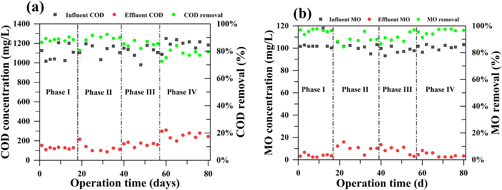
    * **(a) COD removal**: Nồng độ Influent COD dao động $1000\text{--}1250\text{ mg/L}$. Ở Phase I ($0\text{ g/L}$ NaCl), hiệu suất khử COD ổn định ở mức trung bình $88.4\%$ (Effluent COD khoảng $110\text{--}150\text{ mg/L}$). Khi chuyển sang Phase II ($5\text{ g/L}$ NaCl), hệ bị sốc muối làm Effluent COD tăng lên $\sim 215\text{ mg/L}$, hiệu suất giảm đột ngột xuống $80.5\%$ trước khi thích nghi và phục hồi dần về $88.9\%$. Khi tăng tiếp nồng độ NaCl lên $10\text{ g/L}$ (Phase III) và $20\text{ g/L}$ (Phase IV), hiệu suất khử COD bị ức chế rõ rệt, giảm xuống lần lượt $85.2\%$ và $78.3\%$ với Effluent COD tăng lên $200\text{--}300\text{ mg/L}$.
    * **(b) MO removal**: Influent MO duy trì ổn định $\sim 100\text{ mg/L}$ ($95\text{--}103\text{ mg/L}$). Ở Phase I, hiệu suất khử Methyl Orange đạt mức rất cao $>96\%$ (Effluent MO $<6\text{ mg/L}$). Dù có sự sụt giảm nhẹ trong giai đoạn chuyển tiếp giữa các mức độ mặn (hiệu suất giảm ngắn hạn về khoảng $85\text{--}88\%$), hệ AnMBR vẫn duy trì hiệu suất khử MO tổng thể trong dải $90\text{--}96\%$ ngay cả khi nồng độ NaCl đạt mức cao nhất $20\text{ g/L}$.

- Tác động của độ mặn đến sản lượng biogas được đánh giá thông qua thử nghiệm hoạt tính sinh methane đặc trưng cải tiến (modified specific methanogenic activity - SMA) (Table 2, Fig. S1):
  - Ở Phase I ($\text{NaCl } 0\text{ g/L}$), SMA của bùn kỵ khí đạt $0.046\text{ g COD g VSS}^{-1}\text{ d}^{-1}$ ($0.046 \pm 0.006\text{ g COD g VSS}^{-1}\cdot\text{d}^{-1}$).
  - Khi tăng nồng độ $\text{NaCl}$ lên $5\text{ g/L}$ (Phase II), giá trị SMA tăng vọt lên $0.077\text{ g COD g VSS}^{-1}\text{ d}^{-1}$ ($0.077 \pm 0.006\text{ g COD g VSS}^{-1}\cdot\text{d}^{-1}$).
  - Khi độ mặn tiếp tục tăng lên $10\text{ g/L}$ (Phase III) và $20\text{ g/L}$ (Phase IV), SMA suy giảm rõ rệt xuống lần lượt là $0.042\text{ g COD g VSS}^{-1}\text{ d}^{-1}$ ($0.042 \pm 0.007\text{ g COD g VSS}^{-1}\cdot\text{d}^{-1}$) và $0.010\text{ g COD g VSS}^{-1}\text{ d}^{-1}$ ($0.010 \pm 0.001\text{ g COD g VSS}^{-1}\cdot\text{d}^{-1}$).
  - Kết quả chỉ ra rằng nồng độ $\text{NaCl}$ thấp thúc đẩy sản xuất biogas trong khi nồng độ $\text{NaCl}$ cao gây tác động ức chế nghiêm trọng.
    - Zhang et al. (2020b) cũng báo cáo sản lượng biogas từ phân hủy kỵ khí (anaerobic digestion - AD) xử lý rác thải nhà bếp tăng từ $4.25\text{ L}$ lên $5.28\text{ L}$ khi độ mặn tăng từ $1.0$ lên $2.0\text{ g/L}$, sau đó suy giảm khi độ mặn tăng cao hơn.
    - Sự gia tăng sản sinh biogas ban đầu ở độ mặn thấp cho thấy vi sinh vật sinh methane (methanogens) có khả năng thích ứng tiềm tàng với môi trường mặn sau quá trình thuần hóa (Zhang et al., 2020b).
    - Sự suy giảm sản lượng methane ở độ mặn cao bắt nguồn từ việc vi sinh vật kỵ khí phải tiêu tốn cơ chất để sinh tổng hợp các chất tan tương thích (compatible solutes) nhằm đối phó với áp suất thẩm thấu cao, cùng với hoạt tính enzyme bị suy giảm do tế bào mất nước nội bào (Aslan và Şekerdağ, 2016; Oh et al., 2008).
  - Bảng tổng hợp các thông số vận hành của AnMBR dưới các mức nồng độ $\text{NaCl}$ khác nhau (Table 2):
    * **Bảng 2.** Effect of NaCl concentration on AnMBR performance (COD and M
        * 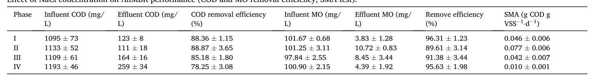
    - **COD removal**: Hiệu suất khử COD đạt đỉnh ở Phase II ($88.87 \pm 3.65\%$) và Phase I ($88.36 \pm 1.15\%$), sau đó giảm dần khi tăng độ mặn xuống $85.18 \pm 1.80\%$ (Phase III) và thấp nhất $78.25 \pm 3.08\%$ (Phase IV), Effluent COD tăng tương ứng từ $123 \pm 8$ lên $259 \pm 34\text{ mg/L}$.
    - **MO removal**: Hiệu suất khử Methyl Orange duy trì ở mức cao qua các giai đoạn: $96.31 \pm 1.23\%$ (Phase I, Effluent $3.83 \pm 1.28\text{ mg/L}$), giảm tạm thời xuống $89.61 \pm 3.14\%$ (Phase II, Effluent $10.72 \pm 0.83\text{ mg/L}$), sau đó phục hồi lên $91.38 \pm 3.44\%$ (Phase III, Effluent $8.45 \pm 3.44\text{ mg/L}$) và $95.63 \pm 1.98\%$ (Phase IV, Effluent $4.39 \pm 1.92\text{ mg/L}$) với nồng độ Influent MO lần lượt là $101.67 \pm 0.68$, $101.25 \pm 3.11$, $97.84 \pm 2.55$, và $100.90 \pm 2.15\text{ mg/L}$.
    - **SMA test**: Hoạt tính sinh methane đặc trưng tăng từ $0.046 \pm 0.006$ (Phase I) lên mức cực đại $0.077 \pm 0.006\text{ g COD g VSS}^{-1}\cdot\text{d}^{-1}$ ở Phase II ($5\text{ g/L}$ NaCl), sau đó bị ức chế rõ rệt ở Phase III ($0.042 \pm 0.007$) và giảm sâu nhất ở Phase IV ($0.010 \pm 0.001\text{ g COD g VSS}^{-1}\cdot\text{d}^{-1}$, $20\text{ g/L}$ NaCl).

- Đánh giá tổng thể hiệu năng và định hướng tối ưu hóa hệ AnMBR dưới điều kiện sốc mặn:
  - Độ mặn thấp ($5\text{ g/L}$) chỉ tác động hạn chế đến quá trình phân hủy chất hữu cơ và sinh biogas nhờ sinh khối kỵ khí thích nghi và thuần hóa với độ mặn.
  - Độ mặn cao ($>10\text{ g/L}$) thể hiện tác động tiêu cực rõ rệt lên hiệu suất khử COD và sinh biogas, chủ yếu do hoạt tính vi sinh vật suy giảm dưới áp suất thẩm thấu cao và mất nước nội bào.
  - Đối với chất màu MO, độ mặn chỉ gây ảnh hưởng không đáng kể (marginal effect) trong AnMBR, nhờ sự làm giàu của các vi sinh vật chuyên biệt và khả năng chịu mặn cao của các enzyme phân hủy màu.
  - Giải pháp cân bằng áp suất thẩm thấu cao bằng bổ sung ion vô cơ hoặc chất tan tương thích:
    - Bổ sung các ion vô cơ (như $\text{K}^+$, $\text{Ca}^{2+}$ và $\text{Mg}^{2+}$) hoặc các chất tan tương thích (như glycine betaine) giúp cân bằng chênh lệch áp suất thẩm thấu cao (Li et al., 2018b; Zhang et al., 2016).
    - Li et al. (2018b) đánh giá ảnh hưởng của việc bổ sung $\text{KCl}$ lên xử lý kỵ khí nước thải mặn chứa $2.0\%\text{ NaCl}$ và nhận thấy bổ sung $\text{KCl}$ làm tăng đáng kể hiệu suất khử COD thêm $115.4\%$.
    - Zhang et al. (2016) báo cáo bổ sung glycine betaine có thể giảm thiểu hiệu quả tác động của độ mặn cao lên quá trình AD, đặc biệt đối với vi sinh vật sinh acid acetic (acetic acid producers), vi khuẩn sinh methane dùng acetate (acetoclastic methanogens) và vi sinh vật sử dụng n-butyrate (n-butyrate utilizers).
    - Việc bổ sung ion vô cơ hoặc chất tan tương thích là giải pháp khả thi để duy trì hiệu năng xử lý của AnMBR, song cần có thêm các nghiên cứu chuyên sâu về tác động của chúng đối với hiện tượng nghẽn màng (membrane fouling).
  - Tối ưu hóa điều kiện vận hành và triển vọng tương lai:
    - Các điều kiện vận hành như thời gian lưu bùn (sludge retention time - SRT) và thời gian lưu thủy lực (hydraulic retention time - HRT) cần được tối ưu hóa để chống chịu độ mặn trong AnMBR.
    - Trong tương lai, hệ AnMBR sử dụng màng gốm (ceramic membrane) sở hữu tiềm năng ứng dụng cao trong xử lý nước thải dệt nhuộm ở các mức độ mặn khác nhau khi kết hợp bổ sung ion vô cơ hoặc chất tan tương thích cùng với các thông số vận hành được tối ưu.

### 3.2. Impact of salinity on AnMBR fouling profiles

* Giám sát diễn biến áp suất qua màng (transmembrane pressure - TMP profiles) để đặc trưng hóa sự tắc nghẽn màng gốm (ceramic membrane fouling) dưới áp lực độ mặn khác nhau (different salinity stress) (Fig. 3):
    * **Hình 3.** Variations in the TMP during the anaerobic ceramic membrane 
        * 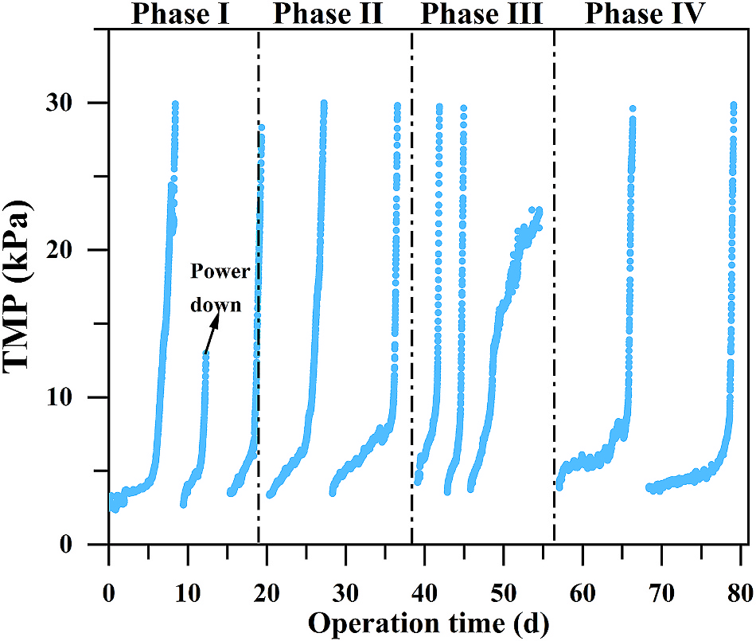
    * Biểu đồ TMP ($0\text{--}30\text{ kPa}$) qua 4 giai đoạn vận hành ($0\text{--}80\text{ ngày}$) với ngưỡng rửa màng/tắc nghẽn tối đa khoảng $30\text{ kPa}$.
    * **Phase I (0 g/L NaCl, 0–19 d):** Chu kỳ đầu kéo dài $\sim 6.9\text{ d}$ trước khi TMP tăng vọt lên $30\text{ kPa}$; ghi nhận sự cố mất điện ("Power down") tại ngày $\sim 12$ khi TMP đạt $\sim 13\text{ kPa}$.
    * **Phase II (5 g/L NaCl, 19–38 d):** Xuất hiện 2 chu kỳ lọc ổn định ($\sim 7\text{--}9\text{ d}$/chu kỳ) với động học tăng TMP tương đồng Phase I trước khi đạt ngưỡng $30\text{ kPa}$.
    * **Phase III (10 g/L NaCl, 39–56 d):** Tốc độ tắc nghẽn màng tăng vọt nhanh nhất; 2 chu kỳ đầu bị rút ngắn chỉ còn $2\text{--}3\text{ d}$ đã chạm $30\text{ kPa}$, chu kỳ thứ ba mang tính chuyển tiếp đạt $\sim 23\text{ kPa}$.
    * **Phase IV (20 g/L NaCl, 57–80 d):** Chu kỳ lọc được kéo dài trở lại ($9.3\text{--}10.7\text{ d}$) với giai đoạn tăng TMP chậm ban đầu kéo dài và phẳng hơn trước khi bật tăng đột ngột lên $30\text{ kPa}$.
* Trong Giai đoạn I (Phase I) và Giai đoạn II (Phase II), quan sát thấy biểu đồ tắc nghẽn màng tương đối tương đồng (relatively similar membrane fouling profile) với thời gian vận hành khoảng $6.9\text{--}13.5\text{ d}$:
    * Tốc độ gia tăng TMP ($d\mathrm{TMP}/dt$) trong giai đoạn tăng chậm (slow TMP increase) và tăng đột ngột (sudden TMP increase) lần lượt là $0.67$ và $11.8\text{ kPa/d}$.
* Tiếp tục tăng độ mặn lên $10\text{ g/L}$ trong Giai đoạn III (Phase III) dẫn đến tốc độ tắc nghẽn màng nhanh nhất (fastest membrane fouling rate):
    * Giá trị $d\mathrm{TMP}/dt$ trong giai đoạn tăng TMP chậm và tăng đột ngột lần lượt là $2.0$ và $24.4\text{ kPa/d}$.
* Đáng chú ý, khi độ mặn đạt $20\text{ g/L}$ trong Giai đoạn IV (Phase IV), chu kỳ tắc nghẽn màng (membrane fouling cycle) được kéo dài lên $9.3\text{--}10.7\text{ d}$ với tốc độ tắc nghẽn màng ($d\mathrm{TMP}/dt$) thấp hơn đáng kể:
    * Tốc độ gia tăng TMP ($d\mathrm{TMP}/dt$) chỉ đạt $0.36\text{ kPa/d}$ trong giai đoạn tăng TMP chậm.
* Mức độ tăng TMP cao nhất xuất hiện trong Giai đoạn III với $10\text{ g/L}\text{ NaCl}$ được quy cho sự tiết ra đáng kể các sản phẩm vi sinh vật hòa tan (soluble microbial products - SMP) từ vi sinh vật để chống chịu với điều kiện độ mặn cao (Aquino and Stuckey, 2004).
* Diễn biến TMP cũng chỉ ra rằng Giai đoạn III đóng vai trò là một giai đoạn chuyển tiếp (transition stage):
    * Quá trình này có thể xuất phát từ sự biến đổi cấu trúc quần xã vi sinh vật (transformation of the microbial community structure) từ các vi sinh vật nhạy cảm với độ mặn sang các vi sinh vật chịu mặn (salt-tolerant microbes) dưới áp lực chọn lọc của độ mặn (salinity selective pressure) (Luo et al., 2016).
    * Đồng thời liên quan đến sự biến đổi các đặc tính của hỗn hợp bùn trong bể màng (membrane tank mixture characteristics), đặc biệt là hàm lượng SMP và phân bố trọng lượng phân tử của SMP (SMP molecular weight distribution) (chi tiết tại Section 3.3 và 3.4).

### 3.3. Impact of salinity on membrane tank mixture characteristics

#### 3.3.1. SMP variation and molecular weight distribution

* Đặc tính của hỗn hợp bùn trong bể màng (membrane tank mixture) dưới các điều kiện độ mặn khác nhau được đặc trưng thông qua nồng độ SMP (soluble microbial products - sản phẩm vi sinh vật hòa tan) và phân bố khối lượng phân tử (molecular weight distribution - MWD) của SMP.
* Nồng độ SMP dao động trong khoảng từ $93$ đến $179\text{ mg/L}$ dưới các nồng độ $\text{NaCl}$ khác nhau ($0\text{--}20\text{ g/L}$), trong đó nồng độ protein trong SMP ($\text{SMP}_\text{p}$) là $80\text{--}160\text{ mg/L}$ trong khi hàm lượng carbohydrate trong SMP ($\text{SMP}_\text{c}$) chỉ đạt $0\text{--}20\text{ mg/L}$ (Fig. 4a).
    * **Hình 4.** Variations of SMP in the membrane tank during operations (a)
        * 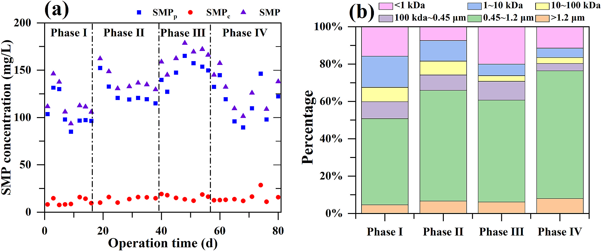
    * **(a) Nồng độ và thành phần SMP:** Nồng độ SMP tổng dao động trong khoảng $93\text{--}179\text{ mg/L}$ qua $80\text{ ngày}$; trong đó $\text{SMP}_\text{p}$ (protein) chiếm ưu thế áp đảo ($80\text{--}165\text{ mg/L}$), còn $\text{SMP}_\text{c}$ (carbohydrate) duy trì ở mức thấp ($7\text{--}19\text{ mg/L}$, ngoại trừ một điểm đạt $\sim 28{,}5\text{ mg/L}$ ở ngày $74$).
    * **(a) Biến thiên động học theo độ mặn:** SMP trung bình đạt $\sim 116\text{ mg/L}$ ở Phase I ($0\text{ g/L}$); tăng vọt lên $162\text{ mg/L}$ khi bắt đầu Phase II ($5\text{ g/L}$) rồi ổn định về $\sim 119\text{ mg/L}$; đạt đỉnh $178\text{ mg/L}$ ở Phase III ($10\text{ g/L}$) do sốc mặn gây ly giải tế bào; sau đó giảm về trung bình $\sim 133\text{ mg/L}$ ở Phase IV ($20\text{ g/L}$).
    * **(b) Phân bố khối lượng phân tử (MWD):** Các đại phân tử ($>100\text{ kDa}$, bao gồm các phân đoạn $100\text{ kDa--}0{,}45\text{ }\mu\text{m}$, $0{,}45\text{--}1{,}2\text{ }\mu\text{m}$ và $>1{,}2\text{ }\mu\text{m}$) chiếm đa số với $60\text{--}80{,}5\%$ tổng SMP qua $4$ giai đoạn, là tác nhân chính lắng đọng tạo cặn bẩn.
    * **(b) Phân đoạn kích thước gây nghẽn màng cao ($100\text{ kDa--}0{,}45\text{ }\mu\text{m}$):** Phân đoạn $100\text{ kDa--}0{,}45\text{ }\mu\text{m}$ (chứa kích thước lỗ màng $0{,}1\text{ }\mu\text{m}$) chiếm tỷ lệ cao nhất ở Phase III ($10{,}0\%$, so với $9{,}0\%$ ở Phase I, $8{,}0\%$ ở Phase II và $4{,}0\%$ ở Phase IV), đóng vai trò then chốt gây tắc nghẽn lỗ màng và gia tăng mạnh tốc độ nghẽn màng.
    * Trong Giai đoạn I (Phase I), nồng độ SMP trung bình trong hỗn hợp bể màng đạt khoảng $116\text{ mg/L}$.
    * Sau khi đưa áp lực muối $5\text{ g/L NaCl}$ vào ở thời điểm đầu Giai đoạn II (Phase II), nồng độ SMP tăng vọt đột ngột lên $162\text{ mg/L}$, sau đó giảm dần và ổn định ở mức khoảng $119\text{ mg/L}$.
        * Sự gia tăng ban đầu của SMP trong Giai đoạn I và Giai đoạn II có thể do việc tiếp nhận tải sốc hữu cơ (organic shock loading) và độ mặn, dẫn đến việc tiết SMP để chống chịu với các điều kiện bất lợi (Aquino and Stuckey, 2004).
        * Các giai đoạn ổn định tiếp theo cho thấy quần xã vi sinh vật đã thích nghi với môi trường và giảm dần tốc độ tiết SMP (Chen et al., 2019).
    * Tiếp tục tăng nồng độ $\text{NaCl}$ lên $10\text{ g/L}$ trong Giai đoạn III (Phase III) làm nồng độ SMP tăng lên và đạt đỉnh tại $178\text{ mg/L}$.
        * Hiện tượng này chủ yếu có thể do sự ly giải tế bào (cell lysis) trong quá trình dịch chuyển lớn của cấu trúc quần xã vi sinh vật dưới áp lực muối (Chen et al., 2019), do một số vi sinh vật trong bể phản ứng UASB (upflow anaerobic sludge blanket) chỉ có thể tồn tại ở điều kiện $<10\text{ g/L NaCl}$ (C. R.Woolard and R.L.Irvine, 1995; Lay et al., 2010).
        * Sự suy giảm dần hàm lượng SMP ở cuối Giai đoạn III sau đó cũng được ghi nhận, có thể giải thích do sự tái thiết lập một quần xã vi sinh vật có khả năng chống chịu tốt hơn với độ mặn cao.
    * Khi độ mặn đạt $20\text{ g/L}$ trong Giai đoạn IV (Phase IV), nồng độ SMP giảm và được duy trì ở mức nồng độ trung bình $133\text{ mg/L}$, tương đương với mức trong Giai đoạn I và II.
    * Sự dao động của nồng độ SMP hoàn toàn phù hợp với kết quả diễn biến áp suất qua màng TMP (transmembrane pressure) (Fig. 3) và cho thấy một giai đoạn chuyển tiếp của AnMBR (anaerobic membrane bioreactor) đã diễn ra trong Giai đoạn III.
* Phân bố khối lượng phân tử của SMP (Fig. 4b) cho thấy các đại phân tử ($>100\text{ kDa}$) chiếm phần lớn hàm lượng SMP ($60\text{--}80\%$), đóng vai trò thiết yếu trong sự lắng đọng chất gây nghẽn màng (foulants deposition) (Deng et al., 2016).
    * Tương tự, Liu et al. (2018b) cũng báo cáo rằng các chất gây nghẽn đại phân tử là thành phần chủ yếu của tổng lượng chất hữu cơ.
    * Phân đoạn phân tử SMP ($100\text{ kDa--}0{,}45\text{ }\mu\text{m}$) bao gồm dải kích thước vật lý của kích thước lỗ màng ($0{,}1\text{ }\mu\text{m}$) chiếm tỷ lệ cao nhất ($10{,}0\%$) trong Giai đoạn III.
    * Đây có thể là yếu tố then chốt dẫn đến hiện tượng tắc nghẽn màng nghiêm trọng hơn trong Giai đoạn III do phân đoạn phân tử SMP này đóng góp rất lớn vào tắc nghẽn màng vì tiềm năng gây tắc lỗ màng (pore-clogging potential) cao (De Temmerman et al., 2014).

#### 3.3.2. Three-dimensional excitation–emission matrix (3D-EEM)

* Phân tích 3D-EEM (three-dimensional excitation–emission matrix - ma trận kích thích – phát xạ huỳnh quang 3 chiều) được thực hiện để làm rõ sâu hơn thành phần SMP trong hỗn hợp bể màng dưới các nồng độ $\text{NaCl}$ khác nhau (Fig. 5).
    * **Hình 5.** 3D-EEM of membrane tank mixture on different NaCl concentrat
        * 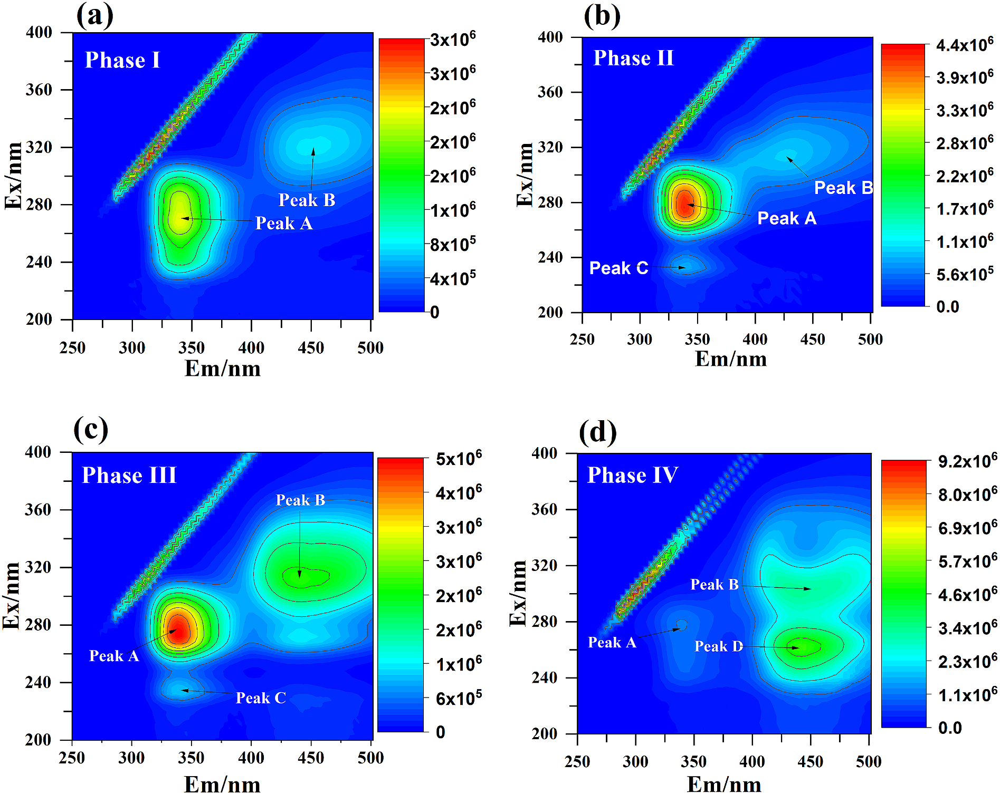
    * **(a) Phase I ($0\text{ g/L NaCl}$):** Peak A ($\text{Ex/Em} \approx 270\text{--}280/340\text{ nm}$, sản phẩm vi sinh SMP) chiếm ưu thế với cường độ huỳnh quang $\approx 2{,}0\text{--}2{,}5 \times 10^6$; Peak B ($\text{Ex/Em} \approx 315/450\text{ nm}$, dạng humic) đạt $\approx 1{,}0 \times 10^6$ (thang cực đại $3 \times 10^6$).
    * **(b) Phase II ($5\text{ g/L NaCl}$):** Cường độ Peak A tăng mạnh lên mức tâm đỏ $\approx 3{,}9\text{--}4{,}4 \times 10^6$; Peak B tăng nhẹ lên $\approx 1{,}1\text{--}1{,}7 \times 10^6$; bắt đầu xuất hiện Peak C ($\text{Ex/Em} \approx 235/340\text{ nm}$, tryptophan) ở cường độ yếu (thang cực đại $4{,}4 \times 10^6$).
    * **(c) Phase III ($10\text{ g/L NaCl}$):** Cả Peak A và Peak B đạt đỉnh huỳnh quang cao nhất chu kỳ: Peak A đạt tâm đỏ $\approx 4{,}5\text{--}5{,}0 \times 10^6$, Peak B mở rộng đạt tâm xanh lục $\approx 2{,}5\text{--}3{,}0 \times 10^6$; Peak C duy trì tín hiệu (thang cực đại $5{,}0 \times 10^6$).
    * **(d) Phase IV ($20\text{ g/L NaCl}$):** Peak A suy giảm mạnh ($< 1{,}1 \times 10^6$); xuất hiện Peak D mới ($\text{Ex/Em} \approx 260/445\text{ nm}$, cường độ $\approx 3{,}4\text{--}4{,}6 \times 10^6$) cùng Peak B ($\approx 2{,}3 \times 10^6$) chiếm ưu thế (thang cực đại $9{,}2 \times 10^6$).
    * Các đỉnh huỳnh quang Peak A, Peak B và Peak C lần lượt nằm ở Vùng IV ($\text{Ex/Em} = 250\text{--}380/380\text{--}540\text{ nm}$) (hình ghi Peak A nằm ở $\text{Ex/Em} \approx 270\text{--}280/340\text{ nm}$, thuộc Vùng V), Vùng V ($\text{Ex/Em} = 250\text{--}335/280\text{--}380\text{ nm}$) (hình ghi Peak B nằm ở $\text{Ex/Em} \approx 310\text{--}320/440\text{--}450\text{ nm}$, thuộc Vùng IV) và Vùng II ($\text{Ex/Em} = 200\text{--}255/335\text{--}380\text{ nm}$), lần lượt thuộc về các sản phẩm phụ vi sinh vật hòa tan (dissolved microbial by-products), các chất dạng axit humic (humic acid-like substances), và các chất dạng protein tryptophan (tryptophan protein-like substances).
    * Peak A đại diện cho các sản phẩm phụ vi sinh vật chiếm ưu thế trong tất cả các mẫu (hình ghi ở Phase IV với $20\text{ g/L NaCl}$, Peak A suy giảm mạnh và không còn chiếm ưu thế so với Peak D và Peak B).
* Khi độ mặn tăng theo từng bước từ $0$ đến $10\text{ g/L}$ (Giai đoạn I đến Giai đoạn III), cường độ huỳnh quang của Peak A (sản phẩm phụ vi sinh vật hòa tan) và Peak B (các chất dạng axit humic) liên tục gia tăng, nhưng sau đó có xu hướng giảm ở Giai đoạn IV.
    * Kết quả này nhất quán với kết quả nồng độ SMP và có thể do sự tiết ra từ vi sinh vật dưới áp lực muối khi độ mặn dưới $10\text{ g/L}$, cùng sự tái thiết lập của một quần xã vi sinh vật có khả năng thích nghi tốt hơn với độ mặn cao khi độ mặn đạt $20\text{ g/L}$.
    * Sự sản sinh các chất dạng axit humic dưới áp lực muối có thể do sự phân hủy của các tế bào chết và sự phân cắt các chất hữu cơ phân tử lượng lớn, ví dụ như protein và polysaccharide (Qu et al., 2012).

### 3.4. Microbial community structure analyses

* Quần xã vi sinh vật trong bể phản ứng UASB (upflow anaerobic sludge blanket) tại thời điểm kết thúc mỗi giai đoạn được phân tích chi tiết nhằm tìm hiểu các đáp ứng vi sinh vật đối với sự gia tăng độ mặn từng bước trong hệ AnMBR (anaerobic membrane bioreactor):
    * Các chỉ số đa dạng alpha (alpha diversity indices) được sử dụng để xác định độ phong phú của quần xã vi sinh vật (số loài quan sát được / observed species, ACE và Chao 1) và độ đa dạng vi sinh vật (Shannon và Simpson).
    * Các chỉ số ACE, Chao1, Shannon và Simpson suy giảm mạnh xuống mức tối thiểu ở Giai đoạn III ($10\text{ g/L NaCl}$) và sau đó hồi phục nhẹ ở Giai đoạn IV ($20\text{ g/L NaCl}$).
    * Độ mặn cao ảnh hưởng bất lợi đến độ phong phú và độ đa dạng của quần xã vi sinh vật, nhưng việc tăng độ mặn tiếp tục lên $20\text{ g/L}$ có thể tái thiết lập một quần xã vi sinh vật có khả năng chịu mặn tốt hơn.
    * Tác động bất lợi của độ mặn cao ($>20\text{ g/L}$) lên độ phong phú và đa dạng vi sinh vật này tương đồng với các nghiên cứu đã công bố trước đây (Chen et al., 2019).
    * Giai đoạn II ($5\text{ g/L NaCl}$) thể hiện các chỉ số Shannon và Simpson hơi cao hơn so với Giai đoạn I ($0\text{ g/L NaCl}$); điều này được suy đoán là do độ mặn thấp ($5\text{ g/L}$) tạo ra một áp lực chọn lọc có thể kiểm soát được (manageable selective pressure) giúp thúc đẩy độ đa dạng quần thể.
    * Kết quả giải trình tự và các ước tính độ phong phú cũng như độ đa dạng vi sinh vật cho từng mẫu phản ánh sự biến đổi cấu trúc quần xã vi sinh vật theo độ mặn:
        * **Bảng 3.** Sequencing results of community richness and diversity estim
            * 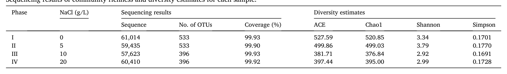
        * **Độ bao phủ và số lượng OTU:** Độ bao phủ giải trình tự đạt mức rất cao ($\ge 99.90\%$). Số lượng OTU duy trì ở mức $533$ qua Phase I ($0\text{ g/L NaCl}$) và Phase II ($5\text{ g/L NaCl}$), sau đó giảm mạnh xuống $396$ ở Phase III ($10\text{ g/L NaCl}$) và duy trì ở Phase IV ($20\text{ g/L NaCl}$).
        * **Độ phong phú quần xã (ACE & Chao1):** Đạt cao nhất ở Phase I ($\text{ACE} = 527.59$; $\text{Chao1} = 520.85$), giảm dần qua Phase II ($\text{ACE} = 499.86$; $\text{Chao1} = 499.03$), chạm đáy ở Phase III ($\text{ACE} = 381.71$; $\text{Chao1} = 376.84$) trước khi hồi phục nhẹ ở Phase IV ($\text{ACE} = 397.44$; $\text{Chao1} = 395.00$).
        * **Độ đa dạng quần xã (Shannon & Simpson):** Đạt giá trị cao nhất tại Phase II ($\text{Shannon} = 3.79$; $\text{Simpson} = 0.1770$) so với Phase I ($\text{Shannon} = 3.34$; $\text{Simpson} = 0.1701$), sau đó giảm xuống mức cực tiểu ở Phase III ($\text{Shannon} = 2.92$; $\text{Simpson} = 0.1691$) và tăng nhẹ trở lại ở Phase IV ($\text{Shannon} = 2.99$; $\text{Simpson} = 0.1728$).
* Ở cấp độ ngành (phylum level), Bacteroidota, Firmicutes, Proteobacteria và Chloroflexi là các ngành chiếm ưu thế chính, chiếm hơn $60\%$ tổng độ phong phú tương đối và thường được ghi nhận trong bùn kỵ khí (anaerobic sludge) (Liang et al., 2019; Zhang et al., 2020b):
    * Bacteroidota duy trì tỷ lệ $5{,}55\text{--}11{,}3\%$ qua tất cả các giai đoạn vận hành nhờ tính không nhạy cảm đối với sự thay đổi độ mặn (insensitivity to salinity shift) (Dorador et al., 2009; Zhao et al., 2020).
    * Độ phong phú tương đối của Firmicutes suy giảm rõ rệt từ $47{,}2\text{--}55{,}6\%$ ở Giai đoạn I và II xuống còn $6{,}10\text{--}8{,}90\%$ ở Giai đoạn III và IV do tác động ức chế mạnh của sự gia tăng độ mặn lên ngành Firmicutes (Zhang et al., 2020b).
    * Tỷ lệ của Proteobacteria gia tăng nhanh chóng trong môi trường độ mặn cao và trở thành ngành chiếm ưu thế nhất, chiếm $41{,}2\%$ ở Giai đoạn III và $46{,}5\%$ tổng độ phong phú tương đối ở Giai đoạn IV; điều này có thể do một số loài trong Proteobacteria có khả năng sinh trưởng bằng cách tiêu thụ các hợp chất hữu cơ khác nhau ở độ mặn cao (Zhang et al., 2017).
    * Độ phong phú tương đối của Chloroflexi tăng vọt từ dưới $5\%$ ở Giai đoạn I và II lên khoảng $27{,}4\%$ (Giai đoạn III) và $22{,}6\%$ (Giai đoạn IV), trở thành ngành phong phú thứ hai nhờ khả năng chịu mặn (Liang et al., 2019).
    * Sự biến đổi tỷ lệ của Firmicutes, Proteobacteria và Chloroflexi chỉ ra sự chuyển đổi rõ rệt trong cấu trúc vi sinh vật diễn ra ở Giai đoạn III và ổn định ở Giai đoạn IV (Strepis et al., 2020; Xia et al., 2019), đóng góp vào các biến đổi về chu kỳ áp suất qua màng (transmembrane pressure - TMP) và đặc tính sản phẩm vi sinh vật hòa tan (soluble microbial products - SMP) trong hỗn hợp bể màng.
* Cấu trúc và độ phong phú tương đối của quần xã vi sinh vật ở các cấp độ phân loại khác nhau (cấp ngành và bản đồ nhiệt cấp chi) phản ánh sự chuyển dịch cấu trúc quần xã theo độ mặn:
    * **Hình 6.** Relative abundances of different levels in microbial communi
        * 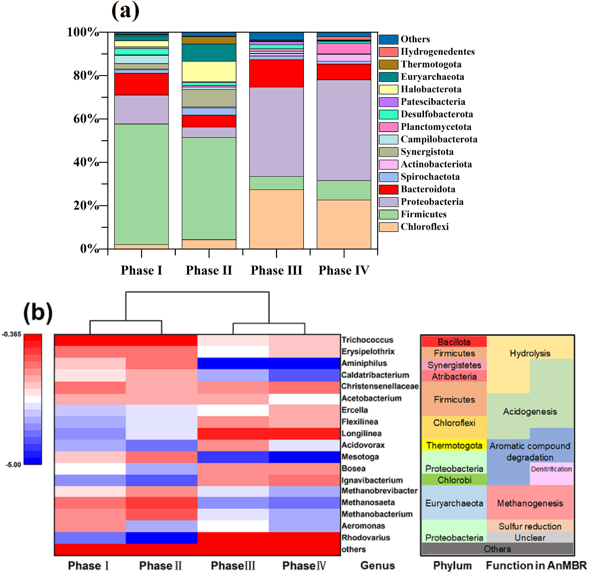
    * **Phân bố cấp ngành (Panel a):** Bốn ngành chính chiếm $>60\%$ tổng quần xã; khi độ mặn tăng, Firmicutes giảm mạnh từ $47{,}2\text{--}55{,}6\%$ (Phase I–II) xuống $6{,}10\text{--}8{,}90\%$ (Phase III–IV), trong khi Proteobacteria ($41{,}2\text{--}46{,}5\%$) và Chloroflexi (tăng từ $<5\%$ lên $22{,}6\text{--}27{,}4\%$) trở thành ưu thế, còn Bacteroidota duy trì ổn định $5{,}55\text{--}11{,}3\%$.
    * **Phân cụm và ức chế sinh học (Panel b):** Cây phân cụm chia thành $2$ nhánh tách biệt (Phase I–II và Phase III–IV); các nhóm vi sinh vật thủy phân (*Trichococcus*, *Aminiphilus*) và sinh methane (*Methanosaeta*, *Methanobrevibacter*, *Methanobacterium*) bị ức chế nghiêm trọng ở Phase III–IV.
    * **Sự phát triển của vi khuẩn chịu mặn (Panel b):** Các chi chịu mặn tăng sinh vượt bậc ở Phase III–IV gồm *Longilinea* (ngành Chloroflexi, lên men acid), *Bosea*, *Rhodovarius* (Proteobacteria) và *Ignavibacterium* (Chlorobi), đảm nhiệm chức năng phân hủy hữu cơ trong điều kiện áp suất thẩm thấu cao.
    * Phân tích phân cụm thứ bậc (hierarchical clustering analysis / bản đồ nhiệt heat map) chỉ ra cấu trúc tổ hợp vi sinh vật ở Giai đoạn I tương đồng với Giai đoạn II, nhưng khác biệt đáng kể so với quần thể vi sinh vật ở Giai đoạn III và IV do tác động phơi nhiễm độ mặn.
    * Độ mặn cao hơn gây tác động bất lợi lớn hơn lên các vi khuẩn liên quan đến quá trình thủy phân (hydrolysis) và sinh acid (acidogenesis) như *Trichococcus*, *Aminiphilus*, *Caldatribacterium* và *Mesotoga* (Diaz et al., 2007; Li et al., 2022; Wang et al., 2018b):
        * *Aminiphilus* liên quan đến quá trình phân hủy amino acid; độ phong phú tương đối của chi này giảm từ $6{,}19\text{--}7{,}42\%$ xuống mức không thể phát hiện khi độ mặn tăng lên $10\text{--}20\text{ g/L}$ ở Giai đoạn III và IV (Diaz et al., 2007).
        * *Mesotoga* đảm nhận vai trò phân hủy carbohydrate phức tạp; sự suy giảm độ phong phú tương đối dưới áp lực độ mặn cao có thể giải thích cho hiệu quả loại bỏ COD bị suy giảm (Li et al., 2022).
    * Độ phong phú tương đối của các vi khuẩn cổ sinh methane (methanogenic archaea) gồm *Methanobrevibacter*, *Methanosaeta* và *Methanobacterium* tăng nhẹ từ Giai đoạn I sang Giai đoạn II, nhưng giảm rõ rệt ở Giai đoạn III và IV:
        * *Methanosaeta* và *Methanobacterium* tăng từ $2{,}81\%$ và $1{,}67\%$ ở Giai đoạn I lên lần lượt $9{,}22\%$ và $6{,}14\%$ ở Giai đoạn II khi đưa độ mặn $5\text{ g/L}$ vào hệ thống, nhưng cả hai đều giảm xuống dưới $0{,}1\%$ trong hai giai đoạn tiếp theo.
        * Độ mặn thấp có thể làm giàu một số chủng sinh methane, nhưng độ mặn cao ($>10\text{ g/L}$) gây tổn hại nghiêm trọng đến các chủng vi khuẩn cổ sinh methane nói trên, hoàn toàn phù hợp với kết quả đo hoạt tính sinh methane đặc riêng (specific methanogenic activity - SMA).
    * Ngược lại, các chi vi khuẩn *Longilinea*, *Ignavibacterium*, *Rhodovarius*, *Bosea* và *Flexilinea* trở nên chiếm ưu thế dưới áp lực độ mặn cao:
        * *Longilinea* là vi khuẩn kỵ khí bắt buộc phân hủy carbohydrate để tạo ra acid béo bay hơi (volatile fatty acid - VFA) (Liu et al., 2017), đồng thời có khả năng chịu mặn với độ phong phú tăng từ $0{,}3\%$ khi không có muối lên $22{,}4\%$ dưới độ mặn $10\text{ g/L}$ (Guo et al., 2018).
        * *Ignavibacterium* và *Bosea* được báo cáo lần lượt đảm nhận vai trò mở vòng benzen (benzene ring opening) và phân hủy phẩm nhuộm azo (azo dye degradation) (Song et al., 2021; Yuan et al., 2023).
        * Độ phong phú tương đối cao hơn của *Ignavibacterium* và *Bosea* ở Giai đoạn III và IV giải thích cho hiệu quả loại bỏ methyl da cam (methyl orange - MO) được duy trì tương đối ổn định.
* Phân tích thành phần chính (principal component analysis - PCA) ở cấp độ chi làm rõ mối quan hệ giữa các yếu tố môi trường như độ mặn và quần xã vi sinh vật:
    * **Hình 7.** PCA analyses of microbial community at genus level.
        * 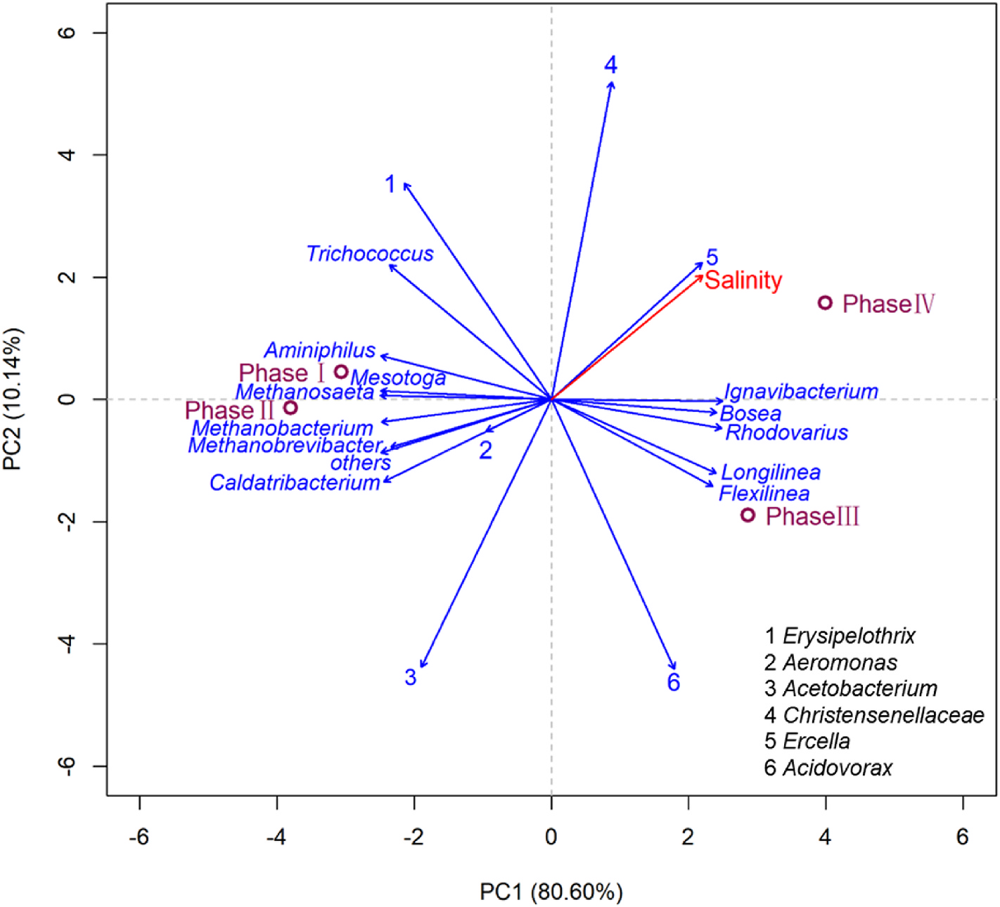
    * **Phương sai giải thích (PC1 & PC2):** Trục $\text{PC1}$ giải thích $80{,}60\%$ và trục $\text{PC2}$ giải thích $10{,}14\%$ biến thiên quần xã (tổng tích lũy $90{,}74\%$).
    * **Phân cụm mẫu theo giai đoạn:** Các điểm mẫu Giai đoạn I và II phân cụm sát nhau ở miền âm ($\text{PC1} \approx -3{,}7$ đến $-3{,}0$), trong khi Giai đoạn III ($\text{PC1} \approx +2{,}8$; $\text{PC2} \approx -1{,}9$) và Giai đoạn IV ($\text{PC1} \approx +4{,}0$; $\text{PC2} \approx +1{,}6$) phân tách rõ sang miền dương $\text{PC1}$ tương ứng với mức độ mặn tăng cao.
    * **Tương quan vector vi sinh vật:** Vector độ mặn (*Salinity*) và chi *Ercella* (vector số $5$) trùng khít nhau ở góc phần tư thứ nhất; các chi vi khuẩn chịu mặn (*Ignavibacterium*, *Bosea*, *Rhodovarius*, *Longlinea*, *Flexilinea*) tương quan thuận với độ mặn ($\text{PC1} > 0$), trong khi các chi thủy phân/sinh acid và vi khuẩn cổ sinh methane (*Methanosaeta*, *Methanobacterium*, *Methanobrevibacter*, *Aminiphilus*, *Mesotoga*, *Caldatribacterium*) tương quan nghịch rõ rệt ($\text{PC1} < 0$).
    * Các điểm mẫu của Giai đoạn I và II phân cụm sát nhau, cho thấy cấu trúc quần xã vi sinh vật tương đồng giữa hai giai đoạn này.
    * Hình chiếu của Giai đoạn III và IV cho thấy mối tương quan thuận với độ mặn.
    * Điểm mẫu Giai đoạn III lệch nhiều hơn so với vector độ mặn so với các điểm mẫu khác (Giai đoạn I, II và IV), chứng tỏ vi sinh vật ở Giai đoạn III ít nhạy cảm hơn đối với sự thay đổi độ mặn, gợi ý Giai đoạn III là thời kỳ chuyển tiếp từ quần thể vi sinh vật nhạy cảm với độ mặn sang quần xã chịu mặn.
    * Độ phong phú tương đối ở cấp độ chi của vi khuẩn (*Aminiphilus*, *Caldatribacterium*, *Mesotoga*) và vi khuẩn cổ (*Methanobrevibacter*, *Methanobacterium*, *Methanosaeta*) thể hiện tương quan nghịch với độ mặn.
    * Các chi *Longilinea*, *Ignavibacterium*, *Rhodovarius*, *Bosea* và *Flexilinea* ở cấp độ chi thể hiện tương quan thuận với độ mặn, hoàn toàn phù hợp với các biến động của từng chi cụ thể và củng cố thêm bằng chứng về sự chuyển dịch quần xã vi sinh vật từ nhạy cảm sang chịu mặn.
    * Đáng chú ý, vector của *Ercella* trùng khớp với vector độ mặn, gợi ý rằng chi này có thể ưa mặn (halophilic) và cực kỳ nhạy cảm với độ mặn (Li et al., 2021).

### 3.5. Adaboost modelling

* Mô hình Adaboost (Adaptive Boosting) có thể được sử dụng để dự đoán nồng độ COD dòng ra (effluent COD) ở các mức độ mặn khác nhau (Fig. 8):
    * **Hình 8.** Adaboost modelling of effluent COD concentration: (a) traini
        * 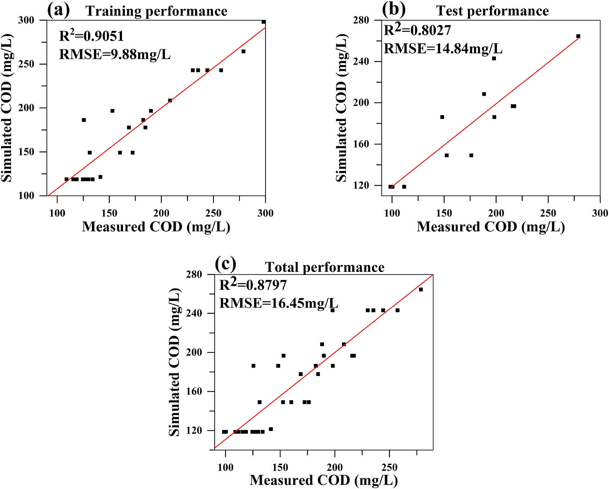
    * **(a) Hiệu suất tập huấn luyện (Training):** Tương quan giữa COD mô phỏng và đo đạc đạt $R^2 = 0{,}9051$, $\text{RMSE} = 9{,}88\text{ mg/L}$ trong dải nồng độ COD khoảng $100\text{--}300\text{ mg/L}$.
    * **(b) Hiệu suất tập kiểm tra (Test):** Đạt $R^2 = 0{,}8027$, $\text{RMSE} = 14{,}84\text{ mg/L}$ (văn bản bài báo ghi nhầm thành số liệu của tập train: $R^2 = 0{,}9051$, $\text{RMSE} = 9{,}88\text{ mg/L}$).
    * **(c) Hiệu suất tổng thể (Total):** Toàn bộ dữ liệu đạt $R^2 = 0{,}8797$, $\text{RMSE} = 16{,}45\text{ mg/L}$; các điểm dự báo bám sát đường hồi quy tuyến tính lý tưởng.
* Phân chia tập dữ liệu và tối ưu hóa tham số mô hình:
    * Các giá trị tối ưu của các thông số then chốt được tối ưu hóa trên tập huấn luyện (training set, chiếm $70\%$) sử dụng hàm mục tiêu sai số toàn phương trung bình ($RMSE$).
    * Mô hình đã qua huấn luyện được áp dụng mô phỏng hồi quy trên tập kiểm tra (test set, chiếm $30\%$) để phân tích COD dòng ra.
* Hiệu suất dự đoán trên tập kiểm tra (test set):
    * Hệ số xác định $R^2$ trên tập kiểm tra đạt $0{,}9051$ (hình ghi $0{,}8027$).
    * Sai số toàn phương trung bình $RMSE$ trên tập kiểm tra là $9{,}88\text{ mg/L}$ (hình ghi $14{,}84\text{ mg/L}$).
* Đánh giá độ chính xác tổng thể của mô hình Adaboost:
    * Ngoại trừ một vài giá trị ngoại lệ (outliers), các giá trị dự đoán của mô hình Adaboost khớp tốt với các giá trị đo đạc thực nghiệm.
    * Sai số tuyệt đối trung bình (average absolute error) chỉ ở mức $3{,}07\%$.
    * Hệ số xác định tổng thể $R^2$ đạt $0{,}8797$.
* Giới hạn và định hướng mở rộng mô hình:
    * Do giới hạn trong thiết kế thí nghiệm, mô hình có thể không ngoại suy tốt vượt ra ngoài một số thiết lập thực nghiệm nhất định.
    * Việc mở rộng kích thước tập dữ liệu từ các kịch bản AnMBR độ mặn cao đa dạng trong tương lai được kỳ vọng sẽ nâng cao độ chính xác dự đoán COD dòng ra của mô hình Adaboost.

## 4. Conclusion

- Nghiên cứu đã khảo sát tác động của việc gia tăng độ mặn theo từng bước (stepwise increase of salinity) lên hiệu suất xử lý nước thải dệt nhuộm (textile wastewater) của hệ thống màng sinh học kỵ khí màng gốm cấu hình UASB (UASB-configured ceramic AnMBR):
  - Sự gia tăng độ mặn từng bước đã ức chế hiệu suất khử COD từ $92\%$ xuống $73\%$, nhưng chỉ có ảnh hưởng không đáng kể (marginal effect) đến hiệu suất khử methyl orange (MO) đạt $90\text{--}96\%$ trong AnMBR.
  - Độ mặn thấp ($5\text{ g/L}$) đã thúc đẩy sản lượng khí sinh học (biogas production), trong khi độ mặn cao ($>10\text{ g/L}$) ức chế quá trình sinh khí này.
  - Sự gia tăng độ mặn dẫn đến nồng độ các sản phẩm vi sinh vật hòa tan (soluble microbial products - SMP) tăng vọt và tốc độ nghẽn màng (membrane fouling rate) tăng cao, đạt đỉnh tại độ mặn $10\text{ g/L}$ (Giai đoạn III / Phase III) rồi sau đó phục hồi trở lại mức thấp hơn.
  - Các phân tích đa dạng vi sinh vật (microbial diversity analyses) chỉ ra sự chuyển dịch rõ rệt từ các vi sinh vật nhạy cảm với độ mặn (salinity-sensitive microbes) sang quần xã vi sinh vật chịu mặn (salinity-tolerant community):
    - Quá trình chuyển dịch này dẫn đến sự gia tăng nồng độ SMP và gây nghẽn màng nghiêm trọng hơn ở Giai đoạn III (Phase III).
    - Hiện tượng nghẽn màng được giảm thiểu sau khi hệ thống đạt được trạng thái cân bằng mới khi quần xã vi sinh vật đã thích nghi với điều kiện độ mặn cao.
  - Mô hình Adaboost đã được xây dựng thành công để dự đoán nồng độ COD dòng ra (effluent COD) dưới các mức độ mặn khác nhau; tuy nhiên, cần có thêm dữ liệu để nâng cao độ chính xác dự đoán.
