# Predictive modeling based on artificial neural networks for membrane fouling in a large pilot-scale anaerobic membrane bioreactor for treating real municipal wastewater

## Abstract

* **Bối cảnh và thách thức vận hành**: Hiện tượng tắc nghẽn màng (membrane fouling) là trở ngại hàng đầu hạn chế việc ứng dụng của bể phản ứng sinh học màng kỵ khí (anaerobic membrane bioreactors - AnMBR) trong xử lý nước thải đô thị (municipal wastewater treatment).
  * Xử lý nước thải hiệu quả đóng vai trò nền tảng trong việc duy trì tính bền vững môi trường, đòi hỏi các giải pháp dự báo và kiểm soát tắc nghẽn chính xác.
  * Nghiên cứu ứng dụng các bước tiến đột phá về năng lực tính toán và thuật toán học máy (machine learning) nhằm giải quyết bài toán dự đoán tắc nghẽn màng.

* **Cơ sở dữ liệu thực nghiệm và điều kiện vận hành**: Mô hình được xây dựng dựa trên bộ dữ liệu vận hành liên tục kéo dài 525 ngày từ hệ thống AnMBR quy mô pilot lớn (large pilot-scale AnMBR) xử lý nước thải đô thị thực (real municipal wastewater).
  * Hệ thống phản ánh trung thực diễn biến thực tế khi vận hành dưới các biến động điều kiện vận hành đáng kể (substantial variations in operating conditions) trong suốt 525 ngày.

* **Kiến trúc mô hình học máy và tập đặc trưng**: Dự đoán hồi quy (regression prediction) được hiện thực hóa thông qua hai kiến trúc mạng nơ-ron nhân tạo: Perceptron đa lớp (multilayer perceptron - MLP) và Mạng bộ nhớ ngắn-dài hạn (long short-term memory - LSTM).
  * **Đặc trưng đầu vào (input features)**: Mô hình tích hợp 6 thông số vận hành và hóa sinh then chốt:
    * Tải trọng hữu cơ (organic loading rate - OLR).
    * Nồng độ chất rắn lơ lửng (suspended solids concentration - SS).
    * Nồng độ protein trong các chất polyme ngoại bào (protein concentration in extracellular polymeric substances - $\text{EPS}_p$).
    * Nồng độ polysaccharide trong các chất polyme ngoại bào (polysaccharide concentration in extracellular polymeric substances - $\text{EPS}_c$).
    * Nhiệt độ bể phản ứng (reactor temperature).
    * Thông lượng màng (flux).
  * **Mục tiêu dự đoán đầu ra (prediction target output)**: Áp suất xuyên màng (transmembrane pressure - TMP).

* **Hiệu suất dự đoán và tối ưu hóa siêu tham số**: Quá trình tối ưu hóa siêu tham số (hyperparameter optimization) đóng vai trò đặc biệt quan trọng trong việc thiết lập mô hình và nâng cao độ chính xác dự đoán hồi quy.
  * Cả hai mô hình MLP và LSTM đều dự đoán thành công diễn biến tắc nghẽn màng trên hệ thống AnMBR quy mô pilot lớn.
  * Độ chính xác dự đoán hồi quy đạt hệ số xác định vượt trội: $R^2 > 0.91$.

* **Phân tích khả năng giải thích của mô hình (Model Interpretability)**: Áp dụng công nghệ phân tích khả năng giải thích mô hình nhằm hỗ trợ thấu hiểu cơ chế dự đoán và khắc phục nhược điểm "hộp đen" của học máy.
  * Tính hợp lý (rationality) và tính hữu dụng thực tiễn (utility) của mô hình MLP trong dự đoán tắc nghẽn màng AnMBR quy mô lớn được chứng minh ở cả hai cấp độ:
    * Cấp độ toàn cục (global level).
    * Cấp độ cục bộ (local level).

* **Ý nghĩa khoa học và thực tiễn**: Nghiên cứu mang lại bước tiến phương pháp luận quan trọng, khẳng định tầm quan trọng của việc kết hợp kỹ thuật môi trường (environmental engineering) với tiến bộ tính toán (computational advancements) để giải quyết các thách thức môi trường cấp bách.

## 1. Introduction

* **Bối cảnh toàn cầu về năng lượng, phát thải khí nhà kính và nhu cầu xử lý nước thải đô thị:**
  * Khủng hoảng năng lượng và lượng phát thải $\text{CO}_2$ là hai trong số các thách thức toàn cầu cấp bách nhất, đặc biệt trong giai đoạn hậu đại dịch (Aktar et al., 2021).
  * Bất chấp tác động của đại dịch, sự gia tăng dân số và tốc độ đô thị hóa nhanh chóng đã làm gia tăng đáng kể thể tích nước thải đô thị (*municipal wastewater*) phát sinh (Goswami et al., n.d.).
  * Nước thải đô thị có đặc thù là hàm lượng hữu cơ thấp (*low organic strength*) và nồng độ chất hữu cơ dạng hạt cao (*high particulate organic matter concentration*) (Ozgun et al., 2013).

* **Hạn chế cố hữu của công nghệ bùn hoạt tính truyền thống (CAS):**
  * Các quy trình sinh học hiếu khí cho xử lý nước thải đô thị, điển hình là bùn hoạt tính truyền thống (*conventional activated sludge - CAS*) và các biến thể của nó, đã được ứng dụng trong hơn một thế kỷ để loại bỏ chất ô nhiễm và đáp ứng các quy chuẩn xả thải (*effluent regulations*) (Wan et al., 2016).
  * Mặc dù sở hữu công nghệ phát triển cùng năng lực tạo ra chất lượng nước đầu ra đạt yêu cầu, quy trình CAS vẫn bị chỉ trích gay gắt do tiêu thụ năng lượng cao, đặc biệt là năng lượng dùng cho sục khí hiếu khí (*aeration*), cũng như chi phí tốn kém cần thiết cho việc xử lý bùn thải dư thừa (*excess sludge*) (Kim et al., 2020; Martinez-Sosa et al., 2011).

* **Sự chuyển đổi vai trò của các nhà máy xử lý nước thải (WWTPs):**
  * Theo định hướng của các mục tiêu phát triển bền vững (*sustainable development goals - SDGs*), nghiên cứu về tự chủ năng lượng (*energy autarky*) và giảm thiểu phát thải $\text{CO}_2$ từ các nhà máy xử lý nước thải (*wastewater treatment plants - WWTPs*) đã nhận được sự quan tâm đáng kể trong suốt thập kỷ qua (Gude, 2015; Hao et al., 2019a; L. Li et al., 2022; McCarty et al., 2011).
  * Vai trò của các WWTP đã được mở rộng vượt ra ngoài phạm vi loại bỏ chất ô nhiễm truyền thống, bao gồm phát điện/sản xuất năng lượng (*energy generation*), thu hồi tài nguyên dinh dưỡng (*nutrient recovery*), sản xuất nước sạch tái sử dụng (*freshwater production*), và xử lý chất ô nhiễm (Hao et al., 2019b; Obaideen et al., 2022).
  * Nhiều công nghệ cải tiến mang tính đột phá đã được nghiên cứu và phát triển nhằm hiện thực hóa sự chuyển đổi toàn diện này.

* **Tiềm năng và ưu thế vượt trội của bể phản ứng sinh học màng kỵ khí (AnMBR):**
  * Bể phản ứng sinh học màng kỵ khí (*anaerobic membrane bioreactor - AnMBR*) được đánh giá là một công nghệ đầy hứa hẹn cho công tác xử lý nước thải đô thị.
  * Nhờ tích hợp trực tiếp quy trình phân hủy kỵ khí (*anaerobic digestion - AD*) với quá trình lọc màng (*membrane filtration*), AnMBR có thể tách rời hoàn toàn thời gian lưu bùn (*sludge retention time - SRT*) và thời gian lưu thủy lực (*hydraulic retention time - HRT*) (Lei et al., 2018).
  * Sự tách rời giữa SRT và HRT giúp giảm thiểu triệt để các thách thức liên quan đến việc áp dụng quá trình AD đối với dòng nước thải có nồng độ nhu cầu oxy hóa học (*chemical oxygen demand - COD*) thấp và lưu lượng thể tích lớn đặc trưng của đô thị (Baek et al., 2010; Silvestre et al., 2015).
  * Sau một thập kỷ nghiên cứu chuyên sâu, các ứng dụng AnMBR ở quy mô phòng thí nghiệm (*lab-scale*) và quy mô pilot (*pilot-scale*) đối với cả nước thải tổng hợp và nước thải đô thị thực tế đã đạt được những bước tiến vượt bậc (Chen et al., 2017; Dong et al., 2016; Gouveia et al., 2015; Ji et al., 2021).
  * Khi triển khai AnMBR, các WWTP về mặt lý tưởng sẽ vừa tự sản xuất năng lượng (khí sinh học biogas) vừa đóng góp tích cực vào việc hiện thực hóa các mục tiêu phát triển bền vững (Hu et al., 2022).

* **Tắc nghẽn màng là rào cản chính đối với thương mại hóa và mở rộng quy mô AnMBR:**
  * Hiện tượng tắc nghẽn màng (*membrane fouling*) là trở ngại lớn nhất cản trở quá trình thương mại hóa và mở rộng quy mô (*scale-up*) của hệ thống AnMBR trong xử lý nước thải đô thị (Rong et al., 2022a).
  * Cơ chế phát sinh tắc nghẽn màng:
    * Xảy ra do các tương tác vật lý và hóa học phức tạp giữa các cấu phần gây tắc nghẽn (*fouling components*) trong dòng cấp (*feed*) và bề mặt màng.
    * Sự bám dính (*attachment*), tích tụ (*accumulation*), hoặc hấp phụ (*adsorption*) các vật chất lên trên bề mặt màng và/hoặc bên trong các lỗ màng bắt nguồn từ hiện tượng truyền khối (*mass transfer*) (Guo et al., 2012).
  * Hệ lụy tiêu cực của tắc nghẽn màng:
    * Làm suy giảm thông lượng thấm qua (*permeate flux*).
    * Gây tăng cao áp suất vận hành qua màng (*transmembrane pressure - TMP*).
    * Khiến hiệu suất xử lý suy giảm (*performance degradation*), làm ngắn tuổi thọ màng (*shorter membrane lifespan*), và gây phát sinh chi phí phi kinh tế (*diseconomies*) (Hu et al., 2020; Martin Vincent et al., 2018).
  * Nhu cầu phòng ngừa và kiểm soát:
    * Ngăn ngừa hoặc giảm thiểu tắc nghẽn màng là yêu cầu bắt buộc để duy trì một hệ thống AnMBR vận hành mạnh mẽ và ổn định.
    * Mặc dù các biện pháp kiểm soát tắc nghẽn đã tạo điều kiện ứng dụng thành công AnMBR ở quy mô công nghiệp (*industrial-scale*) đối với nước thải công nghiệp (An et al., 2023), tắc nghẽn màng vẫn là một thách thức dai dẳng và ngày càng trở nên cấp bách khi công nghệ được nhân rộng trong xử lý nước thải sinh hoạt đô thị.
    * Tác động của vấn đề ngày càng leo thang do sự gia tăng thể tích nước thải, độ phức tạp của thành phần chất ô nhiễm, các giới hạn kỹ thuật hiện tại, cùng các quy định xả thải ngày một nghiêm ngặt.
    * Tắc nghẽn màng là hiện tượng không thể tránh khỏi trong tất cả các hệ thống xử lý nước thải ứng dụng quá trình lọc màng; tuy nhiên, bản chất và mức độ nghiêm trọng của tắc nghẽn biến thiên tùy thuộc vào trình độ công nghệ, điều kiện kinh tế (Andrée et al., 2019), cũng như các điều kiện khí hậu và môi trường bản địa (Rong et al., 2022b).
    * Nghiên cứu giảm thiểu tác động của tắc nghẽn màng nhằm nâng cao hiệu quả và tính bền vững của các công đoạn xử lý nước thải tiếp tục là lĩnh vực trọng tâm đầy sôi động.

* **Tầm quan trọng của công nghệ giám sát, dự đoán và xây dựng kế hoạch vận hành màng:**
  * Do tắc nghẽn màng diễn ra ở cả các khu vực phát triển và đang phát triển, việc phát triển các công nghệ tiên tiến phục vụ giám sát (*monitoring*), phát hiện (*detection*), kiểm soát (*control*), cũng như xây dựng kế hoạch vận hành màng hợp lý đóng vai trò quan trọng và hiệu quả tương đương so với việc phát triển các vật liệu màng hoặc công nghệ kháng bám bẩn mới (vốn đòi hỏi trình độ chuyên môn kỹ thuật cao hơn và chi phí đầu tư tốn kém hơn).
  * Quy trình làm sạch (*cleaning*) và thực hiện một kế hoạch vận hành thích hợp có thể làm chậm đáng kể quá trình tắc nghẽn màng (Lindamulla et al., 2021).
  * Các kỹ thuật kiểm soát tắc nghẽn màng đang được ứng dụng bao gồm:
    * Sục khí sinh học (*biogas sparging*) (Aslan et al., 2014).
    * Rửa ngược tăng cường bằng hóa chất (*chemical-enhanced backwashing - CEB*) (Kim et al., 2021; Lateef et al., 2013).
    * Châm bổ sung các chất tăng cường tính năng (*performance enhancer dosage*) (Sohn et al., 2021).
    * Các chiến lược chống tắc nghẽn màng khác theo nguyên lý vật lý, hóa học hoặc sinh học (Bagheri and Mirbagheri, 2018).
  * Dự đoán trước tắc nghẽn màng giữ vai trò mắt xích then chốt giúp định hướng lựa chọn các phương pháp tiền xử lý và xây dựng các chiến lược chống tắc nghẽn phù hợp (Kim et al., 2013; Vrouwenvelder et al., 2006).

* **Ứng dụng của Trí tuệ nhân tạo (AI) và Học máy (ML) trong xử lý dữ liệu và dự đoán tắc nghẽn màng:**
  * Bùng nổ dữ liệu trong ngành nước và môi trường:
    * Sự phát triển của các phương pháp và thiết bị phát hiện, quan trắc đã mở rộng đáng kể khối lượng và mức độ phức tạp của dữ liệu trong khoa học và kỹ thuật môi trường, đặc biệt trong ngành công nghiệp nước và nước thải (Zhong et al., 2021).
    * Nhu cầu nâng cao năng lực phân tích và xử lý dữ liệu ngày càng trở nên cấp bách.
  * Vai trò tiên phong của Trí tuệ nhân tạo (*Artificial Intelligence - AI*):
    * Sự phát triển vượt bậc của AI (vốn đã được ứng dụng sâu rộng trong các lĩnh vực như hóa học, khoa học vật liệu, và y tế) mang lại tiềm năng to lớn cho ngành nước trong việc tối ưu hóa và điều tiết hoạt động giám sát, quản lý tài nguyên nước (Alam et al., 2022).
  * Vị thế chủ đạo của Mạng nơ-ron nhân tạo (*Artificial Neural Networks - ANN*):
    * Trong suốt hai thập kỷ qua, các thuật toán học máy (*machine learning - ML*) thuộc nhánh AI bao gồm mạng nơ-ron nhân tạo (*artificial neural network - ANN*), $k$ láng giềng gần nhất (*$k$-Nearest Neighbors - kNN*), và máy vector hỗ trợ (*support vector machines - SVMs*) đã được nghiên cứu sâu rộng để dự đoán tắc nghẽn màng, trong đó ANN là thuật toán vượt trội và chiếm ưu thế áp đảo cho nhiều hệ thống lọc màng khác nhau (Niu et al., 2022).
    * Việc dự đoán tắc nghẽn màng trong AnMBR là một bài toán phi tuyến tính đa chiều phức tạp; ANN mang lại độ linh hoạt và năng lực tính toán vượt trội để xử lý bài toán này.
    * Các khung làm việc ANN tạo điều kiện thuận lợi cho việc thực hiện tối ưu hóa siêu tham số nghiêm ngặt (*hyperparameter optimization - HPO*), yếu tố mang tính quyết định trong việc nâng cao độ chính xác dự đoán.
    * Mạng ANN nắm bắt trọn vẹn và chuẩn xác các mối quan hệ động thái phi tuyến phức tạp giữa các biến số chi phối đến quá trình tắc nghẽn màng.
  * Cơ chế mô hình hóa "hộp đen" (*black box*):
    * Kỹ thuật ANN đánh giá mức độ tắc nghẽn màng trong các hệ thống MBR bằng cách quy đổi toàn bộ các cơ chế tắc nghẽn phức tạp thành một mô hình "hộp đen", qua đó chỉ tập trung xem xét các thông số đầu vào liên quan đến đặc tính vận hành MBR và tính chất nước thải (Schmitt and Do, 2017).
  * Các kiến trúc ANN cơ bản và chuyên biệt:
    * *Multilayer Perceptron (MLP)*: Được xem là mô hình ANN nền tảng; MLP là cấu trúc mạng nơ-ron truyền thẳng (*feed-forward neural network*) gồm nhiều tầng chứa các nút liên kết, mỗi nút thực hiện một phép tính toán học trên đầu vào và truyền kết quả tới tầng kế tiếp (Gardner and Dorling, 1998).
    * *Long Short-Term Memory (LSTM)*: Là biến thể mạng nơ-ron phức tạp hơn của ANN, được thiết kế chuyên biệt và tối ưu để xử lý dữ liệu chuỗi thời gian (*time-series data*) (Hochreiter and Schmidhuber, 1997).
  * Đánh đổi giữa độ phức tạp và chi phí tính toán:
    * Mạng LSTM thường tiêu tốn nhiều tài nguyên tính toán hơn so với MLP.
    * Do tắc nghẽn màng là vấn đề xảy ra tại cả các nước phát triển lẫn đang phát triển, việc triển khai các mô hình ML cần phải cân nhắc cẩn trọng sự đánh đổi giữa độ phức tạp của mô hình và chi phí tính toán, đặc biệt trong các điều kiện hạn chế về nguồn lực tại các quốc gia đang phát triển (De-Arteaga et al., 2018).
    * Mặc dù các giải pháp đổi mới có khả năng ứng dụng rộng rãi, quá trình triển khai thực tế đòi hỏi phải được đánh giá kỹ lưỡng và điều chỉnh thích nghi với hoàn cảnh địa phương, năng lực kỹ thuật và nguồn lực sẵn có. Sự hợp tác, khả năng thích ứng và hiểu biết về điều kiện thực tế là yếu tố quyết định để triển khai thành công tại các cơ sở ở khu vực đang phát triển.

* **Tiềm năng ứng dụng của mô hình ML trong cảnh báo sớm và điều khiển tự động:**
  * Thông qua nhiệm vụ dự đoán tắc nghẽn màng, các mô hình ML có khả năng định lượng mức độ quan trọng của các thông số và điều kiện vận hành then chốt dẫn đến tắc nghẽn màng.
  * Việc nhận diện các biến số trọng yếu này giúp nhân viên vận hành hệ thống xử lý nước thải đưa ra quyết định lựa chọn các quy trình tiền xử lý phù hợp với điều kiện vận hành.
  * Năng lực dự đoán vượt trội của ML có thể hoạt động như một hệ thống cảnh báo sớm (*early warning system*) cho các biện pháp chống tắc nghẽn màng.
  * Bằng cách dự đoán các sự cố tắc nghẽn màng trước khi chúng thực sự diễn ra, người vận hành có thể chủ động áp dụng các giải pháp kịp thời như rửa ngược (*backwashing*), rửa hóa chất (*chemical cleaning*), hoặc tạm thời điều chỉnh áp suất $\text{TMP}$.
  * Các mô hình ML hoàn chỉnh có thể được nhúng trực tiếp vào logic điều khiển của hệ thống AnMBR để tự động kích hoạt các cơ chế chống tắc nghẽn này.

* **Khoảng trống nghiên cứu hiện nay (Knowledge Gaps):**
  * Hiện có rất ít nghiên cứu phát triển mô hình dự đoán tích hợp ANN được thực hiện trên hệ thống AnMBR, đặc biệt đối với các hệ thống xử lý nước thải đô thị.
  * Các công trình nghiên cứu đã công bố trước đây chủ yếu tập trung vào:
    * Khảo sát hiệu suất của quá trình phân hủy kỵ khí AD đơn thuần (G. Li et al., 2022).
    * Nghiên cứu tắc nghẽn màng trên hệ thống quy mô phòng thí nghiệm (*lab-scale*) sử dụng nước thải tổng hợp (*synthetic wastewater*) (Taheri et al., 2021).
    * Nghiên cứu tắc nghẽn trên hệ thống xử lý dòng nước thải có nồng độ ô nhiễm cao (*high-strength wastewater*) (Yao et al., 2022).
  * Đến nay, y văn vẫn còn thiếu vắng các nghiên cứu chuyên sâu hướng tới việc dự đoán tắc nghẽn màng trong hệ thống AnMBR xử lý nước thải đô thị thực tế (*real municipal wastewater*).
  * Khi mở rộng quy mô hệ thống (*scale-up*), các mô hình dự đoán tắc nghẽn màng phục vụ AnMBR xử lý nước thải đô thị thực tế cần được đẩy mạnh nghiên cứu: với thể tích hiệu dụng lớn hơn, diện tích màng lớn hơn và công suất xử lý cao hơn, các phát hiện và dữ liệu dài hạn thu được từ lò phản ứng quy mô lớn sẽ chính xác và mang tính thuyết phục cao hơn nhiều so với các kết quả từ lò phản ứng quy mô phòng thí nghiệm nhỏ.

* **Mục tiêu và giải pháp của công trình nghiên cứu này:**
  * Nghiên cứu được triển khai dựa trên quá trình xử lý nước thải sinh hoạt đô thị thực tế sử dụng hệ thống AnMBR quy mô pilot lớn (*large pilot-scale*) với thể tích hiệu dụng đạt $5000\text{ L}$.
  * Xây dựng một tập dữ liệu chuẩn mực được trích xuất từ nhiều điều kiện thực nghiệm vận hành dài hạn để huấn luyện hai mô hình mạng nơ-ron nhân tạo: MLP và LSTM, nhằm dự đoán tắc nghẽn màng thông qua chỉ số $\text{TMP}$.
  * Tối ưu hóa siêu tham số (HPO) và kiến trúc mạng nơ-ron bằng khung tinh chỉnh tự động (*auto-tuning framework*) nhằm tìm kiếm cấu trúc mạng đạt hiệu năng dự đoán cao nhất.
  * Nghiên cứu bài toán dự đoán hồi quy (*regression prediction*) để đào sâu các hiểu biết chi tiết về hiện tượng tắc nghẽn màng trong AnMBR quy mô pilot lớn, đồng thời đánh giá toàn diện khả năng giải thích của mô hình (*model interpretability*).
  * Các kết quả của công trình cung cấp một mô hình tối ưu cho mục tiêu kiểm soát thông minh (*intelligent control*) và chứng minh tiềm năng ứng dụng mạnh mẽ của AI trong lĩnh vực xử lý nước thải sinh hoạt đô thị.

## 2. Materials and methods

### 2.1. AnMBR apparatus and operational procedure

* **Quy mô và vị trí lắp đặt hệ thống AnMBR**: Hệ thống bể phản ứng sinh học màng kỵ khí (anaerobic membrane bioreactor - AnMBR) quy mô pilot lớn với thể tích vận hành hiệu dụng (operational volume) là $5000\ \text{L}$ được xây dựng trực tiếp tại hiện trường (on-site) tại một nhà máy xử lý nước thải đô thị (municipal wastewater treatment plant - WWTP).

* **Hệ thống nạp liệu và tiền xử lý sơ cấp**: Nước thải đô thị thô (raw municipal wastewater) được dẫn trực tiếp bằng đường ống từ bể lắng cát (grit chamber) của nhà máy WWTP vào một bồn chứa nước đầu vào (influent reservoir) có dung tích $2.5\ \text{m}^3$.
  * Bồn chứa nước đầu vào được trang bị lưới lọc trống quay (rotating drum screen) với kích thước mắt lưới $1\ \text{mm}$ nhằm loại bỏ các hạt cặn thô, rác và tạp chất (impurities) trước khi đưa vào bể phản ứng kỵ khí.
  * Bồn nước đầu vào được trang bị cánh khuấy cơ học nhằm duy trì tính đồng nhất của nước thải cấp.

* **Sơ đồ nguyên lý và cấu trúc dòng công nghệ hệ thống AnMBR**: Toàn bộ cấu trúc bố trí thiết bị và chu trình vận hành của hệ thống AnMBR được thể hiện trong Hình 1 (Fig. 1).
  * **Hình 1.** Sơ đồ nguyên lý hệ thống AnMBR quy mô pilot.
    * 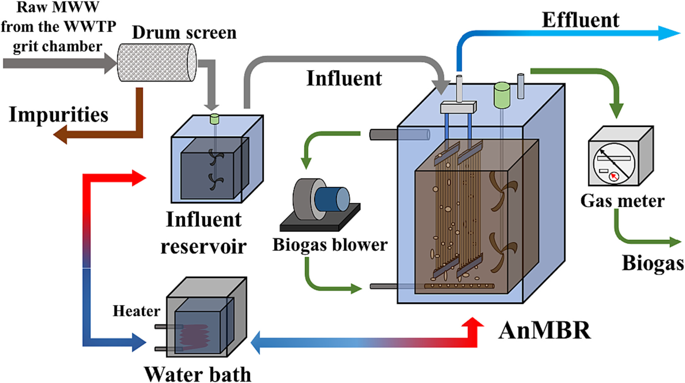
    * **Hình này chứng minh điều gì**
      * Cấu trúc tích hợp tiền xử lý drum screen, bồn đệm điều nhiệt và bể AnMBR đặt màng sợi rỗng PVDF kết hợp sục rửa biogas.
    * **Từ đâu mà thấy được**
      * Luồng dòng từ trái sang phải: nước thải qua drum screen vào influent reservoir, liên kết bồn water bath rồi bơm vào bể AnMBR.
      * Cụm AnMBR: màng sợi rỗng thu effluent, cánh khuấy cơ học và blower tuần hoàn khí biogas từ đỉnh về dàn sục khí đáy màng.

* **Kiểm soát nhiệt độ và các giai đoạn vận hành**: Một hệ thống điều nhiệt cách thủy (water bath thermostatic system) được trang bị bộ gia nhiệt (heater) nhằm duy trì bồn chứa nước đầu vào và bể AnMBR ở mức nhiệt độ ổn định trong dải từ $15\ ^\circ\text{C}$ đến $25\ ^\circ\text{C}$ qua các giai đoạn vận hành khác nhau, mô phỏng môi trường nhiệt độ ổn định xung quanh.
  * Quá trình vận hành kéo dài 525 ngày với nhiệt độ được ổn định hóa qua ba giai đoạn chính: xấp xỉ $25\ ^\circ\text{C}$, $20\ ^\circ\text{C}$, và $15\ ^\circ\text{C}$.

* **Thông số kỹ thuật và cấu tạo cụm module màng lọc**: Module màng gồm 12 cụm đơn vị màng sợi rỗng bằng vật liệu polyvinylidene fluoride (PVDF).
  * Kích thước lỗ màng (pore size) là $0.4\ \mu\text{m}$.
  * Đường kính ngoài của sợi màng (external diameter) là $2.8\ \text{mm}$.
  * Tổng diện tích bề mặt lọc của màng (filtration area) là $72\ \text{m}^2$.
  * Toàn bộ cụm module màng được đặt ngập hoàn toàn (submerged) bên trong bể AnMBR.

* **Chế độ vận hành thủy lực và kiểm soát tắc nghẽn màng**: Chế độ vận hành hút lọc của màng được thiết lập theo chu kỳ $5\ \text{min}$ mỗi chu kỳ (bao gồm $4\ \text{min}$ hút lọc / permeating và $1\ \text{min}$ nghỉ giãn / relaxing).
  * Hệ thống kiểm soát tắc nghẽn màng sử dụng máy thổi khí sinh học (biogas blower) để tuần hoàn khí biogas từ đỉnh bể về dàn ống phân phối khí ở đáy module màng, tạo dòng bọt khí sục rửa liên tục bề mặt sợi màng.
  * Bể AnMBR được bố trí hệ thống cánh khuấy cơ học nhằm khuấy trộn đều hỗn dịch bùn kỵ khí.
  * Cảm biến áp suất xuyên màng trực tuyến (online transmembrane pressure sensor - TMP sensor) được lắp đặt trên đường ống hút lọc dòng thấm, cho phép hiển thị và lưu trữ biến thiên TMP theo thời gian thực (real-time TMP variation) vào hệ thống điều khiển.

* **Cấu hình thiết bị, lưu lượng và hiệu suất xử lý nước thải**: Các thông số cấu hình lò phản ứng, đặc tính module màng và hiệu quả xử lý nước thải của hệ pilot AnMBR được thể hiện trong Bảng 1 (Table 1).
  * **Bảng 1.** Cấu hình và hiệu quả xử lý của AnMBR pilot
    * 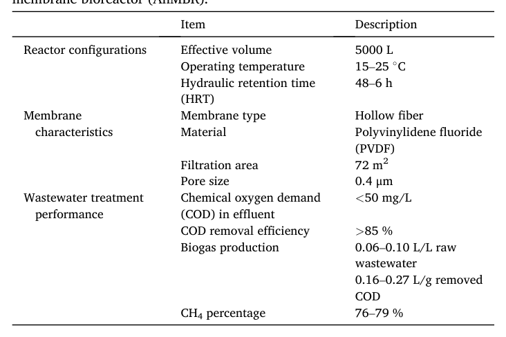
    * **Bảng này chứng minh điều gì**
      * Hệ thống AnMBR pilot ($5000\ \text{L}$) đạt hiệu suất xử lý COD $>85\ \%$, giữ nồng độ COD nước ra $<50\ \text{mg/L}$.
      * Quá trình phân hủy kỵ khí thu hồi khí sinh học giàu $\text{CH}_4$ ($76\text{--}79\ \%$) với sản lượng $0.06\text{--}0.10\ \text{L/L}$ nước thải.
    * **Từ đâu mà thấy được**
      * Cột "Description", hai nhóm thông số đầu: thể tích bể $5000\ \text{L}$, HRT $48\text{--}6\ \text{h}$, màng sợi rỗng PVDF $72\ \text{m}^2$ (kích thước lỗ $0.4\ \mu\text{m}$).
      * Cột "Description", nhóm "Wastewater treatment performance": COD nước ra $<50\ \text{mg/L}$, COD removal $>85\ \%$, biogas $0.06\text{--}0.10\ \text{L/L}$ nước thải, và tỷ lệ $\text{CH}_4$ $76\text{--}79\ \%$.
  * **Thời gian lưu nước lực học (HRT) và thông lượng màng (flux)**: Thời gian lưu nước lực học được rút ngắn theo từng giai đoạn từ $48\ \text{h}$ xuống $24\ \text{h}$, $12\ \text{h}$, $8\ \text{h}$, và $6\ \text{h}$, tương ứng với thông lượng màng biến thiên từ $2$ đến $15\ \text{LMH}$ trong dải HRT $48\text{--}8\ \text{h}$, và đạt $17.83\ \text{LMH}$ ở HRT $6\ \text{h}$.
  * **Tải trọng hữu cơ (OLR)**: Dao động từ $0.11$ đến $2.04\ \text{g/L/d}$.
  * **Nồng độ COD nước sau xử lý**: Nồng độ COD dòng ra luôn duy trì ở mức $<50\ \text{mg/L}$.
  * **Hiệu suất loại bỏ COD**: Đạt $>85\ \%$ (trong đó đạt $>90\ \%$ ở các giai đoạn nhiệt độ $25\ ^\circ\text{C}$ và $20\ ^\circ\text{C}$, và đạt $85\ \%$ ở giai đoạn $15\ ^\circ\text{C}$).
  * **Sản lượng sinh khí sinh học**: Tốc độ sinh biogas đạt $0.06\text{--}0.10\ \text{L/L}$ nước thải thô (tương đương $0.16\text{--}0.27\ \text{L/g}$ COD bị loại bỏ), với tỷ lệ $\text{CH}_4$ duy trì ổn định ở mức $76\text{--}79\ \%$, được định lượng bằng đồng hồ đo khí (gas meter).

* **Nguồn tài liệu tham khảo chi tiết**: Các công trình nghiên cứu trước đây (Kong et al., 2021a, 2021b; Rong et al., 2022a, 2021) cung cấp đầy đủ thông tin chi tiết về các chỉ tiêu chất lượng nước, quy trình lấy mẫu, phương pháp phân tích thực nghiệm, cũng như điều kiện và hoàn cảnh bố trí thiết bị nghiên cứu.

### 2.2. Dataset preprocessing

* **Quy mô và nguồn gốc bộ dữ liệu thực nghiệm**:
  * Bộ dữ liệu được thiết lập dựa trên $525\text{ ngày}$ vận hành dài hạn của hệ thống bể phản ứng sinh học màng kỵ khí quy mô pilot lớn (pilot-scale anaerobic membrane bioreactor - AnMBR) xử lý nước thải đô thị thực (real municipal wastewater).
  * Toàn bộ các mô hình học máy đều sử dụng $7\text{ đặc trưng đầu vào}$ (input features) bao gồm:
    * Tải trọng hữu cơ của AnMBR (organic load rate - OLR).
    * Nồng độ chất rắn lơ lửng trong nước thải đầu vào (suspended solids in the influent - SS).
    * Nồng độ protein ($\text{EPS}_p$) trong các chất polyme ngoại bào (extracellular polymeric substances - EPS) của bùn.
    * Nồng độ polysaccharide ($\text{EPS}_c$) trong EPS của bùn.
    * Nồng độ chất rắn lơ lửng trong hỗn hợp bùn (mixed liquor-suspended solids - MLSS).
    * Nhiệt độ của bể phản ứng sinh học (bioreactor temperature - Temp).
    * Thông lượng lọc của màng (flux).
  * Biến mục tiêu đầu ra (target output) của các mạng nơ-ron: Áp suất xuyên màng (transmembrane pressure - TMP).

* **Tần suất thu thập dữ liệu và phương pháp xử lý dữ liệu khuyết thiếu (Missing Data Imputation)**:
  * Tần suất lấy mẫu không đồng bộ giữa các thông số:
    * Dữ liệu nhiệt độ (Temp) và thông lượng (flux) được thu thập hàng ngày (daily).
    * Các biến số còn lại (OLR, influent SS, $\text{EPS}_p$, $\text{EPS}_c$, MLSS) được lấy mẫu và đo đạc định kỳ mỗi $2\text{ ngày}$ ($2\text{ days}$).
  * Phương pháp gán quan sát cuối cùng về phía trước (last observation carried forward - LOCF):
    * Phương pháp gán giá trị LOCF được sử dụng để xử lý dữ liệu bị khuyết thiếu phát sinh do quá trình thu thập dữ liệu bất đồng bộ (asynchronous data gathering).
    * Nguyên lý LOCF: Đây là chiến lược tiêu chuẩn để xử lý dữ liệu khuyết trong các nghiên cứu theo thời gian hoặc chuỗi thời gian (longitudinal or time-series studies); khi một điểm dữ liệu trong một khoảng thời gian nhất định bị khuyết, giá trị quan sát gần nhất trước đó sẽ được điền vào để lấp khoảng trống (Woolley et al., 2009).

* **Phân bố thống kê của bộ dữ liệu (Dataset Distribution)**:
  * Sự phân bố của các đặc trưng đầu vào và biến mục tiêu đầu ra được trình bày chi tiết trong Bảng 2:
    * Tải trọng hữu cơ OLR: giá trị cực đại $2.04\text{ g/(L}\cdot\text{d)}$, cực tiểu $0.11\text{ g/(L}\cdot\text{d)}$, trung bình $0.90\text{ g/(L}\cdot\text{d)}$, độ lệch chuẩn $\text{STD} = 0.51\text{ g/(L}\cdot\text{d)}$.
    * Chất rắn lơ lửng dòng vào SS: cực đại $478.00\text{ mg/L}$, cực tiểu $128.00\text{ mg/L}$, trung bình $223.51\text{ mg/L}$, $\text{STD} = 42.58\text{ mg/L}$.
    * Nồng độ protein trong EPS bùn ($\text{EPS}_p$): cực đại $136.33\text{ mg/g VSS}$, cực tiểu $32.82\text{ mg/g VSS}$, trung bình $57.13\text{ mg/g VSS}$, $\text{STD} = 21.56\text{ mg/g VSS}$.
    * Nồng độ polysaccharide trong EPS bùn ($\text{EPS}_c$): cực đại $124.18\text{ mg/g VSS}$, cực tiểu $9.00\text{ mg/g VSS}$, trung bình $16.41\text{ mg/g VSS}$, $\text{STD} = 13.60\text{ mg/g VSS}$.
    * Nồng độ MLSS: cực đại $15.28\text{ mg/L}$, cực tiểu $5.62\text{ mg/L}$, trung bình $9.22\text{ mg/L}$, $\text{STD} = 2.03\text{ mg/L}$ (ghi chú theo nguyên văn bảng; tương đương $5.62 - 15.28\text{ g/L}$ trong bùn kỵ khí).
    * Nhiệt độ bể phản ứng Temp: cực đại $28.20^\circ\text{C}$, cực tiểu $16.10^\circ\text{C}$, trung bình $24.89^\circ\text{C}$, $\text{STD} = 2.55^\circ\text{C}$.
    * Thông lượng lọc Flux: cực đại $17.83\text{ LMH}$, cực tiểu $2.08\text{ LMH}$, trung bình $9.36\text{ LMH}$, $\text{STD} = 4.44\text{ LMH}$.
    * Biến mục tiêu TMP: giá trị cực đại $25.61\text{ kPa}$, cực tiểu $0.15\text{ kPa}$, trung bình $6.57\text{ kPa}$, và độ lệch chuẩn $\text{STD} = 6.24\text{ kPa}$.
  * **Bảng 2.** Phân bố tập dữ liệu huấn luyện và kiểm thử mô hình.
    * 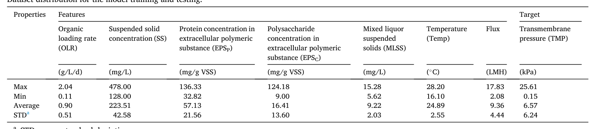
    * **Bảng này chứng minh điều gì**
      * Thống kê mô tả đầy đủ miền giá trị (Max, Min, Average, STD) của 7 biến đặc trưng đầu vào và biến mục tiêu TMP trong suốt 525 ngày vận hành AnMBR pilot.
    * **Từ đâu mà thấy được**
      * Cột Features gồm 7 thông số vận hành và hóa sinh; cột Target là áp suất qua màng TMP.
      * Các hàng Min, Max, Average và STD xác định khoảng biến thiên và độ lệch chuẩn của từng biến số.

* **Phân chia tập dữ liệu và xáo trộn ngẫu nhiên (Data Partitioning & Shuffling)**:
  * Tỷ lệ phân chia tập dữ liệu: Bộ dữ liệu được phân chia ngẫu nhiên thành tập huấn luyện (training set) và tập kiểm thử (test set) theo tỷ lệ $9:1$ ($90\%$ dành cho huấn luyện và $10\%$ dành cho kiểm thử) (Zhu et al., 2023).
  * Mục đích xáo trộn dữ liệu (shuffling data) và loại bỏ tính tuần tự:
    * Dù dữ liệu gốc mang đặc tính chuỗi thời gian (temporal characteristics), mục tiêu trọng tâm của nghiên cứu là so sánh hiệu năng giữa mô hình Perceptron đa lớp (multilayer perceptron - MLP) và Mạng bộ nhớ ngắn-dài hạn (long short-term memory - LSTM) trong bối cảnh phi tuần tự (non-sequential context).
    * Thông qua thao tác xáo trộn ngẫu nhiên dữ liệu, việc phân chia chuyển đổi tính chất từ một bộ dữ liệu chuỗi thời gian sang một bộ dữ liệu tổng quát (general dataset).
    * Lợi ích kép của thao tác xáo trộn:
      * Nâng cao khả năng tổng quát hóa của mô hình (improved model generalization).
      * Giải quyết triệt để mối lo ngại về rò rỉ dữ liệu tiềm ẩn (addressed potential data leakage concerns), do thứ tự thời gian không còn là một yếu tố can thiệp sau khi dữ liệu đã được xáo trộn.

* **Chuẩn hóa đặc trưng đầu vào (Input Feature Normalization / Standardization)**:
  * Vai trò của chuẩn hóa đối với mô hình mạng nơ-ron:
    * Chuẩn hóa hoặc tiêu chuẩn hóa các đặc trưng đầu vào mang lại lợi ích thiết thực cho các mô hình học máy, đặc biệt là mạng nơ-ron nhân tạo (neural networks).
    * Nếu không chuẩn hóa đầu vào, các thuật toán tối ưu hóa như phương pháp hạ gradient (gradient descent) có thể gặp khó khăn trong việc đạt tới sự hội tụ do hành vi dao động (oscillatory behavior) của gradient, đặc biệt khi thang đo của các đặc trưng có sự biến thiên lớn.
    * Mặc dù trong một số thuật toán học máy nhất định, chênh lệch lớn về miền giá trị số học có thể khiến các biến có thang đo lớn hơn gây ảnh hưởng bất cân xứng lên mô hình (Ozsahin et al., 2022), mục tiêu chủ đạo của việc chuẩn hóa trong các mô hình mạng nơ-ron của nghiên cứu này là thúc đẩy sự hội tụ hiệu quả và ổn định trong suốt quá trình huấn luyện (promote efficient and stable convergence during training).
  * Tính tương thích với các kỹ thuật điều chuẩn (Regularization):
    * Tầm quan trọng của việc đồng nhất thang đo đặc trưng càng tăng lên rõ rệt khi áp dụng các kỹ thuật điều chuẩn (regularization techniques).
    * Thang đo nhất quán đảm bảo trọng số (weight) của không có bất kỳ đặc trưng nào bị phạt (unfairly penalized) một cách không công bằng chỉ do thang đo số học ban đầu của đặc trưng đó.
  * Hàm tiêu chuẩn hóa (Standardization Function) - Công thức (1):
    * Phương pháp chuẩn hóa được sử dụng để giải quyết vấn đề thang đo và tạo điều kiện thuận lợi cho việc so sánh, phân tích các đặc trưng:
      $$X_{\text{standardized}} = \frac{X - \mu}{\sigma} \quad (1)$$
    * Trong đó:
      * $X$ là giá trị đặc trưng ban đầu (original features).
      * $\mu$ là giá trị trung bình (mean) của đặc trưng.
      * $\sigma$ là độ lệch chuẩn (standard deviation) của đặc trưng.
    * Thuộc tính sau chuẩn hóa: Sau khi tiêu chuẩn hóa, các đặc trưng đều có giá trị trung bình xấp xỉ $0$ ($\mu \approx 0$) và độ lệch chuẩn xấp xỉ $1$ ($\sigma \approx 1$).
    * Tác động bảo toàn phân bố: Phép biến đổi này tối ưu hóa hiệu năng của các mô hình học máy mà vẫn duy trì nguyên vẹn hình dạng phân bố ban đầu (original distribution shape) của các đặc trưng.
  * Môi trường và công cụ hiện thực hóa:
    * Quá trình tiêu chuẩn hóa được thực hiện bằng công cụ `StandardScaler` thuộc thư viện học máy Scikit-learn dành cho ngôn ngữ lập trình Python (phiên bản `3.9.16`).

### 2.3. Model development

#### 2.3.1. Hyperparameters optimization (HPO)

* **Quy trình phát triển mô hình tổng thể và tầm quan trọng của siêu tham số**:
  * Quy trình phát triển mô hình dự đoán áp suất xuyên màng ($\text{TMP}$ - transmembrane pressure) được minh họa khái quát trong Hình 2 (Fig. 2):
    * **Hình 2.** Sơ đồ quy trình phát triển và giải thích mô hình TMP.
      * 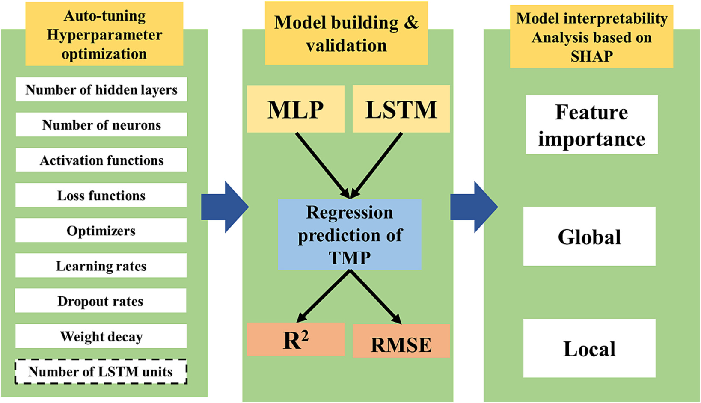
      * **Hình này chứng minh điều gì**
        * Quy trình 3 giai đoạn nối tiếp: tự động tối ưu siêu tham số (HPO), huấn luyện đối sánh MLP và LSTM và giải thích bằng SHAP.
      * **Từ đâu mà thấy được**
        * Luồng xử lý từ trái sang phải liên kết qua mũi tên xanh: Auto-tuning HPO $\to$ Model building & validation $\to$ Model interpretability Analysis based on SHAP.
        * Khối 1 tối ưu 9 siêu tham số; khối 2 huấn luyện MLP và LSTM dự đoán TMP (đánh giá bằng $R^2$, RMSE); khối 3 phân tích SHAP (Feature importance, Global, Local).
  * Trong tất cả các kỹ thuật học máy (machine learning), các siêu tham số (hyperparameters) đóng vai trò sống còn quyết định trực tiếp đến hiệu suất của mô hình.
  * Các giá trị của siêu tham số phải được xác định và cố định trước khi bắt đầu quá trình học (learning process) (Agarwal et al., 2023).
  * Đối với các mạng nơ-ron nhân tạo (neural networks - NN), siêu tham số bao gồm các thông số cốt lõi như tốc độ học (learning rate), số lượng tầng ẩn (number of layers), số lượng nơ-ron trong từng tầng (number of neurons in each layer), v.v.
  * Siêu tham số tác động sâu sắc đến năng lực học từ dữ liệu và khả năng tổng quát hóa (generalization) của mô hình trên dữ liệu mới chưa từng thấy, cũng như chi phối hiệu suất tổng thể, hiệu quả tính toán và tính thích ứng của mô hình.
  * Việc tinh chỉnh siêu tham số hiệu quả (effectively tuned) là điều kiện thiết yếu hàng đầu trong quy trình xây dựng bất kỳ mô hình học máy nào.

* **Khung tối ưu hóa Optuna và không gian siêu tham số cần tối ưu**:
  * Để đạt được hiệu suất tối ưu, khung tối ưu hóa Optuna (Optuna framework) (Akiba et al., 2019) xây dựng trên nền tảng Python được sử dụng để tối ưu hóa tự động các siêu tham số.
  * Đối với mô hình Perceptron đa lớp (multilayer perceptron - MLP), các siêu tham số được đưa vào tối ưu hóa bao gồm:
    * Số lượng tầng ẩn (number of hidden layers).
    * Số lượng nơ-ron trong các tầng ẩn (number of neurons in the hidden layers).
    * Hàm kích hoạt (activation functions) tại từng tầng ẩn.
    * Thuật toán tối ưu hóa (optimizers) và tốc độ học (learning rate) trong suốt quá trình huấn luyện.
    * Tỷ lệ loại bỏ (dropout rate) cho từng tầng ẩn.
    * Suy giảm trọng số (weight decay) đóng vai trò điều hòa $L_2$ ($L_2$ regularization).
    * Hàm mất mát (loss function).
  * Đối với mô hình Mạng bộ nhớ ngắn-dài hạn (long short-term memory - LSTM): bên cạnh các siêu tham số được tối ưu như MLP, số lượng đơn vị bộ nhớ (number of memory units / LSTM units) được tối ưu bổ sung để nâng cao năng lực học chuỗi thời gian.
  * Bảng 3 (Table 3) trình bày chi tiết các phương án thay thế khả dĩ (available alternatives) và các lựa chọn tối ưu (selected options) cho từng siêu tham số của mô hình MLP và LSTM:
    * **Bảng 3.** Cấu hình siêu tham số cho MLP và LSTM
      * 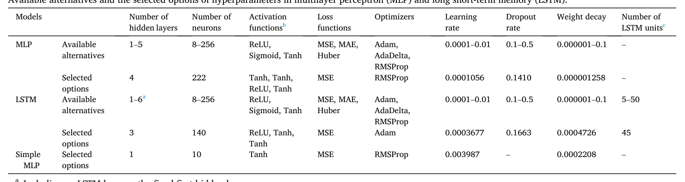
      * **Bảng này chứng minh điều gì**
        * MLP chọn $4$ lớp ẩn ($222$ neuron, RMSProp), LSTM chọn $3$ lớp ($140$ neuron, $45$ đơn vị LSTM, Adam), và Simple MLP chọn $1$ lớp ($10$ neuron).
        * Cả hai mô hình đều chọn loss MSE, learning rate lần lượt là $0.0001056$ (MLP) và $0.0003677$ (LSTM).
      * **Từ đâu mà thấy được**
        * Hàng "Selected options" đối chiếu với "Available alternatives" ở cột "Models" (MLP, LSTM, Simple MLP).
        * Các cột "Number of hidden layers", "Number of neurons", "Optimizers", "Learning rate" và "Number of LSTM units".
  * Chi tiết không gian tìm kiếm khả dĩ và cấu hình tối ưu được xác định từ Bảng 3:
    * **Mô hình MLP**:
      * Số tầng ẩn: không gian khảo sát $1\text{–}5$ tầng; tùy chọn được chọn là $4$ tầng.
      * Số lượng nơ-ron: không gian khảo sát $8\text{–}256$ nơ-ron; tùy chọn được chọn là $222$ nơ-ron.
      * Hàm kích hoạt: không gian khảo sát gồm ReLU, Sigmoid, Tanh; tùy chọn được chọn từ tầng 1 đến tầng 4 lần lượt là Tanh, Tanh, ReLU, Tanh.
      * Hàm mất mát: không gian khảo sát gồm MSE, MAE, Huber; tùy chọn được chọn là sai số bình phương trung bình ($\text{MSE}$).
      * Bộ tối ưu hóa: không gian khảo sát gồm Adam, AdaDelta, RMSProp; tùy chọn được chọn là $\text{RMSProp}$.
      * Tốc độ học: không gian khảo sát $0.0001\text{–}0.01$; tùy chọn được chọn là $0.0001056$.
      * Tỷ lệ dropout: không gian khảo sát $0.1\text{–}0.5$; tùy chọn được chọn là $0.1410$.
      * Suy giảm trọng số (weight decay): không gian khảo sát $0.000001\text{–}0.1$; tùy chọn được chọn là $0.000001258$.
    * **Mô hình LSTM**:
      * Số tầng ẩn: không gian khảo sát $1\text{–}6$ tầng (bao gồm một tầng LSTM đóng vai trò cố định là tầng ẩn đầu tiên); tùy chọn được chọn là $3$ tầng.
      * Số lượng nơ-ron: không gian khảo sát $8\text{–}256$ nơ-ron; tùy chọn được chọn là $140$ nơ-ron.
      * Hàm kích hoạt: không gian khảo sát gồm ReLU, Sigmoid, Tanh; tùy chọn được chọn lần lượt là ReLU, Tanh, Tanh.
      * Hàm mất mát: không gian khảo sát gồm MSE, MAE, Huber; tùy chọn được chọn là $\text{MSE}$.
      * Bộ tối ưu hóa: không gian khảo sát gồm Adam, AdaDelta, RMSProp; tùy chọn được chọn là $\text{Adam}$.
      * Tốc độ học: không gian khảo sát $0.0001\text{–}0.01$; tùy chọn được chọn là $0.0003677$.
      * Tỷ lệ dropout: không gian khảo sát $0.1\text{–}0.5$; tùy chọn được chọn là $0.1663$.
      * Suy giảm trọng số: không gian khảo sát $0.000001\text{–}0.1$; tùy chọn được chọn là $0.0004726$.
      * Số đơn vị bộ nhớ LSTM: không gian khảo sát $5\text{–}50$ đơn vị; tùy chọn được chọn là $45$ đơn vị.
    * **Mô hình MLP đơn giản đối chứng (Simple MLP)**:
      * Cấu hình lựa chọn gồm $1$ tầng ẩn, $10$ nơ-ron, hàm kích hoạt Tanh, hàm mất mát $\text{MSE}$, bộ tối ưu $\text{RMSProp}$, tốc độ học $0.003987$, suy giảm trọng số $0.0002208$ (không áp dụng dropout).

* **Thuật toán TPE và Hàm mục tiêu tối ưu hóa**:
  * Thuật toán tối ưu hóa mặc định: Optuna triển khai thuật toán Ước lượng Parzen cấu trúc cây (Tree-structured Parzen Estimator - TPE) làm phương pháp mặc định cho HPO.
  * Bản chất kỹ thuật của TPE: TPE là một biến thể tiên tiến của phương pháp tối ưu hóa Bayes (Bayesian optimization technique), cho phép thăm dò hiệu quả không gian tìm kiếm và nhận diện các tổ hợp siêu tham số tiềm năng (J. Li et al., 2022).
  * Tiêu chuẩn đánh giá hiệu suất dự đoán: Hiệu suất dự đoán hồi quy của các mô hình MLP và LSTM được định lượng thông qua hệ số xác định ($R^2$ - coefficient of determination) theo công thức (2):
    $$R^2 = \frac{\sum_i (y_i - p_i)^2}{\sum_i (y_i - m)^2} \qquad (2)$$
    trong đó:
    * $y_i$: giá trị áp suất xuyên màng ($\text{TMP}$) thực tế trong tập kiểm tra (test set).
    * $p_i$: giá trị $\text{TMP}$ được mô hình dự đoán.
    * $m$: giá trị trung bình của các giá trị $\text{TMP}$ thực tế trong tập kiểm tra.
  * Mục tiêu của HPO (Objective of HPO): Quá trình tối ưu hóa siêu tham số nhắm tới việc tối đa hóa hệ số xác định $R^2$ ($\max R^2$) để đạt được độ chính xác dự đoán cao nhất.

* **Cài đặt số chu kỳ huấn luyện (Epochs) và kích thước lô (Batch size)**:
  * Số chu kỳ (epochs) và kích thước lô (batch sizes) là các tham số quan trọng ảnh hưởng sâu sắc đến tiến trình học của mạng nơ-ron.
  * Mỗi epoch đại diện cho một lượt duyệt hoàn chỉnh qua toàn bộ tập dữ liệu trong quá trình huấn luyện; số lượng epochs là siêu tham số bắt buộc phải được định nghĩa trước khi khởi chạy huấn luyện.
  * Việc cập nhật trọng số sau từng mẫu huấn luyện riêng lẻ trong mạng nơ-ron đòi hỏi chi phí tính toán rất lớn; vì vậy kích thước lô (batch size) là một siêu tham số then chốt cần được ấn định cụ thể (Masters and Luschi, 2018).
  * Căn cứ vào quy mô bộ dữ liệu và tỷ lệ phân chia tập huấn luyện - kiểm tra (train-test split) đối với bài toán dự đoán $\text{TMP}$, kích thước lô và số epochs trong quy trình HPO được thiết lập cố định lần lượt là $32$ và $1000$.
  * Thiết lập này được duy trì đồng nhất cho các mô hình dự đoán MLP và LSTM được huấn luyện tiếp sau đó.

* **Cơ chế huấn luyện lan truyền ngược (BP), bộ tối ưu hóa và tốc độ học**:
  * Thuật toán lan truyền ngược (Backpropagation - BP): Cả hai mô hình MLP và LSTM đều được huấn luyện bằng thuật toán lan truyền ngược BP.
  * Vai trò của bộ tối ưu hóa: Bộ tối ưu hóa được sử dụng trong quá trình huấn luyện BP để cập nhật và điều chỉnh các trọng số (weights) cùng độ chệch (biases) của mạng nơ-ron dựa trên các gradient tính toán được; mục đích chính là cực tiểu hóa các sai số hoặc hàm mất mát trong huấn luyện (Sun, 2019).
  * Lựa chọn bộ tối ưu hóa: Quá trình HPO khảo sát giữa ba bộ tối ưu hóa gồm Adam, RMSProp và AdaDelta.
  * Vai trò của tốc độ học (Learning rate):
    * HPO tối ưu hóa tốc độ học - một siêu tham số tối quan trọng trong các giải thuật tối ưu hóa.
    * Trong quá trình huấn luyện mạng nơ-ron, tốc độ học kiểm soát độ lớn bước nhảy (step size) mà bộ tối ưu hóa áp dụng để hiệu chỉnh trọng số và độ lệch.
    * Tốc độ học điều tiết biên độ cập nhật mô hình và có thể tác động căn bản đến tính hội tụ (convergence) cũng như hiệu suất tổng thể của mô hình (Smith, 2017).

* **Kiểm soát hiện tượng quá khớp (Overfitting) và thiết lập số lượt thử nghiệm (Trials) trong Optuna**:
  * Nguy cơ quá khớp trong học máy:
    * Quá khớp (overfitting) là một thách thức phổ biến khi mô hình hoạt động rất tốt trên dữ liệu huấn luyện nhưng lại kém hiệu quả trên dữ liệu mới chưa từng thấy.
    * Hiện tượng này xuất hiện khi mô hình trở nên quá phức tạp và có xu hướng học vẹt/ghi nhớ các trường hợp huấn luyện thay vì nắm bắt các quy luật và mối quan hệ bản chất cốt lõi (Ying, 2019).
  * Biện pháp kiểm soát quá khớp trong HPO: Kỹ thuật Dropout và Suy giảm trọng số (Weight decay) được áp dụng đồng thời cho từng tầng ẩn trong HPO, đồng thời tỷ lệ dropout và cường độ điều hòa của weight decay được tối ưu hóa nhằm cực tiểu hóa nguy cơ quá khớp.
  * Khái niệm lượt thử nghiệm (trial) trong Optuna:
    * Một trial là một bước lặp đơn lẻ của quá trình HPO, tại đó một tập hợp siêu tham số cụ thể được khởi tạo và đánh giá.
    * Trong mỗi trial, Optuna nỗ lực tìm kiếm các siêu tham số tối ưu nhằm tối đa hóa hàm mục tiêu đã được chỉ định.
    * Trong nghiên cứu này, tổng cộng $1000$ lượt thử nghiệm ($1000\text{ trials}$) được phân bổ độc lập cho mỗi mô hình MLP và LSTM.

#### 2.3.2. MLP model

* **Kiến trúc mạng nơ-ron và quy trình phát triển mô hình (Network architecture)**:
  * **Cấu trúc mạng Perceptron đa lớp (MLP - Multilayer Perceptron)**:
    * Mô hình MLP bao gồm tầng đầu vào (input layer), 4 tầng ẩn (four hidden layers), và tầng đầu ra (output layer).
    * Tầng đầu vào: Mỗi nơ-ron đại diện cho một trong $7$ đặc trưng đầu vào (seven input features).
    * Bốn tầng ẩn: Mỗi tầng ẩn chứa $222$ nơ-ron ($222$ neurons).
    * Mỗi nơ-ron thực hiện phép biến đổi tuyến tính trên dữ liệu đầu vào và chuyển kết quả đến một hàm kích hoạt (activation function) để tạo ra đầu ra.
    * Quy trình phát triển mô hình và cấu trúc chi tiết được minh họa trong Hình 3 (Fig. 3):
      * **Hình 3.** Cấu trúc mô hình mạng MLP và LSTM
        * 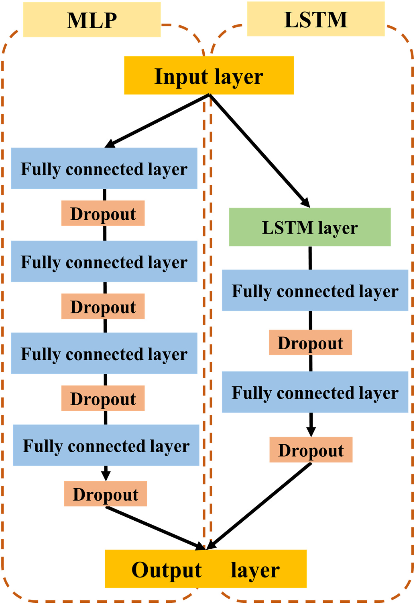
        * **Hình này chứng minh điều gì**
          * MLP gồm 4 lớp Fully connected xen kẽ 4 Dropout; LSTM gồm 1 lớp LSTM tiếp nối 2 lớp Fully connected xen kẽ Dropout.
        * **Từ đâu mà thấy được**
          * Hướng đọc từ trên xuống: từ Input layer tách thành hai nhánh MLP (trái) và LSTM (phải), cùng dẫn về Output layer.
          * Khung MLP chứa 4 khối Fully connected layer xen kẽ Dropout; khung LSTM có khối LSTM layer tiếp nối 2 khối Fully connected layer xen kẽ Dropout.
  * **Cơ chế tính toán tại từng nơ-ron (Eq. (3))**:
    * Đối với một nơ-ron cho trước ở tầng $l$, quá trình tính toán được xác định theo Phương trình (3):
      $$a^l = f\left(W^l \cdot a^{l-1} + b^l\right) \quad (3)$$
    * $a^l$: Biểu diễn vectơ kích hoạt (activation vector) tại tầng $l$.
    * $W^l$: Biểu diễn ma trận trọng số (weight matrix) kết nối từ tầng $l-1$ đến tầng $l$.
    * $b^l$: Biểu diễn vectơ độ chệch (bias vector) tại tầng $l$.
    * $f$: Biểu diễn hàm kích hoạt được áp dụng theo từng phần tử (element-wise) lên kết quả biến đổi tuyến tính.

* **Cấu hình hàm kích hoạt (Activation functions)**:
  * **Hàm kích hoạt cho các tầng ẩn**:
    * Quá trình tối ưu hóa siêu tham số (HPO - Hyperparameter Optimization) lựa chọn hàm kích hoạt cho từng tầng ẩn.
    * Thứ tự các hàm kích hoạt được lựa chọn từ tầng ẩn thứ 1 đến tầng ẩn thứ 4 lần lượt là $\text{Tanh}$, $\text{Tanh}$, $\text{ReLU}$, và $\text{Tanh}$ (Eqs. (4) và (5)):
      * **Hàm Tanh (Eq. (4))**:
        $$\text{Tanh}(z) = f(z) = \frac{e^z - e^{-z}}{e^z + e^{-z}} \quad (4)$$
      * **Hàm ReLU (Rectified Linear Unit - Eq. (5))**:
        $$\text{ReLU}(z) = f(z) = \max(0, z) \quad (5)$$
      * Trong đó $z$ là giá trị đầu vào của hàm kích hoạt và $f(z)$ là giá trị đầu ra tương ứng.
  * **Hàm kích hoạt cho tầng đầu ra**:
    * Biến mục tiêu duy nhất trong bài toán dự đoán hồi quy là áp suất qua màng (TMP - Transmembrane Pressure), vốn là một biến số liên tục (continuous value).
    * Do đó, tầng đầu ra của mô hình hồi quy chỉ gồm $1$ nơ-ron đại diện cho TMP.
    * Thông thường, hàm kích hoạt tuyến tính (linear activation function) hay được áp dụng ở tầng đầu ra của các tác vụ hồi quy, cho phép mạng xuất trực tiếp các giá trị kỳ vọng mà không cần biến đổi bổ sung (Dubey et al., 2022).
    * Tuy nhiên, việc lựa chọn hàm kích hoạt phù hợp với đặc trưng của bài toán và hành vi đầu ra mong muốn là điều thiết yếu: Đối với dự đoán TMP, giá trị bắt buộc phải dương; do đó, hàm $\text{ReLU}$ được chọn làm hàm kích hoạt cho tầng đầu ra trong nghiên cứu này.

* **Hàm mất mát và các siêu tham số huấn luyện lan truyền ngược (Loss function, optimizer, and training hyperparameters)**:
  * **Hàm mất mát (Loss function - Eq. (6))**:
    * Sai số toàn phương trung bình (MSE - Mean Square Error) được chọn làm hàm mất mát cho mô hình hồi quy MLP:
      $$\text{MSE}(y, p) = \frac{1}{n} \sum_{i=1}^n (y_i - p_i)^2 \quad (6)$$
    * Trong đó $n$ là số lượng mẫu (number of samples), $y_i$ là giá trị thực nghiệm của biến mục tiêu, và $p_i$ là giá trị dự đoán của mô hình.
  * **Thuật toán tối ưu hóa và các siêu tham số huấn luyện (Optimizer and hyperparameters)**:
    * Thuật toán tối ưu hóa (Optimizer): $\text{RMSProp}$ được lựa chọn để cập nhật trọng số qua lan truyền ngược.
    * Tốc độ học (Learning rate): $0{,}0001056$.
    * Tỷ lệ loại bỏ ngẫu nhiên (Dropout rate): $0{,}1410$ cho mỗi tầng ẩn.
    * Hệ số suy giảm trọng số (Weight decay): $0{,}000001258$ cho mỗi tầng ẩn.

* **Khung chỉ số thống kê đánh giá hiệu năng hồi quy (Evaluation metrics framework)**:
  * **Căn bậc hai sai số toàn phương trung bình (RMSE - Root Mean Square Error - Eq. (7))**:
    * Bên cạnh hệ số xác định $R^2$, RMSE là chỉ số thông dụng để định lượng độ lớn trung bình của sai số dự đoán.
    * Cung cấp đánh giá trực quan về độ chính xác của mô hình theo cùng đơn vị đo với biến mục tiêu (kPa).
    * RMSE được tính bằng căn bậc hai của MSE:
      $$\text{RMSE} = \sqrt{\text{MSE}} \quad (7)$$
    * Trong bài toán hồi quy, RMSE được tính toán trên cả tập huấn luyện (training set) và tập kiểm thử (test set) nhằm mang lại bức tranh toàn diện về hiệu năng mô hình.
  * **Hệ số xác định hiệu chỉnh (Adjusted $R^2$ - Eq. (8))**:
    * Bổ sung nhằm xem xét số lượng biến dự đoán (đặc trưng đầu vào) trong mô hình, mang lại đánh giá chính xác hơn về khả năng giải thích (explanatory capability):
      $$\text{Adjusted } R^2 = 1 - \left(1 - R^2\right) \cdot \frac{n - 1}{n - p - 1} \quad (8)$$
    * Trong đó $R^2$ là hệ số xác định, $n$ là số lượng mẫu, và $p$ là số lượng biến dự đoán / đặc trưng đầu vào trong mô hình ($p = 7$).
  * **Sai số tuyệt đối trung bình (MAE - Mean Absolute Error - Eq. (9))**:
    * Đo lường độ sai lệch tuyệt đối trung bình giữa giá trị dự đoán và giá trị thực tế, phản ánh trực tiếp độ lớn sai số trung bình:
      $$\text{MAE}(y, p) = \frac{1}{n} \sum_{i=1}^n |y_i - p_i| \quad (9)$$
    * Trong đó $n$ là số lượng mẫu, $y_i$ là giá trị thực tế, và $p_i$ là giá trị dự đoán.
  * **Sai số tuyệt đối trung vị (MedAE - Median Absolute Error - Eq. (10))**:
    * Lấy giá trị trung vị của tập hợp các sai số tuyệt đối $|y_i - p_i|$ khi sắp xếp theo thứ tự tăng dần:
      $$\text{MedAE}(y, p) = \text{median}(|y_i - p_i|) \quad (10)$$
    * Là một chỉ số bền vững (robust metric), ít bị nhạy cảm hoặc sai lệch bởi các giá trị ngoại lai (outliers) trong tập dữ liệu so với MAE.
  * **Tính toàn diện của khung đánh giá**: Sự kết hợp các chỉ số ($R^2$, Adjusted $R^2$, RMSE, MAE, MedAE) tạo thành khung chuẩn mực để thẩm định chặt chẽ năng lực dự đoán của các mô hình.

* **Mô hình MLP đơn giản dùng làm chuẩn đối sánh (Simple MLP benchmark model - s-MLP)**:
  * **Mục tiêu xây dựng**: Do quy trình HPO tối ưu hóa sâu tạo ra mô hình có cấu trúc phức tạp đòi hỏi nhiều tài nguyên tính toán và thời gian, mô hình MLP đơn giản (s-MLP) được phát triển làm mốc chuẩn (benchmark) để so sánh và đánh giá hiệu năng của các mô hình mạng nơ-ron nhân tạo.
  * **Đặc tính giữ nguyên**: Tập dữ liệu sử dụng, các thuộc tính của tầng đầu vào ($7$ đặc trưng) và tầng đầu ra ($1$ nơ-ron với hàm kích hoạt $\text{ReLU}$) giữ nguyên như mô hình MLP chính.
  * **Cấu trúc mạng và điều chuẩn**:
    * s-MLP chỉ có đúng $1$ tầng ẩn (single hidden layer) với dải tìm kiếm nơ-ron từ $1$ đến $10$.
    * Do cấu trúc đơn giản, kỹ thuật Dropout không được áp dụng (Dropout rate = 0).
  * **Không gian siêu tham số và kết quả sau HPO**:
    * Các cấu hình HPO khác (hàm kích hoạt, hàm mất mát, bộ tối ưu hóa, tốc độ học, suy giảm trọng số, số lượt thử nghiệm) hoàn toàn tương đồng với mô hình MLP chính.
    * Cấu hình tối ưu nhận được sau HPO:
      * Số nơ-ron tầng ẩn: $10$ nơ-ron.
      * Hàm kích hoạt tầng ẩn: $\text{Tanh}$.
      * Hàm mất mát: $\text{MSE}$.
      * Thuật toán tối ưu: $\text{RMSProp}$.
      * Tốc độ học (Learning rate): $0{,}003987$.
      * Hệ số suy giảm trọng số (Weight decay): $0{,}0002208$.

#### 2.3.3. LSTM model

* **Kiến trúc tổng thể và cấu hình các tầng của mô hình**:
  * **Đặc tính tầng đầu vào và đầu ra**: Mô hình Mạng bộ nhớ ngắn-dài hạn (long short-term memory - LSTM) và Perceptron đa lớp (multilayer perceptron - MLP) có cùng các đặc tính tầng đầu vào (input layer) và tầng đầu ra (output layer) phục vụ bài toán dự đoán hồi quy (regression prediction).
  * **Cấu trúc ba tầng ẩn (three hidden layers)**:
    * Tầng ẩn thứ nhất là một tầng LSTM (LSTM layer) với 45 đơn vị bộ nhớ (memory units).
    * Hai tầng ẩn còn lại là các tầng liên kết đầy đủ (fully connected layers), mỗi tầng chứa 140 nơ-ron (neurons).
  * **Hàm kích hoạt (activation functions)**: Được cấu hình lần lượt cho từng tầng ẩn theo thứ tự là $\text{ReLU}$, $\tanh$, và $\tanh$.

* **Cấu trúc ô nhớ và cơ chế cổng (Memory cell architecture and gating mechanisms)**:
  * **Chức năng của đơn vị LSTM**: Mỗi đơn vị trong tầng LSTM đảm nhiệm vai trò xử lý và lưu trữ dữ liệu theo thời gian (processing and storing data over time).
  * **Các thành phần cốt lõi**: Bao gồm cổng đầu vào (input gates), cổng quên (forget gates), cổng đầu ra (output gates) và các ô nhớ (memory cells).
  * **Cơ chế điều phối thông tin**: Các thành phần này cùng phối hợp quản lý luồng thông tin đi qua đơn vị nhớ, cho phép giữ lại hoặc loại bỏ dữ liệu tùy thuộc vào mức độ liên quan (relevance).
  * **Hệ phương trình trạng thái và các cổng (Eqs. (11)–(15))**: Xác định cách thức kết hợp và biến đổi giữa đầu vào, trạng thái ẩn trước đó và trạng thái ô nhớ trước đó để tạo ra trạng thái ẩn đầu ra và trạng thái ô nhớ cập nhật cho từng bước thời gian:
    * **Cổng đầu vào (Input Gate - $i_t$)**:
      $$i_t = \text{Sigmoid}(W_i \cdot z_t + U_i \cdot h_{t-1} + b_i) \quad (11)$$
    * **Cổng quên (Forget Gate - $f_t$)**:
      $$f_t = \text{Sigmoid}(W_f \cdot z_t + U_f \cdot h_{t-1} + b_f) \quad (12)$$
    * **Ô nhớ (Memory cell - $c_t$)**:
      $$c_t = f_t \cdot c_{t-1} + i_t \cdot \tanh(W_c \cdot z_t + U_c \cdot h_{t-1} + b_c) \quad (13)$$
      *(Lưu ý: trong văn bản gốc, ký hiệu hệ số đầu được in là $f_f \cdot c_{t-1}$ đại diện cho cổng quên $f_t$)*
    * **Cổng đầu ra (Output Gate - $o_t$)**:
      $$o_t = \text{Sigmoid}(W_o \cdot z_t + U_o \cdot h_{t-1} + b_o) \quad (14)$$
    * **Trạng thái ẩn (Hidden State - $h_t$)**:
      $$h_t = o_t \cdot \tanh(c_t) \quad (15)$$
  * **Định nghĩa các biến số và tham số**:
    * $z_t$ (trong nguồn ghi $z_i$): Biểu diễn đầu vào tại bước thời gian $t$.
    * $h_{t-1}$: Biểu diễn đầu ra của tầng LSTM trước đó hoặc trạng thái ẩn ban đầu (initial hidden state).
    * $c_{t-1}$: Trạng thái ô nhớ trước đó (previous cell state).
    * $c_t$: Trạng thái ô nhớ được cập nhật (updated cell state).
    * $h_t$: Trạng thái ẩn đầu ra (output hidden state).
    * **Hàm Sigmoid**: Hàm kích hoạt nén các giá trị về khoảng giữa 0 và 1 (Eq. (16)):
      $$\text{Sigmoid}(z) = f(z) = \frac{1}{1 + e^{-z}} \quad (16)$$
    * **Hàm Tanh**: Hàm kích hoạt nén các giá trị về khoảng giữa $-1$ và $1$.
    * $W_i, W_f, W_c, W_o$: Các ma trận trọng số (weight matrices) lần lượt cho cổng đầu vào, cổng quên, ô nhớ và cổng đầu ra.
    * $U_i, U_f, U_c, U_o$: Các ma trận trọng số hồi quy (recurrent weight matrices) tương ứng.
    * $b_i, b_f, b_c, b_o$: Các vectơ độ chệch (bias vectors) cho từng cổng và ô nhớ tương ứng.

* **Phương thức mô hình hóa chuỗi phi truyền thống (Unorthodox sequence modeling)**:
  * **Khả năng xử lý chuỗi của LSTM**: Mô hình LSTM được cấu trúc tự nhiên để xử lý chuỗi (sequences); kiến trúc có thể đánh giá các bước thời gian (time steps) nhằm xác định các liên kết và quy luật mẫu hình thời gian (temporal links and patterns) trong dữ liệu.
  * **Thiết lập bước thời gian cố định $\text{time step} = 1$**:
    * Thông thường, các bước thời gian trong mô hình LSTM phản ánh các thời điểm hoặc điểm dữ liệu trong một chuỗi.
    * Trong nghiên cứu này, bước thời gian được chủ đích thiết lập bằng $1$.
    * Mỗi đặc trưng trong tập dữ liệu được coi như một trường hợp độc lập (unique instance) thay vì một điểm đơn lẻ trong một chuỗi.
    * Cấu hình này chỉ ghi nhận giá trị tức thời của đặc trưng mà không khai thác khả năng xử lý tuần tự theo thời gian (temporal sequencing capability) của mô hình.
  * **Mục tiêu thử nghiệm**: Phương pháp phi truyền thống này được lựa chọn có chủ đích nhằm so sánh năng lực dự đoán của LSTM với MLP trên cùng một thiết lập tập dữ liệu phi tuần tự (non-sequential data set-up).

* **Siêu tham số huấn luyện và điều chuẩn (Training hyperparameters and regularization)**:
  * **Bộ tối ưu hóa (Optimizer)**: Sử dụng thuật toán Adam với tốc độ học (learning rate) là $0.0003677$.
  * **Kỹ thuật điều chuẩn (Regularization)**: Kỹ thuật loại bỏ ngẫu nhiên (dropout) và suy giảm trọng số (weight decay) được áp dụng trên từng tầng ẩn:
    * Tỷ lệ dropout (dropout rate): $0.1663$.
    * Hệ số suy giảm trọng số (weight decay): $0.0004726$.

### 2.4. Model interpretability analysis

* **Khái niệm và sự cần thiết của tính khả giải thích trong học máy (ML interpretability)**: Tính khả giải thích trong học máy (machine learning - ML) thể hiện năng lực nắm bắt và giải thích các quyết định cũng như lập luận suy diễn đằng sau các mô hình.
  * **Hạn chế hộp đen của mô hình học máy**: Dù được chấp nhận và ứng dụng rộng rãi, phần lớn các mô hình ML đều có bản chất mờ đục (mostly opaque).
  * **Đánh giá độ tin cậy và quyết định thực thi**: Việc thấu hiểu căn nguyên dẫn tới các kết quả dự đoán đóng vai trò sống còn trong việc đánh giá mức độ tin cậy (assessing trust), xác định xem người vận hành có nên đưa ra hành động dựa trên dự đoán hay triển khai một mô hình mới hay không (Lipton, 2017).
  * **Giá trị ứng dụng trong dự đoán tắc nghẽn màng**: Trong bài toán dự đoán tắc nghẽn màng (membrane fouling prediction), phân tích tính khả giải thích giúp diễn giải cơ chế mô hình và cung cấp những hiểu biết sâu sắc (insights) về các thông số gây tắc nghẽn, tạo điều kiện thuận lợi cho công tác theo dõi và kiểm tra hệ thống (facilitate inspection).

* **Phương pháp giải thích cộng tính Shapley (SHapley Additive exPlanations - SHAP)**: Kỹ thuật diễn giải tiên tiến nhất (state-of-the-art interpreting technique) SHAP (Lundberg and Lee, 2017) được áp dụng cho mô hình mạng Perceptron đa lớp (multilayer perceptron - MLP) nhằm đánh giá khả năng giải thích và kiểm tra tác động của các thông số đầu vào đối với hiện tượng tắc nghẽn màng.
  * **Mục tiêu định lượng**: SHAP được sử dụng để tính toán các giá trị SHAP (SHAP values) nhằm lượng hóa mức độ quan trọng và ý nghĩa của từng đặc trưng đầu vào đối với kết quả dự đoán.

* **Công thức toán học của giá trị Shapley (Shapley values formulation)**: Giá trị SHAP được xác định thông qua Phương trình (17) dựa trên lý thuyết trò chơi hợp tác (cooperative game theory):
  $$\phi_i(f, x) = \sum_{S \subseteq N \setminus \{i\}} \frac{|S|!(|N| - |S| - 1)!}{|N|!} [f(S \cup \{i\}) - f(S)] \quad (17)$$
  * $\phi_i(f, x)$: Đại diện cho giá trị SHAP của đặc trưng $i$ đối với một dự đoán cụ thể được đưa ra bởi mô hình $f$ trên một cá thể/mẫu dữ liệu $x$ (instance $x$).
  * $N$: Tập hợp tất cả các đặc trưng đầu vào (set of all features).
  * $S$: Một liên minh các đặc trưng (coalition of features) không chứa đặc trưng $i$ ($S \subseteq N \setminus \{i\}$).
  * $|S|$ và $|N|$: Biểu diễn số lượng phần tử (lực lượng) tương ứng trong tập liên minh $S$ và toàn bộ tập đặc trưng $N$.
  * $f(S)$: Kết quả dự đoán được mô hình thực hiện trên mẫu $x$ với các đặc trưng trong liên minh $S$.
  * $f(S \cup \{i\})$: Kết quả dự đoán được mô hình thực hiện trên mẫu $x$ với các đặc trưng trong liên minh $S$ cộng thêm đặc trưng $i$.
  * $[f(S \cup \{i\}) - f(S)]$: Đóng góp biên (marginal contribution) của đặc trưng $i$ khi được đưa vào liên minh $S$.
  * **Cơ chế tính toán**: Giá trị SHAP của một đặc trưng được tính toán bằng cách xem xét toàn bộ các liên minh đặc trưng khả dĩ (all possible feature coalitions) cùng với đóng góp biên tương ứng của chúng theo trọng số tổ hợp xác suất.

* **Các khía cạnh phân tích diễn giải mô hình MLP**: Nhằm xác thực tính hợp lý (reasonableness) của mô hình dự đoán tắc nghẽn màng và thấu hiểu rõ hơn cách thức các thông số đầu vào chi phối sự biến đổi của áp suất xuyên màng (transmembrane pressure - TMP modification), nghiên cứu khảo sát ba khía cạnh dựa trên giá trị SHAP:
  * **Độ quan trọng của đặc trưng (Feature importance)**: Định lượng và xếp hạng mức độ ảnh hưởng tương đối của từng biến số đầu vào đối với dự đoán TMP.
  * **Khả năng giải thích toàn cục (Global interpretability / global explanations)**: Đánh giá xu hướng và hướng tác động tổng thể (tăng hoặc giảm) của từng đặc trưng trên toàn bộ tập dữ liệu.
  * **Khả năng giải thích cục bộ (Local interpretability / local explanations)**: Phân tích chi tiết tiến trình ra quyết định và sự tích lũy đóng góp của từng đặc trưng cho từng trường hợp dự đoán riêng biệt của mẫu thử nghiệm.

## 3. Results and discussion

### 3.1. AnMBR performance

* Đánh giá hiệu năng của hệ thống AnMBR quy mô pilot lớn (large pilot-scale AnMBR) trong xử lý nước thải sinh hoạt đô thị (municipal wastewater) suốt quá trình vận hành dài hạn (long-term operation):
  * **Điều kiện vận hành và biến thiên tải trọng**:
    * Thời gian lưu nước thủy lực (hydraulic retention time - HRT) được rút ngắn định kỳ qua các mức: $48\text{ h} \rightarrow 24\text{ h} \rightarrow 12\text{ h} \rightarrow 8\text{ h} \rightarrow 6\text{ h}$.
    * Nhiệt độ vận hành được ổn định ở ba pha tương ứng xấp xỉ $25\ ^\circ\text{C}$, $20\ ^\circ\text{C}$, và $15\ ^\circ\text{C}$.
    * Tải trọng hữu cơ (organic loading rate - OLR) của AnMBR dao động trong dải từ $0{,}11$ đến $2{,}04\text{ g/L/d}$.
    * Nồng độ chất rắn lơ lửng đầu vào (influent SS concentration) dao động từ $128$ đến $478\text{ mg/L}$.
    * Các dao động nồng độ đầu vào phản ánh điều kiện thực tế khi triển khai, chứng minh tính khả thi của hệ thống AnMBR trong việc chống chịu và thích ứng với biến thiên OLR.
* Hiệu suất xử lý và loại bỏ COD (chemical oxygen demand - nhu cầu oxy hóa học):
  * Hiệu suất loại bỏ COD (COD removal efficiency) đạt trên $90\%$ ở nhiệt độ $25\ ^\circ\text{C}$ và $20\ ^\circ\text{C}$.
  * Hiệu suất loại bỏ COD duy trì ở mức $85\%$ khi nhiệt độ giảm xuống $15\ ^\circ\text{C}$.
  * Nồng độ COD dòng ra (effluent COD concentration) duy trì dưới $50\text{ mg/L}$ ở cả ba giai đoạn nhiệt độ vận hành.
  * Toàn bộ hiệu suất xử lý của hệ thống AnMBR được thể hiện trong Table 1.
* Sản lượng khí sinh học (biogas production) và thu hồi năng lượng (energy recovery):
  * Tốc độ sinh biogas (biogas production rate) đạt $0{,}06 - 0{,}10\text{ L/L}$ nước thải thô (raw wastewater).
  * Suất sinh biogas theo tải lượng hữu cơ phân hủy đạt $0{,}16 - 0{,}27\text{ L/g}$ COD bị loại bỏ (removed COD) trong suốt giai đoạn vận hành ổn định.
  * Tỷ lệ phần trăm $\text{CH}_4$ trong biogas sinh ra được duy trì ở mức $76\% - 79\%$.
  * Các chỉ số trên chứng minh hệ thống AnMBR đạt khả năng thu hồi năng lượng thỏa đáng (satisfactory energy recovery) (Sun et al., 2015).
* Động thái áp suất xuyên màng (transmembrane pressure - TMP) và cơ chế tắc nghẽn màng (membrane fouling):
  * Trong giai đoạn HRT $48 - 8\text{ h}$ ở nhiệt độ $25\ ^\circ\text{C}$ và $20\ ^\circ\text{C}$, giá trị TMP tương đối ổn định và duy trì dưới $10\text{ kPa}$ với thông lượng (flux) từ $2$ đến $15\text{ LMH}$.
  * Khi nồng độ chất rắn lơ lửng trong hỗn dịch bùn (mixed liquor suspended solids - MLSS) tiếp tục tăng dần do HRT bị rút ngắn xuống $6\text{ h}$ kết hợp nhiệt độ vận hành hạ xuống $15\ ^\circ\text{C}$, TMP tăng vọt vượt ngưỡng $25\text{ kPa}$ ở mức thông lượng $17{,}83\text{ LMH}$.
  * Ảnh hưởng của MLSS lên hiện tượng tắc nghẽn màng bị khuếch đại (magnified) khi HRT bị rút ngắn (Kong et al., 2021a).
  * Biến thiên nồng độ chất polyme ngoại bào (extracellular polymeric substances - EPS) của bùn làm trầm trọng thêm mức độ tắc nghẽn màng khi nhiệt độ môi trường giảm thấp (Rong et al., 2022a).
* Ý nghĩa đối với việc xây dựng tập dữ liệu huấn luyện mô hình (dataset construction):
  * Mô hình phát triển trong nghiên cứu chứa đựng nhiều biến thiên điều kiện vận hành qua giai đoạn kéo dài.
  * Bộ dữ liệu bao hàm đầy đủ hiệu năng màng ở cả giai đoạn ổn định (stable stage) và giai đoạn tắc nghẽn màng (fouling stage).
  * Nhờ đó, tập dữ liệu có tính khái quát (generality) cao hơn đáng kể so với các nghiên cứu ngắn hạn có ít biến động về điều kiện vận hành.

### 3.2. HPO for the MLP and LSTM model

* Lịch sử thử nghiệm tối ưu hóa siêu tham số (hyperparameter optimization - HPO) và so sánh hiệu năng giữa hai mô hình Perceptron đa lớp (multilayer perceptron - MLP) và Mạng bộ nhớ ngắn-dài hạn (long short-term memory - LSTM) (Fig. 4(a), (b)):
  * Giá trị $R^2$ trên tập kiểm tra (test set) cao nhất:
    * Mô hình MLP đạt $R^2 = 0{,}9183$, xuất hiện ở lượt thử nghiệm thứ 789 (789th trial).
    * Mô hình LSTM đạt $R^2 = 0{,}8954$, xuất hiện ở lượt thử nghiệm thứ 210 (210th trial).
  * Phân bố giá trị $R^2$ và độ ổn định qua 1000 lượt thử nghiệm (1000 trials):
    * Phần lớn các tổ hợp siêu tham số của mô hình MLP đạt giá trị $R^2 > 0{,}75$.
    * Mô hình LSTM có phân bố các giá trị $R^2 > 0{,}50$ đồng đều hơn, tuy nhiên giá trị $R^2$ có xu hướng dao động quanh ngưỡng $0{,}75$ ở phần lớn các lượt thử nghiệm.
    * Mô hình MLP không chỉ thể hiện độ chính xác cực đại vượt trội mà còn duy trì kết quả nhất quán hơn trong toàn bộ 1000 lượt thử nghiệm, cho thấy mô hình MLP có độ ổn định cao hơn trong các giới hạn siêu tham số đã xác định.
    * Hiệu năng $R^2$ tổng thể của LSTM kém hơn và kém ổn định hơn so với MLP.
  * Hiện tượng giá trị $R^2$ âm trong hồi quy phi tuyến:
    * Giá trị $R^2$ thông thường không âm trong các mô hình hồi quy tuyến tính (linear regression).
    * Trong các mô hình hồi quy phi tuyến như mạng nơ-ron nhân tạo (artificial neural networks - ANN), độ chính xác thấp bắt nguồn từ hiệu năng mô hình kém sẽ dẫn đến giá trị $R^2$ âm (Spiess and Neumeyer, 2010).
    * Mô hình LSTM xuất hiện nhiều giá trị $R^2$ âm hơn so với mô hình MLP, chứng minh thêm rằng mô hình MLP đạt độ ổn định cao hơn.
  * **Hình 4.** Biến thiên giá trị $R^2$ trong lịch sử thử nghiệm tối ưu hóa siêu tham số (HPO) và mức độ quan trọng của các siêu tham số trong quy trình HPO.
    * 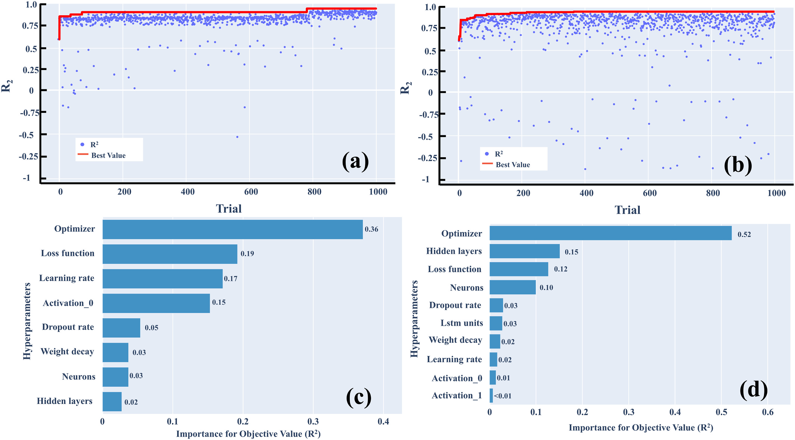
    * **Hình này chứng minh điều gì**
      * Optimizer chi phối vượt trội hiệu năng mô hình, đạt độ quan trọng 0.36 ở MLP và 0.52 ở LSTM.
      * Quá trình HPO đạt giá trị $R^2$ tiệm cận đỉnh (> 0.85) chỉ sau số ít lượt thử nghiệm ban đầu.
    * **Từ đâu mà thấy được**
      * (a), (b): Trục Ox Trial (0–1000), Oy $R^2$ (-1–1.0); đường Best Value đỏ nhanh chóng vượt 0.85 và đi ngang sát 1.0.
      * (c), (d): Trục Oy Hyperparameters, Ox Importance for Objective Value ($R^2$); Optimizer đứng đầu ở cả hai mô hình (0.36 và 0.52).

* Xếp hạng mức độ quan trọng của các siêu tham số đối với giá trị $R^2$ trong quy trình HPO (Fig. 4(c), (d) và Table 4):
  * Khi chuẩn hóa tổng tỷ lệ đóng góp (overall contribution rate) của tất cả các siêu tham số bằng $1$, bộ tối ưu hóa (optimizer) đóng vai trò đóng góp lớn nhất ở cả hai mô hình:
    * Đạt mức $0{,}36$ ở mô hình MLP.
    * Đạt mức $0{,}52$ ở mô hình LSTM.
  * Thứ hạng và mức độ đóng góp của các siêu tham số đối với mô hình MLP:
    * 1. Bộ tối ưu hóa (optimizer): đóng góp $0{,}36$ (lớn nhất).
    * 2. Hàm mất mát (loss function): đóng góp $0{,}19$ (đứng thứ hai sau optimizer).
    * 3. Tốc độ học (learning rate): đóng góp $0{,}17$ (xếp thứ ba).
    * 4. Hàm kích hoạt của lớp ẩn thứ nhất (activation function of 1st hidden layer): đóng góp $0{,}15$ (xếp thứ tư).
    * 5. Tỷ lệ loại bỏ nơ-ron ngẫu nhiên (dropout rate): đóng góp $0{,}05$.
    * 6. Số lượng nơ-ron (number of neurons): đóng góp $0{,}03$.
    * 7. Suy giảm trọng số (weight decay): đóng góp $0{,}03$.
    * 8. Số lớp ẩn (number of hidden layers): đóng góp $0{,}02$.
  * Thứ hạng và mức độ đóng góp của các siêu tham số đối với mô hình LSTM:
    * 1. Bộ tối ưu hóa (optimizer): đóng góp $0{,}52$ (chi phối áp đảo).
    * 2. Số lớp ẩn (number of hidden layers): xếp thứ hai với tỷ lệ đóng góp $0{,}15$.
    * 3. Hàm mất mát (loss function): xếp thứ ba với tỷ lệ đóng góp $0{,}12$.
    * 4. Số lượng nơ-ron (number of neurons): xếp thứ tư với tỷ lệ đóng góp $0{,}10$.
    * 5. Tỷ lệ loại bỏ nơ-ron ngẫu nhiên (dropout rate): đóng góp $0{,}03$.
    * 6. Số đơn vị LSTM (number of LSTM units): đóng góp $0{,}03$ (chỉ áp dụng riêng cho mô hình LSTM).
    * 7. Tốc độ học (learning rate): đóng góp $0{,}02$.
    * 8. Suy giảm trọng số (weight decay): đóng góp $0{,}02$.
    * 9. Hàm kích hoạt (activation functions): xếp cuối cùng với tỷ lệ đóng góp $0{,}01$.
  * Vai trò cơ chế của bộ tối ưu hóa (optimizer) trong mạng nơ-ron nhân tạo:
    * Trong mạng nơ-ron (NNs), optimizer điều khiển quá trình hiệu chỉnh các tham số của mô hình xuyên suốt quá trình huấn luyện nhằm tối thiểu hóa hàm mất mát (loss) hoặc tối đa hóa độ chính xác mô hình.
    * Optimizer quyết định trực tiếp phương thức tính toán gradient và cơ chế cập nhật trọng số mô hình.
    * Tham số optimizer có tác động chi phối mạnh nhất đến hành vi hội tụ (convergence behavior), năng lực tổng quát hóa (generalizability), và hiệu năng tổng thể của các mô hình ANN.
  * **Bảng 4.** Độ quan trọng của siêu tham số trong MLP và LSTM.
    * 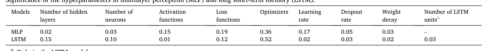
    * **Bảng này chứng minh điều gì**
      * Optimizers chi phối hiệu năng lớn nhất ở cả hai mô hình ($0.36$ ở MLP và $0.52$ ở LSTM), định hình quá trình hội tụ và tối ưu trọng số.
      * Yếu tố ảnh hưởng kế tiếp phân hóa: MLP phụ thuộc hàm mất mát ($0.19$), còn LSTM phụ thuộc số lớp ẩn ($0.15$).
    * **Từ đâu mà thấy được**
      * Cột "Optimizers" có giá trị lớn nhất trên cả 2 dòng: MLP đạt $0.36$ và LSTM đạt $0.52$.
      * Giá trị thấp nhất nằm ở cột "Number of hidden layers" đối với MLP ($0.02$) và "Activation functions" đối với LSTM ($0.01$).

* Phương pháp luận tối ưu hóa siêu tham số (HPO) và so sánh các thuật toán tìm kiếm:
  * Thuật toán ước lượng Parzen theo cấu trúc cây (Tree-structured Parzen Estimator - TPE) và ý nghĩa của HPO:
    * Nghiên cứu sử dụng thuật toán TPE để tìm kiếm tổ hợp siêu tham số tối đa hóa giá trị mục tiêu $R^2$ trong không gian giới hạn siêu tham số cho trước.
    * HPO cải thiện đáng kể độ chính xác của mô hình và hiệu quả của quy trình phát triển, mang ý nghĩa quan trọng trong việc thiết lập mô hình dự đoán tắc nghẽn màng của hệ thống AnMBR quy mô lớn.
    * HPO là một bước đi có giá trị bất kể mục tiêu cụ thể của nghiên cứu, nhờ khả năng thúc đẩy quá trình xây dựng mô hình chính xác hơn, mạnh mẽ hơn (robust), và đáng tin cậy hơn (reliable).
    * Mục tiêu chính của HPO là nâng cao độ chính xác dự đoán; quan trọng hơn nữa, mô hình sau tối ưu hóa có thể tận dụng hiệu quả các mối tương quan giữa các đặc trưng đầu vào (input features) và biến phản ứng (response variable) (Zhu et al., 2023).
  * So sánh các phương pháp tối ưu hóa siêu tham số khác nhau:
    * Framework Optuna cung cấp giải pháp tiếp cận tự động hóa tinh vi.
    * Phương pháp thử và sai (trial-and-error) (Viet and Jang, 2021): các cấu hình siêu tham số được chọn lựa thủ công và đánh giá hiệu năng; phương pháp tuy đơn giản và đôi khi đạt kết quả thỏa đáng nhưng đòi hỏi nhiều thời gian cùng tài nguyên tính toán hơn với mức độ bảo đảm tối ưu hóa thấp hơn.
    * Thuật toán di truyền (Genetic Algorithms - GA) (Yao et al., 2022): mô phỏng quá trình chọn lọc tự nhiên để tìm kiếm tổ hợp tối ưu; phương pháp mô phỏng sinh học này mã hóa siêu tham số thành các gen và tiến hóa chúng qua các thế hệ dựa trên hàm thích nghi (fitness function, thông thường là điểm số kiểm định mô hình).
    * Tìm kiếm theo lưới (Grid Search): tìm kiếm vét cạn qua tập hợp các siêu tham số được định nghĩa trước.
    * Tìm kiếm ngẫu nhiên (Random Search): lấy mẫu ngẫu nhiên các thiết lập siêu tham số từ các phân phối xác định.
    * Mỗi phương pháp đều sở hữu ưu điểm và giới hạn riêng, phù hợp với các dạng bài toán và ràng buộc tài nguyên tính toán khác nhau.

* Chi phí tính toán, nền tảng phần cứng và sự đánh đổi thực tiễn (computational costs and practical trade-offs):
  * Cấu hình phần cứng và thời gian thực thi HPO:
    * Toàn bộ quá trình mô hình hóa tính toán trong nghiên cứu được thực hiện trên CPU Intel Core i5-1135G7 với tốc độ xung nhịp $2{,}40\text{ GHz}$.
    * Thời gian cần thiết để hoàn thành quy trình HPO với 1000 lượt thử nghiệm (1000 trials) trong các điều kiện đồng nhất:
      * Mô hình MLP: xấp xỉ $7\text{ giờ}$ ($7\text{ h}$).
      * Mô hình LSTM: xấp xỉ $12\text{ giờ}$ ($12\text{ h}$) — đòi hỏi thời gian tính toán kéo dài nhất do độ phức tạp cố hữu của các đơn vị LSTM (inherent complexity of LSTM units).
      * Mô hình MLP đơn giản hóa (simplified MLP - s-MLP): xấp xỉ $3\text{ giờ}$ ($3\text{ h}$) — nhờ kiến trúc thô sơ nên tiêu tốn ít thời gian tính toán nhất; tuy nhiên độ chính xác $R^2$ cực đại chỉ đạt $0{,}8317$, kém hơn đáng kể so với các mô hình dự đoán tắc nghẽn màng khác được tổng hợp trong Table 5.
  * Cân nhắc đánh đổi thực tiễn khi triển khai HPO:
    * Về mặt lý thuyết, việc gia tăng số lượng lượt thử nghiệm có thể làm tăng xác suất đạt được cấu hình siêu tham số tối ưu.
    * Mặc dù vậy, lợi thế này phải được cân nhắc và cân bằng với các ràng buộc thực tế, bao gồm hạn chế về tài nguyên tính toán và chi phí thời gian.
    * Do đó, việc triển khai HPO trong thực tế phát triển mô hình cần được đánh giá thỏa đáng, xét đồng thời cả yêu cầu về hiệu năng dự đoán lẫn chi phí tính toán liên quan trong bối cảnh và khu vực ứng dụng cụ thể.

### 3.3. Regression models for membrane fouling prediction

* **Thiết lập mô hình hồi quy và phân chia tập dữ liệu vận hành**:
    * Các mô hình hồi quy dự đoán dựa trên mạng nơ-ron truyền thẳng nhiều tầng (Multilayer Perceptron - MLP) và mạng nơ-ron hồi quy có bộ nhớ dài-ngắn hạn (Long Short-Term Memory - LSTM) được xây dựng dựa trên kết quả tối ưu hóa siêu tham số (Hyperparameter Optimization - HPO).
    * Toàn bộ tập dữ liệu $525$ ngày vận hành của hệ thống AnMBR được phân chia thành tập huấn luyện (training set) và tập kiểm tra (testing set) theo tỷ lệ $9:1$:
        * Tập huấn luyện bao gồm $472$ ngày dữ liệu, được huấn luyện qua $1000$ epoch với kích thước lô (batch size) là $32$.
        * Tập kiểm tra độc lập bao gồm $53$ ngày dữ liệu được dùng để đánh giá năng lực dự đoán thực tế của các mô hình đã huấn luyện.

* **Đặc tính suy giảm và hành vi dao động của hàm mất mát MSE trong quá trình huấn luyện (Hình 5a, b)**:
    * Diễn biến hàm mất mát sai số toàn phương trung bình (Mean Squared Error - MSE) trong suốt $1000$ epoch huấn luyện:
        * Đường cong mất mát MSE của mô hình MLP và LSTM giảm dần về các giá trị ổn định lần lượt là xấp xỉ $4.5$ (khoảng $4.9$ trên đồ thị) đối với MLP và $8.8$ đối với LSTM.
        * Việc đạt đến trạng thái ổn định khẳng định $1000$ epoch là số lượng chu kỳ huấn luyện hoàn toàn phù hợp cho cả hai cấu trúc mạng.
    * Phân tích hành vi dao động (oscillatory pattern) của hàm mất mát MSE trong quá trình tiệm cận giá trị cực tiểu (minimum):
        * Hàm MSE không suy giảm đơn điệu (not monotonically decrease) mà xuất hiện các đợt dao động với sự tăng và giảm giá trị xen kẽ.
        * Hiện tượng dao động phản ánh tác động đồng thời của nhiều yếu tố kỹ thuật:
            * Tốc độ học (learning rate): quy định mức điều chỉnh các tham số (trọng số weights và độ lệch bias) sau mỗi vòng lặp; nếu tốc độ học quá lớn, mô hình có thể nhảy vượt qua điểm tối ưu lý tưởng (overshoot) và gây dao động đường cong mất mát.
            * Tỷ lệ ngắt kết nối nơ-ron (dropout rate): tỷ lệ dropout cao đưa vào lượng lớn nhiễu ngẫu nhiên trong quá trình huấn luyện, có thể cản trở sự hội tụ trơn tru của mô hình và gây khó khăn tạm thời trong việc đạt nghiệm ổn định.
            * Độ phức tạp nội tại và tính không lồi (non-convexity) của bề mặt mất mát (loss landscape; Fort and Jastrzebski, 2019).
        * Mặc dù có dao động cục bộ, đường cong MSE của cả MLP và LSTM đều thể hiện xu hướng hội tụ mạnh mẽ (strong convergence), chứng minh tính xác đáng của việc lựa chọn siêu tham số từ HPO và bảo đảm độ chính xác của cấu trúc mô hình.
    * **Hình 5.** Dự đoán TMP và mất mát MSE của MLP và LSTM
        * 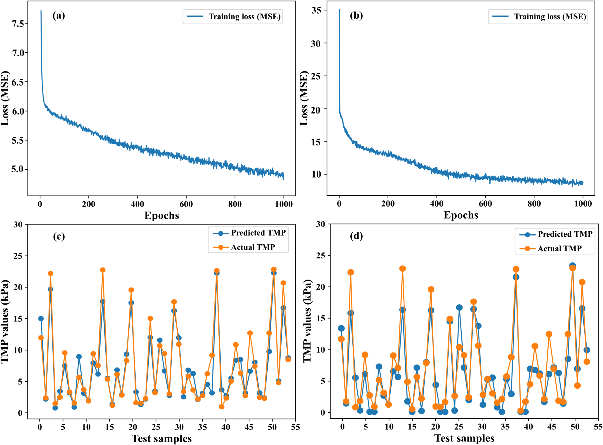
        * **Hình này chứng minh điều gì**
            * MLP hội tụ MSE huấn luyện thấp hơn (~$4.5$ so với ~$8.8$) và bám sát TMP thực nghiệm hơn LSTM.
        * **Từ đâu mà thấy được**
            * (a), (b): Trục Ox là Epochs ($0$–$1000$), Oy là Loss MSE; đường loss MLP (a) giảm về ~$4.5$ (khoảng $4.9$ trên đồ thị), LSTM (b) giảm về ~$8.8$.
            * (c), (d): Trục Ox là Test samples, Oy là TMP ($0$–$30\text{ kPa}$); Predicted TMP (xanh) của MLP khớp Actual TMP (cam) chặt chẽ hơn LSTM.

* **Đánh giá hiệu năng dự đoán áp suất qua màng (TMP) trên tập kiểm tra độc lập và kiểm soát quá khớp (Hình 5c, d)**:
    * Kết quả so sánh giữa giá trị dự đoán và giá trị thực tế của áp suất qua màng (Transmembrane Pressure - TMP) trên cùng tập kiểm tra $53$ ngày được thể hiện chi tiết tại Fig. 5 (c) cho MLP và Fig. 5 (d) cho LSTM.
    * Đánh giá định lượng qua hệ số xác định ($R^2$):
        * Trên tập kiểm tra độc lập: mô hình MLP đạt $R^2 = 0.9183$, trong khi mô hình LSTM đạt $R^2 = 0.8954$.
        * Trên tập dữ liệu huấn luyện: mô hình MLP đạt $R^2 = 0.9322$, trong khi LSTM đạt $R^2 = 0.9249$.
        * Giá trị dự đoán của cả hai mô hình đều có độ tương đồng và ăn khớp rất cao (good agreement) với giá trị thực nghiệm của TMP.
    * Phân tích nguyên nhân $R^2$ tập huấn luyện cao hơn nhẹ so với tập kiểm tra:
        * Kích thước mẫu của tập huấn luyện lớn hơn nhiều ($472$ ngày so với $53$ ngày), dẫn đến các ước lượng hiệu năng mang tính ổn định và tối ưu hơn.
        * Sự khác biệt nhỏ về phân bố dữ liệu giữa tập huấn luyện và tập kiểm tra thực tế.
        * Mức chênh lệch rất nhỏ giữa hai tập ($0.9322$ so với $0.9183$ ở MLP; $0.9249$ so với $0.8954$ ở LSTM) chứng minh hiện tượng quá khớp (overfitting) đã được khống chế và phòng tránh một cách hiệu quả.
    * Đánh giá sai số qua căn bậc hai sai số toàn phương trung bình (Root Mean Square Error - RMSE):
        * Đơn vị đo lường của RMSE được giữ nguyên theo đơn vị của TMP đầu ra là $\text{kPa}$.
        * Trên tập kiểm tra: MLP ghi nhận $\text{RMSE} = 2.408\text{ kPa}$, trong khi LSTM ghi nhận $\text{RMSE} = 3.098\text{ kPa}$.
        * Trên tập huấn luyện: MLP đạt $\text{RMSE} = 2.176\text{ kPa}$, LSTM đạt $\text{RMSE} = 2.898\text{ kPa}$.
        * Mức sai số RMSE phản ánh độ lệch trung bình giữa giá trị dự đoán và giá trị thực tế dao động quanh mức $3\text{ kPa}$ TMP.
        * Xét trong toàn bộ dải phân bố TMP thực tế của hệ thống AnMBR (dao động rộng từ xấp xỉ $0$ đến $25\text{ kPa}$), mức sai số RMSE này là hoàn toàn chấp nhận được đối với bài toán dự báo tắc nghẽn màng nhằm phục vụ công tác lập kế hoạch làm sạch màng (membrane cleaning).

* **So sánh đa tiêu chí giữa các cấu trúc mô hình (Adjusted $R^2$, MAE, MedAE)**:
    * Đánh giá qua hệ số xác định hiệu chỉnh (Adjusted $R^2$):
        * Mô hình MLP đạt Adjusted $R^2 = 0.9056$, vượt trội hơn đáng kể so với mô hình MLP đơn giản không qua HPO tối ưu đầy đủ (Simple MLP hay s-MLP, Adjusted $R^2 = 0.8055$) và mô hình LSTM (Adjusted $R^2 = 0.8791$) khi hiệu chỉnh theo số lượng biến dự báo (predictors) sử dụng.
    * Đánh giá qua sai số tuyệt đối trung bình (Mean Absolute Error - MAE):
        * Mô hình MLP đạt sai số trung bình thấp nhất với $\text{MAE} = 1.509$, vượt trội rõ rệt về độ chính xác dự đoán so với s-MLP ($\text{MAE} = 2.243$) và LSTM ($\text{MAE} = 1.878$).
    * Đánh giá qua sai số tuyệt đối trung vị (Median Absolute Error - MedAE):
        * Mô hình LSTM đạt sai số trung vị thấp hơn với $\text{MedAE} = 0.8400$, so với MLP đạt $\text{MedAE} = 0.9190$ và s-MLP đạt $\text{MedAE} = 1.748$.
        * Giá trị MedAE thấp hơn của LSTM gợi ý rằng LSTM có thể đem lại độ chính xác dự đoán đồng đều và nhất quán hơn trên phân bố trung vị của tập dữ liệu.
    * Phân tích bản chất thống kê giữa các chỉ số và tác động của điểm ngoại lai (outliers):
        * Một mô hình có thể ghi nhận giá trị $R^2$ cao hơn nhưng đồng thời lại có MedAE lớn hơn nếu mô hình đó nhạy cảm hơn trước các điểm ngoại lai (outliers); các điểm ngoại lai tác động bất cân xứng lên sai số trung bình (mean error) so với sai số trung vị (median error).
        * Quá trình đánh giá và lựa chọn mô hình đòi hỏi phải tổng hòa cả các thước đo xu hướng tập trung (central tendency) lẫn các thước đo độ phân tán sai số (error dispersion), gắn liền với mục đích ứng dụng thực tiễn cụ thể.
        * Tổng thể các chỉ số xác nhận MLP luôn mang lại các kết quả dự đoán chuẩn xác nhất một cách ổn định; LSTM có hiệu năng cao hơn s-MLP nhưng nhìn chung xếp sau MLP (ngoại trừ MedAE); s-MLP là mô hình có độ chính xác thấp nhất.
        * Nhờ giảm thiểu ảnh hưởng của các điểm ngoại lai cực biên, MedAE cung cấp góc nhìn bổ trợ tin cậy và khách quan hơn bên cạnh MAE.

* **So sánh định lượng hiệu năng mô hình dự đoán và đối chiếu toàn diện với y văn (Bảng 5)**:
    * Kết quả hiệu năng của các mô hình trong nghiên cứu này và so sánh với các công trình công bố trước đây được tổng hợp chi tiết tại Bảng 5:
        * Nghiên cứu này (This study):
            * Simple MLP (AnMBR $5000\text{ L}$, nước thải đô thị thực tế, HPO bằng Optuna, $525$ mẫu): Tập huấn luyện đạt $R^2 = 0.8622$, $\text{RMSE} = 3.897\text{ kPa}$; Tập kiểm tra đạt $R^2 = 0.8317$, $\text{RMSE} = 4.156\text{ kPa}$, Adjusted $R^2 = 0.8055$, $\text{MAE} = 2.243$, $\text{MedAE} = 1.748$.
            * MLP (AnMBR $5000\text{ L}$, nước thải đô thị thực tế, HPO bằng Optuna, $525$ mẫu): Tập huấn luyện đạt $R^2 = 0.9322$, $\text{RMSE} = 2.176\text{ kPa}$; Tập kiểm tra đạt $R^2 = 0.9183$, $\text{RMSE} = 2.408\text{ kPa}$, Adjusted $R^2 = 0.9056$, $\text{MAE} = 1.509$, $\text{MedAE} = 0.9190$.
            * LSTM (AnMBR $5000\text{ L}$, nước thải đô thị thực tế, HPO bằng Optuna, $525$ mẫu): Tập huấn luyện đạt $R^2 = 0.9249$, $\text{RMSE} = 2.898\text{ kPa}$; Tập kiểm tra đạt $R^2 = 0.8954$, $\text{RMSE} = 3.098\text{ kPa}$, Adjusted $R^2 = 0.8791$, $\text{MAE} = 1.878$, $\text{MedAE} = 0.8400$.
        * Schmitt et al. (2018): Mô hình MLP trên hệ thống AO-MBR ($50\text{ L}$), xử lý nước thải sinh hoạt thực tế, không thực hiện HPO, kích thước mẫu $938$, đạt $R^2 = 0.85$ và $\text{RMSE} = 0.099\text{ cm Hg}$.
        * Yao et al. (2022): Mô hình MLP trên hệ thống AnMBR ($20\text{ L}$), xử lý thành phần hữu cơ của nước rỉ rác sinh hoạt, HPO bằng thuật toán di truyền (Genetic Algorithm - GA), kích thước mẫu $102$, sai số tương đối (Relative error) = $3.57\%$.
        * Viet và Jang (2021): Mô hình MLP trên hệ thống màng thẩm thấu (OMBR, quy mô $1\text{ L}$), xử lý nước thải, tối ưu bằng thử sai (Trial-and-error), kích thước mẫu $100$, đạt $R^2 > 0.9$.
        * Shim et al. (2021): Mô hình LSTM trên hệ thống lọc nano (Nanofiltration), nước cấp muối tổng hợp, không HPO, kích thước mẫu $1420$, đạt $R^2 = 0.97$.
        * Kovacs et al. (2022): So sánh RF, MLP, LSTM trên bể MBR quy mô thực tế công suất $60,000\text{ m}^3\text{/ngày}$, nước thải đô thị thực, áp dụng phân tích độ bất định (Uncertainty analysis), kích thước mẫu lớn $83,823$, đạt $R^2 > 0.92$.
        * Mirbagheri et al. (2015): Mô hình MLP và mạng hàm xuyên tâm (RBF) trên bể MBR, nước thải đô thị thực, HPO bằng GA, kích thước mẫu $60$, đạt $R^2 = 0.98$.
        * Liu et al. (2020): Mô hình máy vector hỗ trợ (SVM) trên hệ thống AnMBR, nước thải sinh hoạt, áp dụng kiểm định chéo 5 lần (Five-fold cross-validation) kết hợp tìm kiếm siêu tham số, kích thước mẫu $190$, đạt $R^2 = 0.9995$ và $\text{RMSE} = 1.70 \times 10^{-7}$.
    * **Bảng 5.** So sánh hiệu năng mô hình dự đoán với y văn
        * 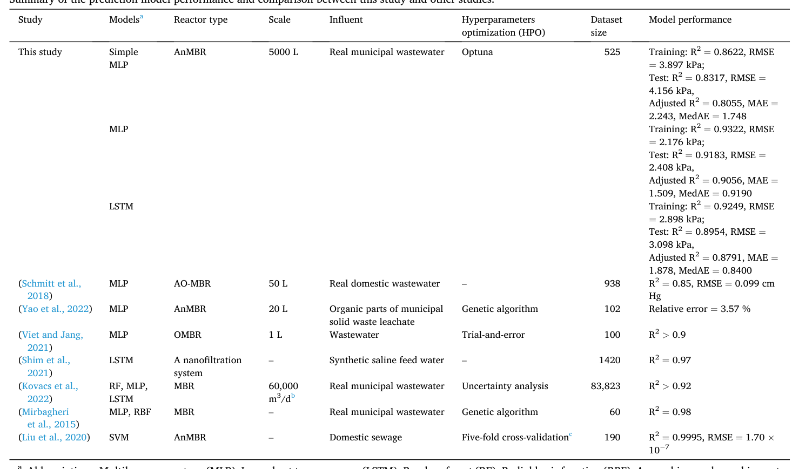
        * **Bảng này chứng minh điều gì**
            * Mô hình MLP đạt hiệu năng kiểm tra tốt nhất ($R^2 = 0.9183$, $\text{RMSE} = 2.408\text{ kPa}$), tương đương mức $R^2 > 0.90$ của các nghiên cứu MBR khác.
        * **Từ đâu mà thấy được**
            * Hàng "This study", cột "Model performance": MLP đạt $R^2 = 0.9183$ (tập test), cao hơn Simple MLP ($R^2 = 0.8317$) và LSTM ($R^2 = 0.8954$).
            * Cột "Model performance" các hàng y văn: giá trị cao nhất là Liu et al. ($R^2 = 0.9995$), thấp nhất là Schmitt et al. ($R^2 = 0.85$).

* **Phân tích nguyên nhân chênh lệch hệ số xác định $R^2$ so với các nghiên cứu trước đây**:
    * Hệ số xác định của nghiên cứu này ($R^2 = 0.9183$ trên tập kiểm tra) thấp hơn một chút so với một số nghiên cứu tiền nhiệm ghi nhận $R^2 > 0.95$ (Liu et al., 2020; Mirbagheri et al., 2015; Shim et al., 2021; Yao et al., 2022). Nguyên nhân được làm sáng tỏ qua ba khía cạnh chính:
        1. Tính phức tạp của cơ chế tắc nghẽn màng trong AnMBR: Trong các hệ thống MBR sử dụng màng vi lọc (microfiltration), cơ chế tắc nghẽn màng của AnMBR phức tạp hơn nhiều so với hệ thống MBR hiếu khí truyền thống (Dvořák et al., 2016); đồng thời sự khác biệt lớn trong việc lựa chọn các đặc trưng đầu vào dẫn đến sự biến thiên về độ chính xác khi huấn luyện và dự đoán bằng cùng một loại mạng nơ-ron nhân tạo.
        2. Dữ liệu vận hành thực tế dài hạn và dải biến thiên TMP rộng lớn: Các mô hình trong nghiên cứu này được xây dựng hoàn toàn dựa trên dữ liệu vận hành dài hạn ($525$ ngày) của một bể phản ứng quy mô pilot lớn ($5000\text{ L}$); số lượng mẫu dữ liệu và biên độ biến động của các thông số lớn hơn nhiều so với các nghiên cứu quy mô phòng thí nghiệm trước đây. Giá trị TMP trong tập kiểm tra trải rộng từ mức dưới $5\text{ kPa}$ (giai đoạn vận hành ổn định) đến gần $25\text{ kPa}$ (sau khi xảy ra tắc nghẽn màng nghiêm trọng).
        3. Kỹ thuật điều chuẩn chống quá khớp (Regularization): Cả MLP và LSTM đều được áp dụng kỹ thuật điều chuẩn L2 (L2 regularization / weight decay) cùng với dropout; kết hợp với lượng dữ liệu phong phú, điều này bảo đảm mô hình không bị hiện tượng quá khớp (overfitting) như ở các nghiên cứu có tập dữ liệu nhỏ.
    * Ý nghĩa khoa học: Đây là lần đầu tiên mô hình mạng nơ-ron nhân tạo (ANN) được triển khai thành công để dự đoán tắc nghẽn màng trong vận hành dài hạn của hệ thống AnMBR quy mô lớn xử lý nước thải đô thị thực tế với độ chính xác tin cậy, đảm bảo năng lực tổng quát hóa (generalizability) và thiết lập một chuẩn đối sánh (benchmark) vững chắc cho các hệ thống AnMBR tương lai.

* **Đánh giá chi phí tính toán và lựa chọn mô hình tối ưu cho hệ thống AnMBR**:
    * Thời gian tính toán (không bao gồm thời gian thực hiện HPO):
        * Mô hình s-MLP và MLP hoàn thành tính toán trên cùng tập dữ liệu chỉ trong vòng chưa đầy $1$ phút ($< 1\text{ min}$).
        * Mô hình LSTM đòi hỏi thời gian tính toán trong vòng $2$ phút ($< 2\text{ min}$).
    * Đánh giá và lựa chọn mô hình thích hợp:
        * Mô hình MLP đạt độ chính xác cao nhất (thể hiện qua $R^2$ cao nhất và RMSE thấp nhất); mức độ phức tạp vừa phải cùng mức tiêu thụ tài nguyên tính toán thấp khiến MLP trở thành mô hình phù hợp nhất để dự đoán tắc nghẽn màng trong hệ thống AnMBR của nghiên cứu này.
        * Mô hình Simple MLP (s-MLP) tuy tiết kiệm thời gian và tài nguyên phần cứng nhưng độ chính xác kém hơn nhiều so với các mô hình khác ($R^2 = 0.8317$, $\text{RMSE} = 4.156\text{ kPa}$).
        * Mô hình LSTM có độ phức tạp thuật toán cao, đòi hỏi tài nguyên và thời gian tính toán vượt trội, trong khi độ chính xác $R^2$ ($0.8954$) và RMSE ($3.098\text{ kPa}$) lại kém hơn MLP, khiến LSTM không phải là lựa chọn tối ưu cho việc dự đoán tắc nghẽn màng trong điều kiện nghiên cứu này.

### 3.4. Insight into the membrane fouling features and the interpretability of the model

* **Nguyên lý khung diễn giải SHAP và mối liên kết giữa độ quan trọng đặc trưng với giải thích toàn cục (global interpretability)**:
  * Khung phân tích $\text{SHAP}$ (SHapley Additive exPlanations) đóng vai trò là phương pháp chặt chẽ nhằm làm sáng tỏ ảnh hưởng của từng đặc trưng riêng lẻ (individual features) lên kết quả dự đoán của các mô hình học máy (ML models).
  * Bắt nguồn từ các nguyên lý của lý thuyết trò chơi hợp tác (cooperative game theory), các giá trị $\text{SHAP}$ cung cấp một thước đo thống nhất (unified metric) để đánh giá tầm quan trọng của đặc trưng, đảm bảo phân bổ đóng góp công bằng (equitable allocation of attribution) giữa các biến số đầu vào được xem xét (Gramegna and Giudici, 2021).
  * Trong bối cảnh tính khả giải thích của học máy, khái niệm tầm quan trọng của đặc trưng (feature importance) liên kết mật thiết với khái niệm giải thích toàn cục (global interpretability):
    * Trong khi độ quan trọng đặc trưng phản ánh đóng góp của từng biến số vào các dự đoán cụ thể, dạng tổng hợp (aggregate form) của nó trên nhiều cá thể/mẫu dữ liệu giúp mô tả hành vi tổng quát của mô hình, từ đó thiết lập khả năng giải thích toàn cục.
    * Bằng cách tính toán giá trị $\text{SHAP}$ cho từng biến số, mức đóng góp trung bình của chúng vào kết quả dự đoán của mô hình trên toàn bộ các tổ hợp đặc trưng khả dĩ được xác định đầy đủ.
    * Giá trị $\text{SHAP}$ càng cao biểu thị mức độ ý nghĩa và đóng góp càng lớn đối với kết quả dự đoán của mô hình.

* **Thứ bậc tầm quan trọng của các đặc trưng và tác động định hướng toàn cục đến dự đoán TMP (Fig. 6)**:
  * Đánh giá giá trị $\text{SHAP}$ tuyệt đối trung bình (mean absolute SHAP values) trên $7$ đặc trưng đầu vào xác lập thứ tự chi phối đối với biến động áp suất xuyên màng ($\text{TMP}$):
    $$\text{Flux} > \text{OLR} > \text{Temperature} > \text{MLSS} > \text{EPSp} > \text{EPSc} > \text{SS}$$
  * Thông lượng ($\text{Flux}$) là yếu tố chi phối mạnh mẽ nhất trong việc dự đoán các dao động của $\text{TMP}$, tiếp theo là tải trọng hữu cơ ($\text{OLR}$), nhiệt độ ($\text{Temperature}$), $\text{MLSS}$, $\text{EPSp}$, $\text{EPSc}$ và chất rắn lơ lửng ($\text{SS}$).
  * Hệ thống $\text{AnMBR}$ quy mô pilot lớn kết hợp bể phản ứng khuấy trộn hoàn toàn liên tục (continuously stirred tank reactor - CSTR) và mô-đun màng, trong đó biến động thời gian lưu thủy lực ($\text{HRT}$) và điều kiện tải trọng nạp ($\text{loading rate}$) phụ thuộc trực tiếp vào sự biến thiên của thông lượng ($\text{flux}$).
  * Do đó, tải trọng nạp cao hơn đi kèm với thông lượng cao hơn có xu hướng gây ra tình trạng tắc nghẽn màng nghiêm trọng hơn, hoàn toàn phù hợp với cơ chế lý thuyết cho thấy $\text{flux}$ ảnh hưởng trực tiếp đến tốc độ tắc nghẽn màng (He et al., 2017).
  * Trái ngược với giải thích toàn cục tập trung vào hành vi trên toàn bộ không gian dữ liệu, giải thích cục bộ (local interpretability) đi sâu giải thích các dự đoán riêng lẻ trên từng mẫu kiểm tra và cho phép phát hiện các điểm ngoại lai được dự đoán (predicted outliers).
  * Biến thiên của $\text{Flux}$ và $\text{OLR}$ tạo ra tác động phân tán rộng hơn (more diffused impact) trong phân bố giá trị $\text{SHAP}$, chứng tỏ sự thay đổi của hai thông số này giúp phân biệt rõ rệt hơn mức độ tắc nghẽn màng so với các yếu tố khác.
  * Ngược lại, $\text{Temperature}$, $\text{MLSS}$, $\text{EPSp}$, $\text{EPSc}$ và $\text{SS}$ thể hiện mức độ phân biệt giá trị $\text{SHAP}$ thấp hơn trên các mẫu kiểm tra, cho thấy mức đóng góp tối thiểu vào việc phân hóa dự đoán tắc nghẽn màng.
  * Biểu đồ phân tán $\text{SHAP}$ làm rõ cả độ lớn tác động (magnitude of impact) lẫn chiều hướng tác động (direction: dương hoặc âm): $\text{Flux}$ và $\text{OLR}$ thể hiện cả tác động dương lẫn âm với biên độ biến thiên mạnh (giá trị thực nghiệm cao đẩy $\text{TMP}$ tăng mạnh, giá trị thấp kéo $\text{TMP}$ giảm).
  * **Hình 6.** Tầm quan trọng và tác động của đặc trưng lên mô hình MLP
    * 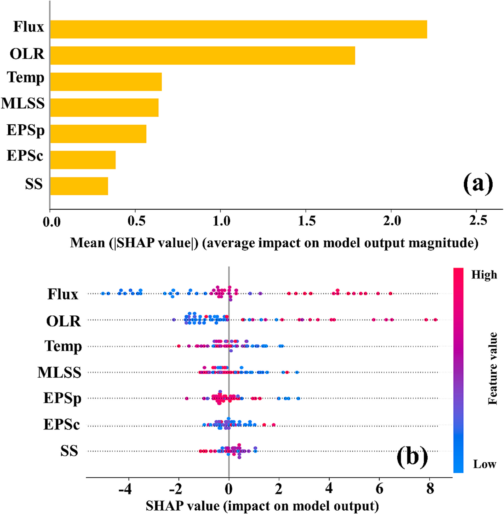
    * **Hình này chứng minh điều gì**
      * $\text{Flux}$ ($\approx 2{,}2$) và $\text{OLR}$ ($\approx 1{,}8$) chi phối áp đảo dự đoán $\text{TMP}$; giá trị $\text{Flux}$ và $\text{OLR}$ cao làm tăng mạnh $\text{TMP}$, trong khi nhiệt độ cao làm giảm $\text{TMP}$.
    * **Từ đâu mà thấy được**
      * Panel (a) Biểu đồ thanh: Trục hoành biểu diễn $\text{Mean}(|\text{SHAP value}|)$ trong thang đo $0{,}0\text{--}2{,}5$; $\text{Flux}$ đạt giá trị cao nhất ($\approx 2{,}2$), $\text{OLR}$ đứng thứ hai ($\approx 1{,}8$), vượt xa nhóm $\text{Temperature}$ ($\approx 0{,}65$), $\text{MLSS}$ ($\approx 0{,}63$) và các biến sinh học $\text{EPSp}$, $\text{EPSc}$, $\text{SS}$ ($< 0{,}6$).
      * Panel (b) Biểu đồ chấm phân tán SHAP (dot plot): Trục hoành biểu diễn $\text{SHAP value}$ (dải $-5$ đến $8$ quanh trục chuẩn $0$); điểm đỏ (giá trị đặc trưng cao) của $\text{Flux}$ và $\text{OLR}$ phân tán mạnh sang phía dương ($> 6\text{--}8$), $\text{Temperature}$ phân tán sang phía âm (đạt $-2$), trong khi các biến sinh học co cụm sát vạch $0$.

* **Tiến trình ra quyết định và cơ chế nhận biết trạng thái vận hành của mô hình MLP (Fig. 7)**:
  * Biểu đồ quyết định (decision plot) thể hiện khả năng giải thích cục bộ của mô hình $\text{MLP}$ thông qua việc tái hiện tiến trình tích lũy ra quyết định cho từng mẫu thuộc tập kiểm tra:
    * Đường thẳng đứng màu đen ở trung tâm biểu đồ đại diện cho giá trị cơ sở (fundamental value/base value) của mô hình, được xác định là giá trị $\text{TMP}$ trung bình ($\approx 6\text{ kPa}$).
    * Mỗi đường biểu diễn phản ánh quỹ đạo dự đoán của một mẫu thử nghiệm cụ thể; chuyển động lệch sang trái hoặc sang phải khi đi qua từng đặc trưng thể hiện đặc trưng đó kéo giảm hay làm tăng giá trị đầu ra so với mức trung bình.
    * Bắt đầu từ đáy biểu đồ, đường dự đoán mô tả cách thức mô hình $\text{MLP}$ tích lũy đóng góp từ mức $\text{TMP}$ trung bình ban đầu để đạt tới giá trị đầu ra dự đoán cuối cùng ở đỉnh đồ thị.
    * Dao động ngang (horizontal oscillation) càng lớn sau khi đi qua tác động của một đặc trưng biểu thị mức độ ảnh hưởng càng mạnh của đặc trưng đó đối với kết quả dự đoán.
  * Đồng nhất với kết quả phân tích giải thích toàn cục, ba biến số đầu tiên ($\text{Temperature}$, $\text{OLR}$ và $\text{Flux}$) làm biến đổi sâu sắc nhất đường dự báo, trong khi $\text{SS}$, $\text{EPSc}$, $\text{EPSp}$ và $\text{MLSS}$ hầu như không làm chệch quỹ đạo khỏi giá trị trung bình ban đầu.
  * Về mặt lý thuyết cơ chế, ảnh hưởng của $\text{OLR}$ và $\text{Flux}$ lên đường dự đoán phải cùng hướng (đồng biến, in the same direction):
    * Xu hướng đồng biến này hoàn toàn phù hợp và nhất quán khi mô hình dự đoán ở các giai đoạn tắc nghẽn màng nghiêm trọng tương ứng với các giá trị $\text{TMP}$ cao ($> 10\text{--}20\text{ kPa}$).
    * Tuy nhiên, ở vùng $\text{TMP}$ thấp tương ứng với giai đoạn vận hành ổn định (steady portion of operation), tác động của $\text{OLR}$ và $\text{Flux}$ lên $\text{TMP}$ lại bộc lộ tính chất đối kháng nhất định (exhibited some antagonism).
    * Hiện tượng này chứng minh mô hình $\text{MLP}$ có khả năng phân biệt thành công giữa giai đoạn vận hành ổn định và giai đoạn tắc nghẽn màng nghiêm trọng, đồng thời sở hữu hành vi dự đoán tùy biến riêng biệt (tailored prediction behavior) thích ứng cho từng giai đoạn vận hành.
  * Khả năng phân hóa này gợi mở hướng nghiên cứu tương lai: có thể chia tách các mô hình dự đoán chuyên biệt cho từng giai đoạn tải nạp khác nhau của hệ thống $\text{AnMBR}$ nhằm nâng cao hơn nữa hiệu năng dự báo.
  * **Hình 7.** Quá trình ra quyết định dự đoán TMP của mô hình MLP
    * 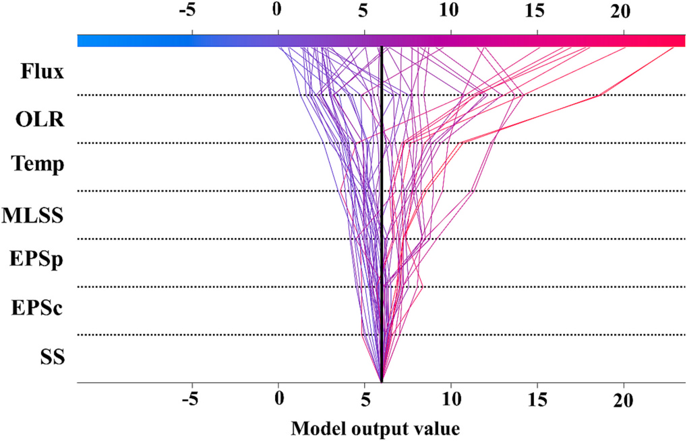
    * **Hình này chứng minh điều gì**
      * Quỹ đạo dự đoán phân kỳ mạnh nhất khi đi qua các đặc trưng $\text{Temperature}$, $\text{OLR}$ và $\text{Flux}$; các biến $\text{SS}$, $\text{EPSc}$, $\text{EPSp}$ và $\text{MLSS}$ hầu như không làm chệch mức $\text{TMP}$ trung bình.
    * **Từ đâu mà thấy được**
      * Trục hoành $Ox$: Giá trị đầu ra của mô hình ($\text{Model output value}$), dải từ $-5$ đến $20$. Trục tung $Oy$: $7$ biến đầu vào tích lũy từ đáy lên gồm $\text{SS}$, $\text{EPSc}$, $\text{EPSp}$, $\text{MLSS}$, $\text{Temp}$, $\text{OLR}$, $\text{Flux}$.
      * Đường thẳng đứng màu đen ở trung tâm đồ thị (mốc $\approx 6$) đại diện giá trị $\text{TMP}$ trung bình xuất phát tại đáy.
      * Các đường tích lũy tản rộng dần từ $\text{Temp}$ lên $\text{Flux}$ thành hai dải rõ rệt: dải màu xanh lam hạ thấp ($< 5\text{ kPa}$) và dải màu đỏ hồng tăng cao ($> 10$ đến $> 20\text{ kPa}$).

* **Tính khả thi triển khai trong ứng dụng thực tế và tự động hóa rửa màng**:
  * Dưới góc độ ứng dụng kỹ thuật thực tế, để hiện thực hóa việc rửa màng tự động (automatic membrane cleaning), các thông số đầu vào được lựa chọn phải là những biến số có thể thu thập trực tiếp từ cảm biến (directly obtained from sensors), thay vì phụ thuộc vào các chỉ tiêu đòi hỏi lấy mẫu và phân tích thủ công trong phòng thí nghiệm.
  * Kết quả phân tích tính khả giải thích chỉ ra rằng $\text{Flux}$, $\text{OLR}$ (liên hệ trực tiếp với nồng độ $\text{COD}$), nhiệt độ ($\text{Temperature}$) và $\text{MLSS}$ là những đặc trưng quan trọng nhất đối với mô hình dự đoán.
  * Cả bốn thông số then chốt này đều có thể được thu thập hoàn toàn và liên tục bằng các cảm biến trực tuyến (sensors solely).
  * Do đó, mô hình $\text{MLP}$ được phát triển trong nghiên cứu này hoàn toàn phù hợp và có tính khả thi cao khi ứng dụng vào hệ thống điều khiển tự động hóa trong thực tế.

* **Ý nghĩa đối sánh giữa khả năng giải thích toàn cục và cục bộ trong quản lý tắc nghẽn màng**:
  * Giải thích toàn cục (global interpretability) mang lại cái nhìn toàn diện về hành vi tổng thể của mô hình trên toàn bộ tập dữ liệu, làm nổi bật các biến số chi phối cốt lõi. Điều này củng cố niềm tin của các bên liên quan (stakeholders) vào năng lực khái quát hóa của mô hình và đảm bảo mô hình vận hành phù hợp với các nguyên lý khoa học đã xác lập.
  * Ngược lại, giải thích cục bộ (local interpretability) tập trung làm sáng tỏ căn nguyên suy luận đằng sau từng kết quả dự đoán riêng lẻ. Trong bối cảnh tắc nghẽn màng, những hiểu biết chi tiết ở mức độ hạt mịn này (granular insights) mang tính sống còn, đóng vai trò định hướng thiết thực cho công tác bảo trì (maintenance), phòng ngừa sớm (prevention) và đề xuất các điều chỉnh hệ thống kịp thời (potential system modifications).

### 3.5. Limitations and future prospects

* Quá trình dự đoán hiện tượng nghẹt màng (membrane fouling) dựa trên trí tuệ nhân tạo (artificial intelligence - AI) đã đạt được nhiều tiến bộ đáng kể, song việc ứng dụng thực tế công nghệ AI vào các quy trình màng vẫn đối mặt với nhiều rào cản kỹ thuật (Niu et al., 2022).
* Bể phản ứng sinh học màng kỵ khí (anaerobic membrane bioreactor - AnMBR) mang lại nhiều ưu điểm nổi bật, đặc biệt thích hợp để triển khai tại các quốc gia đang phát triển (Elmoutez et al., 2023):
  * Diện tích mặt bằng nhỏ gọn (compact footprint).
  * Hiệu quả xử lý nước thải cao.
  * Khả năng sản xuất nước tái sử dụng (reclaimed water production).
  * Tiềm năng thu hồi năng lượng (energy recovery).
  * Thách thức trung tâm cần giải quyết là ứng dụng công nghệ AI để giảm thiểu vấn đề nghẹt màng dai dẳng trong các hệ thống AnMBR xử lý nước thải đô thị (municipal wastewater treatment).
* Việc đưa công nghệ AI vào vận hành thực tế (operationalize) đòi hỏi phải giải quyết đồng thời nhiều yêu cầu thiết yếu về tài nguyên và hạ tầng (De-Arteaga et al., 2018):
  * Khả năng tiếp cận dữ liệu (data accessibility).
  * Năng lực tính toán phần cứng (computational capacity).
  * Tính sẵn có của hạ tầng mạng internet (internet availability).
  * Nguồn nhân lực chuyên môn hóa cao (specialized human resources).
  * Cần cân nhắc kỹ lưỡng bối cảnh áp dụng và nguồn lực sẵn có trong suốt giai đoạn phát triển lẫn giai đoạn triển khai công nghệ.
* Nghiên cứu hiện tại được thực hiện dựa trên quy mô thử nghiệm pilot (pilot-scale case investigation), đặt ra bài toán cân đối giữa hiệu năng và chi phí triển khai:
  * Quy mô thu thập dữ liệu (scale of data acquisition) và độ phức tạp của mô hình (model intricacy) đóng vai trò là thước đo tương đối về mức tiêu hao tài nguyên cần thiết cho việc phát triển và triển khai thực tế.
  * Kết quả so sánh giữa các mô hình s-MLP (simplified multi-layer perceptron), MLP (multi-layer perceptron) và LSTM (long short-term memory) nhấn mạnh sự cần thiết phải định hướng cân bằng giữa hiệu năng và chi phí (performance-cost nexus) phù hợp với từng kịch bản và nhu cầu vận hành cụ thể.
* Khả năng thích ứng (adaptability) cao của các mô hình mạng nơ-ron nhân tạo (artificial neural network - ANN) mở ra tiềm năng ứng dụng rộng rãi trong lĩnh vực kỹ thuật môi trường và xử lý nước thải:
  * Bên cạnh AnMBR, các mô hình ANN có khả năng tái hiệu chuẩn (recalibrated) và điều chỉnh linh hoạt để thích nghi với các kịch bản vận hành khác nhau.
  * Quy trình điều chỉnh mô hình sang bối cảnh mới đòi hỏi một phương pháp luận hoàn chỉnh:
    * Tái huấn luyện (retrained) mô hình bằng dữ liệu đặc thù của hệ thống xử lý nước thải mới.
    * Tinh chỉnh các kỹ thuật kỹ nghệ đặc trưng (feature engineering) nhằm bao quát các đặc tính riêng biệt của hệ thống mới.
    * Thực hiện kiểm chứng nghiêm ngặt (rigorous validation) để đảm bảo độ tin cậy (dependability) và độ chính xác (precision) trong môi trường mới.
    * Bổ sung các chỉ số đánh giá hiệu năng tùy biến (customized performance metrics) nhằm mang lại đánh giá đa chiều, sâu sắc về hiệu quả mô hình qua nhiều kịch bản vận hành đa dạng.
* Sự tiến bộ với tốc độ nhanh chóng của các công nghệ AI mở ra nhiều triển vọng nghiên cứu trong tương lai:
  * Tốc độ đổi mới của AI vượt xa các cải tiến công nghiệp truyền thống, đòi hỏi các phương pháp và mô hình dự đoán nghẹt màng phải không ngừng cải tiến và cập nhật.
  * Các hướng nghiên cứu tương lai cần liên tục tập trung vào:
    * Các kỹ thuật tối ưu hóa siêu tham số mới nổi (emerging hyperparameter optimization - HPO techniques).
    * Các mẫu hình mô hình hóa tiên tiến (novel modeling paradigms).
    * Các khung làm việc mới nhằm tăng cường khả năng giải thích của mô hình (frameworks for model interpretability).
  * Nhờ khả năng thích ứng và mở rộng (scalability) vốn có, các mô hình học máy (machine learning - ML) có tiềm năng mở rộng sang nhiều quy trình xử lý nước thải khác, với điều kiện thực hiện các điều chỉnh tham số phù hợp, thay thế tập dữ liệu tương thích, và hoàn thiện các chiến lược chỉ số đánh giá hiệu năng.

## 4. Conclusions

* **Tổng kết các phát hiện cốt lõi từ quy trình phát triển mô hình (Summary of findings & HPO):**
  * Dựa trên bộ dữ liệu thu thập từ quá trình vận hành dài hạn ($525\text{ ngày}$) của hệ thống bể phản ứng sinh học màng kỵ khí ($AnMBR$ - Anaerobic Membrane Bioreactor) quy mô pilot lớn ($5000\text{ L}$) xử lý nước thải đô thị thực tế, hai mô hình mạng nơ-ron nhân tạo ($ANN$ - Artificial Neural Network) gồm $MLP$ (Multilayer Perceptron) và $LSTM$ (Long Short-Term Memory) đã được phát triển thành công để dự đoán hiện tượng tắc nghẽn màng ($membrane\text{ }fouling$).
  * Quy trình tối ưu hóa siêu tham số ($HPO$ - Hyperparameter Optimization) sử dụng nền tảng Optuna đóng vai trò là cấu phần then chốt trong quá trình xây dựng mô hình dự đoán.
  * Mặc dù $HPO$ là một trong những giai đoạn tiêu tốn nhiều thời gian và tài nguyên tính toán nhất trong toàn bộ quy trình mô hình hóa, năng lực tự động tinh chỉnh ($auto\text{-}tuning$) của Optuna đã chứng minh tính hiệu quả quyết định trong việc tạo điều kiện cho cả hai mô hình $MLP$ và $LSTM$ ứng dụng thành công vào việc dự đoán tắc nghẽn màng trong hệ thống $AnMBR$.

* **Phán quyết so sánh hiệu năng mô hình (Model comparison verdict):**
  * Xét theo độ chính xác hồi quy trong việc dự đoán áp suất xuyên màng ($TMP$ - Transmembrane Pressure) trên tập kiểm tra ($test\text{ }set$), mô hình $MLP$ thể hiện hiệu suất vượt trội với hệ số xác định $R^2 = 0{,}9183$ và sai số căn bậc hai trung bình bình phương $RMSE = 2{,}408\text{ kPa}$, vượt trội hơn mô hình $LSTM$ đạt $R^2 = 0{,}8954$ và $RMSE = 3{,}098\text{ kPa}$.
  * Nhờ cấu trúc đơn giản vốn có, mô hình $MLP$ đòi hỏi ít tài nguyên tính toán hơn đáng kể so với $LSTM$, khiến $MLP$ trở thành lựa chọn phù hợp hơn cho bài toán dự đoán tắc nghẽn màng trong hệ thống $AnMBR$ trong phạm vi nghiên cứu này.
  * Đáng chú ý, mặc dù sở hữu kiến trúc rút gọn cùng hiệu quả cao về thời gian và tài nguyên tính toán, mô hình $MLP$ đơn giản hóa ($s\text{-}MLP$ - Simple Multilayer Perceptron) không đạt được các ngưỡng chuẩn đối sánh phổ biến ($prevalent\text{ }benchmarks$) trong các tài liệu khoa học đương đại (chỉ đạt $R^2 = 0{,}8317$ và $RMSE = 4{,}156\text{ kPa}$ trên tập kiểm tra).

* **Ý nghĩa và hiểu biết chuyên sâu từ khuôn khổ giải thích SHAP (SHAP takeaways):**
  * Việc áp dụng khuôn khổ diễn giải $SHAP$ ($SHapley\text{ }Additive\text{ }exPlanations$) để làm sáng tỏ mô hình hồi quy $MLP$ đã thực hiện thành công đánh giá toàn diện trên cả hai phương diện: khả năng diễn giải toàn cục ($global\text{ }interpretability$) và khả năng diễn giải cục bộ ($local\text{ }interpretability$).
  * Phân tích $SHAP$ đã lượng hóa và xếp hạng tầm quan trọng của từng đặc trưng đầu vào ($input\text{ }features$) cùng tác động tương ứng của chúng tới hiện tượng tắc nghẽn màng, trong đó lưu lượng dòng thấm qua màng ($flux$) là yếu tố chi phối mạnh mẽ nhất, tiếp theo là tải trọng hữu cơ ($OLR$ - Organic Loading Rate), nhiệt độ ($temperature$), nồng độ bùn hoạt tính ($MLSS$), $EPS$ protein ($EPS_p$), $EPS$ carbohydrate ($EPS_c$) và hàm lượng chất rắn lơ lửng ($SS$).
  * Khuôn khổ $SHAP$ phân định rõ ràng ảnh hưởng cụ thể (cả về cường độ lẫn chiều hướng tác động dương hoặc âm) của từng biến đầu vào trên từng mẫu dự đoán riêng lẻ, phản ánh chân thực quá trình ra quyết định của mô hình và hoàn toàn nhất quán với các quy luật thực nghiệm quan sát được trong thực tiễn kỹ thuật công nghệ.

* **Định hướng ứng dụng công nghiệp và triển vọng kỹ thuật (Industrial guidance & future prospects):**
  * Nghiên cứu đã làm sáng tỏ năng lực vượt bậc của các mô hình $ANN$ trong việc dự đoán tắc nghẽn màng ở các hệ thống $AnMBR$ xử lý nước thải đô thị, khẳng định vai trò trọng yếu của học máy ($ML$ - Machine Learning, một nhánh của trí tuệ nhân tạo $AI$) như một công cụ đắc lực giải quyết các bài toán môi trường cấp bách.
  * Các nỗ lực nghiên cứu trong tương lai cần ưu tiên triển khai thực tế ($tangible\text{ }implementation$) các mô hình $ML$ này vào các kịch bản kỹ thuật công trình quy mô thực tiễn ($real\text{-}world\text{ }engineering\text{ }scenarios$).
  * Để hiện thực hóa mục tiêu tự động hóa quy trình rửa màng ($automatic\text{ }membrane\text{ }cleaning$) trong công nghiệp, hệ thống nên tập trung thu thập các đặc trưng trực tiếp từ mạng lưới cảm biến online (như $flux$, $OLR$ liên quan đến $COD$, nhiệt độ và $MLSS$) thay vì các chỉ tiêu phân tích ngoại tuyến thủ công.
  * Cần chủ động điều hướng mối quan hệ tương quan giữa hiệu năng và chi phí tính toán ($performance\text{-}cost\text{ }nexus$) phù hợp với từng điều kiện triển khai, đồng thời có thể phân tách các mô hình dự đoán theo từng giai đoạn tải trọng vận hành khác nhau của $AnMBR$ nhằm tối ưu hóa độ chuẩn xác và độ tin cậy trong kiểm soát vận hành dài hạn.
