# Artificial Neural Networks and Multivariate Statistical Process Control to improve ammonia removal on membrane bioreactors treating refinery wastewater

## Abstract

- Bể phản ứng sinh học màng (MBR - Membrane bioreactors) đã được ứng dụng để xử lý nước thải nhà máy lọc dầu (oil refinery wastewater).
  - Để cho phép tái sử dụng nước (water reuse), nồng độ amoniac (ammonia concentration) phải đạt mức đủ thấp.
  - Việc thấu hiểu và kiểm soát quá trình khử amoniac là thiết yếu, và mô hình hóa trí tuệ nhân tạo (AI - artificial intelligence modelling) là một giải pháp thay thế tiềm năng.
- Các mô hình Mạng nơ-ron nhân tạo (ANN - Artificial Neural Networks) và Phân tích thành phần chính (PCA - Principal Components Analysis) được áp dụng để xác định các biến số đóng góp nhiều nhất vào hiệu quả khử amoniac và dự đoán động thái của nó; đồng thời Kiểm soát quá trình thống kê đa biến (MSPC - Multivariate Statistical Process Control) được sử dụng để phát hiện và chẩn đoán các điều kiện khử amoniac ở mức thấp.
  - Nghiên cứu sử dụng dữ liệu quan trắc trong $4$ năm từ một hệ thống MBR quy mô pilot xử lý nước thải thực tế của nhà máy lọc dầu.
- Mô hình ANN và PCA xác định các biến số ảnh hưởng đến hiệu quả khử amoniac:
  - Độ thấm của màng (membrane permeability) cùng với nồng độ COD và dầu mỡ (oil and grease) trong dòng vào (influent) đóng góp làm giảm hiệu quả khử amoniac.
  - Nhiệt độ (temperature) và thời gian lưu bùn (SRT - sludge retention time) đóng góp làm tăng hiệu quả khử amoniac.
- Mô hình ANN dự đoán hiệu quả khử amoniac từ tập hợp các điều kiện vận hành với độ chính xác cao, đạt hệ số xác định $R^2 = 0.868$.
- Biểu đồ kiểm soát $Q$ ($Q$ control chart) của mô hình MSPC phát hiện được hơn $50\,\%$ các đợt vận hành có hiệu quả khử amoniac dưới $90\,\%$, và phát hiện $100\,\%$ các đợt vận hành có hiệu quả khử dưới $85\,\%$, tạo điều kiện cho các can thiệp có mục tiêu cụ thể hơn.
- ANN và MSPC là các công cụ giá trị hỗ trợ việc ra quyết định liên quan đến kiểm soát khử amoniac, giúp thấu hiểu, quản lý, dự đoán và phát hiện sớm các vấn đề về hiệu suất trong hệ thống MBR.

### Notation

- AI: Trí tuệ nhân tạo (artificial intelligence).
- ANN: Mạng nơ-ron nhân tạo (Artificial Neural Networks).
- BNR: Khử chất dinh dưỡng sinh học (biological nutrient removal).
- BOD: Nhu cầu oxy sinh hóa (biochemical oxygen demand).
- CAS: Bùn hoạt tính truyền thống (conventional activated sludge).
- COD: Nhu cầu oxy hóa học (chemical oxygen demand).
- DO: Oxy hòa tan (dissolved oxygen).
- ELM: Máy học cực trị (extreme learning machine).
- EPS: Các chất polyme ngoại bào (extracellular polymeric substances).
- ESE: Khoa học và Kỹ thuật Môi trường (Environmental Science and Engineering).
- FL: Logic mờ (fuzzy logic).
- HRT: Thời gian lưu thủy lực (hydraulic retention time).
- IQR: Khoảng tứ phân vị (interquartile range).
- MAE: Sai số tuyệt đối trung bình (mean absolute error).
- MBR: Bể phản ứng sinh học màng (membrane bioreactors).
- MF: Vi lọc (microfiltration).
- ML: Học máy (machine learning).
- MLSS: Chất rắn lơ lửng trong bùn lỏng (mixed liquor suspended solids).
- MLVSS: Chất rắn lơ lửng bay hơi trong bùn lỏng (mixed liquor volatile suspended solids).
- MSE: Sai số toàn phương trung bình (Mean Squared Error).
- MSPC: Kiểm soát quá trình thống kê đa biến (Multivariate Statistical Process Control).
- NAS: Bùn hoạt tính làm giàu vi sinh vật nitrat hóa (nitrifying-enriched activated sludge).
- OLR: Tải trọng hữu cơ (organic loading rate).
- OMBR: Bể phản ứng sinh học màng thẩm thấu (osmotic membrane bioreactor).
- PAC: Than hoạt tính dạng bột (powdered activated carbon).
- PC: Các thành phần chính (principal components).
- PCA: Phân tích thành phần chính (Principal Components Analysis).
- PES: Polyether sulfone.
- $R^2$: Hệ số xác định (coefficient of determination).
- RF: Rừng ngẫu nhiên (random forest).
- SMP: Sản phẩm vi sinh vật hòa tan (soluble microbial products).
- SRT: Thời gian lưu bùn (sludge retention time).
- SVM: Máy vectơ hỗ trợ (support vector machines).
- TMP: Áp suất qua màng (transmembrane pressure).
- TOC: Tổng cacbon hữu cơ (total organic carbon).
- UCL: Giới hạn kiểm soát trên (upper control limit).
- WWTP: Trạm xử lý nước thải (wastewater treatment plant).

## 1. Introduction

* Bể phản ứng sinh học màng (MBR - membrane bioreactors) kết hợp quá trình xử lý sinh học (biological treatment) với phân tách bằng màng (membrane separation), tạo ra nước sau xử lý có chất lượng cao (high effluent quality) và hiệu quả xử lý vượt trội [1].
  * Công nghệ MBR sở hữu nhiều ưu điểm vận hành quan trọng so với công nghệ truyền thống:
    * Đạt hiệu suất loại bỏ cao đối với các chất ô nhiễm hữu cơ vi lượng và khó phân hủy (micro- and persistent organic pollutants) [1].
    * Yêu cầu diện tích mặt bằng công nghiệp nhỏ (small industrial area requirement) và phát sinh bùn thải thấp (low sludge production) [1].
  * Công nghệ MBR đã được nghiên cứu và phát triển trong xử lý nước thải hơn ba thập kỷ qua, chứng minh hiệu quả vận hành vượt trội trên nhiều loại hình nước thải:
    * Nước thải đô thị (municipal wastewater) [2].
    * Các nguồn nước thải công nghiệp đặc thù gồm dệt nhuộm (textile) [3], nhà máy bia (brewery) [4], chế biến sữa (dairy) [5] và lọc dầu (oil refinery) [6,7].
* Quản lý tài nguyên nước và tái sử dụng nước đã qua xử lý (water reuse) là thách thức hàng đầu đối với các ngành công nghiệp hiện nay, đặc biệt là các nhà máy lọc dầu (oil refineries) [8].
  * Để đáp ứng yêu cầu tái sử dụng nước, đặc biệt cho hệ thống tháp giải nhiệt (cooling towers), nồng độ amoniac trong dòng nước sau xử lý (effluent ammonia concentration) bắt buộc phải đạt mức đủ thấp [8].
  * MBR là giải pháp công nghệ đầy tiềm năng cho mục tiêu này do cho phép loại bỏ amoniac vượt trội so với hệ thống bùn hoạt tính truyền thống (CAS - conventional activated sludge) [8]:
    * Thời gian lưu bùn ($SRT$ - sludge retention time) kéo dài hơn đáng kể [8].
    * Đạt khả năng lưu giữ bùn hoàn toàn (complete sludge retention) trong bể phản ứng [8].
* Tiềm năng loại bỏ amoniac từ nước thải lọc dầu của MBR đã được chứng minh qua nhiều nghiên cứu thực nghiệm dài hạn (bao gồm hơn $10$ năm nghiên cứu của nhóm tác giả) [9–11]:
  * Amaral et al. [9] và Alkmim et al. [10] đánh giá trên các hệ thống MBR quy mô pilot, đạt hiệu suất loại bỏ amoniac trung bình lần lượt là $90\ \%$ và $92\ \%$.
  * Moser et al. [11] khảo sát các cấu hình MBR khác nhau ở quy mô phòng thí nghiệm (lab-scale), ghi nhận hiệu suất loại bỏ amoniac vượt trên $95\ \%$.
* Việc ứng dụng MBR quy mô lớn (large-scale) tập trung vào mục tiêu khử amoniac vẫn đối mặt với nhiều thách thức nghiêm trọng [12,13]:
  * Tổng quan nghiên cứu của Mao et al. [12] chỉ ra các rào cản kỹ thuật phức tạp khi vận hành MBR quy mô lớn để loại bỏ amoniac.
  * Quá trình loại bỏ amoniac sinh học trong MBR rất nhạy cảm với sự dao động của các điều kiện vận hành (operating conditions), gây khó khăn cho công tác kiểm soát [13].
  * Nghiên cứu của Sun et al. [13] ghi nhận hiệu suất loại bỏ amoniac sụt giảm đột ngột từ $95\ \%$ xuống khoảng $54\ \%$ khi nồng độ nhu cầu oxy hóa học ($COD$ - chemical oxygen demand) dòng vào tăng sốc từ mức $100\text{–}400\text{ mg}\cdot\text{L}^{-1}$ lên $615\text{ mg}\cdot\text{L}^{-1}$.
* Yêu cầu cấp thiết đặt ra là phải thấu hiểu và kiểm soát các yếu tố then chốt ảnh hưởng đến hiệu quả loại bỏ amoniac trong MBR, đồng thời xây dựng năng lực dự báo và phát hiện sớm các sự cố suy giảm hiệu suất [14–16].
  * Các nghiên cứu thực nghiệm thuần túy về biến vận hành ảnh hưởng đến xử lý amoniac sinh học [17,18] gặp nhiều trở ngại do nước thải công nghiệp có thành phần phức tạp và biến động liên tục.
  * Trí tuệ nhân tạo (AI - artificial intelligence) là công cụ đắc lực giải quyết thách thức này [19]:
    * Thực hiện hiệu quả quá trình trích xuất đặc trưng (feature extraction) và phân tích tương quan (correlation analysis) giữa các tập dữ liệu đầu vào và đầu ra [19].
    * Đạt hiệu suất vượt trội hơn các phương pháp truyền thống trong tác vụ phân loại mẫu (pattern classification) và hồi quy logic (logical regression) [19].
    * Giảm thiểu độ phức tạp trong nghiên cứu, hạn chế can thiệp thủ công của con người, nâng cao hiệu quả vận hành, tiết kiệm thời gian và tối ưu hóa chi phí [19].
* Học máy (ML - machine learning) cung cấp các thuật toán toán học và thống kê giúp phát hiện quy luật dữ liệu và dự báo dữ liệu đầu ra đối với các hệ thống phân bố phi tuyến và đa chiều phức tạp [18]:
  * Các kỹ thuật AI phổ biến trong giám sát hiệu năng MBR gồm máy vector hỗ trợ (SVM - support vector machine), logic mờ (FL - fuzzy logic), rừng ngẫu nhiên (RF - random forest), và máy học cực trị (ELM - extreme learning machine) [19].
  * Chang et al. [19] đã thử nghiệm $7$ thuật toán ML để mô hình hóa thông lượng nước (water flux) và độ mặn (salinity) của bể phản ứng sinh học màng thẩm thấu (OMBR - osmotic membrane bioreactor) quy mô phòng thí nghiệm, khẳng định tính khả thi của mô hình hóa ML.
  * Trong các kỹ thuật ML, mạng nơ-ron nhân tạo (ANN - artificial neural networks) [20], phân tích thành phần chính (PCA - principal components analysis) và kiểm soát quá trình thống kê đa biến (MSPC - multivariate statistical process control) nổi bật với hiệu suất cao khi xử lý dữ liệu nước thải vốn thường thiếu hụt dữ liệu gán nhãn quy mô lớn [21].
* Mạng nơ-ron nhân tạo (ANN) mô phỏng cấu trúc nơ-ron sinh học và cơ chế học của não bộ con người để giải quyết bài toán ánh xạ phi tuyến giữa các biến đầu vào và đầu ra [22,23]:
  * Mô hình ANN bao gồm các đơn vị xử lý (nơ-ron) bố trí theo các lớp liên kết, thiết lập tương quan giữa biến độc lập (đầu vào) và biến phụ thuộc (đầu ra) thông qua tập dữ liệu huấn luyện [23].
  * ANN được ưa chuộng nhờ thời gian tính toán nhanh, độ chính xác cao, và khả năng mô hình hóa phi tuyến phục vụ phân loại (classification), nhận dạng mẫu (pattern recognition), phân cụm (clustering), và dự báo (forecasting) [24].
  * Ứng dụng ANN trong giám sát hệ thống MBR phức tạp đã chứng minh độ chính xác cao:
    * Banerjee et al. [25] sử dụng ANN để phân tích ảnh hưởng của thời gian lưu thủy lực ($HRT$ - hydraulic retention time), hàm lượng chất rắn lơ lửng trong bùn lỏng ($MLSS$ - mixed liquor suspended solid), và $COD$ dòng vào đến hiệu suất loại bỏ $COD$ trong MBR xử lý nước thải thuộc da thực tế (real tannery wastewater).
    * Kovacs et al. [26] áp dụng thành công ANN để dự báo hiện tượng tắc nghẽn màng (membrane fouling) trong MBR xử lý nước thải đô thị.
    * Các mô hình ANN đóng vai trò là công cụ hỗ trợ ra quyết định (decision support), giúp cắt giảm chi phí vận hành [25,26].
* Phân tích thành phần chính (PCA) là phương pháp giảm số chiều dữ liệu hiệu quả, giúp trích xuất cấu trúc ẩn và biểu diễn thông tin cốt lõi dưới dạng các thành phần chính (PC - principal components) là tổ hợp tuyến tính của các biến ban đầu [27,28]:
  * PCA hỗ trợ phân tích toàn diện tập dữ liệu phức tạp: làm sáng tỏ tương quan giữa các biến và quan sát, lượng hóa các mẫu quy luật, và nhận diện các quan sát ngoại lai (extreme observations) [28].
  * Ứng dụng tiếp cận dựa trên dữ liệu (data-driven approach) bằng PCA trong hệ sinh thái MBR đã ghi nhận nhiều thành công:
    * Gutiérrez et al. [29] dùng PCA xác định các yếu tố chủ chốt chi phối quá trình loại bỏ chất ô nhiễm vi lượng trong hệ MBR kết hợp than hoạt tính dạng bột (PAC - powdered activated carbon).
    * Qin et al. [30] phân tích tác động của $HRT$ và tải trọng hữu cơ ($OLR$ - organic loading rate) đến động thái vi nấm trong quá trình phân hủy kỵ khí chất thải thực phẩm bằng MBR màng ngập (immersed MBR).
    * Miwa et al. [31] dùng PCA đánh giá cấu trúc quần xã vi sinh vật liên quan đến sự hình thành màng sinh học (biofilm) và tắc nghẽn màng trong MBR.
    * Viet và Jang [32] ứng dụng PCA chứng minh trở lực tắc nghẽn màng (fouling resistance) đóng vai trò chi phối biến thiên tổng thể trong hệ OMBR kết hợp xử lý nước thải và tưới phân bón bền vững.
* Kiểm soát quá trình thống kê đa biến (MSPC) cung cấp năng lực giám sát động học quá trình thông qua các biểu đồ kiểm soát (control charts) nhằm phát hiện sớm các biến cố bất thường [33,34]:
  * Biểu đồ kiểm soát đa biến duy trì tính trực quan, đơn giản tương tự biểu đồ đơn biến nhưng có độ nhạy vượt trội trong phát hiện các quan sát lệch chuẩn (out-of-control observations) nhờ tích hợp đồng thời thông tin từ mọi biến số đo lường [34].
  * MSPC hỗ trợ truy tìm nguyên nhân khả gán (assignable causes) gây ra các hành vi bất thường, từ đó nâng cao độ chính xác trong kiểm soát vận hành [34].
  * Dù việc áp dụng MSPC cho hệ thống MBR còn rất hạn chế, tiềm năng đã được chứng minh trong kiểm soát chất lượng ở các lĩnh vực khác [35,36] cho thấy tính khả thi cao trong kiểm soát quá trình loại bỏ amoniac [33,34].
* Mục tiêu và đóng góp mới của nghiên cứu:
  * Khảo sát hệ thống MBR quy mô pilot xử lý nước thải nhà máy lọc dầu thực tế trong thời gian liên tục $4$ năm, phản ánh đầy đủ hiệu ứng nền phức tạp (matrix effects) và hành vi vận hành dài hạn [124–146].
  * Kết hợp đồng thời ba công cụ phân tích nâng cao:
    * Mạng nơ-ron nhân tạo (ANN) và phân tích thành phần chính (PCA) để nhận diện các biến vận hành có ảnh hưởng lớn nhất đến hiệu quả loại bỏ amoniac và dự đoán hành vi hệ thống [126–128].
    * Kiểm soát quá trình thống kê đa biến (MSPC) để phát hiện và chẩn đoán sớm các điều kiện dẫn đến sự cố suy giảm hiệu suất loại bỏ amoniac [128,129].
  * Đây là nghiên cứu đầu tiên ứng dụng tích hợp ANN, PCA và MSPC chuyên biệt cho mục tiêu loại bỏ amoniac trong MBR xử lý nước thải lọc dầu [129–131].
  * Các biến đo lường được lựa chọn toàn diện nhằm thu thập thông tin về cả hai cơ chế xử lý nền tảng của MBR: phân hủy sinh học (biodegradation) và phân tách qua màng lọc (membrane separation) [139–141].
  * Đóng góp cơ sở khoa học và kỹ thuật để tối ưu hóa khả năng kiểm soát quá trình loại bỏ amoniac, nâng cao độ tin cậy và hiệu suất xử lý của công nghệ MBR trong công nghiệp lọc hóa dầu [144–146].

## 2. Materials and methods

### 2.1. Pilot-scale MBR: configuration and performance

- Hệ thống MBR quy mô pilot (pilot-scale MBR) trong nghiên cứu trường hợp được lắp đặt tại một nhà máy lọc dầu ở Brazil và được giám sát vận hành liên tục trong suốt thời gian $4\text{ năm}$ ($4\text{ years}$).
- Cấu hình thiết bị bao gồm một bể sinh học (biological tank) tích hợp module màng vi lọc (microfiltration - MF) dạng tấm phẳng (submerged flat sheet) làm từ vật liệu polyether sulfone (PES) do Kubota sản xuất (Fig. 1).
  - **Hình 1.** Sơ đồ cấu hình hệ thống pilot MBR màng đặt ngập
    - 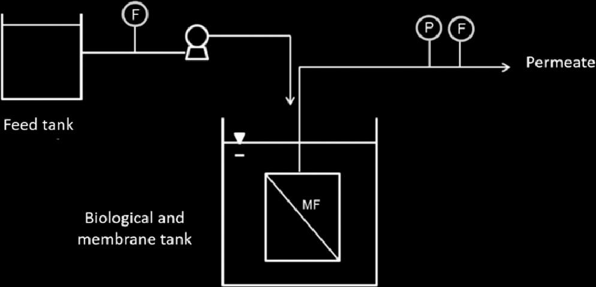
    - **Hình này chứng minh điều gì**
      - Bể sinh học và màng tích hợp chung, nước sau lọc rút trực tiếp từ module MF qua cảm biến $P$ và $F$.
    - **Từ đâu mà thấy được**
      - Hướng dòng từ trái sang phải: Feed tank qua bơm vào Biological and membrane tank.
      - Module MF đặt ngập dưới mực nước, đường Permeate gắn đồng hồ đo áp suất $P$ và lưu lượng $F$.
- Nước thải từ nhà máy lọc dầu được nạp vào đơn vị pilot MBR sau chuỗi các bước tiền xử lý (pretreatment steps):
  - Tách dầu và nước (water and oil separation).
  - Tuyển nổi (flotation).
  - Lọc cát (sand filtering).
  - Châm định lượng hydrogen peroxide ($\text{H}_2\text{O}_2$) nhằm kiểm soát nồng độ sulphide.
- Toàn bộ các đặc tính thiết kế và điều kiện vận hành cơ bản của hệ thống pilot được quy định và tổng kết tại Bảng 1 (Table 1).
  - **Bảng 1.** Đặc tính và điều kiện vận hành của hệ MBR
    - 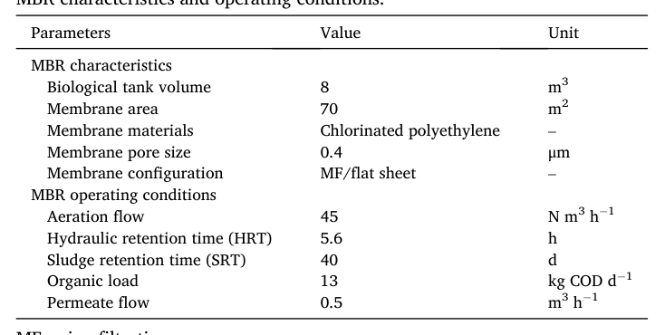
    - **Bảng này chứng minh điều gì**
      - Bảng xác lập cấu hình màng MF tấm phẳng ($70\text{ m}^2$, $0.4\text{ }\mu\text{m}$) cùng tải trọng và chế độ sục khí cố định cho bể pilot $8\text{ m}^3$.
    - **Từ đâu mà thấy được**
      - Cột Parameters phân tách hai nhóm: đặc tính màng lọc và điều kiện vận hành hệ thống.
      - Cột Value và Unit chỉ rõ sục khí $45\text{ N m}^3\text{ h}^{-1}$, HRT $5.6\text{ h}$, SRT $40\text{ d}$, tải hữu cơ $13\text{ kg COD d}^{-1}$ và lưu lượng thấm $0.5\text{ m}^3\text{ h}^{-1}$.
- Động lực cho quá trình lọc qua màng (driving force for permeation) là áp suất thủy tĩnh (hydrostatic pressure) tạo bởi cột nước trong bể màng.
- Hệ thống sục khí (aeration system) đảm nhiệm vai trò kép:
  - Cung cấp oxy đáp ứng nhu cầu của các quá trình sinh học trong bể.
  - Kiểm soát hiện tượng tắc nghẽn màng (fouling control) nhờ ứng suất cắt (shear stress) tạo bởi dòng bọt khí dâng lên.
- Lưu lượng dòng thấm (permeate flow) được duy trì thông qua chu kỳ vận hành gián đoạn với $1\text{ phút}$ nghỉ (relaxation) sau mỗi $9\text{ phút}$ lọc liên tục.
- Quy trình làm sạch hóa học (chemical cleaning) của màng được triển khai định kỳ:
  - Màng được làm sạch phục hồi (recovery cleaning) định kỳ bằng dung dịch sodium hypochlorite ($\text{NaClO}$) nồng độ $5000\text{ mg L}^{-1}$.
  - Thời gian ngâm rửa hóa chất kéo dài $24\text{ h}$.
  - Quá trình rửa hóa chất được kích hoạt bất cứ khi nào hệ thống không thể duy trì được lưu lượng dòng thấm với áp suất thủy tĩnh cực đại tạo bởi cột nước trong bể màng.
- Hiệu năng vận hành của hệ thống MBR được đánh giá thông qua quan trắc định kỳ theo ba nhóm chỉ tiêu chính:
  - Điều kiện vận hành (operating conditions): áp suất qua màng (transmembrane pressure - TMP), nhiệt độ (temperature), lưu lượng dòng thấm (permeate flowrate), độ thấm của màng (membrane permeability), thời gian lưu bùn (sludge retention time - SRT) và $\text{pH}$.
  - Đặc tính bùn hoạt tính (sludge characteristics): nồng độ chất rắn lơ lửng bay hơi trong hỗn dịch bùn (MLVSS), nồng độ chất rắn lơ lửng trong hỗn dịch bùn (MLSS), khả năng lọc của bùn (sludge filterability), khả năng lắng (sedimentability), các chất polymer ngoại bào (extracellular polymeric substances - EPS) và sản phẩm vi sinh vật hòa tan (soluble microbial products - SMP).
  - Đặc tính của dòng nạp và dòng thấm đầu ra (feed and effluent characteristics): nhu cầu oxy sinh hóa (BOD), nhu cầu oxy hóa học (COD), tổng carbon hữu cơ (TOC), độ kiềm (alkalinity), ammonia, chloride, sulphide, phosphorous, dầu và mỡ (OG), độ đục (turbidity), độ màu (color) và độ dẫn điện (conductivity).
- Phương pháp luận và quy chuẩn phân tích đo đạc các chỉ tiêu:
  - Các thông số hóa lý (physicochemical parameters) được đo đạc theo Tiêu chuẩn Phương pháp Kiểm tra Nước và Nước thải (*Standard Methods for Examination of Water and Wastewater*) [37].
  - Khả năng lọc của bùn (sludge filterability) được xác định theo phương pháp khuyến nghị của hãng Kubota (Filter Test — FT):
    - Lấy $50\text{ mL}$ hỗn dịch bùn đem lọc qua giấy lọc Whatman 42 ($185\text{ mm}$) được gấp nếp với sự hỗ trợ của một phễu đơn giản.
    - Thể tích dịch lọc thu được trong $5\text{ phút}$ đầu tiên được ghi nhận là độ lọc của bùn ($\text{mL } 5\text{ min}^{-1}$).
  - Độ thấm của màng (membrane permeability) được tính toán bằng cách chia lưu lượng dòng thấm đo được cho tích của diện tích màng và áp suất tác dụng lên hệ thống.
- Hiệu quả loại bỏ các chất ô nhiễm trong nước thải của hệ pilot MBR được trình bày tại Bảng 2 (Table 2).
  - **Bảng 2.** Hiệu suất loại bỏ các chất ô nhiễm của MBR.
    - 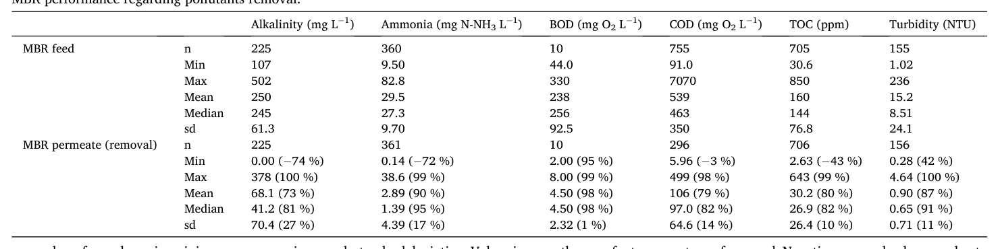
    - **Bảng này chứng minh điều gì**
      - BOD đạt hiệu suất loại bỏ trung bình cao nhất $98\ \%$, trong khi COD đạt trung bình $79\ \%$, trung vị $82\ \%$.
    - **Từ đâu mà thấy được**
      - Các cột "Ammonia ($\text{mg N-NH}_3\ \text{L}^{-1}$)", "BOD ($\text{mg O}_2\ \text{L}^{-1}$)" và "COD ($\text{mg O}_2\ \text{L}^{-1}$)" tại phần "MBR permeate (removal)".
      - Giá trị tốt nhất ở cột BOD với mức khử trong ngoặc đạt $98\ \%$ (Mean) và $99\ \%$ (Max); thấp nhất ở COD với $-3\ \%$ (Min); cột Ammonia ghi nhận $90\ \%$ (Mean).
- Các mức hiệu suất loại bỏ quan sát được hoàn toàn phù hợp và tương đồng với các dữ liệu đã công bố về xử lý nước thải nhà máy lọc dầu sử dụng hệ MBR quy mô pilot [38,39].

### 2.2. Database and preliminary statistical analysis

- Dữ liệu quan trắc do nhà máy lọc dầu (oil refinery) cung cấp, ban đầu bao gồm $1131$ mẫu dữ liệu (samples) được thu thập trong suốt $4$ năm quan trắc ($4\text{ years of monitoring}$).
  - Mỗi mẫu đại diện cho một ngày vận hành ($1\text{ day}$) và bao quát một tập hợp gồm $30$ biến số ($30\text{ variables}$):
    - Áp suất qua màng (TMP - transmembrane pressure).
    - Nhiệt độ (temperature).
    - Lưu lượng dòng thấm (permeate flowrate).
    - Độ thấm của màng (membrane permeability).
    - Thời gian lưu bùn (SRT - sludge retention time).
    - Độ lọc của bùn (sludge filterability).
    - Khả năng lắng của bùn (sedimentability).
    - Chất rắn lơ lửng bay hơi trong bùn lỏng (MLVSS - mixed liquor volatile suspended solids).
    - Chất rắn lơ lửng trong bùn lỏng (MLSS - mixed liquor suspended solids).
    - Các chất polyme ngoại bào (EPS - extracellular polymeric substances).
    - Các sản phẩm vi sinh vật hòa tan (SMP - soluble microbial products).
    - $\text{pH}$.
    - Tổng cacbon hữu cơ ($\text{TOC}$ - total organic carbon) dòng vào và dòng ra.
    - Nhu cầu oxy sinh hóa ($\text{BOD}$ - biochemical oxygen demand) dòng vào và dòng ra.
    - Nhu cầu oxy hóa học ($\text{COD}$ - chemical oxygen demand) dòng vào và dòng ra.
    - Nồng độ amoniac ($\text{ammonia}$) dòng vào và dòng ra.
    - Độ đục ($\text{turbidity}$) dòng vào và dòng ra.
    - Độ kiềm ($\text{alkalinity}$) dòng vào và dòng ra.
    - Clorua ($\text{chloride}$) dòng ra.
    - Độ màu ($\text{color}$) dòng ra.
    - Độ dẫn điện ($\text{conductivity}$) dòng ra.
    - Nồng độ sunphua ($\text{sulphide}$) dòng vào.
    - Nồng độ photpho ($\text{phosphorous}$) dòng vào.
    - Nồng độ dầu mỡ ($\text{OG}$ - oil and grease) dòng vào.
- Quá trình chọn lọc biến số nhằm cân bằng giữa thông tin cơ chế và số lượng mẫu khả dụng:
  - Do các mẫu chứa dữ liệu bị khuyết (missing data) không thể sử dụng để xây dựng các mô hình đa biến (multivariate models), việc lựa chọn biến số hướng tới hai mục tiêu:
    - Thu được các thông tin liên quan đến các cơ chế xử lý của hệ thống MBR (MBR treatment mechanisms).
    - Giữ lại số lượng mẫu lớn nhất có thể (keep the greatest possible number of samples).
  - $14$ biến số được lựa chọn cho mô hình bao gồm:
    - $\text{SRT}$.
    - Độ lọc của bùn (sludge filterability).
    - $\text{MLVSS}$.
    - $\text{pH}$.
    - Nhiệt độ (temperature).
    - Độ thấm của màng (membrane permeability).
    - Nồng độ dòng vào của $\text{COD}$ (influent COD).
    - Nồng độ dòng vào của photpho (influent phosphorous).
    - Nồng độ dòng vào của amoniac (influent ammonia).
    - Nồng độ dòng vào của sunphua (influent sulphides).
    - Nồng độ dòng vào của dầu mỡ (influent oil and grease - $\text{OG}$).
    - Nồng độ dòng ra của $\text{COD}$ trong dòng thấm (effluent COD).
    - Hiệu suất loại bỏ $\text{COD}$ (COD removal).
    - Hiệu suất loại bỏ amoniac (ammonia removal).
  - Giới hạn liên quan đến độ kiềm (alkalinity):
    - Độ kiềm là biến số quan trọng để khảo sát quá trình khử amoniac do đóng vai trò thiết yếu trong phản ứng nitrat hóa (nitrification).
    - Tuy nhiên, độ kiềm không được đo đạc với tần suất đủ cao để có thể khả thi đưa vào mô hình.
- Tinh lọc dữ liệu và thu giảm kích thước mẫu quan trắc:
  - Do các biến số được chọn không được đo lường với cùng tần suất, tập dữ liệu vẫn xuất hiện nhiều khoảng trống dữ liệu khuyết.
  - Các mẫu không chứa đầy đủ phép đo cho tất cả $14$ biến số đã chọn đều bị loại bỏ khỏi cơ sở dữ liệu.
  - Cơ sở dữ liệu cuối cùng sau khi tinh lọc bao gồm $479$ mẫu dữ liệu hoàn chỉnh ($479\text{ samples}$), thu giảm từ $1131$ mẫu ban đầu và bao quát trọn vẹn $14$ biến số.
- Khảo sát và xử lý các giá trị ngoại lai (outliers):
  - Giá trị ngoại lai được khảo sát bằng đồng thời hai phương pháp:
    - Phương pháp khoảng tứ phân vị (IQR - interquartile range) [40].
    - Phương pháp nhận diện Hampel (Hampel identifier methods) [41].
  - Tất cả các trường hợp ngoại lai đều được kiểm tra riêng lẻ từng trường hợp (individually examined) đối chiếu với báo cáo vận hành do nhà máy lọc dầu cung cấp cùng với dữ liệu quan trắc, nhằm xác minh xem có sự cố vận hành (operational problem) nào giải thích cho các giá trị cực trị hay không, tránh gây sai lệch kết quả.
  - Toàn bộ các quan sát bị phân loại là ngoại lai đều được giữ lại trong tập dữ liệu (kept in the dataset):
    - Các giá trị này phản ánh các điều kiện vận hành không điển hình (atypical operating conditions).
    - Việc giữ lại giúp bổ sung thông tin quan trọng cho việc kiểm soát quá trình (process control).
- Thống kê mô tả và phân phối xác suất của 14 biến số trong cơ sở dữ liệu cuối cùng ($n = 479$, Table 3):
  - Bảng 3 trình bày các thông số thống kê mô tả (descriptive statistics) cho $14$ biến số đã chọn:
    - Độ lọc của bùn ($\text{Filt}$): giá trị nhỏ nhất $\text{Min} = 5.00\text{ mL } 5\text{ min}^{-1}$, cực đại $\text{Max} = 26.0\text{ mL } 5\text{ min}^{-1}$, trung vị $\text{Median} = 11.0\text{ mL } 5\text{ min}^{-1}$, trung bình $\text{Mean} = 11.6\text{ mL } 5\text{ min}^{-1}$, độ lệch chuẩn $\text{sd} = 4.44\text{ mL } 5\text{ min}^{-1}$, phương sai $\text{Variance} = 19.7$, hệ số biến thiên $\text{Coef. of variation} = 0.38$, hệ số bất đối xứng $\text{Coef. of skewness} = 0.69$.
    - $\text{MLVSS}$: $\text{Min} = 2150\text{ mg L}^{-1}$, $\text{Max} = 12{,}500\text{ mg L}^{-1}$, $\text{Median} = 7200\text{ mg L}^{-1}$, $\text{Mean} = 7185\text{ mg L}^{-1}$, $\text{sd} = 2004\text{ mg L}^{-1}$, $\text{Variance} = 4{,}016{,}661$, $\text{Coef. of variation} = 0.28$, $\text{Coef. of skewness} = 0.08$.
    - $\text{pH}$: $\text{Min} = 5.61$, $\text{Max} = 10.5$, $\text{Median} = 7.70$, $\text{Mean} = 8.10$, $\text{sd} = 0.98$, $\text{Variance} = 0.96$, $\text{Coef. of variation} = 0.12$, $\text{Coef. of skewness} = 0.70$.
    - Nồng độ amoniac dòng vào ($\text{Influent ammonia}$): $\text{Min} = 11.2\text{ mg L}^{-1}$, $\text{Max} = 82.8\text{ mg L}^{-1}$, $\text{Median} = 29.1\text{ mg L}^{-1}$, $\text{Mean} = 29.9\text{ mg L}^{-1}$, $\text{sd} = 8.42\text{ mg L}^{-1}$, $\text{Variance} = 70.9$, $\text{Coef. of variation} = 0.28$, $\text{Coef. of skewness} = 1.61$.
    - Nồng độ sunphua dòng vào ($\text{Influent sulphides}$): $\text{Min} = 1.00\text{ mg L}^{-1}$, $\text{Max} = 21.5\text{ mg L}^{-1}$, $\text{Median} = 6.40\text{ mg L}^{-1}$, $\text{Mean} = 7.20\text{ mg L}^{-1}$, $\text{sd} = 3.26\text{ mg L}^{-1}$, $\text{Variance} = 10.6$, $\text{Coef. of variation} = 0.45$, $\text{Coef. of skewness} = 1.11$.
    - Nồng độ dầu mỡ dòng vào ($\text{Influent OG}$): $\text{Min} = 0.60\text{ ppm}$, $\text{Max} = 48.4\text{ ppm}$, $\text{Median} = 11.6\text{ ppm}$, $\text{Mean} = 11.4\text{ ppm}$, $\text{sd} = 6.35\text{ ppm}$, $\text{Variance} = 40.3$, $\text{Coef. of variation} = 0.56$, $\text{Coef. of skewness} = 1.69$.
    - Nồng độ photpho dòng vào ($\text{Influent phosp.}$): $\text{Min} = 0.01\text{ mg L}^{-1}$, $\text{Max} = 1.50\text{ mg L}^{-1}$, $\text{Median} = 0.20\text{ mg L}^{-1}$, $\text{Mean} = 0.30\text{ mg L}^{-1}$, $\text{sd} = 0.16\text{ mg L}^{-1}$, $\text{Variance} = 0.03$, $\text{Coef. of variation} = 0.61$, $\text{Coef. of skewness} = 3.23$.
    - Nồng độ $\text{COD}$ dòng vào ($\text{Influent COD}$): $\text{Min} = 144\text{ mg L}^{-1}$, $\text{Max} = 1617\text{ mg L}^{-1}$, $\text{Median} = 563\text{ mg L}^{-1}$, $\text{Mean} = 594\text{ mg L}^{-1}$, $\text{sd} = 249\text{ mg L}^{-1}$, $\text{Variance} = 62{,}188$, $\text{Coef. of variation} = 0.42$, $\text{Coef. of skewness} = 1.00$.
    - Nồng độ $\text{COD}$ dòng ra trong dòng thấm ($\text{Permeate COD}$): $\text{Min} = 17.0\text{ mg L}^{-1}$, $\text{Max} = 384\text{ mg L}^{-1}$, $\text{Median} = 102\text{ mg L}^{-1}$, $\text{Mean} = 112\text{ mg L}^{-1}$, $\text{sd} = 48.1\text{ mg L}^{-1}$, $\text{Variance} = 2317$, $\text{Coef. of variation} = 0.43$, $\text{Coef. of skewness} = 1.31$.
    - Hiệu suất loại bỏ amoniac ($\text{Ammonia removal}$): $\text{Min} = 15.8\,\%$, $\text{Max} = 99.4\,\%$, $\text{Median} = 94.2\,\%$, $\text{Mean} = 91.7\,\%$, $\text{sd} = 10.0\,\%$, $\text{Variance} = 100$, $\text{Coef. of variation} = 0.11$, $\text{Coef. of skewness} = -4.09$.
    - Hiệu suất loại bỏ $\text{COD}$ ($\text{COD removal}$): $\text{Min} = 19.3\,\%$, $\text{Max} = 96.9\,\%$, $\text{Median} = 81.0\,\%$, $\text{Mean} = 79.3\,\%$, $\text{sd} = 10.2\,\%$, $\text{Variance} = 104$, $\text{Coef. of variation} = 0.13$, $\text{Coef. of skewness} = -2.17$.
    - Nhiệt độ ($\text{Temp.}$): $\text{Min} = 23.4\,^\circ\text{C}$, $\text{Max} = 39.2\,^\circ\text{C}$, $\text{Median} = 29.0\,^\circ\text{C}$, $\text{Mean} = 28.9\,^\circ\text{C}$, $\text{sd} = 3.40\,^\circ\text{C}$, $\text{Variance} = 11.5$, $\text{Coef. of variation} = 0.12$, $\text{Coef. of skewness} = 0.33$.
    - Thời gian lưu bùn ($\text{SRT}$): $\text{Min} = 30\text{ d}$, $\text{Max} = 80\text{ d}$, $\text{Median} = 30\text{ d}$, $\text{Mean} = 42\text{ d}$, $\text{sd} = 15\text{ d}$, $\text{Variance} = 217$, $\text{Coef. of variation} = 0.36$, $\text{Coef. of skewness} = 0.52$.
    - Độ thấm của màng ($\text{Perm.}$): $\text{Min} = 87.9\text{ L h}^{-1}\text{ m}^{-2}\text{ bar}^{-1}$, $\text{Max} = 1463\text{ L h}^{-1}\text{ m}^{-2}\text{ bar}^{-1}$, $\text{Median} = 179\text{ L h}^{-1}\text{ m}^{-2}\text{ bar}^{-1}$, $\text{Mean} = 276\text{ L h}^{-1}\text{ m}^{-2}\text{ bar}^{-1}$, $\text{sd} = 232\text{ L h}^{-1}\text{ m}^{-2}\text{ bar}^{-1}$, $\text{Variance} = 53{,}783$, $\text{Coef. of variation} = 0.84$, $\text{Coef. of skewness} = 2.27$.
  - Đặc tính phân phối và độ lệch chuẩn của dữ liệu:
    - Hiệu suất loại bỏ amoniac và $\text{COD}$ có hệ số bất đối xứng âm mạnh (skewness lần lượt là $-4.09$ và $-2.17$), thể hiện phân phối lệch trái với phần lớn các giá trị đạt mức cao và đuôi phân phối kéo dài về vùng hiệu suất thấp.
    - Photpho dòng vào ($\text{skewness} = 3.23$), độ thấm của màng ($\text{skewness} = 2.27$), dầu mỡ dòng vào ($\text{skewness} = 1.69$), amoniac dòng vào ($\text{skewness} = 1.61$), và $\text{COD}$ trong dòng thấm ($\text{skewness} = 1.31$) có hệ số bất đối xứng dương lớn, thể hiện phân phối lệch phải.
    - $\text{MLVSS}$ có hệ số bất đối xứng xấp xỉ không ($\text{skewness} = 0.08$), phản ánh phân phối gần như đối xứng hoàn hảo quanh giá trị trung bình ($7185\text{ mg L}^{-1}$) và trung vị ($7200\text{ mg L}^{-1}$).

### 2.3. Multivariate statistical analyses

- Phương pháp luận nghiên cứu và quy trình xử lý dữ liệu được thiết lập theo sơ đồ phân tích đa biến tích hợp (Hình 2):
  - **Hình 2.** Sơ đồ phương pháp nghiên cứu và xử lý dữ liệu
    - 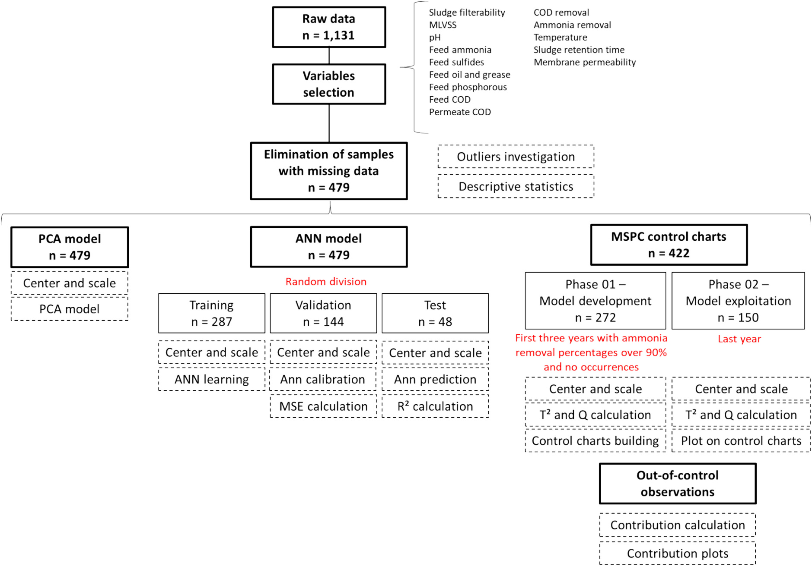
    - **Hình này chứng minh điều gì**
      - Tiền xử lý loại bỏ dữ liệu thiếu thu gọn tập dữ liệu thô từ $n = 1{,}131$ xuống $n = 479$ mẫu.
      - Ba nhánh phân tích vận hành song song gồm PCA ($n = 479$), ANN ($287/144/48$) và MSPC ($n = 422$, chia $272/150$).
    - **Từ đâu mà thấy được**
      - Luồng dọc từ trên xuống: mũi tên từ "Raw data" qua "Variables selection" đến "Elimination of samples with missing data".
      - Nhánh rẽ ngang phía dưới: ba cột song song gồm "PCA model" (trái), "ANN model" (giữa) và "MSPC control charts" (phải).
- Nền tảng phần mềm và công cụ triển khai mô hình hóa:
  - Tất cả các mô hình phân tích đa biến được phát triển bằng phần mềm R phiên bản 4.0.2.
  - Gói thư viện `readxl` được sử dụng để nhập dữ liệu từ Microsoft Excel® 2016.

#### 2.3.1. ANN model development

- Tiền xử lý và chuẩn hóa dữ liệu:
  - Tập dữ liệu cuối cùng được chuẩn hóa về điểm số $Z$ ($Z$ score) với giá trị trung bình bằng $0$ ($\mu = 0$) và độ lệch chuẩn bằng $1$ ($\sigma = 1$) theo Phương trình (1):
    $$Z_i = \frac{x_i - \mu}{\sigma} \quad (1)$$
    trong đó:
    - $Z_i$ là điểm số đã chuẩn hóa (standardized score).
    - $x_i$ là giá trị của một biến số cụ thể (specific variable).
    - $\mu$ là giá trị trung bình của tập biến số (mean of the set of variables).
    - $\sigma$ là độ lệch chuẩn của tập biến số (standard deviation of the set of variables).
  - Phép chuẩn hóa $Z$ score thu hẹp khoảng cách bậc độ lớn (orders of magnitude) giữa các biến số khác nhau, đưa chúng về thang đo có thể so sánh trực tiếp và đảm bảo tầm quan trọng ngang nhau trong các mô hình đa biến.
- Cấu trúc biến số và công cụ xây dựng mô hình ANN:
  - Mô hình Mạng nơ-ron nhân tạo (ANN - Artificial Neural Network) được xây dựng trong R sử dụng các gói thư viện `NeuralNet` và `Keras`.
  - Bộ biến đầu vào (input variables) bao gồm $13$ thông số vận hành và chất lượng nước:
    - Độ lọc của bùn (sludge filterability).
    - Nồng độ chất rắn lơ lửng bay hơi trong bùn lỏng ($MLVSS$ - mixed liquor volatile suspended solids).
    - $pH$.
    - Nồng độ amoniac dòng vào (influent concentration of ammonia).
    - Nồng độ dầu mỡ dòng vào ($OG$ - oil and grease).
    - Nồng độ sulfua dòng vào (influent concentration of sulphides).
    - Nồng độ photpho dòng vào (influent concentration of phosphorous).
    - $COD$ dòng vào (influent COD).
    - $COD$ dòng ra (effluent COD).
    - Hiệu quả khử $COD$ (COD removal).
    - Nhiệt độ (temperature).
    - Thời gian lưu bùn ($SRT$ - sludge retention time).
    - Độ thấm của màng (membrane permeability).
  - Biến đầu ra (output variable): Hiệu quả khử amoniac (ammonia removal) được lựa chọn làm biến mục tiêu nhằm dự đoán chuẩn xác giá trị và đánh giá động thái vận hành của hệ thống MBR.
- Kiến trúc mạng và tối ưu hóa siêu tham số:
  - Áp dụng kiến trúc mạng truyền thẳng nhiều lớp (multilayer feedforward architecture).
  - Tiến hành hàng loạt thử nghiệm kết hợp giữa các hàm kích hoạt (activation function), số lượng lớp ẩn (hidden layers), số lượng nơ-ron trong từng lớp và số chu kỳ huấn luyện (epochs) nhằm xác định cấu hình có sai số toàn phương trung bình ($MSE$ - mean square error) nhỏ nhất.
  - Cấu hình mạng nơ-ron tối ưu được xác định cho mô hình hóa MBR:
    - Hàm kích hoạt: Hàm chỉnh lưu kết hợp dropout (rectifier with dropout).
    - Số lớp ẩn: $2$ lớp ẩn, trong đó lớp thứ nhất chứa $12$ nơ-ron và lớp thứ hai chứa $7$ nơ-ron (cấu hình $12$ và $7$ neurons theo thứ tự).
    - Số chu kỳ huấn luyện: $5000$ epochs.
- Phân chia tập dữ liệu và tính đại diện của mẫu huấn luyện:
  - Mô hình phục vụ hai mục đích chính: phân tích độ nhạy (sensitivity analysis) của hiệu quả khử amoniac đối với các biến đầu vào, và dự báo (forecasting) hiệu quả khử amoniac từ các điều kiện đầu vào cho trước.
  - Toàn bộ dữ liệu được phân chia ngẫu nhiên thành $3$ tập con:
    - Tập huấn luyện (training set): $60\,\%$ tổng số dữ liệu.
    - Tập kiểm định (validation set): $30\,\%$ tổng số dữ liệu.
    - Tập kiểm tra (test set): $10\,\%$ tổng số dữ liệu.
  - Đảm bảo tính đại diện của dữ liệu theo khuyến nghị của Zhong et al. đối với ứng dụng học máy trong Khoa học và Kỹ thuật Môi trường ($ESE$ - Environmental Science and Engineering): dữ liệu mang tính "đại diện" quan trọng hơn việc chỉ có dữ liệu "lớn" để tạo nên các mô hình mạnh mẽ và ổn định.
  - Quy trình phân chia tập dữ liệu được kiểm tra và lặp lại liên tục cho đến khi tập huấn luyện bao phủ dải rộng các tỷ lệ phần trăm khử amoniac, giúp mô hình học tập đầy đủ các điều kiện vận hành đa dạng.
  - Cơ chế sử dụng các tập dữ liệu:
    - Các tập con huấn luyện và kiểm định được kết hợp để huấn luyện và hiệu chuẩn mạng phục vụ phân tích độ nhạy.
    - Tập con kiểm tra độc lập được sử dụng làm cấu hình đầu vào để đánh giá khả năng dự đoán hiệu quả khử amoniac.
- Thông số thống kê đánh giá hiệu năng mô hình:
  - Hiệu năng của mô hình ANN được định lượng thông qua ba chỉ số: hệ số xác định ($R^2$ - coefficient of determination), sai số tuyệt đối trung bình ($MAE$ - mean absolute error), và sai số toàn phương trung bình ($MSE$ - mean square error).

#### 2.3.2. PCA model development

- Mục tiêu phân tích thành phần chính (PCA - Principal Component Analysis):
  - Khám phá sâu hơn các mối quan hệ tương quan giữa các biến số với hiệu quả khử amoniac đạt được.
  - Phân tích và làm rõ bản chất chiều hướng tương quan (mang dấu dương hay dấu âm) mà mô hình ANN đã nhận diện.
- Nguyên lý toán học của phép biến đổi trực giao:
  - PCA thực hiện giảm chiều dữ liệu (dimensionality reduction) bằng phép biến đổi trực giao (orthogonal transformation), chuyển nhóm vectơ gốc thành nhóm vectơ mới là tổ hợp tuyến tính của các vectơ ban đầu.
  - Phương trình triển khai toán học được xác định theo Phương trình (2):
    $$P_i = Z_i \cdot \mathrm{cov} \quad (2)$$
    trong đó:
    - $Z_i$ là ma trận số đã chuẩn hóa trước khi thực hiện PCA (standardized numerical matrix before PCA).
    - $\mathrm{cov}$ là ma trận hiệp phương sai của ma trận $Z_i$.
    - $P_i$ là ma trận số sau khi biến đổi PCA (numerical matrix after PCA).
- Công cụ tính toán và trực quan hóa:
  - Phân tích PCA được tính toán bằng hàm `PCA` trong gói thư viện `FactoMineR`.
  - Toàn bộ dữ liệu trước đó được chuẩn hóa về điểm số $Z$ theo Phương trình (1).
  - Các biểu đồ tải (loading plots) được xây dựng và trực quan hóa bằng các gói `factoextra`, `ggplot2` và `ggpubr`.
- Tiêu chí lựa chọn thành phần chính và đánh giá mô hình:
  - Số lượng thành phần chính giữ lại được xác định dựa trên tiêu chí Kaiser (Kaiser criterion) và kiểm định sườn dốc (scree test).
  - Chất lượng mô hình PCA được đánh giá thông qua giá trị hệ số xác định ($R^2$).

#### 2.3.3. MSPC model development

- Khung phương pháp kiểm soát quá trình thống kê đa biến (MSPC - Multivariate Statistical Process Control):
  - Các biểu đồ kiểm soát đa biến được xây dựng dựa trên phương pháp tiếp cận biến tiềm ẩn (latent-variable based approach) cho MSPC, sử dụng PCA làm phương pháp chiếu thống kê (MSPC-PCA) theo khuôn khổ của Ferrer và Taghezouit et al.
  - Số lượng thành phần giữ lại trong mô hình PCA của MSPC tiếp tục được lựa chọn dựa trên tiêu chí Kaiser và kiểm định sườn dốc scree test.
- Tiêu chí ngoài kiểm soát và phân tách dữ liệu thành hai giai đoạn:
  - Tiêu chí ngoài kiểm soát (out-of-control criteria) được định nghĩa là hiệu quả khử amoniac dưới $90\,\%$.
  - Tập dữ liệu được phân chia thành hai giai đoạn:
    - Giai đoạn I (Phase I): Chỉ bao gồm các mẫu nằm trong vùng kiểm soát (in-control, hiệu quả khử amoniac $> 90\,\%$) từ $3$ năm quan trắc đầu tiên ($n = 272$).
    - Giai đoạn II (Phase II): Bao gồm toàn bộ các mẫu từ năm quan trắc cuối cùng, chứa cả các mẫu trong vùng kiểm soát và ngoài vùng kiểm soát ($n = 150$).
- Thiết lập mô hình, thống kê bổ trợ và giới hạn kiểm soát trên (UCL):
  - Tập dữ liệu Phase I được chuẩn hóa về điểm số $Z$ (Phương trình 1) và sử dụng để phát triển mô hình PCA nền tảng.
  - Từ mô hình PCA Phase I, hai thống kê bổ trợ $T^2$ (Hotelling's $T^2$) và $Q$ (thống kê lỗi bình phương hay khoảng cách dự đoán vuông góc) được tính toán cho từng quan sát.
  - Các biểu đồ kiểm soát đa biến tương ứng được thiết lập với giới hạn kiểm soát trên ($UCL$ - upper control limits) được quy ước là phân vị thứ $95\,\%$ ($95\,\%$ percentiles) của từng đại lượng thống kê.
- Chiếu dữ liệu Phase II và phát hiện bất thường:
  - Tập dữ liệu Phase II được chuẩn hóa về điểm số $Z$ (Phương trình 1) và chiếu lên mô hình PCA đã huấn luyện ở Phase I để tính toán các giá trị thống kê $T^2$ và $Q$.
  - Các giá trị thống kê được vẽ trên biểu đồ kiểm soát để đối chiếu trực tiếp với các ngưỡng $UCL$.
- Chẩn đoán nguyên nhân biến động bằng biểu đồ đóng góp (contribution plots):
  - Đối với các quan sát được phát hiện vượt quá ngưỡng $UCL$ trên biểu đồ kiểm soát thống kê $Q$, phương pháp chẩn đoán dựa trên biểu đồ đóng góp được áp dụng.
  - Mức độ đóng góp của từng biến số $j$ cho từng quan sát bất thường $i$ ($\mathrm{cont}_{j,i}$) được định lượng theo Phương trình (3):
    $$\mathrm{cont}_{j,i} = \frac{e_{i,j}^2}{\sum_{j=1}^{J} e_{i,j}^2} \quad (3)$$
    trong đó:
    - $e_{i,j}$ là sai số phần dư (residual) của biến số $j$ tại quan sát bất thường $i$.
    - $J$ là tổng số lượng các biến số tham gia mô hình.
- Thư viện phần mềm hỗ trợ tính toán:
  - Các bước tính toán phương pháp luận MSPC được triển khai với sự hỗ trợ của các gói R gồm `scales`, `rstatix`, `ggplot2` và `ggpubr`.

## 3. Results and discussion

### 3.1. Comprehending and predicting ammonia removal on MBR systems

#### 3.1.1. Identification of the most influential variables on ammonia removal

* Mô hình mạng nơ-ron nhân tạo (ANN - Artificial Neural Network) và phân tích thành phần chính (PCA - Principal Components Analysis) được phát triển nhằm nhận diện các biến số then chốt chi phối hiệu quả loại bỏ amoni (ammonia removal) trong hệ thống MBR.
* Kiến trúc mô hình ANN và phân bố trọng số khớp thần kinh (synaptic weights) (Fig. 3):
  - **Hình 3.** Kiến trúc mạng ANN và trọng số khớp thần kinh
    - 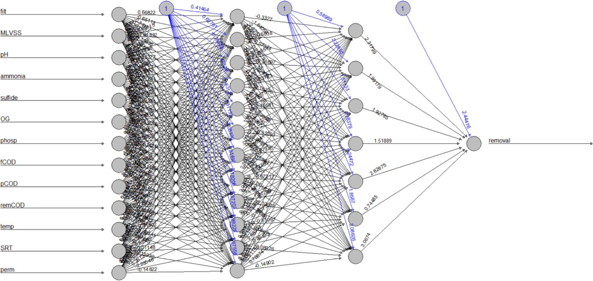
    - **Hình này chứng minh điều gì**
      - Mô hình thiết lập cấu trúc gồm 13 biến đầu vào, 2 lớp ẩn (12 và 7 nơ-ron), 1 đầu ra removal cùng các số hạng chệch bias.
    - **Từ đâu mà thấy được**
      - Đọc từ trái sang phải: 13 biến vận hành đầu vào (từ filt đến perm), qua 2 lớp ẩn (12 và 7 nơ-ron), đến nơ-ron đầu ra removal.
      - Đường nối màu đen ghi nhận trọng số khớp thần kinh; đường màu xanh lam từ nút tròn $1$ biểu thị các số hạng chệch (bias).
  * Các đường liên kết màu đen thể hiện các kết nối giữa từng lớp và trọng số khớp thần kinh trên mỗi kết nối.
  * Các đường màu xanh lam biểu diễn số hạng chệch (bias term) được bổ sung ở từng bước tính toán của mạng.
* Hiệu năng hội tụ và sai số dự đoán của mô hình ANN (Fig. 4):
  * Mô hình đạt kết quả tốt trong việc mô phỏng ứng xử của MBR, ghi nhận sai số tuyệt đối trung bình MAE (Mean Absolute Error) ở mức hợp lý (bậc độ lớn $10^{-2}$) và sai số toàn phương trung bình MSE (Mean Squared Error) ở bậc độ lớn $10^{-4}$ (order of magnitude 10−4 (hình ghi MSE khoảng 20–30 (trục Oy 0–700), MAE khoảng 1–2 (trục Oy 0–24))), như minh họa tại Fig. 4:
  - **Hình 4.** Sai số MAE và MSE trong huấn luyện mô hình ANN
    - 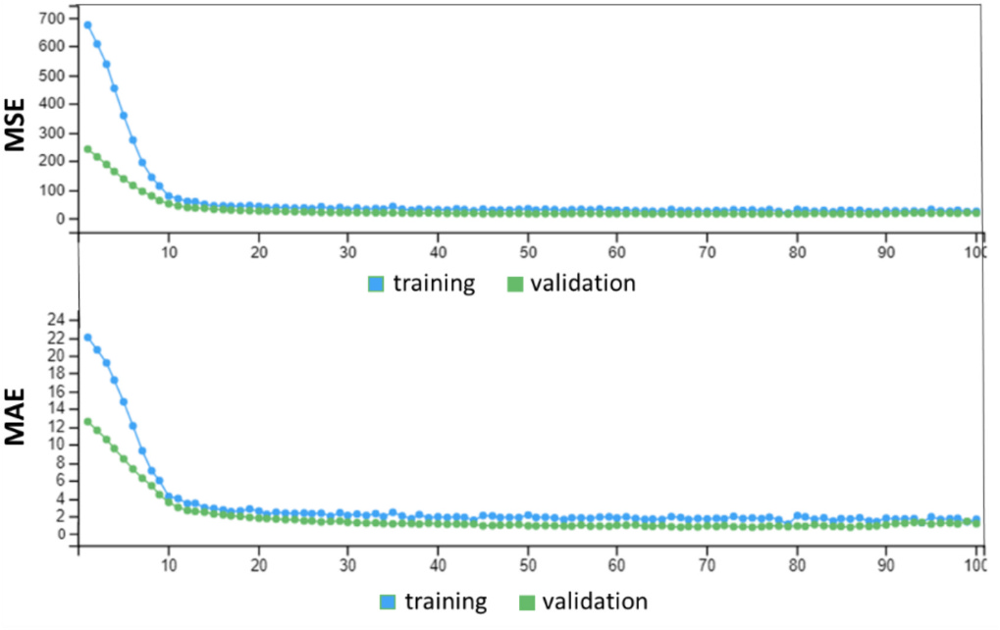
    - **Hình này chứng minh điều gì**
      - Sai số giảm dốc đứng trong $10\text{--}15$ epoch đầu và tiệm cận ổn định từ epoch $20$ trên cả hai tập dữ liệu.
    - **Từ đâu mà thấy được**
      - Ox: số epoch ($0\text{--}100$). Oy: đồ thị trên biểu diễn MSE ($0\text{--}700$), đồ thị dưới biểu diễn MAE ($0\text{--}24$).
      - MSE tập training giảm từ $\sim 680$ về $\sim 20$, MAE giảm từ $\sim 22$ về $\sim 1.5$; đường cong phẳng dần sau epoch $15$.
      - Lưu ý: hình ghi MSE khoảng $20\text{--}30$ và MAE khoảng $1\text{--}2$, văn bản ghi bậc $10^{-4}$.
  * Quá trình học (learning process) và sự tiến triển của mô hình ANN qua các giai đoạn huấn luyện (training) và kiểm định (validation) ghi nhận sự sụt giảm đáng kể của cả MAE và MSE.
  * Sự suy giảm đồng thời của MAE và MSE chứng minh mô hình tự hiệu chỉnh thích ứng chặt chẽ với dữ liệu thực nghiệm và học được các quy luật tiềm ẩn.
* Phân tích thành phần chính PCA: Scree plot, tiêu chí lựa chọn và phương sai giải thích (Fig. 5):
  * Đồ thị đoạn dốc (scree plot) xác định số lượng thành phần chính (PC - Principal Component) được giữ lại (Fig. 5a):
    * Tiêu chí Kaiser (Kaiser criterion): các PC có giá trị riêng (eigenvalue) lớn hơn 1 được giữ lại [51].
    * Phép thử đoạn dốc (scree test): giữ lại các PC nằm trước điểm khuỷu (elbow point) trên đường cong scree plot [52].
    * Ba thành phần chính đầu tiên ($PC_1$, $PC_2$, $PC_3$) đều thỏa mãn đồng thời cả hai tiêu chí trên.
  * Đánh giá hệ số xác định $R^2$ và mức độ gia tăng độ phức tạp mô hình (Fig. 5b):
    * Bổ sung thêm các PC sau thành phần thứ ba không mang lại ý nghĩa thực tiễn, do giá trị $R^2$ không gia tăng đủ nhiều để biện minh cho độ phức tạp cao hơn của mô hình (Fig. 5):
  - **Hình 5.** Scree plot và giá trị $R^2$ của mô hình PCA
    - 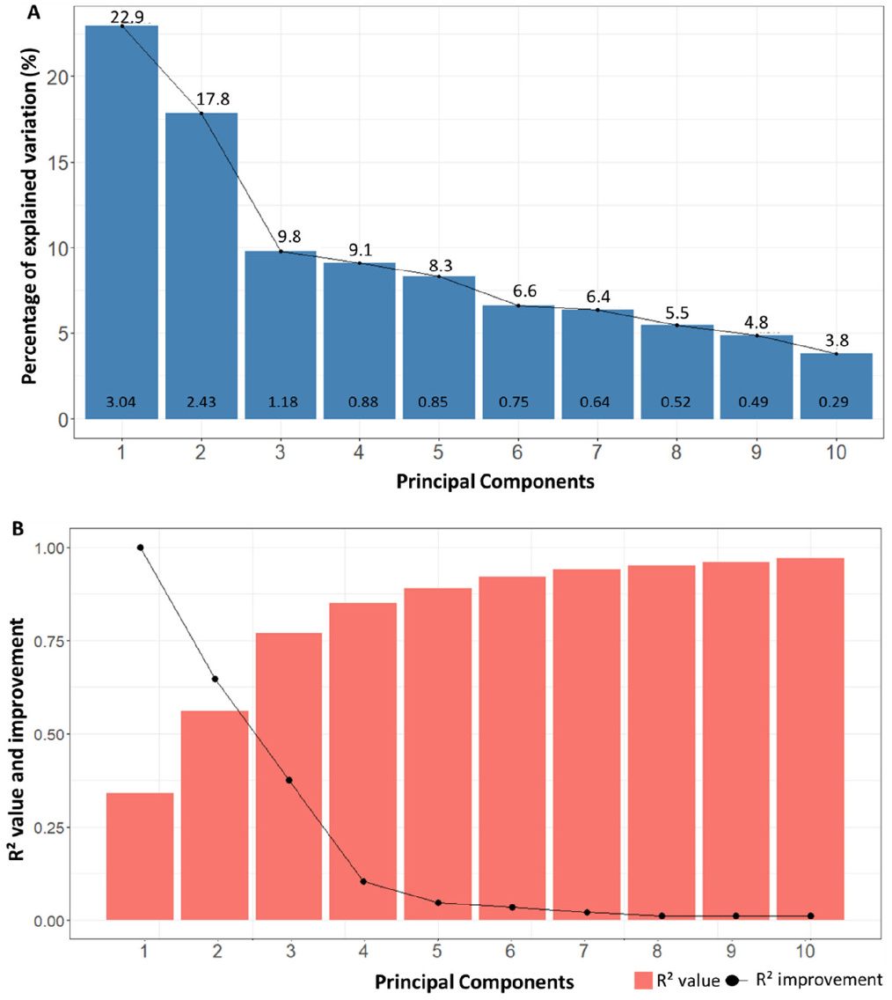
    - **Hình này chứng minh điều gì**
      - 3 thành phần chính đầu tiên tối ưu để giữ lại thông tin với eigenvalue $> 1$ và $R^2 > 0.75$.
    - **Từ đâu mà thấy được**
      - Panel (a): PC 1–3 có eigenvalue $> 1$ ($3.04$, $2.43$, $1.18$) và giải thích lần lượt $22.9\ \%$, $17.8\ \%$, $9.8\ \%$ biến thiên.
      - Panel (b): Cột $R^2$ vượt $0.75$ ở PC 3; điểm cải thiện $R^2$ giảm từ $1.00$ xuống dưới $0.10$ ở PC 4.
    * Đồ thị chỉ hiển thị 10 PC đầu tiên nhằm mục đích đơn giản hóa; mục tiêu chính của PCA là giảm số chiều dữ liệu (data dimensionality reduction), do đó giữ lại càng ít thành phần càng tối ưu chừng nào sự thất thoát thông tin nằm trong ngưỡng chấp nhận được.
    * Với 3 PC đầu tiên, mô hình giải thích được $55\%$ tổng biến thiên của dữ liệu (data variation), đủ để khảo sát các mối liên hệ mạnh nhất giữa các biến số [57].
    * Mô hình PCA đạt hiệu năng thỏa đáng với hệ số xác định $R^2 = 0{,}772$, được đánh giá là mức độ tốt theo tiêu chuẩn của Eriksson et al. [58].
* Xếp hạng mức độ quan trọng tương đối của các biến đầu vào theo mô hình ANN (Fig. 6):
  * Phân tích độ nhạy (sensitivity analysis) từ mô hình ANN xác lập thứ tự tầm quan trọng tương đối đối với hiệu quả loại bỏ amoni (Fig. 6):
  - **Hình 6.** Tầm quan trọng tương đối của các biến đầu vào ANN
    - 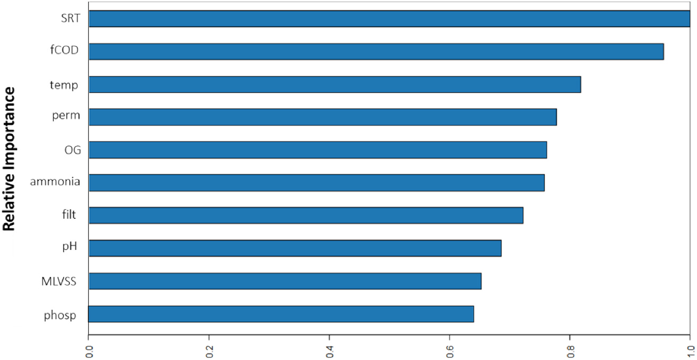
    - **Hình này chứng minh điều gì**
      - SRT và fCOD có tầm quan trọng tương đối cao nhất đối với mô hình loại bỏ amoni, trong khi phosp thấp nhất.
    - **Từ đâu mà thấy được**
      - Ox: tầm quan trọng tương đối, thang đo $0.0$–$1.0$. Oy: 10 biến đầu vào theo thứ tự giảm dần.
      - Chiều dài thanh ngang đạt cực đại tại SRT ($1.0$), kế tiếp là fCOD ($\sim 0.95$), và thấp nhất tại phosp ($\sim 0.64$).
  * Chỉ 10 biến đầu vào quan trọng nhất được biểu diễn trên biểu đồ nhằm mục đích đơn giản hóa, do tầm quan trọng tương đối của các biến còn lại ở mức quá thấp.
* Phân tích tương quan giữa các biến vận hành và hiệu quả loại bỏ amoni theo mô hình PCA (Fig. 7):
  * Biểu đồ tải trọng (loading plot) từ mô hình PCA làm sáng tỏ các mối tương quan qua lại giữa các biến số (Fig. 7):
  - **Hình 7.** Tương quan PCA giữa các biến và loại bỏ amoni
    - 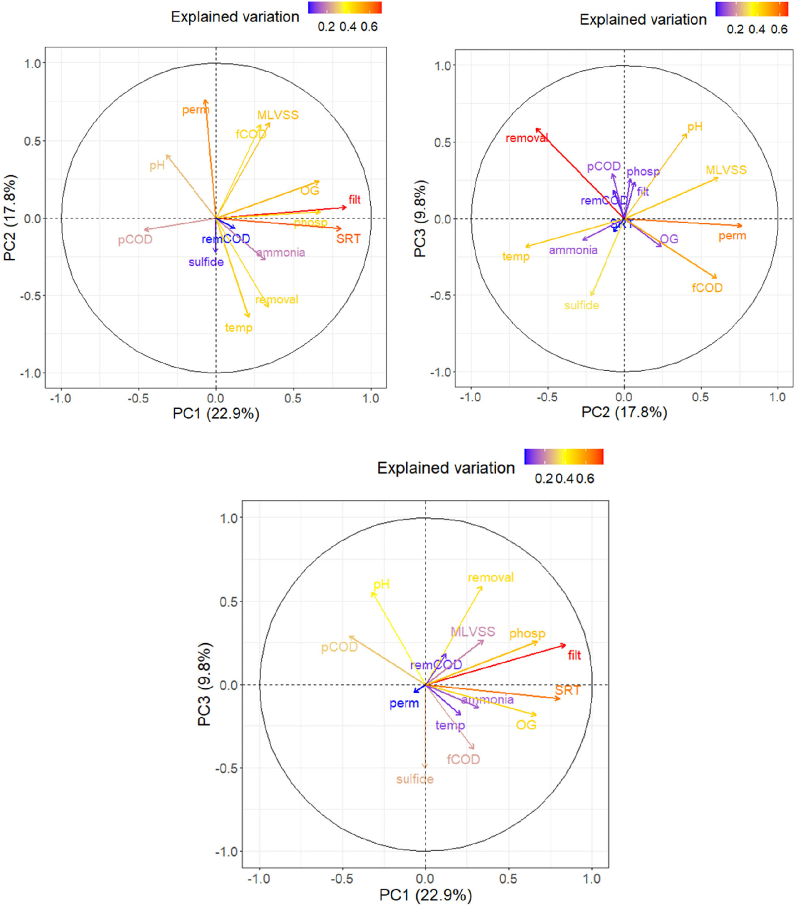
    - **Hình này chứng minh điều gì**
      - Các thành phần PC1–PC3 lượng hóa tương quan giữa biến vận hành và loại bỏ amoni qua góc kẹp véc-tơ ($0^\circ$ thuận, $90^\circ$ độc lập, $180^\circ$ nghịch).
    - **Từ đâu mà thấy được**
      - Trục tọa độ: 3 vòng tròn tương quan biểu diễn các cặp PC1 ($22.9\ \%$), PC2 ($17.8\ \%$) và PC3 ($9.8\ \%$) trong dải $[-1.0, 1.0]$.
      - Véc-tơ removal (giải thích biến thiên $\ge 0.4$) nằm cùng góc phần tư với temp và ammonia, ngược hướng với perm và fCOD.
  * Mối quan hệ tương quan được chỉ thị bởi góc giữa các mũi tên véc-tơ: góc $0^\circ$ tương ứng tương quan thuận hoàn toàn, góc $90^\circ$ tương ứng không tương quan (độc lập), và góc $180^\circ$ tương ứng tương quan nghịch hoàn toàn.
* Nhận diện các biến có ảnh hưởng chi phối lớn nhất đến loại bỏ amoni:
  * Theo đồng thuận của cả hai mô hình ANN và PCA:
    * Các biến có tác động tích cực lớn nhất đến loại bỏ amoni là thời gian lưu bùn (SRT - sludge retention time), nhiệt độ vận hành (operating temperature), và nồng độ amoni đầu vào (influent ammonia concentration).
    * Các biến có tác động tiêu cực đáng kể nhất gồm nồng độ COD đầu vào (influent COD), nồng độ dầu mỡ đầu vào (OG - oil and grease), và độ thấm của màng (membrane permeability).
  * Đối chiếu với mô hình ANN của Zhang, Chen và Jiang [14–16]:
    * Các tác giả ứng dụng mô hình ANN dự đoán hiệu suất loại bỏ amoni trong các trạm xử lý nước thải (WWTP - wastewater treatment plants) áp dụng các quy trình sinh học khác nhau dựa trên 5 biến: lưu lượng dòng vào (inlet flow rate), pH, nồng độ amoni đầu vào, COD và nồng độ tổng phospho.
    * Kết quả của Zhang et al. cũng ghi nhận COD đầu vào là yếu tố ảnh hưởng chủ đạo (phù hợp với nghiên cứu này); tuy nhiên, nồng độ amoni đầu vào trong nghiên cứu của họ lại không ảnh hưởng đáng kể đến hiệu quả loại bỏ, trái ngược với kết quả ghi nhận tại hệ thống MBR này.
* Cơ chế giải thích ảnh hưởng mạnh của nồng độ amoni đầu vào (influent ammonia concentration):
  * Nồng độ amoni cao trong dòng nạp thúc đẩy động học của phản ứng nitrat hóa (nitrification reaction kinetics) [59].
  * Làm tăng tốc độ sinh trưởng của vi khuẩn nitrat hóa theo mô hình động học Monod (Monod's relation).
  * Nồng độ amoni cao hơn trong nước thải cấp vào bể MBR trực tiếp làm tăng tải lượng amoni bị oxy hóa (oxidized ammonia load) [60].
* Cơ chế giải thích ảnh hưởng của nhiệt độ vận hành (operating temperature) và biến động pH:
  * Tốc độ sinh trưởng của vi khuẩn nitrat hóa gia tăng theo hàm mũ theo nhiệt độ [61], giải thích vai trò ảnh hưởng vượt trội của nhiệt độ đến hiệu quả loại bỏ amoni.
  * Nghiên cứu của Leite [62] về các yếu tố chi phối loại bỏ amoni trong nước thải lọc dầu bằng phân tích thống kê đa biến (đánh giá DO, pH, nhiệt độ, amoni đầu vào, phenol, sunfua, OG và COD) cũng ghi nhận mối quan hệ tương quan thuận rất mạnh giữa nhiệt độ vận hành và hiệu quả xử lý amoni.
  * Phản ứng nitrat hóa sinh ra ion $\text{H}^+$ như một sản phẩm cuối cùng, trực tiếp làm giảm giá trị pH môi trường, lý giải mối tương quan nghịch giữa loại bỏ amoni và pH (quan sát này cũng phù hợp với công bố của Leite [62]).
  * Sự suy giảm pH là một hàm số phụ thuộc vào độ kiềm (alkalinity) [59]; tuy nhiên cơ sở dữ liệu thực nghiệm không có đủ dữ liệu độ kiềm để tiếp tục đánh giá sâu hơn mối liên hệ này.
* Cơ chế giải thích tương quan thuận mạnh mẽ của thời gian lưu bùn (SRT):
  * Ưu điểm cốt lõi của công nghệ MBR so với công nghệ bùn hoạt tính truyền thống CAS (conventional activated sludge) là tính độc lập giữa SRT và thời gian lưu thủy lực HRT (hydraulic retention time), cho phép vận hành MBR ở mức SRT cao hơn nhiều so với CAS thông thường.
  * Giá trị SRT cao hơn thúc đẩy quá trình thích nghi của bùn (sludge acclimatization), nhờ đó nâng cao năng lực loại bỏ các hợp chất ô nhiễm [8].
  * Khả năng giữ lại hoàn toàn sinh khối của màng lọc đảm bảo độ đa dạng vi sinh vật phong phú trong bể sinh học, đóng góp vào hiệu quả phân hủy nhiều loại chất ô nhiễm [63].
  * Tốc độ sinh trưởng của vi khuẩn nitrat hóa chậm hơn đáng kể so với vi khuẩn dị dưỡng (heterotrophic bacteria), do đó cần duy trì SRT đủ dài để vi khuẩn nitrat hóa kịp phát triển và tích lũy trước khi bị rửa trôi (washout) khỏi hệ thống [59].
  * Các yếu tố trên lý giải mối tương quan thuận mạnh mẽ giữa SRT và loại bỏ amoni, nhất quán với các nghiên cứu trước đây [64].
* Cơ chế giải thích tác động tiêu cực mạnh mẽ của COD đầu vào (influent COD) và tỷ lệ C/N:
  * Tác động tiêu cực của COD đầu vào bắt nguồn từ ảnh hưởng trực tiếp của thông số này lên cộng đồng vi sinh vật.
  * Nồng độ COD đầu vào cao tạo ra tỷ lệ C/N cao trong hệ thống xử lý sinh học, kích thích sự bùng phát của vi khuẩn dị dưỡng, dẫn đến cạnh tranh gay gắt về cơ chất và oxy hòa tan (DO - dissolved oxygen), gây ức chế sự sinh trưởng của vi khuẩn nitrat hóa [60].
  * Thí nghiệm của Sepehri và Sarrafzadeh [65] trên hệ thống MBR làm giàu bùn nitrat hóa (NAS - nitrifying-enriched activated sludge) đã chứng minh hiệu suất nitrat hóa vượt trội của NAS so với bùn CAS: tỷ lệ loại bỏ amoni đạt $100\%$ ở NAS so với chỉ $43\%$ ở CAS; nồng độ nitrat sinh ra đạt $37{,}5\text{ mg L}^{-1}$ ở NAS so với $6{,}6\text{ mg L}^{-1}$ ở CAS.
  * Brasil et al. [66] cũng chứng minh tỷ lệ C/N thấp hơn (kết hợp nhiệt độ cao hơn) tạo môi trường thuận lợi cho vi khuẩn nitrat hóa và cải thiện rõ rệt hiệu quả loại bỏ amoni.
  * Hệ thống MBR trong nghiên cứu này vận hành ở tỷ lệ C/N đầu vào rất cao ($20{,}0 \pm 11{,}1$), do đó quá trình loại bỏ amoni bị ảnh hưởng tiêu cực mạnh mẽ bởi biến thiên nồng độ COD đầu vào.
* Cơ chế giải thích tác động ức chế độc tính của nồng độ dầu mỡ đầu vào (influent OG):
  * Nồng độ OG đầu vào cao gây ức chế chuyển hóa trao đổi chất đối với vi khuẩn nitrat hóa; ngay cả ở nồng độ thấp, các hợp chất độc hại cũng có thể cản trở hoạt tính vi khuẩn và làm tổn hại đến việc loại bỏ amoni [67].
  * Qin et al. (2007) khi thử nghiệm MBR xử lý nước thải nhà máy lọc dầu liên tục trong hơn hai tháng nhận thấy: trong hai tuần vận hành đầu tiên, hiệu suất loại bỏ amoni chỉ đạt $20\text{--}40\%$ do hàm lượng OG đầu vào quá cao ($53\text{--}153\text{ mg L}^{-1}$); hiệu quả nitrat hóa chỉ đạt mức cao khi nồng độ OG đầu vào giảm xuống dưới $20\text{ mg L}^{-1}$.
  * Trong hệ thống MBR nghiên cứu, nồng độ OG đầu vào ghi nhận mức cao lên tới $48\text{ mg L}^{-1}$ (cực đại $48{,}4\text{ ppm}$), tác động ức chế độc học này giải thích cho các đợt suy giảm hiệu quả loại bỏ amoni.
* Cơ chế giải thích tác động tiêu cực của độ thấm màng (membrane permeability) thông qua rút ngắn HRT:
  * Độ thấm màng cao làm gia tăng thông lượng và rút ngắn thời gian lưu thủy lực HRT, dẫn đến thời gian tiếp xúc của nước thải trong bể không đủ để vi khuẩn nitrat hóa kịp oxy hóa lượng amoni hiện diện.
  * Song et al. [68] đã chứng minh khi HRT giảm xuống dưới ngưỡng giới hạn ($6{,}5$ ngày), sự nitrat hóa không hoàn toàn gây sụt giảm hiệu suất loại bỏ nitơ tổng thể.
  * HRT cũng là nhân tố quyết định duy trì cấu trúc cộng đồng vi sinh vật; Ni et al. [69] nghiên cứu MBR ở các kích thước lỗ màng ($0{,}40$ và $0{,}05\ \mu\text{m}$) ở $25^\circ\text{C}$ xác nhận sự biến đổi cấu trúc cộng đồng vi sinh vật diễn ra đồng điệu và nhất quán với các biến đổi của HRT.
* Vai trò của MLVSS và giá trị biểu thị của độ lọc bùn (sludge filterability):
  * MLVSS có mức độ ảnh hưởng ít quan trọng hơn nhiều trong cả hai mô hình, phản ánh rằng để tăng hiệu quả loại bỏ amoni, việc chỉ nâng cao nồng độ bùn sinh khối thuần túy là không đủ.
  * Điều kiện cốt lõi là phải duy trì mật độ đủ lớn của các vi sinh vật oxy hóa amoni chuyên biệt trong hệ thống; kết quả này củng cố các nhận định khoa học rằng MLVSS không phải là chỉ thị thích hợp cho hoạt tính sinh lý của sinh khối [70, 71].
  * Sepehri và Sarrafzadeh [65] chỉ ra rằng bùn giàu vi khuẩn nitrat hóa (NAS) có khả năng lọc tốt gấp đôi so với CAS, cho thấy độ lọc bùn cao hơn (sludge filterability) liên quan trực tiếp đến nồng độ vi khuẩn nitrat hóa cao hơn và đi kèm hiệu quả loại bỏ amoni vượt trội.
  * Hiệu ứng này được cả hai mô hình PCA và ANN phản ánh thông qua ảnh hưởng tích cực của độ lọc bùn đối với quá trình loại bỏ amoni.

#### 3.1.2. Ammonia removal prediction

- Ứng dụng mô hình mạng nơ-ron nhân tạo (Artificial Neural Network - ANN) để dự đoán hiệu suất loại bỏ amoni (ammonia removal) của hệ thống MBR từ tập các điều kiện đầu vào (input conditions).
- Mối tương quan giữa các giá trị thực tế đo đạc (real / measured values) và giá trị do mô hình dự đoán (predicted values) được thể hiện ở Fig. 8:
  - **Hình 8.** Dự đoán hiệu suất loại bỏ amoni bằng mô hình ANN
    - 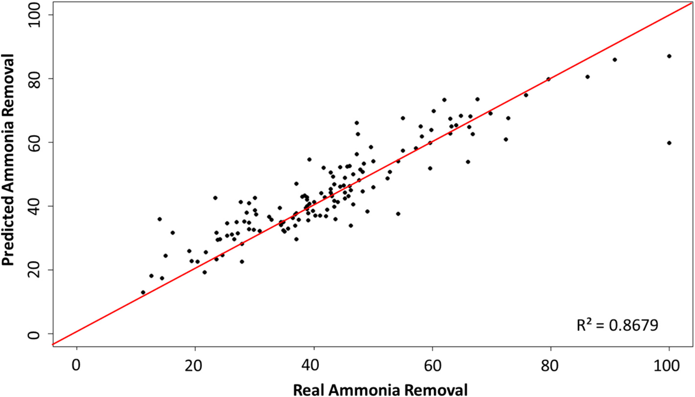
    - **Hình này chứng minh điều gì**
      - Sai số dự đoán thấp và duy trì tương quan tuyến tính trên toàn dải loại bỏ amoni, dữ liệu tập trung nhiều nhất ở khoảng $30$–$60$.
    - **Từ đâu mà thấy được**
      - Ox: Real Ammonia Removal, thang đo $0$–$100$. Oy: Predicted Ammonia Removal, thang đo $0$–$100$.
      - Các điểm dữ liệu bám sát đường chéo đỏ $1:1$; góc phải dưới ghi nhận hệ số xác định $R^2 = 0.8679$.
  - Mô hình ANN đạt hiệu suất cao với các giá trị sai số tuyệt đối trung bình (Mean Absolute Error - $\text{MAE}$) và sai số toàn phương trung bình (Mean Squared Error - $\text{MSE}$) đều ở mức thấp.
  - Các kết quả dự báo đạt độ tin cậy và quyết đoán thỏa đáng (adequately assertive) với hệ số xác định $R^2 = 0.868$.
  - Mức sai số giữa giá trị dự đoán của mô hình và giá trị đo đạc thực tế là thấp, chứng minh mô hình ANN có hiệu quả cao trong việc nắm bắt và dự đoán hành vi loại bỏ amoni của MBR.
- Khả năng ứng dụng cho quan trắc trực tuyến (online monitoring):
  - Dù được xây dựng từ tập dữ liệu quan trắc ngoại tuyến (offline monitoring data), kết quả này chứng minh tiềm năng rõ rệt của mô hình ANN trong giám sát trực tuyến các hệ thống xử lý nước thải MBR.
  - Nhờ năng lực dự đoán cao, mô hình có thể dự báo các mẫu dữ liệu mới để đánh giá xem hệ thống có đang vận hành đúng kỳ vọng hay đang gặp phải sự cố vận hành (operating problem).
- Hỗ trợ ra quyết định và nâng cao hiệu quả vận hành theo thời gian thực (real-time operation):
  - Việc cung cấp dữ liệu kịp thời theo thời gian thực giúp hỗ trợ quá trình ra quyết định quyết đoán và chính xác hơn (more assertive decision-making).
  - Cải thiện công tác giám sát và kiểm soát quy trình xử lý, đóng góp vào việc vận hành hệ thống hiệu quả và tối ưu hơn.

### 3.2. Controlling ammonia removal on MBR systems

#### 3.2.1. Detecting low ammonia removal conditions

- Áp dụng mô hình MSPC-PCA (Multivariate Statistical Process Control - Phân tích thành phần chính để kiểm soát quá trình thống kê đa biến) trên cơ sở dữ liệu nhằm theo dõi hiệu suất MBR về khả năng loại bỏ amoni theo thời gian và phát hiện các sự kiện bất thường dẫn đến hiệu suất loại bỏ thấp:
  - Phương pháp chiếu PCA (Principal Component Analysis) giữ lại 3 thành phần chính (PC - Principal Components) dựa trên cả tiêu chuẩn Kaiser (Kaiser criterion) và kiểm định đồ thị lắng đọng (scree test).
  - Ba PC giữ lại giải thích hơn $50\ \%$ tổng biến thiên dữ liệu (data variation).
- Biểu đồ kiểm soát đa biến Hotelling $T^2$ và $Q$, cùng với giá trị phần trăm loại bỏ amoni của từng mẫu trong Giai đoạn II (Phase II), được thiết lập để theo dõi quá trình:
  - **Hình 9.** Phát hiện suy giảm hiệu suất loại bỏ amoni trong MBR
    - 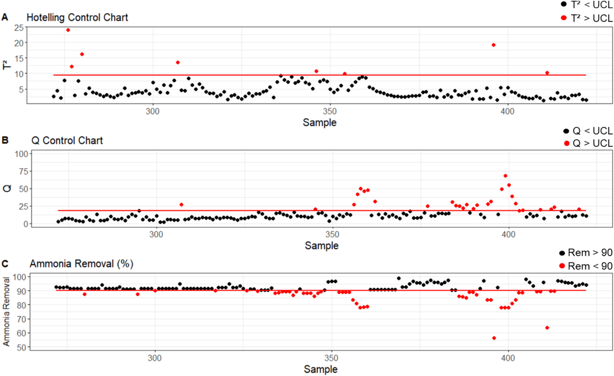
    - **Hình này chứng minh điều gì**
      - Các chu kỳ suy giảm amoni (mẫu 358–362 và 385–405, rơi xuống thấp nhất $\sim 56\ \%$) trùng khớp đồng bộ với cụm vi phạm $\text{UCL}$ trên biểu đồ $Q$.
    - **Từ đâu mà thấy được**
      - Panel (a): Biểu đồ $T^2$ có đường $\text{UCL} \approx 9.5$; đa số điểm tại các mẫu 358–362 và 385–405 đều nằm dưới ngưỡng.
      - Panel (b): Biểu đồ $Q$ có đường $\text{UCL} \approx 18$; cụm chấm đỏ ($Q > \text{UCL}$, đỉnh $\sim 68$) bùng phát tại mẫu 358–362 và 385–405.
      - Panel (c): Biểu đồ hiệu suất có đường ngưỡng $90\ \%$; các chấm đỏ ($\text{Rem} < 90$) giảm sâu xuống $\sim 78\ \%$ và chạm đáy $\sim 56\ \%$ (mẫu $\sim 395$).
- Biểu đồ kiểm soát Hotelling $T^2$ thể hiện hiệu quả kém trong việc phát hiện điều kiện vận hành có hiệu suất loại bỏ amoni thấp:
  - Tỷ lệ phát hiện (detection rate) các mẫu có hiệu suất loại bỏ amoni dưới $90\ \%$ của biểu đồ $T^2$ chỉ đạt $11\ \%$.
  - Thống kê $T^2$ kiểm tra xem một quan trắc mới khi chiếu lên siêu phẳng của các PC (PC hyperplane) có nằm trong các giới hạn xác định bởi dữ liệu tham chiếu hay không.
  - Giá trị $T^2$ vượt quá giới hạn kiểm soát cho thấy quan trắc có giá trị bất thường ở một số biến ban đầu nhưng vẫn duy trì cấu trúc tương quan giữa các biến trong mô hình (được định danh là điểm ngoại lai bên trong mô hình PCA - outlier inside the PCA model) [53,72].
  - Tỷ lệ phát hiện thấp của $T^2$ có thể bắt nguồn từ sự phá vỡ cấu trúc tương quan của mô hình ở các mẫu nằm ngoài tầm kiểm soát (out-of-control samples).
- Biểu đồ kiểm soát $Q$ (SPE - Squared Prediction Error) chứng minh khả năng phát hiện vượt trội đối với các điều kiện suy giảm hiệu suất loại bỏ amoni:
  - Thống kê $Q$ kiểm tra sự xuất hiện của các sự kiện mới làm quá trình dịch chuyển ra khỏi siêu phẳng được xác định bởi mô hình tham chiếu.
  - Biểu đồ $Q$ phát hiện được $54\ \%$ các trường hợp vận hành có tỷ lệ loại bỏ amoni dưới $90\ \%$ (nhận diện các điểm ngoại lai bên ngoài mô hình - outliers outside the model).
  - Độ nhạy phát hiện đạt $100\ \%$ đối với tất cả các điểm vận hành có hiệu suất loại bỏ amoni giảm xuống dưới $85\ %$.
  - Ý nghĩa đối với kiểm soát vận hành: Khả năng phát hiện sớm giúp ngăn ngừa hiệu suất loại bỏ amoni rơi xuống các mức cực kỳ thấp và định hướng thời điểm can thiệp thích hợp nhất vào hệ thống.
  - Tiềm năng nâng cao độ nhạy: Kết quả chỉ ra rằng với các hiệu chỉnh tốt hơn trong mô hình hoặc tập dữ liệu đầu vào mang tính đại diện cao hơn, tỷ lệ phát hiện các điều kiện có hiệu suất loại bỏ dưới $90\ \%$ có thể tiếp tục được nâng cao.
- Cả hai thống kê kiểm soát đều duy trì tỷ lệ báo động giả (false alarms) ở mức rất thấp:
  - Tỷ lệ báo động giả chỉ là $3\ \%$ ở biểu đồ $T^2$ và $1\ \%$ ở biểu đồ $Q$.
  - Các sai số này là tất yếu do xác suất thống kê định trước của phương pháp ($5\ \%$).
- Ứng dụng MSPC thông qua biểu đồ kiểm soát $Q$ là công cụ hữu ích cho việc giám sát và kiểm soát loại bỏ amoni trên hệ thống MBR:
  - Cho phép can thiệp phòng ngừa và quyết đoán hơn vào hệ thống khi phát hiện xu hướng suy giảm hiệu suất.
  - Tránh phát sinh các chi phí vận hành không cần thiết.
  - Nâng cao chất lượng nước sau xử lý và cải thiện hiệu quả tổng thể của MBR.

#### 3.2.2. Diagnosing low ammonia removal conditions

- Đồ thị đóng góp (contribution plot) dựa trên thống kê $Q$ được thiết lập nhằm điều tra các nguyên nhân dẫn đến hiệu suất loại bỏ amoni thấp trong quá trình giám sát vận hành MBR:
  - Do thống kê $Q$ vượt trội trong việc phát hiện vận hành loại bỏ amoni thấp, nó được lựa chọn để phân tích đóng góp biến.
  - Tương tự như phân tích độ nhạy, chỉ có 10 biến quan trọng nhất được hiển thị để đơn giản hóa đồ thị chẩn đoán:
  - **Hình 10.** Đồ thị đóng góp thống kê Q khi mất kiểm soát
    - 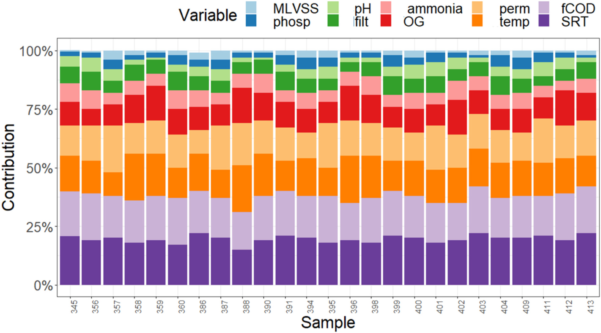
    - **Hình này chứng minh điều gì**
      - Ba thông số SRT, fCOD và temp luôn chiếm tỷ trọng đóng góp chủ đạo vào thống kê Q trên toàn bộ 25 mẫu quan trắc mất kiểm soát.
    - **Từ đâu mà thấy được**
      - Ox: mẫu quan trắc (Sample) $345$–$413$. Oy: tỷ lệ đóng góp (Contribution), thang đo $0\%$–$100\%$.
      - Ba dải màu dưới cùng gồm SRT (tím đậm, $\sim 15\text{--}22\%$), fCOD (tím nhạt, $\sim 15\text{--}20\%$) và temp (cam đậm, $\sim 13\text{--}18\%$), cộng dồn luôn vượt $50\%$ chiều cao mỗi cột.
- Ba biến số đóng góp lớn nhất vào các giá trị vượt ngưỡng của thống kê $Q$ là nồng độ COD dòng vào (fCOD - influent COD), thời gian lưu bùn (SRT - Sludge Retention Time) và nhiệt độ (temperature - temp):
  - Ba biến này có ảnh hưởng mạnh nhất đến sự suy giảm loại bỏ amoni, củng cố và đồng thuận với các kết quả thu được từ mô hình PCA và mạng nơ-ron nhân tạo (ANN - Artificial Neural Network).
  - Kết quả khẳng định vai trò quyết định của tỷ lệ C/N (C/N ratio) đối với quá trình kiểm soát loại bỏ amoni.
  - Nhấn mạnh tầm quan trọng của việc duy trì hệ thống vận hành ở nhiệt độ và SRT phù hợp: giá trị COD đầu vào cao kết hợp với SRT ngắn và nhiệt độ thấp là những nguyên nhân phổ biến nhất gây ra sự suy giảm tỷ lệ loại bỏ amoni trong MBR.
- Nghiên cứu sự phối hợp giữa các yếu tố vận hành để tìm điểm cân bằng là điều cần thiết trong thực tế kỹ thuật:
  - Trong thực tế vận hành, không phải lúc nào cũng có thể duy trì đồng thời tất cả các thông số trong phạm vi mong muốn.
  - Nghiên cứu của Stewart et al. [73] trên hai chuỗi xử lý loại bỏ chất dinh dưỡng sinh học (BNR - Biological Nutrient Removal) quy mô pilot cho thấy việc tăng SRT trong giai đoạn nhiệt độ nước lạnh giúp bù đắp và duy trì hiệu suất loại bỏ amoni.
- Áp dụng kiểm định thống kê phi tham số Wilcoxon-Mann-Whitney [74] ở mức ý nghĩa 1 % (hình ghi p < 0.01%) để kiểm tra xem giá trị trung vị của các biến gồm hiệu suất loại bỏ amoni, nhiệt độ, SRT và COD dòng vào có khác biệt đáng kể giữa trạng thái vận hành trong kiểm soát (in-control) và ngoài kiểm soát (out-of-control) hay không:
  - **Hình 11.** Kiểm định Wilcoxon-Mann-Whitney cho hai trạng thái vận hành
    - 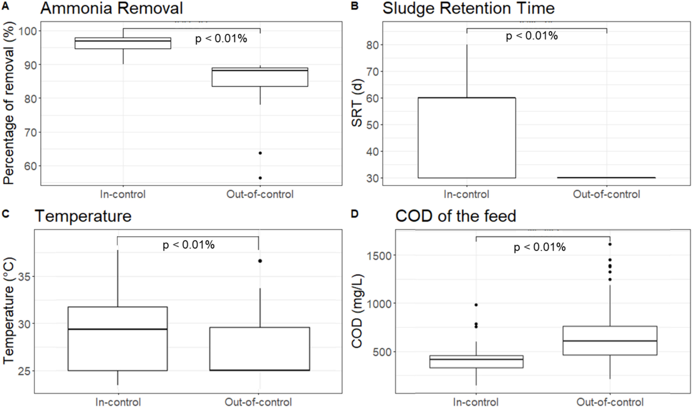
    - **Hình này chứng minh điều gì**
      - Hiệu suất khử amoni và nhiệt độ giảm rõ rệt khi mất kiểm soát, củng cố sự phân tách trên cả 4 biến.
    - **Từ đâu mà thấy được**
      - Panels A, C: Khử amoni giảm từ trung vị $\sim 97\ \%$ xuống $\sim 88\ \%$; nhiệt độ giảm từ $\sim 29.5\ ^\circ\text{C}$ xuống $\sim 25\ ^\circ\text{C}$.
      - Panels B, D: SRT bị ghìm ở mức đáy $30\text{ d}$; COD đầu vào tăng từ trung vị $\sim 420\text{ mg/L}$ lên $\sim 610\text{ mg/L}$ (ngoại lai $> 1200\text{ mg/L}$).
      - Lưu ý: hình ghi p < 0.01%, văn bản ghi 1 %.
- Kết quả kiểm định giả thuyết (các giá trị $p\text{-value}$ chi tiết được trình bày trong Phụ lục A) xác nhận tính phân tách có ý nghĩa thống kê giữa hai trạng thái vận hành:
  - Giá trị của hiệu suất loại bỏ amoni, nhiệt độ và SRT ở trạng thái mất kiểm soát (out-of-control) thấp hơn rõ rệt và có ý nghĩa thống kê so với trạng thái kiểm soát (in-control).
  - Giá trị nồng độ COD dòng vào ở trạng thái mất kiểm soát cao hơn rõ rệt và có ý nghĩa thống kê so với trạng thái kiểm soát.
  - Kết quả kiểm định khẳng định và củng cố vững chắc các kết luận chẩn đoán rút ra từ phân tích thành phần chính, mô hình mạng nơ-ron và đồ thị đóng góp của thống kê $Q$.

## 4. Conclusion

- Các kỹ thuật học máy và thống kê đa biến bao gồm ANN (Artificial Neural Networks - Mạng nơ-ron nhân tạo), PCA (Principal Components Analysis - Phân tích thành phần chính) và MSPC (Multivariate Statistical Process Control - Kiểm soát quá trình thống kê đa biến) chứng minh tính phù hợp cao trong việc giám sát hệ thống MBR (Membrane Bioreactor - Bể phản ứng sinh học màng) quy mô pilot xử lý nước thải thực tế từ nhà máy lọc dầu (real oil refinery wastewater).
  - Mô hình hóa bằng PCA và ANN thể hiện hiệu quả rõ rệt trong việc lập bản đồ hành vi của hệ thống MBR liên quan đến quá trình loại bỏ amoni ($\text{NH}_4^+$), đồng thời nhận diện chính xác các yếu tố vận hành quan trọng nhất tác động theo cả hai chiều hướng tích cực và tiêu cực lên hiệu suất xử lý.
- Các mô hình đã xác định cụ thể các biến số vận hành chi phối hiệu suất loại bỏ amoni:
  - Thời gian lưu bùn (SRT - Sludge Retention Time), nhiệt độ (temperature) và nồng độ amoni đầu vào (influent concentration of ammonia) là những biến số giúp cải thiện mạnh nhất hiệu suất loại bỏ amoni.
  - Nồng độ nhu cầu oxy hóa học đầu vào (influent COD - Chemical Oxygen Demand), nồng độ dầu mỡ đầu vào (OG - Oil and Grease) và độ thấm màng (membrane permeability) là những biến số làm suy giảm nhiều nhất hiệu suất loại bỏ amoni.
- Mô hình ANN được áp dụng thành công để dự đoán định lượng hiệu suất loại bỏ amoni với độ chính xác cao:
  - Hệ số xác định đạt $R^2 = 0.868$, thể hiện mức sai số thấp giữa giá trị dự đoán của mô hình và giá trị đo đạc thực tế.
  - ANN chứng minh tính hiệu quả vượt trội trong việc nắm bắt động học phi tuyến của MBR, cho phép dự báo trước (forecast) hiệu suất loại bỏ amoni từ một tập hợp các điều kiện vận hành xác định.
- Hiệu quả kiểm soát quá trình và giám sát lỗi vận hành của các biểu đồ kiểm soát MSPC:
  - Biểu đồ kiểm soát $T^2$ Hotelling (Hotelling $T^2$ control chart) không đạt hiệu quả trong việc phát hiện các sự cố vận hành liên quan đến tỷ lệ loại bỏ amoni thấp.
  - Biểu đồ kiểm soát $Q$ ($Q$ control chart / thống kê sai số phần dư) thể hiện năng lực vượt trội: phát hiện phần lớn các chu kỳ vận hành có hiệu suất loại bỏ amoni trên $90\%$ và phát hiện toàn bộ $100\%$ các giai đoạn vận hành có hiệu suất suy giảm xuống dưới $85\%$.
  - Biểu đồ kiểm soát $Q$ cho phép kiểm soát chặt chẽ hệ thống xử lý nước thải công nghiệp thông qua việc điều chỉnh kịp thời tỷ lệ $\text{C/N}$ ($\text{C/N}$ ratio), nhiệt độ hoặc SRT, qua đó ngăn chặn hiệu suất loại bỏ amoni rơi xuống các mức suy giảm nghiêm trọng.
- Sức mạnh tổng hợp (Synergy) giữa ANN và MSPC cùng tiềm năng điều khiển thời gian thực:
  - Kết quả nghiên cứu khẳng định tiềm năng to lớn của các kỹ thuật AI (Artificial Intelligence - Trí tuệ nhân tạo) và ML (Machine Learning - Học máy) trong giám sát và kiểm soát hệ thống MBR ở quy mô công nghiệp (industrial scale), đóng góp vào việc nâng cao hiệu quả tổng thể của quy trình.
  - Dù kết quả nghiên cứu được phát triển từ dữ liệu giám sát ngoại tuyến (offline monitoring data), mô hình chỉ ra tính khả thi cao trong việc ứng dụng đánh giá trạng thái hệ thống theo thời gian thực (real-time assessment) ở quy mô công nghiệp, hỗ trợ đưa ra các quyết định vận hành chính xác và tối ưu hóa quy trình xử lý.
- Khuyến nghị vận hành cho MBR nhà máy lọc dầu và ý nghĩa đối với tái sử dụng nước (Water reuse implications):
  - Khuyến nghị vận hành tập trung vào việc duy trì SRT đủ dài để bảo tồn vi khuẩn nitrat hóa, kiểm soát chặt chẽ hàm lượng COD và dầu mỡ đầu vào nhằm ổn định tỷ lệ $\text{C/N}$, đồng thời ứng dụng biểu đồ kiểm soát $Q$ để phát hiện sớm các bất thường trước khi xảy ra sự cố chất lượng nước.
  - Việc kiểm soát ổn định hiệu suất loại bỏ amoni ở mức cao ($\ge 90\%$) là điều kiện tiên quyết để nước sau lọc MBR đáp ứng các tiêu chuẩn khắt khe phục vụ tái sử dụng nước trong nhà máy lọc dầu (như nước bổ cấp cho hệ thống tháp giải nhiệt, hạn chế ăn mòn và cáu cặn sinh học), nâng cao tính tuần hoàn và phát triển bền vững cho nhà máy.
- Thông tin về dữ liệu và tài trợ của nghiên cứu:
  - Dữ liệu thô từ nhà máy lọc dầu được bảo mật theo quy định thỏa thuận và sẵn sàng chia sẻ khi có yêu cầu hợp lệ.
  - Nghiên cứu được hỗ trợ từ các cơ quan tài trợ CAPES, CNPq, FAPEMIG và Đại học Liên bang Minas Gerais (UFMG - Federal University of Minas Gerais).

## Appendix A

- Bảng A1 (Table A1) tổng hợp kết quả kiểm định thống kê phi tham số Wilcoxon-Mann-Whitney (Wilcoxon-Mann-Whitney nonparametric statistical test) nhằm so sánh các mẫu vận hành giữa trạng thái trong kiểm soát (in-control operations) và ngoài kiểm soát (out-of-control operations) của hệ thống MBR quy mô pilot [74].
  - Kiểm định được thiết lập ở mức ý nghĩa $1\,\%$ ($\alpha = 0.01$) để kiểm tra xem giá trị trung vị (medians) của các biến số gồm hiệu suất loại bỏ amoniac (Removal), nhiệt độ (Temp), thời gian lưu bùn (SRT) và nồng độ COD dòng vào (fCOD) có sự khác biệt có ý nghĩa thống kê giữa hai trạng thái vận hành hay không.
  - Quy mô mẫu kiểm định:
    - Nhóm 1 (Group 1 - In-control): trạng thái vận hành bình thường, nằm trong giới hạn kiểm soát thống kê, gồm $n_1 = 272$ mẫu dữ liệu.
    - Nhóm 2 (Group 2 - Out-of-control): trạng thái vận hành bất thường hoặc suy giảm hiệu suất, ngoài giới hạn kiểm soát thống kê, gồm $n_2 = 46$ mẫu dữ liệu.
- Chi tiết các biến số giám sát và kết quả kiểm định thống kê trong Bảng A1 (Table A1):
  - Biến hiệu suất loại bỏ amoniac (Removal):
    - Giá trị thống kê kiểm định (Statistic): $12{,}512$.
    - Mức ý nghĩa thống kê ($p$-Value): $2.07\text{e-}27$ ($2.07 \times 10^{-27}$).
    - Nhận xét và phát hiện: Giá trị $p \ll 0.01$ khẳng định mức độ chênh lệch có ý nghĩa thống kê cực kỳ cao; giá trị hiệu suất loại bỏ amoniac ở trạng thái ngoài kiểm soát thấp hơn đáng kể so với trạng thái trong kiểm soát.
  - Biến nhiệt độ vận hành (Temp):
    - Giá trị thống kê kiểm định (Statistic): $5976$.
    - Mức ý nghĩa thống kê ($p$-Value): $1.22\text{e-}4$ ($1.22 \times 10^{-4}$).
    - Nhận xét và phát hiện: Giá trị $p < 0.01$ xác nhận nhiệt độ vận hành của hệ thống ở trạng thái ngoài kiểm soát thấp hơn đáng kể so với trạng thái trong kiểm soát.
  - Biến thời gian lưu bùn (SRT - Sludge Retention Time):
    - Giá trị thống kê kiểm định (Statistic): $9913$.
    - Mức ý nghĩa thống kê ($p$-Value): $2.68\text{e-}13$ ($2.68 \times 10^{-13}$).
    - Nhận xét và phát hiện: Giá trị $p \ll 0.01$ chứng minh thời gian lưu bùn ở trạng thái ngoài kiểm soát bị rút ngắn đáng kể so với trạng thái trong kiểm soát.
  - Biến nồng độ COD dòng nạp vào bể (fCOD - Influent Chemical Oxygen Demand):
    - Giá trị thống kê kiểm định (Statistic): $9722$.
    - Mức ý nghĩa thống kê ($p$-Value): $1.86\text{e-}9$ ($1.86 \times 10^{-9}$).
    - Nhận xét và phát hiện: Giá trị $p \ll 0.01$ xác nhận nồng độ COD trong dòng nước thải nạp vào ở trạng thái ngoài kiểm soát cao hơn đáng kể so với trạng thái trong kiểm soát.
- Bảng tổng hợp dữ liệu kiểm định Wilcoxon-Mann-Whitney (Table A1):

| Group 1 (Nhóm 1) | Group 2 (Nhóm 2) | $n_1$ | $n_2$ | Variable (Biến số) | Statistic (Giá trị thống kê) | $p$-Value |
| :--- | :--- | :--- | :--- | :--- | :--- | :--- |
| In-control | Out-of-control | $272$ | $46$ | Removal | $12{,}512$ | $2.07\text{e-}27$ |
| In-control | Out-of-control | $272$ | $46$ | Temp | $5976$ | $1.22\text{e-}4$ |
| In-control | Out-of-control | $272$ | $46$ | SRT | $9913$ | $2.68\text{e-}13$ |
| In-control | Out-of-control | $272$ | $46$ | fCOD | $9722$ | $1.86\text{e-}9$ |

- Ý nghĩa kiểm định đối với chẩn đoán và kiểm soát quá trình MBR:
  - Tất cả $4$ biến số phân tích đều đạt mức ý nghĩa $p < 0.01$, củng cố định lượng cho các kết quả biểu diễn trên đồ thị hộp (boxplots ở Hình 11) và kết quả phân tích đóng góp từ mô hình MSPC-PCA.
  - Kết quả kiểm định xác nhận vững chắc rằng điều kiện vận hành ngoài kiểm soát (suy giảm hiệu suất khử amoniac) của hệ thống MBR xử lý nước thải nhà máy lọc dầu liên hệ chặt chẽ với sự sụt giảm nhiệt độ, sự suy giảm thời gian lưu bùn (SRT ngắn gây nguy cơ rửa trôi vi khuẩn nitrat hóa), và sự gia tăng đột biến của tải lượng COD dòng vào (fCOD cao làm tăng tỷ lệ $\text{C/N}$, kích thích vi khuẩn dị dưỡng cạnh tranh gay gắt với vi khuẩn nitrat hóa).
