# Computational artificial intelligence modeling and optimization of nutrient removal in microalgae membrane bioreactors using ANN and RSM

## Abstract

* **Bối cảnh và động lực nghiên cứu**: Các phương pháp xử lý nước thải dựa trên sinh học (biological based methods) được ưu tiên lựa chọn do có tính kinh tế cao hơn và thân thiện với môi trường hơn.
* **Mục tiêu nghiên cứu**: Dự đoán mức độ nitơ amoniac (ammonia nitrogen), nồng độ phosphat (phosphate concentration) và hiệu suất loại bỏ (removal efficiency) trong bể phản ứng sinh học màng vi tảo (microalgae membrane bioreactor - MBR).
* **Phương pháp luận mô hình hóa và tối ưu hóa**:
    * Sử dụng mô hình mạng nơ-ron nhân tạo (artificial neural network - ANN) và phương pháp bề mặt đáp ứng (response surface methodology - RSM) để dự báo các giá trị trong nghiên cứu.
    * Ứng dụng kết hợp RSM và NSGA-II trong quy trình tối ưu hóa chứng minh khả năng xác định chính xác các điều kiện lý tưởng để loại bỏ chất dinh dưỡng khỏi bioreactor.
* **Hiệu năng và thông số dự báo của mô hình RSM**:
    * Mô hình RSM ước tính chính xác hiệu quả loại bỏ phosphat, nitơ và amoniac.
    * Giá trị $R^2$ đạt $0.9733$ và $0.9608$, minh chứng cho mối tương quan có ý nghĩa (significant correlation) giữa các dự đoán của mô hình và hiệu suất loại bỏ thực tế.
    * Mô hình sử dụng biến thời gian (time) cùng với hàm lượng TOC (total organic carbon) để dự đoán hiệu quả loại bỏ các chất ô nhiễm này.
* **Hiệu năng và thông số dự báo của mô hình ANN**:
    * Đối với nitơ amoniac (ammonia nitrogen): Hệ số xác định $R^2 = 0.99791$, sai số toàn phương trung bình (mean squared error - MSE) là $3.57\text{E-}02$.
    * Đối với nồng độ phosphat (phosphate concentration): Hệ số xác định $R^2 = 0.99722$, sai số toàn phương trung bình MSE là $2.75\text{E-}02$.
    * Giới hạn mô hình: Sự sai lệch giữa dữ liệu thực tế và dự đoán của ANN chỉ ra những giới hạn tiềm ẩn trong mô hình hoặc thiết kế thực nghiệm (experimental design).
* **Từ khóa (Keywords)**: Membrane bioreactor, Phosphate, Wastewater and treatment, ANN.

## Introduction

* **Thu hồi tài nguyên và bối cảnh kinh tế tuần hoàn trong xử lý nước thải**:
  * Việc thu hồi nước sạch, năng lượng và các chất dinh dưỡng từ nước thải đóng vai trò là một hợp phần cốt lõi của nền kinh tế tuần hoàn (*circular economy*).
  * Các vi sinh vật thủy phân (*hydrolytic microorganisms*) hiện diện tự nhiên trong các sinh cảnh đặc thù, tiêu biểu như khoang dạ cỏ của động vật nhai lại (*ruminant animals*).
  * Thành phần chất ô nhiễm chủ yếu trong nước thải bao gồm nitơ vô cơ (*inorganic nitrogen*), photpho (*phosphorus*), các hợp chất ô nhiễm hữu cơ (*organic pollutants*) và các độc tố khác.
    * Hiện tượng phú dưỡng (*eutrophication*) là hệ quả trực tiếp xảy ra khi nước thải chưa qua xử lý bị xả thẳng vào các thủy vực tiếp nhận tự nhiên.
    * Amonia ($\text{NH}_3/\text{NH}_4^+$) và nitrit ($\text{NO}_2^-$) có độc tính rất cao đối với đời sống và hệ sinh thái thủy sinh.
  * Các phương pháp sinh học (*biological methods*) được ưu tiên lựa chọn hàng đầu trong xử lý nước thải nhờ tính thân thiện với môi trường và hiệu quả kinh tế vượt trội so với các phương pháp xử lý hóa lý khác.
  * Hệ thống vi tảo - vi khuẩn (*microalgae-bacterial systems*) gần đây thu hút sự quan tâm nghiên cứu sâu rộng nhằm xử lý nước thải sinh hoạt và nước thải công nghiệp.
    * Hệ vi sinh kết hợp này thường xuyên được áp dụng như một hệ thống sinh học thay thế (*alternative biosystem*) đầy tiềm năng tại các khu vực khí hậu nhiệt đới và cận nhiệt đới.
    * Vi tảo đã được khai thác và ứng dụng liên tục trong hơn 70 năm qua để xử lý nước thải sinh hoạt nhằm thu hồi hiệu quả nguồn nitơ và photpho.

* **Cơ chế cộng sinh và ưu thế công nghệ của hệ thống MBR vi tảo - vi khuẩn so với bùn hoạt tính truyền thống**:
  * Hạn chế của hệ thống bùn hoạt tính truyền thống (*conventional activated sludge*):
    * Quá trình tách dòng nước sau xử lý dựa hoàn toàn vào sự lắng trọng lực của bùn rắn, phụ thuộc vào khả năng tự lắng của sinh khối (*biomass's capacity to settle*).
    * Đòi hỏi hệ thống sục khí cơ học (*mechanical aeration*) vận hành liên tục với chi phí năng lượng rất tốn kém, đặt ra yêu cầu cấp thiết phải triển khai các giải pháp xử lý có chi phí vận hành hiệu quả hơn.
  * Cơ chế ưu việt của bể phản ứng sinh học màng (*MBRs - membrane bioreactors*):
    * Ứng dụng các màng lọc để lưu giữ hoàn toàn các chất rắn lơ lửng (*suspended solids*).
    * Tách rời hoàn toàn thời gian lưu bùn/hạt rắn (*SRT - particle/solids retention time*) độc lập với thời gian lưu thủy lực (*HRT - hydraulic retention time*), đảm bảo tất cả chất rắn đều có cùng thời gian lưu trong bể.
  * Hiệu quả loại bỏ sục khí cơ học nhờ cộng sinh tương hỗ giữa vi tảo và vi khuẩn dị dưỡng (*heterotrophic bacteria*):
    * Dưới điều kiện chiếu sáng, vi tảo quang hợp tạo ra lượng oxy hòa tan ($\text{O}_2$) cần thiết cho vi khuẩn dị dưỡng khoáng hóa các phân tử hữu cơ.
    * Đồng thời, vi tảo hấp thụ trực tiếp các chất dinh dưỡng vô cơ gồm amoni ($\text{NH}_4^+$), nitrat ($\text{NO}_3^-$) và photphat ($\text{PO}_4^{3-}$) hiện diện trong nước thải.
    * Đổi lại, vi tảo khép kín chu trình quang hợp bằng cách tiêu thụ khí carbon dioxide ($\text{CO}_2$) phát sinh từ quá trình hô hấp của vi khuẩn, qua đó giảm thiểu đáng kể lượng phát thải khí nhà kính (*greenhouse gases*).

* **Tổng quan các nghiên cứu ứng dụng trí tuệ nhân tạo (ANN, RSM, ML) và tối ưu hóa trong hệ thống xử lý nước thải**:
  * Các kỹ thuật mạng nơ-ron nhân tạo (*ANN - Artificial Neural Networks*), phương pháp bề mặt đáp ứng (*RSM - Response Surface Methodology*), học máy (*machine learning*) và tối ưu hóa đa mục tiêu (*multi-objective optimization*) đã được triển khai rộng rãi trong nhiều nghiên cứu tính toán và thực nghiệm phục vụ mô hình hóa, dự báo và tối ưu hóa quy trình:
    * Mô hình hóa bể phản ứng sinh học màng thẩm thấu (*osmotic membrane bioreactor* - Viet và cộng sự): Ứng dụng ANN cho thấy độ tin cậy cao với hệ số xác định $R^2 = 0.93$ cho mô phỏng tắc nghẽn màng (*membrane fouling*), $R^2 = 0.92$ cho dự báo lưu lượng dòng nước (*water flux*), và $R^2 = 0.98$ cho mô hình loại bỏ tổng carbon hữu cơ (*TOC - Total Organic Carbon*).
    * Cải thiện hiệu suất bể quang sinh học vi tảo (*microalgal photobioreactors* - Mojiri và cộng sự): Ứng dụng ANN nâng cao hiệu quả khử nhiễm với sai số toàn phương trung bình (*MSE*) thấp và $R^2 > 0.99$; các phân tích độc tính xác nhận thời gian tiếp xúc kéo dài ($> 48\text{ h}$) và nồng độ chất ô nhiễm cao ($> 10\text{ mg/L}$) làm suy giảm hàm lượng diệp lục (*chlorophyll*) và protein của vi tảo.
    * Dự báo các biến chi phối bể phản ứng sinh học màng kỵ khí mẻ (*anaerobic membrane bioreactor-sequencing batch reactors - AnMBR-SBR* - Taheri và cộng sự): Chứng minh hàm thuộc Gauss bốn thành phần (*four-member Gauss membership function*) đạt hiệu năng dự báo vượt trội; kiến trúc tối ưu gồm lớp ẩn chứa 9 nơ-ron được huấn luyện bằng thuật toán Levenberg-Marquardt kết hợp kỹ thuật lan truyền ngược (*back-propagation*) trong mô hình truyền thẳng (*feed-forward*).
    * Khảo sát hiện tượng tắc nghẽn màng trong bể màng ngập (*submerged membrane bioreactor* - Alipourzadeh và cộng sự): Ứng dụng RSM với mô hình thiết kế hỗn hợp trung tâm (*CCD - Central Composite Design*) được chứng minh là phương pháp tối ưu nhất để dự báo và cải thiện các thông số tắc nghẽn màng.
    * Ước tính thông số tối ưu khử kim loại nặng bằng vi tảo hấp phụ sinh học (*biosorbent* - Sultana): Mô hình lai RSM kết hợp thuật toán chọn lọc dòng (*RSM-CSA - Clonal Selection Algorithm*) cung cấp nghiệm tối ưu toàn cục, cho kết quả tương đồng với phương pháp hàm thỏa dụng (*RSM-DF - Desirability Function*); thực nghiệm kiểm chứng đạt hiệu suất khử $97\%$ trong điều kiện tối ưu (sai số $< 5\%$ so với dự báo của mô hình).
    * Mô hình hóa tắc nghẽn màng trong MBR (*Chen và cộng sự*): So sánh mạng lan truyền ngược (*BPNN*) và mạng nơ-ron hồi quy tổng quát (*GRNN*); GRNN đạt độ chính xác cao hơn, trong khi BPNN thể hiện hệ số hồi quy và độ chính xác xuất sắc, chứng minh khả năng của ANN trong việc nắm bắt quan hệ ánh xạ phi tuyến phức tạp giữa năng lượng liên bề mặt (*interfacial energy*) và các thông số vận hành; cả BPNN và GRNN đều đạt hiệu quả định lượng vượt trội so với lý thuyết Derjaguin–Landau–Verwey–Overbeek mở rộng (*XDLVO*), trong đó BPNN vượt trội GRNN về độ chính xác dự báo.
  * Tích hợp trí tuệ nhân tạo (*AI*) với các chiến lược tối ưu hóa đa dạng cho phép các mô hình dự báo xác lập tổ hợp thông số đầu vào tối ưu; phương pháp ANN giúp đơn giản hóa độ phức tạp vận hành, trong khi RSM cung cấp dữ liệu thực nghiệm chuẩn xác về hiệu năng và đặc tính phát thải trong xử lý nước thải.

* **Khoảng trống nghiên cứu hiện hữu trong y văn (Research Gaps)**:
  * Khảo sát y văn khẳng định việc ứng dụng phổ biến các mô hình dựa trên dữ liệu (*data-driven models*) để dự báo quy trình xử lý nước thải, tuy nhiên hai khoảng trống nghiên cứu then chốt vẫn chưa được giải quyết:
    * **Khoảng trống 1 - Thiếu vắng nghiên cứu so sánh đối chứng nghiêm ngặt giữa RSM và ANN**: Đa phần các nghiên cứu trước đây chỉ áp dụng đơn lẻ một phương pháp mô hình hóa—hoặc RSM hoặc ANN một cách cô lập. Thiếu các nghiên cứu so sánh toàn diện đánh giá đồng thời phương pháp tham số/đa thức (RSM) và phi tuyến (ANN) trên cùng một bộ dữ liệu thực nghiệm chuẩn hóa nhằm xác định phương pháp tối ưu hơn cho các dao động sinh học phức tạp của hệ thống MBR vi tảo.
    * **Khoảng trống 2 - Sự hạn chế của tối ưu hóa đơn mục tiêu và thiếu vắng giải thuật tiến hóa đa mục tiêu**: Các nỗ lực tối ưu hóa trước đây chủ yếu tập trung vào các kỹ thuật đơn mục tiêu (*single-objective techniques*), hoàn toàn không phản ánh được bản chất xung đột (*conflicting nature*) giữa các chỉ số vận hành của bể phản ứng sinh học (việc tối đa hóa hiệu suất loại bỏ một chất ô nhiễm có thể làm suy giảm hiệu suất loại bỏ chất khác hoặc đòi hỏi thời gian lưu quá mức). Tồn tại sự thiếu hụt rõ rệt trong việc ứng dụng các thuật toán tiến hóa đa mục tiêu (*Multi-Objective Evolutionary Algorithms*), đặc biệt là Thuật toán di truyền sắp xếp không bị chi phối II (*NSGA-II - Non-dominated Sorting Genetic Algorithm II*), trong lĩnh vực MBR vi tảo.
  * **Giải pháp khắc phục của công trình**: Thiết lập một khung nghiên cứu toàn diện (*holistic framework*), vừa so sánh đối chứng độ chính xác dự báo giữa RSM và ANN trên cùng tập dữ liệu, vừa tích hợp mô hình với giải thuật NSGA-II để tạo lập mặt biên Pareto tối ưu (*Pareto optimal front*), cung cấp tập hợp các phương án thỏa hiệp tối ưu (*optimal trade-off solutions*) phục vụ loại bỏ đồng thời cả Amonia Nitơ và Photphat.

* **Mục tiêu nghiên cứu và phương pháp tiếp cận của bài báo**:
  * Đề xuất phương pháp cải tiến mang tính đột phá nhằm dự báo và nâng cao hiệu quả loại bỏ Amonia Nitơ ($\text{NH}_4^+$-$\text{N}$), nồng độ Photphat ($\text{PO}_4^{3-}$) và Tổng carbon hữu cơ (TOC) trong bể phản ứng sinh học màng vi tảo (*microalgae membrane bioreactor*) thông qua tích hợp kỹ thuật mô hình hóa RSM và ANN.
  * Mục tiêu cốt lõi của nghiên cứu:
    * Dự báo và tối đa hóa nồng độ Amonia Nitơ, Photphat cũng như hiệu suất loại bỏ (*removal efficiency*) của chúng trong bể MBR vi tảo.
    * Khai thác và tái phân tích bộ dữ liệu thực nghiệm từ công trình của Ding và cộng sự (Ding et al.).
    * Xác định ba biến độc lập (*independent variables*) đầu vào chi phối quá trình gồm: nồng độ TOC đầu vào, thời gian lưu (*time*), và pH.
    * Triển khai hai phương pháp mô hình hóa RSM và ANN để mô phỏng và định lượng hành vi của nồng độ Amonia Nitơ, nồng độ Photphat và hiệu suất loại bỏ tương ứng.
    * Kết hợp mô hình hóa RSM với thuật toán NSGA-II trong quy trình tối ưu hóa đa mục tiêu nhằm xác định chế độ vận hành tối ưu nhất (*best processing mode*).
  * Ý nghĩa điều khiển hệ thống: Khẳng định TOC và pH là các thông số then chốt chi phối hiệu quả loại bỏ dinh dưỡng trong MBR vi tảo; mô hình chứng minh khả năng làm chủ trong việc kiểm soát các biến số biến đổi theo thời gian (*time-varying variables*), đồng thời việc kết hợp RSM và NSGA-II cho phép định vị chuẩn xác các điều kiện vận hành tối ưu nhằm loại bỏ triệt để các chất dinh dưỡng khỏi bể phản ứng sinh học.

## Results and discussion

### RSM modeling results

* **Cơ sở dữ liệu và thiết lập biến số trong mô hình hóa phương pháp bề mặt đáp ứng (Response Surface Methodology - RSM)**:
    * **Khả năng dự báo phản ứng của hệ thống**: Phản ứng ở các nồng độ cụ thể của từng nguyên tố có thể được dự báo bằng phương trình biểu diễn theo các yếu tố thực tế (actual factors).
    * **Biến phụ thuộc (dependent variables)**: Dữ liệu thực nghiệm từ nghiên cứu của Ding và cộng sự (Ding et al. 2026 / tham chiếu 26) về hàm lượng chất dinh dưỡng và hiệu suất loại bỏ được sử dụng làm các biến phụ thuộc.
    * **Biến độc lập (independent variables)**: Thời gian (Time), $\text{pH}$ và hàm lượng tổng carbon hữu cơ ($\text{TOC}$) được sử dụng làm các biến độc lập cho mô hình hóa RSM.
    * **Đơn vị đo lường**: Các mức giá trị của từng yếu tố được liệt kê theo các đơn vị gốc ban đầu (original units).
    * **Công cụ phần mềm và thu thập dữ liệu thống kê**: Phần mềm chuyên gia (Design-Expert) được sử dụng để xây dựng mô hình dự báo theo phương pháp RSM; các đồ thị và kết quả thống kê đều được trích xuất trực tiếp từ phần mềm này.
    * **Dạng mô hình quy định theo cặp biến số độc lập**:
        * Các Phương trình từ (1) đến (4) dựa trên hai biến thời gian và nồng độ $\text{TOC}$ được xây dựng theo mô hình bậc hai (quadratic model).
        * Các Phương trình từ (5) đến (8) dựa trên hai biến thời gian và $\text{pH}$ được xây dựng theo mô hình bậc ba (cubic model).

* **Hệ phương trình hồi quy bậc hai dự báo theo thời gian và nồng độ TOC (Phương trình 1–4)**:
    * **Phương trình (1) - Nồng độ amonia nitơ ($\text{mg/L}$)**:
        $$\text{Ammonia Nitrogen concentrations} = 17.63922 - 0.020773 \times [\text{TOC}] - 1.14294 \times \text{Time} - 0.002362 \times [\text{TOC}] \times \text{Time} - 0.000049 \times [\text{TOC}]^2 + 0.039948 \times \text{Time}^2 \quad (1)$$
    * **Phương trình (2) - Hiệu suất loại bỏ amonia nitơ ($\%$)**:
        $$\text{Removal efficiency} = -17.34990 + 0.125461 \times [\text{TOC}] + 7.58606 \times \text{Time} + 0.015832 \times [\text{TOC}] \times \text{Time} + 0.000430 \times [\text{TOC}]^2 - 0.265073 \times \text{Time}^2 \quad (2)$$
    * **Phương trình (3) - Nồng độ phosphat ($\text{mg/L}$)**:
        $$\text{Phosphate concentrations} = +4.00800 - 0.021655 \times [\text{TOC}] - 0.174407 \times \text{Time} - 0.000850 \times [\text{TOC}] \times \text{Time} + 0.000106 \times [\text{TOC}]^2 + 0.006695 \times \text{Time}^2 \quad (3)$$
    * **Phương trình (4) - Hiệu suất loại bỏ phosphat ($\%$)**:
        $$\text{Removal efficiency} = -33.09859 + 0.708943 \times [\text{TOC}] + 5.77748 \times \text{Time} + 0.028554 \times [\text{TOC}] \times \text{Time} - 0.003467 \times [\text{TOC}]^2 - 0.221934 \times \text{Time}^2 \quad (4)$$

* **Hệ phương trình hồi quy bậc ba dự báo theo thời gian và pH (Phương trình 5–8)**:
    * **Phương trình (5) - Nồng độ amonia nitơ ($\text{mg/L}$)**:
        $$\begin{aligned} \text{Ammonia Nitrogen concentrations} = & -334.89544 + 149.23601 \times \text{pH} + 0.151816 \times \text{Time} - 0.500580 \times \text{pH} \times \text{Time} \\ & - 20.88410 \times \text{pH}^2 + 0.049813 \times \text{Time}^2 + 0.040872 \times \text{pH}^2 \times \text{Time} \\ & - 0.004006 \times \text{pH} \times \text{Time}^2 + 0.959895 \times \text{pH}^3 + 0.000776 \times \text{Time}^3 \quad (5) \end{aligned}$$
    * **Phương trình (6) - Hiệu suất loại bỏ amonia nitơ ($\%$)**:
        $$\begin{aligned} \text{Removal efficiency} = & +2410.12044 - 1027.68992 \times \text{pH} - 1.34714 \times \text{Time} + 3.45763 \times \text{pH} \times \text{Time} \\ & + 143.75809 \times \text{pH}^2 - 0.335549 \times \text{Time}^2 - 0.282310 \times \text{pH}^2 \times \text{Time} \\ & + 0.027494 \times \text{pH} \times \text{Time}^2 - 6.60451 \times \text{pH}^3 - 0.005249 \times \text{Time}^3 \quad (6) \end{aligned}$$
    * **Phương trình (7) - Nồng độ phosphat ($\text{mg/L}$)**:
        $$\begin{aligned} \text{Phosphate concentrations} = & -80.57145 + 34.59074 \times \text{pH} + 0.962919 \times \text{Time} - 0.352554 \times \text{pH} \times \text{Time} \\ & - 4.70673 \times \text{pH}^2 + 0.011279 \times \text{Time}^2 + 0.024569 \times \text{pH}^2 \times \text{Time} \\ & - 0.000451 \times \text{pH} \times \text{Time}^2 + 0.210722 \times \text{pH}^3 + 0.000012 \times \text{Time}^3 \quad (7) \end{aligned}$$
    * **Phương trình (8) - Hiệu suất loại bỏ phosphat ($\%$)**:
        $$\begin{aligned} \text{Removal efficiency} = & +2866.96551 - 1187.60916 \times \text{pH} - 32.37146 \times \text{Time} + 11.83435 \times \text{pH} \times \text{Time} \\ & + 161.73271 \times \text{pH}^2 - 0.378165 \times \text{Time}^2 - 0.824916 \times \text{pH}^2 \times \text{Time} \\ & + 0.015573 \times \text{pH} \times \text{Time}^2 - 7.24769 \times \text{pH}^3 - 0.000457 \times \text{Time}^3 \quad (8) \end{aligned}$$

* **Kiểm định ANOVA và các thông số đánh giá độ chính xác của mô hình RSM**:
    * **Độ có ý nghĩa thống kê của mô hình theo thời gian và TOC**:
        * Giá trị chuẩn định $F$ ($F\text{-value}$) đạt $196.39$ đối với nồng độ amonia nitơ phụ thuộc vào thời gian và nồng độ $\text{TOC}$, chứng minh mô hình có ý nghĩa thống kê cao.
        * Hệ số xác định dự báo $R^2$ đạt $0.9541$ đối với hiệu suất loại bỏ amonia nitơ theo thời gian và nồng độ $\text{TOC}$, xác nhận mô hình RSM đạt độ chính xác tốt.
        * Giá trị $F$ đạt $131.15$ đối với nồng độ phosphat theo thời gian và nồng độ $\text{TOC}$, khẳng định ý nghĩa thống kê của phương trình hồi quy.
        * Hệ số $R^2$ dự báo ($R^2_{\text{pred}} = 0.9385$) và $R^2$ hiệu chỉnh ($R^2_{\text{adj}} = 0.9535$) đối với nồng độ phosphat theo thời gian và nồng độ $\text{TOC}$ có sự tương thích hợp lý với độ lệch nhỏ hơn $0.2$.
    * **Độ chính xác và độ có ý nghĩa của mô hình theo thời gian và pH**:
        * Hệ số $R^2$ hiệu chỉnh đối với nồng độ amonia nitơ theo thời gian và $\text{pH}$ đạt $0.9723$.
        * Các số hạng của mô hình (model terms) đối với hiệu suất loại bỏ amonia nitơ theo thời gian và $\text{pH}$ đạt mức có ý nghĩa thống kê khi giá trị $P$ nhỏ hơn $0.0500$ ($P\text{-value} < 0.0500$).
        * Giá trị $F$ đối với nồng độ phosphat theo thời gian và $\text{pH}$ đạt $140.81$.
        * Giá trị $F$ đối với hiệu suất loại bỏ phosphat theo thời gian và $\text{pH}$ đạt $140.83$.
        * Phương pháp tính tổng bình phương sai số: Sử dụng Loại III từng phần (Type III partial sum of squares).

* **Nồng độ amonia nitơ và hiệu suất loại bỏ nhạy cảm với biến thiên thời gian hơn so với nồng độ TOC trên đồ thị đường đồng mức (Hình 1)**:
    - **Hình 1.** Đồ thị đường đồng mức nồng độ và hiệu suất khử Amonia Nitơ
      - 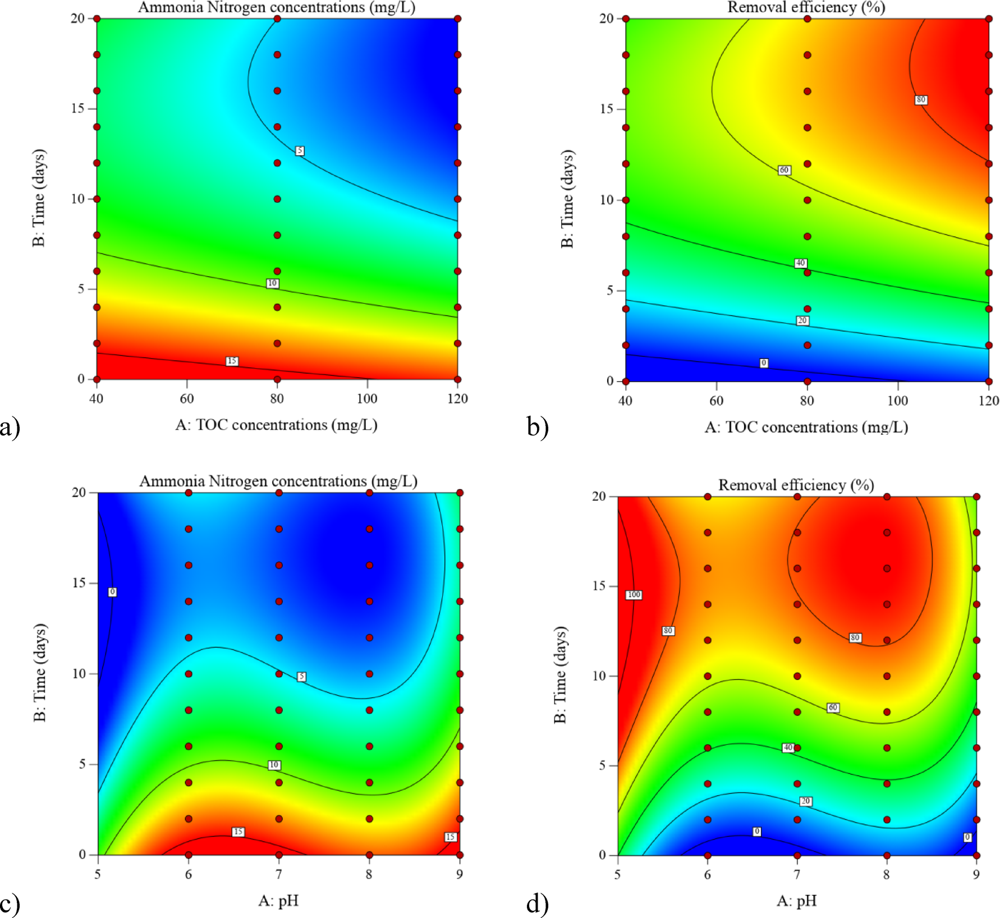
      - **Hình này chứng minh điều gì**
        - Nồng độ Amonia Nitơ giảm từ $15\text{ mg/L}$ xuống $< 5\text{ mg/L}$, hiệu suất khử tăng từ $0\,\%$ lên $> 80\,\%$ khi tăng thời gian lên $15$–$20\text{ ngày}$.
      - **Từ đâu mà thấy được**
        - Panel (a, b): Ox là TOC ($40$–$120\text{ mg/L}$), Oy là Time ($0$–$20\text{ ngày}$); hiệu suất (b) đạt $80\,\%$ khi TOC $> 100\text{ mg/L}$ và Time $> 15\text{ ngày}$.
        - Panel (c, d): Ox là pH ($5$–$9$), Oy là Time ($0$–$20\text{ ngày}$); hiệu suất (d) đạt $80$–$100\,\%$ (vùng màu đỏ) khi Time $> 15\text{ ngày}$.
    * **Đặc tính tương tác giữa thời gian và nồng độ TOC**:
        * Vì thời gian và nồng độ $\text{TOC}$ là hai biến số độc lập riêng biệt, khi thời gian được giữ cố định, chỉ ghi nhận những biến đổi rất nhỏ ở nồng độ amonia nitơ khi thay đổi nồng độ $\text{TOC}$.
        * Tuy nhiên, các biến động trở nên rõ rệt khi thời gian thay đổi trong khi nồng độ $\text{TOC}$ giữ nguyên, chứng minh nồng độ amonia nitơ nhạy cảm với sự thay đổi thời gian hơn là nồng độ $\text{TOC}$.
        * Khi giảm nồng độ $\text{TOC}$ theo thời gian, nồng độ amonia nitơ tăng lên.
        * Độ nhạy của cả hiệu suất loại bỏ và nồng độ amonia đối với thời gian đều lớn hơn độ nhạy đối với nồng độ $\text{TOC}$.
        * Ghi nhận một xu hướng đảo ngược đối với hiệu suất loại bỏ dựa trên sự thay đổi đồng thời của thời gian và nồng độ $\text{TOC}$.

* **Hiệu suất khử amonia nitơ tăng theo thời gian lưu và đạt đỉnh ở dải pH từ $5\text{--}6$ và $7.5\text{--}8.5$ trên đồ thị 3D (Hình 2)**:
    - **Hình 2.** Đồ thị bề mặt 3D nồng độ và hiệu suất khử Amonia Nitơ
      - 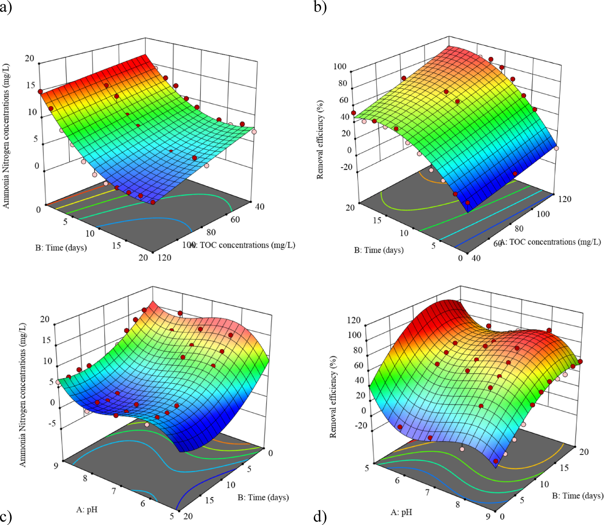
      - **Hình này chứng minh điều gì**
        - Thời gian lưu kéo dài đến $20\text{ ngày}$ chi phối việc hạ nồng độ amonia về sát $0\text{ mg/L}$, ít bị TOC tác động.
      - **Từ đâu mà thấy được**
        - (a, b): Trục Time ($0$–$20\text{ ngày}$) và TOC ($40$–$120\text{ mg/L}$); mặt cong dốc mạnh theo trục thời gian.
        - (c, d): Trục pH ($5$–$9$) và Time ($0$–$20\text{ ngày}$); mặt cong dạng vòm uốn phi tuyến rõ rệt theo trục pH.
    * **Tác động của tương tác thời gian - pH**:
        * Trong trường hợp thời gian - $\text{pH}$ đóng vai trò biến độc lập, hiệu suất loại bỏ tăng dần theo thời gian.
        * Hiệu suất loại bỏ cao nhất được ghi nhận trong các khoảng $\text{pH}$ từ $5\text{--}6$ và $7.5\text{--}8.5$.
        * Ở điều kiện $\text{pH}$ cố định, mức thay đổi hiệu suất loại bỏ do thay đổi $\text{pH}$ thấp hơn so với khi cố định thời gian.
        * Nồng độ amonia nitơ thể hiện độ nhạy đối với biến thiên thời gian cao hơn so với nồng độ $\text{TOC}$.
    * **Cơ chế sinh học và hóa học loại bỏ chất dinh dưỡng trong MBR vi tảo**:
        * **Hấp thụ dinh dưỡng bởi tế bào vi tảo**: Được xem là cơ chế chủ đạo để loại bỏ chất dinh dưỡng trong xử lý nước thải bằng vi tảo, do nitơ và photpho là hai nguyên tố thiết yếu để tổng hợp các hợp chất sinh học nội bào.
        * **Tác động tích cực của hàm lượng TOC**: Sự gia tăng hàm lượng $\text{TOC}$ thúc đẩy tốc độ sinh trưởng của vi tảo, nâng cao năng lực hấp thụ chất ô nhiễm và thể hiện xu hướng tương đồng ở nồng độ amonia nitơ và tổng photpho trong nước thải.
        * **Các phản ứng hóa học hỗ trợ**: Một số phản ứng hóa học như kết tủa hóa học (chemical precipitation) và bay hơi amoniac (ammonia volatilization) có thể loại bỏ một phần nitơ và photpho khỏi nước thải; tuy nhiên các cơ chế hóa học này chủ yếu chịu sự chi phối từ các biến động $\text{pH}$ do quá trình tăng sinh của vi tảo tạo ra.

* **Nồng độ phosphat và hiệu suất loại bỏ chịu sự chi phối mạnh bởi thời gian hơn so với nồng độ TOC trên đồ thị đường đồng mức (Hình 3)**:
    - **Hình 3.** Đồ thị đường đồng mức nồng độ và hiệu suất khử Phosphate
      - 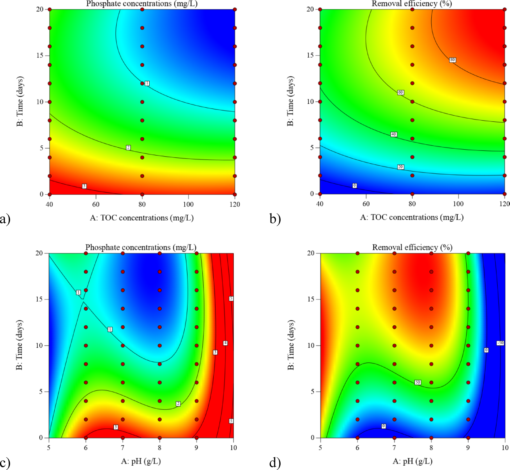
      - **Hình này chứng minh điều gì**
        - Hiệu suất khử phosphate đạt cực đại (> $80\%$, nồng độ < $1\text{ mg/L}$) khi thời gian lưu $20\text{ ngày}$, TOC $120\text{ mg/L}$ và pH $6.5\text{--}8.0$.
      - **Từ đâu mà thấy được**
        - (a, b) $Ox$: TOC ($40\text{--}120\text{ mg/L}$), $Oy$: thời gian ($0\text{--}20\text{ ngày}$); hiệu suất tăng từ $0\%$ lên > $80\%$ ở góc trên bên phải.
        - (c, d) $Ox$: pH ($5\text{--}10$), $Oy$: thời gian ($0\text{--}20\text{ ngày}$); nồng độ giảm xuống < $1\text{ mg/L}$ và hiệu suất cao nhất tại pH $6.5\text{--}8.0$.
    * **Biến động của nồng độ phosphat theo thời gian và TOC**:
        * Với thời gian và nồng độ $\text{TOC}$ là các biến độc lập, mức độ biến đổi của nồng độ phosphat do thay đổi nồng độ $\text{TOC}$ là thấp trong chế độ thời gian cố định.
        * Hàm lượng $\text{TOC}$ trong hệ thống vẫn duy trì ở mức cao qua các mốc thời gian diễn tiến.
        * Nồng độ phosphat nhạy cảm với biến thiên thời gian hơn so với biến thiên nồng độ $\text{TOC}$.
        * Nồng độ amonia nitơ giảm dần theo thời gian và nồng độ $\text{TOC}$; việc giảm nồng độ $\text{TOC}$ theo thời gian làm nồng độ amonia nitơ tăng lên.
        * Nồng độ phosphat và hiệu suất loại bỏ đều nhạy với thời gian hơn là nồng độ $\text{TOC}$; ghi nhận xu hướng đảo ngược của hiệu suất loại bỏ dựa trên biến động của nồng độ $\text{TOC}$ và thời gian.
    * **Vai trò của tải lượng TOC đầu vào và pH đối với vi tảo**:
        * Hàm lượng $\text{TOC}$ dòng vào ảnh hưởng đáng kể đến hiệu suất loại bỏ amonia nitơ: Khi hàm lượng $\text{TOC}$ đầu vào tăng lên, hiệu suất loại bỏ amonia nitơ trong nước thải dần được cải thiện rõ rệt.
        * Độ $\text{pH}$ tác động mạnh mẽ đến sự sinh trưởng của chủng vi tảo *P. helgolandica tsingtaoensis*, từ đó quyết định hiệu quả loại bỏ các chất ô nhiễm.

* **Hiệu suất khử phosphat đạt tối đa trong các dải pH từ $5\text{--}5.5$ và $7.5\text{--}8$ theo mô hình bề mặt 3D (Hình 4)**:
    - **Hình 4.** Đồ thị bề mặt 3D nồng độ và hiệu suất khử Phosphate
      - 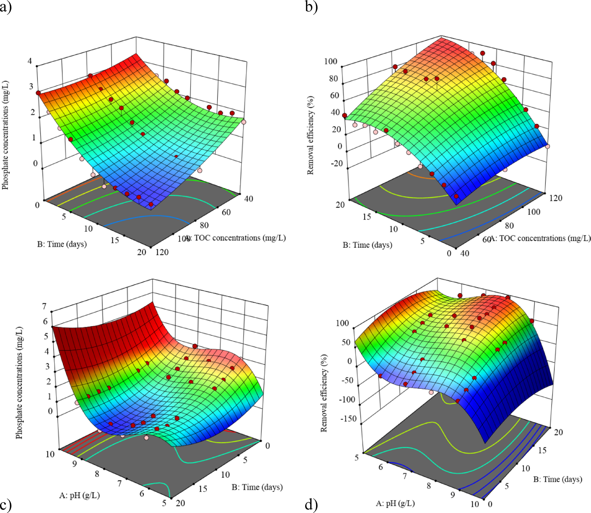
      - **Hình này chứng minh điều gì**
        - Kéo dài thời gian đến $20\text{ ngày}$ hạ nồng độ photphat xuống dưới $1\text{ mg/L}$; chệch khỏi pH 7–8 làm hiệu suất sụt giảm rõ rệt.
      - **Từ đâu mà thấy được**
        - Panel (a, b): trục thời gian ($0\text{--}20\text{ ngày}$) và TOC ($40\text{--}120\text{ mg/L}$); hiệu suất (b) tạo vồng cực đại ở $20\text{ ngày}$.
        - Panel (c, d): trục thời gian ($0\text{--}20\text{ ngày}$) và pH ($5\text{--}10$); nồng độ (c) chạm đáy dưới $1\text{ mg/L}$ và hiệu suất (d) đạt đỉnh tại pH 7–8.
    * **Phân tích động thái khử phosphat theo không gian 3 chiều**:
        * Hiệu suất loại bỏ phosphat gia tăng theo thời gian khi thời gian - $\text{pH}$ được thiết lập làm biến độc lập.
        * Khoảng giá trị $\text{pH}$ từ $5\text{--}5.5$ và $7.5\text{--}8$ đem lại hiệu quả làm sạch tối đa (maximum clearance effectiveness).
        * Tại một mốc thời gian không đổi, mức độ biến đổi hiệu suất loại bỏ do thay đổi $\text{pH}$ gây ra cao hơn so với mức độ biến đổi khi giữ $\text{pH}$ không đổi.
        * Nồng độ phosphat thể hiện độ nhạy đối với biến thiên $\text{pH}$ cao hơn so với biến thiên thời gian.

* **Đánh giá mức độ phù hợp của mô hình qua đồ thị phần dư và tương quan thực tế - dự báo (Hình 5)**:
    - **Hình 5.** Đồ thị phần dư và tương quan thực tế - dự báo của RSM
      - 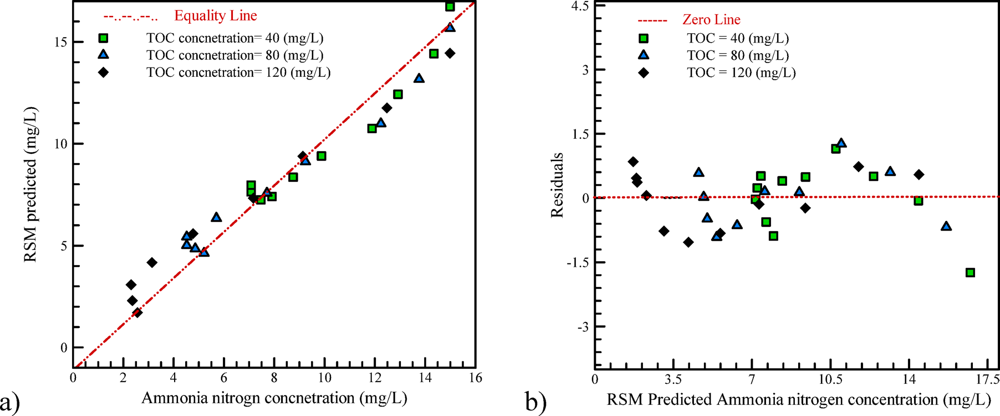
      - **Hình này chứng minh điều gì**
        - Mô hình dự báo sát nồng độ ammonia nitrogen ở cả 3 mức TOC ($40$, $80$, $120\text{ mg/L}$).
      - **Từ đâu mà thấy được**
        - Panel (a): Ox giá trị thực nghiệm ($0$–$16\text{ mg/L}$), Oy RSM dự báo; các điểm bám sát Equality Line.
        - Panel (b): Ox RSM dự báo ($0$–$17.5\text{ mg/L}$), Oy phần dư; các điểm phân tán quanh Zero Line.
    - **Hình 5.** (tiếp theo) Đồ thị phần dư và kiểm định mô hình RSM
      - 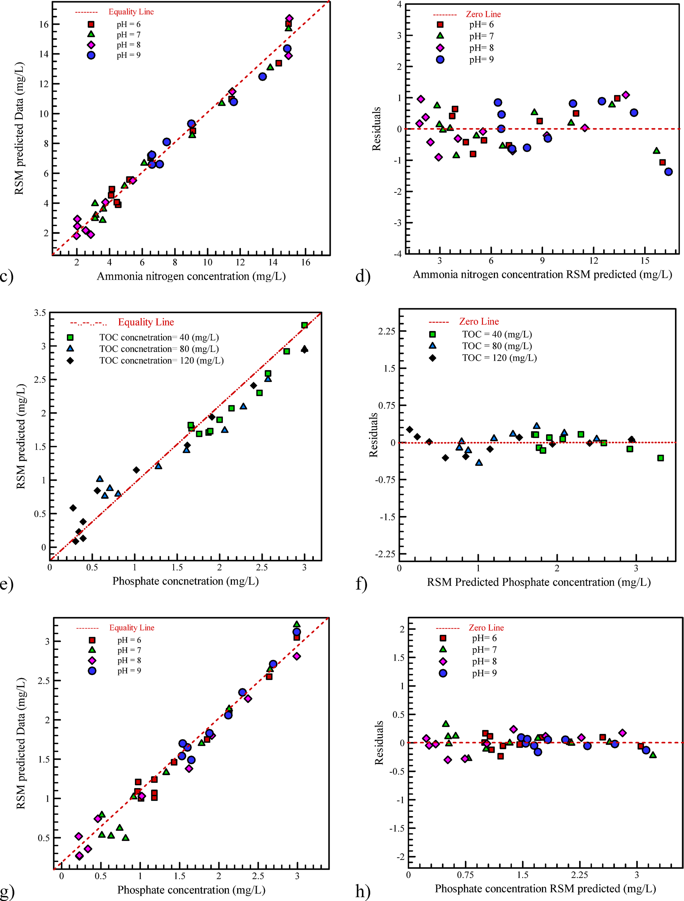
      - **Hình này chứng minh điều gì**
        - Mô hình RSM dự báo sát nồng độ ammonia nitrogen theo pH (c, d) và phosphate theo TOC, pH (e–h).
      - **Từ đâu mà thấy được**
        - Panel (c, e, g): Ox giá trị thực nghiệm ($0$–$16\text{ mg/L}$ ammonia nitrogen, $0$–$3.5\text{ mg/L}$ phosphate), Oy RSM dự báo; các điểm bám sát Equality Line.
        - Panel (d, f, h): Ox RSM dự báo, Oy phần dư; các điểm phân tán sát Zero Line trong khoảng $[-1.5, 1.1]$ (ammonia) và $[-0.5, 0.4]$ (phosphate).
    * **Mô hình phần dư và thực tế - dự báo cho nồng độ amonia nitơ (Hình 5a và 5d)**:
        * Đồ thị mô hình phần dư và thực tế - dự báo phản ánh nồng độ amonia nitơ theo các mối quan hệ thời gian - nồng độ $\text{TOC}$ và thời gian - $\text{pH}$.
        * Mức độ tập trung của các điểm dữ liệu dọc theo đường chéo (diagonal line) đóng vai trò là thước đo chuẩn mực đánh giá kết quả thực nghiệm so với giá trị dự báo kỳ vọng.
        * Khoảng cách giữa các điểm chấm tới đường chéo phản ánh mức độ trùng khớp cao giữa giá trị thực nghiệm và dự đoán, khẳng định mô hình đề xuất có khả năng dự báo chuẩn xác nồng độ amonia nitơ theo thời gian và $\text{pH}$.
    * **Mô hình phần dư và thực tế - dự báo cho nồng độ phosphat (Hình 5e và 5h)**:
        * Đồ thị mô hình phần dư cùng các giá trị thực tế và dự báo của nồng độ phosphat tương ứng theo thời gian - nồng độ $\text{TOC}$ và thời gian - $\text{pH}$ tiếp tục chứng minh sự phân bố sát sao của các điểm quanh đường chéo.
        * Các dự đoán về động thái của nồng độ phosphat và amonia trong hệ thống MBR vi tảo được thiết lập từ bộ dữ liệu thực nghiệm đạt sự tương đồng và thống nhất rất cao.

### ANN modeling results

* **Nguồn dữ liệu thực nghiệm và các biến số mô hình (Experimental dataset source and model variables)**:
    * Dữ liệu thực nghiệm được kế thừa từ công trình của Ding et al. [26] dùng cho mô hình hóa mạng nơ-ron nhân tạo (artificial neural network - ANN).
    * **Các biến phụ thuộc (Dependent factors / output targets)**:
        * Nồng độ nitơ amoniac (ammonia nitrogen concentration).
        * Nồng độ phosphat (phosphate concentration).
        * Hiệu suất loại bỏ (removal efficiency) của cả nitơ amoniac và phosphat.
    * **Các biến độc lập (Independent variables / model inputs)**:
        * Thời gian vận hành (Time).
        * Độ $\text{pH}$.
        * Nồng độ tổng carbon hữu cơ (Total Organic Carbon - TOC concentration).

* **Chiến lược lựa chọn cấu trúc mạng nơ-ron tối ưu (Optimal ANN architecture selection strategy)**:
    * Tô-pô tối ưu (optimal topology) của các mô hình ANN được xác định thông qua quy trình thử - sai có hệ thống (trial-and-error procedure).
    * Số lượng nơ-ron trong lớp ẩn (number of neurons in the hidden layer) được khảo sát và biến thiên lặp lại từng bước từ $1$ đến $20$ nơ-ron (iteratively varied from 1 to 20).
    * **Tiêu chí lựa chọn cấu trúc tối ưu**: Cấu trúc kiến trúc đạt giá trị sai số toàn phương trung bình thấp nhất trên tập kiểm định (lowest mean squared error - MSE on the validation set) được lựa chọn làm mô hình khớp tốt nhất (best-fit architecture).

* **Các thông số kiến trúc và độ chính xác tối ưu của các mô hình ANN (Optimal ANN architectures and accuracy parameters)**:
    * Kết quả cấu trúc tối ưu và các thông số độ chính xác cho từng biến phụ thuộc được chi tiết hóa trong Bảng 1:
        * **Mô hình nitơ amoniac dựa trên dữ liệu $\text{pH}$ (Ammonia nitrogen based on pH data)**:
            * Cấu trúc mạng (Structure): $[2\ 5]$ ($2$ nơ-ron ở lớp ẩn thứ nhất và $5$ nơ-ron ở lớp ẩn thứ hai).
            * Hàm kích hoạt chuyển tiếp (Transfer function): kết hợp [Logsigmoid Tansigmoid].
            * Hệ số tương quan (Correlation coefficient): $R = 0.99743$.
            * Sai số toàn phương trung bình: $\text{MSE} = 2.04\times 10^{-2}$ ($2.04\text{E-}02$).
        * **Mô hình nitơ amoniac dựa trên dữ liệu TOC (Ammonia nitrogen based on TOC data)**:
            * Cấu trúc mạng: $[2\ 4]$ ($2$ nơ-ron và $4$ nơ-ron ở các lớp ẩn).
            * Hàm kích hoạt chuyển tiếp: [Logsigmoid Logsigmoid].
            * Hệ số tương quan: $R = 0.99791$.
            * Sai số toàn phương trung bình: $\text{MSE} = 3.57\times 10^{-2}$ ($3.57\text{E-}02$).
        * **Mô hình phosphat dựa trên dữ liệu $\text{pH}$ (Phosphate based on pH data)**:
            * Cấu trúc mạng: $[3\ 3]$ ($3$ nơ-ron và $3$ nơ-ron ở các lớp ẩn).
            * Hàm kích hoạt chuyển tiếp: [Tansigmoid Logsigmoid].
            * Hệ số tương quan: $R = 0.99647$.
            * Sai số toàn phương trung bình: $\text{MSE} = 1.36\times 10^{-2}$ ($1.36\text{E-}02$).
        * **Mô hình phosphat dựa trên dữ liệu TOC (Phosphate based on TOC data)**:
            * Cấu trúc mạng: $[5\ 2]$ ($5$ nơ-ron và $2$ nơ-ron ở các lớp ẩn).
            * Hàm kích hoạt chuyển tiếp: [Tansigmoid Logsigmoid].
            * Hệ số tương quan: $R = 0.99722$.
            * Sai số toàn phương trung bình: $\text{MSE} = 2.75\times 10^{-2}$ ($2.75\text{E-}02$).
    * **Bảng 1.** Cấu trúc tối ưu và thông số độ chính xác của mạng ANN
        * 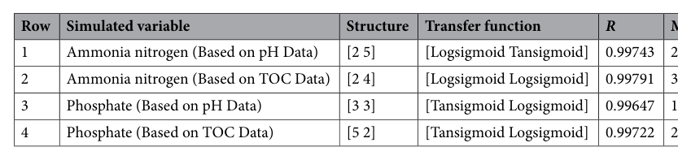
        * **Bảng này chứng minh điều gì**
            * Mô hình ANN đạt cấu trúc tối ưu với 2 lớp ẩn (từ $[2\ 4]$ đến $[5\ 2]$ nơ-ron) kết hợp hàm Logsigmoid/Tansigmoid cho các biến Ammonia nitrogen và Phosphate.
        * **Từ đâu mà thấy được**
            * Cột "Structure" và "Transfer function" thể hiện số nơ-ron lớp ẩn và hàm kích hoạt tương ứng cho từng biến mô phỏng.
            * Cột "$R$" ghi nhận giá trị tương quan cao cho cả 4 mô hình, từ $0.99647$ (dòng 3) đến $0.99791$ (dòng 2).
#### Addressing model robustness and overfitting

* **Thách thức tập dữ liệu giới hạn và sự cần thiết của kiểm soát quá khớp (Small dataset challenge and overfitting control)**:
    * Do kích thước tập dữ liệu thực nghiệm bị hạn chế (chỉ gồm $44$ điểm dữ liệu thực nghiệm), các biện pháp kỹ thuật đặc thù đã được thiết lập để đảm bảo khả năng diễn giải mô hình (model interpretability) và chủ động ngăn chặn hiện tượng quá khớp (overfitting).

* **Cơ chế điều chuẩn dừng sớm trong tiến trình huấn luyện (Early Stopping regularization mechanism)**:
    * Chiến lược giảm thiểu quá khớp chính (primary mitigation strategy) là áp dụng kỹ thuật điều chuẩn dừng sớm (Early Stopping regularization).
    * Trong suốt tiến trình huấn luyện lặp (iterative training process), chỉ số $\text{MSE}$ của tập con kiểm định (Validation subset, chiếm $15\%$ dữ liệu) liên tục được theo dõi trực tiếp.
    * Thuật toán huấn luyện được cấu hình tự động dừng (halt automatically) nếu sai số trên tập kiểm định không được cải thiện trong $6$ epoch liên tiếp ($6$ consecutive epochs).
    * Cơ chế này đảm bảo mạng nơ-ron tiếp thu và học được các quy luật xu hướng chung tiềm ẩn (underlying general trends) thay vì ghi nhớ nhiễu ngẫu nhiên (memorizing noise) trong tập huấn luyện.

* **Thuật toán tối ưu hóa trọng số Levenberg-Marquardt (Levenberg-Marquardt backpropagation weight optimization)**:
    * Thuật toán lan truyền ngược Levenberg-Marquardt (LM backpropagation algorithm) được lựa chọn cho bài toán tối ưu hóa trọng số mạng.
    * Thuật toán LM được biết đến rộng rãi với tham số tắt dần (damping parameter, $\mu$), đóng vai trò cung cấp cơ chế điều chuẩn tự nhiên (natural regularization) thông qua việc luân chuyển linh hoạt giữa phương pháp hạ gradient (Gradient Descent) và phương pháp Gauss-Newton.
    * Đặc tính này giúp thuật toán LM đạt độ ổn định tính toán rất cao (highly stable), đặc biệt phù hợp và hiệu quả đối với các tập dữ liệu có kích thước nhỏ [1].

* **Đánh giá độ bền vững và năng lực tổng quát hóa của mô hình ANN (Model robustness and generalization performance)**:
    * Sự đồng nhất và nhất quán cao của các giá trị hệ số xác định $R^2$ trên toàn bộ các tập dữ liệu chứng minh năng lực mô hình:
        * Tập huấn luyện (Training dataset): $R^2 > 0.99$.
        * Tập kiểm định (Validation dataset): $R^2 > 0.99$.
        * Tập kiểm tra (Testing dataset): $R^2 > 0.9$.
    * Độ ổn định nhất quán này (được trình bày chi tiết trong Bảng 1 và trực quan hóa trong Hình 6) khẳng định mô hình ANN đã đạt được khả năng tổng quát hóa mạnh mẽ (strong generalization capabilities) đối với dữ liệu mới chưa từng thấy (unseen data).
    * **Đối sánh giữa dữ liệu thực nghiệm và đầu ra ANN về nồng độ**:
        * Dữ liệu thực nghiệm (đường màu tím) và đầu ra mô hình ANN (đường màu xanh lá) của nồng độ nitơ amoniac và phosphat nằm rất gần nhau, thể hiện xu thế tương đồng.
        * Các đường huấn luyện (đường màu cam), kiểm tra (đường màu xanh lá) và kiểm định (đường màu đỏ) phản ánh chính xác hiệu năng qua từng pha: đường huấn luyện cho thấy mô hình khớp rất tốt dữ liệu học, trong khi đường kiểm tra và kiểm định xác nhận khả năng tổng quát hóa xuất sắc.
        * Một số sai lệch nhỏ còn tồn tại giữa dữ liệu thực nghiệm và đầu ra ANN phản ánh các giới hạn tiềm ẩn của mô hình hoặc từ điều kiện thiết kế thực nghiệm (limitations of model or experimental setup).
    * **Hình 6.** Đối sánh nồng độ thực nghiệm và đầu ra ANN cho Amonia và Phosphate
        * 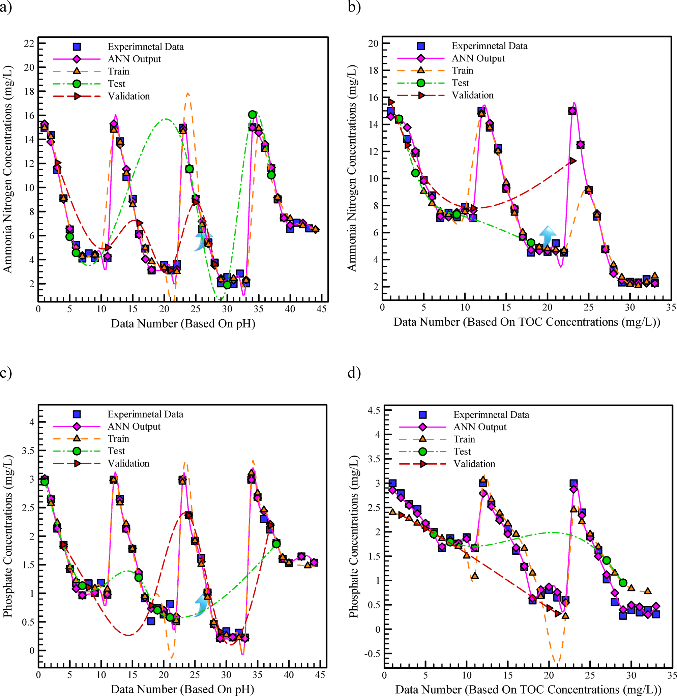
        * **Hình này chứng minh điều gì**
            * Đầu ra ANN mô phỏng chính xác các bước nhảy nồng độ của Ammonia Nitrogen ($2 - 16\text{ mg/L}$) và Phosphate ($0.2 - 3.1\text{ mg/L}$).
        * **Từ đâu mà thấy được**
            * Ox: số mẫu theo pH ($0 - 45$) hoặc theo TOC ($0 - 35$). Oy: nồng độ Ammonia ($0 - 22\text{ mg/L}$) và Phosphate ($-0.5 - 4.5\text{ mg/L}$).
            * Đường ANN Output (màu tím) nối trùng khít qua từng điểm Experimental Data (vuông xanh) trên cả 4 đồ thị (a)–(d).

* **Dự báo hiệu suất loại bỏ chất ô nhiễm bằng mô hình ANN (Removal efficiency prediction by ANN model)**:
    * Đồ thị trong Hình 7 biểu diễn đầu ra của mô hình ANN và dữ liệu thực nghiệm đối với hiệu suất loại bỏ nitơ amoniac và phosphat:
        * Mặc dù dữ liệu thực nghiệm củng cố và hỗ trợ mạnh mẽ cho mô hình, chúng không xác định rõ xu thế của dữ liệu đầu ra xuyên suốt toàn bộ pha kiểm định và pha kiểm tra.
        * Tuy nhiên, mô hình ANN vẫn dự báo chính xác các điểm giá trị mục tiêu (accurately predicted the target points) trên toàn dải hiệu suất loại bỏ.
    * **Hình 7.** Đối sánh hiệu suất khử thực nghiệm và đầu ra ANN cho Amonia và Phosphate
        * 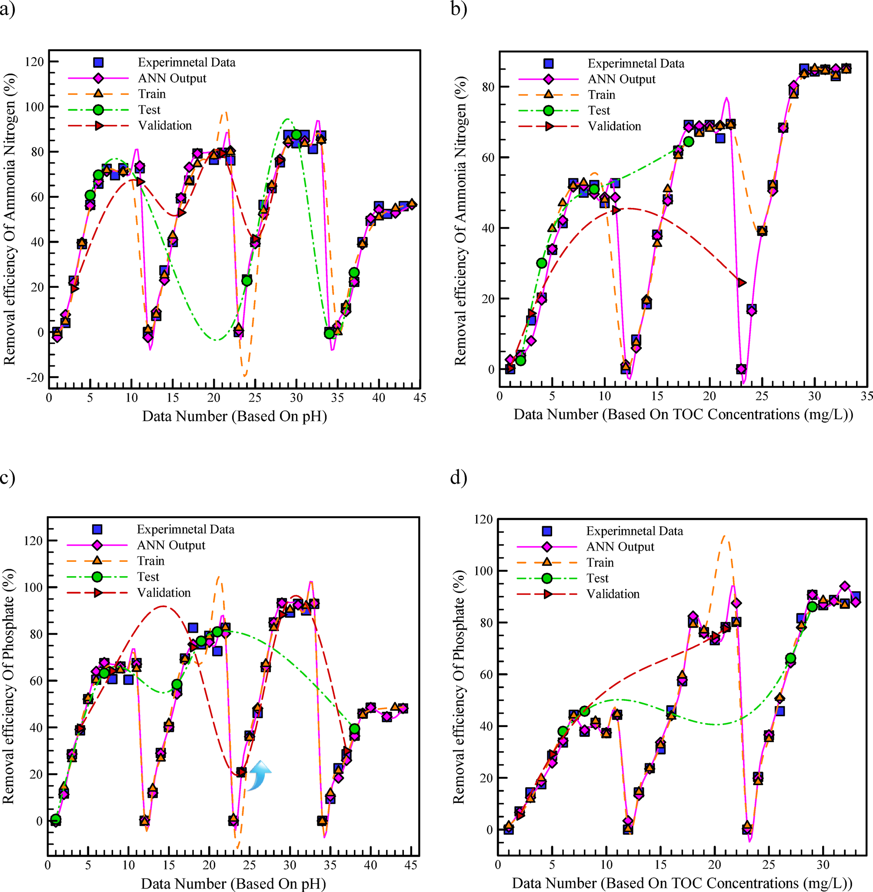
        * **Hình này chứng minh điều gì**
            * Đường cong ANN bám sát dữ liệu thực nghiệm qua toàn bộ các dao động cực đại và cực tiểu ($0 - 90\%$).
        * **Từ đâu mà thấy được**
            * Ox: Thứ tự dữ liệu theo pH ($0 - 45$) hoặc TOC ($0 - 35$); Oy: Hiệu suất loại bỏ ($0 - 100\%$).
            * Đồ thị (a)–(d): Đường hồng (ANN Output) đi qua chính xác các điểm thực nghiệm (vuông xanh).
            * Cả ba tập Train, Test và Validation đều phân bố trùng khít với đường mô phỏng ANN.

### Comparison between ANN and RSM outputs

* **So sánh trực quan giữa dữ liệu thực nghiệm và kết quả mô hình hóa ANN và RSM (trang 10–11)**:
    * Hình 8 so sánh trực tiếp dữ liệu thực nghiệm phòng thí nghiệm (laboratory / actual data) với kết quả mô phỏng từ hai mô hình mạng nơ-ron nhân tạo (Artificial Neural Network - ANN) và phương pháp bề mặt đáp ứng (Response Surface Methodology - RSM).
    * **Hiệu năng dự đoán nồng độ và hiệu suất loại bỏ Ammonia Nitrogen theo $\text{pH}$ (Hình 8a)**:
        * Các giá trị đầu ra của mô hình ANN thể hiện năng lực dự báo vượt trội (superior predictive capability) đối với dữ liệu thực nghiệm, đặc biệt rõ nét ở các giai đoạn ban đầu (initial stages) của từng xu hướng biến thiên cho cả hai thông số phụ thuộc: nồng độ Ammonia Nitrogen và hiệu suất loại bỏ (dựa trên $\text{pH}$).
    * **Mối quan hệ giữa nồng độ Phosphate và hiệu suất loại bỏ theo $\text{pH}$ (Hình 8b)**:
        * Biểu diễn tương quan giữa nồng độ Phosphate và hiệu suất khử dựa trên $\text{pH}$; ngoại trừ điểm dữ liệu ở khoảng giữa (middle data point) có độ lệch khỏi xu hướng chung, cả hai mô hình ANN và RSM đều thể hiện năng lực dự đoán mạnh mẽ đối với dữ liệu thực nghiệm.
    * **Độ chính xác vượt bậc của ANN đối với Ammonia Nitrogen theo $\text{TOC}$ (Hình 8c)**:
        * Mô hình ANN thể hiện hiệu năng xuất sắc khi dự đoán chính xác dữ liệu tại mọi điểm khảo sát (at all points).
        * Ngược lại, mô hình RSM gặp nhiều khó khăn trong việc dự báo chính xác dữ liệu thực nghiệm, đặc biệt ở các điểm dữ liệu ban đầu (initial points).
    * **Hiệu năng dự báo Phosphate và hiệu suất loại bỏ theo $\text{TOC}$ (Hình 8d)**:
        * Mặc dù cả hai mô hình đều có năng lực dự đoán bị hạn chế đối với dữ liệu phòng thí nghiệm ở một số vùng cục bộ, mô hình ANN vẫn thể hiện độ chuẩn xác vượt trội (superior accuracy) trong việc tái hiện tập dữ liệu thực nghiệm.
    * **Hình 8.** So sánh đầu ra ANN và RSM với dữ liệu thực nghiệm
      * 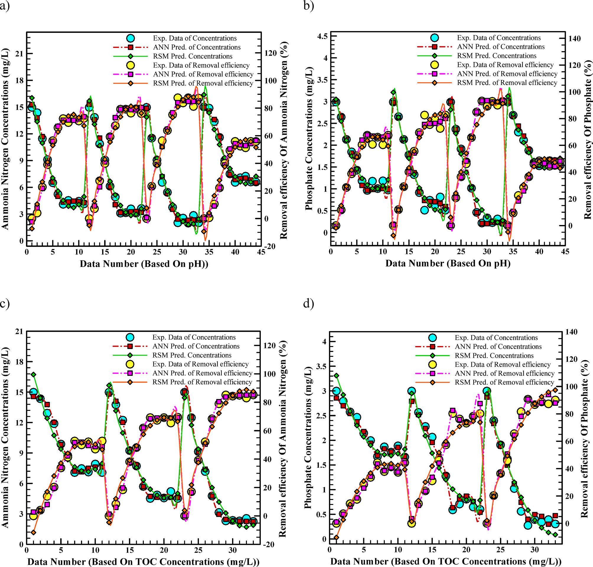
      * **Hình này chứng minh điều gì**
        * Đường ANN bám sát dữ liệu thực nghiệm nồng độ và hiệu suất xử lý ammonia nitrogen lẫn phosphate theo pH và TOC.
      * **Từ đâu mà thấy được**
        * Ox: số thứ tự mẫu theo pH (a, b) hoặc TOC (c, d); Oy: nồng độ và hiệu suất xử lý.
        * Ký hiệu ANN (hình vuông) bám khít điểm thực nghiệm (hình tròn), trong khi đường RSM lệch tại các đỉnh cực trị.
* **Cơ chế sinh học và động thái $\text{pH}$ trong bioreactor vi tảo**:
    * Hoạt tính quang hợp (photosynthetic activity) của vi tảo có thể làm tăng rõ rệt giá trị $\text{pH}$ trong môi trường nuôi cấy do tiêu thụ $\text{CO}_2$ hòa tan.
    * Giá trị $\text{pH}$ quan sát được trong bioreactor vận hành liên tục (continuous bioreactor) thấp hơn so với trong quang phản ứng mẻ luân phiên (sequencing batch photoreactor - SBPR), phản ánh việc nuôi cấy vi tảo liên tục trong lò phản ứng hỗ trợ sự phát triển và sinh trưởng của chúng hiệu quả hơn.
    * Ngưỡng $\text{pH}$ tối ưu có sự khác biệt giữa các loài vi tảo khác nhau; trong đó sản lượng của vi tảo *Chlorella* trong photobioreactor xử lý nước thải ngành sữa (dairy effluent) đạt mức tối đa tại dải $\text{pH}$ từ $6.3\text{ -- }7.5$.
* **Đánh giá định lượng hiệu năng mô hình qua các chỉ số thống kê (Bảng 3)**:
    * Mặc dù Hình 8 minh họa trực quan sự trùng khớp chặt chẽ giữa thực nghiệm và mô hình, đánh giá định lượng cung cấp một sự so sánh khoa học và nghiêm ngặt hơn (rigorous comparison).
    * Căn cứ vào các chỉ số thống kê trong Bảng 3, mô hình ANN nhất quán vượt trội hơn mô hình RSM trên tất cả các biến đáp ứng (across all response variables).
    * **So sánh định lượng trên biến nồng độ Ammonia Nitrogen**:
        * Mô hình ANN đạt sai số toàn phương trung bình $\text{RMSE} = 0.189$ và sai số tuyệt đối trung bình $\text{MAE} = 0.142$.
        * Mức sai số này đại diện cho sự suy giảm sai số khoảng $41\%$ so với mô hình RSM ($\text{RMSE} = 0.324$, $\text{MAE} = 0.281$).
        * Hệ số xác định $R^2$ của ANN đạt $0.9979$, cao hơn rõ rệt so với $R^2 = 0.9733$ của mô hình RSM.
    * **So sánh định lượng trên biến nồng độ Phosphate**:
        * Mô hình ANN đạt sai số cực thấp với $\text{RMSE} = 0.166$ và $\text{MAE} = 0.118$.
        * Mô hình RSM ghi nhận sai số lớn hơn đáng kể với $\text{RMSE} = 0.251$ và $\text{MAE} = 0.215$.
        * Hệ số xác định $R^2$ của ANN đạt $0.9972$, vượt trội so với $R^2 = 0.9608$ của RSM.
    * **Bảng 3.** So sánh định lượng các chỉ số thống kê giữa ANN và RSM
      * 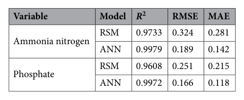
      * **Bảng này chứng minh điều gì**
        * ANN đạt độ chuẩn xác dự báo vượt trội trên cả Ammonia nitrogen và Phosphate với $R^2 > 0.997$ và sai số giảm gần một nửa.
      * **Từ đâu mà thấy được**
        * Cột $R^2$: hàng ANN đạt $0.9979$ (Ammonia nitrogen) và $0.9972$ (Phosphate), cao hơn rõ rệt so với RSM ($0.9733$ và $0.9608$).
        * Cột RMSE và MAE: hàng ANN ghi nhận sai số thấp nhất ở cả hai biến, với RMSE $0.189$ / $0.166$ và MAE $0.142$ / $0.118$.
* **Phân tích phân bố sai số phần dư và ưu thế vượt trội của ANN phi tuyến so với RSM đa thức bậc hai (Hình 9)**:
    * Sự khác biệt về độ chuẩn xác dự báo giữa hai mô hình được trực quan hóa sâu sắc qua biểu đồ tần số sai số phần dư (residual error distribution histogram, $y_{\text{pred}} - y_{\text{exp}}$) trong Hình 9.
    * **Phân bố sai số của mô hình ANN**:
        * Sai số phần dư của ANN tuân theo phân bố chuẩn (normally distributed) và tập trung đỉnh nhọn cao độ quanh giá trị 0 (sharply peaked around zero).
        * Phân bố tập trung sát 0 chứng minh đa số tuyệt đối các dự đoán từ ANN chỉ có độ lệch tối thiểu so với giá trị thực nghiệm, hoàn toàn không có sai số cực biên.
    * **Hạn chế trong phân bố sai số của mô hình RSM**:
        * Ngược lại, phân bố sai số của RSM có độ phân tán rộng hơn nhiều (wider spread), tương ứng với độ lệch chuẩn cao hơn (higher standard deviation).
        * Độ phân tán rộng phản ánh các phương trình đa thức bậc hai (quadratic polynomial equations) của RSM gặp nhiều hạn chế và bất cập khi nắm bắt các dao động phi tuyến phức tạp (complex, non-linear fluctuations) vốn có trong quy trình xử lý nước thải sinh học.
    * **Kết luận về năng lực mô hình hóa hệ thống MBR**:
        * Toàn bộ bằng chứng thống kê và trực quan khẳng định cấu trúc kiến trúc ANN cung cấp sự xấp xỉ vượt trội (superior approximation) đối với hành vi vận hành phức tạp của hệ thống màng lọc sinh học vi tảo (MBR).
    * **Hình 9.** Biểu đồ tần số phân bố sai số (phần dư) giữa ANN và RSM
      * 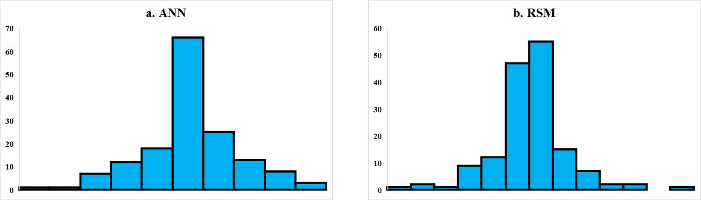
      * **Hình này chứng minh điều gì**
        * ANN có độ tin cậy vượt trội khi tập trung phần lớn dự báo sát sai số 0 và không có sai số cực biên.
      * **Từ đâu mà thấy được**
        * Trục $Oy$ biểu thị tần số mẫu; trục $Ox$ biểu diễn các khoảng sai số phần dư.
        * Đồ thị a (ANN): cột tâm sát mốc 0 đạt đỉnh cao nhất ($\approx 66$), phân bố dốc đứng và đối xứng.
        * Đồ thị b (RSM): đỉnh bị phân tách ($\approx 47$ và $55$), dải phân bố dàn trải và có ngoại lai ở rìa phải.

### NSGA-II optimization

* **Thiết lập và nguyên lý bài toán tối ưu hóa đa mục tiêu bằng giải thuật di truyền sắp xếp không bị chi phối II (Non-dominated Sorting Genetic Algorithm II - NSGA-II)**:
  * **Mục tiêu tối ưu hóa đa biến (Multi-objective optimization framework)**: Giải quyết mối quan hệ đánh đổi phức tạp giữa các mục tiêu xung đột nhau (conflicting objectives) nhằm tối ưu hóa đồng thời hiệu quả loại bỏ các chất dinh dưỡng gồm nitơ amoniac (ammonia nitrogen - $\text{NH}_4^+$-$\text{N}$) và phosphat (phosphate - $\text{PO}_4^{3-}$) trong bể phản ứng sinh học màng vi tảo (microalgae membrane bioreactor - MBR).
  * **Xung đột giữa các mục tiêu công nghệ (Ammonia removal vs. Phosphate removal conflict)**:
    * Quá trình loại bỏ đồng thời nitơ và phosphat thường nảy sinh sự cạnh tranh về điều kiện sinh hóa; các thông số vận hành lý tưởng cho quá trình hấp thụ nitơ có thể không trùng khớp hoàn toàn với điều kiện tối ưu để vi tảo đồng hóa photpho.
    * Tồn tại sự đánh đổi nội tại giữa nồng độ chất ô nhiễm còn lại trong nước thải đầu ra (effluent concentration) và hiệu suất loại bỏ (removal efficiency): khi nồng độ cơ chất trong dòng ra giảm xuống mức cực thấp, tốc độ sinh trưởng và hấp thụ của vi tảo bị giới hạn bởi động học phản ứng, khiến việc gia tăng hiệu suất loại bỏ đòi hỏi phải đánh đổi bằng chi phí vận hành hoặc kéo dài thời gian lưu.
  * **Cấu trúc hàm mục tiêu và hàm thích nghi (Objective / Fitness Functions)**:
    * Bài toán được cấu trúc thành tối ưu hóa hai mục tiêu: cực tiểu hóa nghịch đảo hiệu suất khử ($1/\text{Removal Efficiency}$, đại diện cho việc cực đại hóa hiệu suất loại bỏ) và cực tiểu hóa nồng độ cơ chất dinh dưỡng trong dòng ra ($\text{Ammonia Nitrogen Concentration}$ hoặc $\text{Phosphate Concentration}$).
    * Các mô hình toán học đã phát triển—bao gồm mô hình phương pháp bề mặt đáp ứng (Response Surface Methodology - RSM) và mạng nơ-ron nhân tạo (Artificial Neural Network - ANN)—được sử dụng trực tiếp làm các hàm thích nghi (fitness functions/surrogate models) để ước lượng chính xác đáp ứng của hệ thống cho các cá thể giải thuật di truyền.
  * **Biên giới hạn không gian biến quyết định (Decision Variable Boundaries)**:
    * Quá trình tối ưu hóa bị ràng buộc nghiêm ngặt bởi miền giá trị thiết kế thực nghiệm:
      * Thời gian vận hành / thời gian lưu thủy lực ($\text{Time}$ / HRT): $0 \le \text{Time} \le 20\text{ ngày (days)}$.
      * Độ $\text{pH}$: $6 \le \text{pH} \le 9$ (tận dụng vùng đệm kiềm nhẹ tối ưu của quá trình quang hợp vi tảo).
      * Nồng độ tổng carbon hữu cơ (Total Organic Carbon - TOC): $40 \le \text{TOC} \le 120\text{ mg/L}$.
  * **Nguyên lý và cơ chế hình thành mặt biên Pareto (Pareto Optimal Front)**:
    * NSGA-II ứng dụng cơ chế sắp xếp không bị chi phối (non-dominated sorting), tính toán khoảng cách tập trung (crowding distance) nhằm duy trì độ phân tán đa dạng của quần thể, và cơ chế bảo toàn độ ưu tú (elitism) qua các thế hệ.
    * Thay vì chỉ tìm một nghiệm cực trị đơn lẻ mang tính cứng nhắc, giải thuật tạo lập một tập hợp nghiệm tối ưu không bị chi phối (non-dominated solutions) tạo thành mặt biên Pareto (Pareto front), đại diện cho các phương án thỏa hiệp tối ưu nhất giữa nồng độ dòng ra và hiệu suất xử lý.

* **Kết quả tối ưu hóa đa mục tiêu cho Nitơ Amoniac (Ammonia Nitrogen Optimization)**:
  * **Động thái đánh đổi trên mặt biên Pareto (Hình 10a,b)**:
    * Đồ thị mặt biên Pareto giữa $1/\text{Removal Efficiency}$ và nồng độ Amonia Nitơ minh chứng rằng hiệu suất loại bỏ có xu hướng giảm khi nồng độ Amonia Nitơ tăng lên trong vùng khảo sát; mô hình được tối ưu hóa nhằm đồng thời đạt nồng độ Amonia Nitơ thấp nhất và hiệu suất khử cao nhất.
  * **Kết quả tối ưu hóa bằng mô hình mạng nơ-ron nhân tạo (ANN Optimization)**:
    * Phân tích đồ thị Pareto Front (Hình 10a) cho thấy điểm vận hành tối ưu của mô hình ANN đạt nồng độ Amonia Nitơ khoảng $1.932\text{ mg/L}$, với hiệu suất loại bỏ tương ứng đạt $87\,\%$.
    * Phân bố nghiệm trên đồ thị (a): nồng độ Amonia Nitơ tập trung trong dải hẹp từ $1.98319$ đến $1.983225\text{ mg/L}$, tương ứng $1/\text{Removal Efficiency}$ biến thiên từ $0.01149789$ về $0.01149787\text{ \%}$ (tương đương hiệu suất khử $\approx 86.97\,\%$ đến $87\,\%$).
  * **Kết quả tối ưu hóa bằng mô hình phương pháp bề mặt đáp ứng (RSM Optimization)**:
    * Khi tối ưu hóa mô hình RSM bằng NSGA-II để đạt hiệu suất loại bỏ cao nhất với hàm lượng Amonia Nitơ thấp nhất, điểm tối ưu ghi nhận nồng độ Amonia Nitơ khoảng $1.722\text{ mg/L}$ với hiệu quả loại bỏ đạt $87\,\%$.
    * Phân bố nghiệm trên đồ thị (b): nồng độ Amonia Nitơ nằm trong khoảng $1.7221$ đến $1.72223\text{ mg/L}$, với $1/\text{Removal Efficiency}$ giảm từ $0.01122774$ về $0.01122765\text{ \%}$ (tương đương hiệu suất khử thực tế $\approx 89.06\,\%$ đến $89.07\,\%$).
  * **Hình 10.** Mặt biên Pareto từ tối ưu hóa đa mục tiêu NSGA-II
    * 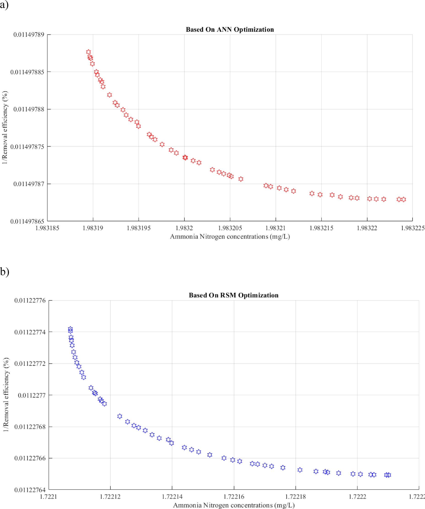
    * **Hình này chứng minh điều gì**
      * Cả tối ưu hóa dựa trên ANN (a) và RSM (b) đều tạo thành mặt biên Pareto liên tục thể hiện sự đánh đổi giữa hai mục tiêu: cực tiểu hóa nồng độ Amonia Nitơ và cực đại hóa hiệu suất khử ($1/\text{Removal Efficiency}$ cực tiểu).
    * **Từ đâu mà thấy được**
      * Đồ thị (a) ANN: nồng độ Ammonia Nitrogen tăng từ $1.98319$ đến $1.983224\text{ mg/L}$ khi $1/\text{Removal efficiency}$ giảm từ $0.01149789$ về $0.01149787\text{ \%}$.
      * Đồ thị (b) RSM: nồng độ Ammonia Nitrogen tăng từ $1.7221$ đến $1.72223\text{ mg/L}$ khi $1/\text{Removal efficiency}$ giảm từ $0.01122774$ về $0.01122765\text{ \%}$.

* **Kết quả tối ưu hóa đa mục tiêu cho Phosphat (Phosphate Optimization)**:
  * **Động thái đánh đổi trên mặt biên Pareto (Hình 10c,d)**:
    * Mặt biên Pareto biểu diễn mối quan hệ giữa $1/\text{Removal Efficiency}$ và nồng độ Phosphat cho thấy hiệu suất loại bỏ giảm khi nồng độ phosphat tăng lên, phản ánh quy luật cân bằng động học trong sự đồng hóa photpho của quần thể vi tảo.
  * **Kết quả tinh chỉnh mô hình ANN với NSGA-II**:
    * Theo công bố trong văn bản, mô hình ANN được điều chỉnh bằng NSGA-II đạt điểm tối ưu với nồng độ phosphat $9.5\text{ mg/L}$ và hiệu suất loại bỏ đạt $99\,\%$.
    * *Đối chiếu đồ thị thực tế Hình 10c*: Trục hoành đồ thị mang thang đo tỷ lệ $\times 10^{-3}$, cho thấy nồng độ phosphat thực tế trên biên Pareto là khoảng $9.5 \times 10^{-3}\text{ mg/L}$ ($0.0095\text{ mg/L}$) trong dải từ $9.4985 \times 10^{-3}$ đến $9.5015 \times 10^{-3}\text{ mg/L}$, ứng với $1/\text{Removal Efficiency}$ nằm trong khoảng $0.01000394$ đến $0.01000396\text{ \%}$ (tương đương hiệu suất khử $\approx 99.96\,\%$); số liệu $9.5\text{ mg/L}$ trong bài báo xuất phát từ việc lược bỏ hệ số tỷ lệ thang đo khi diễn giải bằng lời văn.
  * **Kết quả tối ưu hóa mô hình RSM với NSGA-II**:
    * Theo công bố trong văn bản, mô hình RSM được tối ưu hóa với NSGA-II đạt hàm lượng phosphat lý tưởng là $0.002\text{ mg/L}$ cùng hiệu quả làm sạch đạt $99\,\%$.
    * *Đối chiếu đồ thị thực tế Hình 10d*: Trục hoành đồ thị ghi nhận nồng độ phosphat biến thiên từ $0.201496$ đến $0.201514\text{ mg/L}$ (xấp xỉ $0.2015\text{ mg/L}$), với $1/\text{Removal Efficiency}$ nằm trong khoảng $0.01067439$ đến $0.01067447\text{ \%}$ (tương đương hiệu suất khử thực tế $\approx 93.68\,\%$); giá trị văn bản $0.002\text{ mg/L}$ và $99\,\%$ phản ánh sự khác biệt so với tọa độ trục số hiển thị trên đồ thị RSM.
  * **So sánh hiệu năng Pareto giữa mô hình ANN và RSM**:
    * Biên Pareto tối ưu hóa bởi ANN đạt nồng độ phosphat thấp hơn vượt bậc ($\sim 9.5 \times 10^{-3}\text{ mg/L}$) so với mô hình RSM ($\sim 0.2015\text{ mg/L}$), khẳng định khả năng xấp xỉ chính xác của mạng nơ-ron giúp NSGA-II khám phá được các giải pháp công nghệ ưu việt hơn.
  * **Hình 10.** (tiếp theo) Mặt biên Pareto và không gian biến quyết định
    * 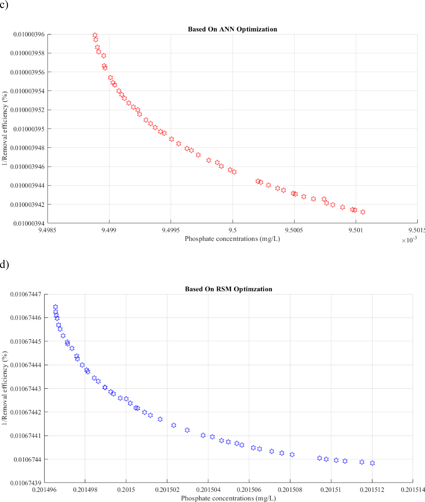
    * **Hình này chứng minh điều gì**
      * Biên Pareto thể hiện sự đánh đổi giữa giảm nồng độ phosphate và tăng hiệu suất khử qua mô hình ANN và RSM.
      * Tối ưu hóa bằng ANN đạt nồng độ phosphate thấp hơn đáng kể ($\sim 9.5 \times 10^{-3}\text{ mg/L}$) so với RSM ($\sim 0.2015\text{ mg/L}$).
    * **Từ đâu mà thấy được**
      * Panel (c) ANN: $\text{Ox}$ nồng độ phosphate ($9.4985 \times 10^{-3}$ - $9.5015 \times 10^{-3}\text{ mg/L}$), $\text{Oy}$ $1/\text{Removal efficiency}$ ($0.01000394$ - $0.01000396\,\%$).
      * Panel (d) RSM: $\text{Ox}$ nồng độ phosphate ($0.201496$ - $0.201514\text{ mg/L}$), $\text{Oy}$ $1/\text{Removal efficiency}$ ($0.01067439$ - $0.01067447\,\%$).
      * Xu hướng đường cong dốc xuống: khi nồng độ phosphate tăng thì nghịch đảo hiệu suất giảm (hiệu suất khử tăng).

* **Ý nghĩa kỹ thuật và hỗ trợ ra quyết định vận hành (Operational Trade-offs and Decision Support)**:
  * **Tính linh hoạt trong điều hành hệ thống**: Khác với một điểm cài đặt cố định duy nhất, tập hợp nghiệm tối ưu Pareto cung cấp cho người vận hành nhà máy xử lý nước thải một dải phương án điều khiển linh hoạt; trong các thời điểm tải trọng thủy lực biến động mạnh, nhà vận hành có thể chủ động chuyển dịch điểm làm việc trên mặt biên Pareto để cân đối giữa yêu cầu xả thải khắt khe và chi phí năng lượng/thời gian lưu.
  * **Công cụ hỗ trợ ra quyết định mạnh mẽ**: Sự kết hợp giữa mô hình học máy (ANN/RSM) và giải thuật NSGA-II xác lập một khung tính toán AI tin cậy, chuyển đổi các mô phỏng lý thuyết thành công cụ hỗ trợ ra quyết định thiết thực trong quản lý và vận hành bền vững hệ thống xử lý nước thải bằng vi tảo.

### Practical implications and environmental relevance

* **Ý nghĩa thực tiễn và mở rộng quy mô (Scale-up and practical engineering insights)**:
    * Kết quả tối ưu hóa từ khung tính toán kết hợp ANN và NSGA-II cung cấp các thông số định hướng then chốt phục vụ mở rộng quy mô (scale-up) và vận hành hệ thống bể phản ứng sinh học màng vi tảo (microalgae MBRs).
    * Mô hình xác định khoảng $\text{pH}$ tối ưu cho quá trình loại bỏ chất dinh dưỡng nằm trong dải từ $7.5$ đến $8.5$.
    * Từ góc độ kỹ thuật công trình thực tế (practical engineering perspective), dải $\text{pH}\ 7.5\text{--}8.5$ tạo nên một cửa sổ vận hành (operational window) rất thuận lợi cho công nghệ màng sinh học.
* **Cơ chế tự điều hòa pH và tối ưu chi phí vận hành (pH self-regulation and OPEX reduction)**:
    * Hoạt động quang hợp của vi tảo tiêu thụ tự nhiên lượng $\text{CO}_2$ hòa tan trong hỗn dịch bùn lỏng (mixed liquor), dẫn tới xu hướng tự nâng cao chỉ số $\text{pH}$ của môi trường phản ứng.
    * Nhờ cơ chế kiềm hóa tự nhiên này, việc duy trì bioreactor trong dải kiềm nhẹ ($\text{pH}\ 7.5\text{--}8.5$) chỉ đòi hỏi lượng hóa chất đệm bổ sung (axit hoặc bazơ) ở mức tối thiểu.
    * Việc giảm thiểu hóa chất đệm giúp cắt giảm đáng kể chi phí vận hành (Operational Expenditure - OPEX) của hệ thống xử lý.
    * Hạn chế hóa chất bổ sung đồng thời ngăn ngừa nguy cơ ô nhiễm hóa chất thứ cấp (secondary chemical contamination) đối với nguồn nước đầu ra (effluent).
* **Đánh đổi vận hành giữa thời gian lưu và chi phí đầu tư (Operational trade-off: HRT vs. CAPEX)**:
    * Phân tích biến số "Thời gian" (Time), đại diện cho thời gian lưu thủy lực (Hydraulic Retention Time - HRT), làm sáng tỏ mối quan hệ đánh đổi vận hành cốt lõi (critical operational trade-off).
    * Mô hình dự đoán rằng mục tiêu tối đa hóa hiệu suất loại bỏ chất ô nhiễm đạt mức $> 90\%$ đòi hỏi thời gian lưu phải vượt trên $12\text{ ngày}$ ($> 12\text{ ngày}$).
    * Mức hiệu suất $> 90\%$ giúp đáp ứng nghiêm ngặt các quy chuẩn xả thải môi trường tại các nguồn nước nhạy cảm nhằm ngăn ngừa hiện tượng phú dưỡng (eutrophication).
    * Tuy nhiên, thời gian lưu kéo dài trên $12\text{ ngày}$ đòi hỏi dung tích bể phản ứng lớn hơn, làm gia tăng đáng kể chi phí vốn đầu tư xây dựng ban đầu (Capital Expenditure - CAPEX).
* **Hỗ trợ ra quyết định linh hoạt thông qua mặt biên Pareto (Decision-support via Pareto front)**:
    * Tối ưu hóa đa mục tiêu với mặt biên Pareto (Pareto front) đem lại công cụ điều hành giá trị cho các kỹ sư vận hành nhà máy (plant operators).
    * Thay vì phải bám sát một điểm đặt cố định cứng nhắc (single rigid setpoint), người vận hành có thể căn cứ vào mô hình để điều chỉnh linh hoạt quy trình theo tải lượng thực tế.
    * Trong các giai đoạn đỉnh tải thủy lực (peak hydraulic load), trạm xử lý có thể chủ động lựa chọn nghiệm không bị chi phối (non-dominated solution) với thời gian lưu ngắn hơn (ví dụ: $8\text{--}10\text{ ngày}$) mà vẫn duy trì hiệu quả xử lý trong ngưỡng quy chuẩn xả thải cho phép.
    * Việc lựa chọn thời gian lưu $8\text{--}10\text{ ngày}$ giúp tránh tình trạng gượng ép đạt hiệu suất lý thuyết tối đa vốn có thể gây nghẽn hoặc quá tải hệ thống (system bottleneck).
    * Khả năng thích ứng linh hoạt này chứng minh khung trí tuệ nhân tạo đề xuất là một công cụ hỗ trợ ra quyết định đáng tin cậy cho công tác quản lý nước thải bền vững.
* **So sánh đối chứng với các nghiên cứu tiền nhiệm (Benchmarking against previous microalgae MBR studies)**:
    * Nghiên cứu tiến hành so sánh đối chứng toàn bộ kết quả mô hình hóa, dự đoán và tối ưu hóa hành vi hệ thống MBR vi tảo với các công trình công bố gần đây.
    * Trong điều kiện hỗn dưỡng (mixotrophic circumstances) với glucose và các hợp chất hữu cơ khác, lượng sinh khối vi tảo tăng cao trong môi trường dinh dưỡng hỗn hợp giúp hiệu suất loại bỏ nitơ và photpho cao hơn so với điều kiện tự dưỡng quang năng thuần túy (photoautotrophic settings).
    * Hiệu quả loại bỏ chất ô nhiễm trong các nghiên cứu trước đây thấp hơn đáng kể so với kết quả đạt được trong nghiên cứu này, dù hiện tượng thực nghiệm quan sát có nhiều nét tương đồng.
    * Chế độ nuôi cấy liên tục (continuous culture) trong thí nghiệm tạo điều kiện cho hệ thống bể phản ứng vận hành ổn định, thúc đẩy vi tảo nhanh chóng đạt trạng thái sinh trưởng cân bằng (steady-state microalgae growth) và nâng cao hiệu quả khử chất ô nhiễm.
    * Khung thuật toán kết hợp ANN, RSM và NSGA-II trong công trình hiện tại tích hợp xử lý đồng thời nitơ và photpho với độ chính xác cao so với các mô hình trước chỉ tập trung vào một khía cạnh riêng lẻ.
        * **Bảng 2.** So sánh với các nghiên cứu mô hình hóa MBR vi tảo gần đây
            * 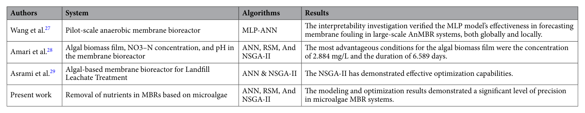
            * **Bảng này chứng minh điều gì**
                * Nghiên cứu hiện tại áp dụng đồng thời ANN, RSM và NSGA-II để xử lý dinh dưỡng trong MBR vi tảo với độ chính xác cao.
            * **Từ đâu mà thấy được**
                * Cột "System" và "Algorithms": hàng "Present work" tích hợp cả 3 phương pháp cho khử dinh dưỡng, so với chỉ MLP-ANN dự báo nghẽn màng (Wang et al.) hay nước rỉ rác (Asrami et al.).
                * Cột "Results": hàng "Present work" khẳng định mô hình và tối ưu hóa đạt độ chính xác đáng kể ("significant level of precision") trên hệ MBR vi tảo.

## Conclusions

* **Kết luận chung về phát triển và so sánh mô hình (Overall conclusions on model development and comparison)**:
    * Nghiên cứu đã phát triển và so sánh thành công các mô hình trí tuệ tính toán (computational intelligence models) nhằm dự đoán và tối ưu hóa quá trình loại bỏ nitơ amoniac (ammonia nitrogen) và phosphat (phosphate) trong bể phản ứng sinh học màng vi tảo (microalgae membrane bioreactor - MBR).
    * Phân tích so sánh chứng minh rằng mô hình mạng nơ-ron nhân tạo (Artificial Neural Network - ANN) vượt trội đáng kể so với phương pháp bề mặt đáp ứng (Response Surface Methodology - RSM).
    * ANN đạt hệ số xác định $R^2 > 0.99$ và các giá trị sai số căn bậc hai trung bình (root mean square error - RMSE) thấp hơn đối với tất cả các biến mục tiêu (target variables).
    * Kết quả khẳng định kiến trúc phi tuyến tính (non-linear architecture) của ANN vượt trội trong việc nắm bắt các động thái sinh học phức tạp (complex biological dynamics) của quá trình xử lý nước thải so với những giới hạn đa thức (polynomial limitations) của mô hình RSM.
### Novelty and contribution

* **Tính mới và đóng góp phương pháp luận (Novelty and contribution)**:
    * Đóng góp và tính mới cốt lõi của nghiên cứu nằm ở việc ứng dụng tích hợp ANN, RSM và thuật toán di truyền sắp xếp không bị chi phối thế hệ II (Non-dominated Sorting Genetic Algorithm II - NSGA-II) để thiết lập một khung hỗ trợ ra quyết định toàn diện (holistic decision-support framework).
    * Khác với các nghiên cứu trước đây vốn chỉ tập trung vào tối ưu hóa đơn mục tiêu (single-objective optimization), nghiên cứu này ứng dụng NSGA-II để tạo ra mặt tiền tối ưu Pareto (Pareto optimal front), làm sáng tỏ các mối quan hệ đánh đổi vận hành then chốt (critical operational trade-offs) giữa thời gian lưu và hiệu suất loại bỏ chất dinh dưỡng (nutrient removal efficiency).
    * Khung hỗ trợ ra quyết định này giúp người vận hành nhà máy lựa chọn các điều kiện vận hành linh hoạt—chẳng hạn như dải $\text{pH}$ từ $7.5\text{--}8.5$ và thời gian lưu thủy lực động (dynamic hydraulic retention time - dynamic HRT)—nhằm cân bằng giữa việc tuân thủ nghiêm ngặt các quy chuẩn môi trường với tính khả thi trong vận hành thực tế (operational feasibility).

### Limitations

* **Các giới hạn của nghiên cứu (Limitations)**:
    * Giới hạn về tập dữ liệu (dataset limitation): Quá trình xây dựng mô hình dựa trên tập dữ liệu thứ cấp (secondary dataset) gồm $44$ điểm thực nghiệm. Mặc dù các kỹ thuật kiểm định mạnh mẽ như dừng sớm (Early Stopping) và kiểm định chéo (cross-validation) đã được áp dụng để giảm thiểu hiện tượng quá khớp (overfitting), một tập dữ liệu lớn hơn sẽ giúp nâng cao hơn nữa độ tin cậy của mô hình.
    * Giới hạn về kiểm chứng thực nghiệm (experimental validation limitation): Các điều kiện tối ưu được đề xuất bởi thuật toán NSGA-II hiện tại mới chỉ là những dự đoán dựa trên mô hình (model-based predictions). Dù hoàn toàn phù hợp với các kỳ vọng lý thuyết, các điều kiện này vẫn chưa được kiểm chứng thực nghiệm vật lý trong điều kiện phòng thí nghiệm có kiểm soát (controlled laboratory setting).

### Future research directions

* **Định hướng nghiên cứu trong tương lai (Future research directions)**:
    * Kiểm chứng thực nghiệm có con người tham gia đánh giá (“human-in-the-loop” experimental validation): Khuyến nghị tiến hành thử nghiệm các điểm đặt (setpoints) cụ thể được xác định từ mặt tiền Pareto trên hệ thống MBR quy mô pilot (pilot-scale MBR) nhằm xác minh hiệu suất loại bỏ dự đoán.
    * Tích hợp khung AI với hệ thống giám sát thời gian thực (integration with real-time monitoring systems): Tiềm năng đáng kể trong việc kết nối các mô hình dự đoán này với các cảm biến IoT (Internet of Things), cho phép phát triển hệ thống điều khiển phản hồi tự động (automated feedback control system) có khả năng tự động điều chỉnh $\text{pH}$ và thời gian lưu theo dao động tải trọng dòng vào (fluctuating influent loads), tiến tới quản lý nước thải thông minh toàn diện (smart wastewater management).

## Modeling description

* **Khung mô hình hóa và tối ưu hóa tích hợp**: Sự kết hợp giữa các kỹ thuật mô hình hóa phương pháp bề mặt đáp ứng (Response Surface Methodology - RSM), mạng nơ-ron nhân tạo (Artificial Neural Network - ANN) và thuật toán di truyền sắp xếp không vượt trội II (Non-dominated Sorting Genetic Algorithm II - NSGA-II) được sử dụng để ước tính chính xác hiệu quả loại bỏ chất ô nhiễm trong bể phản ứng sinh học màng vi tảo (microalgae membrane bioreactor - MBR).
    * **Mục tiêu đánh giá và tối ưu**: Dự đoán và cải thiện nồng độ phosphat (phosphate concentration), hiệu suất loại bỏ phosphat (phosphate removal efficiency) và hiệu quả loại bỏ nitơ amoniac (ammonia nitrogen removal).
* **Ưu điểm và tiềm năng của khung tính toán thông minh kết hợp (RSM, ANN và NSGA-II)**:
    * **Tính mạnh mẽ và linh hoạt (robust and flexible)**: Cung cấp một phương pháp luận tin cậy và mềm dẻo để mô hình hóa dự báo, đồng thời tối ưu hóa các điều kiện vận hành của bioreactor.
    * **Tác động đến thiết kế và vận hành**: Kỹ thuật này có tiềm năng thay đổi cách thức thiết kế và vận hành các hệ thống xử lý nước thải dựa trên vi tảo (microalgae-based wastewater treatment systems).
    * **Lợi ích thực tiễn**: Nâng cao hiệu quả chi phí (cost-effectiveness), tính bền vững môi trường (sustainability) và hiệu suất tổng thể (efficiency) của quy trình xử lý.

### Data acquisition and preprocessing

* **Nguồn dữ liệu thực nghiệm và mục tiêu nghiên cứu (Source dataset and study objective)**:
    * Dữ liệu thực nghiệm của nghiên cứu được kế thừa từ công trình của Ding et al. [23], tập trung vào quá trình xử lý nước thải nuôi trồng thủy sản biển (mariculture wastewater) trong bể phản ứng sinh học màng vi tảo (microalgae membrane bioreactor - MBR).
    * Công trình này đóng vai trò là một nghiên cứu tái phân tích bằng mô hình hóa tính toán (computational modeling reanalysis) nhằm trích xuất các quy luật tối ưu hóa chuyên sâu (optimization insights) chưa từng được khám phá trong nghiên cứu thực nghiệm gốc.
    * Tập dữ liệu bao gồm $44$ điểm dữ liệu thực nghiệm riêng biệt ($44$ distinct experimental data points / runs).

* **Các biến số đầu vào và đầu ra của mô hình (Model input and output variables)**:
    * **Biến đầu vào độc lập (Input variables)**:
        * Thời gian vận hành (Time): đơn vị tính bằng ngày (days), dải khảo sát từ $0$ đến $20\text{ ngày}$.
        * Độ $\text{pH}$: dải khảo sát từ $6$ đến $9$.
        * Tổng carbon hữu cơ (Total Organic Carbon - TOC): đơn vị tính bằng $\text{mg/L}$, dải nồng độ khảo sát từ $40$ đến $120\text{ mg/L}$.
    * **Biến đáp ứng đầu ra (Output response variables)**:
        * Nồng độ nitơ amoniac (Ammonia Nitrogen concentration, $\text{mg/L}$).
        * Nồng độ phosphat (Phosphate concentration, $\text{mg/L}$).
        * Hiệu suất loại bỏ nitơ amoniac tương ứng (Ammonia Nitrogen Removal Efficiency, $\%$).
        * Hiệu suất loại bỏ phosphat tương ứng (Phosphate Removal Efficiency, $\%$).

* **Kỹ thuật tiền xử lý và chuẩn hóa Min-Max (Data preprocessing and Min-Max normalization)**:
    * Để đảm bảo khả năng hội tụ hiệu quả (efficient convergence) trong suốt tiến trình huấn luyện mạng nơ-ron nhân tạo (artificial neural network - ANN), toàn bộ dữ liệu đầu vào và đầu ra đều được chuẩn hóa về khoảng $[0, 1]$.
    * Phương pháp chuẩn hóa Min-Max (Min-Max normalization technique) được áp dụng theo công thức Phương trình (9):
      $$X_{\text{norm}} = \frac{X_i - X_{\min}}{X_{\max} - X_{\min}}$$
      * $X_{\text{norm}}$: Giá trị đã chuẩn hóa (normalized value), nằm trong khoảng $[0, 1]$.
      * $X_i$: Giá trị thực nghiệm đo đạc thực tế (actual value).
      * $X_{\min}$: Giá trị nhỏ nhất (cực tiểu) của biến số tương ứng trong tập dữ liệu (minimum value of the dataset).
      * $X_{\max}$: Giá trị lớn nhất (cực đại) của biến số tương ứng trong tập dữ liệu (maximum value of the dataset).

* **Chiến lược phân chia tập dữ liệu mô hình hóa ANN (Dataset partitioning for ANN modeling)**:
    * Toàn bộ $44$ điểm dữ liệu thực nghiệm được phân chia ngẫu nhiên (randomly partitioned) thành 3 tập con phục vụ huấn luyện và đánh giá mô hình:
        * **Tập huấn luyện (Training subset - $70\%$, $\sim 31$ mẫu)**: Dùng để điều chỉnh và cập nhật các trọng số mạng (network weights) và độ lệch của mô hình ANN.
        * **Tập kiểm định (Validation subset - $15\%$, $\sim 6-7$ mẫu)**: Dùng để giám sát sai số và ngăn ngừa hiện tượng quá khớp (prevent overfitting) trong quá trình huấn luyện.
        * **Tập kiểm tra (Testing subset - $15\%$, $\sim 6-7$ mẫu)**: Dùng để đánh giá độc lập và khách quan khả năng tổng quát hóa (generalization capability) của mô hình trên tập dữ liệu hoàn toàn mới chưa từng thấy (unseen data).

### RSM description

* **Khái niệm và mục tiêu của phương pháp bề mặt đáp ứng (Response Surface Methodology - RSM)**:
    * **Định nghĩa**: RSM là một tập hợp các phương pháp toán học và thống kê được sử dụng để xây dựng, cải thiện và tối ưu hóa các quy trình kỹ thuật.
    * **Mục tiêu cốt lõi**: Công cụ hữu hiệu nhằm xác định các thiết lập biến đầu vào tối ưu (best input variable settings) và tối đa hóa đáp ứng (response) của quy trình hoặc sản phẩm.
    * **Phạm vi khảo sát yếu tố**: RSM có khả năng nghiên cứu đa yếu tố đồng thời (multiple factors), mặc dù trong thực tế thường tập trung phân tích tương tác giữa hai yếu tố chính.
    * **Mô hình hóa bề mặt đáp ứng**: Thông qua việc triển khai chuỗi thiết kế thực nghiệm thừa số toàn phần (full factorial Design of Experiments - DOE), RSM thiết lập bản đồ bề mặt đáp ứng và cung cấp các phương trình thực nghiệm mô tả định lượng cách thức các yếu tố đầu vào chi phối biến đáp ứng.

* **Công cụ phần mềm và tham số thiết kế Design-Expert**:
    * **Vai trò**: Design-Expert là một trong những gói phần mềm phổ biến và mạnh mẽ nhất được ứng dụng cho mô hình hóa RSM.
    * **Khả năng thiết kế linh hoạt**: Phần mềm cung cấp phạm vi tùy chọn thiết kế phong phú, xử lý linh hoạt các tham số phân loại (categorical parameters) và kết hợp hài hòa giữa các biến hỗn hợp (mixture variables) cùng biến quy trình (process variables).
    * **Quy trình ứng dụng trong thực nghiệm**: Sự kết hợp giữa RSM và Design-Expert cho phép:
        * Sàng lọc các thông số then chốt (screening essential parameters).
        * Xác định các điều kiện vận hành phù hợp (appropriate process settings).
        * Tìm kiếm công thức phối liệu tối ưu với hỗn hợp các thiết kế (formulation with a mixture of design).

* **Kiểm định thống kê qua phân tích phương sai (Analysis of Variance - ANOVA)**:
    * **Nguyên lý của ANOVA**: Là phương pháp thống kê được sử dụng để xác định sự tồn tại của những biến thiên đáng kể giữa giá trị trung bình (means) của hai hoặc nhiều nhóm dữ liệu so sánh.
    * **Chức năng trong RSM**: Đánh giá tầm quan trọng và mức độ có ý nghĩa thống kê của các biến độc lập cũng như các số hạng tương tác tác động lên biến đáp ứng.
    * **Kiểm định giả thuyết không (Null Hypothesis - $H_0$)**:
        * **Nội dung giả thuyết không**: Phát biểu rằng không có sự khác biệt đáng kể giữa các giá trị trung bình của các nhóm được so sánh.
        * **Tiêu chuẩn bác bỏ**: Nếu giả thuyết không bị chứng minh là sai (bị bác bỏ), giá trị trung bình giữa các nhóm so sánh có sự khác biệt thực chất (vary substantially), khẳng định yếu tố thực nghiệm có ảnh hưởng đáng kể đến quy trình.

* **Quy trình các bước triển khai mô hình hóa bề mặt đáp ứng (RSM Workflow)**:
    * **Bước 1 - Thiết kế yếu tố thực nghiệm**: Xác định các yếu tố đầu vào (biến độc lập), ký hiệu là $X_1, X_2, \dots, X_n$, và lựa chọn các mức giá trị (levels) phù hợp cho từng yếu tố.
    * **Bước 2 - Lập ma trận thực nghiệm**: Xây dựng ma trận thiết kế gồm tập hợp các thí nghiệm (từ thí nghiệm $1$ đến thí nghiệm $n$), trong đó mỗi lần chạy là một tổ hợp các mức yếu tố xác định.
    * **Bước 3 - Tiến hành thí nghiệm và thu thập dữ liệu**: Thực hiện các mẻ phản ứng thực nghiệm và đo đạc chính xác các biến đáp ứng đầu ra tương ứng.
    * **Bước 4 - Khớp mô hình toán học (Model Fitting)**: Khớp mô hình bề mặt đáp ứng dựa trên dữ liệu thực nghiệm bằng phân tích hồi quy (regression analysis) hoặc các kỹ thuật mô hình hóa phù hợp nhằm mô phỏng mối quan hệ $Y = f(X_1, X_2, \dots, X_n)$.
    * **Bước 5 - Tối ưu hóa điều kiện vận hành**: Sử dụng mô hình bề mặt đáp ứng để xác định mức yếu tố lý tưởng nhằm cực đại hóa hoặc cực tiểu hóa biến đáp ứng theo mục tiêu công nghệ.
    * **Bước 6 - Xác thực và kiểm định mô hình (Validation)**: Đánh giá độ chính xác và độ tin cậy của mô hình trong việc dự đoán kết quả tại các điểm dữ liệu chưa từng quan sát (unobserved data points); quy trình có thể lặp lại hoặc phân tích mở rộng tùy theo yêu cầu cụ thể.

* **Dạng phương trình hồi quy đa thức trong RSM**:
    * **Mô hình hồi quy đa thức bậc hai (Quadratic RSM model)**: Mô hình bề mặt đáp ứng bậc hai được biểu diễn tổng quát theo phương trình:
      $$Y = \beta_0 + \sum_{i=1}^{k} \beta_i X_i + \sum_{i=1}^{k} \beta_{ii} X_i^2 + \sum_{i=1}^{k} \sum_{j=1}^{k} \beta_{ij} X_i X_j + \varepsilon \quad (10)$$
        * $Y$: Biến đáp ứng phụ thuộc (response variable).
        * $X_i, X_j$: Các biến độc lập đầu vào (independent variables).
        * $\beta_0$: Hệ số chặn / hằng số tự do (intercept constant).
        * $\beta_i$: Các hệ số hồi quy tuyến tính (linear coefficients).
        * $\beta_{ii}$: Các hệ số hồi quy bậc hai thuần túy (quadratic coefficients).
        * $\beta_{ij}$: Các hệ số hồi quy tương tác tích chéo (interaction / cross-product coefficients).
        * $\varepsilon$: Số hạng sai số ngẫu nhiên (random error term).
    * **Cân nhắc cấu trúc đa thức bậc hai và bậc ba (Quadratic vs. Cubic polynomial forms)**:
        * Dạng bậc hai (quadratic) là cấu trúc chuẩn mực được lựa chọn trong nghiên cứu nhờ khả năng nắm bắt độ cong bề mặt đáp ứng và tương tác đa biến mà không đòi hỏi số lượng điểm thí nghiệm quá lớn.
        * Dạng bậc ba (cubic) hoặc bậc cao hơn trong Design-Expert thường được kiểm tra để phát hiện phi tuyến phức tạp, nhưng có nguy cơ gây quá khớp (overfitting) hoặc thiếu bậc tự do (aliasing/lack of fit) nếu không có đủ điểm thực nghiệm bổ sung.

* **Cấu hình thiết kế thực nghiệm trong nghiên cứu**:
    * **Các biến phụ thuộc (biến đáp ứng đầu ra)**: Nồng độ nitơ amoniac (ammonia nitrogen concentrations), nồng độ phosphat (phosphate concentrations) và hiệu suất loại bỏ tương ứng (removal efficiency, $\%$).
    * **Các biến độc lập (yếu tố đầu vào) và dải giá trị khảo sát**:
        * Tổng carbon hữu cơ (Total Organic Carbon - TOC): $40\text{ đến }120\text{ mg/L}$.
        * Độ pH: $6\text{ đến }9$.
        * Thời gian phản ứng (Time): $0\text{ đến }20\text{ ngày}$.
    * **Phương pháp thiết kế thực nghiệm**:
        * Nghiên cứu ứng dụng thiết kế phức hợp tâm (Central Composite Design - CCD) kết hợp với các đợt chạy Box-Behnken, tạo ra $33$ và $44$ mẻ thực nghiệm.
        * Thiết kế CCD cho phép khảo sát toàn diện tác động riêng lẻ và hiệu ứng tương hỗ đồng thời của các yếu tố (TOC, pH, thời gian) lên hiệu quả khử chất dinh dưỡng trong bể phản ứng sinh học màng vi tảo (microalgae MBR).

* **So sánh tổng quan với các nghiên cứu mô hình hóa MBR vi tảo gần đây (Table 2)**:
    * **Wang và cộng sự (2024)**: Ứng dụng mô hình MLP-ANN trên hệ thống AnMBR quy mô pilot; phân tích khả năng giải thích (interpretability investigation) xác nhận tính hiệu quả của MLP trong dự báo hiện tượng nghẽn màng ở cả phạm vi cục bộ lẫn toàn cục.
    * **Amari và cộng sự (2023)**: Khảo sát màng sinh khối vi tảo, nồng độ $\text{NO}_3^-\text{-N}$ và pH trong MBR bằng ANN, RSM và NSGA-II; xác định điều kiện tối ưu cho màng sinh khối vi tảo tại nồng độ $2.884\text{ mg/L}$ và thời gian $6.589\text{ ngày}$.
    * **Asrami và cộng sự (2022)**: Nghiên cứu MBR vi tảo xử lý nước rỉ rác bãi chôn lấp bằng ANN và NSGA-II; khẳng định năng lực tối ưu hóa hiệu quả vượt trội của thuật toán NSGA-II.
    * **Nghiên cứu hiện tại (Present work)**: Ứng dụng khung tích hợp đồng thời ANN, RSM và NSGA-II để mô hình hóa và tối ưu hóa quá trình loại bỏ chất dinh dưỡng trong MBR vi tảo; kết quả chứng minh độ chính xác vượt trội ("significant level of precision") trong mô phỏng hành vi của hệ thống sinh học vi tảo.

### ANN description

* **Khái niệm và nền tảng của Mạng nơ-ron nhân tạo (Artificial Neural Network - ANN)**:
    * **Định nghĩa và nguyên lý sinh học**: ANN là mô hình điện toán mô phỏng theo cấu trúc và phương thức vận hành của các mạng nơ-ron sinh học (biological neural networks). Mạng bao gồm nhiều nơ-ron hay các đơn vị xử lý kết nối mạng (networked processing units) phối hợp với nhau nhằm giải quyết các bài toán kỹ thuật phức tạp.
    * **Kiến trúc Perceptron đa tầng (Multilayer Perceptron - MLP)**: Là một dạng mạng nơ-ron truyền thẳng (feedforward neural network) gồm nhiều tầng nơ-ron:
        * Lớp đầu vào (input layer): Tiếp nhận các biến hoặc đặc trưng đầu vào của bài toán.
        * Một hoặc nhiều lớp ẩn (one or more hidden layers): Thực hiện việc trích xuất đặc trưng và biến đổi phi tuyến không gian dữ liệu.
        * Lớp đầu ra (output layer): Tính toán và xuất ra các giá trị dự báo cuối cùng.
    * **Thuật toán lan truyền ngược (Backpropagation algorithm)**: MLP được huấn luyện thông qua kỹ thuật lan truyền ngược nhằm liên tục điều chỉnh các trọng số liên kết (connection weights) giữa các nơ-ron, cực tiểu hóa sai số giữa kết quả dự báo và dữ liệu thực tế quan sát được.
    * **Lợi thế tính toán trong kỹ thuật môi trường**: MLP là một trong những mạng nơ-ron sâu cơ bản nhất (basic deep neural networks), cho phép nắm bắt trọn vẹn động học phi tuyến mà không đòi hỏi chi phí tính toán quá cao (avoiding high processing demands) như các kiến trúc học sâu hiện đại phức tạp.

* **Cấu trúc kiến trúc và quy tắc thiết lập siêu tham số của mô hình MLP**:
    * **Số lượng lớp ẩn (Hidden layer count)**:
        * Là siêu tham số quan trọng cần được tinh chỉnh (hyperparameter tuning). Về mặt lý thuyết, mô hình MLP có thể thiết lập số lượng lớp ẩn tùy ý.
        * **Quy tắc kinh nghiệm (Rules of thumb)**: Bắt đầu cấu hình với $1$ lớp ẩn duy nhất và tăng dần số lớp cho đến khi hiệu năng mô hình trên tập kiểm định không còn được cải thiện.
        * **Kiểm định chéo (Cross-validation)**: Khuyến nghị sử dụng các phương pháp kiểm định chéo để tìm ra số lượng lớp ẩn tối ưu, đảm bảo tính tổng quát hóa tốt nhất.
    * **Số lượng nơ-ron trong lớp ẩn (Number of neurons in hidden layers)**:
        * Là siêu tham số quyết định trực tiếp dung lượng học tập (learning capacity) của mô hình.
        * **Quy tắc biên**: Lựa chọn số lượng nơ-ron nằm trong khoảng trung gian giữa kích thước của lớp đầu vào và lớp đầu ra.
        * **Quy tắc tỷ lệ hai phần ba**: Thiết lập số lượng nơ-ron bằng hai phần ba ($2/3$) tổng kích thước của lớp đầu vào và lớp đầu ra.
    * **Cấu trúc hoàn toàn kết nối (Fully connected architecture)**:
        * Sơ đồ dòng dữ liệu bắt đầu từ lớp đầu vào đại diện cho các thuộc tính đặc trưng.
        * Mỗi nơ-ron ở lớp đầu vào kết nối toàn phần tới mọi nơ-ron của lớp ẩn đầu tiên; mỗi liên kết mang một trọng số đại diện cho cường độ tương tác.
        * Quá trình truyền xuôi tiếp tục được lặp lại qua từng lớp ẩn liên tiếp cho đến khi tới lớp đầu ra.

* **Cơ chế tính toán toán học trong nơ-ron (Mathematical Formulation of Neuron Processing)**:
    * **Tính toán đầu vào nơ-ron (Neuron input calculation - Weighted sum)**:
        * Đối với một nơ-ron đơn lẻ trong mạng, tổng có trọng số của các đầu vào kết hợp với số hạng độ lệch (bias term) được xác định theo phương trình (11):
          $$Z = \sum_{i=1}^{n} (w_i \cdot x_i) + b \quad (11)$$
          Trong đó:
          * $Z$ (hoặc $z$): Tổng có trọng số của các tín hiệu đầu vào cộng với độ lệch bias.
          * $x_i$: Tín hiệu đầu vào thứ $i$ đưa vào nơ-ron.
          * $w_i$: Trọng số liên kết gắn liền với đầu vào $x_i$.
          * $b$: Số hạng độ lệch (bias term), đóng vai trò ngưỡng dịch chuyển cho hàm kích hoạt.
    * **Áp dụng hàm kích hoạt (Activation function transformation)**:
        * Hàm kích hoạt $f(z)$ được áp dụng trực tiếp lên tổng có trọng số $z$ theo phương trình (12):
          $$a = f(z) \quad (12)$$
          Trong đó $a$ là giá trị kích hoạt đầu ra của nơ-ron được truyền tiếp xuống lớp kế cận.
        * **Vai trò**: Đưa đặc tính phi tuyến (non-linearity) vào mạng nơ-ron, cho phép mô hình học và xấp xỉ các mối quan hệ động học và hóa sinh phức tạp.
    * **Tính toán đầu ra tại lớp đầu ra (Output layer computation)**:
        * Hàm kích hoạt của nơ-ron lớp đầu ra tạo ra giá trị dự đoán cuối cùng $y$ theo phương trình (13):
          $$y = f\left(\sum_{i=1}^{n} (w_i \cdot x_i) + b\right) \quad (13)$$
          Giá trị $y$ này biểu diễn đại lượng được mô hình mạng nơ-ron dự báo cho biến mục tiêu tương ứng.

* **Các hàm kích hoạt và phạm vi ứng dụng trong MLP**:
    * **Hàm kích hoạt cho lớp ẩn (Hidden layer activation functions)**:
        * **Hàm Hyperbolic Tangent Sigmoid ($\tanh$ / `tansig`)**: Ánh xạ bất kỳ giá trị đầu vào nào thành giá trị trong dải $[-1, 1]$. Tính đối xứng qua gốc tọa độ giúp quá trình tối ưu hóa lan truyền ngược hội tụ nhanh hơn.
        * **Hàm Sigmoid đối xứng / Logistic (`logsig`)**: Ánh xạ dần dần bất kỳ giá trị đầu vào nào thành giá trị thực trong khoảng $[0, 1]$.
        * **Hàm Rectified Linear Unit (ReLU)**: Hàm phi tuyến từng đoạn không trơn (non-smooth), ánh xạ mọi giá trị $< 0$ về $0$ và giữ nguyên giá trị đầu vào nếu $\ge 0$ ($f(z) = \max(0, z)$).
    * **Hàm kích hoạt cho lớp đầu ra (Output layer activation functions)**:
        * **Bài toán phân loại (Classification tasks)**: Thường sử dụng hàm Softmax để chuyển đổi các đầu ra thành phân phối xác suất.
        * **Bài toán hồi quy (Regression tasks)**: Thường sử dụng hàm tuyến tính đồng nhất (Identity function / linear / `purelin`), cho phép mô hình dự báo không bị giới hạn trong dải giá trị thực liên tục của các chỉ tiêu chất lượng nước thải.

* **Hiện tượng quá khớp và các chiến lược kiểm soát (Overfitting & Regularization)**:
    * **Bản chất của hiện tượng quá khớp (Overfitting)**:
        * Xảy ra khi mô hình đạt độ chính xác quá cao trên tập huấn luyện (training data) nhưng hoạt động rất kém trên tập dữ liệu mới chưa từng thấy (fresh/unseen data).
        * Nguyên nhân do mô hình quá phức tạp so với lượng dữ liệu huấn luyện có sẵn, dẫn tới việc mạng ghi nhớ (memorize) các điểm dữ liệu cụ thể và nhiễu ngẫu nhiên thay vì học các quy luật quy nạp bản chất (underlying patterns).
    * **Kỹ thuật điều chuẩn (Regularization techniques - L1 & L2)**:
        * Bổ sung một số hạng phạt (penalty term) vào hàm mất mát (loss function) nhằm khuyến khích mô hình duy trì các giá trị trọng số nhỏ hơn.
        * Giúp đơn giản hóa cấu trúc mô hình và kiểm soát độ phức tạp hiệu quả.
    * **Điều chuẩn loại bỏ nơ-ron (Dropout regularization)**:
        * Trong quá trình huấn luyện, kỹ thuật dropout loại bỏ ngẫu nhiên một tỷ lệ nơ-ron trong mạng ở mỗi lượt lặp.
        * Thúc đẩy mô hình hình thành các đặc trưng bền vững (robust features) và ngăn ngừa hiện tượng phụ thuộc quá mức vào bất kỳ một nơ-ron đơn lẻ nào.
    * **Phát hiện quá khớp qua kiểm định chéo (Cross-validation)**:
        * Đánh giá song song hiệu năng của mô hình trên cả tập huấn luyện và tập kiểm định. Hiện tượng quá khớp được xác nhận khi sai số trên tập kiểm định tăng cao rõ rệt so với sai số trên tập huấn luyện.

* **Chiến lược phân chia tập dữ liệu và Thuật toán huấn luyện Levenberg-Marquardt**:
    * **Phân chia tập dữ liệu (Dataset partitioning - 70/15/15)**:
        * **Tập huấn luyện (Training set - 70%)**: Dùng để tính toán gradient và trực tiếp cập nhật các trọng số liên kết và độ lệch ($w, b$) của mô hình mạng.
        * **Tập kiểm định (Validation set - 15%)**: Dùng để theo dõi độc lập độ chính xác trong quá trình huấn luyện, ngăn ngừa hiện tượng quá khớp thông qua cơ chế giám sát sai số.
        * **Tập kiểm tra (Testing set - 15%)**: Hoàn toàn độc lập, không tham gia vào quá trình tối ưu hóa trọng số hay lựa chọn mô hình, dùng để đánh giá năng lực tổng quát hóa khách quan trên dữ liệu thực tế.
    * **Thuật toán huấn luyện Levenberg-Marquardt (LM backpropagation)**:
        * Là thuật toán tối ưu hóa bậc hai dựa trên xấp xỉ ma trận Hessian ($H \approx J^T J + \mu I$, với $J$ là ma trận Jacobian của sai số).
        * Kết hợp linh hoạt giữa tốc độ hội tụ nhanh vượt trội của phương pháp Gauss-Newton (khi gần điểm cực tiểu) và tính ổn định bền vững của phương pháp hạ độ dốc (gradient descent - khi ở xa điểm cực tiểu).
        * Được xem là giải thuật huấn luyện chuẩn mực có hiệu quả cao nhất cho các mạng MLP quy mô vừa và nhỏ trong mô hình hóa kỹ thuật môi trường.
    * **Tiêu chí dừng và kỹ thuật dừng sớm (Stopping criteria & Early Stopping)**:
        * **Dừng sớm dựa trên kiểm định (Validation checks / Early Stopping)**: Quá trình huấn luyện tự động dừng lại khi sai số trên tập kiểm định liên tiếp không giảm trong $6$ epoch kiểm tra (validation checks fail = 6); các trọng số tối ưu tại epoch có sai số kiểm định nhỏ nhất được lưu trữ lại nhằm triệt tiêu hoàn toàn quá khớp.
        * **Các ngưỡng dừng bổ sung**: Đạt số chu kỳ tối đa (maximum epochs), gradient sai số giảm xuống dưới ngưỡng cực tiểu cho phép, hoặc tham số suy giảm $\mu$ vượt ngưỡng tối đa ($\mu_{\max}$).

* **Các chỉ số đánh giá hiệu năng mô hình (Performance Evaluation Metrics)**:
    * **Sai số toàn phương trung bình (Mean Squared Error - MSE)**:
        * Là hàm mất mát tiêu chuẩn trong huấn luyện và đánh giá MLP, đo lường sai khác bình phương trung bình giữa giá trị thực nghiệm và giá trị dự báo theo phương trình (14):
          $$\text{MSE} = \frac{1}{n} \sum (y - a)^2 \quad (14)$$
          Trong đó:
          * $n$: Cỡ mẫu quan sát (sample size).
          * $y$: Giá trị thực tế thu được từ thực nghiệm.
          * $a$: Giá trị dự đoán bởi mạng nơ-ron.
          * $\text{Sum}$: Tổng bình phương sai số trên toàn bộ tập dữ liệu mẫu.
    * **Hệ số xác định ($R^2$ / R-squared)**:
        * Đo lường mức độ phù hợp của mô hình đối với dữ liệu thực nghiệm, dao động trong dải từ $0$ đến $1$ ($1$ đại diện cho sự trùng khớp tuyệt đối) theo phương trình (15):
          $$R^2 = 1 - \frac{\sum (y - a)^2}{\sum (y - \bar{y})^2} \quad (15)$$
          Trong đó:
          * $y$: Giá trị đầu ra thực tế.
          * $a$: Giá trị đầu ra dự đoán.
          * $\bar{y}$ ($\text{mean}(y)$): Giá trị trung bình cộng của các đầu ra thực tế quan sát được.

* **Thiết lập mô hình ANN trong nghiên cứu cụ thể này**:
    * **Nguồn dữ liệu thực nghiệm**: Mô hình MLP được xây dựng và huấn luyện dựa trên $44$ điểm dữ liệu thực nghiệm nuôi cấy liên tục vi tảo *Platymonas helgolandica tsingtaoensis* trong hệ thống MBR xử lý nước thải nuôi trồng thủy sản từ nghiên cứu của Yi Ding et al.
    * **Các biến đầu vào ($3$ thông số vận hành)**:
        * Thời gian vận hành ($\text{Time}$, đơn vị: ngày / days).
        * Độ $\text{pH}$.
        * Nồng độ tổng carbon hữu cơ đầu vào ($\text{TOC}$, đơn vị: mg/L).
    * **Các biến đầu ra ($4$ chỉ tiêu xử lý chất dinh dưỡng)**:
        * Nồng độ amonia nitơ ($\text{NH}_4^+\text{-N}$) và hiệu suất loại bỏ amonia nitơ ($\%$).
        * Nồng độ phosphat ($\text{PO}_4^{3-}$) và hiệu suất loại bỏ phosphat ($\%$).
    * **Cấu hình hàm kích hoạt và thuật toán trong nghiên cứu**:
        * Lớp ẩn: Sử dụng hàm kích hoạt hyperbolic tangent sigmoid (`tansig`) nhằm nắm bắt trọn vẹn bản chất phi tuyến phức tạp trong quá trình hấp thụ dinh dưỡng của vi tảo.
        * Lớp đầu ra: Sử dụng hàm kích hoạt tuyến tính đồng nhất (`purelin`) để thực hiện tác vụ hồi quy liên tục cho các chỉ số nồng độ và hiệu suất.
        * Giải thuật huấn luyện: Áp dụng thuật toán Levenberg-Marquardt (LM) với chiến lược chia dữ liệu $70/15/15$ và cơ chế Early Stopping để ngăn chặn quá khớp, sử dụng $\text{MSE}$ và $R^2$ làm thước đo định lượng chính xác độ tin cậy của mô hình.

### Multi-objective optimization setup via NSGA-II

* **Mục tiêu và nguyên lý của giải thuật di truyền sắp xếp không bị chi phối II (Non-dominated Sorting Genetic Algorithm II - NSGA-II)**:
    * **Mục đích tối ưu hóa**: Xác định các điều kiện vận hành tối ưu nhằm đồng thời cực đại hóa hiệu quả loại bỏ các chất dinh dưỡng (nutrient removal) trong hệ thống MBR.
    * **Đặc tính đa mục tiêu (Multi-objective optimization)**: Khác với phương pháp tối ưu hóa đơn mục tiêu (single-objective optimization) chỉ tìm một nghiệm cực trị cục bộ hoặc toàn cục, NSGA-II tạo ra một tập hợp các giải pháp tối ưu được gọi là mặt trước Pareto (Pareto Front).
    * **Bản chất của mặt trước Pareto (Pareto Front)**: Đại diện cho sự thỏa hiệp tối ưu nhất (best trade-offs) giữa các mục tiêu xung đột nhau (conflicting objectives), khi việc cải thiện một mục tiêu bắt buộc phải đánh đổi bằng sự suy giảm của mục tiêu còn lại.
    * **Cơ chế hoạt động cốt lõi của NSGA-II**:
        * **Sắp xếp không bị chi phối (Non-dominated sorting)**: Phân tầng các cá thể trong quần thể thành các bậc Pareto (Pareto fronts/ranks) dựa trên quan hệ chi phối; một giải pháp được coi là không bị chi phối nếu không có giải pháp nào khác tốt hơn nó ở tất cả các mục tiêu.
        * **Khoảng cách tập trung (Crowding distance)**: Ước lượng mật độ xung quanh từng giải pháp trên biên Pareto nhằm duy trì tính đa dạng sinh học (diversity preservation) của quần thể mà không cần tham số chia sẻ (niching/sharing parameter) định lượng trước.
        * **Bảo toàn độ ưu tú (Elitism)**: Ghép đôi quần thể cha mẹ và con cái ($2N$) trước khi chọn lọc, đảm bảo các cá thể xuất sắc nhất qua các thế hệ không bị mất đi.
* **Thiết lập bài toán tối ưu hóa (Problem Formulation)**:
    * Bài toán tối ưu hóa được xây dựng gồm $3$ biến quyết định (decision variables) và $2$ hàm mục tiêu (objective functions).
    * **Biến quyết định (Decision Variables)**: Không gian tìm kiếm (search space) bị giới hạn nghiêm ngặt bởi các biên của thiết kế thực nghiệm (experimental design boundaries):
        * Thời gian vận hành (Time): $0 \le \text{Time} \le 20$ (ngày / days).
        * Độ $\text{pH}$: $6 \le \text{pH} \le 9$.
        * Tổng cacbon hữu cơ (Total Organic Carbon - TOC): $40 \le \text{TOC} \le 120$ (mg/L).
    * **Hàm mục tiêu và hàm thích nghi (Objective / Fitness Functions)**: Các phương trình hồi quy đa thức (regression equations) thu được từ mô hình phương pháp bề mặt đáp ứng (Response Surface Methodology - RSM) được sử dụng trực tiếp làm các hàm thích nghi:
        * **Mục tiêu 1 (Objective 1)**: Cực đại hóa hiệu suất loại bỏ nitơ amoniac (Ammonia Nitrogen Removal Efficiency, $\%$), sử dụng các phương trình hồi quy RSM (Eqs. 2 và 6).
        * **Mục tiêu 2 (Objective 2)**: Cực đại hóa hiệu suất loại bỏ phosphat (Phosphate Removal Efficiency, $\%$), sử dụng các phương trình hồi quy RSM (Eqs. 4 và 8).
* **Cấu hình tham số thuật toán (Algorithm Parameters)**:
    * Các thông số vận hành của thuật toán NSGA-II được thiết lập nhằm đảm bảo khả năng hội tụ bền vững và chính xác (robust convergence):
        * **Quy mô quần thể (Population Size)**: $100$ cá thể.
        * **Số thế hệ tối đa (Maximum Generations)**: $200$ thế hệ.
        * **Xác suất lai ghép (Crossover Probability)**: $0.9$ ($90\%$).
        * **Xác suất đột biến (Mutation Probability)**: $0.1$ ($10\%$).
        * **Toán tử chọn lọc (Selection Operator)**: Chọn lọc giải đấu (Tournament Selection), cho phép chọn cá thể tốt hơn dựa trên bậc Pareto và khoảng cách tập trung.
* **Khả năng ứng dụng và hỗ trợ ra quyết định (Decision-making implications)**:
    * Tập nghiệm tối ưu Pareto (Pareto optimal set) cung cấp cho các nhà quản lý và kỹ sư vận hành một dải rộng các điều kiện vận hành khả thi.
    * Cho phép tính linh hoạt cao trong việc điều chỉnh chế độ công nghệ tùy theo yêu cầu cụ thể của từng kịch bản nước thải (wastewater scenario)—ưu tiên xử lý triệt để nitơ amoniac hay phosphat tùy thuộc vào quy chuẩn xả thải tại địa phương.

### Verification of RSM, NSGA-II, and ANN models

* **Mục tiêu và khuôn khổ kiểm chứng mô hình (Model Verification Framework)**:
    * **Đánh giá nghiêm ngặt độ chuẩn xác dự báo (Predictive Accuracy)**: Để đánh giá toàn diện và khắt khe năng lực dự báo của các mô hình bề mặt đáp ứng (Response Surface Methodology - RSM) và mạng nơ-ron nhân tạo (Artificial Neural Network - ANN) đã phát triển, nghiên cứu áp dụng các chỉ số thống kê định lượng chuyên sâu thay vì chỉ dựa vào hệ số xác định ($R^2$).
    * **Sự cần thiết của việc mở rộng các chỉ số đánh giá**: Mặc dù hệ số xác định $R^2$ phản ánh mức độ tương quan xu hướng giữa dữ liệu dự đoán và thực nghiệm, chỉ số này có thể bị thổi phồng hoặc không phản ánh được biên độ sai số tuyệt đối; do đó, việc kết hợp các chỉ số sai số trung bình là bắt buộc để khẳng định độ tin cậy trong kỹ thuật môi trường.
    * **Kiểm định sự phù hợp của mô hình trong hệ thống MBR vi tảo**: Xác nhận khả năng mô phỏng chính xác quá trình loại bỏ các chất dinh dưỡng (nitơ amoniac và phosphat) trong bể phản ứng sinh học màng vi tảo (*microalgae membrane bioreactor* - MBR), nơi diễn ra đồng thời nhiều tương tác sinh hóa và thủy động học phức tạp.

* **Các chỉ số thống kê đánh giá sai số và công thức toán học (Statistical Evaluation Metrics)**:
    * **Căn bậc hai sai số toàn phương trung bình (Root Mean Square Error - RMSE)**:
        * **Định nghĩa và ý nghĩa vật lý**: RMSE lượng hóa độ lệch căn bậc hai trung bình giữa các giá trị dự đoán ($y_{\text{pred}}$) và dữ liệu thực nghiệm thực tế ($y_{\text{exp}}$). Do áp dụng phép tính bình phương sai số trước khi lấy trung bình, RMSE đặc biệt nhạy cảm với các sai số lớn (outliers) và phạt nặng các độ lệch dự báo bất thường.
        * **Công thức toán học (Phương trình 16)**:
          $$\text{RMSE} = \sqrt{\frac{1}{n} \sum_{i=1}^{n} (y_{\text{exp}} - y_{\text{pred}})^2} \quad (16)$$
          Trong đó:
          * $n$: Tổng số điểm dữ liệu thực nghiệm quan sát ($n = 44$).
          * $y_{\text{exp}}$: Giá trị thực nghiệm đo đạc thực tế tại mẫu thứ $i$.
          * $y_{\text{pred}}$: Giá trị dự báo tương ứng thu được từ mô hình (RSM hoặc ANN) tại mẫu thứ $i$.
    * **Sai số tuyệt đối trung bình (Mean Absolute Error - MAE)**:
        * **Định nghĩa và đặc tính thống kê**: MAE lượng hóa giá trị trung bình số học của tất cả các sai số tuyệt đối giữa giá trị thực nghiệm và giá trị dự báo. Không giống như RMSE, MAE gán trọng số tuyến tính đồng đều cho mọi mức sai lệch, phản ánh độ lớn sai số điển hình mà không phóng đại ảnh hưởng của các giá trị ngoại lai.
        * **Công thức toán học (Phương trình 17)**:
          $$\text{MAE} = \frac{1}{n} \sum_{i=1}^{n} |y_{\text{exp}} - y_{\text{pred}}| \quad (17)$$
          Trong đó:
          * $n$: Số lượng mẫu quan sát trong tập dữ liệu.
          * $|y_{\text{exp}} - y_{\text{pred}}|$: Độ lệch tuyệt đối giữa giá trị thực nghiệm và giá trị dự báo tại mẫu thứ $i$.
    * **Hệ số xác định (Coefficient of Determination - $R^2$)**:
        * **Ý nghĩa thống kê**: Đo lường tỷ lệ phần trăm tổng phương sai của biến phụ thuộc được giải thích bởi mô hình toán học (RSM hoặc ANN), biểu thị mức độ phù hợp tổng thể giữa đường cong dự báo và phân bố thực nghiệm:
          $$R^2 = 1 - \frac{\sum_{i=1}^{n} (y_{\text{exp}} - y_{\text{pred}})^2}{\sum_{i=1}^{n} (y_{\text{exp}} - \bar{y}_{\text{exp}})^2}$$
          Trong đó $\bar{y}_{\text{exp}}$ là giá trị trung bình thực nghiệm ($\bar{y}_{\text{exp}} = \frac{1}{n} \sum_{i=1}^{n} y_{\text{exp}}$).
        * **Tiêu chuẩn đánh giá**: Giá trị $R^2$ nằm trong dải $[0, 1]$; giá trị càng tiệm cận $1.0$ càng khẳng định mức độ ăn khớp lý tưởng của mô hình đối với dữ liệu thực nghiệm.
    * **Kiểm định giả thuyết thống kê (Statistical Hypothesis Testing)**:
        * **Bác bỏ giả thuyết không ($H_0$)**: Thông qua phân tích phương sai (ANOVA), giả thuyết không cho rằng "mô hình không có khả năng dự báo và sai số quan sát được chỉ do ngẫu nhiên" bị bác bỏ với mức ý nghĩa cao ($P < 0.0001$).
        * **Ngưỡng chấp nhận mô hình**: Cả hai mô hình RSM và ANN đều vượt qua ngưỡng kiểm định khắt khe với hệ số $R^2 > 0.95$, xác nhận cả hai cách tiếp cận đều có ý nghĩa thống kê thực chất và đủ năng lực mô phỏng động học của bioreactor.

* **So sánh định lượng hiệu năng giữa mô hình RSM và ANN (đối chiếu Bảng 3 tại mục 3.3)**:
    * **Chi tiết các chỉ số thống kê so sánh đối chứng giữa hai mô hình**:
      | Biến mục tiêu (*Target Variable*) | Mô hình (*Model*) | $R^2$ | RMSE | MAE |
      | :--- | :--- | :--- | :--- | :--- |
      | Nitơ amoniac (*Ammonia nitrogen*) | RSM | $0.9733$ | $0.324$ | $0.281$ |
      | Nitơ amoniac (*Ammonia nitrogen*) | ANN | $0.9979$ | $0.189$ | $0.142$ |
      | Photphat (*Phosphate*) | RSM | $0.9608$ | $0.251$ | $0.215$ |
      | Photphat (*Phosphate*) | ANN | $0.9972$ | $0.166$ | $0.118$ |
    * **Phân tích so sánh chi tiết giữa RSM và ANN**:
      * **Độ chính xác trên biến Nitơ amoniac (Ammonia nitrogen)**:
        * Mô hình RSM đạt $R^2 = 0.9733$, $\text{RMSE} = 0.324$, và $\text{MAE} = 0.281$.
        * Mô hình ANN đạt $R^2 = 0.9979$, $\text{RMSE} = 0.189$, và $\text{MAE} = 0.142$.
        * Sai số RMSE của ANN giảm $41.7\%$ và MAE giảm $49.5\%$ so với RSM, thể hiện sự cải thiện vượt bậc về độ chuẩn xác tại từng điểm đo.
      * **Độ chính xác trên biến Photphat (Phosphate)**:
        * Mô hình RSM đạt $R^2 = 0.9608$, $\text{RMSE} = 0.251$, và $\text{MAE} = 0.215$.
        * Mô hình ANN đạt $R^2 = 0.9972$, $\text{RMSE} = 0.166$, và $\text{MAE} = 0.118$.
        * Sai số RMSE của ANN giảm $33.9\%$ và MAE giảm $45.1\%$ so với RSM.
      * **Đánh giá ưu thế vượt trội của phương pháp mạng nơ-ron (ANN superiority)**:
        * Dù cả hai mô hình đều có năng lực dự báo thỏa đáng ($R^2 > 0.95$), ANN thể hiện độ chính xác vượt trội (superior precision) với các giá trị RMSE và MAE thấp hơn rõ rệt trên toàn bộ các biến phản ứng mục tiêu.
        * Kết quả này khẳng định cấu trúc phi tuyến với các hàm kích hoạt đối xứng nhiều tầng của ANN thích hợp vượt trội trong việc nắm bắt bản chất động sinh học phi tuyến phức tạp (*non-linear complexities*) của hệ thống MBR vi tảo so với các phương trình hồi quy đa thức giới hạn của RSM.

* **Kiểm chứng vai trò tích hợp của thuật toán NSGA-II trong chuỗi mô hình hóa**:
    * **Kết nối giữa mô hình hồi quy và giải thuật di truyền**: Thuật toán di truyền sắp xếp không bị chi phối II (NSGA-II) sử dụng trực tiếp các phương trình toán học thực nghiệm từ RSM làm các hàm thích nghi (fitness functions) để tìm kiếm không gian nghiệm tối ưu.
    * **Xác thực tập nghiệm tối ưu Pareto (Pareto Optimal Verification)**:
        * NSGA-II giải quyết xung đột cố hữu giữa hai mục tiêu: cực đại hóa hiệu quả loại bỏ nitơ amoniac và cực đại hóa hiệu quả loại bỏ phosphat.
        * Các nghiệm trên mặt trước Pareto được kiểm chứng chéo với các miền biên vật lý thực nghiệm và dự báo ANN, đảm bảo các chế độ vận hành đề xuất hoàn toàn khả thi và không bị trôi dạt vào các vùng bất ổn định của bể sinh học màng vi tảo.
