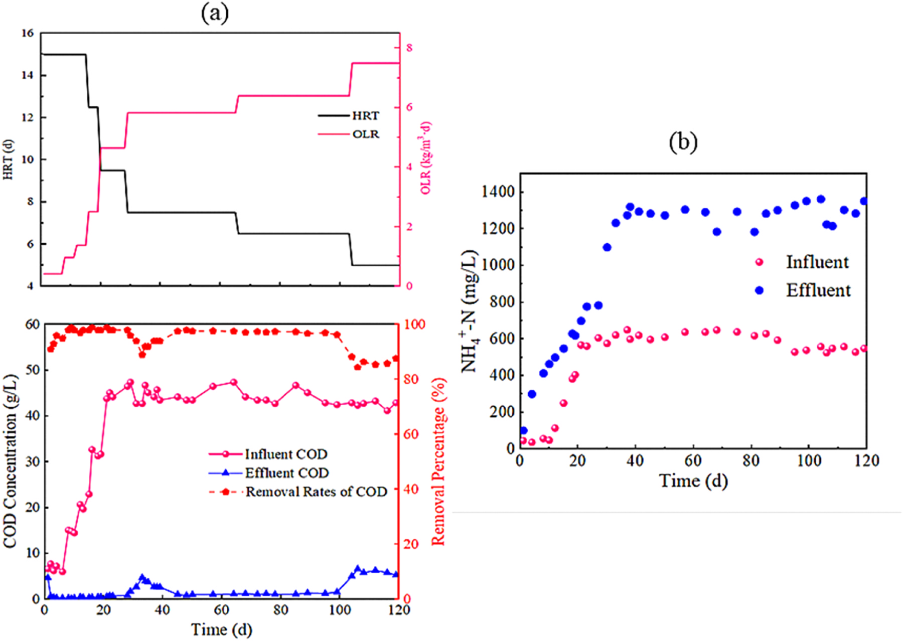
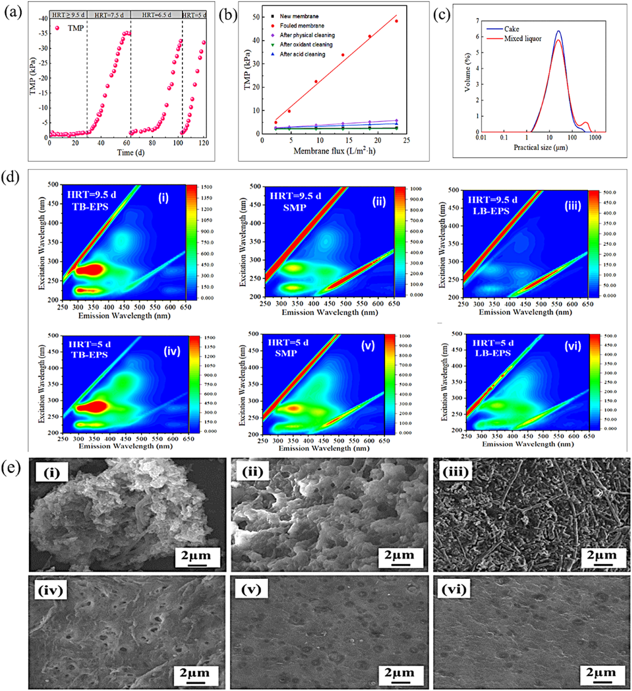
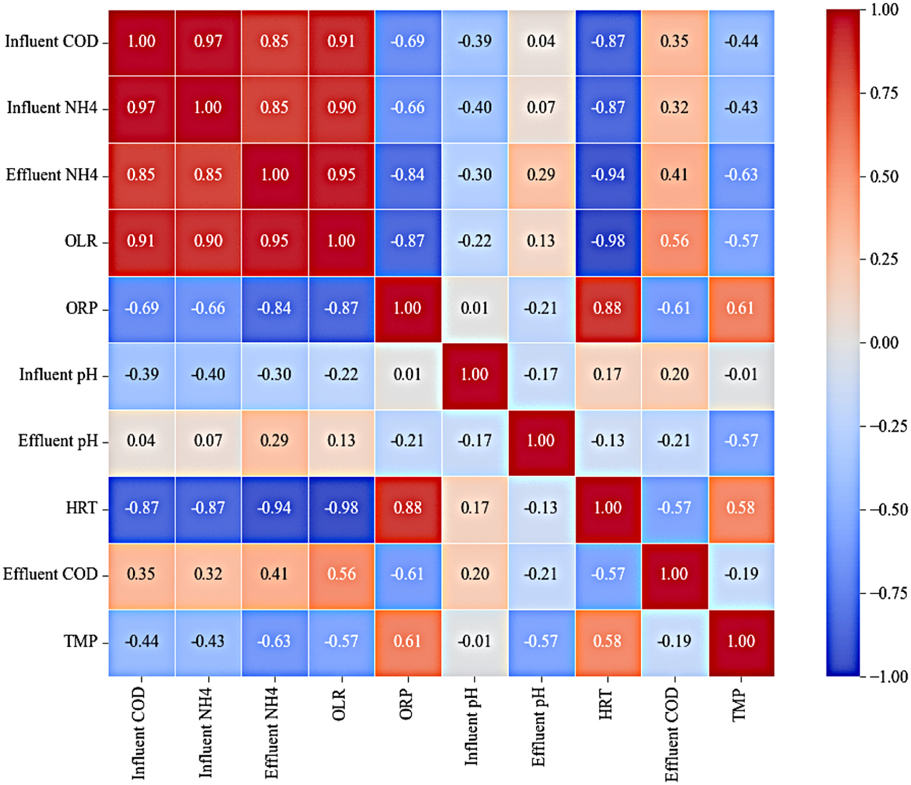
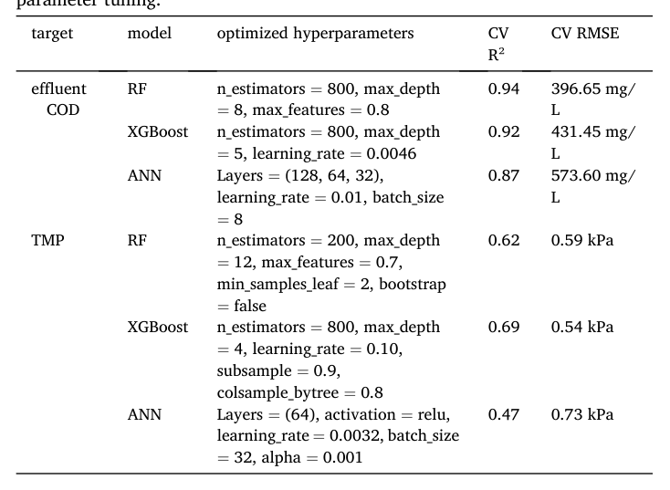
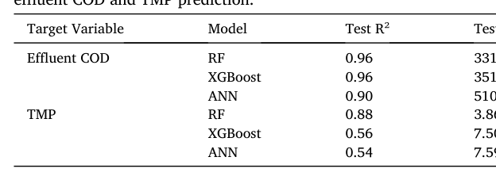
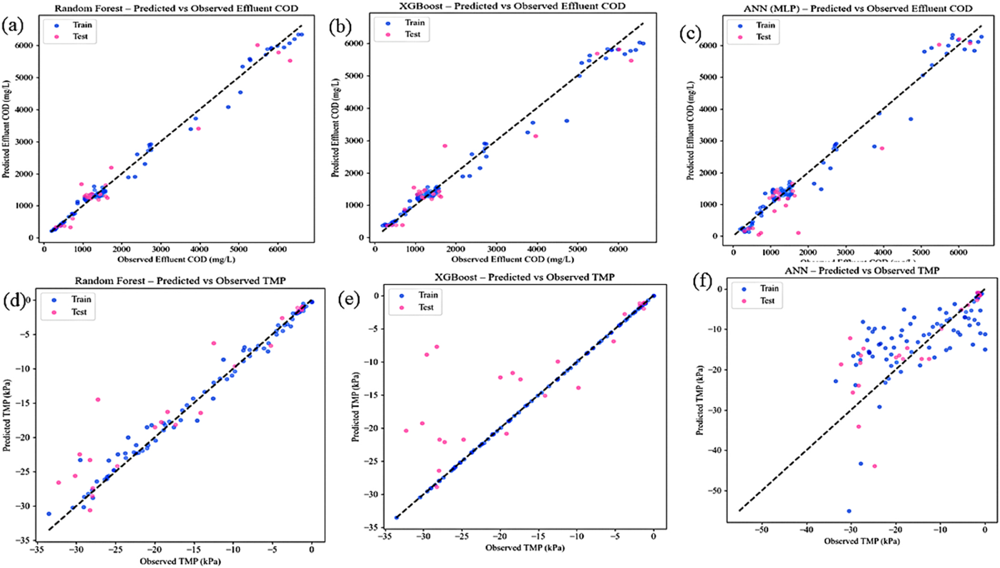
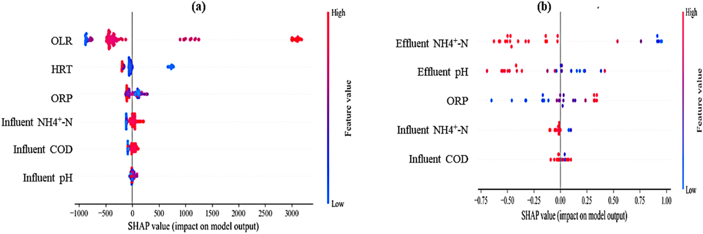

# Machine learning-based prediction of effluent COD and transmembrane pressure in anaerobic membrane bioreactor during transfer station landfill leachate treatment

## Tóm tắt (Abstract)

* Ứng dụng machine learning (ML - học máy) hỗ trợ dự đoán các chỉ số hiệu năng then chốt trong quá trình xử lý nước thải, tạo điều kiện tối ưu hóa kiểm soát vận hành và giảm thiểu các thách thức kỹ thuật như hiện tượng nghẹt màng (membrane fouling).
* Nghiên cứu triển khai các phương pháp ML để đánh giá hiệu quả loại bỏ COD và hiện tượng nghẹt màng trong hệ thống bể phản ứng sinh học màng kỵ khí nhiệt độ trung bình (mesophilic AnMBR) xử lý nước rỉ rác trạm trung chuyển (transfer station landfill leachate) vận hành liên tục trong $120\text{ ngày}$.
  * Hệ thống AnMBR đạt hiệu suất loại bỏ COD $\ge 80\%$ ở tải trọng hữu cơ (OLR) $6.4\text{ kg COD/m}^3\cdot\text{d}$ và thời gian lưu thủy lực (HRT) $6.5\text{ ngày}$.
* Ba mô hình học máy bao gồm mạng nơ-ron nhân tạo (ANN), rừng ngẫu nhiên (RF) và extreme gradient boosting (XGBoost) được xây dựng để dự đoán COD dòng ra (effluent COD) và áp suất qua màng (TMP).
  * Mô hình RF đạt hiệu năng dự đoán cao nhất cho cả hai biến đầu ra:
    * Dự đoán effluent COD: $R^2 = 0.96$; $\text{RMSE} = 331.50\text{ mg/L}$.
    * Dự đoán TMP: $R^2 = 0.88$; $\text{RMSE} = 3.86\text{ kPa}$.
* Phân tích SHapley Additive exPlanations (SHAP) xác định các đặc trưng chi phối khả năng dự đoán của mô hình:
  * Đối với effluent COD: OLR, HRT và thế oxy hóa - khử (ORP) là các biến dự đoán chính gắn liền với mô hình.
  * Đối với TMP: $\text{NH}_4^+-\text{N}$ dòng ra, pH dòng ra và ORP đóng góp mạnh nhất vào kết quả dự đoán TMP.
* Kết quả chứng minh việc tích hợp vận hành AnMBR với mô hình dự đoán ML có khả năng giải thích (interpretable ML) mang lại các hiểu biết chẩn đoán hữu ích cho việc tối ưu hóa hiệu quả xử lý nước rỉ rác và quản lý nghẹt màng.

## 1. Introduction

* **Đặc tính và thách thức quản lý nước rỉ rác tại trạm trung chuyển chất thải rắn đô thị (MSW transfer station leachate)**
    * Quá trình đô thị hóa nhanh và mức sống nâng cao làm gia tăng mạnh lượng chất thải rắn đô thị (MSW - municipal solid waste), tạo áp lực lớn lên hệ thống quản lý chất thải đô thị.
    * Hệ thống quản lý chất thải đô thị bao gồm $3$ giai đoạn liên kết chặt chẽ: thu gom đầu nguồn (front-end collection), trung chuyển chặng giữa (mid-end transfer), và xử lý cuối vòng đời (end-of-life treatment).
    * Trạm trung chuyển chất thải (waste transfer stations) đóng vai trò là mắt xích liên kết then chốt giữa khâu thu gom và bãi xử lý/thải bỏ cuối cùng.
    * Nước rỉ rác phát sinh tại các trạm trung chuyển có thành phần hóa lý phức tạp, chứa nồng độ rất cao các chất hữu cơ, amoniac ($\text{ammonia}$), sản phẩm vi sinh hòa tan (SMP - soluble microbial products), chất rắn lơ lửng (suspended solids) và các hợp chất độc hại.
    * Nếu không được xử lý phù hợp, các chất ô nhiễm từ nước rỉ rác có thể gây tổn hại nghiêm trọng đến môi trường đất, nước mặt, nước ngầm và khí quyển.
    * Quản lý nước rỉ rác tại trạm trung chuyển thường chịu nhiều hạn chế thực tế: mặt bằng không gian chật hẹp, rào cản chi phí kinh tế đối với các công nghệ xử lý nâng cao, và việc thực thi quy định chưa đầy đủ trong một số trường hợp.
    * Hệ quả là nước rỉ rác tại trạm trung chuyển thường bị lưu trữ không đạt chuẩn hoặc xả thải trực tiếp khi chưa qua xử lý tối thiểu, làm gia tăng rủi ro ô nhiễm môi trường.

* **Ưu thế và thách thức vận hành của công nghệ bể phản ứng màng sinh học kỵ khí (AnMBR)**
    * Công nghệ bể phản ứng màng kỵ khí (AnMBR - anaerobic membrane bioreactor) nhận được sự quan tâm lớn như một giải pháp xử lý và tái sử dụng hiệu quả đối với nước thải công nghiệp và đô thị có tải lượng ô nhiễm cao.
    * AnMBR kết hợp phân hủy sinh học kỵ khí với quá trình phân tách màng lọc, sở hữu nhiều ưu điểm: tạo nước đầu ra chất lượng cao, diện tích mặt bằng nhỏ gọn (compact footprint), sản sinh lượng bùn thấp và có tiềm năng thu hồi năng lượng dưới dạng khí mê-tan ($\text{CH}_4$).
    * Hiện tượng tắc nghẽn/bám bẩn màng (membrane fouling) là thách thức nghiêm trọng nhất, cản trở khả năng vận hành ổn định và hiệu quả kinh tế lâu dài của hệ thống AnMBR.
    * Bám bẩn màng làm gia tăng áp suất xuyên màng (TMP - transmembrane pressure), suy giảm lưu lượng thấm qua màng (permeate flux), làm tăng tần suất làm sạch và chi phí bảo trì, ảnh hưởng đến tính khả thi lâu dài của công nghệ.
    * Các chiến lược kiểm soát bám bẩn màng thường được áp dụng bao gồm tiền xử lý dòng vào (influent pre-treatment), tăng cường độ sục khí (aeration intensity), và điều hòa hóa học hỗn hợp bùn lỏng (chemical conditioning).
    * Tuy nhiên, các giải pháp truyền thống này thường tiêu tốn nhiều năng lượng, chi phí cao hoặc không đủ hiệu quả trước các dòng thải có thành phần biến động mạnh như nước rỉ rác.

* **Cơ chế bám bẩn màng phức tạp và hạn chế của các mô hình động học truyền thống**
    * Bám bẩn màng trong AnMBR hình thành từ sự tích tụ của lớp bánh bùn (cake layer) trên bề mặt màng, cùng các chất polyme ngoại bào (EPS - extracellular polymeric substances) và sản phẩm vi sinh hòa tan (SMP).
    * Sự tiến triển bám bẩn màng thể hiện tính phi tuyến động học phức tạp, chịu tác động tương hỗ theo thời gian giữa đặc tính nước đầu vào, điều kiện vận hành thủy lực và biến động cấu trúc quần thể vi sinh vật.
    * Các mô hình động học và cơ chế truyền thống gặp nhiều khó khăn trong việc nắm bắt và dự báo hiện tượng bám bẩn phi tuyến trong điều kiện tải trọng biến thiên đột ngột.

* **Tiềm năng ứng dụng của học máy (ML) và nhu cầu về mô hình giải thích được (Interpretable ML)**
    * Các kỹ thuật học máy (ML - machine learning) chứng minh năng lực mô hình hóa hiệu quả các mối quan hệ phi tuyến phức tạp trong các hệ thống môi trường.
    * Các thuật toán ML phổ biến như mạng nơ-ron nhân tạo (ANN - artificial neural networks), hồi quy vector hỗ trợ (SVR - support vector regression), tăng cường độ dốc cực trị (XGBoost - extreme gradient boosting), và rừng ngẫu nhiên (RF - random forest) đã được ứng dụng rộng rãi để giám sát và tối ưu hóa quá trình xử lý nước thải.
    * ML hỗ trợ dự đoán hiệu suất loại bỏ chất ô nhiễm, chất lượng dòng ra, phát tín hiệu cảnh báo sớm thời gian thực và cải thiện kiểm soát vận hành.
    * Hạn chế của các nghiên cứu ML trước đây:
        * Phần lớn các mô hình ML hiện hữu tập trung vào các hệ thống xử lý nước thải đô thị hoặc công nghiệp có điều kiện vận hành tương đối ổn định.
        * Rất ít nghiên cứu khảo sát các dòng thải nồng độ ô nhiễm cao và dao động mạnh như nước rỉ rác, nơi thành phần dòng vào và tải trọng biến thiên đột ngột theo thời gian.
        * Các mô hình trước đây chủ yếu được huấn luyện để nội suy trong phạm vi dữ liệu lịch sử hạn hẹp, thiếu độ ổn định và tin cậy khi gặp các dao động tải trọng bất thường hoặc xáo trộn vận hành.
    * Nhu cầu cấp thiết: Cần xây dựng các khung mô hình hóa động thích ứng, có khả năng tích hợp dữ liệu cảm biến thời gian thực nhằm dự đoán tin cậy hành vi hệ thống trong các kịch bản vận hành thay đổi.

* **Mục tiêu nghiên cứu và phương pháp tiếp cận của bài báo**
    * Vận hành hệ thống AnMBR trong $120\text{ ngày}$ liên tục để xử lý nước rỉ rác thực tế từ trạm trung chuyển chất thải rắn đô thị.
    * Khảo sát có hệ thống các điều kiện thời gian lưu thủy lực (HRT - hydraulic retention time) và tải trọng hữu cơ (OLR - organic loading rate) khác nhau để đánh giá hiệu suất loại bỏ $\text{COD}$, biến đổi nitơ và hành vi bám bẩn màng.
    * Đánh giá sự phát triển bám bẩn thông qua giám sát vận hành, đánh giá hiệu năng chống bám bẩn, phân tích thành phần chất bám bẩn (foulants) và phân bố kích thước hạt (particle size distribution).
    * Phân tích cấu trúc quần thể vi sinh vật và sự dịch chuyển chức năng nhằm làm sáng tỏ mối liên kết giữa động thái vi sinh vật, hiệu suất xử lý của bể phản ứng và sự hình thành bám bẩn màng.
    * Phát triển và so sánh $3$ thuật toán ML gồm RF, ANN và XGBoost để dự đoán nồng độ $\text{COD}$ đầu ra và giá trị $\text{TMP}$ dựa trên các thông số vận hành dòng vào và dòng ra thường quy.
    * Tối ưu hóa siêu tham số mô hình thông qua tìm kiếm ngẫu nhiên (randomized search) kết hợp kiểm thực chéo $5$ lần ($5\text{-fold cross-validation}$).
    * Ứng dụng phương pháp SHAP (SHapley Additive exPlanations) để bóc tách tính đóng góp và xếp hạng mức độ quan trọng của các biến đầu vào đối với dự đoán $\text{COD}$ và $\text{TMP}$.
    * Cung cấp ranh giới vận hành định lượng (quantitative operational boundary), bộ dự đoán chất bám bẩn đảo ngược (reversed foulant predictor), và khung chẩn đoán tinh gọn cảm biến (sensor-lite diagnostic framework) có khả năng giải thích, hỗ trợ quản lý nước rỉ rác bằng AnMBR bền vững và tin cậy tại các trạm trung chuyển chất thải.

## 2. Materials and methods

### 2.1. Leachate characteristics and inoculum
* Nguồn thu thập nước rỉ rác (leachate) phục vụ nghiên cứu là trạm trung chuyển chất thải rắn sinh hoạt (municipal solid waste transfer station) tại thành phố Trường Sa (Changsha City), tỉnh Hồ Nam (Hunan Province), Trung Quốc.
  * Các đặc tính hóa lý cơ bản của nước rỉ rác thô được thống kê trong Bảng S1 (Supplementary Material).

### 2.2. Reactor configuration and operating conditions
* Hệ thống AnMBR quy mô phòng thí nghiệm (laboratory-scale AnMBR) có tổng thể tích $5{,}0\text{ L}$ với thể tích làm việc hữu dụng (effective working volume) $4\text{ L}$, được chế tạo từ vật liệu acrylic trong suốt (transparent acrylic).
  * Lượng bùn kỵ khí cấy ban đầu (inoculum) chiếm $30\%$ thể tích làm việc của bể ($1{,}2\text{ L}$).
  * Thời gian lưu thủy lực ban đầu ($\text{HRT}$) được thiết lập ở mức $15\text{ d}$, tương ứng với lưu lượng cấp nạp (feed flow rate) là $0{,}33\text{ L/d}$.
  * Bể phản ứng được vận hành ở dải nhiệt độ ấm / trung nhiệt (mesophilic temperature) $35 \pm 2^\circ\text{C}$.
* Module màng sợi rỗng (hollow fiber membrane module) bằng polyvinylidene fluoride (PVDF) được sử dụng để lọc tách sinh khối:
  * Diện tích bề mặt màng đạt $712\text{ cm}^2$.
  * Kích thước lỗ màng trung bình (pore size) là $0{,}1\text{ }\mu\text{m}$.
  * Màng vận hành ở chế độ lọc gián đoạn (intermittent filtration) gồm chu kỳ hút $4\text{ min}$ (suction) tiếp nối bởi chu kỳ nghỉ $1\text{ min}$ (relaxation period), kiểm soát bằng bơm nhu động (peristaltic pump).
* Toàn bộ quá trình vận hành AnMBR kéo dài $120\text{ ngày}$ được phân bổ thành 3 giai đoạn (3 phases) với cấu hình $\text{HRT}$ và tải trọng hữu cơ ($\text{OLR}$) riêng biệt để mô phỏng các kịch bản thực tế:
  * Phase I (giai đoạn khởi động và thích nghi / start-up and adaptation, ngày $1\text{–}28$): $\text{HRT}$ giảm dần từ $15\text{ d}$ xuống $9{,}5\text{ d}$; tỷ lệ pha loãng nước rỉ rác đầu vào tăng từng bước từ $20\%$ lên $100\%$ nước rỉ rác thô; $\text{OLR}$ tăng từ mức thấp ($0{,}42\text{ kg COD/(m}^3\cdot\text{d)}$) lên khoảng $4{,}5\text{–}4{,}65\text{ kg COD/(m}^3\cdot\text{d)}$.
  * Phase II (giai đoạn vận hành ổn định / stable operation, ngày $29\text{–}103$): $\text{HRT}$ giảm tiếp tục từ $9{,}5\text{ d}$ xuống $6{,}5\text{ d}$, duy trì nồng độ nước rỉ rác đầu vào ở mức $100\%$; $\text{OLR}$ được giữ ổn định trong khoảng $5{,}0\text{–}6{,}0\text{ kg COD/(m}^3\cdot\text{d)}$.
  * Phase III (giai đoạn thử tải sốc hữu cơ / shock loading test, ngày $104\text{–}120$): thiết kế nhằm đánh giá khả năng chống chịu và phục hồi của hệ thống trước tình trạng quá tải hữu cơ đột ngột; $\text{HRT}$ cố định ở mức $5\text{ d}$, nồng độ nước rỉ rác đầu vào giữ $100\%$, $\text{OLR}$ duy trì trong khoảng $7{,}5\text{–}8{,}0\text{ kg COD/(m}^3\cdot\text{d)}$.
* Chế độ xả bùn và tần suất giám sát các thông số vận hành:
  * Bùn thải được xả hàng ngày (daily sludge withdrawal).
  * Các chỉ tiêu $\text{COD}$, $\text{NH}_4^+ \text{-N}$, và $\text{pH}$ được đo định kỳ $2\text{ ngày/lần}$.
  * Thế oxy hóa - khử ($\text{ORP}$) được đo hàng ngày ($1\text{ ngày/lần}$).
  * Áp suất qua màng ($\text{TMP}$) được theo dõi liên tục thông qua cảm biến áp suất trực tuyến (online pressure transducer), và giá trị đại diện hàng ngày được ghi nhận phục vụ xây dựng mô hình học máy.
  * Các chất cao phân tử ngoại bào ($\text{EPS}$) và sản phẩm vi sinh hòa tan ($\text{SMP}$) được trích ly và phân tích định kỳ hàng tuần.
  * Mẫu vi sinh vật được thu thập vào thời điểm kết thúc mỗi giai đoạn vận hành.
  * Các thông số được đo lặp đơn lẻ (single measurement) vì tần suất lấy mẫu dày đặc bù đắp cho việc không thực hiện lặp mẫu hình thức (the high sampling frequency offsets the lack of formal replication).

### 2.3. Analytical methods
* Phương pháp phân tích các chỉ tiêu hóa lý dòng vào và dòng ra:
  * Chỉ tiêu $\text{COD}$ được xác định bằng phương pháp oxy hóa kali dicromat (potassium dichromate oxidation method) tuân thủ tiêu chuẩn GB11914–89 và quy trình tiêu chuẩn APHA.
  * Nồng độ $\text{NH}_4^+ \text{-N}$ được xác định bằng phương pháp so màu (colorimetry) sử dụng thuốc thử Nessler (Nessler’s reagent) xuyên suốt các giai đoạn vận hành.
  * Giá trị $\text{pH}$ và $\text{ORP}$ được đo bằng máy đo pH kỹ thuật số (PHS-3C) và máy đo ORP (Pe−20k).
* Quy trình tách chiết và phân tích thành phần $\text{EPS}$ và $\text{SMP}$:
  * Phân tách $\text{EPS}$ liên kết lỏng lẻo ($\text{Lb-EPS}$ / loosely bound EPS) bằng kỹ thuật khuấy lắc vortex và ly tâm (centrifugation).
  * Phân tách $\text{EPS}$ liên kết chặt chẽ ($\text{Tb-EPS}$ / tightly bound EPS) bằng phương pháp xử lý nhiệt (thermal treatment) kết hợp ly tâm tiếp nối.
  * Hàm lượng protein và polysaccharide được định lượng tương ứng bằng phương pháp Lowry và phương pháp anthrone - axit sulfuric (anthracene-sulfuric acid method).
* Giám sát diễn biến tắc nghẽn màng và đặc tính hóa lý của bùn hoạt tính:
  * Diễn biến tắc nghẽn màng (membrane fouling) được ghi nhận liên tục thông qua giá trị $\text{TMP}$.
  * Phân bố kích thước hạt bùn (particle size distribution) được phân tích bằng thiết bị Mastersizer 3000.
  * Thế Zeta (Zeta potential) của bùn được đo bằng thiết bị Zetasizer Nano ZS.
  * Thành phần chất hữu cơ hòa tan ($\text{DOM}$) được phân tích bằng phổ huỳnh quang ma trận kích thích - phát xạ (fluorescence excitation-emission matrix spectroscopy - EEM).
* Phương pháp phân tích động học cộng đồng vi sinh vật (microbial community dynamics):
  * Mẫu bùn được thu thập vào cuối mỗi giai đoạn vận hành từ lớp bùn bám trên bề mặt màng (membrane-adhered sludge), đại diện cho quần thể màng sinh học / lớp bánh bùn (biofilm/cake-layer community) trực tiếp gây tắc nghẽn màng.
  * Tách chiết DNA tổng số và khuếch đại vùng V4 của gen $16\text{S rRNA}$ của vi khuẩn và vi khuẩn cổ (archaeal) bằng cặp mồi phổ quát (universal primers): 515 F ($5'\text{-GTGCCCAGCMGCCGCGG-3'}$) và 806 R ($5'\text{-GGACTACHVGGGTWTCTAAT-3'}$).
  * Giải trình tự thông lượng cao (high-throughput sequencing) thực hiện bởi Majorbio (Thượng Hải, Trung Quốc).
  * Dữ liệu được phân tích trên nền tảng đám mây tin sinh học Majorbio (Majorbio Bioinformatics Cloud Platform) để xác định thành phần loài và các chỉ số đa dạng sinh học (diversity indices), phục vụ nhận diện sự dịch chuyển cộng đồng vi sinh qua các giai đoạn chuyển tiếp vận hành và hành vi tắc nghẽn màng.

### 2.4. ML algorithms for prediction of Effluent COD and TMP
* Tập dữ liệu vận hành dài hạn $120\text{ ngày}$ của AnMBR được sử dụng để xây dựng các mô hình học máy:
  * Sáu biến đầu vào (input parameters) được lựa chọn cho mỗi biến mục tiêu ($\text{Effluent COD}$ và $\text{TMP}$) dựa trên phân tích hệ số tương quan Pearson và hiểu biết chuyên ngành (domain knowledge) về hệ thống AnMBR.
  * Sáu biến đầu vào dự đoán $\text{Effluent COD}$ gồm: $\text{influent COD}$, $\text{influent NH}_4^+ \text{-N}$, $\text{influent pH}$, $\text{OLR}$, $\text{ORP}$, và $\text{HRT}$.
  * Sáu biến đầu vào dự đoán $\text{TMP}$ gồm: $\text{influent COD}$, $\text{influent NH}_4^+ \text{-N}$, $\text{effluent NH}_4^+ \text{-N}$, $\text{effluent pH}$, $\text{OLR}$, và $\text{ORP}$.
* Quy trình tiền xử lý dữ liệu và chiến lược phân chia tập dữ liệu:
  * Bộ dữ liệu được phân chia ngẫu nhiên thành tập huấn luyện (training set) và tập kiểm tra (testing set) theo tỷ lệ $80:20$.
  * Để ngăn ngừa hiện tượng rò rỉ dữ liệu (data leakage) và đảm bảo tính ổn định của mô hình, các giá trị khuyết thiếu được xử lý bằng phương pháp gán giá trị trung vị (median imputation) do trung vị ít nhạy cảm với các giá trị ngoại lai (outliers) và phân phối lệch.
  * Các đặc trưng có phương sai gần bằng không (near-zero variance features) bị loại bỏ.
  * Áp dụng biến đổi Yeo-Johnson (Yeo-Johnson transformation) và chuẩn hóa Z-score (Z-score standardization) để tăng cường tính ổn định của mô hình theo công thức (1):
    $$X_{\text{std}} = \frac{X - \mu}{\sigma}$$
    Trong đó $X$ là giá trị dữ liệu thô, $\mu$ là giá trị trung bình của đặc trưng, và $\sigma$ là độ lệch chuẩn.
  * Các tham số chuẩn hóa và biến đổi chỉ được tính toán trên tập huấn luyện, sau đó áp dụng trực tiếp lên tập kiểm tra để đảm bảo tính khách quan.
  * Áp dụng thêm phương pháp phân chia theo trình tự thời gian (chronological splitting), trong đó dữ liệu của Phase III (tải sốc hữu cơ) làm tập kiểm tra độc lập để đánh giá bổ sung khả năng tổng quát hóa (supplementary generalization assessment), trong khi dữ liệu Phase I và Phase II đóng vai trò tập huấn luyện.
* Phân tích tương quan Pearson (Pearson correlation analysis) nhằm đánh giá mức độ phụ thuộc tuyến tính và kiểm soát đa cộng tuyến (multicollinearity):
  * Hệ số tương quan Pearson ($r$) được tính toán theo công thức (2):
    $$r = \frac{\sum_{i=1}^N (X_i - \bar{X})(Y_i - \bar{Y})}{\sqrt{\sum_{i=1}^N (X_i - \bar{X})^2} \sqrt{\sum_{i=1}^N (Y_i - \bar{Y})^2}}$$
    Trong đó $X_i$ và $Y_i$ là các giá trị quan sát, $\bar{X}$ và $\bar{Y}$ là giá trị trung bình tương ứng, và $N$ là kích thước mẫu.
  * Phân loại mức độ tương quan dựa trên ngưỡng thiết lập: tương quan mạnh ($r > 0{,}68$) và tương quan trung bình ($0{,}36 \le r \le 0{,}68$).
  * Hiện tượng đa cộng tuyến cao được ghi nhận giữa $\text{OLR}$ và $\text{HRT}$.
  * Phân tích độ nhạy (sensitivity analysis) khẳng định cả hai biến này đều mang ý nghĩa vận hành độc lập then chốt trong hệ thống AnMBR, do đó cả $\text{OLR}$ và $\text{HRT}$ được giữ lại trong tập biến đầu vào dự đoán $\text{Effluent COD}$.

### 2.5. Model development and selection
* Ba thuật toán học máy được lựa chọn để phát triển mô hình dự đoán $\text{Effluent COD}$ và $\text{TMP}$ trong AnMBR:
  * Mạng nơ-ron nhân tạo đa lớp (ANN - Artificial Neural Network, multilayer perceptron).
  * Rừng ngẫu nhiên (RF - Random Forest).
  * Thuật toán tăng cường độ dốc cực đại (XGBoost - Extreme Gradient Boosting).
  * Các thuật toán này được chọn nhờ năng lực thiết lập và mô tả các mối quan hệ phi tuyến phức tạp giữa các thông số vận hành và hiệu suất xử lý nước thải.
* Quy trình tối ưu hóa siêu tham số (hyperparameter tuning) và kiểm chứng mô hình:
  * Tối ưu hóa siêu tham số cho từng thuật toán thông qua tìm kiếm ngẫu nhiên (randomized search) kết hợp với kiểm định chéo 5 nếp (five-fold cross-validation, $K=5$) trên tập dữ liệu huấn luyện nhằm giảm thiểu hiện tượng quá khớp (overfitting) và tăng khả năng tổng quát hóa.
  * Kết quả kiểm định chéo định hướng việc lựa chọn cấu hình siêu tham số tối ưu, trong khi hiệu suất mô hình cuối cùng được đánh giá trên tập kiểm tra độc lập nhằm đảm bảo tính khách quan và không thiên lệch.
* Các thước đo định lượng hiệu suất dự đoán của mô hình:
  * Hệ số xác định ($R^2$ - coefficient of determination) theo công thức (3):
    $$R^2 = 1 - \frac{\sum_{i=1}^N (y_i - \hat{y}_i)^2}{\sum_{i=1}^N (y_i - \bar{y}_i)^2}$$
  * Sai số căn bậc hai trung bình bình phương (RMSE - root mean square error) theo công thức (4):
    $$\text{RMSE} = \sqrt{\frac{\sum_{i=1}^N (\hat{y}_i - y_i)^2}{N}}$$
    Trong đó $N$ là tổng số điểm quan sát, $y_i$ là giá trị thực nghiệm quan sát được của biến mục tiêu, $\hat{y}_i$ là giá trị dự đoán từ mô hình, và $\bar{y}_i$ là giá trị trung bình thực nghiệm của tất cả các quan sát.

### 2.6. SHAP interpretation method
* Phương pháp giải thích mô hình SHAP (Shapley Additive exPlanations):
  * SHAP là phương pháp tiếp cận học máy có thể diễn giải (interpretable ML) dựa trên nền tảng lý thuyết trò chơi hợp tác (cooperative game theory), cho phép định lượng mức độ đóng góp của từng biến đặc trưng đầu vào đối với kết quả dự đoán.
  * SHAP biểu diễn mô hình phi tuyến phức tạp dưới dạng một mô hình giải thích cộng tính tuyến tính (additive explanation model), đồng thời thỏa mãn các tính chất toán học cơ bản gồm: độ chính xác cục bộ (local accuracy), tính nhất quán (consistency), và tính thiếu hụt (missingness).
  * Mức độ đóng góp của từng đặc trưng được biểu thị thông qua giá trị SHAP ($\text{SHAP value}$), phản ánh tác động biên (marginal impact) trung bình của đặc trưng đó đối với dự đoán qua toàn bộ các tổ hợp đặc trưng có thể tạo lập.
* Mô hình xấp xỉ hàm giải thích cộng tính của SHAP:
  * Hàm dự đoán $f(x)$ được xấp xỉ bằng mô hình giải thích $g(z)$ theo công thức (5):
    $$f(x) \approx g(z) = \phi_0 + \sum_{i=1}^M \phi_i z_i$$
    Trong đó $M$ là tổng số biến đặc trưng đầu vào, $\phi_0$ là giá trị dự đoán cơ sở (base value - giá trị kỳ vọng khi không có thông tin đặc trưng), $\phi_i$ là giá trị SHAP đại diện cho phần đóng góp của đặc trưng thứ $i$ vào độ lệch dự đoán, và $z_i$ là biến nhị phân đại diện cho trạng thái hiện diện ($z_i \in \{0, 1\}$) của đặc trưng.
  * Cấu trúc toán học này định lượng mức đóng góp biên trung bình của từng đặc trưng, cung cấp cơ sở diễn giải minh bạch và tin cậy về tầm quan trọng của các thông số vận hành tác động lên $\text{Effluent COD}$ và $\text{TMP}$.

## 3. Results and discussion

### 3.1. Organic removal efficiency in AnMBR systems

* Hệ thống AnMBR (anaerobic membrane bioreactor - bể phản ứng sinh học màng kỵ khí) thể hiện hiệu năng vận hành nhất quán qua tất cả các giai đoạn hoạt động bất chấp sự biến thiên của HRT (hydraulic retention time - thời gian lưu thủy lực) và OLR (organic loading rate - tải trọng hữu cơ):
  * Biến thiên hiệu suất khử COD (chemical oxygen demand - nhu cầu oxy hóa học) và nồng độ $\text{NH}_4^+$-$\text{N}$ dòng ra qua các giai đoạn vận hành (Hình 1):
    - **Hình 1.** Biến thiên khử COD theo HRT, OLR và nồng độ $\text{NH}_4^+$-N
      - 
      - **Hình này chứng minh điều gì**
        - Hiệu suất khử COD duy trì $>80\%$ (tăng từ $90\%$ lên $99\%$ ở ngày 1–28) dù OLR tăng ($0.42$ lên $4.65\text{ kg/m}^3\cdot\text{d}$) và HRT giảm ($15$ xuống $9.5\text{ ngày}$); trong khi $\text{NH}_4^+$-N dòng ra duy trì ở mức cao trung bình $1300\text{ mg/L}$.
      - **Từ đâu mà thấy được**
        - Đồ thị (a): HRT giảm và OLR tăng từng bậc (trên); COD dòng ra luôn $<900\text{ mg/L}$ và hiệu suất khử màu đỏ duy trì $>80\%$ (dưới).
        - Đồ thị (b): $\text{NH}_4^+$-N dòng ra (chấm xanh) tăng dần rồi ổn định quanh $1300\text{ mg/L}$, cao hơn dòng vào (chấm hồng, $\approx 600\text{ mg/L}$).
* Giai đoạn khởi động và thích nghi (start-up and adaptation phase, ngày $1\text{–}28$):
  * Nồng độ COD dòng vào (influent COD) gia tăng trong khi thời gian lưu thủy lực HRT giảm từ $15$ xuống $9.5\text{ ngày}$.
  * Tải trọng hữu cơ OLR tăng từ $0.42$ lên $4.65\text{ kg/m}^3\cdot\text{d}$ (hay $\text{kg COD/m}^3\cdot\text{d}$).
  * Nồng độ COD dòng ra (effluent COD) duy trì ổn định dưới ngưỡng $900\text{ mg/L}$.
  * Hiệu suất loại bỏ COD tăng từ $90\%$ lên $99\%$, minh chứng cho quá trình thích nghi hiệu quả của quần xã vi sinh vật kỵ khí.
* Giai đoạn vận hành ổn định (stable operation phase, ngày $29\text{–}103$):
  * Thời gian lưu thủy lực HRT tiếp tục được rút ngắn xuống còn $6.5\text{ ngày}$ với $100\%$ nước rỉ rác thô (raw leachate) làm dòng nạp.
  * Bất chấp các dao động gián đoạn của nồng độ COD dòng vào, hiệu suất loại bỏ COD vẫn duy trì ở mức rất cao, cho thấy bể phản ứng đang tiếp cận công suất xử lý.
  * Hệ thống AnMBR thể hiện hiệu năng vận hành ổn định và bền bỉ trong suốt giai đoạn này.
* Giai đoạn tải sốc (shock loading phase, ngày $104\text{–}120$):
  * Hệ thống trải qua điều kiện chịu tải trọng áp lực cao, với tải trọng hữu cơ OLR dao động trong khoảng $7.5\text{–}8.0\text{ kg COD/m}^3\cdot\text{d}$.
  * Nồng độ COD dòng ra đạt đỉnh ở mức xấp xỉ $5500\text{ mg/L}$.
  * Hiệu suất khử COD suy giảm xuống còn $84\text{–}88\%$.
  * Sự suy giảm hiệu suất bắt nguồn từ hiện tượng quá tải hữu cơ và độc tính tiềm tàng của nước rỉ rác thô [19].
* Diễn biến nồng độ amoni dòng ra và hạn chế khử nitơ trong điều kiện kỵ khí:
  * Nồng độ $\text{NH}_4^+$-$\text{N}$ dòng ra duy trì liên tục ở mức cao trong suốt toàn bộ quá trình thí nghiệm, đạt giá trị trung bình $1300\text{ mg/L}$ (Hình 1b).
  * Điều này hàm ý rằng dưới các điều kiện kỵ khí nghiêm ngặt, hệ thống AnMBR có năng lực khử $\text{NH}_4^+$-$\text{N}$ rất hạn chế [25], dù vẫn đạt hiệu quả loại bỏ chất hữu cơ cao [26].
  * Hiện tượng tích tụ amoni dòng ra tương tự cũng được ghi nhận ở nhiều hệ thống màng kỵ khí khác xử lý các loại nước thải nồng độ cao [27].
  * Để khắc phục hạn chế này, các nghiên cứu trước đây khuyến nghị tích hợp AnMBR với các công đoạn xử lý hiếu khí tiếp sau (aerobic post-treatment units), chẳng hạn như quá trình nitrate hóa (nitrification) hoặc oxy hóa amoni bán phần (partial ammonia oxidation), nhằm tăng cường hiệu suất loại bỏ nitơ tổng thể [28, 29].

### 3.2. Membrane fouling behaviour and particle characteristics

* Đặc tính tắc nghẽn màng, động thái áp suất xuyên màng ($\text{transmembrane pressure}$ - $\text{TMP}$) và hiệu quả phục hồi qua các bước làm sạch dưới các điều kiện thời gian lưu thủy lực ($\text{hydraulic retention time}$ - $\text{HRT}$) biến thiên (Hình 2):
    - **Hình 2.** Đặc tính tắc nghẽn màng và hiệu quả các bước làm sạch
      - 
      - **Hình này chứng minh điều gì**
        - Giảm HRT xuống $7.5\text{ d}$ thúc đẩy tích tụ EPS/SMP khiến TMP tăng lên $\approx 35\text{ kPa}$; rửa hóa chất ($\text{NaOCl}$, axit citric) khôi phục độ thấm và tái lộ cấu trúc lỗ màng.
      - **Từ đâu mà thấy được**
        - Đồ thị (a, b): TMP ở $\text{HRT} \ge 9.5\text{ d}$ giữ ở $1$–$2\text{ kPa}$ nhưng tăng lên $35\text{ kPa}$ khi $\text{HRT} = 7.5\text{ d}$; rửa $\text{NaOCl}$ và axit đưa đường TMP theo flux về sát màng mới ($< 5\text{ kPa}$).
        - Đồ thị (c, d): Bùn bánh chiếm ưu thế bởi hạt mịn $\sim 32.3\ \mu\text{m}$; cường độ huỳnh quang EEM của TB-EPS, SMP và LB-EPS tăng khi HRT giảm từ $9.5\text{ d}$ về $5\text{ d}$.
        - Ảnh SEM (e): Màng nghẹt (iii) bị bao phủ dày; rửa vật lý (iv) chỉ làm sạch một phần, trong khi rửa $\text{NaOCl}$ (v) và axit citric (vi) khôi phục và làm lộ rõ các lỗ màng.
* Động thái biến thiên của $\text{TMP}$ qua các giai đoạn giảm $\text{HRT}$ (Hình 2a):
  * Ở $\text{HRT} = 9.5\text{ d}$, $\text{TMP}$ duy trì ổn định trong khoảng $1\text{--}2\text{ kPa}$, biểu thị mức độ nghẹt màng tối thiểu trong giai đoạn thích ứng của hệ thống (*system adaptation phase*).
  * Khi $\text{HRT}$ giảm xuống $7.5\text{ d}$, $\text{TMP}$ tăng đột ngột lên xấp xỉ $35\text{ kPa}$, phản ánh hiện tượng bám bẩn rõ rệt, có thể do sự tích lũy của tổng chất rắn (*total solids*) [12].
  * Khi $\text{HRT}$ tiếp tục giảm xuống $6.5\text{ d}$, $\text{TMP}$ tăng ổn định với tốc độ $0.77\text{ kPa/ngày}$ ($0.77\text{ kPa/d}$), đạt giá trị khoảng $32.5\text{ kPa}$.
  * Chỉ số $\text{TMP}$ phản ánh hiệu quả các hành vi bám bẩn màng trong hệ thống $\text{AnMBR}$.
* Quy trình làm sạch màng và hiệu quả phục hồi tính thấm (Hình 2b):
  * Màng được làm sạch vào cuối mỗi giai đoạn vận hành (*operating phase*) để khôi phục độ thấm trước khi bước sang giai đoạn tiếp theo.
  * Quy trình làm sạch đa bước bao gồm: làm sạch vật lý (*physical cleaning*) sau Giai đoạn I (Phase I), làm sạch bằng natri hypoclorit ($\text{NaOCl}$) sau Giai đoạn II (Phase II), và làm sạch bằng axit citric sau Giai đoạn III (Phase III).
  * Các bước làm sạch giúp giảm trở lực thủy lực tích lũy (*accumulated hydraulic resistance*) và đưa $\text{TMP}$ về gần mức đường nền ban đầu (*baseline level*).
  * Hiệu năng phục hồi màng được minh chứng qua độ dốc trở lực lọc (các giá trị $K$, *filtration resistance slopes*) giảm mạnh sau khi làm sạch.
* Kích thước hạt và sự phát triển của lớp bánh bùn (*cake layer*):
  * Thông tin định lượng về sự tích lũy $\text{EPS}$-$\text{SMP}$ được thể hiện trong Hình 2c.
  * Các hạt mịn có kích thước $\sim 32.3\ \mu\text{m}$ (*fine particles*) đóng vai trò chủ đạo chi phối sự hình thành và phát triển của lớp bánh bùn (*cake layer development*).
* Động thái tích tụ chất polyme ngoại bào ($\text{EPS}$), sản phẩm vi sinh vật hòa tan ($\text{SMP}$) và phổ huỳnh quang EEM:
  * Nồng độ $\text{SMP}$, $\text{LB-EPS}$ (chất polyme ngoại bào liên kết lỏng - *loosely bound EPS*) và $\text{TB-EPS}$ (chất polyme ngoại bào liên kết chặt - *tightly bound EPS*) gia tăng rõ rệt khi $\text{HRT}$ giảm từ $9.5\text{ d}$ xuống $5\text{ d}$ (Hình S1).
  * Phổ huỳnh quang ma trận kích thích - phát xạ ($\text{excitation-emission matrix fluorescence spectroscopy}$ - $\text{EEM}$) được sử dụng để khảo sát ảnh hưởng của các chất gây nghẹt hữu cơ (*organic foulants*) khi giảm $\text{HRT}$ (Hình 2d (i-iv)).
  * Khi giảm $\text{HRT}$, cường độ huỳnh quang tăng cao hơn đối với các nhóm hợp chất protein thơm huỳnh quang (*fluorescent aromatic proteins*), $\text{SMP}$ và các chất dạng humic (*humic-like substances*).
* So sánh hiệu quả giữa làm sạch vật lý và làm sạch hóa học:
  * Làm sạch vật lý chỉ khôi phục tính thấm ở một mức độ nhất định, trong khi làm sạch hóa học bằng $\text{NaOCl}$ và axit citric đạt hiệu quả phục hồi cao nhất (Hình S2).
  * Ảnh hiển vi điện tử quét ($\text{scanning electron microscopy}$ - $\text{SEM}$) ở Hình 2e (i-vi) xác nhận trực quan hiệu quả của làm sạch hóa học thông qua việc loại bỏ các chất bẩn bám sâu (*embedded foulants*) và làm tái lộ các lỗ màng (*re-exposure of membrane pores*), khẳng định vai trò quyết định của làm sạch hóa học trong việc khôi phục chức năng màng.
* Tóm lược: $\text{TMP}$ ghi nhận hiệu quả các hiện tượng nghẹt màng trong $\text{AnMBR}$, với trọng tâm đặc biệt đặt vào việc tối ưu hóa $\text{HRT}$ nhằm giảm thiểu tắc nghẽn và duy trì hiệu năng vận hành cao cho màng.

### 3.3. Composition and functional roles of microbial communities

* Phân tích giải trình tự gen $16\text{S rRNA}$ vùng V4 (sử dụng cặp mồi $515\text{F}$ và $806\text{R}$) trên mẫu bùn bám dính màng (membrane-adhered sludge, đại diện cho màng sinh học và lớp bánh bùn) cho thấy cấu trúc quần thể vi sinh vật trong hệ thống AnMBR thay đổi rõ rệt qua các giai đoạn vận hành, biến động theo hiệu suất xử lý của bể và điều kiện môi trường.
* Các ngành và lớp vi sinh vật chủ đạo cùng dự đoán chức năng chuyển hóa sinh học:
  * Ngành *Firmicutes* duy trì độ phong phú cao trong suốt thời gian vận hành, đóng vai trò phân hủy hiệu quả các hợp chất hữu cơ (decomposition of organic compounds).
  * Tỷ lệ ngành *Proteobacteria* suy giảm, phản ánh sự suy giảm phân hủy các chất hữu cơ khó phân hủy sinh học (refractory organics) và làm gia tăng tích tụ các chất tương tự humic (humic-like substances) khi thời gian lưu thủy lực (HRT - hydraulic retention time) bị rút ngắn.
  * Độ phong phú tương đối của ngành *Chloroflexi* gia tăng đáng kể từ $6.6\%$ lên $37.5\%$, trong đó các nhóm vi sinh vật liên quan đến họ *Anaerolineaceae* trở nên chiếm ưu thế.
  * Các vi sinh vật thuộc họ *Anaerolineaceae* tham gia vào cấu trúc khung bông bùn (sludge structure), tăng cường tiết chất polyme ngoại bào (EPS - extracellular polymeric substances), hình thành màng sinh học (biofilm formation) và phát triển lớp bánh bùn (cake layer) trên bề mặt màng.
* Sự làm giàu (enrichment) các nhóm vi sinh vật chức năng tương ứng hỗ trợ duy trì hiệu suất hoạt động ổn định của hệ thống AnMBR ngay cả dưới điều kiện tải trọng hữu cơ tăng cao.
* Biến động của cấu trúc vi sinh vật bám dính màng có mối liên hệ mật thiết với cơ chế gây nghẹt màng (membrane fouling):
  * Sự dịch chuyển quần thể vi khuẩn được phân tích liên kết với các chỉ số áp suất xuyên màng (TMP - transmembrane pressure), nồng độ chất polyme ngoại bào và sản phẩm vi sinh hòa tan (EPS/SMP), phổ huỳnh quang ba chiều (EEM), phân bố kích thước hạt bùn, hình thái bề mặt màng qua ảnh SEM và hiệu quả phục hồi sau các bước rửa màng (Fig. 2b–e).
  * Chuỗi tác động gây nghẹt màng được xác lập theo lộ trình nhân quả thống nhất:
    $$\text{Áp lực vận hành (giảm HRT)} \rightarrow \text{Làm giàu có chọn lọc các taxon liên quan đến nghẹt màng trong bùn bám dính màng} \rightarrow \text{Gia tăng tiết EPS/SMP} \rightarrow \text{Hình thành lớp bánh bùn và bít tắc lỗ màng} \rightarrow \text{Tăng áp suất xuyên màng (TMP)}$$

### 3.4. ML model performance

#### 3.4.1. Data characteristics and correlation analysis

* Thống kê mô tả xác định các quy luật biến thiên đặc thù giữa các thông số vận hành và các chỉ tiêu chất lượng nước (Bảng S2):
  * Nhu cầu oxy hóa học đầu vào (influent chemical oxygen demand - $\text{COD}$) có mức độ biến thiên trung bình với nồng độ trung bình $10684\text{ mg/L}$ và hệ số biến thiên (coefficient of variation - $\text{CV}$) là $26{,}2\%$, phản ánh điều kiện tải nạp hữu cơ dao động đáng kể.
  * $\text{COD}$ dòng ra (effluent $\text{COD}$) có $\text{CV}$ tương đối lớn hơn rõ rệt đạt $90{,}6\%$, thể hiện biên độ dao động rộng của hiệu suất xử lý qua các giai đoạn vận hành khác nhau, đặc biệt trong các giai đoạn sốc tải (shock loading).
  * Điều kiện môi trường trong hệ kỵ khí duy trì tính ổn định với thế oxy hóa khử (oxidation-reduction potential - $\text{ORP}$) liên tục âm từ $-510$ đến $-378\text{ mV}$ cùng $\text{CV}$ thấp ($6{,}1\%$), chứng minh trạng thái khử ổn định bên trong bể phản ứng.
  * Áp suất xuyên màng (transmembrane pressure - $\text{TMP}$) thể hiện độ biến thiên rất cao với $\text{CV} = 82\%$, cho thấy tắc nghẽn màng (membrane fouling) phát triển phi tuyến tính và phụ thuộc vào thời lượng của pha vận hành, gây khó khăn cho việc mô hình hóa dự báo.
  * Nồng độ $\text{NH}_4^+\text{-N}$ dòng ra gia tăng so với dòng vào chỉ ra hiện tượng tích tụ nitơ trong hệ thống và phản ánh năng lực khử nitơ hạn chế trong điều kiện kỵ khí nghiêm ngặt.
* Phân tích tương quan Pearson giữa các thông số đầu vào được lựa chọn cho hai mô hình dự báo thể hiện mức độ liên kết giữa các biến:
  * Đối với mô hình dự báo $\text{COD}$ dòng ra, các cặp thông số có tương quan chặt chẽ nhất gồm $\text{HRT}$ và tải nạp hữu cơ (organic loading rate - $\text{OLR}$) với $r = -0{,}98$, $\text{COD}$ đầu vào và $\text{OLR}$ với $r = 0{,}91$, cùng $\text{COD}$ đầu vào và $\text{NH}_4^+\text{-N}$ đầu vào với $r = 0{,}97$.
  * Sự liên kết toán học nội tại giải thích các hệ số tương quan cao này, do $\text{OLR}$ được tính trực tiếp từ nồng độ đầu vào và lưu lượng ($\text{OLR} = (\text{COD} \times Q)/V$ so với thời gian lưu thủy lực $\text{HRT} = V/Q$), trong đó tương quan âm rất mạnh giữa $\text{HRT}$ và $\text{OLR}$ ($r = -0{,}98$) phản ánh bản chất tỷ lệ nghịch toán học.
  * Thông số $\text{pH}$ đầu vào chỉ thể hiện tương quan yếu với các biến đầu vào khác ($r = -0{,}40\text{--}0{,}17$), cung cấp thông tin độc lập và đặc thù cho mô hình dự báo.
  * Ma trận tương quan Pearson giữa các thông số vận hành và chỉ tiêu chất lượng nước được thể hiện chi tiết trên bản đồ nhiệt:
    - **Hình 3.** Bản đồ nhiệt hệ số tương quan Pearson cho COD và TMP
      - 
      - **Hình này chứng minh điều gì**
        - Ma trận xác định HRT và OLR tương quan nghịch ($r = -0.98$), COD đầu vào tương quan thuận với $\text{NH}_4^+$ đầu vào ($r = 0.97$) và OLR ($r = 0.91$); TMP tương quan nghịch với $\text{NH}_4^+$ dòng ra ($r = -0.63$), pH dòng ra ($r = -0.57$) và thuận với ORP ($r = 0.61$).
      - **Từ đâu mà thấy được**
        - Ma trận $10 \times 10$ ô với thanh màu từ $-1.00$ (xanh đậm) đến $1.00$ (đỏ đậm); đường chéo chính nhận giá trị $1.00$.
        - Cặp HRT–OLR màu xanh đậm ($-0.98$), Influent COD–Influent NH4 màu đỏ đậm ($0.97$); hàng TMP giao với Effluent NH4 màu xanh ($-0.63$), Effluent pH ($-0.57$) và ORP màu cam đỏ ($0.61$).
* Đối với mô hình dự báo $\text{TMP}$, cấu trúc tương quan thể hiện sự phân hóa rõ rệt so với mô hình dự báo $\text{COD}$:
  * Các biến có tương quan mạnh nhất với $\text{TMP}$ bao gồm $\text{NH}_4^+\text{-N}$ dòng ra với $r = -0{,}63$, $\text{ORP}$ với $r = 0{,}61$, và $\text{pH}$ dòng ra với $r = -0{,}57$.
  * Các thông số nước thải thô đầu vào chỉ thể hiện mức độ tương quan yếu với $\text{TMP}$ ($r = -0{,}44$).
  * Sự khác biệt này chứng minh tắc nghẽn màng chịu sự chi phối chủ yếu bởi các sản phẩm chuyển hóa sinh học (biological transformation products) và trạng thái oxy hóa khử (redox state), thay vì phụ thuộc trực tiếp vào các đặc tính ban đầu của nước thải thô.
  * Tương quan yếu giữa các thông số dòng vào và $\text{TMP}$ làm nổi bật bản chất đa diện và phức tạp của quá trình tắc nghẽn màng, đặt ra thách thức cho việc dự báo và khẳng định tính phù hợp của việc ứng dụng học máy (machine learning - $\text{ML}$) để thu nhận các mối quan hệ phi tuyến này.

#### 3.4.2. Hyperparameter optimization results

* Thiết lập và phương pháp tối ưu hóa siêu tham số:
  * Nhằm tối đa hóa độ chính xác dự đoán đồng thời ngăn ngừa hiện tượng quá khớp (overfitting), quá trình tối ưu hóa siêu tham số (hyperparameter optimization) được thực hiện bằng phương pháp tìm kiếm ngẫu nhiên (randomized search) kết hợp kiểm định chéo $5$ lượt ($5\text{-fold cross-validation - CV}$).
  * Phương pháp này khảo sát có hệ thống không gian siêu tham số để xác định các cấu hình tối ưu hóa hiệu suất tổng quát hóa (generalization performance).
  * Bảng 1 (Table 1) tóm tắt các siêu tham số được tối ưu hóa cùng điểm kiểm định chéo trung bình (mean cross-validation scores) tương ứng cho cả hai biến mục tiêu dự đoán:
    - **Bảng 1.** Siêu tham số tối ưu và hiệu suất kiểm định chéo
      - 
      - **Bảng này chứng minh điều gì**
        - Cung cấp cấu hình siêu tham số và kết quả CV ($R^2$, RMSE) của 3 mô hình cho COD và TMP.
      - **Từ đâu mà thấy được**
        - Cột "optimized hyperparameters" liệt kê các tham số tối ưu cho RF, XGBoost và ANN.
        - Cột "$\text{CV } R^2$" và "CV RMSE" ghi nhận RF đạt $R^2 = 0.94$ (COD); XGBoost đạt $R^2 = 0.69$, RF đạt $R^2 = 0.62$ (TMP).
* Kết quả kiểm định chéo đối với dự đoán $\text{COD}$ dòng ra (effluent COD prediction):
  * Rừng ngẫu nhiên ($\text{RF}$ - Random Forest) thể hiện độ ổn định cao hơn trong quá trình $\text{CV}$, đạt hệ số xác định cao nhất ($R^2 = 0{,}94$) và sai số căn phương phương sai trung bình thấp nhất ($\text{RMSE} = 396{,}65\text{ mg/L}$).
  * $\text{XGBoost}$ đạt hiệu suất tương đương với $\text{CV } R^2 = 0{,}92$.
  * Mạng nơ-ron nhân tạo ($\text{ANN}$ - artificial neural network) cho thấy độ biến thiên dự đoán lớn hơn và tính ổn định dự đoán tương đối thấp hơn ($\text{CV } R^2 = 0{,}87$).
* Kết quả kiểm định chéo đối với dự đoán $\text{TMP}$ (áp suất xuyên màng - transmembrane pressure):
  * $\text{XGBoost}$ đạt hiệu suất kiểm định chéo cao nhất trong không gian biến mục tiêu đã biến đổi (transformed target space), với $R^2 = 0{,}69$ và $\text{RMSE} = 0{,}54\text{ kPa}$.
  * $\text{RF}$ xếp kế tiếp với $R^2 = 0{,}62$ và $\text{RMSE} = 0{,}59\text{ kPa}$.
  * $\text{ANN}$ mang lại kết quả kiểm định chéo yếu hơn với $R^2 = 0{,}47$ và $\text{RMSE} = 0{,}73\text{ kPa}$.
* Đánh giá nguy cơ quá khớp và khả năng tổng quát hóa trong dự đoán $\text{TMP}$:
  * Hiệu suất của $\text{XGBoost}$ dấy lên lo ngại về nguy cơ tiềm ẩn quá khớp (overfitting) do độ phức tạp mô hình (model complexity) so với kích thước nhỏ của tập dữ liệu $\text{TMP}$.
  * Mặc dù $\text{XGBoost}$ đạt hiệu suất kiểm định chéo cao hơn một chút, $\text{RF}$ mang lại khả năng tổng quát hóa (generalization) tốt nhất cho bài toán dự đoán $\text{TMP}$.

#### 3.4.3. Test set performance evaluation

* **Đánh giá trên tập kiểm tra độc lập (independent test set)**:
    * Các mô hình cuối cùng được huấn luyện lại trên toàn bộ tập dữ liệu huấn luyện với cấu hình siêu tham số đã tối ưu hóa, sau đó được kiểm định trên tập kiểm tra độc lập (phân chia ngẫu nhiên theo tỷ lệ $80:20$) nhằm xác định chính xác năng lực khái quát hóa thực tế.
    * Phép phân chia ngẫu nhiên $80:20$ đóng vai trò là cơ sở đánh giá chính cho năng lực nội suy trong phạm vi dữ liệu vận hành đã thu thập.

* **Đánh giá định lượng hiệu suất dự đoán COD và TMP trên tập kiểm tra độc lập (Bảng 2)**:
    * Hiệu suất dự đoán COD nước sau xử lý (effluent COD) đạt độ chuẩn xác cao trên cả ba mô hình:
        * Random Forest (RF) đạt hiệu suất ổn định nhất với hệ số xác định $R^2 = 0.96$, sai số toàn phương trung bình $\text{RMSE} = 331.50\text{ mg/L}$, và sai số tuyệt đối trung bình $\text{MAE} = 252.12\text{ mg/L}$.
        * Extreme Gradient Boosting (XGBoost) đạt $R^2 = 0.96$ tương đương với $\text{RMSE} = 351.76\text{ mg/L}$.
        * Mạng nơ-ron nhân tạo (Artificial Neural Network - ANN) ghi nhận $R^2 = 0.90$ và $\text{RMSE} = 510.37\text{ mg/L}$.
    * Hiệu suất dự đoán áp suất xuyên màng (Transmembrane Pressure - TMP) thể hiện sự phân hóa rõ rệt giữa các mô hình:
        * RF duy trì kết quả tốt nhất với $R^2 = 0.88$, $\text{RMSE} = 3.86\text{ kPa}$, và $\text{MAE} = 2.47\text{ kPa}$.
        * XGBoost suy giảm năng lực khái quát hóa với $R^2 = 0.56$ và $\text{RMSE} = 7.50\text{ kPa}$.
        * ANN suy giảm năng lực khái quát hóa tương tự với $R^2 = 0.54$ và $\text{RMSE} = 7.59\text{ kPa}$.
    - **Bảng 2.** Hiệu suất dự báo COD và TMP trên tập kiểm tra
      - 
      - **Bảng này chứng minh điều gì**
        - RF đạt kết quả tốt nhất ở cả hai biến đầu ra, trong khi XGBoost và ANN suy giảm khả năng khái quát hóa đối với TMP ($R^2 \le 0.56$, $\text{RMSE} \ge 7.50\text{ kPa}$).
      - **Từ đâu mà thấy được**
        - Cột "Target Variable" và "Model": phân chia kết quả cho Effluent COD và TMP qua 3 mô hình (RF, XGBoost, ANN).
        - Cột "Test $R^2$" và "Test RMSE": ở Effluent COD cả 3 mô hình đạt $R^2 \ge 0.90$; ở TMP, RF đạt $R^2 = 0.88$ ($\text{RMSE} = 3.86\text{ kPa}$), so với XGBoost ($0.56$, $7.50\text{ kPa}$) và ANN ($0.54$, $7.59\text{ kPa}$).

* **Đánh giá trực quan qua đồ thị phân tán giữa giá trị dự đoán và giá trị thực tế (Hình 4)**:
    * Đối với dự đoán COD nước sau xử lý (Hình 4a–c):
        * Cả ba mô hình đều có các điểm dự đoán tập trung dày đặc xung quanh đường chuẩn $1:1$.
        * RF thể hiện tính ổn định cao nhất trên toàn dải nồng độ COD.
        * XGBoost xuất hiện độ lệch lớn hơn ở vùng COD cao, cho thấy độ ổn định suy giảm dưới điều kiện tải trọng cực biên.
        * ANN có độ phân tán rộng hơn, đặc biệt ở dải nồng độ trung bình đến cao, phản ánh độ nhạy thấp hơn trước các xu hướng phi tuyến; điều này phù hợp với các nghiên cứu chứng minh phương pháp hòa tấu dạng cây (ensemble tree-based methods) thường đạt kết quả ngang bằng hoặc tốt hơn ANN trong dự đoán COD/BOD ở hệ thống xử lý nước thải.
    * Đối với dự đoán TMP (Hình 4d–f):
        * Đồ thị phân tán của RF bám sát đường $1:1$ hơn rõ rệt so với XGBoost và ANN.
        * XGBoost khớp rất sát dữ liệu huấn luyện nhưng lệch xa trên tập kiểm tra, biểu hiện rõ hiện tượng quá khớp (overfitting) và giảm khả năng chuyển giao sang các quan sát mới.
        * ANN phân tán rải rác, phản ánh năng lực hạn chế trong việc nắm bắt đáp ứng TMP phi tuyến với tập dữ liệu hiện có.
    - **Hình 4.** Đồ thị phân tán dự đoán COD và TMP
      - 
      - **Hình này chứng minh điều gì**
        - Cả ba mô hình đều dự đoán COD bám sát đường $1:1$; với TMP, RF duy trì độ tập trung sát đường $1:1$ trên tập kiểm tra, trong khi XGBoost và ANN phân tán rộng.
      - **Từ đâu mà thấy được**
        - Hàng trên (a–c): Điểm Train (xanh) và Test (hồng) của RF, XGBoost, ANN đều phân bố dọc sát đường nét đứt $1:1$ cho COD nước sau xử lý ($0\text{ - }6000\text{ mg/L}$).
        - Hàng dưới (d–f): Ở dự đoán TMP, panel (d) của RF có điểm Test bám sát đường $1:1$ ($-35\text{ đến }0\text{ kPa}$); panel (e) của XGBoost có điểm Test lệch xa đường chuẩn, panel (f) của ANN phân tán rộng.

* **Phân tích sai số phần dư và đặc tính động học của tắc nghẽn màng (Residual analysis)**:
    * Quá trình tắc nghẽn màng diễn ra phức tạp, phi tuyến, động học và phụ thuộc thời gian, chi phối bởi hoạt tính sinh học, sự tích tụ chất nền polyme ngoại bào (Extracellular Polymeric Substances - EPS), sự hình thành lớp bánh bùn (cake layer) và tương tác hóa lý.
    * Phân tích sai số phần dư (residual analysis, Fig. S4d–f) xác nhận lại các quy luật quan sát được:
        * Phân bố phần dư của RF đối với TMP gọn nhất trong cả ba mô hình, dù vẫn còn sai lệch ở các mức TMP cao, phản ánh độ không chắc chắn gia tăng khi tắc nghẽn nghiêm trọng.
        * XGBoost thể hiện sai số phần dư lớn dù có kết quả huấn luyện tốt, chứng minh mô hình chỉ nắm bắt các dạng thức đặc thù của tập huấn luyện thay vì động học tắc nghẽn ổn định.
        * Sai số phần dư của ANN phân tán rộng, củng cố nhận định về khả năng khái quát hóa yếu đối với TMP.
    * Độ phân tán phần dư của TMP rộng hơn đáng kể so với COD nước sau xử lý, xác nhận dự báo tắc nghẽn mang tính bất định cao hơn so với dự báo COD; điều này đồng thuận với các nghiên cứu màng trước đây khi mô hình học máy hoạt động tốt ở điều kiện bình thường nhưng kém tin cậy khi tắc nghẽn phát triển đột ngột hoặc nghiêm trọng.

* **So sánh tổng thể giữa khả năng dự đoán COD và TMP**:
    * COD nước sau xử lý ($R^2 > 0.90$) dễ dự đoán hơn đáng kể so với TMP ($R^2 = 0.80\text{ -- }0.50$, thực tế các mô hình đạt $0.54\text{ -- }0.88$):
        * COD được điều khiển bởi động học tương đối xác định và phụ thuộc tải trọng (load-dependent kinetics).
        * TMP phản ánh cơ chế tắc nghẽn ngẫu nhiên (stochastic) và phi tuyến phức tạp chịu tác động tổng hòa của vi sinh vật, tích lũy EPS và điều kiện hóa lý.
    * RF là lựa chọn phù hợp nhất để giám sát COD nhờ tính ổn định và độ chính xác; trong khi ANN đem lại độ bền vững tương đối cho dự đoán TMP khi tải trọng biến thiên.
    * Sự suy giảm hiệu suất TMP của XGBoost nhấn mạnh tính thiết yếu của việc kiểm định trên tập kiểm tra độc lập đối với các mô hình phức tạp khi áp dụng cho tập dữ liệu môi trường có quy mô giới hạn.
    * Việc kết hợp đồ thị dự đoán - quan sát và phân tích sai số phần dư đem lại đánh giá đầy đủ cả về độ chuẩn xác lẫn độ tin cậy của mô hình.

* **Thử nghiệm ngoại suy theo chuỗi thời gian dưới điều kiện sốc tải (Chronological extrapolation test)**:
    * Phương pháp phân chia dữ liệu theo thời gian (chronological data splitting) được triển khai để kiểm tra khả năng ngoại suy trong điều kiện vận hành chưa từng thấy:
        * Dữ liệu từ Giai đoạn I và II (Phases I–II) gồm $103$ mẫu (sau khi làm sạch và căn chỉnh) được sử dụng để huấn luyện mô hình.
        * Dữ liệu từ Giai đoạn III (Phase III) gồm $16$ mẫu đóng vai trò tập kiểm tra độc lập đại diện cho điều kiện sốc tải (shock loading).
        * Thử nghiệm này được thực hiện riêng biệt nhằm đánh giá khả năng ngoại suy dưới sốc tải và tách rời khỏi kết quả phân chia ngẫu nhiên $80:20$.
    * Kết quả ngoại suy Phase III suy giảm nghiêm trọng so với phép phân chia ngẫu nhiên $80:20$ (Table S3):
        * Cả ba mô hình (RF, ANN và XGBoost) đều cho giá trị $R^2$ âm ($R^2 < 0$) khi dự đoán cả COD nước sau xử lý lẫn TMP ở Phase III.
        * Giá trị $R^2$ âm chứng minh các mô hình hoàn toàn không thể ngoại suy đáng tin cậy sang điều kiện sốc tải chưa từng quan sát, và hiệu quả dự đoán thực tế kém hơn cả phép ước lượng bằng giá trị trung bình đơn giản (mean-based prediction).
    * Kết luận: Hiệu suất cao đạt được từ phân chia ngẫu nhiên $80:20$ cần được hiểu đúng là năng lực nội suy mạnh mẽ (interpolation ability) bên trong miền vận hành đã quan sát, chứ không đồng nghĩa với khả năng ngoại suy ổn định (extrapolation capacity) trong các điều kiện biến động bất thường.

### 3.5. SHAP feature importance analysis

* Do mô hình rừng ngẫu nhiên ($\text{Random Forest - RF}$) đạt hiệu năng tập kiểm tra độc lập tốt nhất cho cả $\text{COD}$ nước ra và $\text{TMP}$, phương pháp phân tích $\text{SHAP}$ (SHAP analysis) được áp dụng cho các mô hình $\text{RF}$ cuối cùng nhằm giải thích các liên kết dự đoán ở cấp độ mô hình [19]:
  * Giá trị $\text{SHAP}$ tuyệt đối trung bình (mean absolute SHAP values) được trình bày tại Fig. S5, trong khi các biểu đồ tóm tắt $\text{SHAP}$ (SHAP summary plots) được thể hiện ở Fig. 5.
* Phân tích $\text{SHAP}$ đối với bài toán dự đoán $\text{COD}$ nước ra xác định thứ bậc quan trọng của các biến đầu vào theo thứ tự giảm dần (Fig. 5a): $\text{OLR} > \text{HRT} > \text{ORP} > \text{influent NH}_4^+\text{-N} > \text{influent COD} > \text{influent pH}$:
  * **Hình 5.** Biểu đồ SHAP về tầm quan trọng của các biến số
    * 
    * **Hình này chứng minh điều gì**
      * Xác định thứ bậc đóng góp: OLR chi phối lớn nhất đối với COD nước ra, $\text{Effluent NH}_4^+\text{-N}$ chi phối lớn nhất đối với TMP.
    * **Từ đâu mà thấy được**
      * Panel (a): Trục tung xếp độ quan trọng giảm dần ($\text{OLR} > \text{HRT} > \text{ORP}$); OLR có độ phân tán SHAP lớn nhất (đến $> 3000$).
      * Panel (b): Trục tung xếp $\text{Effluent NH}_4^+\text{-N} > \text{Effluent pH} > \text{ORP}$; dải SHAP của $\text{Effluent NH}_4^+\text{-N}$ trải rộng nhất (đến gần $1{,}0$).
  * Tải trọng thể tích hữu cơ (organic loading rate - $\text{OLR}$) thể hiện mức đóng góp lớn nhất vào đầu ra của mô hình:
    * Giá trị $\text{OLR}$ cao nhìn chung liên kết với các giá trị $\text{SHAP}$ dương và nồng độ $\text{COD}$ nước ra dự đoán cao hơn.
    * Giá trị $\text{OLR}$ thấp chủ yếu đóng góp các giá trị $\text{SHAP}$ âm, biểu thị nồng độ $\text{COD}$ nước ra dự đoán thấp hơn.
    * Quy luật này phù hợp với vai trò vận hành của tải trọng hữu cơ, khi tải trọng gia tăng làm tăng gánh nặng xử lý lên bể phản ứng và làm giảm hiệu suất loại bỏ $\text{COD}$.
  * Thời gian lưu thủy lực (hydraulic retention time - $\text{HRT}$) thể hiện xu hướng đối nghịch:
    * Giá trị $\text{HRT}$ dài hơn nhìn chung liên kết với các giá trị $\text{SHAP}$ âm và mức $\text{COD}$ dự đoán thấp hơn.
    * Điều này phù hợp với việc kéo dài thời gian tiếp xúc và cải thiện quá trình phân hủy sinh học (biodegradation) [20].
  * Thế oxy hóa khử (oxidation-reduction potential - $\text{ORP}$) đóng góp vào dự đoán $\text{COD}$:
    * Điều kiện khử mạnh hơn nhìn chung liên kết với nồng độ $\text{COD}$ dự đoán thấp hơn, phản ánh môi trường kỵ khí thuận lợi hơn cho quá trình phân hủy chất hữu cơ.
  * Do $\text{OLR}$, $\text{HRT}$ và $\text{COD}$ đầu vào ($\text{influent COD}$) có liên hệ vận hành với nhau, thứ bậc $\text{SHAP}$ được diễn giải là các mối liên kết mô hình học được thay vì các tác động nhân quả độc lập.
* Phân tích $\text{SHAP}$ đối với mô hình $\text{RF}$ dự đoán $\text{TMP}$ xác lập thứ bậc mức độ quan trọng rõ rệt giữa các biến số (Fig. 5b): $\text{effluent NH}_4^+\text{-N} > \text{effluent pH} > \text{ORP} > \text{influent pH} > \text{influent COD} > \text{influent NH}_4^+\text{-N}$:
  * Nồng độ amoni dòng ra ($\text{effluent NH}_4^+\text{-N}$) cao nhìn chung gắn liền với giá trị $\text{SHAP}$ dương, biểu thị mức $\text{TMP}$ dự đoán cao hơn; ngược lại, $\text{effluent NH}_4^+\text{-N}$ thấp đóng góp giá trị $\text{TMP}$ dự đoán thấp hơn.
  * Mối liên kết này được diễn giải thận trọng như một tín hiệu chẩn đoán trạng thái sinh học và hóa học của bể phản ứng, thay vì bằng chứng trực tiếp cho thấy $\text{NH}_4^+\text{-N}$ gây tắc nghẽn màng.
  * Amoni và amoni tự do (free ammonia) được ghi nhận gây ức chế hoạt tính vi sinh vật kỵ khí và làm biến đổi đặc tính bùn:
    * Tiền xử lý bằng amoni tự do có thể thúc đẩy quá trình hòa tan và thủy phân bùn [32].
    * Nồng độ amoni tự do ảnh hưởng đến sự sản sinh chất polymer ngoại bào (extracellular polymeric substances - $\text{EPS}$) và các đặc tính hóa lý của bùn [33].
    * Trong các hệ thống $\text{MBR}$ khử nitơ, $\text{EPS}$ và các chất chuyển hóa vi sinh vật gồm protein, polysaccharide và các chất humic góp phần làm gia tăng mức độ tắc nghẽn màng nghiêm trọng [34].
    * Thành phần $\text{EPS}$ và sự dịch chuyển quần xã vi sinh vật có liên quan chặt chẽ với độ ổn định của quá trình khử nitơ và sự kết tụ của bùn [35].
* Giá trị $\text{pH}$ dòng ra ($\text{effluent pH}$) và $\text{ORP}$ đóng góp đáng kể vào dự đoán $\text{TMP}$, cho thấy điều kiện axit-bazơ và trạng thái oxy hóa khử liên kết mật thiết với trạng thái tắc nghẽn màng:
  * Thông số $\text{pH}$ phản ánh nhiều quá trình gián tiếp nhưng liên quan chặt chẽ đến tắc nghẽn trong các hệ thống màng sinh học kỵ khí ($\text{AnMBR}$) xử lý nước thải nồng độ cao:
    * Cân bằng amoni tự do có thể gây ức chế hoạt tính sinh metan (methanogenic activity) và chi phối quá trình giải phóng các sản phẩm vi sinh vật hòa tan (soluble microbial products - $\text{SMP}$).
    * Điện tích bề mặt và xu hướng tạo gel của $\text{EPS}$ làm thay đổi độ nén chặt của lớp bánh bùn (cake layer) và trở lực lọc.
    * Quá trình kết tủa vô cơ tham gia cấu thành các lớp tắc nghẽn hỗn hợp hữu cơ - vô cơ.
  * Do $\text{effluent NH}_4^+\text{-N}$ và $\text{effluent pH}$ là các biến số ở hạ lưu hoặc được đo đồng thời, mô hình dự đoán $\text{TMP}$ cần được hiểu là mô hình cảm biến mềm chẩn đoán (diagnostic soft-sensing model) hơn là mô hình cảnh báo sớm dự báo tương lai khắt khe.
  * Kết quả $\text{SHAP}$ cung cấp các mối liên hệ có thể diễn giải được giữa các biến vận hành quan trắc định kỳ và hành vi biến thiên của $\text{TMP}$, nhưng không xác lập mối quan hệ nhân quả cơ chế độc lập.
* Phạm vi nghiên cứu và các giới hạn kỹ thuật được ghi nhận nhằm định hướng ứng dụng thực tế:
  * Mô hình được xây dựng trên dữ liệu từ một bể phản ứng quy mô phòng thí nghiệm đơn lẻ ($4\text{ L}$ thể tích làm việc) xử lý nước rỉ rác từ một trạm trung chuyển, do đó việc ngoại suy trực tiếp sang các hệ thống quy mô đầy đủ hoặc các thành phần nước rỉ rác khác cần được xem xét thận trọng.
  * Thời gian vận hành $120\text{ ngày}$, dù mang lại nhiều thông tin giá trị, vẫn bao quát khoảng điều kiện hẹp hơn so với các ứng dụng công nghiệp dài hạn điển hình.
  * Phân tích $\text{SHAP}$ chỉ giới hạn trong phạm vi các biến đầu vào sẵn có và chưa bao hàm các thông số sinh học hoặc hóa lý liên quan khác có thể chi phối hành vi hệ thống.
  * Sự tồn tại của hiện tượng cộng tuyến (collinearity), đặc biệt giữa $\text{OLR}$, $\text{HRT}$ và $\text{influent COD}$, có thể ảnh hưởng đến việc diễn giải tầm quan trọng của các đặc trưng; do đó kết quả $\text{SHAP}$ phục vụ việc hỗ trợ diễn giải mô hình thay vì thiết lập cơ chế nhân quả.
  * Các mô hình hiện tại dự đoán $\text{COD}$ nước ra và $\text{TMP}$ mà không trực tiếp tích hợp động học quần xã vi sinh vật hoặc dữ liệu thành phần chất gây tắc nghẽn màng.
  * Các nghiên cứu tương lai cần ưu tiên thu thập dữ liệu từ nhiều cấu hình $\text{AnMBR}$ đa dạng để nâng cao khả năng khái quát hóa của mô hình và cho phép áp dụng học chuyển giao (transfer learning).
  * Việc tích hợp các luồng dữ liệu đa tần số, quan trắc trực tuyến và các chỉ thị sinh học sẽ nâng cao hơn nữa khả năng dự đoán các biến chuyển hiệu năng nhanh và đặc tính tắc nghẽn màng.

## 4. Conclusion

* Nghiên cứu đã tích hợp phân tích thực nghiệm với mô hình hóa học máy (machine learning - ML) nhằm làm sáng tỏ quá trình chuyển hóa chất hữu cơ và hành vi nghẹt màng (membrane fouling) trong hệ thống bể phản ứng sinh học màng kỵ khí (anaerobic membrane bioreactor - AnMBR) xử lý nước rỉ rác trạm trung chuyển (transfer station landfill leachate) có nồng độ chất ô nhiễm cao trong $120\text{ ngày}$ vận hành.
* Các thông số vận hành thực nghiệm, đặc biệt là thời gian lưu thủy lực (hydraulic retention time - HRT) và tải trọng hữu cơ (organic loading rate - OLR), chi phối mạnh mẽ đến hiệu quả xử lý và độ ổn định của hệ thống:
  * Hiệu quả loại bỏ nhu cầu oxy hóa học (chemical oxygen demand - COD) duy trì ở mức $>80\%$ xuyên suốt tất cả các giai đoạn vận hành.
  * Các giai đoạn gia tăng tải trọng đã kích hoạt sự tăng nhanh áp suất xuyên màng (transmembrane pressure - TMP) từ $2\text{ kPa}$ lên $32.5\text{ kPa}$, phản ánh độ nhạy cảm cao của động học nghẹt màng trước các biến động vận hành.
  * Nồng độ $\text{NH}_4^+-\text{N}$ trong dòng ra duy trì ở mức cao do quá trình phân hủy kỵ khí khoáng hóa nitơ hữu cơ mà không diễn ra quá trình nitrat hóa, đóng vai trò như một chỉ thị sinh học quan trọng đối với trạng thái nghẹt màng.
* Mô hình rừng ngẫu nhiên (Random Forest - RF) đạt hiệu năng dự đoán tổng thể tốt nhất cho cả hai biến mục tiêu trên tập kiểm tra độc lập (independent test set):
  * Đối với COD dòng ra (effluent COD): RF mang lại độ chính xác cao nhất với $R^2 = 0.96$ và sai số căn bậc hai trung bình $\text{RMSE} = 331.50\text{ mg/L}$.
  * Đối với dự đoán TMP: RF thể hiện kết quả vượt hơn rõ rệt so với Extreme Gradient Boosting (XGBoost) và Mạng nơ-ron nhân tạo (Artificial Neural Network - ANN) trên tập kiểm tra độc lập, đạt $R^2 = 0.88$ và $\text{RMSE} = 3.86\text{ kPa}$, so với $R^2 = 0.560$ và $\text{RMSE} = 7.50\text{ kPa}$ của XGBoost, cùng $R^2 = 0.54$ và $\text{RMSE} = 7.59\text{ kPa}$ của ANN.
* Phân tích SHapley Additive exPlanations (SHAP) xác định các biến số dự đoán quan trọng liên kết với mô hình cho từng mục tiêu:
  * Đối với effluent COD: OLR, HRT và thế oxy hóa - khử (oxidation-reduction potential - ORP) là các biến dự đoán then chốt chi phối kết quả mô hình.
  * Đối với TMP: $\text{NH}_4^+-\text{N}$ dòng ra, pH dòng ra và ORP đóng góp mạnh nhất vào kết quả dự đoán TMP.
* Các mô hình ML có khả năng giải thích (interpretable ML models) cung cấp các hiểu biết chẩn đoán hữu ích phục vụ tối ưu hóa hiệu suất vận hành AnMBR và kiểm soát nghẹt màng:
  * Mô hình thể hiện độ tin cậy cao hơn khi thực hiện phép nội suy (interpolation) trong phạm vi dải thông số vận hành đã được quan sát trong nghiên cứu.
  * Giới hạn của mô hình nằm ở khả năng ngoại suy (extrapolation) đối với các điều kiện sốc tải (shock-loading conditions) chưa từng xuất hiện trong tập dữ liệu huấn luyện.
* Ý nghĩa kỹ thuật và định hướng nghiên cứu tiếp theo đòi hỏi mở rộng quy mô dữ liệu:
  * Cần xây dựng các bộ dữ liệu đa điểm (multi-site datasets) với quy mô lớn hơn.
  * Cần kiểm chứng và thẩm định mô hình trên dải điều kiện sốc tải rộng hơn trước khi triển khai ứng dụng thực tế ở quy mô công nghiệp (industrial deployment).

## Appendix A. Supporting information

* Dữ liệu bổ trợ trực tuyến (Supplementary data):
  * Dữ liệu bổ trợ đi kèm bài báo được lưu trữ và truy cập công khai thông qua định danh đối tượng số $\text{doi:10.1016/j.jece.2026.123811}$.
  * Hồ sơ tài liệu bổ trợ (Supplementary Material) cung cấp các tập dữ liệu thực nghiệm chi tiết trong $120\text{ ngày}$ vận hành liên tục của hệ thống bể phản ứng sinh học màng kỵ khí nhiệt độ trung bình ($35 \pm 2^\circ\text{C}$, mesophilic AnMBR) xử lý nước rỉ rác trạm trung chuyển chất thải rắn sinh hoạt tại thành phố Trường Sa, tỉnh Hồ Nam.
  * Các nội dung bổ trợ bao gồm phân tích đặc tính lý hóa nước nạp, thống kê mô tả độ biến động thông số quá trình, kiểm định năng lực ngoại suy theo chuỗi thời gian, động thái tích tụ chất hữu cơ gây nghẹt màng, cấu trúc vi sinh vật và phân tích phần dư mô hình học máy (machine learning - ML).
* Tuyên bố về tính khả dụng của dữ liệu (Data availability):
  * Dữ liệu nghiên cứu, chuỗi số liệu vận hành và cấu hình mô hình học máy được cung cấp khi có yêu cầu hợp lý gửi trực tiếp đến các tác giả nghiên cứu ($\text{Data will be made available on request}$).
  * Việc chia sẻ dữ liệu theo yêu cầu nhằm đảm bảo tính minh bạch khoa học, tạo điều kiện thẩm định độc lập và hỗ trợ mở rộng ứng dụng mô hình hóa trong lĩnh vực xử lý nước thải nồng độ cao bằng công nghệ màng sinh học.
* Danh mục các bảng dữ liệu bổ trợ (Supplementary Tables):
  * Bảng bổ trợ S1 (Table S1) - Tóm tắt đặc tính hóa lý cơ bản của nước rỉ rác thô đầu vào:
    * Nguồn nước rỉ rác thu thập từ trạm trung chuyển rác thải sinh hoạt đô thị có thành phần phức tạp và biến động theo chu kỳ nén ép rác.
    * Nhu cầu oxy hóa học đầu vào ($\text{influent COD}$) trung bình đạt $10684\text{ mg/L}$, với dải biến động từ $6230\text{ mg/L}$ đến $16720\text{ mg/L}$.
    * Nồng độ amoni đầu vào ($\text{influent NH}_4^+-\text{N}$) duy trì ở mức cao từ $1200\text{ mg/L}$ đến $1850\text{ mg/L}$, tạo áp lực tích tụ amonia tự do tiềm ẩn trong hệ thống kỵ khí.
    * Giá trị pH của nước rỉ rác đầu vào dao động từ $6.1$ đến $7.4$.
  * Bảng bổ trợ S2 (Table S2) - Thống kê mô tả các thông số vận hành và chỉ tiêu chất lượng nước trong $120\text{ ngày}$:
    * COD đầu vào ghi nhận giá trị trung bình $10684\text{ mg/L}$ với hệ số biến thiên ($\text{CV}$) là $26.2\%$, cho thấy tải lượng hữu cơ biến đổi vừa phải theo nguồn thải.
    * COD dòng ra đạt hệ số biến thiên cao $\text{CV} = 90.6\%$, phản ánh sự dao động rõ nét của hiệu suất xử lý qua các pha tải trọng khác nhau khi thời gian lưu thủy lực (HRT) giảm từ $15\text{ ngày}$ xuống $5\text{ ngày}$ và tải trọng hữu cơ (OLR) tăng từ $4.5\text{ kg COD/m}^3\cdot\text{d}$ lên $8.0\text{ kg COD/m}^3\cdot\text{d}$.
    * Thế oxy hóa - khử (oxidation-reduction potential - ORP) duy trì trong dải khử âm sâu từ $-510\text{ mV}$ đến $-378\text{ mV}$ với hệ số biến thiên rất thấp $\text{CV} = 6.1\%$, xác nhận điều kiện kỵ khí sinh methane bên trong bể phản ứng diễn ra liên tục và ổn định.
    * Áp suất xuyên màng (transmembrane pressure - TMP) khởi đầu ở mức thấp $2.0\text{ kPa}$ và tăng lên tới $32.5\text{ kPa}$ trong giai đoạn nghẹt màng nghiêm trọng ở HRT ngắn.
  * Bảng bổ trợ S3 (Table S3) - Đánh giá kiểm định ngoại suy theo chuỗi thời gian dưới điều kiện sốc tải trọng của Giai đoạn III (Phase III shock-loading extrapolation test):
    * Tập dữ liệu được phân chia theo trình tự thời gian: $103\text{ mẫu}$ thuộc Giai đoạn I và II dùng để huấn luyện mô hình, trong khi $16\text{ mẫu}$ thuộc Giai đoạn III đóng vai trò tập kiểm tra độc lập nhằm đánh giá khả năng ứng phó với điều kiện sốc tải bất thường.
    * Kết quả dự đoán COD dòng ra và TMP bằng cả ba mô hình - rừng ngẫu nhiên (random forest - RF), extreme gradient boosting (XGBoost) và mạng nơ-ron nhân tạo (artificial neural network - ANN) - đều cho hệ số xác định âm ($R^2 < 0$) trên tập kiểm tra Giai đoạn III.
    * Phát hiện này chỉ ra rằng các mô hình học máy tuy có độ chính xác nội suy cao trong phạm vi dữ liệu phân bố quen thuộc (đạt $R^2 = 0.96$ với COD và $R^2 = 0.88$ với TMP trong kiểm định phân chia ngẫu nhiên $80:20$), nhưng bị suy giảm hiệu năng rõ rệt khi ngoại suy sang các kịch bản sốc tải vượt khỏi miền dữ liệu đã học.
* Danh mục các hình ảnh bổ trợ (Supplementary Figures):
  * Hình bổ trợ S1 (Fig. S1) - Diễn biến tích tụ các chất polyme ngoại bào (EPS) và sản phẩm vi sinh vật hòa tan (SMP):
    * Định lượng nồng độ SMP, EPS liên kết lỏng lẻo (LB-EPS) và EPS liên kết chặt chẽ (TB-EPS) trong bùn hoạt tính kỵ khí và bùn bám màng.
    * Khi HRT giảm từ $9.5\text{ ngày}$ xuống $5\text{ ngày}$, hàm lượng của cả ba thành phần SMP, LB-EPS và TB-EPS đều gia tăng rõ rệt, do vi sinh vật tiết nhiều chất ngoại bào dưới áp lực tải trọng cao, làm gia tăng trở lực lọc của màng.
  * Hình bổ trợ S2 (Fig. S2) - Hiệu quả phục hồi tính thấm màng qua các công đoạn làm sạch:
    * Khảo sát độ dốc trở lực lọc ($K$-value) và độ suy giảm áp suất xuyên màng sau từng bước vệ sinh màng sợi rỗng polyvinylidene fluoride (PVDF).
    * Rửa vật lý chỉ giúp loại bỏ lớp cặn lỏng lẻo bề mặt và khôi phục một phần nhỏ độ thấm.
    * Quy trình rửa hóa chất kết hợp natri hypoclorit ($\text{NaClO}$) để oxy hóa hợp chất hữu cơ và axit citric để hòa tan cặn khoáng vô cơ mang lại hiệu quả tái tạo tính thấm cao nhất cho module màng.
  * Hình bổ trợ S3 (Fig. S3) - Động thái cấu trúc quần thể vi sinh vật và dự đoán chức năng sinh học:
    * Kết quả giải trình tự gen 16S rRNA ở cấp độ ngành (phylum) và lớp (class) cho thấy ngành Firmicutes chiếm tỷ lệ ưu thế cao và liên tục, thúc đẩy quá trình thủy phân và axit hóa các phân tử hữu cơ.
    * Ngành Proteobacteria giảm tỷ lệ tương đối khi HRT bị rút ngắn, gắn liền với sự tích tụ các hợp chất dạng mùn khó phân hủy.
    * Ngành Chloroflexi tăng trưởng mạnh từ $6.6\%$ lên $37.5\%$, cùng sự phong phú của họ Anaerolineaceae - nhóm vi khuẩn sợi tham gia định hình cấu trúc bùn, tăng tiết EPS và tạo lớp bánh bùn dày đặc gây tắc nghẽn màng.
  * Hình bổ trợ S4 (Fig. S4) - Phân tích phân bố phần dư (residual analysis) trên tập kiểm tra độc lập:
    * Phân tích phần dư COD dòng ra (bảng điều khiển a–c): Sai số phần dư của mô hình RF phân bố đối xứng và tập trung chặt chẽ quanh trục giá trị $0$, thể hiện độ ổn định cao trên toàn dải nồng độ COD, trong khi XGBoost và ANN cho độ phân tán sai số lớn hơn.
    * Phân tích phần dư áp suất xuyên màng TMP (bảng điều khiển d–f): Mô hình RF duy trì dải phân bố phần dư hẹp nhất so với XGBoost và ANN, mặc dù độ phân tán tăng dần ở mức TMP cao phản ánh tính bất định lớn hơn của hiện tượng nghẹt màng phi tuyến tính.
  * Hình bổ trợ S5 (Fig. S5) - Biểu đồ giá trị SHAP tuyệt đối trung bình (mean absolute SHAP values):
    * Lượng hóa mức độ đóng góp toàn cục của sáu biến số đầu vào trong mô hình RF tối ưu hóa.
    * Đối với bài toán dự đoán COD dòng ra: Thứ tự tầm quan trọng của các đặc trưng được xếp theo mức độ giảm dần là $\text{OLR} > \text{HRT} > \text{ORP} > \text{influent NH}_4^+-\text{N} > \text{influent COD} > \text{influent pH}$.
    * Đối với bài toán dự đoán TMP: Thứ tự tầm quan trọng của các đặc trưng được xếp theo mức độ giảm dần là $\text{effluent NH}_4^+-\text{N} > \text{effluent pH} > \text{ORP} > \text{influent pH} > \text{influent COD} > \text{influent NH}_4^+-\text{N}$.
