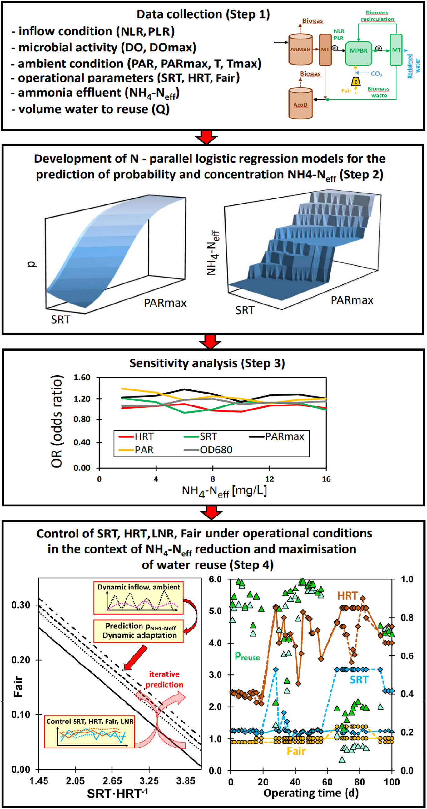
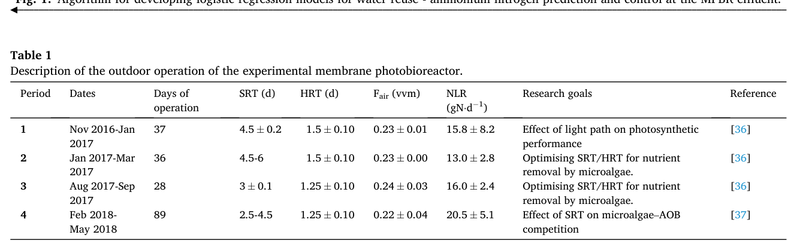
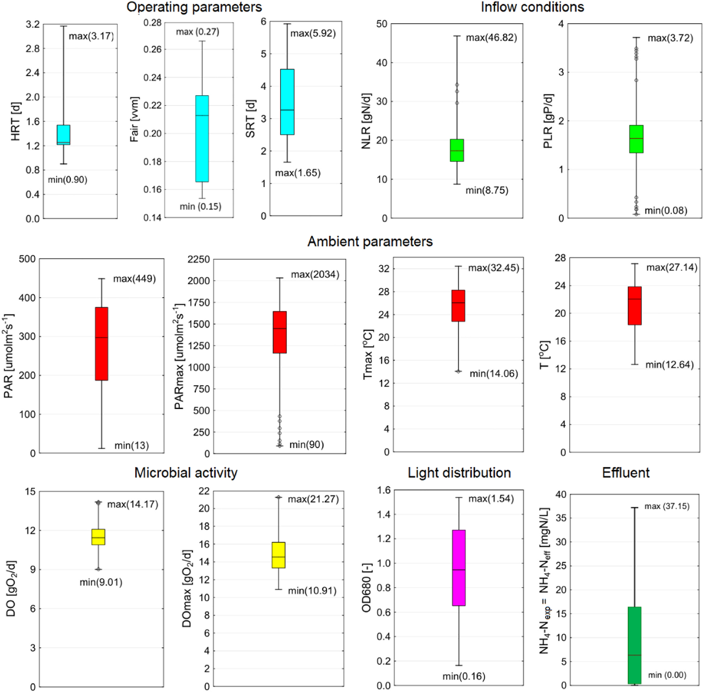
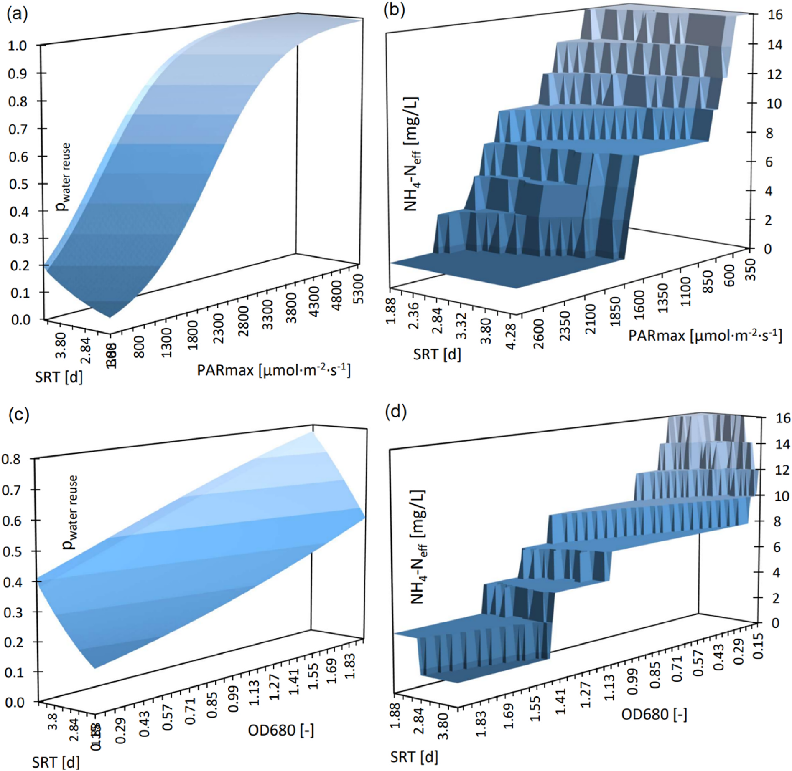
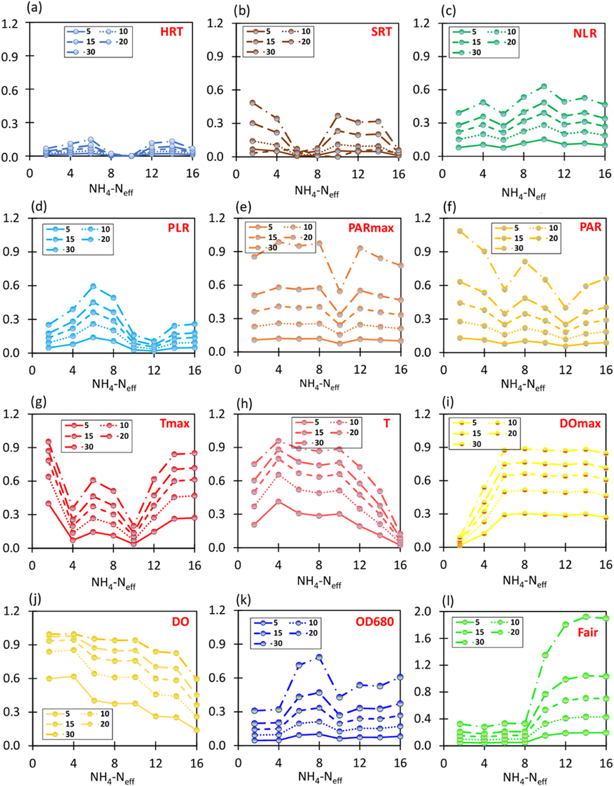
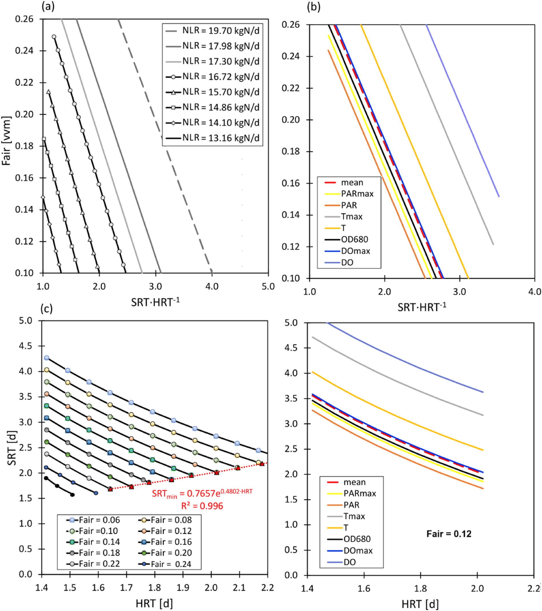
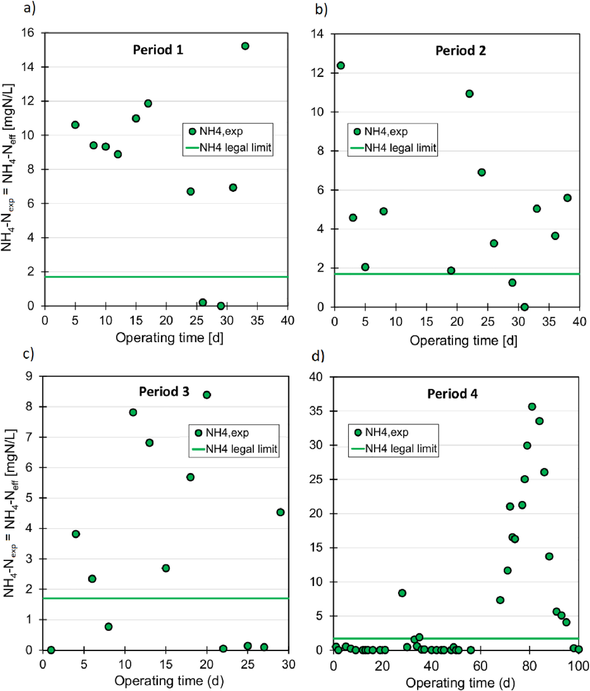
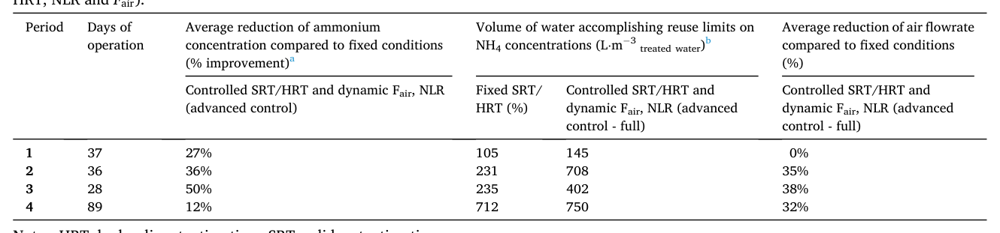
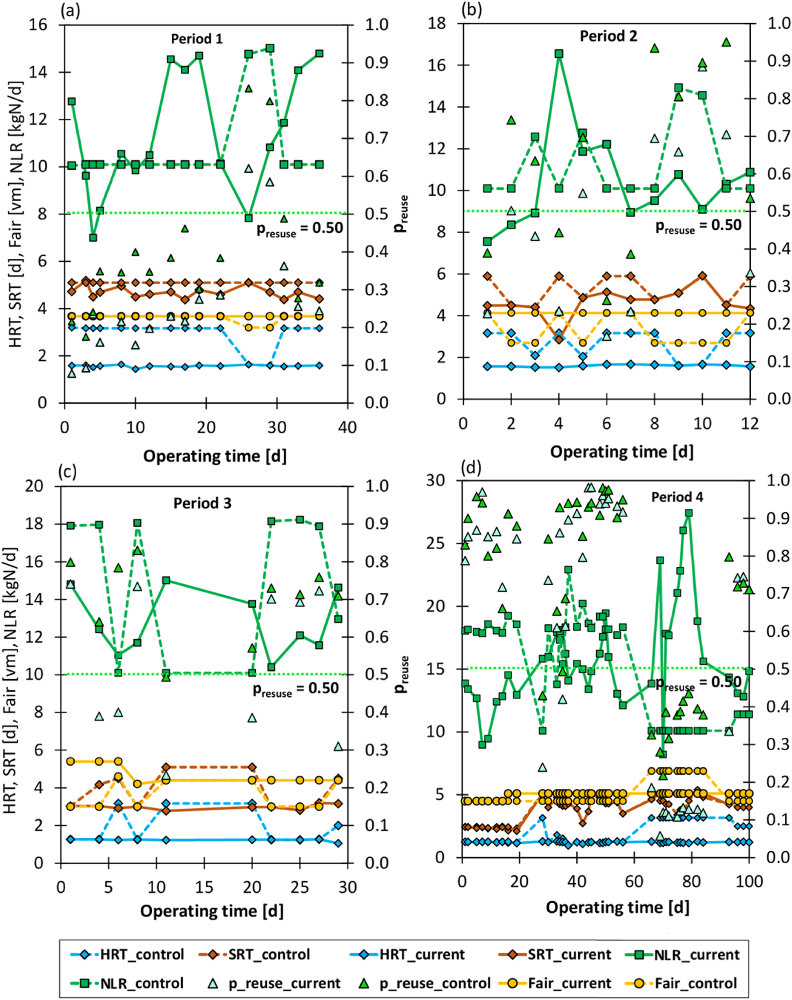
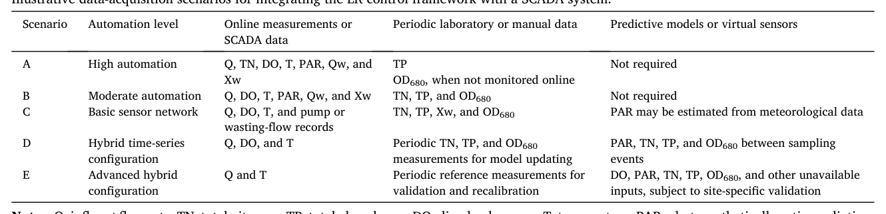

# Data-driven compliance: Optimising MPBR performance for ammonium removal and maximum water reuse for EU standards

## Abstract

* **Phương pháp tiếp cận dựa trên dữ liệu cho quản lý tài nguyên nước**:
  * Đề xuất khung mô hình hồi quy logistic (logistic regression -- LR) nhằm dự đoán nồng độ nitơ amoni trong dòng thải ($NH_4\text{-}N_{eff}$) và đánh giá tính phù hợp để tái sử dụng nước (water reuse suitability).
  * Đối tượng nghiên cứu là hệ thống bể phản ứng quang sinh học màng ngoài trời (outdoor membrane photobioreactor -- MPBR) quy mô pilot có dung tích $470\text{ L}$ (vận hành tại Valencia, Tây Ban Nha).
  * MPBR đóng vai trò là công đoạn xử lý bậc ba (tertiary treatment) để loại bỏ chất dinh dưỡng từ dòng thải của bể phản ứng sinh học màng kỵ khí (anaerobic membrane bioreactor -- AnMBR).
  * AnMBR đảm nhiệm loại bỏ chất hữu cơ bậc một (primary organic matter removal) từ nước thải sinh hoạt đô thị (municipal wastewater).
* **Đánh giá xác suất tuân thủ quy chuẩn tái sử dụng nước nghiêm ngặt**:
  * Khung mô hình ước tính xác suất tuân thủ quy định tái sử dụng nghiêm ngặt của Ý và Liên minh Châu Âu (EU).
  * Ngưỡng nồng độ nitơ amoni quy định trong nước tái sử dụng là $NH_4\text{-}N_{eff} < 1.6\text{ mg N/L}$ ($1.6\text{ mg N}\cdot\text{L}^{-1}$).
* **Xây dựng mô hình và các biến số đầu vào**:
  * Phát triển $8$ mô hình hồi quy logistic nhị phân (binary LR models) dựa trên tập dữ liệu vận hành ngoài trời liên tục trong $1.5\text{ năm}$ ($230\text{ mẫu}$ đo lường thực nghiệm).
  * Các biến đầu vào được xác định tường minh, bao gồm $4$ thông số vận hành chính cùng các yếu tố môi trường và sinh học:
    * Thông số vận hành: thời gian lưu chất rắn (solids retention time -- $\text{SRT}$), thời gian lưu thủy lực (hydraulic retention time -- $\text{HRT}$), lưu lượng sục khí (aeration flowrate -- $F_{air}$), và tải trọng nitơ (nitrogen loading rate -- $\text{NLR}$).
    * Yếu tố môi trường và sinh học: bức xạ ánh sáng khả dụng (light availability), nhiệt độ (temperature), nồng độ oxy hòa tan (dissolved oxygen -- $\text{DO}$), và các chỉ thị sinh khối vi tảo (microalgal biomass indicators).
  * Ứng dụng các phương pháp phân tích hỗ trợ:
    * Phân tích độ nhạy cục bộ (local sensitivity analysis -- LSA) và độ nhạy toàn cục Sobol để lượng hóa mức độ ảnh hưởng của các biến vận hành đến khả năng tuân thủ.
    * Phân cụm K-means (K-means clustering) để phân nhóm các kịch bản và điều kiện vận hành tối ưu.
* **Chiến lược điều khiển nâng cao và kết quả mô phỏng tính toán (in-silico projections)**:
  * Mô phỏng chiến lược điều khiển nâng cao nhằm tối ưu hóa đồng thời $4$ thông số vận hành ($\text{SRT}$, $\text{HRT}$, $F_{air}$, $\text{NLR}$).
  * Kết quả dự báo tính toán chứng minh ưu thế thực tiễn vượt trội so với các điều kiện vận hành cố định (fixed operating conditions):
    * Nâng cao hiệu quả xử lý amoni: nồng độ $NH_4\text{-}N_{eff}$ giảm từ $12\%$ đến $50\%$ ($12\text{--}50\%$).
    * Giảm nhu cầu cấp khí màng: lưu lượng khí sục $F_{air}$ giảm từ $32\%$ đến $38\%$ ($32\text{--}38\%$).
    * Tiết kiệm điện năng tiêu thụ cho sục khí: giảm từ $25\%$ đến $30\%$ ($25\text{--}30\%$), tương ứng giảm mức tiêu thụ năng lượng từ $0.369\text{ kWh/m}^3$ xuống còn $0.260\text{--}0.277\text{ kWh/m}^3$.
    * Gia tăng sản lượng nước tái sử dụng: tỷ lệ mẫu đạt chuẩn tăng thêm từ $5\%$ đến $67\%$ ($5\text{--}67\%$), sản xuất lên tới $750\text{ L}$ nước tái sử dụng đạt chuẩn trên mỗi $\text{m}^3$ nước thải xử lý ($750\text{ L/m}^3$).
* **Tiềm năng ứng dụng và tích hợp hệ thống**:
  * Khung mô hình cung cấp công cụ hỗ trợ ra quyết định giám sát (supervisory decision-making).
  * Có khả năng tích hợp trực tiếp vào hệ thống giám sát điều khiển và thu thập dữ liệu (SCADA) hiện hữu của các nhà máy xử lý nước.
  * Duy trì cấu trúc phân tích giải tích minh bạch và dễ diễn giải (transparent analytical structure).

## 1. Introduction

* **Tiềm năng và rào cản phát triển của ngành vi tảo trong nền kinh tế sinh học lam (blue bioeconomy):**
  * Ngành vi tảo nắm giữ tiềm năng đáng kể trong nền kinh tế sinh học lam đang nổi lên và có thể đóng góp vào các mục tiêu xanh bao gồm khử cacbon (decarbonisation), giảm thiểu ô nhiễm, kinh tế tuần hoàn (circular economy), bảo vệ các hệ sinh thái, cũng như hỗ trợ các Mục tiêu Phát triển Bền vững của Liên Hợp Quốc (UN Sustainable Development Goals - SDGs).
  * Quy mô thị trường vi tảo hiện nay vẫn còn rất hạn chế: trong giai đoạn từ năm $2016$ đến năm $2020$, ngành tảo tại Liên minh Châu Âu đóng góp chưa đến $0{,}01\%$ vào tổng sản phẩm quốc nội (Gross Domestic Product - GDP) của EU.
  * Sự phát triển của ngành vi tảo đang bị cản trở bởi nhiều thách thức cốt lõi:
    * Thiếu hụt hiểu biết thị trường (insufficient market knowledge).
    * Sự bất định về rủi ro và tác động môi trường của các sản phẩm phụ từ vi tảo.
    * Khung pháp lý phân mảnh bắt nguồn từ việc hiểu biết còn hạn chế về quá trình nuôi cấy vi tảo trong dài hạn (long term), cản trở việc tối ưu hóa các quy trình ở quy mô lớn (large-scale processes).
  * Việc nuôi cấy vi tảo trên môi trường nước thải (wastewater-based cultivation) cho phép thu hồi chất dinh dưỡng dưới dạng sinh khối vi tảo để sản xuất danh mục các sản phẩm sinh học (bioproducts), tuy nhiên các tiêu chí phòng ngừa ô nhiễm lại đặt ra thêm nhiều ràng buộc khắt khe cho phương pháp tiếp cận này.

* **Tiềm năng tái sử dụng nước (reclaimed water) và các rào cản pháp lý khắt khe tại Liên minh Châu Âu và Ý:**
  * Nước tái sử dụng (reclaimed water - tức nước thải đã qua xử lý đáp ứng các quy chuẩn chất lượng nước) là một sản phẩm phụ then chốt giúp giảm áp lực thủy văn tại các khu vực khan hiếm nước (water-scarce regions) và tăng cường tính tuần hoàn.
  * Tiêu chuẩn tái sử dụng nước của Liên minh Châu Âu theo Quy định (EU) $2020/741$ (Regulation (EU) $2020/741$ on water reuse):
    * Quy định nồng độ tối đa cho phép đối với vi khuẩn *Escherichia coli*, nhu cầu oxy sinh hóa trong 5 ngày ($\text{BOD}_5$), tổng chất rắn lơ lửng ($\text{TSS}$), độ đục (turbidity), vi khuẩn *Legionella* và trứng giun sán (helminth eggs) phân chia qua $4$ hạng chất lượng (từ $\text{A}$ đến $\text{D}$).
    * Một số quốc gia thành viên EU áp dụng các yêu cầu pháp lý quốc gia nghiêm ngặt hơn mà các hệ thống bắt buộc phải đáp ứng.
  * Tiêu chuẩn tái sử dụng nước của Ý theo Nghị định DM $185\text{-}2003$ (DM $185/2003$):
    * Bắt buộc tuân thủ đồng thời $55$ thông số hóa lý và sinh học, bao gồm các chất ô nhiễm đa lượng chung ($\text{COD}$, $\text{BOD}_5$, $\text{TSS}$, dinh dưỡng), kim loại nặng và các chất ô nhiễm hữu cơ chọn lọc.
    * Quy định ngưỡng giới hạn nồng độ amoni đầu ra cực kỳ nghiêm ngặt: $\text{NH}_4\text{-N}_{\text{eff}} < 2\text{ mg NH}_4/\text{L}$, tương đương với $\text{NH}_4\text{-N}_{\text{eff}} < 1{,}6\text{ mg N-NH}_4/\text{L}$ (hoặc $< 1{,}6\text{ mg N/L}$).

* **Nồng độ amoni đầu ra ($\text{NH}_4\text{-N}_{\text{eff}}$) là nút thắt kỹ thuật lớn nhất đối với các hệ thống xử lý bằng vi tảo:**
  * Giới hạn nồng độ amoni đầu ra $< 1{,}6\text{ mg N-NH}_4/\text{L}$ tạo ra một ràng buộc và thách thức kỹ thuật lớn nhất đối với các hệ thống dựa trên vi tảo:
    * Thách thức đặc biệt nghiêm trọng khi xử lý các dòng nước thải giàu amoni như nước thải thô (raw sewage), nước thải sau lắng sơ cấp (primary effluent), hoặc dịch phân hủy từ quá trình phân hủy kỵ khí (anaerobic digestion digestates).
    * Amoni đóng vai trò là nguồn nitơ chính cho sự phát triển của vi tảo; việc làm cạn kiệt amoni xuống ngưỡng rất thấp này làm suy giảm đáng kể hoạt tính quang hợp (photosynthetic activity) của vi tảo.
    * Do đó, nồng độ amoni được xem là thông số khó kiểm soát nhất để đáp ứng các giới hạn pháp lý của Ý về tái sử dụng nước trong hệ thống vi tảo.
  * Đánh giá rủi ro thực nghiệm của Hernández-Cuenca et al. về tái sử dụng nước từ bể phản ứng quang sinh học màng (membrane photobioreactor - MPBR):
    * Hầu hết các thông số kiểm soát đều đạt mức rủi ro chấp nhận được.
    * Ngoại trừ amoni đầu ra không đáp ứng tiêu chuẩn chất lượng nước đòi hỏi ($< 1{,}6\text{ mg N/L}$) trong khoảng $50\%$ thời gian vận hành được đánh giá (trong tổng số $55\text{ ngày}$ khảo nghiệm).
    * Kết quả chứng minh việc tái sử dụng nước thải từ hệ thống vi tảo hoàn toàn có tính khả thi cả về kỹ thuật lẫn pháp lý, nhưng quy định nghiêm ngặt về nồng độ amoni dòng ra đòi hỏi phải có các phương pháp đánh giá và kiểm soát sâu hơn.

* **Hạn chế của các phương pháp điều khiển nâng cao hiện hữu: mô hình cơ chế (MCM) và hệ logic mờ (fuzzy logic):**
  * Các chiến lược giảm nồng độ amoni đầu ra trước đây chủ yếu dựa trên các chỉ số gián tiếp ($\text{pH}$, oxy hòa tan - dissolved oxygen [$\text{DO}$]) hoặc mô hình dự báo thời tiết, trong khi điều khiển nâng cao chủ yếu dựa vào mô hình điều khiển cơ chế (mechanistic control models - MCM) và hệ logic mờ (fuzzy logic systems).
  * Cả hai phương pháp tiếp cận này đều bộc lộ những hạn chế rõ rệt trên $4$ khía cạnh then chốt:
    * **Yêu cầu về dữ liệu (data requirements):** Mô hình MCM đòi hỏi các bộ dữ liệu toàn diện với độ phân giải cao bao gồm các biến hóa lý và sinh học (như nồng độ các chủng vi khuẩn tự dưỡng và dị dưỡng cụ thể), vốn là các biến rất khó và tốn kém để quan trắc liên tục trực tuyến.
    * **Độ phức tạp toán học (mathematical complexity):** Cả MCM và hệ logic mờ đều đòi hỏi các thuật toán giải nâng cao cho các phương trình vi phân phi tuyến (non-linear differential equations) hoặc các hệ thống cơ sở luật thực nghiệm đồ sộ.
    * **Triển khai thực tế (practical implementation):** Độ phức tạp tính toán cao khiến việc tích hợp các mô hình này vào các nền tảng điều khiển quá trình thời gian thực tiêu chuẩn (như SCADA) bị hạn chế nghiêm trọng.
    * **Khả năng tái lập và chuyển giao (reproducibility and transferability):** Cả hai phương pháp đều bị ràng buộc bởi việc phải hiệu chuẩn số lượng lớn các thông số động học (kinetic), tỷ lượng (stoichiometric) hoặc thông số quy tắc; việc hiệu chuẩn này thường mang tính đặc thù riêng cho từng công trình (site-specific), làm giảm khả năng chuyển giao mô hình sang các cơ sở khác, điều kiện vận hành khác hoặc môi trường ngoài trời biến động. Do đó, các mô hình phát triển trong điều kiện ngắn hạn hoặc đơn giản hóa không phản ánh đầy đủ động thái động học quan sát được trong vận hành dài hạn.

* **Khoảng trống nghiên cứu của các mô hình học máy (ML): nhu cầu cấp thiết về mô hình giải tích minh bạch:**
  * Trước độ phức tạp của các quá trình diễn ra trong quần xã vi tảo và những hạn chế của mô hình MCM, các mô hình học máy (machine learning - ML) xuất hiện như một giải pháp thay thế hiệu quả để giải thích các mối quan hệ phức tạp giữa hệ vi sinh vật, thông số vận hành và các yếu tố môi trường bên ngoài:
    * Cho phép phát triển các mô hình đáng tin cậy để xây dựng chiến lược điều khiển hiệu quả.
    * Giúp tối ưu hóa toàn diện quá trình nuôi cấy vi tảo.
  * Các ứng dụng của ML đã được triển khai trong hệ vi tảo bao gồm: dự đoán nồng độ và năng suất sinh khối vi tảo, hiệu suất loại bỏ chất dinh dưỡng, nhận diện các chủng vi tảo trong bể phản ứng và xác định hoạt tính của chúng.
  * Mặc dù vi tảo đã được chứng minh có thể tạo nền tảng cho các hệ thống tái sử dụng nước, khía cạnh này vẫn chưa được thảo luận rộng rãi trong việc áp dụng mô hình ML để tối ưu hóa hiệu suất hệ thống.
  * Các phương pháp ML đang được sử dụng phổ biến bao gồm mạng nơ-ron nhân tạo (artificial neural networks - ANN), hồi quy tuyến tính và phi tuyến bội (multiple linear and non-linear regression).
  * Khoảng trống nghiên cứu trọng yếu của các ứng dụng ML hiện nay:
    * Phần lớn các ứng dụng ML tiên tiến hoạt động như các thuật toán "hộp đen" (black-box) như ANN, Rừng ngẫu nhiên (Random Forests), XGBoost.
    * Mặc dù các mô hình này có độ chính xác dự báo cao, việc thiếu tính minh bạch cản trở việc trích xuất các quy tắc vận hành có thể diễn giải theo bản chất vật lý (physically interpretable operational rules), gây khó khăn cho việc ứng dụng trong điều khiển thời gian thực của người vận hành nhà máy.

* **Ưu điểm vượt trội của mô hình hồi quy logistic (LR) trong phân loại xác suất tuân thủ:**
  * Các công cụ tính toán mang dạng toán học giải tích cung cấp một giải pháp khả thi, tuy nhiên các mô hình giải tích truyền thống gặp nhiều khó khăn trong việc nắm bắt động thái phi tuyến phức tạp của các quá trình nuôi cấy vi tảo.
  * Trong số các phương pháp ML áp dụng cho hệ thống vi tảo, mô hình hồi quy logistic (logistic regression - LR), đóng vai trò như một công cụ phân loại (classification tool), thu hút sự quan tâm đặc biệt:
    * **Dạng giải tích tường minh (analytical mathematical form):** Các hệ số thu được mang ý nghĩa vật lý rõ ràng (physical interpretation), tạo điều kiện thuận lợi cho việc ứng dụng mô hình trong các điều kiện kỹ thuật thực tế.
    * **Ước tính xác suất trực tiếp từ $0$ đến $1$:** Cung cấp các ước tính xác suất nằm trong khoảng từ $0$ đến $1$, đặc biệt hữu ích cho việc dự đoán tiềm năng tái sử dụng nước vì đầu ra liên kết trực tiếp và tường minh với tiêu chí pháp lý nhị phân (tuân thủ hoặc không tuân thủ ngưỡng amoni đầu ra).
    * **Độ phức tạp tính toán thấp:** Khác với mô hình MCM và hệ logic mờ, mô hình LR không đòi hỏi các phép đo sinh học chi tiết, không cần hiệu chuẩn động học sâu rộng, không dùng bộ giải phi tuyến phức tạp và không cần bộ quy tắc điều khiển thực nghiệm quy mô lớn.
    * **Dễ dàng kiểm chứng và chuyển giao:** Cung cấp mô hình giải tích độ phức tạp thấp, dễ dàng thẩm định, tái lập và tích hợp trực tiếp vào các hệ thống điều khiển quá trình tiêu chuẩn (SCADA).

* **Hạn chế về quy mô thực nghiệm và nhu cầu mở rộng không gian biến điều khiển đa chiều:**
  * Một hạn chế lớn khác trong các nghiên cứu trước đây liên quan đến quy mô triển khai: các nghiên cứu đơn giản hóa ở quy mô phòng thí nghiệm (lab-scale) sử dụng nước thải tổng hợp chỉ cung cấp hiểu biết hạn chế về tương tác giữa các biến đầu vào then chốt như lưu lượng sục khí, thời gian lưu thủy lực ($\text{HRT}$), thời gian lưu chất rắn ($\text{SRT}$), tải lượng dinh dưỡng và các yếu tố môi trường (bức xạ mặt trời, nhiệt độ). Vì vậy, các mô hình hiện có thường bỏ sót các biến đầu vào quan trọng.
  * Các hệ thống điều khiển thực nghiệm trước đây tại các cơ sở trình diễn chủ yếu chỉ tập trung thao tác điều chỉnh duy nhất $\text{SRT}$ và $\text{HRT}$, bỏ qua các thông số vận hành quan trọng khác như lưu lượng sục khí ($F_{\text{air}}$) và tải trọng nạp nitơ (nitrogen loading rate - $\text{NLR}$).
  * Tiềm năng tách rời (uncoupling/decoupling) giữa $\text{NLR}$ và $\text{HRT}$:
    * $\text{NLR}$ có mối quan hệ trực tiếp với $\text{HRT}$ trong các hệ thống nuôi cấy xử lý một dòng thải đơn lẻ.
    * Tuy nhiên, $\text{NLR}$ có thể được tách rời khỏi $\text{HRT}$ bằng cách phối trộn linh hoạt các dòng thải khác nhau để điều chỉnh đặc tính nước thải phù hợp với công suất xử lý của vi tảo nhằm tối ưu hóa hoạt tính vi tảo.
    * Từ góc độ công nghệ, việc tách rời này mở ra những tiềm năng mới để phát triển các chiến lược điều khiển đa chiều, tiên tiến cho các hệ thống xử lý bằng vi tảo.

* **Mục tiêu nghiên cứu và phạm vi triển khai của đề tài:**
  * Đề tài phát triển một khung mô hình hồi quy logistic (LR) minh bạch nhằm đánh giá xác suất tuân thủ nồng độ amoni đầu ra trong một hệ thống bể phản ứng quang sinh học màng ngoài trời (outdoor MPBR) xử lý dòng thải sau bể phản ứng màng kỵ khí (Anaerobic Membrane Bioreactor - AnMBR) cấp bởi nước thải đô thị.
  * Khác với các mô hình cơ chế phức tạp hoặc các phương pháp học máy thiếu tính diễn giải, mô hình LR cung cấp một cấu trúc giải tích tường minh giúp ước tính trực tiếp xác suất tuân thủ quy chuẩn pháp lý và tạo thuận lợi cho việc diễn giải cũng như triển khai vận hành thực tế.
  * Khung mô hình được xây dựng dựa trên chuỗi dữ liệu thực nghiệm quy mô pilot ngoài trời liên tục trong $1{,}5\text{ năm}$, bao quát toàn diện:
    * Các biến vận hành: thời gian lưu chất rắn ($\text{SRT}$), thời gian lưu thủy lực ($\text{HRT}$) và lưu lượng sục khí ($F_{\text{air}}$).
    * Các biến tải lượng dinh dưỡng dòng vào: tải trọng nạp nitơ ($\text{NLR}$) và tải trọng nạp phospho (phosphorus loading rate - $\text{PLR}$).
    * Các điều kiện môi trường: bức xạ quang hợp hoạt dụng (photosynthetically active radiation - $\text{PAR}$) và nhiệt độ.
    * Các chỉ số sinh học và quá trình: nồng độ oxy hòa tan ($\text{DO}$) và mật độ quang tại bước sóng $680\text{ nm}$ ($\text{OD}_{680}$).
  * Năng lực xử lý của hệ thống MPBR này đã được đánh giá trong các nghiên cứu trước đây, nhưng tiềm năng tái sử dụng nước đạt được trong dài hạn vẫn chưa từng được đánh giá.
  * Ba mục tiêu nghiên cứu cụ thể bao gồm:
    * (i) Phát triển và thẩm định nội bộ $8$ mô hình LR dựa trên ngưỡng để dự đoán các dải nồng độ $\text{NH}_4\text{-N}_{\text{eff}}$ và xác suất tuân thủ quy chuẩn tái sử dụng nước.
    * (ii) Xác định các biến vận hành và môi trường có ảnh hưởng chi phối lớn nhất, đồng thời đánh giá tác động kết hợp của chúng thông qua phân tích độ nhạy cục bộ (local sensitivity analysis), độ nhạy toàn cục và phân tích cụm đa biến (multivariate cluster analysis).
    * (iii) Đánh giá mô phỏng trên máy tính (*in silico*) chiến lược điều khiển giám sát tối ưu hóa đồng thời $4$ thông số: $\text{SRT}$, $\text{HRT}$, $\text{NLR}$ và $F_{\text{air}}$ nhằm giảm thiểu $\text{NH}_4\text{-N}_{\text{eff}}$ và cực đại hóa sản lượng nước tái sử dụng ước tính đáp ứng quy chuẩn tái sử dụng của Ý (DM $185\text{-}2003$).
  * Giới hạn của nghiên cứu và định hướng tương lai: Khung nghiên cứu còn bị giới hạn bởi việc rời rạc hóa biến phản hồi nồng độ $\text{NH}_4\text{-N}_{\text{eff}}$ liên tục và bởi phạm vi vận hành trong bộ dữ liệu huấn luyện; các nghiên cứu tiếp theo cần mở rộng kiểm chứng ngoại suy (external validation) trên các điều kiện khí hậu, đặc tính nước thải và cấu hình bể phản ứng khác nhau, cùng với việc triển khai thực tế và so sánh hoặc tích hợp với các mô hình điều khiển cơ chế.

## 2. Methodology

* Nghiên cứu tuân theo một khung quy trình tích hợp gồm $4$ bước (four-step framework) nhằm mô hình hóa và kiểm soát chất lượng nước thải MPBR:
  * **Hình 1.** Quy trình 4 bước phát triển mô hình hồi quy logistic cho MPBR
    * 
    * **Hình này chứng minh điều gì**
      * Chuỗi quy trình liên kết $N$ mô hình LR song song và tỷ số chênh ($OR$) vào vòng lặp thích ứng để tối ưu hóa tái sử dụng nước ($p_{reuse}$).
    * **Từ đâu mà thấy được**
      * Trục đọc từ trên xuống dưới qua 4 khối quy trình nối tiếp nhau bằng các mũi tên đỏ lớn (Step 1 đến Step 4).
      * Khối Step 2 biểu diễn mặt xác suất $p$ và bậc thang nồng độ $NH_4\text{-}N_{eff}$; khối Step 3 thể hiện đồ thị $OR$ theo nồng độ $0\text{--}16\text{ mg/L}$.
      * Khối Step 4 chứa chu trình mũi tên đỏ "iterative prediction" và đồ thị vận hành $0\text{--}100\text{ d}$ theo dõi xác suất tái sử dụng $p_{reuse}$.
  * Bước 1 (Step 1): Thu thập và tiền xử lý dữ liệu vận hành dài hạn từ hệ thống photobioreactor màng ngoài trời (outdoor membrane photobioreactor - MPBR).
    * Các dữ liệu thu thập bao gồm điều kiện dòng vào (tải nạp nitơ $NLR$, tải nạp phospho $PLR$), hoạt tính vi sinh vật (oxy hòa tan $DO$, oxy hòa tan cực đại $DO_{max}$), điều kiện môi trường xung quanh (bức xạ quang hợp hoạt dụng $PAR$, bức xạ cực đại $PAR_{max}$, nhiệt độ $T$, nhiệt độ cực đại $T_{max}$), thông số vận hành (thời gian lưu bùn $SRT$, thời gian lưu nước $HRT$, lưu lượng sục khí $F_{air}$), nồng độ amoni dòng ra ($NH_4\text{--}N_{eff}$), và thể tích nước tái sử dụng ($Q$).
  * Bước 2 (Step 2): Phát triển và kiểm định các mô hình hồi quy logistic (logistic regression - LR) song song phục vụ phân loại xác suất nồng độ $NH_4\text{--}N_{eff}$ và tiềm năng tái sử dụng nước ($p_{reuse}$).
    * Mô hình cho phép dự đoán nồng độ amoni dòng ra và xác suất tuân thủ ngưỡng quy chuẩn tái sử dụng dựa trên các biến đầu vào vận hành và môi trường.
  * Bước 3 (Step 3): Tiến hành phân tích độ nhạy cục bộ (local sensitivity analysis) và độ nhạy toàn cục (global sensitivity analysis) để nhận diện các biến số có ảnh hưởng then chốt và các tương tác giữa chúng.
    * Đánh giá định lượng tác động của từng thông số thông qua hệ số tỷ số chênh (odds ratio - $OR$) trên toàn bộ dải nồng độ $NH_4\text{--}N_{eff}$ từ $0$ đến $16\text{ mg N/L}$.
  * Bước 4 (Step 4): Đánh giá mô phỏng trên máy tính (in-silico evaluation) một chiến lược điều khiển giám sát đa biến (multivariable supervisory control strategy).
    * Chiến lược điều khiển tối ưu hóa đồng thời $4$ thông số then chốt gồm $SRT$, $HRT$, $F_{air}$ và $NLR$ nhằm cải thiện mức độ tuân thủ ngưỡng amoni và tối đa hóa sản lượng nước tái sử dụng.
* Khung phương pháp và chiến lược điều khiển được đánh giá xuyên suốt $4$ chiến dịch đo đạc vận hành thực nghiệm độc lập (Periods 1--4):
  * **Bảng 1.** Thông số vận hành thực nghiệm MPBR ngoài trời qua 4 giai đoạn
    * 
    * **Bảng này chứng minh điều gì**
      * Bốn chiến dịch cung cấp tập dữ liệu gồm 190 ngày vận hành với tải nạp nitơ ($NLR$) biến thiên từ $13.0$ đến $20.5\text{ gN}\cdot\text{d}^{-1}$.
    * **Từ đâu mà thấy được**
      * Các dòng Period 1–4, cột "Days of operation": thời gian vận hành lần lượt là 37, 36, 28 và 89 ngày.
      * Cột "NLR" và "$\text{F}_{\text{air}}$": tải nitơ cao nhất ở Period 4 ($20.5 \pm 5.1\text{ gN}\cdot\text{d}^{-1}$), lưu lượng sục khí duy trì $0.22\text{--}0.24\text{ vvm}$.
  * Giai đoạn 1 (Period 1, từ tháng 11/2016 đến tháng 01/2017, tổng cộng $37\text{ ngày}$ vận hành):
    * Mục tiêu nghiên cứu: Khảo sát ảnh hưởng của chiều dài đường truyền ánh sáng (light path) lên hiệu suất quang hợp của vi tảo.
    * Điều kiện vận hành thực nghiệm: $SRT = 4{,}5 \pm 0{,}2\text{ ngày}$, $HRT = 1{,}5 \pm 0{,}10\text{ ngày}$, $F_{air} = 0{,}23 \pm 0{,}01\text{ vvm}$, $NLR = 15{,}8 \pm 8{,}2\text{ gN}\cdot\text{d}^{-1}$.
  * Giai đoạn 2 (Period 2, từ tháng 01/2017 đến tháng 03/2017, tổng cộng $36\text{ ngày}$ vận hành):
    * Mục tiêu nghiên cứu: Tối ưu hóa các thông số $SRT/HRT$ phục vụ loại bỏ chất dinh dưỡng bằng vi tảo.
    * Điều kiện vận hành thực nghiệm: $SRT = 4{,}5\text{--}6\text{ ngày}$, $HRT = 1{,}5 \pm 0{,}10\text{ ngày}$, $F_{air} = 0{,}23 \pm 0{,}00\text{ vvm}$, $NLR = 13{,}0 \pm 2{,}8\text{ gN}\cdot\text{d}^{-1}$.
  * Giai đoạn 3 (Period 3, từ tháng 08/2017 đến tháng 09/2017, tổng cộng $28\text{ ngày}$ vận hành):
    * Mục tiêu nghiên cứu: Tiếp tục tối ưu hóa $SRT/HRT$ cho quá trình loại bỏ chất dinh dưỡng của vi tảo trong điều kiện bức xạ và nhiệt độ cao.
    * Điều kiện vận hành thực nghiệm: $SRT = 3 \pm 0{,}1\text{ ngày}$, $HRT = 1{,}25 \pm 0{,}10\text{ ngày}$, $F_{air} = 0{,}24 \pm 0{,}03\text{ vvm}$, $NLR = 16{,}0 \pm 2{,}4\text{ gN}\cdot\text{d}^{-1}$.
  * Giai đoạn 4 (Period 4, từ tháng 02/2018 đến tháng 05/2018, tổng cộng $89\text{ ngày}$ vận hành):
    * Mục tiêu nghiên cứu: Khảo sát ảnh hưởng của $SRT$ đến sự cạnh tranh giữa vi tảo và vi khuẩn oxy hóa amoni (ammonia-oxidizing bacteria - AOB).
    * Điều kiện vận hành thực nghiệm: $SRT = 2{,}5\text{--}4{,}5\text{ ngày}$, $HRT = 1{,}25 \pm 0{,}10\text{ ngày}$, $F_{air} = 0{,}22 \pm 0{,}04\text{ vvm}$, $NLR = 20{,}5 \pm 5{,}1\text{ gN}\cdot\text{d}^{-1}$.

### 2.1. Measurement data

#### 2.1.1. Experimental pilot plant

* Dữ liệu thực nghiệm thu thập từ quá trình vận hành ngoài trời liên tục kéo dài $1{,}5\text{ năm}$ của hệ thống photobioreactor màng (membrane photobioreactor - MPBR) quy mô pilot có dung tích làm việc $470\text{ L}$:
  * Hệ thống gồm hai bể quang sinh học dạng tấm phẳng (flat-panel PBRs, kích thước $1{,}25 \times 2 \times 0{,}1\text{ m}$).
  * Hệ thống kết nối với cụm thu hồi sinh khối hai giai đoạn (two-step harvesting system) gồm các bể dung tích $14\text{ L}$ trang bị màng siêu lọc sợi rỗng (ultrafiltration hollow-fibre membranes, nhãn hiệu PURON® KMS PUR-PSH31, kích thước lỗ màng $0{,}03\text{ }\mu\text{m}$, tổng diện tích bề mặt màng $3{,}44\text{ m}^2$).
  * Hai bể PBR được giám sát liên tục bằng các cảm biến trực tuyến (on-line sensors) được hiệu chuẩn định kỳ để đo $\text{pH}$, nhiệt độ ($T$), oxy hòa tan ($DO$), và bức xạ quang hợp hoạt hóa đo theo phương thẳng đứng (photosynthetically active radiation - $PAR$).
  * Bộ điều khiển logic lập trình được (PLC) tích hợp SCADA chịu trách nhiệm thu thập dữ liệu và điều tiết các biến vận hành, bao gồm lưu lượng dòng vào và dòng ra, thời gian lưu nước ($HRT$), thời gian lưu bùn ($SRT$) và lưu lượng sục khí ($F_{air}$), mô phỏng các điều kiện vận hành điển hình ở quy mô công nghiệp lớn.
* Hệ thống MPBR tiếp nhận và xử lý nước thải sau xử lý từ hệ thống màng kỵ khí (anaerobic membrane bioreactor - AnMBR) quy mô pilot:
  * Nước thải đầu vào là nước thải đô thị từ nhà máy xử lý nước thải Carraixet (Carraixet WWTP, tọa độ $39^\circ 30' 04{,}0''\text{N } 0^\circ 20' 00{,}1''\text{W}$, Valencia, Tây Ban Nha), vận hành ngoài trời liên tục.
  * Hệ thống AnMBR chịu trách nhiệm xử lý các chất hữu cơ và loại bỏ mầm bệnh, trong khi giai đoạn MPBR thúc đẩy quá trình loại bỏ chất dinh dưỡng để tái sử dụng nước (water reclamation).
  * Sinh khối tạo ra từ cả hai bước được đưa vào quá trình đồng phân hủy kỵ khí (anaerobic co-digestion - AcoD) nhằm tối đa hóa sản lượng thu hồi khí sinh học (biogas).
  * Nghiên cứu này tập trung phân tích chuyên sâu giai đoạn hai (MPBR) do vai trò quyết định của quá trình vi tảo đối với tiềm năng tái sử dụng nước:
    * Dòng cấp vào MPBR được phân tích qua các mẫu đơn (grab samples) với cùng tần suất như các thông số khác của MPBR, cho phép đánh giá độc lập giai đoạn hai mà không cần phụ thuộc vào giai đoạn AnMBR trước đó.
    * Hiệu suất sinh học của hệ thống AnMBR không được đưa vào khung mô hình hồi quy logistic (logistic regression - LR) do bộ dữ liệu thực nghiệm của hệ thống này chưa đủ lớn.

#### 2.1.2. Data pre-processing and input variables

* Tập dữ liệu thu thập gồm $230\text{ mẫu}$ trong suốt $10\text{ giai đoạn}$ thực nghiệm ($2016\text{--}2018$, tần suất lấy mẫu $2\text{--}3\text{ mẫu/tuần}$), loại trừ các giai đoạn khởi động (start-up) và bảo trì hệ thống.
* Lựa chọn biến đầu vào cho mô hình LR từ $40\text{ biến}$ được giám sát:
  * Việc lựa chọn biến dựa trên kết quả phân tích đa biến trước đó (phân tích thành phần chính - PCA, bình phương tối thiểu từng phần - PLS) và phân tích hồi quy tuyến tính bội (multiple linear regression - MLR) để xác định các biến có mối liên hệ mật thiết nhất với hiệu suất quá trình.
  * Các biến đầu vào được lựa chọn cho mô hình LR phản ánh đặc tính vận hành và môi trường trong suốt thời gian nghiên cứu (Hình 2):
    * **Hình 2.** Biểu đồ hộp phân bố các thông số vận hành thực nghiệm MPBR
      * 
      * **Hình này chứng minh điều gì**
        * Khoảng biến thiên thực tế của 12 biến đầu vào (thuộc 5 nhóm thông số) và nồng độ amoni đầu ra $NH_4\text{--}N_{eff}$ trong suốt vận hành ngoài trời.
      * **Từ đâu mà thấy được**
        * Trục hoành $Ox$: phân nhóm 13 biểu đồ hộp theo 5 nhóm thông số và dòng ra; Trục tung $Oy$: giá trị theo thang đo và đơn vị của từng biến.
        * Nhóm vận hành và môi trường: $HRT$ ($0{,}90\text{--}3{,}17\text{ d}$), $F_{air}$ ($0{,}15\text{--}0{,}27\text{ vvm}$), $SRT$ ($1{,}65\text{--}5{,}92\text{ d}$), $NLR$ ($8{,}75\text{--}46{,}82\text{ gN/d}$), $PLR$ ($0{,}08\text{--}3{,}72\text{ gP/d}$), $T$ ($12{,}64\text{--}27{,}14\ ^\circ\text{C}$), $PAR$ ($13\text{--}449\ \mu\text{mol}\cdot\text{m}^{-2}\cdot\text{s}^{-1}$).
        * Nhóm vi sinh, ánh sáng và dòng ra: $DO$ ($9{,}01\text{--}14{,}17\text{ gO}_2/\text{d}$), $DO_{max}$ ($10{,}91\text{--}21{,}27\text{ gO}_2/\text{d}$), $OD_{680}$ ($0{,}16\text{--}1{,}54$), $NH_4\text{--}N_{eff}$ ($0{,}00\text{--}37{,}15\text{ mgN/L}$).
    * (i) Các thông số vận hành có thể kiểm soát: thời gian lưu bùn ($SRT$), thời gian lưu nước ($HRT$) và lưu lượng sục khí ($F_{air}$).
    * (ii) Các điều kiện dòng cấp: tải trọng nitơ ($NLR$) và tải trọng phospho ($PLR$).
    * (iii) Các chỉ số hoạt tính quang hợp/vi sinh: nồng độ oxy hòa tan trung bình ngày ($DO$) và cực đại ngày ($DO_{max}$).
    * (iv) Các điều kiện môi trường xung quanh: bức xạ $PAR$ trung bình ngày và cực đại ngày ($PAR_{max}$), cùng nhiệt độ trung bình ngày ($T$) và cực đại ngày ($T_{max}$).
    * (v) Phân bố ánh sáng: được đánh giá thông qua mật độ quang ở bước sóng $680\text{ nm}$ ($OD_{680}$).
    * (vi) Nồng độ amoni dòng ra ($NH_4\text{–}N_{eff}$).
* Tách rời mối phụ thuộc giữa tải trọng dinh dưỡng và thời gian lưu nước:
  * Mặc dù $NLR$ và $PLR$ thông thường phụ thuộc vào $HRT$, chúng có thể được tách rời thông qua phối trộn dòng (stream blending) nhằm tối ưu hóa hoạt tính sinh học và kích hoạt các chiến lược kiểm soát nâng cao.
* Tác động chi phối của các yếu tố môi trường và quang học:
  * Giá trị trung bình và giá trị cực đại hàng ngày của $PAR$ và $T$ được tích hợp vào mô hình do sự dao động tự nhiên của thời tiết ngoài trời chi phối trực tiếp đến hiệu suất hệ thống.
  * $OD_{680}$ và $DO$ đóng vai trò là các chỉ số chính thể hiện hiệu quả sử dụng ánh sáng và năng suất tổng thể của quần xã vi tảo.
* Sàng lọc dữ liệu ngoại lai (outlier screening) và kiểm tra sai số đo đạc:
  * Quy trình chuẩn hóa Z-score được áp dụng theo công thức $Z_i = (x_i - \mu_i)/\sigma_i$ để phát hiện các giá trị dị biệt và sai số đo đạc tiềm ẩn.
  * Toàn bộ các giá trị quan trắc đều nằm trong ngưỡng chấp nhận ($Z_i = 0{,}01\text{--}2{,}95 < 3{,}0$, Bảng S2), chứng minh tập dữ liệu phân tích không có sai số đo đạc bất thường.

### 2.2. Logistic regression

* Mô hình hồi quy logistic (Logistic regression - LR) được sử dụng để phát triển các mô hình phân loại nhị phân (binary classification) nhằm ước tính xác suất vượt các ngưỡng nồng độ amoni dòng ra đã chọn ($\mathrm{NH}_4\text{--}\mathrm{N}_{\mathrm{eff}}$).
  * Với mỗi ngưỡng $m$, xác suất vượt ngưỡng $p_{\mathrm{NH}_4\text{--}\mathrm{N}_{\mathrm{eff}}}(m)$ ($p_m$) được xác định theo Công thức (1):
    $$p_{\mathrm{NH}_4\text{--}\mathrm{N}_{\mathrm{eff}}}(m) = \frac{\exp(X_m)}{1 + \exp(X_m)} \quad \text{cho } m = 1, 2, 3, \dots, n$$
  * Tỷ số chênh logarit (log-odds / hàm liên kết logit) tương ứng với hàm dự đoán tuyến tính $X_m$: $\ln\left(\frac{p_m}{1 - p_m}\right) = X_m$.
  * Hàm dự đoán tuyến tính $X_m$ được tính toán theo Công thức (2):
    $$X_m = \alpha_0 + \alpha_1 \cdot x_1 + \alpha_2 \cdot x_2 + \dots + \alpha_i \cdot x_i$$
  * Các hệ số hồi quy $\alpha_0, \dots, \alpha_i$ được ước lượng bằng phương pháp hợp lý cực đại (maximum likelihood).
* Các biến đầu vào mô hình $x_i$ gồm $11$ thông số: $\mathrm{NLR}$, $\mathrm{PLR}$, $\mathrm{SRT}$, $\mathrm{HRT}$, $F_{\mathrm{air}}$, $\mathrm{PAR}$, $\mathrm{PAR}_{\max}$, $\mathrm{DO}$, $\mathrm{DO}_{\max}$, $T$, và $T_{\max}$.
* Tám mô hình LR được xây dựng tương ứng với $8$ ngưỡng $\mathrm{NH}_4\text{--}\mathrm{N}_{\mathrm{eff}}$: $1{,}6$, $4{,}0$, $6{,}0$, $8{,}0$, $10{,}0$, $12{,}0$, $14{,}0$, và $16{,}0\text{ mg N}\cdot\text{L}^{-1}$.
  * Tập ngưỡng được lựa chọn và phân phối dữ liệu được hỗ trợ bởi hàm phân phối tích lũy thực nghiệm (empirical cumulative distribution function - CDF) (Fig. S2).
* Mô hình tương ứng với ngưỡng $\mathrm{NH}_4\text{--}\mathrm{N}_{\mathrm{eff}} = 1{,}6\text{ mg N}\cdot\text{L}^{-1}$ được sử dụng để ước tính xác suất tuân thủ giới hạn tái sử dụng nước theo quy chuẩn Ý (DM 185/2003), được định nghĩa là $p_{\mathrm{reuse}}$.
  * Việc áp dụng nhiều mô hình LR theo ngưỡng tuân theo sự điều chỉnh phương pháp luận từ cách tiếp cận logistic từng được áp dụng cho dự đoán khử màu [43], với đầy đủ chi tiết triển khai trong Phụ lục Thông tin (Mục S1).
  * Kết quả dự báo của mô hình LR được so sánh đối chiếu với các mô hình kinh điển như XGBoost và mạng perceptron đa tầng (Multilayer Perceptron - MLP) (Mục S2).
* Quy trình tiền xử lý dữ liệu nghiêm ngặt được thực hiện trước khi phát triển mô hình:
  * Các bản ghi không hoàn chỉnh chứa giá trị khuyết thiếu bị loại bỏ khỏi phân tích.
  * Dữ liệu đầu vào được chuẩn hóa min-max (min-max standardization) nhằm đảm bảo quy mô đồng nhất giữa các biến.
  * Sàng lọc sơ bộ điểm Z (Z-score pre-screening) được tiến hành nhằm xác định các ngoại lai và sai số đo lường tiềm ẩn:
    $$Z_i = \frac{x_i - \mu_i}{\sigma_i}$$
  * Tất cả các giá trị đều nằm trong ngưỡng chấp nhận ($Z_i = 0{,}01\text{--}2{,}95 < 3$; Bảng S2), chứng minh không có bằng chứng về sai số đo lường trong tập dữ liệu phân tích.
  * Phân phối thực nghiệm của dữ liệu đầu vào được đánh giá tự động bằng phần mềm XLSTAT; độ phù hợp giữa phân phối thực nghiệm và phân phối chuẩn lý thuyết được đánh giá thông qua kiểm định Kolmogorov-Smirnov với mức xác suất tới hạn $p = 0{,}05$ (Bảng S3).
  * Đối với các biến có phân phối lệch đáng kể so với phân phối chuẩn, phép biến đổi Box-Cox (Box-Cox transformation) được áp dụng trước khi tích hợp vào khung hồi quy logistic.
* Hiệu năng mô hình được đánh giá toàn diện thông qua $6$ chỉ số phân loại: độ chính xác (accuracy - ACC), độ nhạy / độ thu hồi (sensitivity/recall - SENS), độ đặc hiệu (specificity - SPEC), độ chuẩn xác (precision - Prec), diện tích dưới đường cong ROC (ROC-AUC), và điểm F1 (F1-score).
  * Việc tuân thủ ngưỡng $\mathrm{NH}_4\text{--}\mathrm{N}$ được định nghĩa là lớp dương tính (positive class).
  * SENS đại diện cho tỷ lệ các quan sát tuân thủ được phân loại chính xác, trong khi SPEC đại diện cho tỷ lệ các quan sát không tuân thủ được phân loại chính xác.
  * Prec định lượng tỷ lệ các quan sát được dự đoán tuân thủ mà trên thực nghiệm có tuân thủ, trong khi F1-score là trung bình điều hòa của Prec và SENS/recall.
  * ROC-AUC đánh giá năng lực của mô hình trong việc phân biệt giữa các quan sát tuân thủ và không tuân thủ trên toàn bộ dải ngưỡng xác suất.
  * Các công thức tính toán các chỉ số này được cung cấp trong Phụ lục Thông tin (Mục S1).
  * Khoảng tin cậy $95\%$ được xác định cho tất cả các chỉ số hiệu năng (SENS, SPEC, Prec, ACC, và F1-score) nhằm củng cố độ vững chắc của kết quả.
* Tập dữ liệu lựa chọn bao gồm tổng cộng $230$ đợt đo (measurement episodes):
  * Phương pháp lấy mẫu ngẫu nhiên phân tầng (stratified random sampling) được áp dụng trên dữ liệu từ $4$ giai đoạn vận hành ($1\text{--}4$) nhằm đảm bảo mô hình có khả năng khái quát hóa qua mọi biến động theo mùa và chế độ vận hành.
  * Dữ liệu từ bốn giai đoạn vận hành gồm $210$ đợt đo với dải nồng độ $\mathrm{NH}_4\text{--}\mathrm{N}_{\mathrm{eff}}$ biến thiên rộng, chia theo tỷ lệ $80\%$ dùng cho huấn luyện (training) và $20\%$ dùng cho kiểm tra (testing) trong mỗi giai đoạn:
    * Giai đoạn 1 (tháng 11/2016 – tháng 01/2017, $37\text{ ngày}$ vận hành): $\mathrm{SRT} = 4{,}5 \pm 0{,}2\text{ ngày}$, $\mathrm{HRT} = 1{,}5 \pm 0{,}10\text{ ngày}$, $F_{\mathrm{air}} = 0{,}23 \pm 0{,}01\text{ vvm}$, $\mathrm{NLR} = 15{,}8 \pm 8{,}2\text{ g N}\cdot\text{d}^{-1}$ (nghiên cứu ảnh hưởng của đường truyền ánh sáng lên hiệu suất quang hợp [36]).
    * Giai đoạn 2 (tháng 01/2017 – tháng 03/2017, $36\text{ ngày}$ vận hành): $\mathrm{SRT} = 4{,}5\text{--}6\text{ ngày}$, $\mathrm{HRT} = 1{,}5 \pm 0{,}10\text{ ngày}$, $F_{\mathrm{air}} = 0{,}23 \pm 0{,}00\text{ vvm}$, $\mathrm{NLR} = 13{,}0 \pm 2{,}8\text{ g N}\cdot\text{d}^{-1}$ (tối ưu hóa SRT/HRT để loại bỏ dinh dưỡng bằng vi tảo [36]).
    * Giai đoạn 3 (tháng 08/2017 – tháng 09/2017, $28\text{ ngày}$ vận hành): $\mathrm{SRT} = 3 \pm 0{,}1\text{ ngày}$, $\mathrm{HRT} = 1{,}25 \pm 0{,}10\text{ ngày}$, $F_{\mathrm{air}} = 0{,}24 \pm 0{,}03\text{ vvm}$, $\mathrm{NLR} = 16{,}0 \pm 2{,}4\text{ g N}\cdot\text{d}^{-1}$ (tối ưu hóa SRT/HRT để loại bỏ dinh dưỡng bằng vi tảo [36]).
    * Giai đoạn 4 (tháng 02/2018 – tháng 05/2018, $89\text{ ngày}$ vận hành): $\mathrm{SRT} = 2{,}5\text{--}4{,}5\text{ ngày}$, $\mathrm{HRT} = 1{,}25 \pm 0{,}10\text{ ngày}$, $F_{\mathrm{air}} = 0{,}22 \pm 0{,}04\text{ vvm}$, $\mathrm{NLR} = 20{,}5 \pm 5{,}1\text{ g N}\cdot\text{d}^{-1}$ (ảnh hưởng của SRT lên sự cạnh tranh giữa vi tảo và vi khuẩn oxy hóa amoni AOB [37]).
  * Quá trình huấn luyện và kiểm định mô hình sử dụng kiểm định chéo 10 lần (10-fold cross-validation) để giảm thiểu độ không đảm bảo và ngăn ngừa quá khớp (overfitting).
  * Bước xác thực bên ngoài độc lập (external verification) bổ sung được tiến hành trên tập con dự phòng gồm $20$ đợt đo độc lập đại diện cho phương sai lớn về chất lượng nước dòng ra ($\mathrm{NH}_4\text{--}\mathrm{N} = 1{,}6\text{--}32\text{ mg N/L}$).
  * Ngưỡng cắt phân loại (classification cut-offs) cho xác suất $p_m$ được tối ưu hóa riêng cho từng ngưỡng (thay vì cố định giá trị $p = 0{,}50$) nhằm cải thiện độ khớp của mô hình theo thông lệ trong y văn [44].

#### 2.2.1. Measurement-uncertainty and applicability-domain analysis

* Độ vững chắc (robustness) của mô hình LR trước độ không đảm bảo đo lường được đánh giá đối với $3$ biến môi trường và quá trình: oxy hòa tan ($\mathrm{DO}$), bức xạ quang hợp hoạt dụng ($\mathrm{PAR}$), và nhiệt độ ($T$).
  * Ba biến này được khảo sát riêng lẻ và đồng thời trong kịch bản kết hợp $T\text{--}\mathrm{DO}\text{--}\mathrm{PAR}$, trong khi các biến đầu vào còn lại được cố định tại giá trị trung bình của chúng.
  * Độ không đảm bảo đo lường được mô phỏng thông qua các giá trị đầu vào tuân theo phân phối chuẩn:
    $$x_i^* \sim \mathcal{N}\left(\mu_i, \sigma_i^2\right)$$
    trong đó $\mu_i$ là giá trị trung bình danh định của biến đầu vào được đánh giá, và độ lệch chuẩn $\sigma_i$ được thiết lập lần lượt bằng $5\%$, $10\%$, $15\%$, $20\%$, hoặc $25\%$ của giá trị trung bình $\mu_i$.
  * Đối với mỗi kịch bản, $10000$ lượt mô phỏng lấy mẫu (sampling simulations) được thực hiện để tạo lập phân phối thực nghiệm của xác suất dự đoán tuân thủ ngưỡng $\mathrm{NH}_4\text{--}\mathrm{N} < 1{,}6\text{ mg N}\cdot\text{L}^{-1}$.
  * Độ vững chắc được định lượng thông qua xác suất dự đoán trung bình ($\mu_p$), độ lệch chuẩn của xác suất ($\sigma_p$), và hệ số biến thiên:
    $$\mathrm{CV}_p = \frac{\sigma_p}{\mu_p}$$
* Miền áp dụng của mô hình (applicability domain) được xác định bởi các khoảng giá trị của các biến dự đoán biểu diễn trong tập dữ liệu phát triển mô hình.
  * Mọi dự đoán thực hiện khi một hoặc nhiều biến đầu vào rơi ra ngoài các khoảng giá trị này được coi là phép ngoại suy (extrapolations).
  * Các dự đoán ngoại suy không được giả định là duy trì được hiệu năng đã quan sát trong quá trình kiểm định mô hình.

### 2.3. Local sensitivity analysis

* Phân tích tỷ số chênh (odds ratio - OR) được sử dụng để định lượng ảnh hưởng của các biến đầu vào mô hình hồi quy logistic (logistic regression - LR) lên xác suất dự đoán vượt ngưỡng nồng độ amoni dòng ra ($NH_4\text{–}N_{eff}$).
  * Tỷ số chênh biểu diễn sự thay đổi tỷ lệ khả dĩ (change in odds) tương ứng với mức gia tăng $\Delta x_i$ của các biến đầu vào theo phương trình (3):
    $$\text{OR} = \exp\left(\sum_{i=1}^{j} \alpha_i \cdot \Delta x_i\right)$$
  * Phép tính $\text{OR}$ giả định các mức nhiễu loạn tương đối (relative perturbations) $\Delta x_i / x_i = 0{,}05\text{--}0{,}30$ đối với các biến đầu vào LR được lựa chọn.
* Độ nhạy thu được phản ánh ảnh hưởng trực tiếp của từng biến trong cấu trúc toán học của mô hình LR đã hiệu chuẩn (calibrated LR model), thay vì thể hiện đầy đủ các quan hệ nhân quả sinh học cơ bản:
  * Nhiều biến số trong hệ thống photobioreactor màng (membrane photobioreactor - MPBR) có tính phụ thuộc lẫn nhau (interdependent); ví dụ, sự thay đổi thời gian lưu bùn (solids retention time - SRT) ảnh hưởng trực tiếp đến mật độ quang ở bước sóng $680\text{ nm}$ ($OD_{680}$, chỉ số gián tiếp biểu thị nồng độ sinh khối).
  * Do đó, phân tích này cung cấp một thứ bậc định lượng (quantitative ranking) về tầm quan trọng tương đối của các biến đầu vào phục vụ dự đoán.
* Hệ số độ nhạy không thứ nguyên (dimensionless sensitivity coefficient) $S_{x_i}$ được tính toán theo phương trình (4) nhằm cho phép so sánh giữa các biến và giữa các ngưỡng khác nhau:
  $$S_{x_i} = |\text{OR} - 1|$$
  * Hệ số $S_{x_i}$ đại diện cho mức biến thiên tỷ lệ (fractional change) của tỷ số chênh vượt ngưỡng $NH_4\text{–}N_{eff}$ xác định khi biến $x_i$ tăng từ $5\text{--}30\%$.
  * Giá trị $S_{x_i}$ càng cao thể hiện độ nhạy của mô hình đối với biến đầu vào đó càng lớn, giúp nhận diện các yếu tố chi phối then chốt (key drivers) quyết định hiệu suất dự đoán.
* Phân tích độ nhạy được thực hiện để đánh giá ảnh hưởng dài hạn của các biến kiểm soát vận hành chính gồm thời gian lưu bùn ($SRT$), thời gian lưu nước (hydraulic retention time - $HRT$), và tải trọng nitơ (nitrogen loading rate - $NLR$) lên sản lượng nước tái sử dụng (reclaimed water production).

### 2.4. Predictive control system based on LR modelling

* Chiến lược điều khiển dự báo dựa trên mô hình hồi quy logistic (logistic regression - LR) được phát triển cho hệ thống photobioreactor màng (membrane photobioreactor - MPBR) dung tích $470\text{ L}$ nhằm tối ưu hóa đồng thời 4 biến vận hành thao tác (manipulated operational variables):
  * Thời gian lưu bùn (solids retention time - $\text{SRT}$, $\text{d}$): đại diện cho mức độ lưu giữ sinh khối vi tảo - vi khuẩn trong bể.
  * Thời gian lưu nước (hydraulic retention time - $\text{HRT}$, $\text{d}$): quyết định tải trọng thủy lực cấp vào hệ thống.
  * Lưu lượng sục khí (aeration flow rate - $F_{\text{air}}$, $\text{L}\cdot\text{min}^{-1}$): kiểm soát việc hòa tan khí, xáo trộn bùn và mức tiêu thụ năng lượng sục khí.
  * Tải trọng nitơ amoni (ammonium nitrogen loading rate - $\text{NLR}$, khối lượng $\text{N}$ trên đơn vị thời gian): tải trọng cơ chất dinh dưỡng nạp vào bể MPBR.
* Hai quan hệ thực nghiệm được tích hợp làm ràng buộc vận hành (operational constraints) trong kiến trúc điều khiển:
  * Sự phụ thuộc của nồng độ sinh khối vào thời gian lưu bùn thông qua mật độ quang ở bước sóng $680\text{ nm}$: $OD_{680} = f(\text{SRT})$ (Hình S3).
  * Mối quan hệ liên thuộc giữa tải trọng amoni $\text{NLR}$ và thời gian lưu nước $\text{HRT}$ thông qua nồng độ amoni dòng vào ($NH_4\text{–}N_{\text{inf}}$) theo phương trình (5):
    $$\text{NLR} = \frac{NH_4\text{–}N_{\text{inf}} \cdot 470}{\text{HRT}}$$
    trong đó $\text{NLR}$ là tải trọng amoni nạp vào MPBR ($\text{mg N}\cdot\text{d}^{-1}$ hoặc khối lượng $\text{N}$ trên đơn vị thời gian), $NH_4\text{–}N_{\text{inf}}$ là nồng độ amoni dòng vào ($\text{mg N}\cdot\text{L}^{-1}$), $470$ là thể tích phản ứng của bể MPBR ($\text{L}$), và $\text{HRT}$ là thời gian lưu nước ($\text{d}$).
* Chiến lược triển khai điều khiển giám sát (implementation strategy) được phân tầng dựa trên mức nồng độ amoni dòng ra ($NH_4\text{–}N_{\text{eff}}$):
  * Khi nồng độ $NH_4\text{–}N_{\text{eff}}$ cao: tối đa hóa đồng thời $F_{\text{air}}$, $\text{HRT}$ và $\text{SRT}$ nhằm tăng cường hiệu suất loại bỏ amoni và hướng tới đạt chuẩn tái sử dụng.
  * Khi nồng độ $NH_4\text{–}N_{\text{eff}}$ thấp: tối thiểu hóa lưu lượng sục khí $F_{\text{air}}$ ($F_{\text{air}}' \to \min$) nhằm cắt giảm tối đa chi phí năng lượng vận hành.
  * Khi nồng độ $NH_4\text{–}N_{\text{eff}}$ ở mức trung gian: các giá trị $F_{\text{air}}$ được lựa chọn thông qua thuật toán dò tìm lặp (iteratively selected) nhằm đảm bảo các giá trị $\text{SRT}$ và $\text{HRT}$ xác định luôn nằm trong miền giá trị áp dụng (applicability ranges) của các mô hình LR.
  * Khi $\text{SRT}$ và $\text{HRT}$ được điều chỉnh, các biến trạng thái phụ thuộc gồm $OD_{680}$ và $\text{NLR}$ được hiệu chỉnh tỷ lệ thuận tương ứng so với trạng thái hiện tại.
* Điểm đặt vận hành tối ưu (optimal operational parameters: $\text{SRT}'$, $\text{HRT}'$, $\text{NLR}'$, $F_{\text{air}}'$) được thiết lập dựa trên dữ liệu đầu vào hiện tại ($x_i^c$, gồm điều kiện môi trường, sinh khối, hoạt tính vi sinh vật và ánh sáng) cùng nồng độ amoni mục tiêu dòng ra $NH_4\text{–}N_{\text{eff}} = 1{,}6\text{ mg N}\cdot\text{L}^{-1}$ (ngưỡng tiêu chuẩn tái sử dụng nước của Ý/EU):
  * Điểm đặt thời gian lưu bùn $\text{SRT}'$ được xác định theo phương trình (6):
    $$\begin{cases} \text{SRT}' = \frac{1}{\alpha_2} \cdot \left( \ln\left(\frac{p_{NH_4\text{–}N_{\text{eff}}=1{,}6}}{1 - p_{NH_4\text{–}N_{\text{eff}}=1{,}6}}\right) - \sum_{i=1}^{j-2} (\alpha_i \cdot x_i^c) - \alpha_1 \cdot \text{HRT}^c - \alpha_3 \cdot \text{NLR}^c - \alpha_4 \cdot F_{\text{air}}^c \right) \\ \text{SRT}' \le \text{SRT}_{\text{TH}} \\ OD_{680} = f(\text{SRT}) \end{cases}$$
  * Điểm đặt thời gian lưu nước $\text{HRT}'$ được xác định theo phương trình (7):
    $$\begin{cases} \text{HRT}' = \frac{1}{\alpha_1} \cdot \left( \ln\left(\frac{p_{NH_4\text{–}N_{\text{eff}}=1{,}6}}{1 - p_{NH_4\text{–}N_{\text{eff}}=1{,}6}}\right) - \sum_{i=1}^{j-2} (\alpha_i \cdot x_i^c) - \alpha_2 \cdot \text{SRT}_{\max} - \alpha_3 \cdot \text{NLR}^c - \alpha_4 \cdot F_{\text{air}}^c \right) \\ \text{HRT}' \le \text{HRT}_{\text{TH}} \\ \text{NLR} = f(\text{HRT}) \end{cases}$$
  * Điểm đặt lưu lượng sục khí $F_{\text{air}}'$ được xác định theo phương trình (8):
    $$\begin{cases} F_{\text{air}}' = \frac{1}{\alpha_1} \cdot \left( \ln\left(\frac{p_{NH_4\text{–}N_{\text{eff}}=1{,}6}}{1 - p_{NH_4\text{–}N_{\text{eff}}=1{,}6}}\right) - \sum_{i=1}^{j-2} (\alpha_i \cdot x_i^c) - \alpha_2 \cdot \text{SRT}_{\text{TH}} - \alpha_1 \cdot \text{HRT}_{\text{TH}} - \alpha_3 \cdot \text{NLR}_{\text{TH}} \right) \\ F_{\text{air}}' \le F_{\text{air,TH}} \\ F_{\text{air}}' \to \min \end{cases}$$
  * Quy ước ký hiệu toán học:
    * Dấu phẩy ($'$) biểu thị điểm đặt mới được cập nhật (updated setpoints).
    * Chỉ số trên $c$ biểu thị giá trị đo đạc/trạng thái hiện tại (current states).
    * Các hệ số hồi quy: $\alpha_{\text{SRT}} = \alpha_2$, $\alpha_{\text{HRT}} = \alpha_1$, $\alpha_{\text{NLR}} = \alpha_3$, $\alpha_{F_{\text{air}}} = \alpha_4$ là các hệ số của mô hình LR tương ứng với từng biến vận hành.
    * Chỉ số $\text{TH}$ biểu thị ngưỡng kích hoạt tối đa / giới hạn ràng buộc (threshold / actuation limits).
    * $x_i^c$ đại diện cho các biến đầu vào đo đạc khác (chất lượng nước thải dòng vào, điều kiện khí tượng, sinh khối/hoạt tính vi sinh vật và các biến liên quan đến bức xạ ánh sáng).
* Quy trình tính toán lặp và hội tụ (iterative identification workflow):
  * Do việc thay đổi $\text{SRT}$ và $\text{HRT}$ trực tiếp làm biến đổi $OD_{680}$ và $\text{NLR}$ theo các quan hệ hàm số Hình S3 và phương trình (5), các điểm đặt được tính toán thông qua vòng lặp cập nhật tỷ lệ $OD_{680}$ và $\text{NLR}$ sau mỗi bước điều chỉnh tỷ số $\text{SRT}\cdot\text{HRT}^{-1}$ cho đến khi nghiệm hội tụ hoàn toàn bên trong phạm vi áp dụng của mô hình LR.
* Khung mô phỏng kiểm chứng số (*in silico* simulation workflow) và phân tích tính bất định:
  * Tương tác phi tuyến giữa 4 biến vận hành ($\text{SRT}$, $\text{HRT}$, $\text{NLR}$, $F_{\text{air}}$) được khảo sát chi tiết dưới điều kiện đầu vào trung bình (average input conditions).
  * Ảnh hưởng của độ bất định đầu vào (input uncertainty) đối với nhu cầu cấp khí $F_{\text{air}}$ dự đoán được phân tích cho từng cặp giá trị $\text{SRT}\cdot\text{HRT}^{-1}$ và $\text{NLR}$, phản ánh đặc tính biến động động học của chất lượng nước thải và thời tiết thực tế ngoài trời.
  * Chiến lược điều khiển tối ưu nâng cao được thẩm định mô phỏng *in silico* trên 4 giai đoạn thực nghiệm (Periods 1, 2, 3, 4) được chọn lọc từ 10 giai đoạn vận hành MPBR ngoài trời (Mục 2.1, Bảng 1) do tính đại diện cao nhất cho tiềm năng nâng cấp quy mô công nghiệp (upscale) theo các nghiên cứu tiền đề [36,37].

### 2.5. Cluster analysis

* Phân tích cụm đa biến (multivariate cluster analysis) được tiến hành nhằm bổ sung cho diễn giải theo từng biến riêng lẻ (individual-variable interpretation) từ phân tích độ nhạy cục bộ (local sensitivity analysis):
  * Phân tích sử dụng các giá trị thực nghiệm của các biến vận hành, môi trường và chất lượng nước bao gồm: thời gian lưu thủy lực ($HRT$), thời gian lưu chất rắn ($SRT$), tải trọng nạp nitơ ($NLR$), tải trọng nạp phospho ($PLR$), bức xạ quang hợp hoạt dụng ($PAR$, $PAR$), nhiệt độ ($T$, $T$), mật độ quang tại bước sóng $680\text{ nm}$ ($OD_{680}$), oxy hòa tan ($DO$, $DO$), và nồng độ amoni ($NH_4\text{–}N$).
  * Trước khi phân cụm, các biến số được chuẩn hóa (standardized) nhằm ngăn chặn sự khác biệt về quy mô số học (numerical scales) ảnh hưởng đến kết quả phân tích.
* Các quan sát thực nghiệm được phân loại thành $4$ cụm (clusters) bằng thuật toán $K\text{--means}$:
  * Số lượng cụm được lựa chọn dựa trên thuật toán Ward (Ward's algorithm) để cực tiểu hóa phương sai bên trong các cụm (minimizing variance in clusters) cùng với thước đo khoảng cách Euclid (Euclidean distance measure).
  * Đặc tính cụm trung bình (mean cluster characteristics) và hồ sơ chuẩn hóa (standardized profiles) được trình bày tương ứng tại Bảng S13 (Table S13) và Hình S4 (Fig. S4) trong phần dữ liệu bổ sung.

## 3. Results and discussion

### 3.1. Logistic regression

* Phân tích hồi quy logistic (logistic regression - LR) khẳng định 12 biến dự báo được lựa chọn có tính phù hợp tổng thể cao để định nghĩa các kịch bản nồng độ amoni ($NH_4\text{–}N$), đồng thời không xảy ra hiện tượng đa cộng tuyến (multicollinearity):
  * Tập biến dự báo đầu vào bao gồm: tải trọng nitơ ($NLR$), tải trọng phospho ($PLR$), thời gian lưu bùn ($SRT$), thời gian lưu thủy lực ($HRT$), lưu lượng sục khí ($F_{air}$), bức xạ quang hợp hoạt dụng trung bình và cực đại ($PAR$, $PAR_{max}$), oxy hòa tan trung bình và cực đại ($DO$, $DO_{max}$), nhiệt độ trung bình và cực đại ($T$, $T_{max}$), cùng mật độ quang tại bước sóng $680\text{ nm}$ ($OD_{680}$).
  * Mức độ ý nghĩa thống kê của từng hệ số hồi quy riêng lẻ $\beta_i$ có sự biến thiên giữa các ngưỡng nồng độ amoni được đánh giá ($\text{Table S4}$).
  * Phân tích tương quan ($\text{Table S5}$) xác nhận không có đa cộng tuyến gây nhiễu giữa các biến đầu vào: toàn bộ các hệ số tương quan từng cặp đều thỏa mãn $R_{ij} \le 0{,}70$, tương ứng với hệ số phóng đại phương sai (variance inflation factor - VIF) thỏa mãn:
    $$\text{VIF} = \frac{1}{1 - R_{ij}^2} < 4$$
    chứng minh tính phù hợp của các biến đã chọn cho mô hình hóa LR.
* Các mô hình LR nhận diện các giai đoạn nồng độ amoni dòng ra thấp ($NH_4\text{–}N_{eff}$) với hiệu năng dự báo cao trên tập dữ liệu kiểm tra (test dataset) qua 8 ngưỡng amoni:
  * Độ nhạy (sensitivity) hoặc độ thu hồi (recall) dao động từ $83{,}45\%$ đến $88{,}89\%$ trên các ngưỡng, chứng minh phần lớn các đợt vận hành thực nghiệm đạt chuẩn hoặc nồng độ amoni thấp đều được phân loại chính xác.
  * Độ đặc hiệu (specificity) dao động từ $84{,}34\%$ đến $96{,}21\%$, thể hiện khả năng nhận diện các giai đoạn amoni cao hoặc không tuân thủ quy chuẩn với độ tin cậy tương đương.
  * Các chỉ số đánh giá bổ sung trên tập kiểm tra ($\text{Table S6}$) khẳng định hiệu năng dự báo cân bằng giữa các khía cạnh: độ chính xác dự báo dương (precision) từ $86{,}45\%$ đến $92{,}27\%$, độ chính xác tổng thể (accuracy) từ $86{,}40\%$ đến $94{,}24\%$, diện tích dưới đường cong đặc trưng hoạt động máy thu (ROC-AUC) từ $0{,}867$ đến $0{,}923$, và điểm F1 ($F_1\text{-score}$) từ $86{,}73\%$ đến $90{,}29\%$.
* Mô hình LR phân loại cho ngưỡng quy chuẩn tái sử dụng nước chính ($NH_4\text{–}N < 1{,}6\text{ mg N}\cdot\text{L}^{-1}$) đạt độ chính xác cao và tính ổn định vững chắc:
  * Đối với ngưỡng quy định then chốt $NH_4\text{–}N < 1{,}6\text{ mg N}\cdot\text{L}^{-1}$ phục vụ mục đích tái sử dụng nước ($p_{reuse}$), mô hình đạt độ nhạy/recall $88{,}02\%$, độ đặc hiệu $84{,}34\%$, độ chính xác (precision) $86{,}45\%$, độ chính xác tổng thể (accuracy) $86{,}40\%$, ROC-AUC đạt $0{,}867$, và $F_1\text{-score}$ đạt $87{,}23\%$.
  * Khoảng tin cậy $95\%$ ($95\%\text{ CI}$) cho các chỉ số hiệu năng ($\text{Table S7}$) khẳng định độ ổn định của kết quả phân loại LR.
  * Kết quả tính toán trên 20 giai đoạn độc lập (independent episodes) cho thấy độ chính xác đạt $95\%$ giữa giá trị đo đạc thực nghiệm và giá trị dự đoán của $NH_4\text{–}N_{eff}$.
* Kết quả so sánh đối chuẩn chứng minh mô hình LR vượt trội hoàn toàn so với các mô hình học máy cấu trúc như XGBoost và mạng nơ-ron đa lớp (multilayer perceptron - MLP):
  * Các chỉ số độ khớp (fit metrics) đạt được bởi mô hình XGBoost và MLP ($\text{Table S8}$) kém hơn rõ rệt: độ nhạy $\text{SENS} \le 73{,}39\%$, độ đặc hiệu $\text{SPEC} \le 62{,}68\%$, độ chính xác $\text{Prec} \le 70{,}34\%$, độ chính xác tổng thể $\text{ACC} \le 68{,}36\%$, diện tích dưới đường cong $\text{ROC-AUC} \le 0{,}70$, và điểm F1 $\text{F1-score} \le 71{,}83\%$.
  * Sự vượt trội về các chỉ số đánh giá ($\text{Table S9}$) củng cố và khẳng định tính hữu hiệu của phương pháp tiếp cận hồi quy logistic được áp dụng trong nghiên cứu này.
* Đánh giá độ mạnh của mô hình (model robustness) thông qua phân tích lan truyền bất định đo lường (measurement uncertainty) xác định oxy hòa tan ($DO$) là nguồn gây bất định dự đoán lớn nhất:
  * Bất định đo lường của $DO$, $PAR$ và nhiệt độ ($T$) được đánh giá riêng rẽ cũng như đồng thời bằng cách biểu diễn dưới dạng phân phối chuẩn có độ lệch chuẩn bằng $5\text{--}25\%$ giá trị trung bình danh định, trong khi các biến dự báo còn lại giữ cố định ở mức trung bình.
  * Xác suất tuân thủ trung bình dự đoán đối với ngưỡng $NH_4\text{–}N < 1{,}6\text{ mg N}\cdot\text{L}^{-1}$ duy trì ổn định ở mức $0{,}47\text{--}0{,}51$, tuy nhiên độ phân tán của dự đoán gia tăng tỷ lệ thuận với mức độ bất định đo lường.
  * Biến $DO$ có ảnh hưởng chi phối mạnh nhất, với hệ số biến thiên (coefficient of variation - CV) tăng vọt từ $0{,}39$ lên $0{,}85$, so với mức $0{,}12\text{--}0{,}46$ của nhiệt độ và $0{,}08\text{--}0{,}35$ của $PAR$.
  * Kịch bản lan truyền bất định kết hợp đồng thời $T\text{–}DO\text{–}PAR$ tạo ra hệ số biến thiên $0{,}41\text{--}0{,}83$, khẳng định $DO$ là yếu tố đóng góp chủ đạo vào độ bất định dự đoán ($\text{Table S14}$).
  * Kết quả này nhấn mạnh tính cấp thiết của việc hiệu chuẩn cảm biến $DO$ định kỳ và kiểm soát chất lượng dữ liệu đo lường.
  * Các dự đoán dựa trên các biến đầu vào vượt ngoài phạm vi phát triển mô hình (model-development ranges) phải được xem là ngoại suy và gắn cờ khuyến cáo chỉ dùng để tham khảo (advisory use only) cho đến khi được kiểm chứng bổ sung hoặc hiệu chuẩn lại.

### 3.2. Prediction of probability of water reuse and ammonium concentration

* Các mô hình hồi quy logistic (logistic regression - LR) phát triển ở Mục 2.2 được áp dụng để mô phỏng biến thiên các thông số vận hành nhằm đánh giá hiệu quả khử amoni ($NH_4$) của hệ vi tảo qua nhiều kịch bản xử lý:
  * Các đường cong đáp ứng mô phỏng (simulated response curves) trong dải vận hành thích hợp minh họa ảnh hưởng của các biến đầu vào then chốt gồm thời gian lưu bùn (solids retention time - $\text{SRT}$), cường độ bức xạ quang hợp tối đa (maximum photosynthetically active radiation - $\text{PAR}_{\max}$), và mật độ quang ở bước sóng $680\text{ nm}$ ($\text{OD}_{680}$) lên cả nồng độ amoni dòng ra ($NH_4\text{–}N_{\text{eff}}$) và xác suất đạt chuẩn tái sử dụng nước ($p_{\text{reuse}}$).
* Việc gia tăng $\text{SRT}$ từ $1{,}88$ đến $3{,}8\text{ ngày}$ nhìn chung làm giảm nồng độ amoni dòng ra $NH_4\text{–}N_{\text{eff}}$ (Fig. 3b, d) và nâng cao xác suất sản xuất nước tái sử dụng tuân thủ quy chuẩn của Ý (Fig. 3a, c):
  * **Hình 3.** Dự đoán nồng độ amoni và xác suất tái sử dụng nước theo $\text{SRT}$, $\text{PAR}_{\max}$ và $\text{OD}_{680}$
    * 
    * **Hình này chứng minh điều gì**
      * Tăng $\text{SRT}$ ($1{,}88\text{--}3{,}80\text{ ngày}$) cùng với tăng cường độ bức xạ $\text{PAR}_{\max}$ hoặc mật độ quang $\text{OD}_{680}$ giúp hạ nồng độ amoni đầu ra $NH_4\text{–}N_{\text{eff}}$ về ngưỡng an toàn ($\le 2\text{ mg/L}$) và nâng xác suất đạt chuẩn tái sử dụng nước ($p_{\text{water reuse}}$) lên cực đại ($0{,}8\text{--}1{,}0$).
    * **Từ đâu mà thấy được**
      * Đồ thị (a, b): Khi $\text{PAR}_{\max} \ge 1600\ \mu\text{mol}\cdot\text{m}^{-2}\cdot\text{s}^{-1}$, $NH_4\text{–}N_{\text{eff}}$ giảm về mức sàn ($0\text{--}2\text{ mg/L}$) và $p_{\text{water reuse}}$ tiệm cận $1{,}0$; dưới ngưỡng $1600\ \mu\text{mol}\cdot\text{m}^{-2}\cdot\text{s}^{-1}$, $NH_4\text{–}N_{\text{eff}}$ tăng vọt từng bậc lên $6\text{--}16\text{ mg/L}$, đòi hỏi $\text{SRT}$ kéo dài ($3{,}80\text{ ngày}$) để bù đắp thiếu hụt quang năng.
      * Đồ thị (c, d): Khi $\text{OD}_{680}$ tăng từ $0{,}15$ lên $1{,}83$, $p_{\text{water reuse}}$ tăng đều từ $0{,}1\text{--}0{,}4$ lên $0{,}6\text{--}0{,}8$; đồng thời $NH_4\text{–}N_{\text{eff}}$ giảm phân bậc từ $16\text{ mg/L}$ xuống $\le 2\text{ mg/L}$ khi $\text{OD}_{680} \ge 1{,}41$ trên toàn dải $\text{SRT} = 1{,}88\text{--}3{,}80\text{ ngày}$.
  * Cơ chế sinh học: $\text{SRT}$ kéo dài tương ứng với thời gian lưu trú của vi tảo trong hệ photobioreactor màng (membrane photobioreactor - MPBR) lâu hơn, tạo điều kiện cho vi tảo sinh trưởng nhiều hơn (kéo theo $\text{OD}_{680}$ tăng cao) trong dải $\text{SRT}$ khảo sát.
* Mối quan hệ giữa $\text{SRT}$ và thời gian lưu nước (hydraulic retention time - $\text{HRT}$) với hiệu quả khử amoni chỉ biểu hiện tuyến tính trong những khoảng vận hành nhất định; vượt ra ngoài dải tối ưu, hoạt tính vi tảo sẽ suy giảm:
  * Kéo dài $\text{SRT}$ từ $6$ lên $9\text{ ngày}$ trong MPBR ngoài trời kích thích sự bùng phát của các loài sinh vật cạnh tranh (competing organisms) và động vật ăn vi tảo (grazers), làm suy giảm hoạt tính của vi tảo [46].
  * $\text{SRT}$ quá ngắn ($< 1{,}6\text{ ngày}$) dẫn đến $NH_4\text{–}N_{\text{eff}}$ tăng cao do thời gian lưu không đủ cho vi tảo sinh trưởng tối ưu [35, 45], làm giảm xác suất tái sử dụng nước (Fig. 3d) (hình ghi Fig. 3d hiển thị $NH_4\text{–}N_{\text{eff}} = f(\text{SRT}, \text{OD}_{680})$ với $\text{SRT} \ge 1{,}88\text{ ngày}$, không khảo sát $\text{SRT} < 1{,}6\text{ ngày}$ và xác suất tái sử dụng nằm ở Fig. 3c).
  * Do đó, quan hệ thực nghiệm $\text{OD}_{680} = f(\text{SRT})$ chỉ có giá trị hiệu lực trong dải $\text{SRT} = 1{,}6\text{--}6\text{ ngày}$ (Fig. S3).
* Thời gian lưu nước $\text{HRT}$ đóng vai trò quan trọng trong việc cân bằng hệ vi sinh vật và hiệu quả loại bỏ dinh dưỡng:
  * $\text{HRT}$ quá dài làm giới hạn lượng cơ chất dinh dưỡng cấp cho môi trường nuôi cấy, gây mất cân bằng hệ vi sinh vật (microbiota).
  * $\text{HRT} < 1\text{ ngày}$ kích thích các vi sinh vật cạnh tranh như vi khuẩn dị dưỡng (heterotrophic bacteria) và vi khuẩn nitrat hóa (nitrifying bacteria) phát triển lấn át [47].
  * Trong hệ thống nuôi cấy hở ngoài trời (membrane high-rate algal pond - MHRAP), Aparicio et al. [48] ghi nhận hiệu suất xử lý đạt tối ưu tại $\text{HRT} = 2\text{ ngày}$ so với các mốc ngắn hơn ($1\text{ ngày}$) hoặc dài hơn ($4$ hoặc $6\text{ ngày}$); mốc $\text{HRT} = 2\text{ ngày}$ là khoảng thời gian duy nhất hệ thống MHRAP loại bỏ nitơ và photpho hiệu quả từ nước thải sinh hoạt nhờ duy trì cân bằng sinh thái giữa vi tảo và vi khuẩn.
  * Việc xác định chính xác dải vận hành kết hợp $\text{SRT}/\text{HRT}$ là điều kiện tiên quyết để vận hành ổn định hệ thống MPBR.
* Cường độ bức xạ quang hợp tối đa ($\text{PAR}_{\max}$) và mật độ quang ($\text{OD}_{680}$) ảnh hưởng phi tuyến lên xác suất tái sử dụng nước và mức độ tích lũy amoni:
  * Khi $\text{PAR}_{\max}$ càng thấp, mức độ phụ thuộc của xác suất tái sử dụng nước vào $\text{SRT}$ càng trở nên rõ nét (Fig. 3a): ở mức bức xạ mặt trời thấp, hoạt tính vi tảo bị giới hạn bởi quang năng (photo-limited) do thiếu hụt photon cho quang hợp, khiến hiệu suất khử amoni dưới mức tối ưu; hệ thống buộc phải kéo dài $\text{SRT}$ để vi tảo tích lũy thêm photon theo thời gian.
  * Khi $\text{PAR}_{\max} < 1600\ \mu\text{mol}\cdot\text{m}^{-2}\cdot\text{s}^{-1}$, nồng độ $NH_4\text{–}N_{\text{eff}}$ mô phỏng vượt ngưỡng cho phép tái sử dụng ($P_{\text{reuse}}$ limit) (Fig. 3b).
  * Ở mức $\text{PAR}_{\max}$ cao, hoạt tính quang hợp đạt ngưỡng bão hòa ánh sáng (saturation threshold), nơi cường độ bức xạ tăng thêm không còn giúp thúc đẩy tiêu thụ amoni.
  * Hiện tượng quang ức chế (photoinhibition) do bức xạ dư thừa không xuất hiện trong hệ thống, chủ yếu nhờ hiệu ứng suy giảm quang năng từ hiện tượng tự che bóng của sinh khối (biomass shading / self-shading).
  * Mật độ quang $\text{OD}_{680}$ thể hiện quy luật biến thiên tương tự nhưng có ảnh hưởng chi phối đến xác suất tái sử dụng nước mạnh hơn cả $\text{PAR}_{\max}$ (Fig. 3a, c).
* Vì $\text{OD}_{680}$ là chỉ số đo gián tiếp của sinh khối vi tảo [40], giá trị $\text{OD}_{680}$ cao hơn phản ánh sản lượng sinh khối lớn hơn và nhu cầu tiêu thụ $NH_4$ cao hơn.
* Khung tiếp cận mô hình hóa LR mang lại bốn lợi thế thực tiễn nổi bật cho các hệ thống xử lý quy mô lớn:
  * Cho phép ước tính dải nồng độ $NH_4\text{–}N_{\text{eff}}$ mà không phụ thuộc vào cảm biến đo amoni trực tuyến tốn kém vốn đòi hỏi hiệu chuẩn và bảo trì liên tục [19].
  * Cung cấp cơ sở thiết lập các chiến lược tối ưu hóa quy trình kiểm soát vận hành (chi tiết tại Mục 3.4).
  * Khả năng tích hợp trực tiếp với các công cụ dự báo thời tiết khí tượng để dự đoán công suất xử lý theo điều kiện môi trường xung quanh.
  * Các đường cong từ mô hình LR có cấu trúc toán học gọn nhẹ, không yêu cầu thuật toán triển khai phức tạp như các phương pháp mô hình hóa động học vi sinh vật (microbial kinetic models - MCM) hoặc máy học (machine learning - ML) (Bảng S1).
* Độ chính xác và giá trị ứng dụng pháp lý của mô hình:
  * Độ chính xác số liệu bị hạn chế cục bộ do mô hình hoạt động trên nguyên lý phân loại xác suất nồng độ $NH_4\text{–}N_{\text{eff}}$ rơi vào một khoảng giá trị nhất định, với giá trị số sử dụng là xấp xỉ mức cao nhất của dải giá trị (Mục 2.2).
  * Do nồng độ $NH_4\text{–}N_{\text{eff}}$ là rào cản hạn chế then chốt đối với tiêu chuẩn tái sử dụng nước, phương pháp này đáp ứng đầy đủ yêu cầu dự báo xác suất không tuân thủ các quy định pháp lý (regulatory requirements).

### 3.3. Local sensitivity analysis (LSA)

* Phân tích độ nhạy cục bộ (local sensitivity analysis - LSA) được thực hiện thông qua hệ số độ nhạy $S$ nhằm định lượng mức độ ảnh hưởng của từng biến đầu vào lên giá trị dự đoán nồng độ amoni dòng ra ($NH_4\text{–}N_{eff}$), và qua đó tác động đến xác suất tuân thủ quy chuẩn tái sử dụng nước ($p_{reuse}$):
  * Kết quả tổng thể của LSA chỉ ra ảnh hưởng mạnh mẽ của phần lớn các biến môi trường và biến quá trình được đánh giá (đặc biệt là $DO$, $DO_{max}$, $T$, $T_{max}$, $PAR$, $PAR_{max}$, và $OD_{680}$) lên nồng độ $NH_4\text{–}N_{eff}$:
    * **Hình 4.** Ảnh hưởng của ngưỡng NH4-Neff lên các hệ số độ nhạy cục bộ:
      * 
      * **Hình này chứng minh điều gì**
        * Hệ số $S$ tăng lũy tiến theo cấp độ nhiễu loạn ($5\text{--}30\%$) trên cả $12$ biến; các yếu tố môi trường duy trì độ nhạy cao liên tục, còn biến vận hành phân hóa mạnh ở các ngưỡng biên $NH_4\text{–}N_{eff}$.
      * **Từ đâu mà thấy được**
        * Trục Ox: ngưỡng $NH_4\text{–}N_{eff}$ ($0\text{--}16\text{ mg N}\cdot\text{L}^{-1}$); Oy: hệ số $S$ ($0.0\text{--}1.2$, riêng $S_{Fair}$ $0.0\text{--}2.0$); $5$ đường ứng với mức nhiễu $5\text{--}30\%$.
        * Panels (a–d, l) so với (e–k): $S_{HRT}$ (a) $< 0.15$ và $S_{PLR}$ (d) $< S_{NLR}$ (c); $S_{Fair}$ (l) tăng vọt lên $1.9$ tại ngưỡng amoni cao ($> 8.0\text{ mg N}\cdot\text{L}^{-1}$); các biến môi trường (e–k) luôn giữ $S$ cao ($0.25\text{--}1.10$).
        * Lưu ý: hình ghi panel (c) là NLR, (d) là PLR và (l) là Fair; văn bản ghi (Fig. 4a) cho NLR/PLR và (Fig. 4b) cho Fair.
  * Điều này khẳng định hệ thống nuôi cấy vi tảo phụ thuộc đồng thời vào nhiều biến số cần được xem xét và đánh giá đồng thời; mặc dù các biến điều khiển vận hành ($SRT$, $HRT$, $F_{air}$, $NLR$, $PLR$) là những biến số duy nhất mà người vận hành có thể can thiệp quản lý, các tham số đầu vào môi trường còn lại vẫn bắt buộc phải được đưa vào mô hình hồi quy logistic (logistic regression - LR).
  * Phát hiện này cũng được khẳng định bởi Szelag et al. [31] qua phân tích đa tiêu chí trên cùng bộ dữ liệu để phát triển mô hình mạng nơ-ron nhiều lớp (multilayer perceptron - MLP), ghi nhận chỉ số Shapley có ý nghĩa ($>|0.1|$) đối với hầu hết các tham số đầu vào, dù tầm quan trọng tương đối thay đổi tùy theo biến mục tiêu đánh giá (năng suất sinh khối, hiệu quả quang hợp, hiệu suất loại bỏ nitơ và phospho).
  * Do đó, để mở rộng quy mô (upscale) khung tiếp cận LR được triển khai trong nghiên cứu này, không chỉ cần xem xét thiết kế lò phản ứng quang sinh học màng (membrane photobioreactor - MPBR) mà còn phải trang bị hệ thống tự động hóa và điều khiển giám sát tương tự (đã mô tả trong Mục 2.1).
* Đối với từng nhóm tham số cụ thể, tải trọng nạp nitơ ($NLR$) thể hiện ảnh hưởng vượt trội và ổn định lên $NH_4\text{–}N_{eff}$ ($S = 0.26\text{--}0.45$) so với tải trọng phospho ($PLR$, $S = 0.03\text{--}0.25$) (hình ghi panel (c) và (d), văn bản ghi Fig. 4a):
  * Tầm quan trọng của các biến liên quan đến nitơ và phospho đối với kiểm soát hệ thống MPBR phù hợp với các quan sát thực nghiệm dài hạn trước đây.
  * Zhang et al. [49] báo cáo việc thay đổi tỷ lệ $N/P$ ($3.9\text{--}9.7$) ảnh hưởng trực tiếp đến hiệu suất xử lý trong thử nghiệm quy mô phòng thí nghiệm kéo dài $360\text{ ngày}$ ($SRT = 20\text{ ngày}$; $HRT = 2.0\text{--}3.0\text{ ngày}$; $DO$ và nhiệt độ giữ cố định).
  * Tương tự, González-Camejo et al. [40] nhận thấy các biến liên quan đến nitơ có mức độ ảnh hưởng lớn hơn phospho trong mô hình hồi quy bình phương tối thiểu từng phần (partial least squares - PLS) dự đoán loại bỏ chất ô nhiễm.
  * Sự vượt trội của $NLR$ bắt nguồn từ khả năng hấp thụ tích lũy dư thừa ('luxury uptake') của vi tảo: vi tảo có khả năng hấp thụ lượng phospho lớn vượt mức tỷ lượng cần thiết khi môi trường dư thừa và dự trữ nội bào dưới dạng hạt polyphosphate, lượng P nội bào này sau đó được sử dụng trong các điều kiện thiếu hụt P [50].
  * Do đó, hiệu quả loại bỏ P (hoặc nồng độ P dòng ra) khó tương quan trực tiếp với các thông số đầu vào theo từng ngày, khiến loại bỏ nitơ trở thành chỉ tiêu ưu tiên để đánh giá hiệu suất vận hành liên tục dài hạn của hệ thống vi tảo [46].
* Đối với các thông số vận hành trực tiếp, thời gian lưu bùn ($SRT$) có ảnh hưởng lớn hơn ($S = 0.04\text{--}0.21$) so với thời gian lưu thủy lực ($HRT$, $S = 0.04\text{--}0.11$):
  * Mối liên quan của $HRT$ và $SRT$ đối với loại bỏ N và P đã được báo cáo rộng rãi ở cả quy mô phòng thí nghiệm [49,51,52] và quy mô pilot [53,54], tuy nhiên mối quan hệ với loại bỏ chất dinh dưỡng chỉ xấp xỉ tuyến tính trong các khoảng vận hành cụ thể (Mục 3.2).
  * Hệ thống MPBR trong nghiên cứu này vận hành trong các phạm vi $HRT$ [$0.9\text{--}3.2\text{ ngày}$] và $SRT$ [$1.6\text{--}6\text{ ngày}$]; các giá trị nằm ngoài phạm vi này không nên xem là khả thi cho vận hành quy mô lớn vì sẽ tạo ra kết quả dưới tối ưu như đã giải thích ở Mục 3.2.
  * Cần lưu ý rằng $HRT$ tỷ lệ nghịch với $NLR$ theo Phương trình (5), mặc dù $NLR$ có thể được điều chỉnh một phần bằng cách phối trộn các dòng nước thải khác nhau như nước thải sau lắng sơ cấp và dịch tách nước ly tâm từ phân hủy kỵ khí (centrate) [36].
  * González-Camejo et al. [55] ghi nhận nồng độ amoni dòng vào đạt $20.2 \pm 0.4\text{ mg N-NH}_4\text{/L}$ khi sử dụng nước thải lắng sơ cấp, tăng lên $35.1 \pm 0.2\text{ mg N-NH}_4\text{/L}$ và $134.2 \pm 2.1\text{ mg N-NH}_4\text{/L}$ khi bổ sung tương ứng $10\%$ và $30\%$ dịch centrate; hiệu quả loại bỏ nitơ đạt cực đại khi bổ sung $10\%$ dịch centrate, chứng minh cách tiếp cận này hữu hiệu để tránh tình trạng giới hạn chất dinh dưỡng.
* Lưu lượng sục khí ($F_{air}$) là một thông số vận hành then chốt khác chi phối sự xáo trộn môi trường nuôi cấy, quyết định chu kỳ sáng - tối (light–dark cycling), truyền khối $CO_2$, ngăn ngừa lắng cặn và hạn chế hình thành màng sinh học bám vách bể, do đó tác động trực tiếp đến nồng độ sinh khối ($OD_{680}$), sản sinh oxy và nồng độ $NH_4\text{–}N_{eff}$ [40]:
  * Các giá trị lưu lượng sục khí khoảng $0.22\text{ vvm}$ được báo cáo là cần thiết để đảm bảo sự xáo trộn đầy đủ trong các hệ thống tương tự [56,57], tuy nhiên xáo trộn quá mức làm gia tăng chi phí vận hành và có thể gây tổn thương tế bào do ứng suất trượt (shear stress) [58,59].
  * Trong hệ thống MPBR nghiên cứu, sục khí xáo trộn chiếm tới $78\%$ tổng năng lượng tiêu thụ ($0.288\text{ kWh}\cdot\text{m}^{-3}$ trên tổng số $0.369\text{ kWh}\cdot\text{m}^{-3}$) [35], khẳng định yêu cầu cấp thiết phải tối thiểu hóa $F_{air}$ trong khi vẫn duy trì sự đồng nhất cần thiết.
  * Phân tích LSA chỉ ra rằng $F_{air}$ ít có ý nghĩa ở dải ngưỡng amoni thấp ($NH_4\text{–}N_{eff} = 1.6\text{--}8.0\text{ mg N}\cdot\text{L}^{-1}$; $S = 0.10\text{--}0.13$) do trong điều kiện thuận lợi, việc duy trì xáo trộn ở mức thông thường đã đủ đảm bảo hoạt động hiệu quả của vi tảo; tuy nhiên ảnh hưởng tăng vọt ở dải ngưỡng cao ($8.0\text{--}16.0\text{ mg N}\cdot\text{L}^{-1}$; $S$ lên đến $0.58$, hình ghi panel (l), văn bản ghi Fig. 4b), phản ánh yếu tố sục khí trở nên đặc biệt quan trọng khi hiệu suất hệ thống suy giảm.
* Trong số các yếu tố môi trường, nhiệt độ ($T$) là biến có ảnh hưởng lớn nhất trong khoảng ngưỡng $NH_4\text{–}N_{eff} = 2\text{--}12\text{ mg N}\cdot\text{L}^{-1}$ ($S_T = 0.35\text{--}0.50$; $R^2 = 0.88$):
  * Ở các ngưỡng amoni cao hơn ($NH_4\text{–}N_{eff} > 12\text{ mg N}\cdot\text{L}^{-1}$), nhiệt độ cực đại ($T_{max}$) thể hiện mức độ ảnh hưởng cao nhất ($S = 0.34\text{--}0.68$; $R^2 = 0.69$).
  * Quy luật này hoàn toàn phù hợp với thực nghiệm chứng minh rằng việc vượt quá nhiệt độ tối ưu chỉ $2\text{--}4\text{ }^\circ\text{C}$ có thể đẩy nhanh tốc độ suy thoái của vi tảo, trong khi nhiệt độ dưới mức tối ưu có xu hướng gây tác động ít nghiêm trọng hơn [59].
  * Ngoài ra, nhiệt độ cao kéo dài (thường $> 30\text{--}32\text{ }^\circ\text{C}$) trong quần thể nuôi cấy hỗn hợp có thể kích thích sự phát triển bùng phát của vi khuẩn oxy hóa amoni (ammonia-oxidising bacteria - AOB), làm suy giảm hoạt tính vi tảo do cạnh tranh trực tiếp nguồn amoni [20,21].
  * Kết quả này nhấn mạnh tầm quan trọng của việc kiểm soát nhiệt độ trong các hệ thống PBR kín, đặc biệt khi nhiệt độ bên trong lò phản ứng có thể vượt nhiệt độ môi trường xung quanh từ $10\text{--}30\text{ }^\circ\text{C}$ [60].
* Độ sẵn có của bức xạ ánh sáng chi phối mạnh mẽ xác suất dự đoán, với $PAR_{max}$ và $PAR$ thể hiện độ nhạy đáng kể ($S_{PAR_{max}} = 0.25$; $S_{PAR} = 0.22$), khẳng định vai trò trung tâm của cường độ chiếu sáng trong các quá trình xử lý dựa trên vi tảo [31]:
  * Bức xạ quang hợp hoạt dụng ($PAR$) là chỉ số đại diện cho số lượng photon cung cấp cho hệ vi tảo, liên quan không chỉ đến cường độ sáng bề mặt mà còn đến mức độ suy giảm ánh sáng xuyên qua môi trường nuôi cấy do hiệu ứng tự che bóng (shadow effect) [36,61].
  * Bức xạ ánh sáng cũng liên kết chặt chẽ với các chỉ số hoạt tính quang hợp, vốn thể hiện ảnh hưởng nổi bật lên $NH_4\text{–}N_{eff}$ ($S_{DO} = 0.25\text{--}0.83$; $S_{DO_{max}} = 0.03\text{--}0.46$; Hình 4i và 4j).
  * Mức độ ảnh hưởng cao của các biến liên quan đến $DO$ còn gắn liền với đặc thù sử dụng hệ thống PBR kín, nơi oxy hòa tan có thể tích lũy đạt nồng độ cao hơn đáng kể so với các hệ thống hở [62].
* Phân tích độ nhạy toàn cục Sobol dựa trên phương sai (variance-based Sobol analysis) được thực hiện cho 8 mô hình ngưỡng LR để khắc phục hạn chế của LSA (vốn chỉ đánh giá đơn biến và giữ cố định các biến còn lại):
  * Chỉ số độ nhạy bậc một ($S_i$) đại diện cho đóng góp độc lập của từng biến đầu vào vào phương sai dự đoán, trong khi chỉ số độ nhạy tổng ($S_{Ti}$) bao gồm cả tác động trực tiếp và các hiệu ứng tương tác với các biến dự đoán còn lại; do đó chênh lệch $S_{Ti} - S_i$ chỉ thị tầm quan trọng của các tương tác.
  * Phân tích cho thấy sự chuyển dịch rõ rệt của cơ chế kiểm soát chi phối qua các ngưỡng amoni: $DO$ có ảnh hưởng vượt trội tại các ngưỡng $NH_4\text{–}N_{eff}$ thấp ($1.6\text{--}4.0\text{ mg N}\cdot\text{L}^{-1}$); nhiệt độ đóng vai trò chủ đạo ở các ngưỡng trung gian ($4\text{--}12\text{ mg N}\cdot\text{L}^{-1}$); và $NLR$ trở thành nguồn biến động dự đoán ngày càng quan trọng ở các ngưỡng trên $8.0\text{ mg N}\cdot\text{L}^{-1}$.
  * Chênh lệch giữa $S_{Ti}$ và $S_i$ nhìn chung gia tăng ở các ngưỡng amoni cao hơn, phản ánh các tương tác mạnh mẽ hơn giữa tải trọng dinh dưỡng, nhiệt độ, nồng độ oxy, bức xạ ánh sáng và sục khí, xác nhận hiệu suất MPBR được quyết định bởi các tác động kết hợp vận hành - môi trường thay vì từng yếu tố riêng lẻ (Hình S5).
* Độ nhạy của các mô hình được diễn giải trong bối cảnh các cơ chế sinh học và kỹ thuật kết hợp chi phối hệ thống consortium hỗn hợp vi tảo - vi khuẩn:
  * Mặc dù LSA đánh giá từng biến dự đoán riêng lẻ, hiệu suất thực tế của MPBR hình thành từ tương tác đa chiều giữa khả năng lưu giữ sinh khối, tải trọng thủy lực và dinh dưỡng, độ sẵn có của ánh sáng, nhiệt độ, oxy hòa tan và sự cạnh tranh giữa các nhóm vi sinh vật chức năng.
  * Quá trình loại bỏ amoni trong các hệ consortium này bao gồm cả đồng hóa sinh khối của vi tảo (microalgal assimilation) và chuyển hóa nitơ của vi khuẩn (bacterial nitrogen transformations), với tỷ lệ đóng góp thay đổi tùy thuộc vào điều kiện vận hành [63,64].
  * $SRT$ và $HRT$ điều hòa các khía cạnh bổ trợ cho nhau của hiệu suất lò phản ứng:
    * $SRT$ quyết định mức độ lưu giữ sinh khối và chọn lọc vi sinh vật: $SRT$ hợp lý duy trì cộng đồng vi tảo - vi khuẩn hoạt động tích cực, trong khi $SRT$ quá dài làm tăng nồng độ sinh khối và tự che bóng nhưng lại cho phép lưu giữ các chủng vi khuẩn nitrat hóa phát triển chậm, làm biến đổi các con đường chuyển hóa amoni mà không theo quy luật đơn điệu [63]; $SRT$ dài còn giúp cải thiện khả năng tạo bông sinh học (bioflocculation) và hiệu suất vận hành màng lọc [65].
    * $HRT$ quyết định thông lượng thủy lực, thời gian tiếp xúc và tải trọng dinh dưỡng theo thể tích: do màng lọc tách rời thời gian lưu thủy lực khỏi thời gian lưu sinh khối, việc rút ngắn $HRT$ chủ yếu làm tăng tải nạp dinh dưỡng và năng suất sinh khối nhưng có thể làm giảm hiệu suất loại bỏ nếu tải nạp vượt quá khả năng hấp thụ và chuyển hóa của consortium [66]; ngược lại, $HRT$ dài hơn thúc đẩy làm cạn kiệt amoni dòng ra nhưng tình trạng kiệt dinh dưỡng quá mức có thể kìm hãm năng suất sinh khối; vì vậy $SRT$ và $HRT$ phải được xem xét đồng thời với tải nitơ, nồng độ sinh khối và cấu trúc cộng đồng thay vì các biến độc lập.
  * Các điều kiện môi trường điều chỉnh và biến đổi sâu sắc những hiệu ứng vận hành này:
    * $PAR$ cung cấp năng lượng cho quang hợp và đồng hóa nitơ; thiếu ánh sáng hạn chế sản sinh oxy quang hợp và hấp thụ dinh dưỡng, trong khi ánh sáng quá mạnh có thể gây ức chế quang học cho cả vi tảo và vi khuẩn nitrat hóa nhạy cảm ánh sáng (đáp ứng ánh sáng phi tuyến tính, bức xạ cao làm giảm mạnh hiệu quả loại bỏ amoni [67]); hơn nữa bức xạ đo được không đại diện cho lượng ánh sáng sinh khối thực tế nhận được do phụ thuộc vào $OD_{680}$, chiều dài đường truyền quang, xáo trộn và tự che bóng.
    * Nhiệt độ ảnh hưởng đến quang hợp, hô hấp, tốc độ sinh trưởng vi sinh vật và độ hòa tan khí; vượt ngưỡng tối ưu làm suy giảm hoạt tính vi tảo và thay đổi ưu thế cạnh tranh giữa vi tảo, vi khuẩn dị dưỡng và vi khuẩn nitrat hóa.
    * Nồng độ oxy hòa tan ($DO$) đóng vai trò đa chức năng: vừa là sản phẩm quang hợp phản ánh hoạt tính vi tảo, vừa bị tiêu thụ bởi hô hấp sinh khối, oxy hóa chất hữu cơ hiếu khí và quá trình nitrat hóa; oxy quang hợp kích thích vi khuẩn nitrat hóa khi có amoni nhưng đồng thời hạn chế quá trình khử nitrat (denitrification) [64]; tác động biểu kiến của $DO$ phụ thuộc vào sục khí, bức xạ, quang chu kỳ, nhiệt độ, nhu cầu hô hấp, cấu trúc bông cặn và thành phần cộng đồng vi sinh.
  * Các tương tác này giải thích vì sao không thể tối ưu hóa loại bỏ amoni chỉ thông qua $SRT$ hoặc $HRT$ đơn lẻ, đồng thời ủng hộ khung điều khiển xem xét đồng thời các biến vận hành, môi trường, tải nạp và sinh khối, coi các kết quả LSA là mối liên hệ có điều kiện thay vì quan hệ nhân quả cô lập.
* Phân tích cụm (cluster analysis) bổ trợ cho LSA nhằm kiểm tra ảnh hưởng kết hợp của các biến vận hành, môi trường và sinh khối (Bảng S13; Hình S4), nhận diện 4 chế độ vận hành đặc trưng chứng minh nồng độ amoni dòng ra bị chi phối bởi các tương tác đa biến thay vì bất kỳ biến đơn lẻ nào:
  * Cụm CL2 đạt nồng độ $NH_4\text{–}N$ trung bình thấp nhất ($2.95\text{ mg N}\cdot\text{L}^{-1}$) dù lưu lượng sục khí tương đối thấp ($F_{air} = 0.16\text{ vvm}$), do kết hợp mức $NLR$ và $PLR$ vừa phải với thời gian lưu trung gian.
  * Ngược lại, cụm CL4 ghi nhận nồng độ $NH_4\text{–}N$ cao nhất ($21.36\text{ mg N}\cdot\text{L}^{-1}$), đi kèm với $HRT$ ngắn nhất, sục khí thấp, và tải trọng $NLR$ cùng $PLR$ cao nhất; giá trị $DO$ tương đối cao trong CL4 không thể bù đắp cho sự kết hợp bất lợi giữa thời gian tiếp xúc thủy lực quá ngắn và tải nạp dinh dưỡng quá lớn.
  * Cụm CL1 và CL3 đều vận hành ở mức $F_{air} = 0.16\text{ vvm}$, nhưng CL3 đạt nồng độ $NH_4\text{–}N$ thấp hơn nhờ kết hợp $HRT$ và $SRT$ dài hơn với tải nạp dinh dưỡng thấp hơn.
  * Các kết quả này chứng minh việc tăng lưu lượng sục khí đơn lẻ không đảm bảo nâng cao hiệu quả loại bỏ amoni và tính hiệu quả phụ thuộc vào thời gian lưu bùn và nước, tải nạp đầu vào, nồng độ sinh khối và điều kiện môi trường; ủng hộ việc điều chỉnh phối hợp đồng thời $HRT$, $SRT$, $NLR$ và $F_{air}$.
  * Do không có sẵn tỷ số F/M dựa trên COD truyền thống, ảnh hưởng của tải nạp và sinh khối được đại diện riêng biệt bởi $NLR$ và $OD_{680}$; các cụm được nhận diện mô tả các liên hệ thống kê trong bộ dữ liệu thực nghiệm thay vì bằng chứng về quan hệ nhân quả.

### 3.4. Development of MPBR control strategies

#### 3.4.1. Interaction between operating parameters

* Chiến lược kiểm soát dựa trên tương tác giữa tỷ số $\text{SRT}\cdot\text{HRT}^{-1}$, lưu lượng sục khí $F_{\text{air}}$ và tải trọng nạp nitơ $\text{NLR}$ cho thấy việc gia tăng tỷ số $\text{SRT}\cdot\text{HRT}^{-1}$ (tức $\text{SRT}/\text{HRT}$) dẫn đến sự suy giảm gần như tuyến tính của $F_{\text{air}}$ cần thiết để duy trì ngưỡng tuân thủ $p_{\text{reuse}} = 0{,}50$.
  * **Hình 5.** Mối quan hệ giữa lưu lượng sục khí $F_{\text{air}}$ và các thông số vận hành tại ngưỡng $p_{\text{reuse}} = 0{,}50$
    * 
    * **Hình này chứng minh điều gì**
      * Tăng tỷ số $\text{SRT}\cdot\text{HRT}^{-1}$ giúp giảm tuyến tính $F_{\text{air}}$ để duy trì $p_{\text{reuse}} = 0{,}50$, cân bằng tối ưu giữa chi phí sục khí (tới $78\%$ năng lượng) và lượng nước tái sử dụng.
      * Quan hệ giữa $\text{SRT}$ và $\text{HRT}$ mang tính phi tuyến với đường biên $\text{SRT}_{\min} = 0{,}7657 e^{0{,}4802\cdot\text{HRT}}$ ($R^2 = 0{,}996$), chứng minh cần điều khiển động thay cho điểm đặt cố định.
    * **Từ đâu mà thấy được**
      * Phân ban $(a)$, $(b)$: $F_{\text{air}}$ ($0{,}10\text{--}0{,}26\text{ vvm}$) giảm tuyến tính theo $\text{SRT}\cdot\text{HRT}^{-1}$ ($1{,}0\text{--}4{,}0$) qua các mức $\text{NLR}$ ($13{,}16\text{--}19{,}70\text{ kgN/d}$) và điều kiện môi trường ($\text{PAR}$, $T$, $\text{DO}$).
      * Phân ban $(c)$, $(d)$: $\text{SRT}$ ($1{,}5\text{--}4{,}5\text{ d}$) giảm phi tuyến theo $\text{HRT}$ ($1{,}4\text{--}2{,}2\text{ d}$) trên các mức $F_{\text{air}}$ ($0{,}06\text{--}0{,}24\text{ vvm}$) tiệm cận đường biên đỏ $\text{SRT}_{\min}$, và tại $F_{\text{air}} = 0{,}12\text{ vvm}$.
  * Tăng $F_{\text{air}}$ cải thiện mức độ đồng nhất của huyền phù sinh khối và gia tăng tần suất chu kỳ sáng–tối (light–dark cycle hay duty cycle) bên trong bể phản ứng quang sinh học màng (membrane photobioreactor - MPBR).
  * Duty cycle cao hơn giúp tăng cường hiệu suất quang hợp và giảm hiện tượng quang ức chế (photoinhibition) do vi tảo tiếp xúc với bức xạ cao gần bề mặt trong thời gian ngắn hơn và có nhiều thời gian phục hồi trong các vùng tối hơn.
  * Hiệu ứng quang hợp cải thiện hỗ trợ loại bỏ chất dinh dưỡng, từ đó nâng cao tiềm năng tái sử dụng nước và sản lượng nước thu hồi ($p_{\text{reuse}}$).
  * Sự gia tăng sản lượng nước tái sử dụng theo $F_{\text{air}}$ thể hiện rõ nét hơn ở các tỷ số $\text{SRT}\cdot\text{HRT}^{-1}$ cao, phản ánh mối liên hệ mật thiết giữa thời gian lưu sinh khối và thời gian lưu thủy lực.
* Đánh giá mối liên kết nước–năng lượng (water–energy nexus) đặt ra bài toán cân bằng tối ưu giữa chi phí vận hành gia tăng do sục khí $F_{\text{air}}$ và giá trị kinh tế của thể tích nước tái sử dụng thu hồi được.
* Mối quan hệ $\text{SRT} = f(\text{HRT}, F_{\text{air}})$ biểu hiện hành vi phi tuyến tính đặc trưng cho các hệ thống vi tảo ngoài trời chịu ảnh hưởng của các yếu tố biến động môi trường.
  * Các xu hướng phi tuyến này tương đồng với các công bố trước đây giữa $\text{SRT}$ và nồng độ sinh khối ở khoảng $\text{SRT} = 10\text{--}30\text{ ngày}$, cũng như khoảng dao động vận hành rộng của $\text{HRT}$ ngoài trời ($2{,}7\text{--}14\text{ ngày}$).
  * Việc duy trì các điểm đặt $\text{SRT}$ và $\text{HRT}$ cố định như trong xử lý nước thải truyền thống là không đủ để đáp ứng độ biến thiên cao của điều kiện tự nhiên.
* Từ góc độ kỹ thuật, lưu lượng sục khí cơ học $F_{\text{air}}$ phải được ghép nối động (dynamically coupled) với tỷ số tổ hợp $\text{SRT}\cdot\text{HRT}^{-1}$ và tải trọng nitơ nạp vào $\text{NLR}$:
  * Trong các giai đoạn $\text{NLR}$ tăng cao hoặc bức xạ quang hợp ($\text{PAR}$) không tối ưu, người vận hành không thể chỉ dựa vào điều chỉnh lưu lượng thủy lực mà cần tăng tự động và đón đầu $F_{\text{air}}$ để đáp ứng nhu cầu oxy đột ngột từ vi khuẩn nitrat hóa cạnh tranh và duy trì trạng thái lơ lửng của sinh khối vi tảo mật độ cao.
  * Trong điều kiện quang hợp mạnh và tải nạp đầu vào thấp, mô hình cho phép giảm $F_{\text{air}}$ an toàn mà vẫn bảo đảm chất lượng nước đầu ra.
  * Vì sục khí chiếm tới $78\%$ tổng năng lượng tiêu thụ trong hệ MPBR, việc chuyển đổi các ngưỡng thống kê này thành các điểm đặt điều khiển tự động trong hệ thống SCADA giúp ngăn ngừa sự cố sinh học đồng thời giảm thiểu tối đa chi phí năng lượng vận hành.

#### 3.4.2. Experimental MPBR data

* Diễn biến nồng độ amoni dòng ra ($NH_4\text{–}N_{eff}$) thực nghiệm qua 4 giai đoạn vận hành (Period 1 đến Period 4) cho thấy sự biến động lớn do ảnh hưởng của các điều kiện mùa vụ và thành phần nước thải.
* Dưới điều kiện thời gian lưu nước ($HRT$) và thời gian lưu bùn ($SRT$) cố định, hệ thống MPBR quy mô pilot thường xuyên vượt giới hạn amoni dòng ra theo tiêu chuẩn tái sử dụng của Ý ($1{,}6\text{ mg N/L}$), với Period 1 và 2 chỉ tuân thủ khoảng 3 ngày (chiếm ~8% thời gian), còn Period 4 tuân thủ cao nhất gần 60 trên 89 ngày trước khi tăng vọt trong các ngày 70–89:
  * **Hình 6.** Diễn biến nồng độ amoni thực nghiệm ở dòng ra MPBR qua 4 giai đoạn
    * 
    * **Hình này chứng minh điều gì**
      * Đa số thời gian ở Period 1–3 đều vượt ngưỡng luật định, trong khi đỉnh bùng phát ở Period 4 đạt tới $35{,}7\text{ mgN/L}$, cao nhất toàn bộ nghiên cứu.
    * **Từ đâu mà thấy được**
      * Trục tọa độ: Ox là thời gian vận hành ($\text{d}$), Oy là $NH_4\text{–}N_{eff}$ ($\text{mgN/L}$); đường ngang xanh biểu diễn ngưỡng pháp lý ($NH_4\text{ legal limit}$).
      * Panels (a)–(c): Đa số điểm đo $NH_4\text{,exp}$ nằm trên đường giới hạn (đạt $15{,}2\text{ mgN/L}$ ở Period 1, $12{,}4\text{ mgN/L}$ ở Period 2 và $8{,}4\text{ mgN/L}$ ở Period 3).
      * Panel (d): Suốt gần 60 ngày đầu duy trì sát $0\text{ mgN/L}$; từ ngày 70–89 nồng độ tăng vọt liên tiếp qua ngưỡng lên đỉnh $35{,}7\text{ mgN/L}$ (ngày ~81).
* Tần suất vi phạm quy chuẩn tái sử dụng diễn ra phổ biến dưới các chế độ vận hành tĩnh hoặc truyền thống do biến động theo mùa về ánh sáng bức xạ quang hợp (PAR), nhiệt độ và lưu lượng tải nạp.
* Sự suy giảm hiệu suất và gia tăng đột biến nồng độ amoni từ ngày 70 đến 89 là kết quả tổng hợp từ tải trọng nitơ tăng và sự cạnh tranh sinh học:
  * Tải trọng nạp nitơ ($NLR$) gia tăng từ $17{,}5 \pm 4{,}6\text{ g N}\cdot\text{d}^{-1}$ lên $26\text{--}34\text{ g N}\cdot\text{d}^{-1}$, bắt nguồn từ đỉnh nồng độ amoni trong nước thải đầu vào.
  * Sự phát triển quá mức của vi khuẩn nitrat hóa (nitrifying bacteria) cạnh tranh amoni trực tiếp với vi tảo, làm suy giảm hiệu suất hấp thụ của sinh khối vi tảo.
* Kiểm soát các yếu tố vận hành và môi trường để điều tiết cạnh tranh giữa vi tảo và vi khuẩn nitrat hóa:
  * González-Camejo và cộng sự [71] đã mô tả các yếu tố môi trường và vận hành chính chi phối sự cạnh tranh vi tảo - vi khuẩn nitrat hóa.
  * Việc kiểm soát tỷ lệ $SRT/HRT$ (tỷ lệ nghịch với tốc độ pha loãng - dilution rate) là giải pháp hiệu quả để tối đa hóa hiệu suất vi tảo và giảm thiểu tối đa quá trình nitrat hóa không mong muốn.

#### 3.4.3. Advanced control strategy

* Kịch bản mô phỏng mở rộng (*in-silico* extended scenario) ghi nhận bước cải thiện đáng kể khi tối ưu hóa đồng thời cả tải trọng nitơ (nitrogen loading rate - $NLR$) và lưu lượng sục khí ($F_{\text{air}}$) bên cạnh thời gian lưu bùn (solids retention time - $SRT$) và thời gian lưu nước (hydraulic retention time - $HRT$) (Bảng S10):
  * Trong kịch bản mô phỏng mở rộng này, $NLR$ và $F_{\text{air}}$ được tối ưu hóa đồng bộ cùng với $SRT$ và $HRT$ nhằm kiểm soát động học hệ thống (Bảng S10).
  * Việc kết hợp tối ưu đồng thời cả $4$ thông số ($SRT$, $HRT$, $NLR$, $F_{\text{air}}$) khắc phục các giới hạn của chiến lược kiểm soát vận hành cố định truyền thống.
* Mô phỏng dự báo nồng độ amoni dòng ra ($NH_4\text{–}N_{\text{eff}}$) giảm từ $12\text{--}50\%$ xuyên suốt các giai đoạn vận hành được đánh giá (Bảng 2):
  * **Bảng 2.** Cải thiện mô phỏng về hiệu suất xử lý amoni, tiềm năng tái sử dụng nước và nhu cầu sục khí
    * 
    * **Bảng này chứng minh điều gì**
      * Chiến lược điều khiển nâng cao giúp đồng thời giảm nồng độ amoni ($NH_4\text{–}N$), gia tăng thể tích nước tái sử dụng đạt chuẩn và tiết kiệm nhu cầu sục khí ($F_{\text{air}}$) qua cả $4$ giai đoạn vận hành ($28\text{--}89\text{ d}$) khi tối ưu hóa đồng thời $SRT$, $HRT$, $NLR$ và $F_{\text{air}}$.
    * **Từ đâu mà thấy được**
      * Nồng độ amoni giảm trung bình $12\text{--}50\%$ qua các giai đoạn (Giai đoạn $1$ giảm $27\%$, Giai đoạn $2$ giảm $36\%$, Giai đoạn $3$ giảm $50\%$, Giai đoạn $4$ giảm $12\%$).
      * Thể tích nước đạt chuẩn tái sử dụng tăng từ $105\text{--}712\text{ L}\cdot\text{m}^{-3}$ lên $145\text{--}750\text{ L}\cdot\text{m}^{-3}$, và lưu lượng khí sục khí giảm $32\text{--}38\%$ ở các Giai đoạn $2, 3, 4$ ($35\%$, $38\%$, $32\%$).
  * Sự suy giảm nồng độ amoni này giúp gia tăng thể tích nước sau xử lý đáp ứng quy chuẩn tái sử dụng (water reuse standard) thêm $5\text{--}67\%$ so với mức cơ sở.
  * Sản lượng nước đạt chuẩn tái sử dụng tăng lên mức tối đa $750\text{ L}\cdot\text{m}^{-3}$ nước xử lý ở giai đoạn thuận lợi nhất (Giai đoạn 4).
  * Các kết quả đại diện cho dự báo mô phỏng và cần được kiểm chứng trong điều kiện vận hành thực nghiệm có kiểm soát.
* Việc chủ động cắt giảm lưu lượng sục khí mang lại mức tiết kiệm năng lượng cho hệ thống photobioreactor màng (membrane photobioreactor - MPBR):
  * Phân tích kinh tế sơ bộ đối với cấu hình MPBR thực nghiệm của González-Camejo và cộng sự [36] ghi nhận nhu cầu điện năng là $0{,}288\text{ kWh}\cdot\text{m}^{-3}$ cho sục khí và $0{,}369\text{ kWh}\cdot\text{m}^{-3}$ cho toàn bộ hệ thống dưới điều kiện vận hành cố định.
  * Dựa trên các kết quả mô phỏng, triển khai hệ thống điều khiển nâng cao có thể giảm nhu cầu năng lượng cho công đoạn sục khí xuống còn $0{,}179\text{--}0{,}196\text{ kWh}\cdot\text{m}^{-3}$.
  * Mức cắt giảm năng lượng sục khí này kéo tổng mức tiêu thụ năng lượng của hệ thống MPBR xuống còn $0{,}260\text{--}0{,}277\text{ kWh}\cdot\text{m}^{-3}$.
  * Mức giảm tổng năng lượng tiêu thụ từ $0{,}369\text{ kWh}\cdot\text{m}^{-3}$ xuống còn $0{,}260\text{--}0{,}277\text{ kWh}\cdot\text{m}^{-3}$ tương đương với mức tiết kiệm $25\text{--}30\%$ tổng năng lượng tiêu thụ của toàn trạm.
* Chiến lược điều khiển nâng cao tích hợp đồng thời cả $F_{\text{air}}$ và $NLR$ nhằm tối ưu hóa hiệu suất sinh học và hiệu quả sử dụng tài nguyên (Hình 7):
  * **Hình 7.** So sánh thông số vận hành ($HRT$, $SRT$, $F_{\text{air}}$, $NLR$) và xác suất tái sử dụng ($p_{\text{reuse}}$)
    * 
    * **Hình này chứng minh điều gì**
      * Chiến lược điều khiển nâng cao tối ưu hóa đồng thời $4$ thông số ($HRT$, $SRT$, $F_{\text{air}}$, $NLR$) giúp nâng cao và duy trì ổn định xác suất tái sử dụng nước vượt ngưỡng tuân thủ ($p_{\text{reuse}} > 0{,}50$) xuyên suốt cả $4$ giai đoạn theo mùa, khắc phục tình trạng vi phạm thường xuyên ở điều kiện thực nghiệm cơ sở.
      * Điều biến động học các thông số (kéo dài $HRT$, điều chỉnh $SRT$, và tiết giảm $F_{\text{air}}$ khi nhu cầu thấp) vừa đảm bảo chất lượng nước đầu ra vừa tiết kiệm năng lượng sục khí.
    * **Từ đâu mà thấy được**
      * Trên cả $4$ giai đoạn (a–d), xác suất tái sử dụng sau điều khiển ($p_{\text{reuse\_control}}$, tam giác xanh lá đậm) luôn nằm trên ngưỡng tiêu chuẩn $p_{\text{reuse}} = 0{,}50$ và đạt mức cao ($0{,}70\text{--}0{,}95$), trong khi điều kiện thực nghiệm thường xuyên rớt xuống dưới $0{,}50$ (dao động $0{,}10\text{--}0{,}40$).
      * Đồ thị ghi nhận $HRT$ được tăng linh hoạt từ $1{,}2\text{--}1{,}6\text{ d}$ lên $2\text{--}6\text{ d}$ ở thời điểm tải cao, $SRT$ được giữ ổn định quanh $3\text{--}6\text{ d}$, và $F_{\text{air}}$ được kiểm soát tối ưu ($2{,}7\text{--}7{,}0\text{ vvm}$) theo biến động của $NLR$ ($8\text{--}30\text{ kg N}\cdot\text{d}^{-1}$) qua từng thời kỳ vận hành.
  * Điều biến linh hoạt $F_{\text{air}}$ bám sát biến động $NLR$ giúp duy trì nồng độ oxy hòa tan tối ưu mà không gây lãng phí năng lượng máy thổi khí.
  * Tối ưu hóa động học đảm bảo xác suất tái sử dụng nước luôn đạt yêu cầu bất chấp dao động thời tiết và tải trọng theo mùa.

#### 3.4.4. Advantages of the selected approach and future research

* Tiếp cận mô hình hóa dựa trên dữ liệu thực nghiệm phù hợp với các thực tiễn chuẩn mực trong y văn, trong đó cấu trúc mô hình tối ưu được xác định xuyên suốt quá trình huấn luyện (training) và kiểm định (validation).
* Khả năng đánh giá trực tiếp mối quan hệ phụ thuộc giữa các biến đầu vào và kết quả dự đoán là ưu điểm cốt lõi, bảo đảm các mối liên hệ dẫn xuất hoàn toàn vững chắc trên cả góc độ công nghệ kỹ thuật và sinh học:
  * Cung cấp nền tảng tin cậy cho việc tối ưu hóa và kiểm soát thời gian thực (real-time optimisation and control) các quá trình sinh học phức tạp—những tác vụ vốn theo truyền thống luôn đòi hỏi các mô hình kiểm soát cơ chế (mechanistic control models - MCMs).
  * Khắc phục nhược điểm của MCMs (như mô hình bùn hoạt tính vi tảo ASM-A): MCMs rất phức tạp trong khâu hiệu chuẩn (calibration) và thường kém khả thi trong thực tế do tồn tại tương tác phức tạp cùng độ bất định lớn giữa các thông số động học (kinetic) và tỷ lượng (stoichiometric).
  * Mô hình hồi quy logistic (logistic regression - LR) mang tính diễn giải cao (highly interpretable) và phản ánh chính xác các quy luật vận hành công nghệ mà không cần ước tính các biến trạng thái nội tại chưa đo đạc được.
* Khả năng ánh xạ các quan hệ phi tuyến phức tạp (complex non-linear relationships) thông qua tổ hợp các mô hình logit:
  * Đạt được độ chính xác dự đoán cao mà không cần đến các mô hình "hộp đen" phức tạp (complex "black-box" models) như mạng perceptron đa tầng ($MLP$), máy vector hỗ trợ ($SVM$), hoặc $XGBoost$.
  * Diễn giải xác suất trực tiếp về khả năng tuân thủ ngưỡng tái sử dụng amoni ($NH_4\text{–}N_{eff} < 1{,}6\text{ mg N/L}$), phục vụ công tác ra quyết định vận hành.
* Năng lực xử lý dữ liệu đo lường có số lượng hạn chế (limited number measurement data)—vấn đề vốn là rào cản lớn khi huấn luyện các mô hình học máy phân loại đa lớp (multiclass ML models):
  * Dữ liệu thu thập trong chu kỳ nghiên cứu kéo dài $1{,}5$ năm ghi nhận đầy đủ dải biến động rộng của chất lượng nước thải, bao gồm các giai đoạn hệ thống đạt hiệu suất rất cao xen lẫn các sự cố suy giảm quá trình nghiêm trọng.
  * Phương sai dữ liệu cao (high variance) mang lại lợi thế vượt trội cho việc phát triển mô hình có độ bền vững cao, dự đoán tin cậy nồng độ $NH_4\text{–}N_{eff}$ trong các điều kiện môi trường biến thiên liên tục.
  * Khắc phục hạn chế thông thường của các hệ thống vi tảo quy mô pilot (thường duy trì hiệu suất cao liên tục dẫn đến phương sai đầu ra thấp và thu hẹp phạm vi dự đoán của mô hình).
  * Toàn bộ các yếu tố chi phối then chốt đến vận hành hệ thống photobioreactor màng (membrane photobioreactor - MPBR, dung tích $470\text{ L}$) đều được thu thập đầy đủ dù tần suất lấy mẫu bị giới hạn.
* Tính khả thi thực tế và tích hợp linh hoạt vào hệ thống điều khiển giám sát và thu thập dữ liệu (Supervisory Control and Data Acquisition - SCADA) hiện hữu:
  * Sử dụng phối hợp dữ liệu thời gian thực (real-time data), dữ liệu phân tích phòng thí nghiệm (laboratory data), hoặc dữ liệu ước tính từ mô hình (model-estimated data).
  * Bộ biến đầu vào chính bao gồm: lưu lượng dòng vào ($Q$), tổng nitơ ($TN$), tổng photpho ($TP$), oxy hòa tan ($DO$), nhiệt độ ($T$), bức xạ hoạt hóa quang hợp ($PAR$), mật độ quang ở bước sóng $680\text{ nm}$ ($OD_{680}$), thời gian lưu nước ($HRT$), và thời gian lưu bùn ($SRT$).
  * $HRT$ và $SRT$ được tính toán gián tiếp từ thể tích bể phản ứng, lưu lượng, nồng độ sinh khối và lưu lượng xả bùn/sinh khối mà không cần đo trực tiếp.
  * Các biến $Q$, $DO$, và $T$ thường có sẵn trực tiếp từ tín hiệu cảm biến SCADA; trong khi các biến $TN$, $TP$, $PAR$, và $OD_{680}$ có thể cần bổ sung thiết bị quan trắc trực tuyến (online analyzers).
  * Để giảm thiểu chi phí đầu tư và vận hành (thuốc thử, hiệu chuẩn, làm sạch và bảo dưỡng của máy phân tích dinh dưỡng online), các thông số này có thể thay thế bằng phân tích phòng thí nghiệm định kỳ hoặc các cảm biến ảo (virtual sensors) đã được kiểm định.
* Yêu cầu tài nguyên tính toán thấp (low computational requirements) cho phép triển khai trực tiếp thuật toán LR trên các thiết bị điều khiển biên (edge controllers):
  * Các phương trình toán học của mô hình LR dễ dàng nhúng vào phần mềm SCADA, bộ điều khiển khả trình (programmable logic controllers - PLC), hệ thống lưu trữ dữ liệu quá trình (process historians), hoặc nền tảng giám sát bên ngoài.
  * Cung cấp cảnh báo sớm và đưa ra khuyến nghị điều chỉnh hai thông số vận hành then chốt $HRT$ và $SRT$ cho nhân viên vận hành nhằm bảo đảm xác suất tuân thủ ngưỡng amoni ($p_{\text{reuse}} > 0{,}50$).
* Phân loại 5 kịch bản triển khai thu thập dữ liệu (Bảng 3) tương ứng với các cấp độ đo đạc và tự động hóa khác nhau:
  * Kịch bản A (Tự động hóa cao - High automation): Đo online/SCADA gồm $Q$, $TN$, $DO$, $T$, $PAR$, lưu lượng xả bùn $Q_w$, và nồng độ sinh khối dòng xả $X_w$; Phân tích phòng thí nghiệm định kỳ gồm $TP$ và $OD_{680}$ (nếu chưa đo online); Không cần mô hình dự đoán hay cảm biến ảo.
  * Kịch bản B (Tự động hóa vừa phải - Moderate automation): Đo online/SCADA gồm $Q$, $DO$, $T$, $PAR$, $Q_w$, và $X_w$; Phân tích phòng thí nghiệm định kỳ gồm $TN$, $TP$, và $OD_{680}$; Không cần cảm biến ảo.
  * Kịch bản C (Mạng cảm biến cơ bản - Basic sensor network): Đo online/SCADA gồm $Q$, $DO$, $T$, cùng nhật ký bơm xả; Phân tích phòng thí nghiệm định kỳ gồm $TN$, $TP$, $X_w$, và $OD_{680}$; Ước tính $PAR$ từ dữ liệu khí tượng.
  * Kịch bản D (Cấu hình chuỗi thời gian lai - Hybrid time-series configuration): Đo online/SCADA gồm $Q$, $DO$, và $T$; Đo đạc phòng thí nghiệm định kỳ $TN$, $TP$, và $OD_{680}$ để cập nhật mô hình; Cảm biến ảo/mô hình dự đoán lấp đầy giá trị $PAR$, $TN$, $TP$, và $OD_{680}$ giữa các kỳ lấy mẫu.
  * Kịch bản E (Cấu hình lai nâng cao - Advanced hybrid configuration): Đo online/SCADA tối thiểu gồm $Q$ và $T$; Đo đạc tham chiếu định kỳ để kiểm định và tái hiệu chuẩn; Cảm biến ảo ước tính toàn bộ các biến $DO$, $PAR$, $TN$, $TP$, và $OD_{680}$ sau khi kiểm định theo từng nhà máy cụ thể.
  * Lộ trình triển khai thực tế được khuyến nghị bắt đầu ở chế độ cố vấn (advisory mode), trước khi tiến tới tích hợp kiểm soát giám sát tự động khép vòng sau khi đã hoàn thiện kiểm định và lập hàng rào an toàn vận hành.
* Năm định hướng nghiên cứu tương lai (future research directions) nhằm nâng cao năng lực kiểm soát dự đoán và quản lý hệ thống xử lý nước thải bằng vi tảo:
  * i) Tăng cường dữ liệu nâng cao (Advanced Data Augmentation): Ứng dụng các kỹ thuật như Mạng đối nghịch tạo sinh (Generative Adversarial Networks - GANs) hoặc phương pháp lấy mẫu lại bootstrapping để tạo tập dữ liệu tổng hợp quy mô lớn, khắc phục tình trạng khan hiếm dữ liệu trong giám sát quá trình sinh học dài hạn và cho phép huấn luyện các cấu trúc học máy phức tạp hơn.
  * ii) Mạng nơ-ron tích hợp tri thức vật lý (Physics-Informed Neural Networks - PINNs): Kết hợp các phương trình vi phân cơ bản (như phương trình cân bằng khối lượng đối với cơ chất $NH_4\text{–}N$ và sinh khối) vào mô hình học máy, bảo đảm các dự đoán luôn tuân thủ nghiêm ngặt định luật bảo toàn vật lý - sinh học và nâng cao tính hợp lý cơ chế.
  * iii) Mô hình hóa lai tuần tự (Sequential Hybrid Modelling - MCM + ML): Tích hợp MCMs để mô phỏng các biến trạng thái sinh học nội tại ở độ phân giải cao (nồng độ các loài sinh khối đặc thù, các dạng nitơ vô cơ, oxy hòa tan, vi khuẩn dị dưỡng, vi khuẩn oxy hóa amoni - AOB, vi khuẩn oxy hóa nitrit - NOB, và chất hữu cơ hạt phân hủy sinh học chậm), sau đó sử dụng các biến này làm đầu vào cho mô hình ML; đồng thời triển khai thuật toán ML nối tiếp nhằm hiệu chỉnh động sai số dự đoán dư $NH_4\text{–}N$ của MCMs.
  * iv) Nắm bắt động lực học thời gian bằng kiến trúc chuỗi tiên tiến (Temporal Dynamics and Advanced Architectures): Chuyển đổi từ mô hình tĩnh sang các mô hình chuỗi thời gian tiên tiến như Transformer hoặc Mạng nơ-ron lỏng (Liquid Neural Networks) kết hợp luồng dữ liệu cảm biến tần suất cao, giúp xử lý triệt để các mối phụ thuộc thời gian và độ trễ vận hành.
  * v) Phát triển mô hình dự đoán phổ quát (Universal Model Development): Thiết lập tương quan giữa các hệ số hồi quy logistic với các thông số sinh học thực tế (như tỷ lệ vi tảo/vi khuẩn, hoạt tính cạnh tranh vi sinh) cùng các điều kiện khí hậu và địa lý, hướng đến xây dựng mô hình tổng quát có khả năng chuyển giao áp dụng cho nhiều cấu hình bể phản ứng và vùng khí hậu khác nhau.

## 4. Conclusions

* Nghiên cứu đã phát triển thành công khung mô hình hồi quy logistic (logistic regression - LR) dựa trên dữ liệu nhằm dự đoán theo xác suất nồng độ nitơ amoni dòng ra ($NH_4\text{–}N_{eff}$) và định lượng tiềm năng tái sử dụng nước trong hệ thống photobioreactor màng ngoài trời (outdoor membrane photobioreactor - MPBR, dung tích $470\text{ L}$) xử lý nước thải sinh hoạt tại Valencia:
  * Dựa trên $1{,}5\text{ năm}$ dữ liệu vận hành ở quy mô pilot, mô hình LR đã chứng minh khả năng dự báo và kiểm soát hiệu quả việc tuân thủ quy chuẩn amoni dòng ra ($NH_4\text{–}N_{eff} < 1{,}6\text{ mg N}\cdot\text{L}^{-1}$).
* Phân tích độ nhạy cục bộ (local sensitivity analysis) chỉ ra rằng hoạt tính quang hợp (oxy hòa tan trung bình và cực đại $DO$, $DO_{max}$) cùng nhiệt độ môi trường ($T$) tạo ra ảnh hưởng chi phối mạnh nhất lên $NH_4\text{–}N_{eff}$ dự đoán:
  * Tầm quan trọng của lưu lượng sục khí ($F_{air}$) gia tăng rõ rệt trong các đợt nồng độ amoni tăng cao (high-ammonium episodes).
  * Việc chỉ dựa thuần túy vào thời gian lưu thủy lực ($HRT$) và thời gian lưu bùn ($SRT$) là không đủ để duy trì hiệu suất vận hành tối ưu lâu dài dưới các điều kiện khí quyển ngoài trời biến động.
* Mô phỏng in-silico chiến lược điều khiển nâng cao — tối ưu hóa đồng thời 4 thông số: $SRT$, $HRT$, tải trọng nitơ ($NLR$) và $F_{air}$ — mang lại những cải thiện định lượng vượt bậc so với phương thức vận hành cố định thông số:
  * Dự phóng giảm $12\text{--}50\%$ nồng độ $NH_4\text{–}N_{eff}$ và giảm $32\text{--}38\%$ nhu cầu sục khí (aeration demand), qua đó tối đa hóa sản lượng nước thu hồi đạt chuẩn tái sử dụng ($p_{reuse}$).
  * Tiết kiệm $25\text{--}30\%$ năng lượng tiêu thụ (giảm từ $0{,}369\text{ kWh}\cdot\text{m}^{-3}$ xuống còn $0{,}260\text{--}0{,}277\text{ kWh}\cdot\text{m}^{-3}$) và gia tăng sản lượng nước tái sử dụng lên tới $750\text{ L}\cdot\text{m}^{-3}$ (mức tăng $5\text{--}67\%$).
* Khung điều khiển hồi quy logistic (LR) có thể triển khai thực tế trên hệ thống SCADA thông qua 5 kịch bản thu thập dữ liệu với các mức độ tự động hóa khác nhau từ mạng cảm biến cơ bản đến cấu hình lai nâng cao:
  * **Bảng 3.** Các kịch bản thu thập dữ liệu tích hợp khung điều khiển LR với hệ thống SCADA
    * 
    * **Bảng này chứng minh điều gì**
      * Cơ chế bù trừ giữa dữ liệu đo online và mô hình dự đoán: cơ sở hạ tầng cảm biến càng tối giản thì vai trò của cảm biến ảo càng tăng để duy trì đầu vào cho mô hình LR.
    * **Từ đâu mà thấy được**
      * Cột "Online measurements": giảm từ đầy đủ 7 biến ($Q$, $TN$, $DO$, $T$, $PAR$, $Q_w$, $X_w$) ở kịch bản A xuống tối thiểu chỉ gồm $Q$ và $T$ ở kịch bản E.
      * Cột "Predictive models or virtual sensors": chuyển từ không cần ("Not required") ở kịch bản A-B sang ước tính phần lớn biến ($DO$, $PAR$, $TN$, $TP$, $OD_{680}$) ở kịch bản E.
  * Các cấp độ thiết bị trải dài từ tự động hóa cao (kịch bản A: đo online $Q$, $TN$, $DO$, $T$, $PAR$, $Q_w$, $X_w$), tự động hóa trung bình (kịch bản B), mạng cảm biến cơ bản (kịch bản C: đo $Q$, $DO$, $T$, lưu lượng thải kết hợp ước tính $PAR$ từ dữ liệu khí tượng), đến cấu hình chuỗi thời gian lai (kịch bản D và E: chỉ cần đo online $Q$, $DO$, $T$ hoặc $Q$, $T$, kết hợp cảm biến ảo ước tính $DO$, $PAR$, $TN$, $TP$, $OD_{680}$ và đo kiểm định kỳ trong phòng thí nghiệm để hiệu chuẩn lại).
* Khung LR mở ra hướng tiếp cận triển vọng và có tính diễn giải cao (highly interpretable) thay thế các mô hình cơ chế phức tạp hoặc các thuật toán học máy "hộp đen" (black-box machine learning):
  * Giới hạn và phạm vi ứng dụng: phương pháp luận mới được thẩm định trên dữ liệu pilot và mô phỏng tính toán, do đó cần được kiểm chứng thêm trên các thiết kế bể phản ứng quy mô thực tế (full-scale), các đặc tính nước thải đầu vào biến động và các điều kiện khí hậu khác nhau.

## Appendix A. Supplementary data

* Dữ liệu bổ sung trực tuyến (Supplementary data) của bài báo được cung cấp công khai thông qua mã định danh đối tượng số (Digital Object Identifier - $\text{DOI}$): `https://doi.org/10.1016/j.wri.2026.100393`.
* Tính khả dụng của dữ liệu (Data availability): toàn bộ dữ liệu thực nghiệm và tập dữ liệu vận hành sẽ được cung cấp theo yêu cầu hợp lý gửi tới các tác giả.
* Các phần thông tin bổ sung (Supplementary Information - $\text{SI}$) cung cấp các dẫn xuất toán học chi tiết, bảng hồi quy mở rộng, thống kê biến số toàn diện qua các đợt vận hành và đặc tả sai số cảm biến:
  * Phần $\text{Section S1}$ trình bày các phương trình và dẫn xuất toán học chi tiết (mathematical derivations) để tính toán các chỉ số đánh giá hiệu năng mô hình hồi quy logistic (logistic regression - $\text{LR}$), bao gồm độ chính xác (accuracy - $\text{ACC}$), độ nhạy / độ thu hồi (sensitivity/recall - $\text{SENS}$), độ đặc hiệu (specificity - $\text{SPEC}$), độ chuẩn xác (precision - $\text{Prec}$), điểm $\text{F1}$ ($\text{F1-score}$), diện tích dưới đường cong đặc trưng hoạt động của bộ thu (receiver operating characteristic - $\text{ROC-AUC}$), cùng phương pháp tính khoảng tin cậy $95\%$ ($95\%$ confidence interval - $95\%\text{ CI}$) cho từng chỉ số.
  * Phần $\text{Section S2}$ mô tả chi tiết cấu trúc mô hình, kỹ thuật tiền xử lý và thiết lập tham số của các mô hình học máy đối chứng (benchmark machine learning models), bao gồm mô hình tăng cường độ dốc cực đại ($\text{XGBoost}$) và mạng nơ-ron truyền thẳng đa tầng (multilayer perceptron - $\text{MLP}$).
  * Bảng $\text{Table S1}$ tổng hợp và đối chiếu các phương pháp mô hình hóa động học vi sinh vật ($\text{MCM}$), mô hình hồi quy tuyến tính và phi tuyến bội ($\text{MLR}$), và các thuật toán học máy ($\text{ML}$) được ứng dụng trong nghiên cứu hệ thống quang sinh học màng (membrane photobioreactor - $\text{MPBR}$).
  * Bảng $\text{Table S2}$ báo cáo kết quả tiền sàng lọc sai số đo lường và phát hiện ngoại lai thông qua điểm chuẩn hóa $Z$ ($Z\text{-score pre-screening}$):
    * Công thức tính điểm chuẩn hóa: $Z_i = (x_i - \mu_i)/\sigma_i$.
    * Toàn bộ các giá trị quan trắc trong tập dữ liệu đều nằm trong ngưỡng chấp nhận ($Z_i = 0.01\text{--}2.95 < 3.0$), chứng minh không có sai số đo lường hoặc dị biệt bất thường trong tập dữ liệu $230$ biến cố vận hành.
  * Bảng $\text{Table S3}$ thể hiện kết quả kiểm định chuẩn tắc Kolmogorov-Smirnov cho phân bố thực nghiệm của tất cả các biến đầu vào ở mức ý nghĩa thống kê $p = 0.05$, làm căn cứ áp dụng phép biến đổi Box-Cox đối với các biến lệch chuẩn trước khi đưa vào khung hồi quy $\text{LR}$.
  * Bảng $\text{Table S4}$ định lượng sự thay đổi về mức ý nghĩa thống kê của các hệ số hồi quy theo $8$ ngưỡng nồng độ amoni đầu ra ($\text{NH}_4\text{-N}_{\text{eff}}$) được đánh giá: $1.6$, $4.0$, $6.0$, $8.0$, $10.0$, $12.0$, $14.0$, và $16.0\text{ mg N}\cdot\text{L}^{-1}$.
  * Bảng $\text{Table S5}$ trình bày ma trận phân tích tương quan tuyến tính giữa các biến đầu vào, xác nhận không có hiện tượng đa cộng tuyến nghiêm trọng (multicollinearity) khi tất cả các hệ số tương quan cặp đều thỏa mãn $R_{ij} \le 0.70$, tương ứng với hệ số phóng đại phương sai (variance inflation factor - $\text{VIF}$) $\text{VIF} = 1/(1 - R_{ij}^2) \le 1.96 < 2.0$.
  * Bảng $\text{Table S6}$ cung cấp bảng hồi quy mở rộng chi tiết của $8$ mô hình $\text{LR}$, bao gồm các hệ số góc $\alpha_j$, hệ số chặn $\alpha_0$, sai số chuẩn, giá trị $p$, và các thước đo hiệu năng trên tập kiểm tra:
    * Độ chuẩn xác ($\text{Prec}$) dao động từ $86.45\%$ đến $92.27\%$.
    * Độ chính xác tổng thể ($\text{ACC}$) dao động từ $86.40\%$ đến $94.24\%$.
    * Diện tích dưới đường cong $\text{ROC-AUC}$ dao động từ $0.867$ đến $0.923$.
    * Điểm $\text{F1}$ dao động từ $86.73\%$ đến $90.29\%$.
    * Đối với ngưỡng pháp lý tái sử dụng nước $\text{NH}_4\text{-N}_{\text{eff}} < 1.6\text{ mg N}\cdot\text{L}^{-1}$, mô hình đạt độ nhạy $\text{SENS} = 88.02\%$, độ đặc hiệu $\text{SPEC} = 84.34\%$, độ chuẩn xác $\text{Prec} = 86.45\%$, độ chính xác $\text{ACC} = 86.40\%$, $\text{ROC-AUC} = 0.867$, và $\text{F1-score} = 87.23\%$.
  * Bảng $\text{Table S7}$ cung cấp các khoảng tin cậy $95\%$ ($95\%\text{ CI}$) cho toàn bộ các chỉ số hiệu năng phân loại, khẳng định tính ổn định và độ tin cậy thống kê của mô hình $\text{LR}$.
  * Bảng $\text{Table S8}$ và Bảng $\text{Table S9}$ trình bày kết quả đánh giá các mô hình đối chứng $\text{XGBoost}$ và $\text{MLP}$ (đạt $\text{SENS} = 73.39\%$, $\text{SPEC} = 62.68\%$, $\text{Prec} = 70.34\%$, $\text{ACC} = 68.36\%$, $\text{ROC-AUC} = 0.70$, $\text{F1-score} = 71.83\%$) cùng hiệu năng xác thực chéo $10$ phân lớp ($10\text{-fold cross-validation}$) trên tập phân chia $80\%$ huấn luyện và $20\%$ kiểm tra.
  * Bảng $\text{Table S10}$ liệt kê các kịch bản tối ưu hóa in-silico mở rộng kết hợp đồng thời $4$ biến vận hành: thời gian lưu bùn (solids retention time - $\text{SRT}$), thời gian lưu thủy lực (hydraulic retention time - $\text{HRT}$), lưu lượng sục khí ($F_{\text{air}}$), và tải trọng nạp nitơ amoni (nitrogen loading rate - $\text{NLR}$), đem lại mức giảm nồng độ $\text{NH}_4\text{-N}_{\text{eff}}$ dự báo từ $12\%$ đến $50\%$.
  * Bảng $\text{Table S13}$ và Hình $\text{Fig. S4}$ mô tả đặc trưng giá trị trung bình toàn diện và hồ sơ chuẩn hóa ($z\text{-score}$) của $4$ cụm chế độ vận hành đặc trưng được phân loại bằng thuật toán K-means dựa trên khoảng cách Euclidean và liên kết Ward.
  * Bảng $\text{Table S14}$ phân tích độ nhạy lan truyền độ không đảm bảo đo lường từ thông số cảm biến:
    * Độ lệch chuẩn sai số đo lường đầu vào được mô phỏng theo phân phối chuẩn $x_i^* \sim \mathcal{N}(\mu_i, \sigma_i^2)$ với mức biến thiên $\sigma_i$ bằng $5\%$, $10\%$, $15\%$, $20\%$, hoặc $25\%$ giá trị trung bình $\mu_i$ của cảm biến oxy hòa tan (dissolved oxygen - $\text{DO}$), bức xạ quang hợp hoạt dụng (photosynthetically active radiation - $\text{PAR}$), và nhiệt độ (temperature - $T$).
    * Cảm biến $\text{DO}$ là nguồn đóng góp lớn nhất gây ra độ không đảm bảo trong dự đoán xác suất tuân thủ chuẩn tái sử dụng, làm tăng hệ số biến thiên (coefficient of variation) $\text{CV}_p = \sigma_p/\mu_p$ từ $0.39$ lên $0.85$, so với $0.12\text{--}0.46$ của cảm biến nhiệt độ $T$ và $0.08\text{--}0.35$ của cảm biến $\text{PAR}$.
    * Kịch bản kết hợp đồng thời cả $3$ cảm biến ($T\text{--DO--PAR}$) tạo ra hệ số biến thiên $\text{CV}_p = 0.41\text{--}0.83$, nhấn mạnh yêu cầu nghiêm ngặt về hiệu chuẩn cảm biến $\text{DO}$ và kiểm soát chất lượng dữ liệu.
  * Hình $\text{Fig. S1}$ minh họa sơ đồ tích hợp bể quang sinh học màng $\text{MPBR}$ với quá trình đồng phân hủy kỵ khí (anaerobic co-digestion - $\text{AcoD}$) nhằm tối đa hóa sản lượng thu hồi khí sinh học.
  * Hình $\text{Fig. S2}$ biểu diễn các hàm phân phối tích lũy thực nghiệm (cumulative distribution function - $\text{CDF}$) của các biến số, hỗ trợ việc thiết lập các phân ngưỡng $\text{NH}_4\text{-N}_{\text{eff}}$.
  * Hình $\text{Fig. S3}$ xác lập quan hệ thực nghiệm ràng buộc vận hành giữa mật độ quang và thời gian lưu bùn $\text{OD}_{680} = f(\text{SRT})$ (có giá trị áp dụng trong dải $\text{SRT} = 1.6\text{--}6\text{ ngày}$) cũng như mối phụ thuộc giữa tải trọng nạp nitơ $\text{NLR}$ và $\text{HRT}$.
  * Hình $\text{Fig. S5}$ biểu diễn các bề mặt đáp ứng đa chiều minh họa tương tác phi tuyến phức tạp giữa các thông số công nghệ và điều kiện môi trường chi phối quá trình xử lý amoni trong hệ vi tảo - vi khuẩn.
